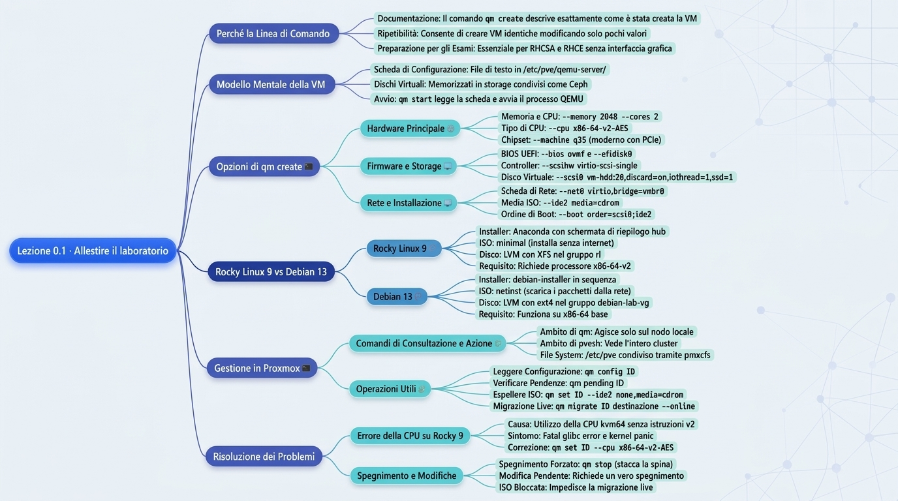
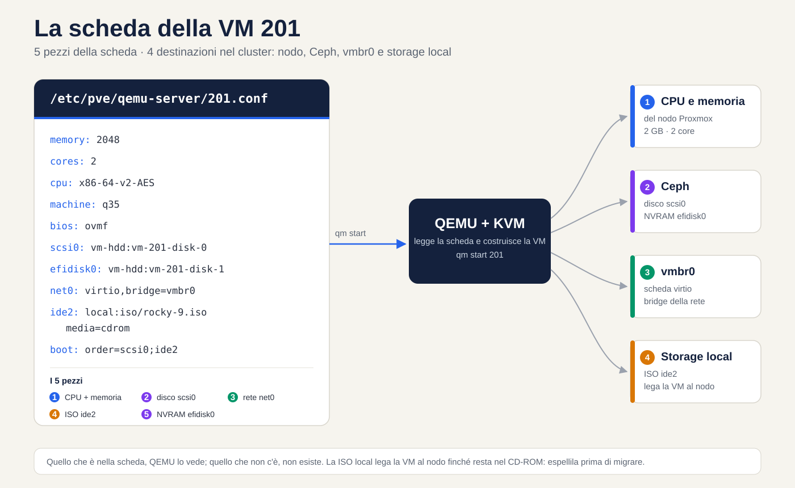
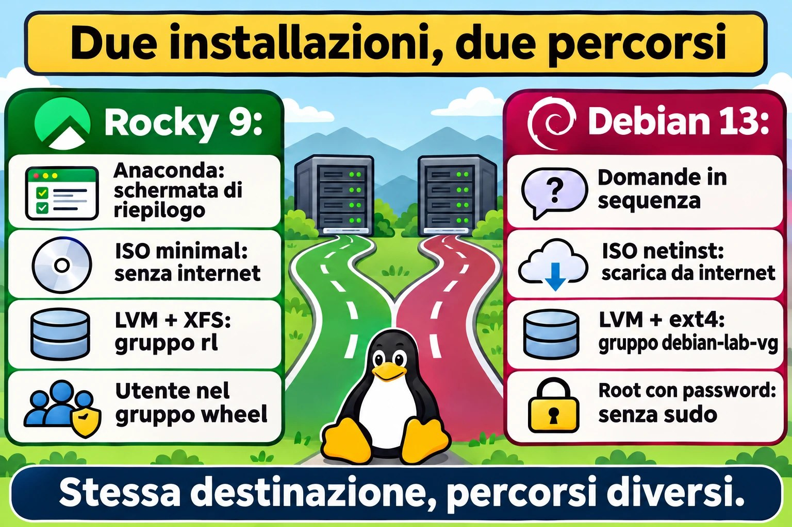
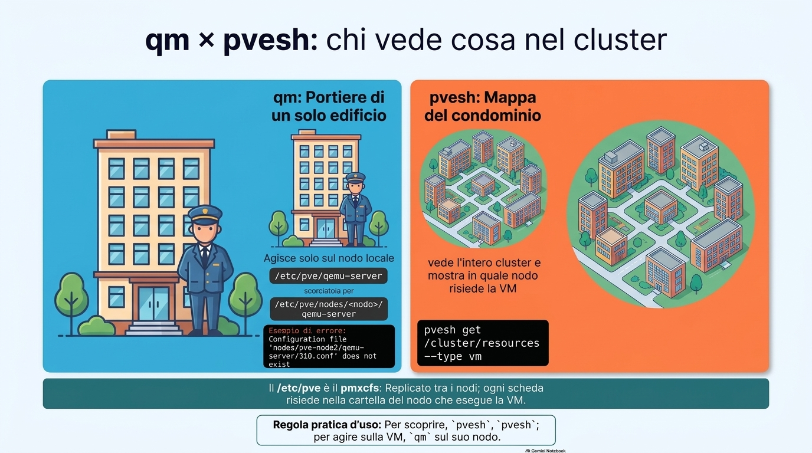
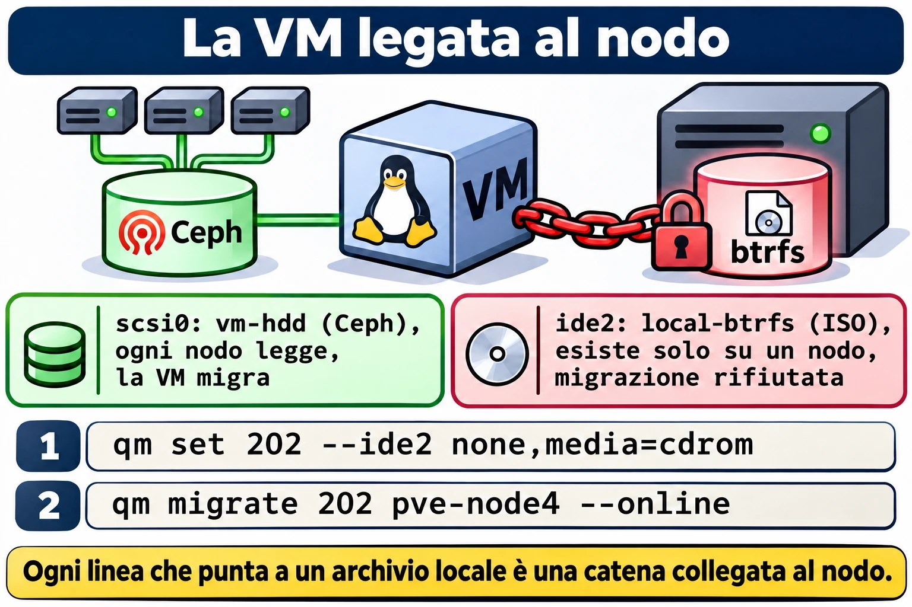
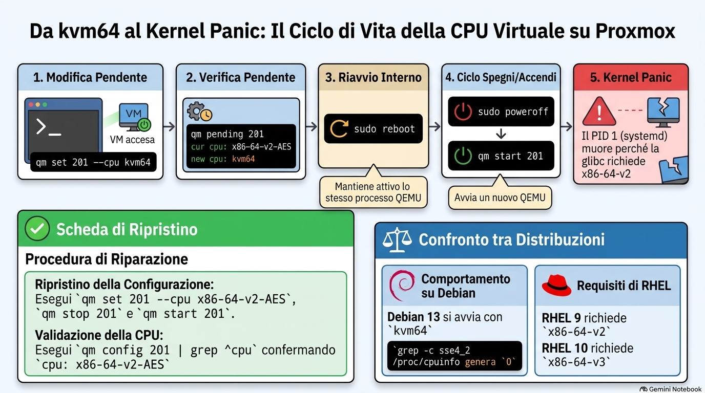

# Lezione 0.1 · Preparare il laboratorio

Crei le due VM del corso dalla riga di comando di Proxmox, installi Rocky Linux 9 e Debian 13 sapendo il perché di ogni schermata e chiudi con il primo snapshot, il punto di partenza di tutto il corso.

| Scheda | Lezione 0.1 |
| --- | --- |
| Modulo | M0 · Laboratorio, lezione 1 di 2 |
| Quando | Settimana 1 |
| Alla fine sei in grado di | Creare una VM con qm create spiegando ogni opzione; installare Rocky 9 e Debian 13 con disco, rete e utenti scelti di proposito; verificare un'installazione con cinque comandi |
| Prerequisiti | Shell di root su un nodo del cluster-labvol; le ISO nel local-btrfs di qualche nodo, oppure internet per scaricarle |
| Durata | Circa 2h30: 40 min di lettura, 1h20 di lab, 30 min di quiz e ripasso |
| Snapshot | Nessuno all'inizio, perché le VM ancora non esistono; alla fine, m0a1-fim su entrambe |

**Mappa della lezione.** Prima di cominciare, guarda tutto il percorso: i sei rami qui sotto sono le sei domande a cui risponde questa lezione. Ci torni alla fine, come ripasso.


*Mappa mentale generata in NotebookLM a partire da questa lezione e rivista comando per comando.*

## 1 · Riscaldamento

Rispondi a mente, prima di leggere il resto. Sbagliare qui fa parte del metodo: provare a rispondere prima di studiare costringe il cervello a cercare, e ciò che leggi dopo si fissa meglio, anche quando l'intuizione era sbagliata. Le risposte sono nelle Soluzioni, in fondo alla scheda.

1. Quando crei una VM con la procedura guidata grafica di Proxmox, lei prende varie decisioni al posto tuo. Citane cinque.
2. Perché la maggior parte dei server Linux non ha un'interfaccia grafica? Pensa a Windows Server Core.
3. In Windows esiste l'Administrator; in Linux, il root. Qual è la differenza più importante tra i due?

## 2 · Perché conta

Fino a Proxmox VE 7, la procedura guidata grafica creava le VM con il tipo di CPU `kvm64`, un processore virtuale generico, senza le istruzioni che le distribuzioni nuove richiedono. Proxmox 8 ha iniziato a proporre `x86-64-v2-AES`, ma chi eredita un template vecchio, o crea la VM con uno script che non dichiara la CPU, può ritrovarsi con `kvm64`. Rocky 9, come RHEL 9, richiede un processore di livello x86-64-v2. La VM semplicemente non parte, e la console mostra:

```text
Fatal glibc error: CPU does not support x86-64-v2
```

Chi ha cliccato senza sapere cosa fa ogni campo non ha da dove cominciare. Chi ha scelto ogni opzione sa dove guardare. Per questo, in questa lezione, crei le VM dalla riga di comando:

- **Il comando è la documentazione.** Una riga di `qm create` dice esattamente come è stata fatta la VM. Una sequenza di schermate non lascia traccia.
- **Il comando si ripete.** Nel modulo 13 crei la VM 203 cambiando tre valori, e viene identica.
- **Il lavoro si fa nel terminale.** Su un server remoto, in un'emergenza o in uno script, risolvi tutto con comandi e file di configurazione; non esiste una procedura guidata che scelga per te.

## 3 · Modello mentale

> **Una VM è una scheda di montaggio più i dischi.**

Pensa a un PC assemblato su ordinazione. Il negozio riceve una scheda: questa scheda madre, tanta memoria, questo disco, questa scheda di rete. In Proxmox, quella scheda è un file di testo di poche righe, `/etc/pve/qemu-server/201.conf`. A ogni `qm start`, Proxmox legge la scheda, costruisce il comando di QEMU (il programma che, insieme al KVM del kernel, fa girare la VM) e avvia il processo. I dischi sono un'altra cosa: volumi conservati in uno storage, qui Ceph, che la scheda cita solo per nome.

**Ponte Windows:** in Hyper-V è uguale. La VM è un file di configurazione `.vmcx` più i dischi `.vhdx`. Copiare solo il `.vhdx` non porta con sé la VM, e cancellare la VM in Hyper-V Manager lascia i dischi indietro. Attenzione al contrasto: in Proxmox, `qm destroy` cancella la scheda e i dischi insieme.


*Dalla scheda al processo QEMU: CPU e memoria arrivano dal nodo, i dischi vanno su Ceph, la rete entra nella `vmbr0` e la ISO sta nello storage locale.*

Leggi il disegno da sinistra a destra. I dischi vanno su Ceph, che tutti i nodi vedono. La ISO sta sul disco di un solo nodo e lega la VM a quel nodo finché è nel CD-ROM. La scheda di rete entra nel bridge `vmbr0`. Il resto diventa argomenti del comando di QEMU.

## 4 · Concetto a strati

### Essenziale

Ogni opzione di `qm create` che digiterai nel lab, e il motivo della scelta:

| Opzione di qm create | Cos'è | Perché scegliamo così |
| --- | --- | --- |
| `--memory 2048 --cores 2` | RAM in MB e core di CPU | Basta e avanza per un server senza interfaccia grafica |
| `--cpu x86-64-v2-AES` | Il processore che la VM vede | È il minimo di Rocky 9 e gira su qualsiasi nodo; l'AES accelera la crittografia |
| `--machine q35` | Il chipset virtuale | Moderno, con PCIe; l'i440fx imita un chipset del 1996 |
| `--bios ovmf` e `--efidisk0` | Firmware UEFI e il dischetto dove conserva le voci di boot | È lo standard dei server attuali; senza l'efidisk, la VM dimentica le voci di boot a ogni spegnimento |
| `--scsihw virtio-scsi-single` e `iothread=1` | Controller disco paravirtualizzato, uno per disco, con un thread di I/O dedicato | Le migliori prestazioni disco su Proxmox |
| `--net0 virtio,bridge=vmbr0` | Scheda di rete paravirtualizzata collegata al bridge | Veloce, e Linux ha già il driver |
| `--ide2 ...,media=cdrom` | Un CD-ROM con la ISO | Serve per installare; poi lo espelli |
| `--boot 'order=scsi0;ide2'` | L'ordine di boot | Prima il disco: se è vuoto fallisce e il boot passa al CD; dopo l'installazione vince il disco |
| `--ostype l26` | Avvisa che il guest è Linux con kernel 2.6 o più recente | Proxmox adatta alcuni valori predefiniti per Linux |
| `--agent enabled=1` | Apre il canale del QEMU Guest Agent | Il pacchetto, dentro la VM, arriva nella Lezione 0.2 |
| `--tags curso` | Un'etichetta nell'interfaccia | Per trovare le VM del corso a colpo d'occhio |

Due fatti del cluster evitano la maggior parte delle confusioni:

- **`/etc/pve` è condiviso.** È il pmxcfs, un file system che Proxmox replica tra i nodi. Il percorso `/etc/pve/qemu-server` è una scorciatoia per la cartella del nodo in cui ti trovi; su pve-node3, per esempio, punta a `/etc/pve/nodes/pve-node3/qemu-server`. Ogni scheda vive nella cartella del nodo che esegue la VM.
- **`qm` agisce solo sul nodo locale; `pvesh` vede l'intero cluster.** Su un nodo che non ospita la 201, `qm config 201` risponde che il file non esiste. Regola pratica: per scoprire, `pvesh`; per agire sulla VM, `qm` sul suo nodo.

### Approfondimento

**UEFI e l'efidisk.** L'UEFI conserva le voci di boot in una memoria chiamata NVRAM, e in una VM quella NVRAM è l'`efidisk0`. Senza, Proxmox accende la VM con una NVRAM temporanea, azzerata a ogni start, e il boot dipende dall'esistenza di un bootloader nel percorso di riserva `\EFI\BOOT\BOOTX64.EFI`. I parametri: `efitype=4m` è il formato attuale, da 4 MB; `pre-enrolled-keys=0` lascia il Secure Boot spento, il che semplifica il laboratorio; e l'`1` in `vm-hdd:1` è solo sintassi, perché Proxmox ignora la dimensione e ci copia dentro il modello della NVRAM.

**VirtIO.** I dispositivi virtio non imitano un hardware reale: sono interfacce pensate per le macchine virtuali, e per questo più veloci. Linux ha i driver nel kernel. Windows no, ed è per questo che, installando Windows in una VM, monti la ISO virtio-win e carichi il driver del disco.

**Tipi di CPU.** Tre che contano:

- `host` passa la CPU reale del nodo. Dà le massime prestazioni, ma la migrazione a caldo è sicura solo tra nodi con CPU identiche.
- `x86-64-v2-AES` garantisce un insieme minimo di istruzioni (SSE4.2, POPCNT e altre), più l'AES, e migra tra qualsiasi nodo moderno. È lo standard del corso.
- `kvm64` è il minimo del minimo, senza SSE4.2. Oggi serve solo a rompere le cose, come farai nella sezione 7.

Rocky 10 alza l'asticella a x86-64-v3, che include l'AVX2. Verifichi cosa vede la VM con `grep -c avx2 /proc/cpuinfo`: 0 significa che non c'è. Ci torneremo nel modulo 16, quando la VM 205 riceverà Rocky 10.

**Storage condiviso e locale.** `vm-hdd` è Ceph RBD: i blocchi del disco sono sparsi sui tre nodi, e qualsiasi nodo li legge. Per questo la migrazione a caldo copia solo la memoria. `local-btrfs` è il disco di un solo nodo. Una VM con qualsiasi cosa su `local-btrfs`, anche una ISO nel CD-ROM, resta legata a quel nodo finché non la sganci.

**sda, non vda.** Con il controller virtio-scsi, il disco appare come `/dev/sda`, come un disco SCSI. Con virtio-blk apparirebbe come `/dev/vda`. I tutorial in giro per internet mescolano i due; guarda il tuo `lsblk` prima di copiare un comando.

**Modifica in sospeso.** Alcune modifiche hardware, come il tipo di CPU, non si applicano a VM accesa. Proxmox conserva la modifica come in sospeso, e `qm pending 201` mostra cosa è in attesa. Un reboot dall'interno della VM non basta, perché il processo QEMU resta lo stesso. La modifica vale quando la VM si spegne davvero e Proxmox la riaccende.

## 5 · Rocky × Debian

Le due installazioni arrivano allo stesso punto, un Linux da server senza interfaccia grafica, per strade diverse. Nota le differenze adesso, perché ognuna tornerà più avanti:

|  | Rocky 9 | Debian 13 |
| --- | --- | --- |
| Installer | Anaconda: una schermata riepilogo (l'hub) in cui risolvi le voci in qualsiasi ordine | debian-installer: domande in sequenza, una per schermata |
| ISO usata | minimal: c'è tutto dentro, si installa senza internet | netinst: piccola, scarica i pacchetti da internet durante l'installazione |
| Disco | LVM con XFS, volume group `rl` | LVM con ext4, volume group `debian-lab-vg` |
| Amministratore | L'utente creato entra nel gruppo `wheel` e usa già sudo | Con la password di root impostata, sudo non viene nemmeno installato; lo risolvi nella Lezione 0.2 |
| Kernel | 5.14, con correzioni e funzionalità portate da versioni nuove (i backport della Lezione 1.1) | 6.12, una versione a supporto lungo |
| Firewall | firewalld attivo | Nessuno attivo |
| CPU minima | x86-64-v2 | x86-64 di base |



*Stessa destinazione, due strade: Anaconda mostra un riepilogo; l'installer di Debian chiede una cosa alla volta.*

## 6 · Lab guidato

> **Dove eseguire:** i comandi `qm`, `pvesm` e `pvesh` girano come root su un nodo del cluster, dalla Shell del nodo nell'interfaccia o via SSH. I comandi dentro le VM sono indicati nel testo.

**L'abitudine del corso.** Quando compare **Prevedi**, scrivi la tua risposta, anche a caso, prima di eseguire il comando. Poi confronta. La distanza tra il previsto e il reale è esattamente ciò che ancora non sapevi.

**E quando compare Decidi**, è un caso di lavoro con quattro vie d'uscita possibili. Scegli la lettera prima di guardare la tabella. Ogni alternativa ha il suo perché, quella giusta e quelle sbagliate: sbagliare qui, con la spiegazione accanto, è il modo più economico di sbagliare.

### Passo 1 · Trova le ISO

Le ISO stanno nel `local-btrfs`, che è separato per nodo. Da un solo nodo, scopri dove sta ciascuna:

```bash
for n in pve-node2 pve-node3 pve-node4; do
  echo "== $n"
  pvesh get /nodes/$n/storage/local-btrfs/content --content iso | grep -Ei 'rocky|debian'
done
```

**Prevedi:** in quanti nodi compare ogni ISO?

Annota il nodo di ciascuna: **ogni VM si crea sul nodo dove sta la sua ISO.**

Se la ISO non esiste in nessun nodo, scaricala dall'interfaccia: nel `local-btrfs` di un nodo, apri ISO Images → Download from URL, incolla il link, clicca su Query URL e poi su Download. I file sono nelle cartelle ufficiali qui sotto; apri la cartella nel browser e copia il link della ISO più recente.

- Rocky 9 minimal: https://download.rockylinux.org/pub/rocky/9/isos/x86\_64/ (il file CHECKSUM contiene gli hash)
- Debian 13 netinst: https://cdimage.debian.org/debian-cd/current/amd64/iso-cd/ (il file SHA256SUMS contiene gli hash)

Nello stesso dialogo, scegli SHA-256 in Hash algorithm e incolla l'hash della ISO: Proxmox verifica il download da solo.

### Passo 2 · Controlla gli ID

```bash
pvesh get /cluster/nextid --vmid 201
pvesh get /cluster/nextid --vmid 202
```

Output atteso: il numero stesso, `201` e poi `202`. Se compare `VM 201 already exists`, l'ID è in uso; scegline un altro e cambialo in tutti i comandi della lezione. Le VM da 100 a 103 e il container 108 non sono del corso: non toccarli.

### Passo 3 · Crea la VM 201

Sul nodo dove si trova la ISO di Rocky, salva il nome della ISO in una variabile:

```bash
ISO=$(pvesm list local-btrfs --content iso | awk '/Rocky-9.*minimal/ {print $1; exit}')
echo "$ISO"
```

Output atteso: qualcosa come `local-btrfs:iso/Rocky-9.6-x86_64-minimal.iso`. Una riga vuota significa che sei sul nodo sbagliato.

```bash
qm create 201 --name rocky-lab --memory 2048 --cores 2 --cpu x86-64-v2-AES \
  --machine q35 --bios ovmf --efidisk0 vm-hdd:1,efitype=4m,pre-enrolled-keys=0 \
  --scsihw virtio-scsi-single --scsi0 vm-hdd:20,discard=on,iothread=1,ssd=1 \
  --net0 virtio,bridge=vmbr0 --ide2 "$ISO",media=cdrom \
  --boot 'order=scsi0;ide2' --ostype l26 --agent enabled=1 --tags curso
```

Tre dettagli che la tabella della sezione 4 non copre:

- `discard=on` passa a Ceph l'avviso dei blocchi cancellati, e lo spazio torna al pool.
- `ssd=1` presenta il disco al sistema come SSD, cioè non rotativo.
- Le virgolette in `'order=scsi0;ide2'` impediscono a bash di trattare il `;` come fine del comando.

Output atteso: righe `transferred ... (100.00%)`. È Proxmox che copia il modello della NVRAM nell'efidisk.

### Passo 4 · Leggi la scheda

```bash
qm config 201
cat /etc/pve/qemu-server/201.conf
```

**Prevedi:** i due output sono uguali?

Oggi sì. La differenza compare in due casi: con una modifica in sospeso, `qm config` mostra già il valore nuovo, mentre il file conserva quello attuale e una sezione `[PENDING]`; con gli snapshot, il file guadagna una sezione per ogni snapshot. Adesso cerca tre righe che non hai digitato:

- `smbios1: uuid=...` è il numero di serie della scheda madre virtuale.
- `vmgenid: ...` avvisa il sistema della VM quando viene clonata o torna da uno snapshot.
- In `net0`, `virtio=BC:24:11:...` è il MAC che Proxmox ha estratto a sorte; il prefisso BC:24:11 è registrato a nome di Proxmox.

Per vedere la scheda trasformarsi in comando, esegui `qm showcmd 201 --pretty`: è il comando completo di QEMU che `qm start` eseguirebbe. Sono decine di righe; cerca `-cpu`, `-machine` e il `-drive` del disco.

**Decidi 1 · La VM che nessuno trova.** Scenario: in un cluster di un cliente, entri su pve-node2 ed esegui `qm config 310`. La risposta è `Configuration file 'nodes/pve-node2/qemu-server/310.conf' does not exist`, ma la VM 310 risulta accesa nell'interfaccia. Cosa fai?

- **A)** Ricrei la VM 310 su pve-node2, perché la scheda è stata cancellata.
- **B)** Esegui `pvesh get /cluster/resources --type vm`, trovi il nodo della 310 ed esegui `qm` su quel nodo.
- **C)** Copi la scheda della 310 da un altro nodo in `/etc/pve/qemu-server/` di pve-node2.
- **D)** Riavvii pve-node2 per far sincronizzare il cluster.

Scegli la lettera prima di guardare la tabella.

| Se hai scelto | Risultato | Perché |
| --- | --- | --- |
| A | ❌ Sbagliato | La scheda esiste, ma su un altro nodo. E l'ID è unico nel cluster: Proxmox rifiuterebbe di crearne un'altra 310. |
| B | ✅ Giusto | `qm` vede solo il nodo in cui ti trovi, perché `/etc/pve/qemu-server` è una scorciatoia per la cartella di quel nodo. `pvesh` interroga l'intero cluster e mostra dove vive la VM. |
| C | ❌ Sbagliato | Avresti una scheda della stessa VM su due nodi. Spostare a mano una scheda tra nodi è una procedura di emergenza, per salvare le VM di un nodo morto, e mai con la VM accesa. |
| D | ❌ Sbagliato | Non c'è nulla fuori sincronia. Riavviare il nodo butta giù tutte le sue VM per qualcosa che un comando risolve. |

**Da ricordare:** `qm` è il portiere di un solo palazzo. `pvesh get /cluster/resources` è la mappa del condominio.



*Per scoprire dove vive la VM, pvesh; per agire su di essa, qm sul suo nodo.*

### Passo 5 · Crea la VM 202

Sul nodo dove si trova la ISO di Debian, che può essere un altro:

```bash
ISO=$(pvesm list local-btrfs --content iso | awk '/debian-13.*netinst/ {print $1; exit}')
echo "$ISO"
qm create 202 --name debian-lab --memory 2048 --cores 2 --cpu x86-64-v2-AES \
  --machine q35 --bios ovmf --efidisk0 vm-hdd:1,efitype=4m,pre-enrolled-keys=0 \
  --scsihw virtio-scsi-single --scsi0 vm-hdd:20,discard=on,iothread=1,ssd=1 \
  --net0 virtio,bridge=vmbr0 --ide2 "$ISO",media=cdrom \
  --boot 'order=scsi0;ide2' --ostype l26 --agent enabled=1 --tags curso
```

Sono cambiati solo l'ID, il nome e la ISO. È questo che significa "il comando si ripete".

### Passo 6 · Accendi la 201 e apri la console

```bash
qm start 201
```

Nell'interfaccia, apri la VM 201 → Console. Compare il menu della ISO di Rocky.

### Passo 7 · Installa Rocky 9

1. Nel menu, la voce selezionata è quella che testa il supporto prima di installare. Sali con la freccia su **Install Rocky Linux 9** e premi Invio.
2. Lingua: English (United States). I messaggi in inglese sono quelli che troverai nei forum, nei log e nella documentazione.
3. Keyboard: aggiungi il layout della tua tastiera, per esempio Italian, e mettilo per primo. Time & Date: Europe/Rome, con Network Time attivo.
4. Software Selection: **Minimal Install**, senza extra.
5. Installation Destination: verifica che il disco da 20 GiB sia selezionato, lascia Automatic e clicca su Done.
6. KDUMP: disattivalo. Riserva memoria per catturare i blocchi del kernel, cosa che non conviene in una VM di laboratorio da 2 GB.
7. Network & Host Name: attiva l'Ethernet (mostra l'IP ricevuto dal DHCP), scrivi `rocky-lab` in Host Name e clicca su Apply.
8. Root Password: imposta una password e lascia il root abilitato, con **Lock root account** deselezionato. Lascia deselezionato anche **Allow root SSH login with password**.
9. User Creation: utente `rodrigo` (cambialo se usi un altro nome), con **Make this user administrator** selezionato. Questo mette l'utente nel gruppo `wheel`.
10. Begin Installation. Alla fine, Reboot System.

### Passo 8 · Installa Debian 13

Sul nodo della 202:

```bash
qm start 202
```

1. Nel menu, scegli **Install**, l'installer in modalità testo, più leggero nella console.
2. Language: English. Location: other → Europe → Italy. Locale: `en_US.UTF-8`. Keyboard: la tua.
3. Hostname: `debian-lab`. Domain name: vuoto.
4. Root password: imposta una password. È per colpa sua che Debian non installa sudo, e la Lezione 0.2 lo sfrutta di proposito.
5. Utente: login `rodrigo` (cambialo se usi un altro nome), con password.
6. Partitioning: Guided - use entire disk and set up LVM → il disco da 20 GB → All files in one partition. Conferma le scritture con Yes e accetta la dimensione massima del volume group.
7. Package manager: Scan extra installation media, No; paese Italy, mirror `deb.debian.org`, proxy vuoto. Popularity contest: No.
8. Software selection: deseleziona **Debian desktop environment** e **GNOME**, che sono selezionati di default; seleziona **SSH server** e mantieni **standard system utilities**. La barra spaziatrice seleziona e deseleziona.
9. Continua fino alla fine. GRUB va nella partizione EFI e la VM si riavvia da sola.

### Passo 9 · Espelli le ISO

**Prevedi:** bisogna spegnere la VM per togliere il CD?

Sul nodo di ciascuna VM:

```bash
qm set 201 --ide2 none,media=cdrom
qm set 202 --ide2 none,media=cdrom
```

Non serve: cambiare il disco del CD-ROM funziona a VM accesa, come aprire il cassetto.

Bonus, se Ceph è in salute: migra la 202 a caldo su un altro nodo. Eseguilo sul nodo dove si trova e sostituisci `pve-node4` con il nodo di destinazione:

```bash
qm migrate 202 pve-node4 --online
```

Con la ISO ancora nel CD, Proxmox rifiuterebbe la migrazione: il CD puntava a un file che esiste solo su un nodo.

**Decidi 2 · La migrazione rifiutata.** Scenario: un venerdì pomeriggio, devi svuotare un nodo di un cliente per sostituire un disco. La migrazione a caldo di una VM fallisce con un messaggio che parla del CD-ROM e di uno storage locale. Cosa fai?

- **A)** Spegni la VM e migri da spenta, perché la migrazione a caldo è instabile.
- **B)** Leggi la scheda con `qm config`, trovi la ISO nella riga `ide2`, la espelli con `qm set` e migri di nuovo.
- **C)** Copi la ISO nello storage locale del nodo di destinazione e riprovi.
- **D)** Cancelli la ISO dallo storage locale, così il CD resta vuoto.

Scegli la lettera prima di guardare la tabella.

| Se hai scelto | Risultato | Perché |
| --- | --- | --- |
| A | ❌ Sbagliato | Con il disco su Ceph, migrare a caldo è routine. Il problema è un riferimento a uno storage locale, e spegnere la VM interrompe il servizio del cliente senza rimuovere la causa. |
| B | ✅ Giusto | Tutto ciò che la scheda punta a uno storage locale lega la VM al nodo. Espellere il CD è una riga e funziona a VM accesa, come hai visto in questo passo. |
| C | ❌ Sbagliato | Proxmox non verifica se il file esiste dall'altra parte: rifiuta perché lo storage è locale. Ottieni solo una copia della ISO che occupa spazio. |
| D | ❌ Sbagliato | La scheda continua a puntare al file, e a decidere è la scheda. Inoltre perdi la ISO che ti serviva per la prossima installazione. |

**Da ricordare:** prima di migrare, leggi la scheda. Ogni riga che punta a uno storage locale è una catena che ti lega al nodo.



*Il disco su Ceph migra su qualsiasi nodo; il CD con la ISO su storage locale lega la VM finché non viene espulso.*

### Passo 10 · Verifica l'installazione con cinque comandi

Entra nella console di ciascuna VM con il tuo utente ed esegui:

```bash
cat /etc/os-release
uname -r
lsblk
ip -br a
systemctl is-system-running
```

| Comando | rocky-lab | debian-lab |
| --- | --- | --- |
| `cat /etc/os-release` | `NAME="Rocky Linux"` e `VERSION_ID="9.x"` | `NAME="Debian GNU/Linux"` e `VERSION_ID="13"` |
| `uname -r` | `5.14.0-...el9_x.x86_64` | `6.12.x+deb13-amd64` |
| `lsblk` | `sda1` in `/boot/efi`, `sda2` in `/boot`, `rl-root` in `/`, `rl-swap` in `[SWAP]` | `sda1` in `/boot/efi`, `sda2` in `/boot`, `debian--lab--vg-root` in `/`, `debian--lab--vg-swap_1` in `[SWAP]` |
| `ip -br a` | `lo` e una scheda, probabilmente `enp6s18`, UP con un IP 10.1.0.x | Lo stesso |
| `systemctl is-system-running` | `running` | `running` |

Se compare `degraded`, `systemctl --failed` mostra cosa è fallito; annotalo e vai avanti. I trattini doppi nell'lsblk di Debian non sono un errore: il device mapper raddoppia i trattini nel nome del volume group.

Bonus: `lsblk -d -o NAME,ROTA` mostra ROTA 0 su `sda`. È `ssd=1` in azione.

Annota l'IP di ciascuna VM, perché la Lezione 0.2 parte da lì. Non aggiornare ancora i sistemi: lo snapshot di fine lezione deve conservare l'installazione pulita.

## 7 · Rompi e ripara

Ora provochi, di proposito, l'errore della sezione 2. La VM 201 non ha ancora uno snapshot, ma il danno è una riga della scheda: ripararlo significa rimettere la riga com'era.

**Rompi.** Sul nodo della 201, con la VM accesa:

```bash
qm set 201 --cpu kvm64
qm pending 201
```

Output atteso: in mezzo all'elenco, `cur cpu: x86-64-v2-AES` e subito sotto `new cpu: kvm64`. Il cambio è rimasto in sospeso perché la VM è accesa.

**Prevedi:** se riavvii la VM dall'interno, torna rotta?

Nella console della 201:

```bash
sudo reboot
```

Torna normale. Il reboot riavvia il sistema della VM, ma il processo QEMU sul nodo resta lo stesso, con la CPU vecchia. La scheda nuova vale solo quando il processo rinasce. Quindi spegni davvero, sempre dalla console:

```bash
sudo poweroff
```

E riaccendi da Proxmox, sul nodo:

```bash
qm start 201
```

Nella console compare:

```text
Fatal glibc error: CPU does not support x86-64-v2
Kernel panic - not syncing: Attempted to kill init!
```

Leggi dall'alto in basso, come una storia. Il kernel è partito, perché non dipende dalle istruzioni v2. Il primo programma che esegue, systemd (il PID 1, ancora dentro l'initramfs), usa la glibc di Rocky 9, che si rifiuta di funzionare senza il livello v2. Il PID 1 è morto, e senza di lui il kernel non ha più nulla da fare: panico.

**Decidi 3 · Il panico dopo la manutenzione.** Scenario: dopo una manutenzione sul cluster di un cliente, una VM con Rocky 9 non parte più. La console mostra `Fatal glibc error: CPU does not support x86-64-v2` e, subito dopo, `Kernel panic`. Una VM Debian sullo stesso nodo parte normalmente. Cosa fai per prima cosa?

- **A)** Reinstalli Rocky, perché la glibc si è corrotta.
- **B)** Esegui `qm config` della VM e controlli la riga `cpu`.
- **C)** Migri la VM su un nodo più recente, perché il processore di questo è troppo vecchio.
- **D)** Ripristini il backup della notte precedente.

Scegli la lettera prima di guardare la tabella.

| Se hai scelto | Risultato | Perché |
| --- | --- | --- |
| A | ❌ Sbagliato | La glibc è integra: sta rifiutando il processore che ha ricevuto. Reinstallare sullo stesso processore virtuale dà lo stesso errore, già nell'installer. |
| B | ✅ Giusto | Il messaggio dice cosa manca, e a decidere il processore che la VM vede è la riga `cpu` della scheda. Qualcuno ha cambiato il tipo, oppure la VM è rimasta senza la riga ed è ricaduta su `kvm64`. Un `qm set` risolve. |
| C | ❌ Sbagliato | Qualsiasi processore da server degli ultimi quindici anni ha il livello v2. Quello che è cambiato è il processore virtuale, e lui si sposta con la scheda su qualsiasi nodo. |
| D | ❌ Sbagliato | Può anche funzionare, perché il backup porta con sé la scheda vecchia. Ma butti via un giorno di dati per una riga, e non scopri cosa è cambiato. |

**Da ricordare:** l'errore dice cosa manca. La scheda dice cosa è stato consegnato.

**Ripara.** Sul nodo:

```bash
qm set 201 --cpu x86-64-v2-AES
qm stop 201
qm start 201
```

Perché `qm stop` e non `qm shutdown`? Un kernel in panico non risponde alla richiesta di spegnimento. `qm stop` spegne la VM come se staccassi la spina, cosa che qui non fa alcun male: il sistema era già morto.

**Decidi 4 · Chiedere o staccare la spina.** Scenario: una VM di un cliente è in kernel panic, come la tua 201 poco fa, e devi spegnerla per correggere la scheda. Quale comando?

- **A)** `qm shutdown`, e aspettare.
- **B)** `qm stop`.
- **C)** `qm reboot`.
- **D)** `qm destroy`.

Scegli la lettera prima di guardare la tabella.

| Se hai scelto | Risultato | Perché |
| --- | --- | --- |
| A | ❌ Sbagliato | `shutdown` chiede al sistema della VM di spegnersi. Un kernel in panico non ascolta nessuno: il comando aspetta fino al timeout e fallisce. |
| B | ✅ Giusto | `stop` uccide il processo QEMU sul nodo, come staccare la spina. Con il sistema già morto, non c'è nulla da perdere. Su una VM sana, chiedi prima con `shutdown`: `stop` interrompe ciò che stava venendo scritto. |
| C | ❌ Sbagliato | `qm reboot` è uno `shutdown` seguito da uno `start`. Si blocca nello stesso punto dell'alternativa A. |
| D | ❌ Sbagliato | `destroy` cancella la VM: la scheda e i dischi. Non esiste cestino. Ricordati questo nome come l'`rm -rf` di Proxmox. |

**Da ricordare:** `shutdown` è chiedere, `stop` è staccare la spina. Chiedi prima, a meno che nessuno stia ascoltando.

**Verifica.**

```bash
qm config 201 | grep ^cpu
```

Output atteso: `cpu: x86-64-v2-AES`. La console torna a mostrare il login.

**Bonus su Debian.** Debian 13 richiede solo l'x86-64 di base. Ripeti la rottura sulla 202:

```bash
qm set 202 --cpu kvm64
```

Spegni dall'interno (nella console, entra come root ed esegui `poweroff`) e riaccendi con `qm start 202`. La VM parte normalmente. Al suo interno:

```bash
grep -c sse4_2 /proc/cpuinfo
```

Output atteso: `0`. La CPU virtuale non ha SSE4.2, e a Debian non importa. Torna allo standard del corso con `qm set 202 --cpu x86-64-v2-AES`, spegni di nuovo dall'interno e riaccendi con `qm start 202`: lo stesso `grep` mostra `2`, una riga per vCPU.

La lezione: lo stesso hardware virtuale serve a un sistema e ne abbatte un altro. A decidere è ciò che ogni sistema richiede, ed è scritto nella sua documentazione: RHEL 9 richiede x86-64-v2; RHEL 10, x86-64-v3.


*Il reboot dall'interno non applica la CPU nuova; solo un nuovo processo QEMU la applica.*

## 8 · Trappole

| Sintomo | Causa | Soluzione |
| --- | --- | --- |
| `echo "$ISO"` mostra una riga vuota | Sei su un nodo che non ha la ISO | Esegui il ciclo del passo 1 e vai sul nodo giusto |
| `qm config 201` risponde `Configuration file 'nodes/pve-node3/qemu-server/201.conf' does not exist` | La VM vive su un altro nodo | `pvesh get /cluster/resources --type vm` mostra il nodo di ogni VM |
| `qm shutdown` o `qm reboot` resta in attesa e finisce in timeout | L'agent è attivo nella scheda, ma il pacchetto entra nella VM solo nella Lezione 0.2 | Fino ad allora, spegni dall'interno (`sudo poweroff` su Rocky; `poweroff` come root su Debian) e riaccendi con `qm start` |
| Hai riavviato dall'interno e la modifica non è comparsa | Modifica in sospeso: il processo QEMU è lo stesso | `qm pending` la mostra; spegni davvero e riaccendi da Proxmox |
| L'IP è cambiato dopo un `qm set --net0` | Hai riscritto la scheda senza indicare il MAC; Proxmox ne ha estratto un altro, e il DHCP ha dato un altro IP | Ripeti il vecchio MAC, che trovi in `qm config`: `virtio=BC:24:11:...,bridge=vmbr0` |
| La migrazione a caldo viene rifiutata | La ISO è ancora nel CD-ROM, su uno storage locale | `qm set` con `--ide2 none,media=cdrom` e riprova |
| L'installer di Rocky è rimasto minuti su Checking | La voce predefinita del menu testa il supporto prima di installare | Esc interrompe il test; la prossima volta, scegli Install nel menu |
| Root bloccato su Rocky | Lock root account è rimasto selezionato | Oggi non cambia nulla, ma il giorno in cui il boot finirà in modalità di emergenza leggerai `Cannot open access to console, the root account is locked.` e resterai senza shell. Impostalo subito: `sudo passwd root` |
| `sudo: command not found` su Debian | Con la password di root, l'installer non installa sudo | È voluto; la Lezione 0.2 lo risolve |
| Debian ha aperto una schermata grafica | GNOME era rimasto selezionato in Software selection | Reinstalla con le voci deselezionate; 2 GB di RAM non reggono bene un desktop |
| Tasti scambiati nella console | Il layout scelto nell'installer è diverso dalla tua tastiera | Correggi il layout; fino all'SSH della Lezione 0.2, preferisci password con sole lettere e numeri |
| `Fatal glibc error: CPU does not support x86-64-v2` | Tipo di CPU senza il livello v2, come `kvm64` | `qm set 201 --cpu x86-64-v2-AES`, `qm stop 201`, `qm start 201` |

## 9 · Quiz

Rispondi a tutto prima di aprire le Soluzioni. Le domande mescolano ciò che hai letto con ciò che hai visto nel lab.

1. Dove sta la scheda della VM 201, e perché qualsiasi nodo del cluster riesce a leggerla?
2. Hai eseguito `qm config 201` e hai ricevuto "Configuration file ... does not exist", ma la VM compare nell'interfaccia. Cos'è successo, e quale comando mostra dov'è?
3. Con la CPU `kvm64`, Rocky 9 non parte e Debian 13 parte. Perché?
4. A cosa serve l'`efidisk0`, e cosa succede a una VM UEFI senza?
5. La migrazione a caldo della 202 è stata rifiutata subito dopo l'installazione. Qual è la causa più probabile, e come si risolve?
6. Un tutorial dice di formattare `/dev/vda1`, ma nella tua VM il disco è `/dev/sda`. Da dove viene la differenza?
7. Hai cambiato la CPU della 201 con la VM accesa, hai riavviato dall'interno e non è cambiato nulla. Spiega, e di' come applicare il cambio.
8. Su Debian, `sudo` risponde "command not found". È un difetto o la conseguenza di una tua scelta? Quale scelta?
9. In inglese, come nei forum e nella documentazione: Which statement best describes a virtual machine?
   - A. A program that translates Windows commands into Linux commands
   - B. A software-defined computer that runs its own operating system on top of a hypervisor
   - C. A process that shares the host kernel with other processes
   - D. A backup copy of a physical server

## 10 · Flashcard e promemoria

Le schede qui sotto escono anche nel DeepTutor con `!cartoes 0.1`. Leggi il fronte, rispondi a voce alta e solo dopo leggi il retro.

| Fronte | Retro |
| --- | --- |
| Dove sta la scheda della VM 201? | `/etc/pve/qemu-server/201.conf`, nel pmxcfs, replicato tra i nodi |
| Come trovare il nodo di una VM? | `pvesh get /cluster/resources --type vm`; `qm` vede solo il nodo locale |
| Cosa conserva l'efidisk0? | La NVRAM dell'UEFI: le voci e l'ordine di boot |
| Perché q35 e non i440fx? | Il q35 è un chipset moderno, con PCIe; l'i440fx ne imita uno del 1996 |
| CPU minima di Rocky 9? E di Rocky 10? | x86-64-v2; x86-64-v3 |
| Errore di Rocky 9 su una CPU troppo debole | `Fatal glibc error: CPU does not support x86-64-v2` |
| Perché il disco appare come sda? | Controller virtio-scsi; con virtio-blk sarebbe vda |
| Come applicare una modifica in sospeso? | Spegnere davvero e riaccendere da Proxmox; il reboot dall'interno non basta |
| Come espellere la ISO a VM accesa? | `qm set 201 --ide2 none,media=cdrom` |
| Perché espellere la ISO prima di migrare? | Sta in uno storage locale e lega la VM al nodo |
| Prefisso MAC di Proxmox | BC:24:11 |
| Debian con password di root: e sudo? | Non viene installato |

**Da sapere a memoria.** I comandi che userai ogni settimana. Scrivili a memoria finché non escono senza pensarci:

```bash
pvesh get /cluster/resources --type vm
qm config 201
qm pending 201
qm start 201
qm stop 201
qm set 201 --ide2 none,media=cdrom
qm listsnapshot 201
qm rollback 201 m0a1-fim
```

**Da consultare.** Il resto, da tenere a portata di mano. Nessuno impara a memoria l'intera riga di `qm create`: copiala dalla lezione o leggila in `man qm`.

```bash
# scoprire (qualsiasi nodo)
pvesm list local-btrfs --content iso      # ISO di questo nodo
pvesh get /cluster/nextid --vmid 201      # l'ID è libero?
pvesh get /cluster/resources --type vm    # su che nodo sta ogni VM

# leggere (sul nodo della VM)
qm config 201                             # la scheda, con le modifiche in sospeso applicate
qm pending 201                            # cosa aspetta spegnimento e riaccensione
qm showcmd 201 --pretty                   # la scheda trasformata in comando di QEMU

# agire (sul nodo della VM)
qm start 201
qm stop 201                               # stacca la spina
qm set 201 --ide2 none,media=cdrom        # espelle la ISO
qm migrate 202 pve-node4 --online         # sostituisci con il nodo di destinazione
# shutdown e reboot da Proxmox solo dopo l'agent, Lezione 0.2

# snapshot
qm snapshot 201 m0a1-fim --description "Aula 0.1: Rocky 9 recém-instalado"
qm listsnapshot 201
qm rollback 201 m0a1-fim                  # la VM torna spenta: poi, qm start 201
```

## 11 · Checklist di uscita

- [ ] Le VM 201 e 202 esistono, con il tag curso, e so su che nodo sta ciascuna
- [ ] So spiegare ogni opzione di `qm create` senza guardare la tabella
- [ ] Ho letto la scheda e riconosciuto `smbios1`, `vmgenid` e il MAC BC:24:11
- [ ] Rocky 9 e Debian 13 installati, con hostname, utente e password di root impostati
- [ ] Le due ISO sono state espulse
- [ ] I cinque comandi di verifica hanno dato il risultato atteso su entrambe le VM, e ho annotato gli IP
- [ ] Ho rotto la 201 con `kvm64`, ho letto l'errore e l'ho riparata
- [ ] Ho risposto al quiz prima di aprire le Soluzioni

**Snapshot di fine.** Lo snapshot congela il disco e la scheda di questo momento: ciò che andrà storto nelle prossime lezioni torna qui in pochi secondi. Spegni le due VM dall'interno (`sudo poweroff` su Rocky; `poweroff` come root su Debian) e, sul nodo di ciascuna:

```bash
qm snapshot 201 m0a1-fim --description "Aula 0.1: Rocky 9 recém-instalado"
qm listsnapshot 201
```

```bash
qm snapshot 202 m0a1-fim --description "Aula 0.1: Debian 13 recém-instalado"
qm listsnapshot 202
```

Output atteso: `m0a1-fim` con la data e la descrizione e, sotto, `current` con `You are here!`, lo stato attuale. Le VM restano spente fino alla Lezione 0.2, che parte con un altro snapshot.

## 12 · Nella vita reale

Un comando digitato una volta, senza un problema vero alle spalle, sparisce in un giorno. Questa sezione esiste perché non succeda: una missione nel tuo lavoro e una sfida per domani, senza guardare la lezione.

**Missione di lavoro (entro domani, sola lettura).** In un cluster Proxmox reale che amministri, entra come root su un nodo ed esegui due comandi che si limitano a leggere:

```bash
pvesh get /cluster/resources --type vm
grep -H -E '^(ide2|cpu):' /etc/pve/nodes/*/qemu-server/*.conf
```

Il primo mostra ogni VM e il nodo dove vive. Il secondo legge in una volta le schede di tutte le VM del cluster e mostra due righe per ciascuna: il CD-ROM e il tipo di CPU. Come leggere:

- `ide2: none,media=cdrom` è un CD vuoto. `ide2: local:iso/...` è una ISO collegata, e quella VM non migra a caldo.
- `cpu: kvm64`, o nessuna riga `cpu:` per quella VM, significa il vecchio processore virtuale generico. Se qualcuno aggiorna il suo sistema a un RHEL 9 o derivato, non parte.
- Una VM della prima lista che non compare nella seconda non ha CD in `ide2` né riga `cpu:`: gira anche lei con `kvm64`.
- Le VM con snapshot compaiono con righe ripetute, perché ogni snapshot conserva una copia della scheda. Vale la prima riga di ogni file.

Annota nel tuo diario da admin quante VM hanno una ISO collegata, quali hanno `kvm64` e se qualcuna stava su un nodo diverso da quello che immaginavi. Non correggere nulla adesso. Porta l'elenco al responsabile e pianifica ogni cambio per una finestra di manutenzione, con la VM spenta e uno snapshot prima.

**Domani, senza guardare.** Riserva da 10 a 15 minuti sul nodo del corso. Senza aprire questa lezione, solo con `man qm`:

1. Mostra su che nodo sta ogni VM del cluster.
2. Senza accendere la 201, scopri il tipo di CPU, il controller disco e il suo MAC.
3. Scrivi, senza eseguirlo, il comando che espelle la ISO della 202.
4. Elenca gli snapshot della 201 e di' in che stato resta dopo un rollback.

Suggerimento: dentro `man qm`, cerca con `/cdrom` e `/rollback`, e premi `n` per l'occorrenza successiva. La Lezione 1.2 insegna il manuale a fondo; qui basta la ricerca.

## 13 · Con il DeepTutor

Apri il DeepTutor e di' che hai finito la Lezione 0.1. Parte con tre domande di ripasso; poi usa:

- `!quiz 0.1` per domande nuove sulla lezione, una alla volta, con correzione.
- `!explica efidisk0` se la NVRAM è ancora nebulosa.
- `!feynman tipos de CPU no Proxmox` per spiegare con parole tue; ti dà un voto da 0 a 10 e indica le lacune.
- `!cartoes 0.1` per le flashcard in modalità ripasso.
- `!erro` per incollare un errore del tuo lab; ti aiuta a leggere il messaggio prima di cercare la soluzione.
- `!revisao 0.1` a D+1, D+3, D+7 e D+21. Segna subito le quattro date in agenda.

## Soluzioni

**Riscaldamento**

1. Cinque qualsiasi tra queste: il tipo di CPU, il chipset, il firmware (BIOS o UEFI), il controller disco, lo storage e la dimensione del disco, il modello della scheda di rete e il bridge, l'ordine di boot, il tipo di sistema operativo. Ognuna è diventata un'opzione di `qm create` nella sezione 4.
2. L'interfaccia grafica consuma memoria e CPU, allunga l'elenco dei pacchetti da aggiornare e apre più porte agli attacchi, e un server si amministra da lontano, via SSH. È la stessa logica di Windows Server Core.
3. Il root, l'utente con UID 0, scavalca i normali permessi dei file: il kernel non fa nemmeno il controllo. Solo livelli aggiuntivi, come SELinux, lo contengono. In Windows, l'Administrator può essere bloccato da una ACL (e deve prendere possesso del file per passare) e lavora con un token filtrato dall'UAC finché non chiede l'elevazione.

**Quiz**

1. In `/etc/pve/qemu-server/201.conf`, scorciatoia per la cartella del nodo che esegue la VM, come `/etc/pve/nodes/pve-node3/qemu-server`. `/etc/pve` è il pmxcfs, che Proxmox replica tra i nodi.
2. La VM vive su un altro nodo, e `qm` vede solo il nodo locale. `pvesh get /cluster/resources --type vm` mostra il nodo di ogni VM.
3. La glibc di Rocky 9 è stata compilata per il livello x86-64-v2 e si rifiuta di funzionare senza; il PID 1 muore e il kernel va in panico. Debian 13 gira sull'x86-64 di base.
4. Conserva la NVRAM dell'UEFI, con le voci e l'ordine di boot. Senza, Proxmox usa una NVRAM temporanea, azzerata a ogni start, e il boot dipende dalla presenza di un bootloader in `\EFI\BOOT\BOOTX64.EFI`.
5. La ISO era ancora nel CD-ROM, su uno storage locale che esiste solo su quel nodo. Espelli con `qm set 202 --ide2 none,media=cdrom` e migra di nuovo.
6. Dal controller: con virtio-scsi il disco è `sda`; con virtio-blk, `vda`. Controlla con `lsblk` prima di copiare i comandi.
7. Il cambio di CPU è rimasto in sospeso perché la VM era accesa, e il reboot dall'interno non ricrea il processo QEMU. Applicalo spegnendo davvero e riaccendendo da Proxmox; `qm pending` mostra cosa è in attesa.
8. Conseguenza: con la password di root impostata, l'installer di Debian non installa sudo. Con la password vuota, il root resterebbe bloccato e il tuo utente otterrebbe sudo.
9. B. A non descrive la virtualizzazione; C descrive un container, che condivide il kernel dell'host; D è un backup.

**Domani, senza guardare**

1. `pvesh get /cluster/resources --type vm`. `qm list` mostrerebbe solo le VM del nodo in cui ti trovi.
2. `qm config 201`, sul suo nodo. La CPU è nella riga `cpu`, il controller in `scsihw` e il MAC in `net0`, dopo `virtio=`.
3. `qm set 202 --ide2 none,media=cdrom`, sul nodo della 202.
4. `qm listsnapshot 201`. Dopo un `qm rollback`, la VM resta spenta: accendila con `qm start 201`.

---

<!-- navegacao -->
[← Piano del corso](../00-plano-do-curso.md) · [Indice delle lezioni](../01-aulas.md) · [Lezione 0.2 · Accesso e protezione →](0.2-acesso-e-protecao.md)
