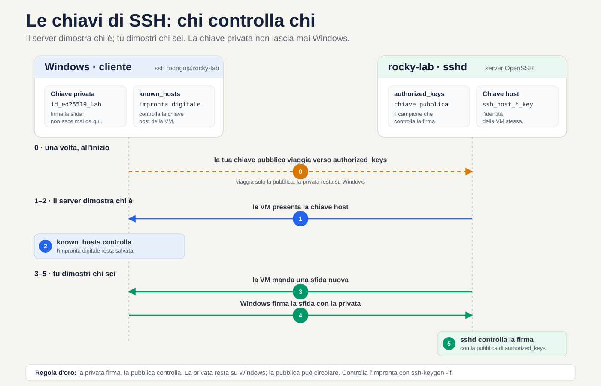
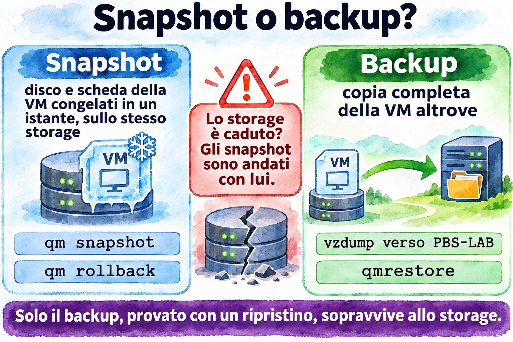
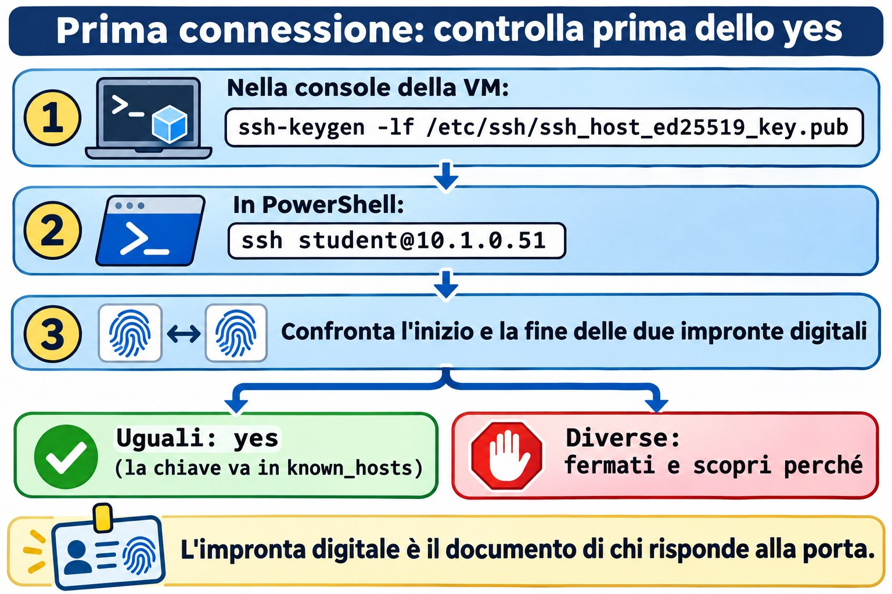
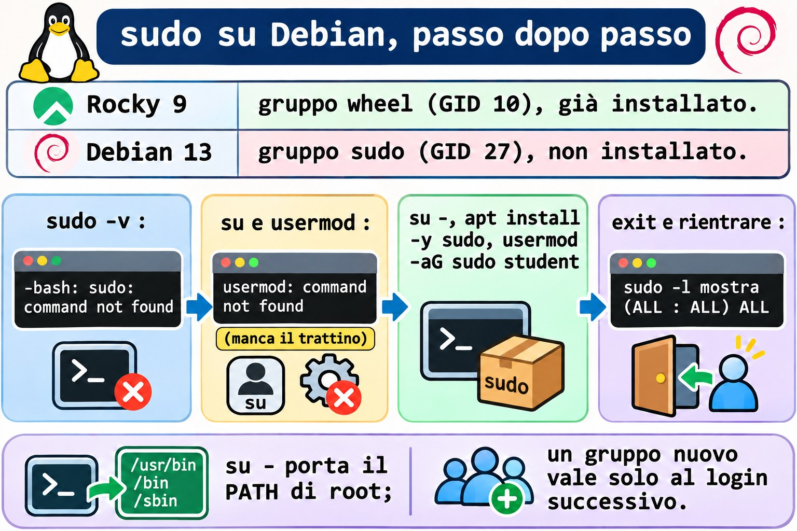
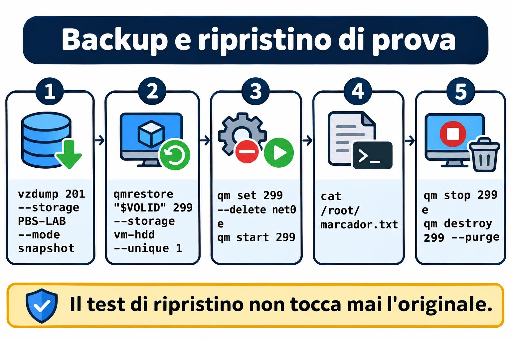
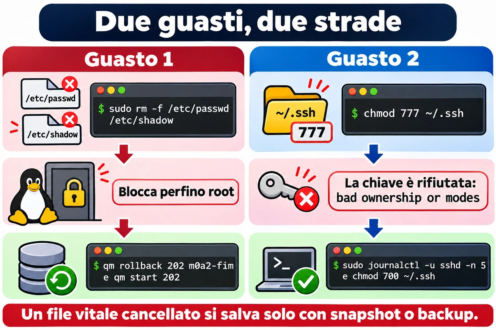
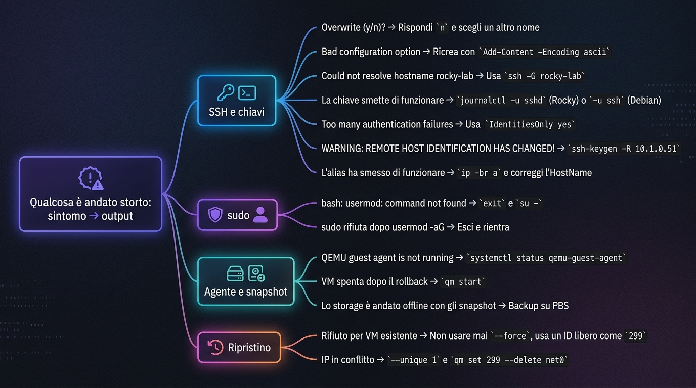

# Lezione 0.2 · Accesso e protezione

Da ora entri nelle VM dal terminale di Windows con una chiave SSH, ottieni sudo su entrambe le distro e costruisci la rete di sicurezza del corso: lo snapshot per annullare un errore in pochi secondi e il backup su PBS per sopravvivere alla perdita dello storage.

| Scheda | Lezione 0.2 |
| --- | --- |
| Modulo | M0 · Laboratorio, lezione 2 di 2, che chiude il modulo |
| Quando | Settimana 1 |
| Alla fine sei in grado di | Entrare nelle VM con ssh rocky-lab usando una chiave Ed25519 solo del lab; usare sudo su entrambe le distro e spiegare perché Debian non lo aveva; parlare con le VM tramite il guest agent; creare, ripristinare e ripulire gli snapshot; fare e testare un backup su PBS |
| Prerequisiti | Lezione 0.1; Windows 10 o 11, che includono già il client OpenSSH |
| Durata | Circa 2h30 |
| Snapshot | m0a2-inicio all'inizio; m0a2-fim a metà del lab, perché è lui che ti salva nella sfida; alla fine, la pulizia del modulo lascia solo m0a2-fim |

## 1 · Riscaldamento

Tre domande prima di cominciare. Rispondi a mente, per iscritto o a voce alta, senza cercare: anche l'intuizione sbagliata insegna, perché la lezione ti mostrerà dove ha fallito. Le risposte sono nelle Soluzioni, in fondo alla lezione.

1. Amministri server Windows via RDP. Cosa cambia quando l'accesso remoto è solo testo, come in SSH? Pensa alla banda, all'automazione e alla traccia di ciò che è stato fatto.
2. Lo storage `vm-hdd` del cluster va perso per sempre. Lo snapshot `m0a1-fim` della VM 201 ti salva? Perché?
3. Su Debian, diventi root con `su`, digiti `usermod -aG sudo student` e ricevi `bash: usermod: command not found`. Sei root, e il programma esiste in `/usr/sbin/usermod`. Cos'è successo?

## 2 · Perché conta

Un server SSH esposto su internet comincia a ricevere tentativi di login automatici poco dopo l'accensione. I bot scansionano indirizzi tutto il giorno e provano, sulla porta 22, combinazioni comuni di utente e password. Contro una password, è questione di tentativi e pazienza. Contro una chiave, non c'è nulla da indovinare: senza il file della chiave privata, l'account non si apre. In questa lezione la password resta attiva, come rete di protezione mentre impari; disattivarla è un passo successivo del corso.

La seconda metà della lezione costruisce la rete di sicurezza dell'intero corso:

- **Lo snapshot annulla.** È il Ctrl+Z del server: riporta indietro un errore in pochi secondi, ma vive nello stesso storage del disco.
- **Il backup sopravvive.** È la copia altrove, su PBS: ci mette di più a tornare, ma resiste alla perdita del disco, del nodo o del cluster.
- **Un backup mai ripristinato è una speranza.** Per questo il lab finisce con un ripristino vero, verificato dall'interno della VM.

Nel lavoro con i clienti, la regola "snapshot prima di toccare, backup testato prima di fidarsi" è ciò che separa uno spavento da un disastro. E configurare il login con chiave e l'accesso da superutente è tra le prime cose che fai su qualsiasi server nuovo, nel terminale, controllando dopo un reboot.

## 3 · Modello mentale

> La chiave privata è il tuo timbro; la chiave pubblica è il campione che resta in archivio.

Pensa a un ufficio notarile che riconosce i documenti timbrati. Lasci lì, una volta sola, un campione del tuo timbro: è la chiave pubblica, scritta nel file `authorized_keys` della VM. A ogni visita, l'ufficio mette sul tavolo un documento nuovo, mai timbrato, e chiede il tuo timbro su di esso. Timbri lì per lì e restituisci; l'ufficio confronta con il campione e ti fa entrare. Il timbro non esce dalla tua tasca: è la chiave privata, che resta su Windows.

Dove l'analogia fallisce, fallisce a favore della sicurezza. Con un timbro di gomma, chi ha il campione può farne fare una copia. Con le chiavi, no: la pubblica serve solo a verificare, e nessun calcolo praticabile estrae la privata da essa. Per questo la pubblica può circolare liberamente, e la privata non si muove.

Manca l'altra metà: l'ufficio è davvero l'ufficio? Alla prima visita, ssh mostra l'impronta digitale della chiave host della VM, una specie di sigillo ufficiale, e chiede se ti fidi. Controlli per una via che non passa dalla rete, nel lab la console di Proxmox, e solo allora rispondi `yes`. ssh annota il sigillo nel tuo `known_hosts` e, nelle visite successive, confronta da solo. Se il sigillo cambia, interrompe la connessione con un avviso in lettere maiuscole.


*Le frecce 1–2 autenticano la VM; le frecce 3–5 autenticano te. La chiave privata non esce mai da Windows.*

Leggi il diagramma seguendo le frecce numerate. Le frecce 1 e 2 rispondono a chi è il server: la VM presenta la chiave host, e il tuo `known_hosts` la verifica. Le frecce 3 e 4 rispondono a chi sei tu: la VM manda una sfida, il tuo Windows restituisce la sfida firmata con la chiave privata, e la VM verifica la firma con il campione conservato in `authorized_keys`. La freccia tratteggiata è l'unico viaggio della chiave pubblica, fatto una volta sola, nel passo 5 del lab.

**Ponte Windows:** questa idea la usi già. Windows Hello for Business crea una coppia di chiavi sul computer, protegge la privata nel TPM e registra solo la pubblica in Active Directory o in Entra ID. E l'avviso di RDP che non riesce a verificare l'identità del computer remoto è lo stesso problema che `known_hosts` risolve: sapere se dall'altra parte c'è davvero il server che pensi.

## 4 · Concetto a strati

### Essenziale

| Termine | Cos'è | Dove compare |
| --- | --- | --- |
| SSH | Protocollo di accesso remoto cifrato, sulla porta 22. Il client è `ssh`; il server, il servizio `sshd` | Client su Windows 10 e 11; server nelle VM |
| Coppia di chiavi | Due metà legate dalla matematica: la privata firma, la pubblica verifica | `id_ed25519_lab` e `id_ed25519_lab.pub`, su Windows |
| Ed25519 | Il tipo di chiave moderno: corto, veloce e sicuro | `-t ed25519` in `ssh-keygen` |
| Passphrase | La password che cifra il file della chiave privata sul disco | Richiesta da `ssh-keygen` e, una volta, da `ssh-add` |
| ssh-agent | Servizio che tiene la chiave sbloccata e firma al posto tuo | Servizio di Windows, attivato nel passo 4 |
| known\_hosts | Le chiavi host che hai già verificato | `%USERPROFILE%\.ssh\known_hosts`, su Windows |
| authorized\_keys | Le chiavi pubbliche accettate per un utente | `~/.ssh/authorized_keys`, nella VM |
| sudo | Esegue un comando come root, chiedendo la tua password, e lo registra nel log | Regole in `/etc/sudoers`, per i gruppi `wheel` e `sudo` |
| Snapshot | Il disco e la scheda della VM congelati in un istante, nello stesso storage | `qm snapshot`; si torna indietro con `qm rollback` |
| Backup | Copia completa della VM altrove | `vzdump` verso `PBS-LAB`; si ripristina con `qmrestore` |

**Ponte Windows:** `sudo` è cugino dell'UAC. In entrambi lavori senza privilegi ed elevi solo ciò che serve. Le differenze: `sudo` chiede la tua password, mentre l'UAC chiede un clic di consenso, o la password di un amministratore se sei un utente normale; `sudo` registra ogni comando nel log; e le regole di `sudo` possono limitare quali comandi ciascuno può eseguire.

### Approfondimento

**Una chiave solo per il lab.** `id_ed25519_lab` serve solo alle VM del corso. Se un giorno trapela, la rimuovi da due VM, senza toccare i server dei clienti. Separare le chiavi per ambiente segue la logica di non riusare la password della mail per la banca. Il commento `lab-curso`, in fondo alla chiave pubblica, identifica la riga dentro un `authorized_keys` che può averne diverse.

**IdentitiesOnly.** Senza quella riga nel `config`, ssh offre al server tutte le chiavi che l'agent conserva, una alla volta. Il server conta ogni rifiuto come un tentativo, e il limite predefinito di `sshd` è sei: con molte chiavi nell'agent, la connessione cade con `Too many authentication failures` prima di arrivare a quella giusta. Con `IdentitiesOnly yes`, ssh offre solo la chiave indicata nel blocco.

**Passphrase e agent.** Il file della chiave privata è cifrato dalla passphrase: chi copia il file senza la frase non riesce a usarlo. L'agent tiene la chiave sbloccata e firma a nome di ssh. Su Windows, l'agent è un servizio che conserva le chiavi aggiunte protette dal tuo account Windows, e restano lì anche dopo un riavvio. In pratica, digiti la passphrase una volta, in `ssh-add`, e la protezione di ogni giorno diventa la tua password di Windows.

**Rigore sulla sfida.** In SSH 2, il server non sorteggia una sfida separata. Le due parti concordano, nello scambio di chiavi, un identificatore di sessione che non si ripete mai, ed è quello che il tuo Windows firma. L'effetto è quello della sfida: una firma catturata in una connessione non serve in nessun'altra.

**StrictModes.** Prima di accettare una chiave, `sshd` controlla proprietario e permessi della home, di `~/.ssh` e di `authorized_keys`. Se un altro utente potesse scrivere lì, potrebbe piantare una chiave sua; allora `sshd` rifiuta e registra `Authentication refused: bad ownership or modes`. Lo standard sicuro è `~/.ssh` con 700 e `authorized_keys` con 600, entrambi dell'utente stesso. Su Rocky c'è un secondo blocco, SELinux: i file devono avere l'etichetta `ssh_home_t`, e `restorecon -Rv ~/.ssh` rimette le etichette giuste, elencando cosa è cambiato.

**su e su -.** `su` senza trattino cambia utente e mantiene quasi tutto il tuo ambiente: la directory corrente e, su Debian, il PATH dell'utente normale, che non passa da `/usr/sbin`. Diventi root con la mappa di un utente normale. `su -` apre una shell di login, con l'ambiente del root, il PATH completo e la directory `/root`. Regola pratica: sempre `su -`.

**I gruppi valgono al login successivo.** `usermod -aG sudo student` scrive il nuovo gruppo in `/etc/group`, ma la tua sessione aperta porta con sé l'elenco dei gruppi di quando sei entrato, e ogni programma che apre eredita quell'elenco. `id` mostra la sessione; `id student` legge i file e mostra già il nuovo gruppo. Attenzione a `-a`: senza, `usermod -G sudo student` sostituisce tutti i gruppi aggiuntivi dell'utente con uno solo.

**fs-freeze e fs-thaw.** In un backup a VM accesa, Proxmox copia il disco mentre il sistema continua a scrivere. Senza l'agent, la copia equivale a staccare la spina: il journal del file system ripara la struttura, ma ciò che era ancora solo in memoria resta fuori. Con l'agent, Proxmox chiede un `fs-freeze`: il sistema svuota le cache e trattiene le scritture per un istante, la copia parte da quel punto, e un `fs-thaw` libera tutto. Il backup esce con i file system consistenti.

**Perché il secondo backup è veloce.** PBS conserva i dati a pezzi e scrive solo i pezzi che non ha ancora. E, finché il processo QEMU della VM è lo stesso (il reboot dall'interno non lo cambia, come hai visto nella Lezione 0.1), Proxmox annota quali blocchi sono cambiati dall'ultimo backup, in una mappa chiamata dirty bitmap, e legge solo quelli.



*Lo snapshot vive sullo stesso storage del disco; solo il backup in un altro posto sopravvive alla sua perdita.*

## 5 · Rocky × Debian

| Tema | Rocky 9 | Debian 13 |
| --- | --- | --- |
| Gruppo che dà sudo | `wheel`, GID 10 | `sudo`, GID 27 |
| Riga in `/etc/sudoers` | `%wheel ALL=(ALL) ALL` | `%sudo ALL=(ALL:ALL) ALL` |
| sudo dopo l'installazione | Installato; l'utente segnato come amministratore è già in `wheel` | Arriva solo se la password di root resta vuota |
| `su` senza trattino | Il PATH dell'utente include già `/usr/sbin`: l'inciampo non compare | Il PATH dell'utente non ha `/usr/sbin`: `usermod` sparisce |
| Aggiornare il sistema | `sudo dnf upgrade` | `sudo apt update` e `sudo apt upgrade` |
| Servizio SSH | `sshd` | `ssh` |
| Blocco extra di accesso | SELinux, per etichette: `restorecon` sistema `~/.ssh` | AppArmor, per percorsi: niente da fare su `~/.ssh` |
| Dove vedere sshd e sudo | Journal e `/var/log/secure` | Solo il journal |
| `qm guest exec` di Proxmox | Bloccato di default | Consentito |

## 6 · Lab guidato

Alternerai tre posti: il PowerShell di Windows, la shell del nodo Proxmox e il terminale delle VM, prima dalla console e, dal passo 5, via SSH. Prima di ogni blocco, il testo dice dove gira.

In otto punti del lab ti fermi su un blocco **Decidi**: una situazione che succede davvero nel lavoro, quattro vie d'uscita e una tabella che commenta ciascuna. Scegli la lettera prima di leggere la tabella, e poi leggi tutte e quattro le righe, non solo quella della tua scelta. Le alternative sbagliate sono gli errori più comuni della professione, e capire perché ognuna fallisce è ciò che ricorderai ancora domani. I blocchi segnati come **scenario** descrivono qualcosa che nel lab non succede da solo; gli altri li vedi sul tuo schermo.

### Passo 1 · Snapshot iniziale

Le VM sono spente dalla fine della Lezione 0.1. Fai lo snapshot prima di accenderle: con la VM spenta, conserva un disco fermo, senza nulla a metà. Sul nodo della 201:

```bash
qm snapshot 201 m0a2-inicio --description "Aula 0.2: início"
qm start 201
```

Sul nodo della 202:

```bash
qm snapshot 202 m0a2-inicio --description "Aula 0.2: início"
qm start 202
```

Non ricordi su che nodo sta ciascuna? `pvesh get /cluster/resources --type vm`, su qualsiasi nodo.

### Passo 2 · Conferma gli IP

Gli IP arrivano dal DHCP e possono essere cambiati dalla Lezione 0.1. Nella console di ciascuna VM, dopo il login come student:

```bash
ip -br a
```

Output atteso: la scheda, probabilmente `enp6s18`, con `UP` e l'indirizzo IPv4. Gli esempi di questa lezione usano 10.1.0.51 per rocky-lab e 10.1.0.52 per debian-lab: usa i tuoi. Nel PowerShell di Windows, verifica che la porta 22 risponda:

```powershell
Test-NetConnection 10.1.0.51 -Port 22
Test-NetConnection 10.1.0.52 -Port 22
```

Output atteso: `TcpTestSucceeded : True` su entrambe.

### Passo 3 · Genera la chiave del lab

Nel PowerShell di Windows, come utente normale:

```powershell
New-Item -ItemType Directory -Force "$env:USERPROFILE\.ssh" | Out-Null
ssh-keygen -t ed25519 -f "$env:USERPROFILE\.ssh\id_ed25519_lab" -C "lab-curso"
```

`ssh-keygen` chiede la passphrase due volte. Scegline una che ricordi: protegge il file se qualcuno lo copia.

**Prevedi:** quanti file ha creato il comando, e quale di essi puoi mostrare a chiunque?

```powershell
Get-ChildItem "$env:USERPROFILE\.ssh"
Get-Content "$env:USERPROFILE\.ssh\id_ed25519_lab.pub"
```

Output atteso: i file `id_ed25519_lab` e `id_ed25519_lab.pub`, e una sola riga che inizia con `ssh-ed25519 AAAAC3NzaC1lZDI1NTE5` e finisce con `lab-curso`. Quell'inizio è uguale in ogni chiave Ed25519: è il nome del tipo di chiave, codificato in base64. Il file senza `.pub` è la chiave privata: non aprirlo, non copiarlo, non incollarlo da nessuna parte.

**Decidi 1 · ssh-keygen vuole sovrascrivere.** Esegui di nuovo esattamente lo stesso `ssh-keygen` di questo passo. Non genera nulla: avvisa che `id_ed25519_lab` `already exists` e si ferma su `Overwrite (y/n)?`. Non digitare ancora nulla. Cosa rispondi?

- **A)** `y`. Stesso nome, quindi stessa chiave; fa lo stesso.
- **B)** `n`, e scopro da dove viene quel file prima di decidere qualsiasi cosa.
- **C)** `y`, e poi copio la nuova chiave pubblica ovunque ci fosse la vecchia.
- **D)** Ctrl+C, cancello la cartella `.ssh` e ricomincio da zero.

Scegli la lettera prima di guardare la tabella.

| Se hai scelto | Risultato | Perché |
| --- | --- | --- |
| A | ❌ Sbagliato | Stesso nome non significa stessa chiave. Il `y` cancella per sempre la vecchia chiave privata e ne crea un'altra al suo posto. Se la vecchia era nell'`authorized_keys` di qualche server, perdi quell'accesso e lo scopri solo il giorno in cui ti serve. |
| B | ✅ Giusto | `n` esce senza toccare nulla. Un file che esiste già è un indizio: leggi il commento in fondo alla chiave pubblica, con il comando qui sotto, e ti dice per cosa è stata creata la chiave. Se non sai da dove viene, genera la nuova con un altro nome. |
| C | ❌ Sbagliato | Si potrebbe fare se sapessi dove stava la vecchia, e non lo sai. È l'errore della A con più lavoro e il rischio di dimenticare un server. |
| D | ❌ Sbagliato | La cartella conserva anche `known_hosts`, `config` e le tue altre chiavi. Distruggi tutto per risolvere ciò che un `n` risolve. |

**Da ricordare:** la chiave privata è l'unica copia della chiave di una casa. Prima di buttarla, scopri quale porta apre.

Rispondi `n` e controlla la chiave che hai già:

```powershell
Get-Content "$env:USERPROFILE\.ssh\id_ed25519_lab.pub"
```

Output atteso: una riga che inizia con `ssh-ed25519` e finisce con `lab-curso`, il commento che hai passato con `-C`. Nel lavoro, metti nel commento per cosa e quando è stata creata la chiave, come `notebook-student-2026`. Fra due anni, è quell'etichetta a dirti cosa apre ogni riga di un `authorized_keys`.

### Passo 4 · Attiva l'agent

Il servizio `ssh-agent` è disattivato di default su Windows. Apri un PowerShell come amministratore ed esegui:

```powershell
Get-Service ssh-agent | Set-Service -StartupType Automatic
Start-Service ssh-agent
```

Chiudi quella finestra e torna al PowerShell normale, perché la chiave è del tuo account:

```powershell
ssh-add "$env:USERPROFILE\.ssh\id_ed25519_lab"
ssh-add -l
```

`ssh-add` chiede la passphrase una volta. Output atteso di `ssh-add -l`: una riga con `256 SHA256:`, l'impronta digitale della chiave e `lab-curso (ED25519)` in fondo.

### Passo 5 · Verifica la VM e consegna il campione

Prima, l'impronta digitale della VM, per una via che non passa dalla rete. Nella console della 201, loggato come student:

```bash
ssh-keygen -lf /etc/ssh/ssh_host_ed25519_key.pub
```

Output atteso: una riga che inizia con `256 SHA256:`, seguita dall'impronta digitale, e finisce con `(ED25519)`. Lascia la console aperta. Ora, nel PowerShell normale, manda la tua chiave pubblica alla VM:

```powershell
Get-Content "$env:USERPROFILE\.ssh\id_ed25519_lab.pub" | ssh student@10.1.0.51 "mkdir -p ~/.ssh && chmod 700 ~/.ssh && cat >> ~/.ssh/authorized_keys && chmod 600 ~/.ssh/authorized_keys"
```

La prima connessione chiede, con piccole variazioni a seconda della versione di Windows:

```text
The authenticity of host '10.1.0.51 (10.1.0.51)' can't be established.
ED25519 key fingerprint is SHA256:...
This key is not known by any other names.
Are you sure you want to continue connecting (yes/no/[fingerprint])?
```

Confronta l'impronta digitale con quella della console, all'inizio e alla fine. Uguali: digita `yes`. Diverse: fermati e scopri perché prima di proseguire. Dopo il `yes`, ssh avvisa che ha salvato la chiave in `known_hosts` e chiede la password dell'account student, per l'ultima volta. Se non compare nessun errore, la copia è riuscita. Prova il login con la chiave:

```powershell
ssh -i "$env:USERPROFILE\.ssh\id_ed25519_lab" student@10.1.0.51
```

Output atteso: il prompt `[student@rocky-lab ~]$`, senza chiedere nessuna password, perché la passphrase è già nell'agent. Sempre dentro la VM, controlla cosa ha creato la copia:

```bash
ls -ld ~/.ssh ~/.ssh/authorized_keys
restorecon -Rv ~/.ssh
```

Output atteso: `drwx------` sulla cartella e `-rw-------` sul file, entrambi di student. Se `restorecon` non stampa nulla, le etichette di SELinux erano già giuste. Esci con `exit`.

Ripeti il passo per la 202: impronta digitale nella console di debian-lab, copia verso `student@10.1.0.52` e prova con `ssh -i`. Il prompt di Debian è `student@debian-lab:~$`, e lì `restorecon` non esiste: AppArmor non etichetta i file.



*Controlla l'impronta digitale per una via che non passa dalla rete, e solo allora digita yes.*

**Decidi 2 · L'impronta digitale non corrisponde.** Scenario: alla prima connessione con la 202, l'impronta digitale che mostra PowerShell inizia e finisce in modo diverso da quella mostrata dalla console di debian-lab. La domanda `Are you sure you want to continue connecting (yes/no/[fingerprint])?` è sullo schermo. Cosa fai?

- **A)** `yes`. È la mia rete, può essere solo la VM.
- **B)** `no`, e controllo nella console di debian-lab se il suo IP è davvero 10.1.0.52.
- **C)** `no`, cancello `known_hosts` e riprovo.
- **D)** Mi connetto con `-o StrictHostKeyChecking=no`, così la domanda sparisce.

Scegli la lettera prima di guardare la tabella.

| Se hai scelto | Risultato | Perché |
| --- | --- | --- |
| A | ❌ Sbagliato | Il `yes` salva la chiave sconosciuta in `known_hosts`, e da lì in poi ssh si fida senza chiedere. Subito dopo chiede la password di student, e la consegneresti alla macchina sbagliata. |
| B | ✅ Giusto | Impronta diversa significa un'altra macchina che risponde su quell'IP. Nel lab, la causa più comune è che il DHCP abbia dato il 10.1.0.52 a un'altra VM, e `ip -br a` nella console di debian-lab mostra il suo IP reale. Se l'IP corrisponde e l'impronta no, c'è qualcuno in mezzo: fermati e indaga sulla rete prima di digitare qualsiasi password. |
| C | ❌ Sbagliato | È la prima connessione, quindi `known_hosts` non ha nemmeno quell'IP: cancellare non cambia la domanda. E si porta via la verifica di tutti i server che hai già convalidato. |
| D | ❌ Sbagliato | Spegne l'allarme invece di cercare il fuoco. Con quell'opzione, ssh salva qualsiasi chiave nuova senza avvisare, oggi e ogni volta che ripeti il comando. |

**Da ricordare:** l'impronta digitale è il documento di chi risponde alla porta. Se non corrisponde all'anagrafica, non consegni il pacco, per quanto la persona giuri di essere lei.

**Da sapere:** su Linux esiste `ssh-copy-id`, che fa questa copia con un solo comando. Il client di Windows non lo include, da qui la riga con `Get-Content`. Lo userai quando le VM cominceranno a parlarsi tra loro.

### Passo 6 · Alias nel config

Digitare `ssh -i ... student@10.1.0.51` ogni volta stanca e invita all'errore. Il file `config` conserva gli alias. Nel PowerShell normale, sostituendo gli IP con i tuoi:

```powershell
Add-Content -Encoding ascii -Path "$env:USERPROFILE\.ssh\config" -Value @'
Host rocky-lab
    HostName 10.1.0.51
    User student
    IdentityFile ~/.ssh/id_ed25519_lab
    IdentitiesOnly yes

Host debian-lab
    HostName 10.1.0.52
    User student
    IdentityFile ~/.ssh/id_ed25519_lab
    IdentitiesOnly yes
'@
```

Il `'@` finale deve stare all'inizio della riga, senza spazi prima. E non creare mai questo file con `>` o `Out-File`: in Windows PowerShell scrivono in UTF-16, che ssh non legge. Prova:

```powershell
ssh rocky-lab hostname
ssh debian-lab hostname
```

Output atteso: `rocky-lab` e `debian-lab`. ssh è entrato, ha eseguito un solo comando ed è uscito. È il mattone di ogni automazione che verrà, compreso Ansible.

### Passo 7 · sudo su entrambe le distro

Su Rocky, l'installer ha già messo student nel gruppo `wheel`. Entra con `ssh rocky-lab` e controlla:

```bash
id
sudo -l
```

Output atteso: `10(wheel)` tra i gruppi di `id` e, alla fine di `sudo -l`, dopo la tua password, la riga `(ALL) ALL`. Esci con `exit`.

Su Debian, il percorso ha un tranello voluto. Entra con `ssh debian-lab` e prova:

```bash
sudo -v
```

Output atteso: `-bash: sudo: command not found`. Il pacchetto non esiste. Diventa root e prova ad assegnare il gruppo:

```bash
su
usermod -aG sudo student
```

Output atteso: `bash: usermod: command not found`, anche come root. È la domanda 3 del Riscaldamento, dal vivo.

**Decidi 3 · Root, e il comando non esiste lo stesso.** Prima di proseguire, scegli la spiegazione:

- **A)** Il pacchetto di `usermod` non è installato; manca un `apt install`.
- **B)** `su` senza trattino ha mantenuto il PATH di student, e quel PATH non ha `/usr/sbin`.
- **C)** Su Debian, nemmeno il root tocca i gruppi finché `sudo` non è installato.
- **D)** Il nome è sbagliato; il comando giusto è `useradd`.

Scegli la lettera prima di guardare la tabella.

| Se hai scelto | Risultato | Perché |
| --- | --- | --- |
| A | ❌ Sbagliato | Il programma è installato: `ls -l /usr/sbin/usermod` mostra il file. La shell semplicemente non cerca in quella cartella, e reinstallare non cambia nulla. |
| B | ✅ Giusto | `su` senza trattino cambia utente e mantiene l'ambiente, PATH compreso. Su Debian, il PATH di un utente normale non ha `/usr/sbin`, dove stanno gli strumenti di amministrazione. `su -` apre un login completo da root, con il PATH di root. |
| C | ❌ Sbagliato | Il root non dipende da `sudo`; `sudo` è solo un modo per diventare root. Con il percorso completo, `/usr/sbin/usermod -aG sudo student` funziona subito. |
| D | ❌ Sbagliato | `useradd` crea utenti, e student esiste già. Il nome era giusto; è la shell che non ha trovato il programma. |

**Da ricordare:** `su` senza trattino è indossare il badge del capo e continuare con la mappa dello stagista. Hai il permesso, ma la mappa non mostra la stanza degli attrezzi.

Dimostra la causa: esegui `echo $PATH`. La risposta, `/usr/local/bin:/usr/bin:/bin:/usr/local/games:/usr/games`, non ha nessun `sbin`. Esci con `exit` e fai nel modo giusto:

```bash
su -
apt update
apt install -y sudo
usermod -aG sudo student
exit
```

**Prevedi:** tornato come student, `sudo` funziona già?

```bash
id
id student
sudo -v
```

**Decidi 4 · Il gruppo è stato scritto, e sudo rifiuta ancora.** Confronta cosa è comparso: `id` non mostra il gruppo `sudo`, `id student` mostra `27(sudo)`, e `sudo -v`, dopo aver chiesto la password, risponde `Sorry, user student may not run sudo on debian-lab.` Cosa fai?

- **A)** Modifico `/etc/sudoers` e ci metto student per nome.
- **B)** Esco con `exit` e rientro.
- **C)** Riavvio la VM.
- **D)** Lo rieseguo, stavolta con `sudo usermod -aG sudo student`.

Scegli la lettera prima di guardare la tabella.

| Se hai scelto | Risultato | Perché |
| --- | --- | --- |
| A | ❌ Sbagliato | Il problema non è nel sudoers: la regola del gruppo `sudo` c'è già. Una regola per nome, server per server, diventa un pasticcio, e un errore di battitura nel sudoers fuori da `visudo` può bloccare sudo per tutti. |
| B | ✅ Giusto | L'elenco dei gruppi viene costruito al login. La sessione aperta porta l'elenco di quando sei entrato, e ogni programma che apre eredita quell'elenco. Uscire e rientrare costruisce un elenco nuovo, già con `sudo`. |
| C | ❌ Sbagliato | Funziona, perché riavviare forza anch'esso un login nuovo, ma butta giù tutto ciò che gira nella VM per risolvere ciò che un `exit` risolve. Su un server di un cliente, sarebbe una finestra di manutenzione sprecata. |
| D | ❌ Sbagliato | `sudo` rifiuta per lo stesso motivo di prima: la tua sessione non è ancora nel gruppo. E non c'è nulla da riscrivere, perché `id student` ha già dimostrato che il gruppo è nei file. |

**Da ricordare:** il badge nuovo è già stato stampato in `/etc/group`, ma al collo hai ancora quello vecchio. Per cambiarlo, esci dalla portineria e rientra.

Esci con `exit`, rientra con `ssh debian-lab` e controlla:

```bash
id
sudo -v
sudo -l
```

Output atteso: `27(sudo)` in `id`; `sudo -v` chiede la tua password e torna in silenzio; `sudo -l` finisce con `(ALL : ALL) ALL`. Ora guarda la traccia, su entrambe le VM:

```bash
sudo journalctl _COMM=sudo -n 5
```

Output atteso: righe come `student : TTY=pts/0 ; PWD=/home/student ; USER=root ; COMMAND=/usr/bin/journalctl _COMM=sudo -n 5`, compreso il comando stesso che hai appena eseguito. Su Rocky, la stessa traccia va anche in `/var/log/secure`: controlla con `sudo tail -n 5 /var/log/secure`.


*su senza trattino dà il badge senza la mappa; un gruppo nuovo vale solo al login successivo.*

### Passo 8 · Aggiorna e riavvia

**Prevedi:** annota il kernel attuale con `uname -r` su entrambe le VM. Se l'aggiornamento porta un kernel nuovo, da quando vale?

Su rocky-lab:

```bash
sudo dnf upgrade
```

Su debian-lab:

```bash
sudo apt update
sudo apt upgrade
```

Leggi l'elenco, rispondi `y` e aspetta che finisca. Poi, su entrambe:

```bash
sudo reboot
```

La connessione SSH cade, come previsto. Aspetta mezzo minuto, rientra ed esegui `uname -r`. Un kernel nuovo vale solo dopo il reboot; fino ad allora, il sistema gira con il vecchio, che resta installato come riserva. Rocky ne conserva fino a tre; Debian lascia i vecchi fino a un `apt autoremove`, che non rimuove mai quello in esecuzione.

### Passo 9 · Installa l'agent

La scheda delle VM ha `agent: enabled=1` dalla Lezione 0.1: Proxmox ha creato il canale, ma nessuno rispondeva dal lato interno. Ora installa chi risponde. Su rocky-lab:

```bash
sudo dnf install -y qemu-guest-agent
sudo systemctl start qemu-guest-agent
systemctl is-active qemu-guest-agent
systemctl is-enabled qemu-guest-agent
```

Su debian-lab:

```bash
sudo apt install -y qemu-guest-agent
sudo systemctl start qemu-guest-agent
systemctl is-active qemu-guest-agent
systemctl is-enabled qemu-guest-agent
```

Output atteso: `active` e, probabilmente, `static`. Static significa che il servizio non ha un interruttore di avvio al boot: una regola di udev lo avvia quando compare la porta virtuale dell'agent, che la riga `agent` della scheda crea. Se compare `disabled`, esegui `sudo systemctl enable qemu-guest-agent`. Se `dnf` dice che il pacchetto era già installato, vai avanti: ciò che conta è `active`.

Ora dal lato Proxmox, sul nodo della 201:

```bash
qm guest cmd 201 ping
qm guest cmd 201 network-get-interfaces
```

Il `ping` senza errori significa che l'agent ha risposto; con l'agent fermo, la risposta sarebbe `QEMU guest agent is not running`. Il secondo comando restituisce le schede della VM con gli IP, che ora compaiono anche nel Summary della VM, nell'interfaccia web. E il test che era fallito nella Lezione 0.1:

```bash
qm shutdown 201
qm status 201
qm start 201
```

Output atteso: `qm shutdown` torna in pochi secondi, `qm status` dice `status: stopped`, e la VM si riaccende. Ripeti i comandi di Proxmox per la 202, sul suo nodo.

**Da sapere:** l'agent è una porta di root dentro la VM. Su Debian, `qm guest exec` esegue qualsiasi comando come root là dentro; Rocky, come RHEL, blocca quel comando di default. Chi amministra Proxmox amministra, di fatto, le VM con agent: proteggi l'accesso a Proxmox come proteggi il root.

**Decidi 5 · L'agent non risponde.** Scenario: sulla 202, `qm shutdown 202` resta fermo e termina con un errore di timeout, e `qm guest cmd 202 ping` risponde `QEMU guest agent is not running`. È esattamente ciò che la missione della sezione 12 andrà a cercare nelle VM dei tuoi clienti. Cosa fai?

- **A)** `qm stop 202`, per spegnere subito e proseguire con il lab.
- **B)** Entro nella VM ed eseguo `systemctl status qemu-guest-agent`.
- **C)** Disattivo l'opzione QEMU Guest Agent della VM, così Proxmox smette di chiedere.
- **D)** Ripeto con `qm shutdown 202 --timeout 600`.

Scegli la lettera prima di guardare la tabella.

| Se hai scelto | Risultato | Perché |
| --- | --- | --- |
| A | ❌ Sbagliato | `qm stop` è staccare il cavo dalla presa. Nel lab passa; su un server con un database, può rovinare ciò che stava venendo scritto. È l'ultima risorsa dopo la diagnosi, mai al suo posto. |
| B | ✅ Giusto | Il messaggio dice dove guardare: Proxmox ha chiamato l'agent e nessuno ha risposto. `systemctl status` separa le cause. Se il servizio non esiste, mancava l'installazione di `qemu-guest-agent`. Se esiste ed è fermo, controlla l'opzione QEMU Guest Agent in Proxmox: vale solo dopo aver spento e riacceso la VM da Proxmox, e un reboot dall'interno non basta. |
| C | ❌ Sbagliato | Lo spegnimento passa dal pulsante di alimentazione virtuale e può anche funzionare, ma il difetto resta nascosto: il backup continua a non congelare i dischi, che era il motivo di questo passo. |
| D | ❌ Sbagliato | Aspettare di più non fa rispondere un servizio fermo. Arrivi allo stesso errore, solo dieci minuti dopo. |

**Da ricordare:** l'agent è il citofono della VM. Se nessuno risponde, non sfondi la porta né strappi il citofono; vai a vedere perché è muto.

### Passo 10 · Primo backup su PBS

Crea un segnaposto, per dimostrare dopo che il backup conserva ciò che pensi. Su rocky-lab:

```bash
echo "aula 0.2: antes do backup" | sudo tee /root/marcador.txt
```

**Prevedi:** con l'agent installato, quali due righe compaiono nel log del backup che non comparirebbero senza? Sul nodo della 201:

```bash
vzdump 201 --storage PBS-LAB --mode snapshot
```

Output atteso, tra le altre righe:

```text
INFO: issuing guest-agent 'fs-freeze' command
INFO: issuing guest-agent 'fs-thaw' command
INFO: Backup job finished successfully
```

Elenca i backup della 201:

```bash
pvesm list PBS-LAB --vmid 201
```

Output atteso: una riga per backup, con un nome come `PBS-LAB:backup/vm/201/2026-10-30T...Z` e il formato `pbs-vm`. Se il job settimanale è già girato, compaiono anche i suoi backup.

### Passo 11 · Ripristina per davvero

Ripristina in una VM nuova, con un altro ID e senza scheda di rete, così nulla minaccia la 201. Sul nodo della 201:

```bash
pvesh get /cluster/nextid --vmid 299
VOLID=$(pvesm list PBS-LAB --vmid 201 | awk 'NR>1 {v=$1} END {print v}')
echo "$VOLID"
qmrestore "$VOLID" 299 --storage vm-hdd --unique 1
qm set 299 --delete net0
qm start 299
```

Riga per riga: la prima conferma che l'ID 299 è libero e lo restituisce; se protesta, scegli un altro numero e cambialo in tutte le righe. La seconda salva nella variabile `VOLID` il nome del backup più recente: `awk` salta l'intestazione e tiene l'ultima riga. `--unique 1` sorteggia un MAC nuovo. E togliere `net0` prima del primo boot impedisce alla copia di comparire in rete con l'identità della 201.

Apri la console della 299 nell'interfaccia web, entra come root ed esegui:

```bash
cat /root/marcador.txt
```

Output atteso: `aula 0.2: antes do backup`. Il backup conserva ciò che pensi. Ora cancella la copia, sul nodo:

```bash
qm stop 299
qm destroy 299 --purge
```

Controlla il numero prima dell'Invio: `qm destroy` cancella la scheda e i dischi insieme, come hai visto nella Lezione 0.1.

**Da sapere:** per recuperare un solo file, senza ripristinare l'intera VM, l'interfaccia web ha il File Restore: nello storage `PBS-LAB`, scheda Backups, scegli il backup e naviga nelle sue cartelle.

**Decidi 6 · Ripristinare sopra?** Scenario: un collega ha fatto il restore con il numero sbagliato, `qmrestore "$VOLID" 201`, e Proxmox ha rifiutato perché la VM 201 esiste già. Lui suggerisce di ripetere con `--force`. Cosa rispondi?

- **A)** Si può, `--force` esiste per questo.
- **B)** Ripristina su un numero libero, come il 299, con `--unique 1`, e senza rete al primo boot.
- **C)** Cancella la 201 con `qm destroy 201` e ripristina al suo posto.
- **D)** Ripristina con lo stesso numero su un altro nodo del cluster.

Scegli la lettera prima di guardare la tabella.

| Se hai scelto | Risultato | Perché |
| --- | --- | --- |
| A | ❌ Sbagliato | `--force` cancella la 201 attuale, dischi compresi, e mette il backup al suo posto. Tutto ciò che è cambiato dopo il backup si perde. Per testare il backup, distruggeresti la macchina che protegge. |
| B | ✅ Giusto | Un test di ripristino non tocca l'originale. Il numero libero evita la collisione, `--unique 1` genera un MAC nuovo, e `qm set 299 --delete net0` impedisce alla copia di contendere la rete con la 201 quando si accende. È esattamente il passo 11. |
| C | ❌ Sbagliato | È il `--force` fatto a mano, con lo stesso risultato: l'originale sparisce. E `qm destroy` non chiede se sei sicuro. |
| D | ❌ Sbagliato | Il numero della VM vale per l'intero cluster. `qmrestore` rifiuta allo stesso modo su qualsiasi nodo. |

**Da ricordare:** testare un backup è come testare la copia di una chiave. Provi la copia nella porta senza buttare prima l'originale.



*Testare il backup significa ripristinare in una VM nuova, senza rete, e controllare il segnaposto; la 201 originale non viene mai toccata.*

### Passo 12 · Snapshot di fine

Con l'agent, lo snapshot si può fare a VM accesa: Proxmox congela i file system per un istante, come nel backup. Sul nodo della 201:

```bash
qm snapshot 201 m0a2-fim --description "Fim do M0: SSH por chave, sudo, agent"
qm listsnapshot 201
```

Sul nodo della 202:

```bash
qm snapshot 202 m0a2-fim --description "Fim do M0: SSH por chave, sudo, agent"
qm listsnapshot 202
```

Output atteso: l'albero con `m0a1-fim`, `m0a2-inicio` e `m0a2-fim`, uno sotto l'altro, e `current` in fondo. È questo `m0a2-fim` che ti salva nella sfida della prossima sezione.

## 7 · Rompi e ripara

Ora, l'errore che ogni amministratore teme: cancellare un file da cui dipende l'intero sistema. `/etc/passwd` collega ogni numero di utente a un nome, e `/etc/shadow` conserva gli hash delle password. Nella vita reale, succede con un `rm` nel terminale sbagliato o con uno script la cui variabile è arrivata vuota. Oggi hai `m0a2-fim`, del passo 12: l'obiettivo è annullare il danno in meno di 2 minuti.

**Rompi.** Entra con `ssh debian-lab` ed esegui:

```bash
[ "$(hostname)" = debian-lab ] && sudo rm -f /etc/passwd /etc/shadow
```

La prima metà è un blocco di sicurezza. Il test tra parentesi quadre dà vero solo su debian-lab, e `&&` esegue il resto solo se il test passa: incollato nella finestra sbagliata, non succede nulla. Porta l'abitudine al lavoro: un comando distruttivo comincia controllando dove si trova.

**Prevedi:** cosa risponde ciascun comando qui sotto, in questa stessa sessione?

```bash
whoami
id
ls -l /home
sudo -v
```

Output atteso, in ordine: `whoami: cannot find name for user ID 1000`; un `uid=1000` senza nome, ma con i gruppi ancora con nome, perché `/etc/group` è ancora lì; il proprietario della cartella `student` compare come `1000`; e `sudo: you do not exist in the passwd database`. I programmi conoscono ancora il tuo numero. Ciò che si è perso è il nome, e `sudo` non si fida di chi non ha un nome.

Ora, in un'altra finestra di PowerShell, prova a entrare:

```powershell
ssh debian-lab
```

La chiave viene rifiutata e compare una richiesta di password che non funzionerà mai. `sshd` non dice agli estranei che l'utente non esiste: finge, perché chi attacca non scopra quali account esistono. Premi Ctrl+C. Nella console della 202, prova a entrare come root: `Login incorrect`. Il login cerca il root nello stesso `/etc/passwd`. La VM è chiusa dall'interno, e nemmeno il root entra.

**Decidi 7 · La VM si è chiusa dall'interno.** Questa sessione è ancora aperta, l'altra finestra non entra e la console rifiuta perfino il root. Qual è la strada più breve per tornare indietro?

- **A)** `sudo cp /etc/passwd- /etc/passwd`, perché Debian conserva una copia di riserva.
- **B)** Sul nodo della 202: `qm rollback 202 m0a2-fim` e poi `qm start 202`.
- **C)** Riavviare la VM, perché il sistema si riprenda al ritorno.
- **D)** Ricreare student con `useradd`, proprio qui in questa sessione.

Scegli la lettera prima di guardare la tabella.

| Se hai scelto | Risultato | Perché |
| --- | --- | --- |
| A | ❌ Sbagliato | La riserva esiste, ma `sudo` deve trovarti in `/etc/passwd` prima di decidere qualsiasi cosa: è il `you do not exist in the passwd database` che hai appena visto. Senza sudo, non scrivi in `/etc`. Quella copia salva la giornata quando non c'è uno snapshot, per la strada descritta più sotto. |
| B | ✅ Giusto | Lo snapshot conserva l'intero disco di prima del danno, e il tuo è di pochi minuti fa. Il rollback richiede secondi e restituisce tutto, compresi gli utenti di sistema che non ti verrebbe nemmeno in mente di ricreare. Dopo, la VM resta spenta, per questo il `qm start`. |
| C | ❌ Sbagliato | Riavviare non ricrea nessun file. Chiudi solo l'unica sessione ancora aperta e torni a una VM in cui nessuno entra. |
| D | ❌ Sbagliato | `useradd` richiede root e scrive nello stesso `/etc/passwd`, quindi qui non gira nemmeno. E, anche come root, ricreerebbe solo student: il root e gli utenti di sistema, come quello di `sshd`, continuerebbero a mancare. |

**Da ricordare:** uno snapshot recente è una macchina del tempo. Quando esiste, usarla è la riparazione professionale; rattoppare a mano i file di sistema si fa quando non esiste.

**Ripara.** Fai partire il cronometro. Sul nodo della 202:

```bash
qm rollback 202 m0a2-fim
qm start 202
```

Il rollback spegne la VM subito, come `qm stop`, e riporta il disco all'istante di `m0a2-fim`, con i due file al loro posto. Torna spenta perché lo snapshot non ha conservato la memoria; `qm start` la accende.

**Verifica.** Aspetta circa 20 secondi e, in PowerShell:

```powershell
ssh debian-lab "whoami; ls -l /home"
```

Output atteso: `student` e la cartella `student` con proprietario `student`. Ferma il cronometro. Lo snapshot è ancora lì, perché il rollback non consuma lo snapshot: se vuoi allenarti di nuovo, puoi.

Senza snapshot, la strada sarebbe un boot di soccorso per copiare indietro `/etc/passwd-` e `/etc/shadow-`, le copie di riserva con la versione precedente all'ultima modifica, che potrebbe non essere quella giusta. Funziona, ma richiede molto più di 2 minuti, e lo imparerai in un modulo più avanti.

**Bonus su Rocky.** Il difetto più comune dell'SSH con chiave, dal vivo. Entra con `ssh rocky-lab` ed esegui:

```bash
[ "$(hostname)" = rocky-lab ] && chmod 777 ~/.ssh
exit
```

**Prevedi:** il prossimo accesso usa la chiave? In PowerShell:

```powershell
ssh rocky-lab
```

ssh chiede la password: la chiave è stata rifiutata.

**Decidi 8 · La chiave ha smesso di funzionare.** Qual è il tuo primo passo?

- **A)** Copio di nuovo la chiave pubblica in `authorized_keys`.
- **B)** Entro con la password e leggo il log di `sshd` nella VM.
- **C)** Eseguo `ssh -v rocky-lab` su Windows e cerco lì il motivo.
- **D)** Genero una chiave nuova, perché questa deve essersi rovinata.

Scegli la lettera prima di guardare la tabella.

| Se hai scelto | Risultato | Perché |
| --- | --- | --- |
| A | ❌ Sbagliato | La chiave è lì, intatta. Copiarla di nuovo crea solo una riga duplicata, e `sshd` continua a rifiutare, perché il problema è la cartella e non la chiave. |
| B | ✅ Giusto | Ha rifiutato il server, quindi il motivo sta nel log del server. Una riga di `journalctl` dice esattamente cosa non ha accettato. |
| C | ❌ Sbagliato | Aiuta a metà: `-v` mostra che la chiave è stata offerta e rifiutata, ma il server non dice mai al client perché. Vedi il "no" senza vedere il motivo. |
| D | ❌ Sbagliato | La chiave nuova va nella stessa cartella, con lo stesso difetto, e viene rifiutata allo stesso modo. Cambi la chiave e la serratura resta inceppata. |

**Da ricordare:** il client sa solo di aver preso un "no"; il perché è annotato dalla parte di chi ha detto "no".

Entra con la password e leggi il motivo dove sta, sul server:

```bash
sudo journalctl -u sshd -n 5
```

Output atteso: una riga con `Authentication refused: bad ownership or modes for directory /home/student/.ssh`. Con 777, qualsiasi utente della VM potrebbe scrivere nella cartella e piantare una chiave sua; `sshd` preferisce rifiutare. Ripara:

```bash
chmod 700 ~/.ssh
exit
```

```powershell
ssh rocky-lab hostname
```

Output atteso: `rocky-lab`, senza chiedere la password.

La lezione: i due danni hanno tagliato l'accesso, ma solo uno ha richiesto lo snapshot. Un permesso sbagliato si ripara dall'interno, purché esista un'altra strada per entrare. Un file vitale cancellato chiude fuori perfino il root, e allora ti salva solo ciò che sta fuori dalla VM: snapshot o backup. Nel lavoro, prima di toccare l'accesso, lascia aperta una seconda strada: la console di Proxmox, un'altra sessione SSH, lo snapshot di prima.



*Un permesso sbagliato si ripara dall'interno; un file vitale cancellato si salva solo con snapshot o backup.*

## 8 · Trappole

| Sintomo | Causa | Soluzione |
| --- | --- | --- |
| `ssh-keygen` chiede `Overwrite (y/n)?` | Esiste già una chiave con quel nome, forse quella che usi con i clienti | Rispondi `n` e scegli un altro nome: sovrascrivere cancella per sempre la vecchia chiave |
| `bash: usermod: command not found`, anche come root | `su` senza trattino ha mantenuto il PATH dell'utente normale | `exit` e `su -` |
| `sudo` rifiuta subito dopo `usermod -aG` | La sessione conserva i gruppi di quando sei entrato | Esci e rientra; `id` mostra la sessione, `id student` mostra i file |
| `Bad configuration option` con caratteri strani | Il `config` è stato scritto in UTF-16, con `>` o `Out-File` | Cancella e ricrea con `Add-Content -Encoding ascii` |
| `Could not resolve hostname rocky-lab` | ssh non ha trovato l'alias: file salvato come `config.txt` o nome digitato diverso | `ssh -G rocky-lab` mostra cosa ha capito ssh; `hostname rocky-lab` nell'output significa che il blocco non è stato letto |
| La chiave smette di funzionare e ssh chiede la password | `sshd` ha rifiutato la chiave: proprietario, permessi o etichetta SELinux in `~/.ssh` | Entra con la password o dalla console e leggi il log: `journalctl -u sshd` su Rocky, `-u ssh` su Debian |
| `Too many authentication failures` | L'agent ha offerto troppe chiavi prima di quella giusta | `IdentitiesOnly yes` nel blocco dell'host |
| `WARNING: REMOTE HOST IDENTIFICATION HAS CHANGED!` | La VM è stata reinstallata, l'IP ora è di un'altra macchina, oppure c'è qualcuno in mezzo | Controlla l'impronta digitale dalla console; solo se il cambio è legittimo, `ssh-keygen -R 10.1.0.51` e riconnettiti, verificando |
| L'alias ha smesso di funzionare da un giorno all'altro | Il DHCP ha dato un altro IP alla VM | `ip -br a` nella console e correggi `HostName`; dalla VM 203 in poi, il corso usa IP fisso |
| `QEMU guest agent is not running` | Il servizio non sta girando dentro la VM | `systemctl status qemu-guest-agent` nella VM; se l'opzione `agent` è stata attivata a VM accesa, spegni e riaccendi da Proxmox |
| La VM è rimasta spenta dopo il rollback | Lo snapshot non ha conservato la memoria | `qm start` subito dopo `qm rollback` |
| Lo storage è caduto e gli snapshot sono andati con lui | Lo snapshot vive nello stesso storage del disco | Backup su PBS, testato con un ripristino |
| `qmrestore` rifiuta perché la VM esiste già, e qualcuno suggerisce `--force` | `--force` sovrascrive la VM esistente | Non ripristinare mai sopra l'originale: usa un ID libero, come il 299 |
| IP in conflitto dopo un ripristino | La copia si è accesa con la scheda di rete dell'originale | `--unique 1` in `qmrestore` e `qm set 299 --delete net0` prima del primo boot |


*Prima il sintomo, poi l'area: ogni trappola ha una soluzione che sta nell'output di un comando.*

## 9 · Quiz

Rispondi a tutto prima di aprire le Soluzioni. Le domande mescolano ciò che hai letto con ciò che hai visto nel lab.

1. Quale dei due file della chiave non esce mai dal tuo Windows, e quale è andato nella VM? In che file della VM sta?
2. Prima del `yes`, hai confrontato l'impronta digitale con quella della console. Cosa stavi verificando, e quale attacco evita?
3. Su Debian, sei diventato root con `su` e `usermod` non esiste. Spiega e indica il comando giusto.
4. Subito dopo `usermod -aG sudo student`, `id` non mostrava il gruppo `sudo`, ma `id student` sì. Perché, e come si risolve?
5. Un collega dice che la sua chiave ha smesso di funzionare su un server e che ssh ora chiede la password. Dove cerchi il motivo, e quali sono due cause probabili?
6. Lo storage `vm-hdd` è sparito. Cosa sopravvive: `m0a2-fim` o il backup del passo 10? E, per annullare un errore di 5 minuti fa con tutto funzionante, quale dei due è più veloce?
7. Nel test di ripristino, a cosa serve `--unique 1`, e perché togliere `net0` prima del primo boot?
8. Nella Lezione 0.1, `qm shutdown` restava in attesa e falliva; oggi torna in pochi secondi. Cosa è cambiato, e dove?
9. In inglese, come nei forum e nella documentazione: Which command lets a regular user run a single command with root privileges, asking for the user's own password?
   - A. `su`
   - B. `sudo`
   - C. `chown`
   - D. `passwd`

## 10 · Flashcard e promemoria

Le schede qui sotto escono anche nel DeepTutor con `!cartoes 0.2`. Leggi il fronte, rispondi a voce alta e solo dopo leggi il retro.

| Fronte | Retro |
| --- | --- |
| Dove sta la chiave privata del lab? | Su Windows, in `%USERPROFILE%\.ssh\id_ed25519_lab`; non esce mai di lì |
| Cosa conserva `authorized_keys`? | Le chiavi pubbliche accettate per quell'utente, nella VM |
| Cosa conserva `known_hosts`? | Le chiavi host già verificate, sul tuo Windows |
| Permessi che `sshd` richiede | `~/.ssh` con 700 e `authorized_keys` con 600, dell'utente stesso |
| A cosa serve `IdentitiesOnly yes`? | Offrire solo la chiave del blocco; evita `Too many authentication failures` |
| Gruppo che dà sudo su Rocky e su Debian | `wheel` (10) e `sudo` (27) |
| `su` o `su -`? | Sempre `su -`: shell di login, con l'ambiente del root |
| Un gruppo nuovo non compare in `id` | Vale al login successivo; `id student` lo mostra già |
| Servizio SSH su Rocky e su Debian | `sshd` e `ssh` |
| Dove vedere chi ha usato sudo | `journalctl _COMM=sudo`; su Rocky, anche `/var/log/secure` |
| Cosa dà l'agent a Proxmox | Spegnimento pulito, gli IP della VM e il congelamento dei file system nel backup |
| Quale sopravvive alla perdita dello storage: snapshot o backup? | Il backup, su PBS |
| Perché ripristinare un backup di prova? | Un backup mai ripristinato è una speranza |

**Da sapere a memoria.** Userai questi in quasi ogni lezione da qui in avanti:

```bash
ssh rocky-lab                        # Windows: entra con l'alias
ssh debian-lab hostname              # Windows: esegue un comando ed esce
sudo -l                              # VM: cosa posso fare con sudo?
qm snapshot 201 m1a1-inicio          # nodo: il primo comando della Lezione 1.1
qm rollback 201 m1a1-inicio          # nodo: annulla; poi, qm start 201
```

**Da consultare.** Basta sapere che esistono; `--help` e `man` danno il resto:

```bash
# Windows (PowerShell)
ssh-keygen -t ed25519 -f "$env:USERPROFILE\.ssh\id_ed25519_lab" -C "lab-curso"
ssh-add -l                           # chiavi nell'agent
ssh -v rocky-lab                     # racconta ogni passo della connessione
ssh -G rocky-lab                     # cosa ha capito ssh dal config
ssh-keygen -R 10.1.0.51              # dimentica una vecchia chiave host

# VM
ssh-keygen -lf /etc/ssh/ssh_host_ed25519_key.pub   # impronta digitale della VM
chmod 700 ~/.ssh; chmod 600 ~/.ssh/authorized_keys
restorecon -Rv ~/.ssh                # solo su Rocky
sudo journalctl _COMM=sudo -n 5      # chi ha usato sudo

# nodo
qm guest cmd 201 ping                # l'agent risponde?
vzdump 201 --storage PBS-LAB --mode snapshot
pvesm list PBS-LAB --vmid 201
qmrestore "$VOLID" 299 --storage vm-hdd --unique 1
qm delsnapshot 201 m0a1-fim
```

## 11 · Checklist di uscita

- [ ] `ssh rocky-lab` e `ssh debian-lab` entrano senza chiedere la password
- [ ] So dire cosa è rimasto su Windows, cosa è andato nella VM e perché
- [ ] Ho verificato l'impronta digitale di ogni VM dalla console prima del `yes`
- [ ] `sudo -l` funziona su entrambe le VM, e so perché Debian non aveva sudo
- [ ] So la differenza tra `su` e `su -`, e quando un gruppo nuovo comincia a valere
- [ ] `qm guest cmd` risponde su entrambe le VM, e `qm shutdown` funziona
- [ ] Ho fatto un backup su PBS, l'ho ripristinato sulla 299, ho controllato il segnaposto e ho cancellato la 299
- [ ] Ho annullato la sfida con `qm rollback` in meno di 2 minuti
- [ ] Ho risposto al quiz prima di aprire le Soluzioni

**Chiudi il modulo.** L'M0 finisce qui. Ogni snapshot trattiene su Ceph i vecchi blocchi del disco, quindi tieni solo l'ultimo. Sul nodo di ciascuna VM:

```bash
qm delsnapshot 201 m0a1-fim
qm delsnapshot 201 m0a2-inicio
qm listsnapshot 201
```

```bash
qm delsnapshot 202 m0a1-fim
qm delsnapshot 202 m0a2-inicio
qm listsnapshot 202
```

Output atteso: solo `m0a2-fim` e, sotto, `current` con `You are here!`. La Lezione 1.1 parte da qui.

## 12 · Nella vita reale

Un comando digitato una volta, senza un problema vero alle spalle, sparisce in un giorno. Questa sezione esiste perché non succeda: una missione nel tuo lavoro e una sfida per domani, senza guardare la lezione.

**Missione di lavoro (entro domani, sola lettura).** Su un nodo di un cluster di produzione che amministri, scopri quali VM accese sono senza guest agent. Nulla qui modifica le VM: il `ping` dell'agent chiede soltanto se è vivo.

```bash
for id in $(qm list | awk 'NR>1 && $3=="running" {print $1}'); do
  if qm guest cmd "$id" ping >/dev/null 2>&1; then echo "$id agente ok"; else echo "$id SEM agente"; fi
done
```

Ripeti su ogni nodo. Ogni VM segnata `SEM agente` fa il backup senza `fs-freeze`: la copia equivale a staccare la spina nel mezzo della scrittura. Su un server di database o di posta, è lì che sta lo spavento. Annota l'elenco. Correggere è rapido, ma è una modifica in produzione: installare l'agent (sulle VM Windows, arriva nel pacchetto virtio-win) e attivare l'opzione `agent` nella scheda, che vale solo dopo aver spento e riacceso la VM. Concorda una finestra con il cliente.

Poi, dimostra un backup di un cliente. Nell'interfaccia web, apri lo storage del PBS di produzione, scheda Backups, scegli il backup più recente di una VM Linux e clicca su File Restore. Naviga fino a `/etc` e scarica un file innocuo, come `hostname`. Il File Restore legge soltanto il backup: non accende la VM né cambia nulla in essa. Se il file si apre, hai appena dimostrato un backup di cui rispondi. Annota la data: è una prova per il cliente e per te.

**Domani, senza guardare.** Senza aprire questa lezione, rifai l'essenziale su debian-lab. Dove ti blocchi, usa `--help` o `man`, come su un server senza internet. L'obiettivo è 15 minuti.

1. Sul nodo, fai uno snapshot chiamato `teste` della 202.
2. Su Windows, genera una chiave nuova, `id_ed25519_teste`, e installala nell'utente student della 202.
3. Entra usando solo quella chiave.
4. Ripristina lo snapshot `teste` e accendi la VM.
5. Dimostra che la chiave di prova non entra più. Poi, cancella lo snapshot `teste` e i due file della chiave di prova.

Se ti blocchi al passo 3: ssh offre per prime le chiavi dell'agent, e quella del lab entra prima di quella di prova. Quale opzione della sezione 4 lo risolve? La risposta è nelle Soluzioni.

## 13 · Con il DeepTutor

Apri il DeepTutor e di' che hai finito la Lezione 0.2. Parte con tre domande di ripasso; poi usa:

- `!quiz 0.2` per domande nuove sulla lezione, una alla volta, con correzione.
- `!explica known_hosts` se il controllo dell'impronta digitale ti sembra ancora burocrazia.
- `!feynman snapshot e backup` per spiegare la differenza come la spiegheresti a un cliente; ti dà un voto da 0 a 10 e indica le lacune.
- `!quebra ssh` per ricevere un difetto nuovo di SSH e diagnosticarlo nel lab.
- `!cartoes 0.2` per le flashcard in modalità ripasso.
- `!erro` per incollare un errore del lab o della missione di lavoro; ti aiuta a leggere il messaggio prima di cercare la soluzione.
- `!revisao 0.2` a D+1, D+3, D+7 e D+21. Segna subito le quattro date in agenda; il D+1 è il giorno della sfida senza guardare. Se oggi è il D+1 o il D+3 della Lezione 0.1, esegui anche `!revisao 0.1`.

## Soluzioni

**Riscaldamento**

1. Il testo passa su qualsiasi link, anche su un 4G scadente, mentre l'RDP trasmette l'intero schermo. Il testo diventa automazione: lo stesso comando gira su un server o su cento, come `ssh debian-lab hostname` del passo 6. E il testo lascia una traccia: cronologia, log, comandi che incolli in un ticket. Inoltre, i tuoi server Linux non hanno nemmeno uno schermo grafico, per scelta tua nella Lezione 0.1.
2. No. Lo snapshot vive nello stesso storage del disco: perso `vm-hdd`, persi entrambi. Solo il backup, altrove, sopravvive. Lo snapshot annulla; il backup sopravvive.
3. `su` senza trattino ha mantenuto il tuo PATH, che su Debian non include `/usr/sbin`, dove vive `usermod`. Eri root, ma con la mappa di un utente normale. Si risolve con `su -` o con il percorso completo, `/usr/sbin/usermod`.

**Quiz**

1. La privata, `id_ed25519_lab`, non esce mai da Windows. La pubblica, `id_ed25519_lab.pub`, è andata in `~/.ssh/authorized_keys` di student, nella VM.
2. Che la chiave host arrivata dalla rete è la stessa che la VM ha sul disco. Se qualcuno in mezzo finge di essere la VM, l'impronta digitale non corrisponde, e ti fermi prima di consegnare la password. Dopo il `yes`, `known_hosts` ripete da solo questo controllo a ogni connessione.
3. `su` senza trattino ha mantenuto il PATH di student, senza `/usr/sbin`. Usa `su -`, che apre una shell di login con l'ambiente del root.
4. La sessione porta l'elenco dei gruppi di quando sei entrato: `id` mostra la sessione; `id student` legge i file. Esci e rientra.
5. Nel log del server, entrando con la password, dalla console o da un'altra sessione: `journalctl -u sshd` su Rocky, `journalctl -u ssh` su Debian. Cause probabili: proprietario o permessi sbagliati in `~/.ssh` o in `authorized_keys`, etichetta SELinux sbagliata su Rocky, o la riga della chiave spezzata nell'incollare.
6. Sopravvive il backup del passo 10, che sta su PBS; `m0a2-fim` stava su `vm-hdd` ed è andato con lui. Per annullare un errore recente, lo snapshot è più veloce: secondi, contro minuti di ripristino.
7. `--unique 1` sorteggia un MAC nuovo, perché la copia non contenda l'identità di rete della 201. Togliere `net0` garantisce che non compaia nemmeno in rete: anche con un altro MAC, la copia ha l'hostname e le chiavi host della 201 e, a seconda del client DHCP, può perfino chiedere lo stesso IP.
8. È cambiato dentro la VM: `qemu-guest-agent` ora è installato e in esecuzione. La scheda aveva `agent: enabled=1` dalla Lezione 0.1, quindi Proxmox chiedeva lo spegnimento all'agent, e nessuno rispondeva. Oggi l'agent risponde e spegne il sistema come si deve.
9. B. `sudo` chiede la tua password e esegue un solo comando come root. `su` chiede la password dell'utente di destinazione, il root, e apre un'intera shell; `chown` cambia il proprietario dei file; `passwd` cambia le password.

**Domani, senza guardare**

Al passo 3: `ssh -o IdentitiesOnly=yes -i "$env:USERPROFILE\.ssh\id_ed25519_teste" student@10.1.0.52`. `-o` passa sulla riga di comando qualsiasi opzione del `config`. Per installare la chiave di prova, usa lo stesso `Get-Content` con `ssh` del passo 5 della lezione, cambiando il nome del file. Al passo 5 della sfida, la riga del passo 3 deve finire nella richiesta di password: la chiave è sparita insieme al rollback.

---

<!-- navegacao -->
[← Lezione 0.1 · Preparare il laboratorio](0.1-montar-o-laboratorio.md) · [Indice delle lezioni](../01-aulas.md) · [Lezione 1.1 · Cos'è Linux →](1.1-o-que-e-linux.md)
