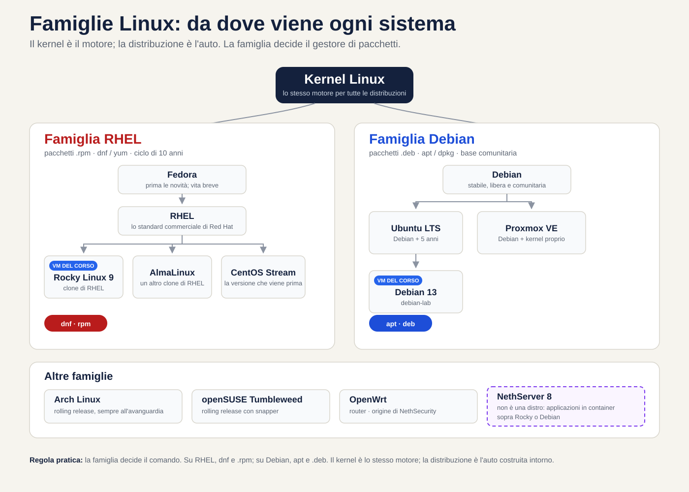
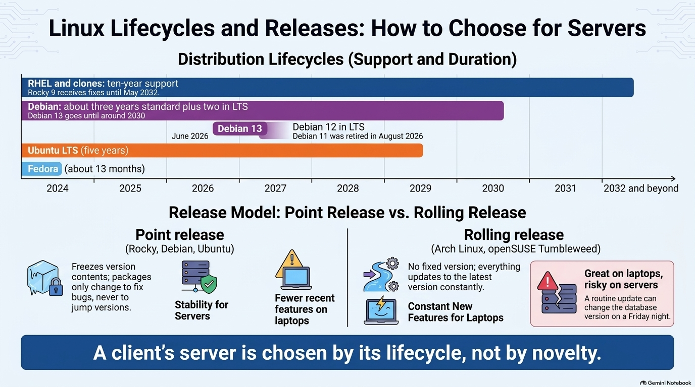
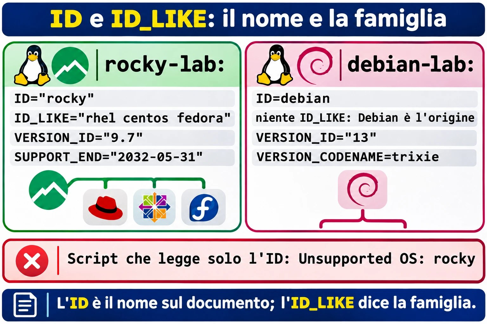
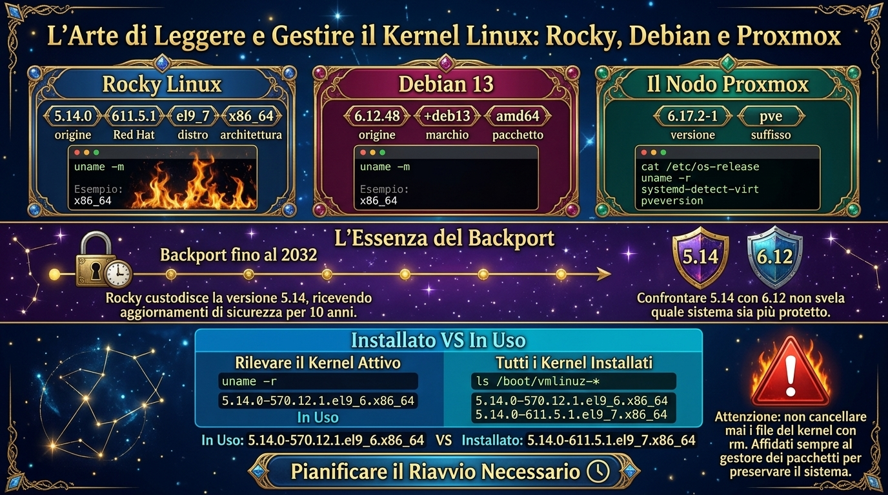
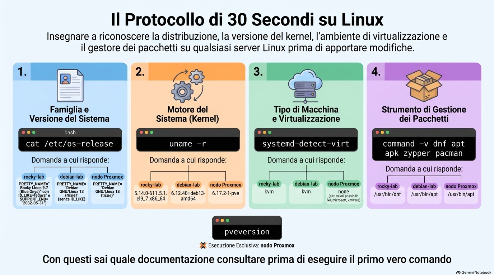

# Lezione 1.1 · Cos'è Linux

Separi una volta per tutte kernel, distribuzione e famiglia, identifichi qualsiasi Linux in 30 secondi e collochi sulla mappa i sistemi che già amministri: Proxmox, NethServer 8 e NethSecurity.

| Scheda | Lezione 1.1 |
| --- | --- |
| Modulo | M1 · Riga di comando, lezione 1 di 10 |
| Quando | Settimana 1 |
| Alla fine sei in grado di | Separare kernel, distribuzione e famiglia; dire famiglia, versione, kernel e ciclo di vita di qualsiasi Linux in 30 secondi; leggere la versione di un kernel pezzo per pezzo; collocare Proxmox, NethServer 8 e NethSecurity nell'albero delle distribuzioni |
| Prerequisiti | M0 completo: ssh rocky-lab e ssh debian-lab funzionanti |
| Durata | Circa 2h |
| Snapshot | m1a1-inicio e m1a1-fim su entrambe le VM |

## 1 · Riscaldamento

Tre domande, a mente, prima di leggere qualsiasi cosa. Scrivi le risposte; le Soluzioni le verificano in fondo.

1. Windows Server 2025 e Windows 11 24H2 hanno lo stesso numero di build, 26100. Sono lo stesso sistema?
2. Senza entrare nelle VM: quale distribuzione e quale versione girano su rocky-lab e su debian-lab? Il kernel delle due è lo stesso?
3. Proxmox VE è Linux? Se sì, quale distribuzione c'è sotto?

## 2 · Perché conta

Un cliente apre un ticket: il file server "ha smesso di aggiornarsi". Entri via SSH, digiti `sudo apt update` e ricevi `command not found`. Cerchi l'errore, trovi una risposta scritta per Ubuntu, provi, non funziona. Venti minuti dopo scopri che la macchina è un CentOS 7. La famiglia è un'altra, il gestore di pacchetti è un altro, e il problema non è nemmeno di comando: CentOS 7 ha smesso di ricevere aggiornamenti a giugno 2024. Non c'è nulla da riparare nel terminale. C'è una migrazione da proporre.

Con il protocollo di questa lezione, la stessa storia richiede 30 secondi. Un comando dice la famiglia e la versione, e con esse arriva il resto: quale documentazione leggere, quale comando usare e se il caso è un ritocco o un progetto.

Per chi assiste i server di più clienti, questo pesa ancora di più. Ogni server è stato installato da qualcuno di diverso, in un'epoca diversa. Solo nei sistemi che già amministri, Proxmox, NethServer e NethSecurity, convivono tre famiglie di Linux, e ciascuna ha la sua data di fine supporto.

## 3 · Modello mentale

> Linux è il motore; la distribuzione è l'auto.

Il kernel Linux è il motore. Parla con l'hardware, divide CPU e memoria tra i programmi, controlla dischi e rete. Da solo non porta nessuno da nessuna parte, come un motore su un banco. La distribuzione è l'auto montata attorno a lui: la shell, i comandi, l'installer, il gestore di pacchetti, le configurazioni di fabbrica e, soprattutto, la promessa di manutenzione, che dice per quanti anni quell'auto riceve ricambi e richiami.

Varie case automobilistiche usano lo stesso motore. Red Hat, la comunità Debian, Canonical e Proxmox prendono lo stesso kernel Linux e montano auto molto diverse. E le case formano famiglie: Rocky è praticamente la stessa auto di RHEL, e Ubuntu è nato da un Debian e ne conserva la meccanica.


*Il kernel è lo stesso; la famiglia decide il gestore di pacchetti. I riquadri evidenziati sono le VM del corso.*

Leggi il diagramma per righe. Ogni riga è una famiglia, e la famiglia decide cosa digiti: `dnf` e pacchetti `.rpm` nella prima, `apt` e pacchetti `.deb` nella seconda. Le frecce mostrano da dove nasce ogni sistema, e i due riquadri evidenziati sono le VM del corso. NethServer 8 ha il bordo tratteggiato perché non è una distribuzione: è un insieme di applicazioni che si installa sopra un Rocky o un Debian. E NethSecurity non sta nemmeno nelle prime due righe: viene da OpenWrt, una famiglia fatta per i router.

**Ponte Windows:** questo modello lo conosci già. Windows Server 2025 e Windows 11 24H2 usano lo stesso nucleo, della build 26100, e sono prodotti diversi, con altre funzioni, un'altra licenza e un altro ciclo di supporto. La differenza è che in Windows solo Microsoft monta auto con quel motore. In Linux chiunque può montarle, perché il codice del kernel è aperto. Per questo esistono centinaia di distribuzioni, e per questo Rocky può esistere come copia gratuita di RHEL.

## 4 · Concetto a strati

### Essenziale

| Termine | Cos'è | Dove lo vedi |
| --- | --- | --- |
| Kernel | Il nucleo: parla con l'hardware e divide CPU, memoria, disco e rete tra i programmi | `uname -r`; lo stesso Linux gira su Proxmox, su rocky-lab e sul tuo telefono Android |
| Userspace | Tutto ciò che gira fuori dal kernel: shell, comandi, servizi | `bash`, `sshd`, `dnf` |
| Distribuzione | Kernel, programmi, gestore di pacchetti, installer e una politica di versioni e di supporto | Rocky, Debian, Ubuntu, Proxmox VE |
| Famiglia | Distribuzioni che nascono dalla stessa origine e usano lo stesso formato di pacchetto | Red Hat (`dnf`, `.rpm`) e Debian (`apt`, `.deb`) |
| Ciclo di vita | Per quanto tempo la distribuzione riceve correzioni di sicurezza | Rocky 9 fino a maggio 2032; CentOS 7 è finito a giugno 2024 |
| Backport | Correzione di una versione nuova applicata a una versione vecchia | Il kernel 5.14 di Rocky, con correzioni del 2026 |
| Versione numerata o rolling | Versioni che si congelano e ricevono solo correzioni, oppure aggiornamento continuo verso il più nuovo | Debian e Rocky; Arch e openSUSE Tumbleweed |
| Software libero | Codice che chiunque può leggere, modificare e ridistribuire; il kernel usa la licenza GPL versione 2 | È ciò che permette l'esistenza di un Rocky gratuito accanto a RHEL |

**Ponte Windows:** il gestore di pacchetti è il Windows Update della distribuzione, ma per tutto: sistema, servizi e programmi arrivano dallo stesso repository. Per questo la famiglia conta tanto. `dnf` non esiste su un Debian, e `apt` non esiste su un Rocky.

### Approfondimento

**Linux o GNU/Linux.** Nel 1991, Linus Torvalds scrisse il kernel. I comandi di base, il compilatore e buona parte del resto vennero dal progetto GNU, che già esisteva. Per questo Debian si chiama Debian GNU/Linux. Android usa il kernel Linux quasi senza nulla di GNU, e il router di casa tua probabilmente gira anch'esso su Linux. Nella documentazione, "Linux" a volte significa solo il kernel; leggi il contesto tenendolo presente.

**La catena di Red Hat.** Dal 2021, il percorso è Fedora, poi CentOS Stream, poi RHEL. Stream è diventato l'anteprima del prossimo RHEL e ha smesso di essere la copia gratuita. Quel ruolo è passato a Rocky Linux e AlmaLinux. Nel 2023 Red Hat ha ristretto la pubblicazione del codice di RHEL; Rocky ha continuato a ricostruire RHEL per altre vie, e AlmaLinux ha iniziato a promettere compatibilità invece di una copia identica. Nel quotidiano, entrambi si comportano come RHEL.

**Leggere la versione del kernel.** Un kernel di Rocky come `5.14.0-611.5.1.el9_7.x86_64` si legge in quattro pezzi; il tuo avrà altri numeri nel mezzo. `5.14.0` è la versione di origine, rilasciata dalla comunità del kernel nel 2021. `611.5.1` è la compilazione di Red Hat, che sale a ogni correzione. `el9_7` significa Enterprise Linux 9, versione 9.7. `x86_64` è l'architettura. Su Debian 13, qualcosa come `6.12.48+deb13-amd64` porta la stessa idea in un altro formato: la versione di origine, il marchio di Debian 13 e l'architettura, che Debian chiama `amd64`.

**Perché Rocky resta sul 5.14 fino al 2032.** Red Hat congela la versione di origine all'inizio di RHEL 9 e, per dieci anni, porta su di essa le correzioni di sicurezza e molti driver delle versioni nuove. È il backport. Il vantaggio è la prevedibilità: un programma omologato su RHEL 9.0 continua a funzionare sulla 9.7. Per questo, confrontare `5.14` con `6.12` non dice quale sia più sicuro. Ciò che lo dice è la data dell'ultimo pacchetto kernel installato e se è quello in esecuzione.

**Versioni numerate e rolling release.** Rocky, Debian e Ubuntu rilasciano versioni numerate e congelano ciò che contengono: dentro Debian 13, un pacchetto cambia per correggere un difetto, mai per saltare di versione. In una rolling release, come Arch Linux o openSUSE Tumbleweed, non esiste una versione: tutto si aggiorna di continuo verso il più nuovo. Ottimo sul portatile di chi ama le novità; rischioso sul server di un cliente, dove un aggiornamento di routine può cambiare la versione del database un venerdì sera.

**Il ciclo di vita è il numero che conta.** RHEL e i suoi cloni hanno dieci anni: Rocky 9 riceve correzioni fino a maggio 2032. Debian dà circa tre anni di supporto normale e altri due di LTS: Debian 13 arriva fino a circa il 2030, Debian 12 è in LTS da giugno 2026, e Debian 11 è uscito definitivamente ad agosto 2026. Ubuntu LTS ha cinque anni, e Canonical vende altri anni a parte. Fedora vive circa 13 mesi per versione. Il server di un cliente si sceglie in base al ciclo di vita, non alla novità.

**I sistemi che già amministri.** Proxmox VE 9 è un Debian 13 con gli strumenti di Proxmox e un kernel proprio, derivato dal kernel di Ubuntu: quasi tutto ciò che impari su debian-lab vale sul nodo. NethServer 8 non è una distribuzione: sono applicazioni in container che si installano su un Rocky Linux o un Debian. NethServer 7 era un CentOS 7 con l'interfaccia di Nethesis. NethSecurity viene da OpenWrt, nato per i router e dotato di propri strumenti di pacchetto.


*Per il server di un cliente, conta quanti anni di correzioni la versione ha ancora.*

## 5 · Rocky × Debian

| Cosa | rocky-lab | debian-lab |
| --- | --- | --- |
| Famiglia | Red Hat | Debian |
| `ID` in `/etc/os-release` | `rocky` | `debian` |
| `ID_LIKE` | `rhel centos fedora` | Non esiste: Debian è l'origine della famiglia |
| File extra di versione | `/etc/redhat-release` e `/etc/rocky-release` | `/etc/debian_version` |
| Kernel | `5.14.0-…el9_….x86_64`, congelato e con backport | `6.12.…+deb13-amd64` |
| Gestore di pacchetti | `dnf`, pacchetti `.rpm` | `apt`, pacchetti `.deb` |
| Pacchetto proprietario di `os-release` | `rocky-release` | `base-files` |
| Verificare se il pacchetto è stato alterato | `rpm -V rocky-release` | `dpkg --verify base-files` |
| Fine del supporto | Maggio 2032, scritto nello stesso `os-release` | Circa il 2030, contando l'LTS; non è nel file |

## 6 · Lab guidato

In questo lab costruisci il protocollo dei 30 secondi: quattro comandi che dicono famiglia, versione, kernel e tipo di macchina di qualsiasi Linux ti capiti tra le mani. Qui tutto è lettura, tranne gli snapshot. Tieni due terminali aperti, uno per VM.

Lungo i passi compaiono blocchi **Decidi**: una situazione, quattro alternative e una tabella che spiega ciascuna, giusta o sbagliata. Quelli segnati come **scenario** descrivono cose che nel lab non succedono da sole, ma succedono nel tuo lavoro.

### Passo 1 · Snapshot iniziale

Nella shell del nodo Proxmox dove stanno le VM, come nelle lezioni dell'M0:

```bash
qm snapshot 201 m1a1-inicio --description "Aula 1.1, antes do lab"
qm snapshot 202 m1a1-inicio --description "Aula 1.1, antes do lab"
qm listsnapshot 201
```

Output atteso: l'albero mostra `m0a2-fim`, poi `m1a1-inicio` e, per ultimo, `current` con "You are here!". Se `qm` risponde che la VM non esiste, sei sul nodo sbagliato; l'interfaccia web mostra su quale nodo gira ogni VM.

### Passo 2 · Il documento d'identità: `/etc/os-release`

```bash
ssh rocky-lab
cat /etc/os-release
```

Output atteso (estratto; il numero dopo il 9. dipende da quando hai installato e aggiornato):

```
NAME="Rocky Linux"
VERSION="9.7 (Blue Onyx)"
ID="rocky"
ID_LIKE="rhel centos fedora"
VERSION_ID="9.7"
PRETTY_NAME="Rocky Linux 9.7 (Blue Onyx)"
SUPPORT_END="2032-05-31"
```

**Prevedi:** prima di eseguire lo stesso comando su debian-lab, rispondi: ci sarà una riga `ID_LIKE`?

```bash
ssh debian-lab
cat /etc/os-release
```

Output atteso (estratto):

```
PRETTY_NAME="Debian GNU/Linux 13 (trixie)"
NAME="Debian GNU/Linux"
VERSION_ID="13"
VERSION="13 (trixie)"
VERSION_CODENAME=trixie
ID=debian
```

Non esiste `ID_LIKE`, né `SUPPORT_END`. Debian è l'origine della famiglia e non somiglia a nessuno; un Ubuntu, nato da lui, porta `ID_LIKE=debian`. E `trixie` è il nome in codice di Debian 13. I nomi in codice vengono dai personaggi di Toy Story, e li troverai nei repository e nei forum quanto il numero.

**Da sapere:** `/etc/os-release` è uno standard di systemd che quasi tutte le distribuzioni hanno adottato, comprese quelle che non usano systemd, come OpenWrt. Per questo apre il protocollo. Quando vuoi solo le righe che contano:

```bash
grep -E '^(ID|ID_LIKE|VERSION_ID)=' /etc/os-release
```

**Decidi 1 · L'installer che non riconosce Rocky.** Scenario: un fornitore manda uno script di installazione che dice di supportare "RHEL 9". Sul server di un cliente, un Rocky 9, lo script si ferma con `Unsupported OS: rocky`. Cosa fai?

- **A)** Modifica `/etc/os-release` e cambia `ID="rocky"` in `ID="rhel"`, per far passare lo script.
- **B)** Legge il controllo dello script e la documentazione del fornitore: molti accettano `ID_LIKE` o hanno un'opzione per le distribuzioni compatibili. Se non c'è, chiede al fornitore.
- **C)** Esegue lo script con `sudo`, perché l'errore deve essere di permessi.
- **D)** Conclude che Rocky è incompatibile con RHEL e reinstalla il server con Ubuntu.

Scegli la lettera prima di guardare la tabella.

| Se hai scelto | Risultato | Perché |
| --- | --- | --- |
| A | ❌ Sbagliato | Il file appartiene al pacchetto `rocky-release` e torna all'originale al prossimo aggiornamento. Fino ad allora, inventari, scanner di vulnerabilità e altri script vedono un sistema che non esiste. La sezione 7 mostra come smascherare questa bugia. |
| B | ✅ Giusto | Rocky è fatto per comportarsi come RHEL, e `ID_LIKE="rhel centos fedora"` esiste per dirlo. Il difetto sta in uno script che legge solo `ID`; la soluzione è usare la via che il fornitore ha previsto o chiedergli di prevederla. |
| C | ❌ Sbagliato | Il messaggio parla del sistema, non dei permessi. Un errore di permessi dice `Permission denied`. |
| D | ❌ Sbagliato | Ubuntu è di un'altra famiglia, più lontana da RHEL di Rocky. Scambieresti un problema di script con un'intera migrazione. |

**Da ricordare:** l'`ID` è il nome sul documento; l'`ID_LIKE` dice di che famiglia sei. Lo script che legge solo l'`ID` è il portiere che blocca il gemello perché il suo nome non è nell'elenco.



*L'ID è il nome sul documento; l'ID_LIKE dice di che famiglia è il sistema.*

### Passo 3 · Il motore: `uname -r`

Su entrambe le VM:

```bash
uname -r
```

Output atteso: qualcosa come `5.14.0-611.5.1.el9_7.x86_64` su rocky-lab e `6.12.48+deb13-amd64` su debian-lab. Leggi pezzo per pezzo, come nella sezione 4. Su Rocky: versione di origine, compilazione di Red Hat, `el9_7` e architettura. Su Debian: versione di origine, il marchio `deb13` e `amd64`.

**Prevedi:** `uname -m` mostra solo l'architettura. Su debian-lab, dirà `amd64` o `x86_64`?

```bash
uname -m
```

Output atteso: `x86_64` su entrambe. `amd64` è solo il nome che Debian dà ai pacchetti di quell'architettura; il kernel si presenta sempre come `x86_64`.

**Decidi 2 · Il kernel "vecchio".** Davanti a te, `5.14` su rocky-lab e `6.12` su debian-lab. Un collega dice che Rocky ha il kernel in ritardo di tre anni e suggerisce di installarne uno più nuovo, da un repository di internet. Cosa fai?

- **A)** Concorda e installa il kernel nuovo da un repository di terze parti.
- **B)** Non decide in base al numero: verifica se il pacchetto del kernel è aggiornato e se il kernel in uso è l'ultimo installato.
- **C)** Migra il server a Debian, che ha un kernel più nuovo.
- **D)** Esegue `sudo dnf update kernel`, che dovrebbe portare Rocky al 6.12.

Scegli la lettera prima di guardare la tabella.

| Se hai scelto | Risultato | Perché |
| --- | --- | --- |
| A | ❌ Sbagliato | Esci dal kernel che Red Hat testa insieme al resto del sistema e smetti di ricevere correzioni tramite `dnf`. Sul server di un cliente, è sostituire il motore originale con uno da officina. |
| B | ✅ Giusto | Grazie al backport, il 5.14 di Rocky riceve correzioni di sicurezza fino al 2032. Ciò che dice se il server è protetto è la data del pacchetto e se è in uso, ed è quello che il prossimo passo mostra. |
| C | ❌ Sbagliato | Il numero del kernel non è un criterio di migrazione. Anche Debian congela la sua versione e fa backport allo stesso modo. |
| D | ❌ Sbagliato | `dnf update` porta una compilazione nuova, con un altro numero dopo `5.14.0-`, ma la versione di origine non cambia mai dentro RHEL 9. |

**Da ricordare:** RHEL 9 è un'auto con dieci anni di richiami. Il modello è del 2021; i pezzi sostituiti sono di oggi.

### Passo 4 · Installato non significa in uso

Su rocky-lab:

```bash
uname -r
ls /boot/vmlinuz-*
```

Output atteso: `uname -r` mostra il kernel in uso; `ls` elenca i kernel installati. Se hai aggiornato la VM dopo l'ultimo boot, può essercene più d'uno. Il file con `rescue` nel nome è un kernel di emergenza che l'installer di Rocky crea; lascialo fuori dal confronto. Fai lo stesso su debian-lab.

**Decidi 3 · Due kernel in `/boot`.** Scenario: su un server di un cliente, `uname -r` mostra `5.14.0-570.12.1.el9_6.x86_64`, e `ls /boot/vmlinuz-*` mostra questo e anche il `5.14.0-611.5.1.el9_7.x86_64`. Cosa significa?

- **A)** Il server sta eseguendo due kernel contemporaneamente.
- **B)** Il kernel nuovo è stato installato, ma il server non si è riavviato, e le sue correzioni non valgono ancora. Concordi un reboot con il cliente.
- **C)** `/boot` è pieno di rifiuti; cancelli il kernel più vecchio con `rm`.
- **D)** È normale e non c'è nulla da fare.

Scegli la lettera prima di guardare la tabella.

| Se hai scelto | Risultato | Perché |
| --- | --- | --- |
| A | ❌ Sbagliato | Gira un solo kernel alla volta: quello che mostra `uname -r`. Gli altri sono file che aspettano un boot. |
| B | ✅ Giusto | Il kernel in uso è più vecchio dell'ultimo installato, quindi le correzioni del nuovo sono ancora nella scatola. È il "riavvia per completare l'aggiornamento" di Windows, solo che Linux non insiste. |
| C | ❌ Sbagliato | Cancelleresti proprio il kernel in uso, e il prossimo boot potrebbe fallire. I kernel vecchi li rimuove `dnf` o `apt`, che ne tengono qualcuno di riserva di proposito. |
| D | ❌ Sbagliato | Avere più di un kernel installato è normale. Eseguire quello più vecchio, no. |

**Da ricordare:** un pezzo nuovo nella scatola non ripara l'auto; solo dopo averlo montato. In Linux, montare il kernel nuovo significa riavviare.


*Il numero del kernel racconta l'origine, la compilazione e la distro; il reboot è ciò che mette in uso quello nuovo.*

### Passo 5 · Che macchina è questa: `hostnamectl` e `systemd-detect-virt`

```bash
hostnamectl
systemd-detect-virt
```

Output atteso di `hostnamectl` su rocky-lab (estratto):

```
 Static hostname: rocky-lab
  Virtualization: kvm
Operating System: Rocky Linux 9.7 (Blue Onyx)
          Kernel: Linux 5.14.0-611.5.1.el9_7.x86_64
    Architecture: x86-64
 Hardware Vendor: QEMU
```

`systemd-detect-virt` risponde solo `kvm`. `hostnamectl` riunisce in un posto ciò che hai visto nei passi 2 e 3, più il tipo di macchina. `systemd-detect-virt` risponde in una parola: `kvm` in una VM di Proxmox, `lxc` in un container LXC come quello del DeepTutor, `microsoft` in una VM di Hyper-V, `vmware` in una di VMware e `none` su una macchina fisica.

**Decidi 4 · Il comando che non esiste.** Scenario: entri via SSH nel NethSecurity di un cliente per vedere la versione, e `hostnamectl` risponde `-ash: hostnamectl: not found`. Cosa sta succedendo?

- **A)** Il firewall ha un difetto e va reinstallato.
- **B)** NethSecurity viene da OpenWrt, che non usa systemd, e `hostnamectl` è uno strumento di systemd. Usi `cat /etc/os-release`, che esiste anche lì.
- **C)** Mancavano i permessi; provi `sudo hostnamectl`.
- **D)** Installi systemd con `dnf install systemd`.

Scegli la lettera prima di guardare la tabella.

| Se hai scelto | Risultato | Perché |
| --- | --- | --- |
| A | ❌ Sbagliato | `not found` significa solo che il comando non esiste in quel sistema. Nulla indica un difetto. |
| B | ✅ Giusto | Famiglia diversa, strumenti diversi. L'`ash` nell'errore dà già l'indizio: è la shell di BusyBox, usata in OpenWrt e in Alpine. L'`os-release` è ciò che tutti hanno in comune. |
| C | ❌ Sbagliato | La mancanza di permessi compare come `Permission denied`. E su OpenWrt normalmente entri già come root. |
| D | ❌ Sbagliato | Non esiste `dnf` su un OpenWrt, e systemd non si installa sopra un sistema. Peggio: sarebbe installare un pacchetto sul firewall di produzione di un cliente solo per leggere una versione. |

**Da ricordare:** l'`os-release` è la targa dell'auto, ce l'hanno tutte. `hostnamectl` è il cruscotto digitale: arriva solo nei modelli con systemd.

### Passo 6 · Quale gestore di pacchetti?

```bash
command -v dnf apt apk zypper pacman
```

Output atteso: `/usr/bin/dnf` su rocky-lab e `/usr/bin/apt` su debian-lab. `command -v` stampa il percorso di ogni nome che esiste e tace sugli altri. I cinque nomi coprono le famiglie Red Hat, Debian, Alpine, SUSE e Arch. La Lezione 1.2 spiega perché usare `command -v` e non `which`.

**Decidi 5 · Il tutorial dell'altra famiglia.** Su rocky-lab, segui un tutorial e digiti `sudo apt install apache2`. Risposta: `sudo: apt: command not found`. Cosa fai?

- **A)** Installa `apt` su Rocky perché il tutorial funzioni.
- **B)** Cerca l'equivalente nella famiglia Red Hat: il gestore è `dnf`, e il pacchetto di Apache si chiama `httpd`. Meglio ancora, cerca un tutorial scritto per Rocky o RHEL.
- **C)** Scarica il pacchetto `.deb` di Apache e lo installa a mano.
- **D)** Crea un alias `apt=dnf`.

Scegli la lettera prima di guardare la tabella.

| Se hai scelto | Risultato | Perché |
| --- | --- | --- |
| A | ❌ Sbagliato | `apt` installa solo pacchetti `.deb`, fatti per le librerie di Debian. Su un Rocky, non avrebbe da dove installare né come convivere con `rpm`. |
| B | ✅ Giusto | L'idea del tutorial vale; i nomi cambiano da famiglia a famiglia. Apache è `apache2` su Debian e `httpd` su Rocky, con la configurazione in altri posti. |
| C | ❌ Sbagliato | Un `.deb` non si installa su un Rocky, e anche convertito romperebbe dipendenze che `dnf` non conosce. |
| D | ❌ Sbagliato | L'alias nasconde la differenza senza risolverla: `dnf install apache2` fallisce allo stesso modo, perché il pacchetto ha un altro nome. |

**Da ricordare:** stessa strada, altra casa automobilistica. I pedali sono nello stesso posto; il manuale è un altro.

### Passo 7 · Il nodo Proxmox, sola lettura

Nella shell di un nodo del cluster, come `pve-node2`. Nulla qui modifica il nodo:

```bash
cat /etc/os-release
uname -r
systemd-detect-virt
pveversion
```

**Prevedi:** l'`os-release` del nodo dirà Proxmox o Debian?

Output atteso: `PRETTY_NAME="Debian GNU/Linux 13 (trixie)"`. Il kernel finisce con `-pve`, come `6.17.2-1-pve`. `systemd-detect-virt` risponde `none`, perché il nodo è la macchina fisica. E `pveversion` mostra qualcosa come `pve-manager/9.1.4/… (running kernel: 6.17.2-1-pve)`; i numeri del tuo nodo saranno altri.

**Decidi 6 · Debian o no?** Scenario: un cliente chiede aiuto su un server che nessuno ha documentato. L'`os-release` dice Debian 13, `uname -r` finisce con `-pve`, e `systemd-detect-virt` risponde `none`. Cos'è questa macchina?

- **A)** Una VM Debian con il kernel sbagliato.
- **B)** Un Ubuntu, perché il kernel di Proxmox viene da Ubuntu.
- **C)** Un nodo Proxmox VE: il Debian sotto, con il kernel di Proxmox. Lo confermi con `pveversion` e tratti la macchina con cautela, perché le VM del cliente dipendono da lei.
- **D)** Un Debian corrotto, dato che il kernel non combacia con l'`os-release`.

Scegli la lettera prima di guardare la tabella.

| Se hai scelto | Risultato | Perché |
| --- | --- | --- |
| A | ❌ Sbagliato | `none` dice che la macchina è fisica. Una VM risponderebbe `kvm`, `vmware` o `microsoft`. |
| B | ❌ Sbagliato | Il kernel di Proxmox deriva dal kernel di Ubuntu, ma il sistema è Debian: `apt`, repository e `os-release` di Debian. |
| C | ✅ Giusto | Proxmox non cambia l'`os-release`, perché resta un Debian. Il kernel `-pve` e `pveversion` rivelano il resto. E un reboot lì butta giù tutte le VM in una volta. |
| D | ❌ Sbagliato | Nulla è rotto: Proxmox installa il suo kernel sopra Debian di proposito. |

**Da ricordare:** carrozzeria di Debian, motore preparato da Proxmox.

### Passo 8 · Chi è il proprietario di `os-release`

`/etc/os-release` sembra un file di configurazione, ma a installarlo è un pacchetto. Segui il link fino al file reale e chiedi al gestore di pacchetti chi lo ha installato.

Su rocky-lab:

```bash
readlink -f /etc/os-release
rpm -qf /usr/lib/os-release
```

Output atteso: `/usr/lib/os-release` e qualcosa come `rocky-release-9.7-1.2.el9.noarch`.

Su debian-lab:

```bash
readlink -f /etc/os-release
dpkg -S /usr/lib/os-release
```

Output atteso: `/usr/lib/os-release` e `base-files: /usr/lib/os-release`.

**Da sapere:** `/etc/os-release` è un link simbolico a `/usr/lib/os-release`. Poiché il file viene da un pacchetto, cambia da solo quando aggiorni da 9.6 a 9.7, e il gestore di pacchetti sa dire se qualcuno lo ha toccato. È ciò che usa la prossima sezione.

### Il protocollo dei 30 secondi

I quattro comandi che porti su qualsiasi server:

```bash
cat /etc/os-release
uname -r
systemd-detect-virt
command -v dnf apt apk zypper pacman
```

Famiglia e versione, motore, tipo di macchina e strumento di pacchetti. Con essi sai quale documentazione aprire prima di digitare il primo comando vero.


*Quattro comandi, quattro risposte: famiglia, motore, macchina e pacchetti.*

## 7 · Rompi e ripara

L'`os-release` è un file di testo. Chiunque abbia root può scriverci ciò che vuole, e a volte qualcuno lo scrive, per ingannare un installer. Ora lo fai di proposito e impari a smascherare la bugia.

**Rompi.** Su rocky-lab. Il controllo dell'hostname impedisce che il comando giri su un'altra macchina:

```bash
[ "$(hostname)" = rocky-lab ] && sudo sed -i 's/^PRETTY_NAME=.*/PRETTY_NAME="Windows Server 2025"/' /usr/lib/os-release
grep PRETTY_NAME /etc/os-release
```

Output atteso: `PRETTY_NAME="Windows Server 2025"`. Hai modificato il file reale in `/usr/lib`, e il link in `/etc` mostra il cambiamento.

**Prevedi:** cosa diranno `hostnamectl` e `/etc/redhat-release`?

```bash
hostnamectl | grep 'Operating System'
cat /etc/redhat-release
```

Output atteso: `hostnamectl` mostra `Operating System: Windows Server 2025`, perché legge lo stesso file. Se mostra ancora Rocky, aspetta mezzo minuto e ripeti: il servizio che risponde a `hostnamectl` conserva l'ultima lettura per un po'. `/etc/redhat-release`, invece, continua a dire `Rocky Linux release 9.7 (Blue Onyx)`, perché è un altro file. Due fonti in disaccordo sono il primo segnale che qualcuno ha messo mano.

**Scopri.** Chiedi al gestore di pacchetti se i file di `rocky-release` sono ancora quelli che ha installato:

```bash
rpm -V rocky-release
```

Output atteso: `S.5....T.    /usr/lib/os-release`. Ogni posizione è un test, e il punto significa che il test è passato. `S` è la dimensione, `5` è il checksum, che cambia con qualsiasi alterazione del contenuto, e `T` è la data di modifica. I tre dicono la stessa cosa: qualcuno ha toccato il file dopo l'installazione.

**Decidi 7 · Il RHEL che non è RHEL.** Scenario: erediti il server di un cliente. L'`os-release` dice `ID="rhel"`, ma `rpm -qf /usr/lib/os-release` risponde `rocky-release`, e `rpm -V rocky-release` mostra la stessa riga `S.5....T.` che hai appena visto. Cos'è e cosa fai?

- **A)** È un RHEL; apri un ticket al supporto di Red Hat.
- **B)** È un Rocky con l'`os-release` modificato, quasi certamente per ingannare un installer. Documenti, scopri quale programma lo ha richiesto e solo allora ripristini il file, in una finestra concordata con il cliente.
- **C)** È solo cosmetico; lo lasci com'è.
- **D)** Reinstalli il server da zero, perché non ci si può più fidare.

Scegli la lettera prima di guardare la tabella.

| Se hai scelto | Risultato | Perché |
| --- | --- | --- |
| A | ❌ Sbagliato | Il pacchetto proprietario del file è `rocky-release`. Lì non c'è nessuna firma di Red Hat, e il supporto non risponderebbe. |
| B | ✅ Giusto | Il pacchetto e la verifica dicono la verità che il file nasconde. Ripristinare senza capire può rompere il programma che dipendeva dalla bugia, per questo prima scopri quale sia. È l'alternativa A di Decidi 1, vista dall'altro lato. |
| C | ❌ Sbagliato | Inventari, scanner di vulnerabilità e strumenti come Ansible leggono quel file. Se è sbagliato, il server compare come un altro sistema, e le correzioni possono passare inosservate. |
| D | ❌ Sbagliato | Esagerato: un file alterato si ripristina con un comando. Reinstallare costa un giorno di lavoro e non spiega perché sia successo. |

**Da ricordare:** una targa contraffatta non cambia il telaio. Il pacchetto e il kernel sono il numero di telaio.

**Ripara.** Reinstalla il pacchetto. `dnf` riscrive tutti i suoi file come sono arrivati:

```bash
sudo dnf reinstall -y rocky-release
```

**Verifica.**

```bash
rpm -V rocky-release
grep PRETTY_NAME /etc/os-release
```

Output atteso: `rpm -V` non stampa nulla, e `grep` torna a mostrare `PRETTY_NAME="Rocky Linux 9.7 (Blue Onyx)"`.

**Decidi 8 · Il silenzio.** `rpm -V rocky-release` non ha stampato nulla. Cosa significa?

- **A)** Il comando è fallito senza mostrare l'errore.
- **B)** Tutti i file del pacchetto sono uguali a quelli che ha installato.
- **C)** Il pacchetto `rocky-release` non è installato.
- **D)** Mancava `sudo` per vedere il risultato.

Scegli la lettera prima di guardare la tabella.

| Se hai scelto | Risultato | Perché |
| --- | --- | --- |
| A | ❌ Sbagliato | Quando fallisce, il comando dice perché. Per verificare, `echo $?` subito dopo mostra `0`, il codice di successo. |
| B | ✅ Giusto | In Linux, un comando riuscito di solito resta muto. `rpm -V` parla solo quando trova una differenza. |
| C | ❌ Sbagliato | In quel caso la risposta sarebbe `package rocky-release is not installed`. |
| D | ❌ Sbagliato | I file di quel pacchetto possono essere letti da qualsiasi utente, e `rpm -V` funziona senza root. |

**Da ricordare:** in Linux, il silenzio è una buona notizia.

**E lo snapshot?** Nel lab, `qm rollback 201 m1a1-inicio` seguito da `qm start 201` annullerebbe anch'esso la rottura. Sul server di un cliente quasi mai esiste uno snapshot di prima del pasticcio, e a volte non si sa nemmeno quando sia avvenuto. Per questo la riparazione che porti nella vita è quella del pacchetto: funziona su qualsiasi server, in qualsiasi momento, senza perdere ciò che è cambiato dopo.

**Bonus su Debian.** Ripeti su debian-lab, con gli strumenti dell'altra famiglia:

```bash
[ "$(hostname)" = debian-lab ] && sudo sed -i 's/^PRETTY_NAME=.*/PRETTY_NAME="Windows Server 2025"/' /usr/lib/os-release
dpkg --verify base-files
sudo apt install -y --reinstall base-files
dpkg --verify base-files
```

Output atteso: il primo `dpkg --verify` mostra `??5??????   /usr/lib/os-release`. `dpkg` controlla solo il checksum, per questo le altre posizioni restano con `?`. Dopo la reinstallazione, il secondo non stampa nulla.

**La lezione:** l'`os-release` dice ciò che qualcuno ci ha scritto; il pacchetto e il kernel dicono cos'è il sistema. Quando le fonti discordano, fidati del gestore di pacchetti, che conserva il checksum di ogni file che ha installato.

## 8 · Trappole

| Sintomo | Causa | Soluzione |
| --- | --- | --- |
| `apt: command not found` su Rocky, o `dnf` su Debian | Comando della famiglia sbagliata | `cat /etc/os-release` prima di tutto; usa il gestore della famiglia |
| L'installer di un fornitore rifiuta Rocky e dice che accetta solo RHEL | Lo script legge solo `ID` e ignora `ID_LIKE` | Documentazione del fornitore o opzione per i compatibili; mai modificare l'`os-release` |
| `hostnamectl: not found` | Sistema senza systemd: OpenWrt, NethSecurity, Alpine, molti container | `cat /etc/os-release`, che esiste in quasi tutti |
| L'`os-release` di un nodo Proxmox dice Debian | Proxmox è un Debian con kernel e strumenti propri | `uname -r` finisce con `-pve`; `pveversion` conferma |
| `uname -r` mostra un kernel più vecchio dell'ultimo in `/boot` | Kernel aggiornato, server non riavviato | Concordare il reboot con il cliente |
| Credere che il kernel 5.14 di Rocky sia obsoleto | Backport: Red Hat corregge la versione congelata | Guardare la data del pacchetto: `rpm -q --last kernel` |
| `/etc/redhat-release` e `/etc/os-release` discordano | Qualcuno ha modificato uno dei due | `rpm -V rocky-release` e `dnf reinstall` |
| `systemd-detect-virt` risponde `none` dove ti aspettavi una VM | Macchina fisica, o l'hypervisor stesso | `pveversion`; cautela doppia prima di riavviare |
| `rpm -V` o `dpkg --verify` non stampa nulla e sembra che sia fallito | Il silenzio è successo | `echo $?` mostra `0` |

## 9 · Quiz

Rispondi a tutto a mente, per iscritto, prima di aprire le Soluzioni.

1. Qual è la differenza tra il kernel e la distribuzione? Fai un esempio di qualcosa che ciascuno fa.
2. In `/etc/os-release` di rocky-lab, cosa dicono le righe `ID` e `ID_LIKE`? Perché debian-lab non ha `ID_LIKE`?
3. Leggi pezzo per pezzo: `5.14.0-570.12.1.el9_6.x86_64`.
4. Perché Rocky 9 resta sul kernel 5.14 fino al 2032, e perché questo non lo rende insicuro?
5. Come scopri se un server sta aspettando un reboot per usare il kernel nuovo?
6. L'`os-release` di un server dice Debian 13. Con quali due comandi dimostri che è un nodo Proxmox?
7. Qual è la differenza tra una distribuzione con versioni numerate e una rolling release? Quale scegli per il server di un cliente, e cosa insegna CentOS 7 a riguardo?
8. In inglese, come nei forum e nella documentazione: *Which of the following Linux distributions is derived from Debian?* A) Fedora · B) Ubuntu · C) Rocky Linux · D) openSUSE

## 10 · Flashcard e promemoria

Copia le schede nel tuo mazzo o chiedile al DeepTutor con `!cartoes 1.1`. Leggi il fronte, rispondi a voce alta e solo dopo guarda il retro.

| Fronte | Retro |
| --- | --- |
| Kernel | Il nucleo: parla con l'hardware e divide CPU, memoria, disco e rete tra i programmi |
| Distribuzione | Kernel, programmi, gestore di pacchetti, installer e una politica di supporto |
| File che identifica la distribuzione | `/etc/os-release`, link a `/usr/lib/os-release` |
| `ID_LIKE="rhel centos fedora"` | Il sistema è della famiglia Red Hat e si dichiara compatibile con essa |
| Famiglia Red Hat | Fedora, CentOS Stream, RHEL, Rocky e Alma; `dnf` e `.rpm` |
| Famiglia Debian | Debian, Ubuntu e Proxmox VE sopra Debian; `apt` e `.deb` |
| `el9_7` nel nome del kernel | Enterprise Linux 9, versione 9.7 |
| Backport | Correzione di una versione nuova applicata a una vecchia; per questo RHEL 9 resta sul 5.14 |
| Kernel più nuovo in `/boot` che in `uname -r` | Aggiornato e non riavviato |
| `systemd-detect-virt`: `kvm`, `lxc`, `none` | VM, container, macchina fisica o l'hypervisor stesso |
| `-pve` alla fine di `uname -r` | Nodo Proxmox: Debian con il kernel di Proxmox |
| NethSecurity | Firewall costruito su OpenWrt, senza systemd |
| NethServer 8 | Applicazioni che si installano su Rocky o Debian; non è una distribuzione |
| Fine del supporto: Rocky 9 e CentOS 7 | Maggio 2032; giugno 2024, già finito |
| `rpm -V` o `dpkg --verify` senza output | I file del pacchetto sono come sono stati installati |

**Da sapere a memoria.**

```bash
cat /etc/os-release
uname -r
systemd-detect-virt
command -v dnf apt apk zypper pacman
```

**Da consultare.** Basta sapere che esistono; `--help` e `man` danno il resto:

```bash
hostnamectl
uname -m
ls /boot/vmlinuz-*
readlink -f /etc/os-release
rpm -qf /usr/lib/os-release
dpkg -S /usr/lib/os-release
rpm -V rocky-release
dpkg --verify base-files
rpm -q --last kernel
pveversion
```

## 11 · Checklist di uscita

- [ ] Spiego senza guardare la differenza tra kernel, distribuzione e famiglia.
- [ ] Dico famiglia, versione, kernel e fine del supporto di un server in 30 secondi.
- [ ] Leggo la versione di un kernel di Rocky e di Debian pezzo per pezzo.
- [ ] So dire se un server sta aspettando il reboot per usare il kernel nuovo.
- [ ] Colloco Proxmox, NethServer 8 e NethSecurity nell'albero delle famiglie.
- [ ] Scopro se l'`os-release` è stato alterato e lo ripristino dal pacchetto, in entrambe le famiglie.
- [ ] Ho creato gli snapshot `m1a1-fim` su entrambe le VM.

**Chiudi la lezione.** Sul nodo Proxmox, conserva lo stato finale e cancella lo snapshot iniziale, che non serve più:

```bash
qm snapshot 201 m1a1-fim --description "Aula 1.1 concluída"
qm snapshot 202 m1a1-fim --description "Aula 1.1 concluída"
qm delsnapshot 201 m1a1-inicio
qm delsnapshot 202 m1a1-inicio
qm listsnapshot 201
```

Output atteso: l'albero mostra `m0a2-fim`, poi `m1a1-fim` e, per ultimo, `current`. La Lezione 1.2 parte da qui.

## 12 · Nella vita reale

Un comando digitato una volta, senza un problema vero alle spalle, sparisce in un giorno. Questa sezione esiste perché non succeda: una missione nel tuo lavoro e una sfida per domani, senza guardare la lezione.

**Missione di lavoro (entro domani, sola lettura).** Fai l'inventario d'identità dei server Linux che assisti. Su ciascuno a cui già accedi via SSH, esegui solo questo:

```bash
grep -E '^(PRETTY_NAME|ID_LIKE|SUPPORT_END)=' /etc/os-release; uname -r; systemd-detect-virt
```

Annota in un tuo foglio di calcolo, una riga per server: famiglia, versione, kernel, VM o fisica e fine del supporto. Sui nodi Proxmox, aggiungi `pveversion`. Su NethSecurity `systemd-detect-virt` non esiste; annota solo l'`os-release`. Poi colora di rosso tutto ciò che ha già superato la fine del supporto: CentOS 7 e NethServer 7 da giugno 2024, Debian 11 e precedenti da agosto 2026, Ubuntu 20.04 e precedenti, senza abbonamento a pagamento, da maggio 2025. Ogni riga rossa è una conversazione di migrazione con un cliente, e il foglio è il primo documento di quella conversazione.

La regola della missione è solo leggere. Niente installare, aggiornare o riavviare; i comandi qui sopra non cambiano nulla sul server.

**Domani, senza guardare.** Senza aprire questa lezione, rifai l'essenziale sulle due VM. Dove ti blocchi, usa `--help` o `man`, come su un server senza internet. L'obiettivo è 15 minuti.

1. Su debian-lab, di' famiglia, versione e nome in codice.
2. Mostra il kernel in uso e di' cos'è ogni pezzo.
3. Scopri se è una VM e di che tipo.
4. Scopri quale pacchetto ha installato il file di identificazione della distribuzione e conferma che è intatto.
5. Su rocky-lab, scopri fino a quando Rocky 9 riceve correzioni, senza aprire il browser.
6. In una frase: perché l'`os-release` di un nodo Proxmox dice Debian?

Se ti blocchi al passo 4: il file reale sta dove punta il link (`man readlink`). `man dpkg` ha un'opzione per chiedere chi ha installato un file e un'altra per verificare un pacchetto; dentro `man`, digita `/verify` e Invio per cercare. La risposta è nelle Soluzioni.

## 13 · Con il DeepTutor

Apri il DeepTutor e di' che hai finito la Lezione 1.1. Parte con tre domande di ripasso; poi usa:

- `!quiz 1.1` per più domande, con il perché di ogni alternativa.
- `!explica backport`, o qualsiasi termine che non ti sia tornato.
- `!feynman` per spiegare con parole tue la differenza tra kernel e distribuzione; ti indica dove sei rimasto vago.
- `!quebra 1.1` perché inventi una rottura nuova, come un `/etc/redhat-release` contraffatto, e tu indaghi.
- `!cartoes 1.1` per le flashcard.
- `!erro` con il messaggio incollato, quando un comando risponde qualcosa che non capisci.
- `!revisao 1.1` a D+1, D+3, D+7 e D+21. Al D+1, fai anche `!revisao 0.2`; al D+3, `!revisao 0.1`.

## Soluzioni

**Riscaldamento**

1. No. Il nucleo è lo stesso, quello della build 26100, ma i prodotti sono diversi: funzioni, licenza e ciclo di supporto. È il modello delle distribuzioni Linux, con una differenza: in Windows, solo Microsoft monta prodotti con quel nucleo.
2. rocky-lab esegue Rocky Linux 9, della famiglia Red Hat; debian-lab, Debian 13 (trixie). I kernel sono diversi: Rocky usa il 5.14 con backport di Red Hat, Debian usa il 6.12. Ogni distribuzione sceglie e mantiene il suo.
3. Sì. Proxmox VE 9 è un Debian 13 con gli strumenti di Proxmox e un kernel proprio, derivato dal kernel di Ubuntu. Per questo l'`os-release` del nodo dice Debian.

**Quiz**

1. Il kernel parla con l'hardware e divide le risorse; per esempio, decide quale programma usa la CPU adesso. La distribuzione è tutto ciò che sta attorno; per esempio, `dnf` che installa i programmi e la promessa di correzioni fino al 2032. Lo stesso kernel compare in distribuzioni diverse.
2. `ID="rocky"` dice cosa è il sistema; `ID_LIKE="rhel centos fedora"` dice con chi è compatibile. Debian non ha `ID_LIKE` perché è l'origine della propria famiglia; un Ubuntu porta `ID_LIKE=debian`.
3. `5.14.0` è la versione di origine; `570.12.1`, la compilazione di Red Hat; `el9_6`, Enterprise Linux 9.6; `x86_64`, l'architettura.
4. Red Hat congela la versione di origine all'inizio di RHEL 9 e, per dieci anni, porta su di essa le correzioni delle versioni nuove: è il backport. La sicurezza si misura con la data del pacchetto del kernel e con il fatto che sia in uso, non con il numero.
5. Confronta `uname -r`, che mostra il kernel in uso, con `ls /boot/vmlinuz-*`, che elenca quelli installati. Se ce n'è uno installato più nuovo di quello in uso, manca il reboot.
6. `uname -r`, che finisce con `-pve`, e `pveversion`, che mostra la versione di `pve-manager`.
7. In una distribuzione con versioni numerate, ogni versione congela ciò che ha e riceve solo correzioni durante il ciclo di vita; in una rolling release, tutto si aggiorna di continuo verso il più nuovo. Per il server di un cliente, versione numerata con ciclo lungo, come Rocky 9 fino al 2032. CentOS 7 mostra cosa succede quando il ciclo finisce: nessuna correzione nuova da giugno 2024 e una migrazione da pianificare.
8. **B.** Guarda il perché di ogni alternativa:

| Alternativa | Risultato | Perché |
| --- | --- | --- |
| A) Fedora | ❌ Sbagliato | È della famiglia Red Hat: il laboratorio da cui escono CentOS Stream e RHEL. Usa `dnf` e `.rpm`. |
| B) Ubuntu | ✅ Giusto | È nato da Debian e mantiene `apt` e i pacchetti `.deb`. È mantenuto da Canonical. |
| C) Rocky Linux | ❌ Sbagliato | È la ricostruzione gratuita di RHEL, della famiglia Red Hat. |
| D) openSUSE | ❌ Sbagliato | È della famiglia SUSE, con `zypper`. Il tranello: usa anch'esso pacchetti `.rpm`, ma il formato del pacchetto da solo non definisce la famiglia. |

**Domani, senza guardare**

Passo 1: `cat /etc/os-release` mostra Debian GNU/Linux 13, nome in codice trixie. Passo 2: `uname -r`, letto come versione di origine, marchio `deb13` e architettura. Passo 3: `systemd-detect-virt` risponde `kvm`. Passo 4: `readlink -f /etc/os-release` porta a `/usr/lib/os-release`, `dpkg -S /usr/lib/os-release` risponde `base-files`, e `dpkg --verify base-files` senza output significa intatto. Passo 5: `grep SUPPORT_END /etc/os-release` mostra `2032-05-31`. Passo 6: Proxmox non cambia l'`os-release`, perché resta un Debian, con il kernel e gli strumenti di Proxmox sopra.

---

<!-- navegacao -->
[← Lezione 0.2 · Accesso e protezione](0.2-acesso-e-protecao.md) · [Indice delle lezioni](../01-aulas.md) · [Lezione 1.2 · La shell e l'aiuto →](1.2-o-shell-e-a-ajuda.md)
