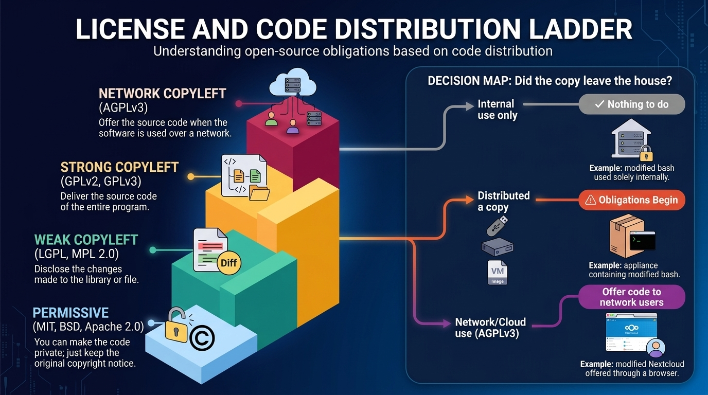
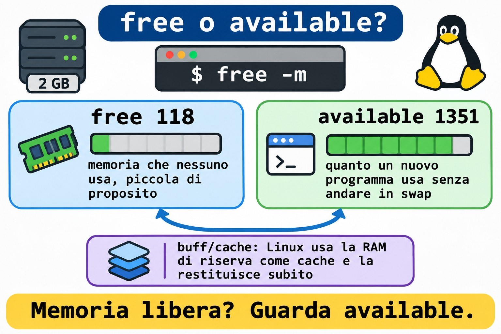
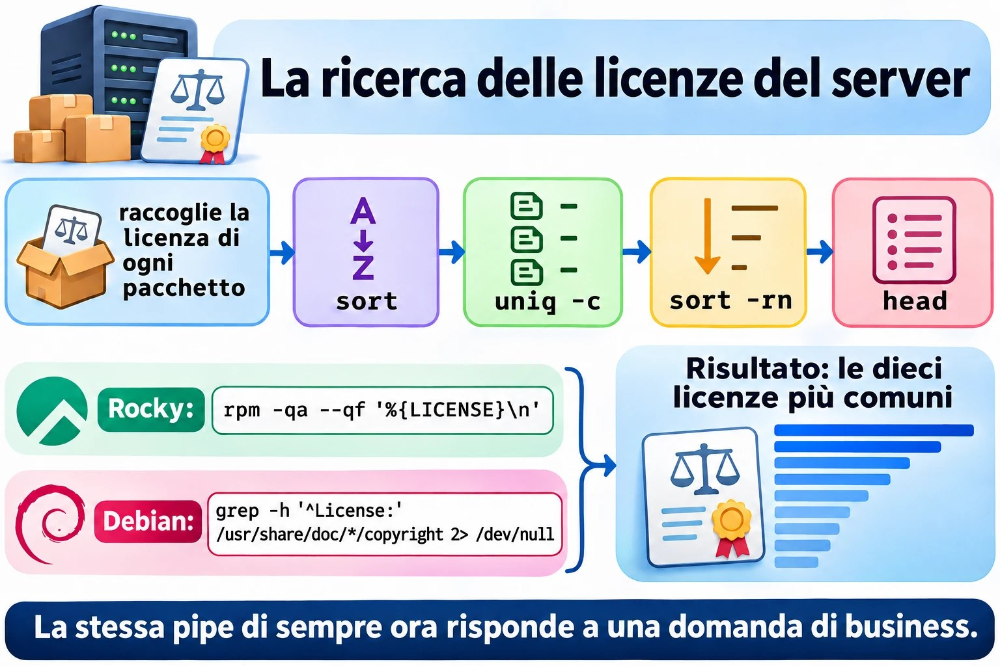
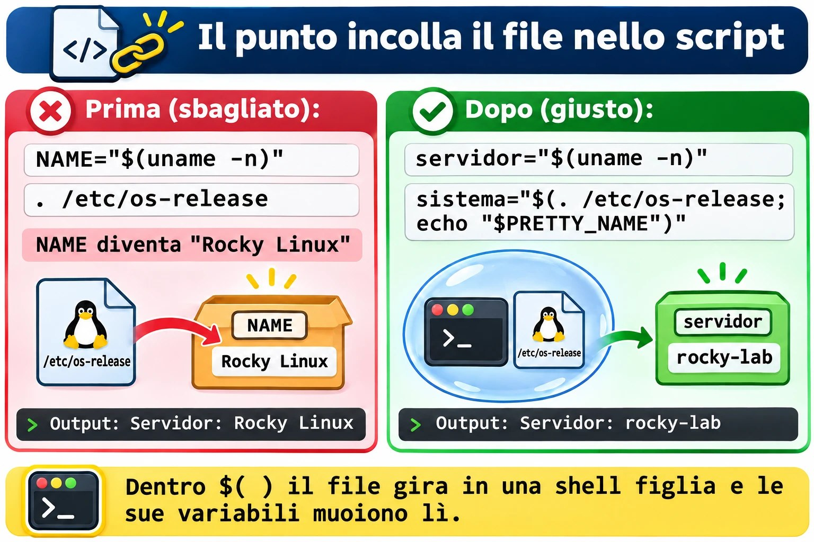

# Lezione 1.10 · Il software libero in pratica

Ultima lezione del Modulo 1, e ha due metà che si incontrano alla fine. Nella prima, impari a rispondere alla domanda che prima o poi ogni cliente fa: "cosa gira su questo server, e possiamo usarlo gratis?". Questa è licenza, e la licenza è un tema da sysadmin, non solo da avvocato. Nella seconda, metti insieme tutto ciò che hai visto dalla Lezione 1.1 in uno script vero, `inventario.sh`: la fotografia di un server, nello stesso formato su Rocky e su Debian, pronta da incollare in una richiesta di assistenza o da archiviare in una cartella.

| Scheda | Lezione 1.10 |
| --- | --- |
| Modulo | M1 · Riga di comando, lezione 10 di 10, sfida del modulo |
| Quando | Settimana 3 |
| Alla fine sei in grado di | Spiegare le quattro libertà e la differenza tra licenza permissiva e copyleft; dire quando una licenza obbliga a consegnare il codice; trovare la licenza di un pacchetto su Rocky e su Debian; riconoscere i principali programmi liberi per desktop e per server; dire se un Linux gira su una macchina fisica, una VM o un container; scrivere da zero uno script che raccoglie, formatta e salva la fotografia di un server |
| Prerequisiti | Lezioni da 1.1 a 1.9; `~/bin` nel `PATH` su entrambe le VM |
| Durata | Circa 3h |
| Snapshot | m1a10-inicio e m1a10-fim su entrambe le VM |

## 1 · Riscaldamento

Tre domande, a memoria. Scrivi le risposte; le Soluzioni le controllano alla fine.

1. Nella Lezione 1.9, `grep -q root /etc/passwd` è terminato con codice 0. E `grep -q naoexiste /etc/passwd`? Perché quel numero non è un errore?
2. Nella Lezione 1.9, qual è la differenza tra `wc -l /etc/passwd` e `wc -l < /etc/passwd`, e perché conta dentro uno script?
3. Scommessa: la tua azienda prende un programma GPL, ne cambia il codice e lo usa solo in casa, sui propri server, senza consegnarlo a nessuno. È obbligata a pubblicare le modifiche?

## 2 · Perché conta

A marzo del 2024, Redis, uno dei database in memoria più usati al mondo, ha sostituito la licenza BSD con due licenze che non sono di software libero. In pochi giorni, la Linux Foundation ha lanciato Valkey, una copia del codice dell'ultima versione libera. Ad agosto del 2023, Terraform aveva fatto la stessa mossa, e ne è nato OpenTofu. A giugno del 2023, Red Hat ha iniziato a consegnare il codice sorgente di RHEL solo ai clienti, e Rocky Linux, che usi in questa lezione, ha dovuto cambiare il modo di costruire la distribuzione.

In tutte e tre le storie, chi si occupava dei server ha dovuto rispondere, in pochi giorni: "ci riguarda? Possiamo continuare a usarlo? Dobbiamo cambiare?". Chi sapeva leggere una licenza ha risposto in un'ora. Chi non sapeva è rimasto ad aspettare l'ufficio legale.

Proxmox, che fa girare le tue VM, è un altro esempio, più tranquillo: è AGPLv3, gratuito, e l'azienda che lo produce vive di abbonamenti di supporto. Saperlo spiega il messaggio "No valid subscription" che compare quando ci entri, e cosa significa (non è un problema di licenza).

La seconda metà della lezione risolve un'altra richiesta di tutti i giorni: "mandami i dati di quel server". Quanta RAM, quanto disco libero, quale sistema, quale IP, se è una VM. Sai già trovare ogni informazione. Oggi smetti di digitare otto comandi e ne lanci uno.

## 3 · Modello mentale

> La licenza è la regola per chi **passa il software ad altri**. Finché il software resta con te, quasi tutto è permesso. Gli obblighi iniziano il giorno in cui consegni una copia, oppure, nella AGPL, il giorno in cui altre persone usano il programma attraverso la rete.

Quattro famiglie, dalla più libera alla più esigente:

| Famiglia | Esempi | Se modifichi e consegni una copia | Se lo usi solo in casa |
| --- | --- | --- | --- |
| Permissiva | MIT, BSD, Apache 2.0 | Puoi chiudere il codice; mantieni l'avviso di copyright | Niente da fare |
| Copyleft debole | LGPL, MPL 2.0 | Apri le modifiche **alla libreria o al file**; il tuo programma che si limita a usarla può restare chiuso | Niente da fare |
| Copyleft | GPLv2, GPLv3 | Consegna il codice dell'intero programma, con la stessa licenza | Niente da fare |
| Copyleft di rete | AGPLv3 | Come la GPL | Se altre persone usano la versione modificata **attraverso la rete**, offri loro il codice |

E l'inventario, la seconda metà:

> Un inventario è una fotografia: gli stessi campi, nello stesso ordine, nello stesso formato, su qualsiasi server. Se la fotografia di Rocky e quella di Debian non si possono confrontare riga per riga, non serve.

```text
   coleta                    formata                  entrega
  ┌──────────────┐        ┌───────────────┐       ┌──────────────────┐
  │ os-release   │        │ printf '%-9s' │       │ tela   (sempre)  │
  │ uname, ip    │ ─────► │ um campo por  │ ────► │ arquivo se PASTA │
  │ free, df     │        │ linha         │       │ journal (logger) │
  │ rpm ou dpkg  │        │ "?" se faltou │       │ código 0, 1 ou 2 │
  └──────────────┘        └───────────────┘       └──────────────────┘
```

## 4 · Concetto a strati

### Essenziale

**Da dove viene il software libero.** Nel 1983, Richard Stallman annunciò il progetto GNU, per scrivere un intero sistema operativo che tutti potessero usare, studiare e condividere. Nel 1985 creò la FSF, la Free Software Foundation, e poi la GPL, la licenza che protegge quell'idea. Nel 1991, Linus Torvalds aggiunse a GNU ciò che mancava, il kernel. Per questo una parte della comunità dice "GNU/Linux": `bash`, `ls` e `grep`, che usi dalla Lezione 1.1, sono di GNU.

**Le quattro libertà**, numerate a partire da zero, come fa un buon programmatore:

| Libertà | Cosa garantisce | Richiede |
| --- | --- | --- |
| 0 | Eseguire il programma per qualsiasi scopo |  |
| 1 | Studiare come funziona e modificarlo | Accesso al codice sorgente |
| 2 | Ridistribuire copie |  |
| 3 | Distribuire le tue versioni modificate | Accesso al codice sorgente |

"Libero" parla di libertà, non di prezzo. La frase classica è *free as in free speech, not as in free beer*. Un software libero può essere venduto, e un programma gratuito può essere chiuso.

**Open source.** Nel 1998, un gruppo creò l'OSI, la Open Source Initiative, con un altro discorso: meno etica, più vantaggio pratico, il codice aperto come modo migliore di sviluppare. Le licenze approvate dalle due organizzazioni sono quasi le stesse. Nel lavoro di tutti i giorni vedrai le sigle **FOSS** (Free and Open Source Software) e **FLOSS** (Free/Libre and Open Source Software), che mettono insieme le due visioni.

**Copyleft** è il trucco giuridico della GPL: usare il diritto d'autore per garantire che le copie, e le versioni modificate, restino libere. Chi riceve un programma GPL riceve le quattro libertà e non può toglierle a chi viene dopo.


*Le libertà 1 e 3 richiedono il codice sorgente; il copyleft impedisce che qualcuno tolga tutte e quattro a chi viene dopo.*

**Le licenze del tuo server.** Non devi impararle tutte a memoria; devi riconoscere le famiglie.

| --- | --- | --- |
| Kernel Linux | GPLv2, solo la versione 2 | Copyleft |
| `bash`, `coreutils`, `grep`, `tar` | GPLv3 o successiva | Copyleft |
| `glibc`, `systemd` | LGPL 2.1 o successiva, per la maggior parte | Copyleft debole |
| Firefox, Thunderbird, LibreOffice | MPL 2.0 | Copyleft debole |
| Proxmox VE, Nextcloud | AGPLv3 | Copyleft di rete |
| Apache httpd, Kubernetes | Apache 2.0 | Permissiva |
| nginx, OpenSSH | BSD | Permissiva |
| PostgreSQL | PostgreSQL License, simile alla MIT | Permissiva |
| MariaDB | GPLv2 | Copyleft |
| Samba, Ansible | GPLv3 | Copyleft |
| Python | PSF License | Permissiva |

**I programmi liberi che devi saper riconoscere.**

| Area | Programmi |
| --- | --- |
| Ufficio | LibreOffice: Writer (testo), Calc (foglio di calcolo), Impress (presentazioni), Draw, Base, Math |
| Internet | Firefox, Thunderbird |
| Immagini, video e audio | GIMP (foto), Inkscape (vettoriale), Blender (3D), Audacity (audio), VLC (video) |
| Server | Apache httpd e nginx (web), MariaDB, MySQL e PostgreSQL (database), Samba (cartelle per Windows), NFS (cartelle tra Linux), Postfix e Dovecot (e-mail), OpenLDAP (directory) |
| Linguaggi | C, Java, JavaScript, Perl, PHP, Python, shell |
| Pacchetti | `dpkg` e `apt` su Debian; `rpm` e `dnf` su Rocky |

**Trovare la licenza di un pacchetto.** Ogni famiglia la tiene in un posto diverso.

```bash
# Rocky: rpm tiene la licenza dentro il pacchetto stesso
rpm -qi bash | grep -i '^License'
rpm -q --qf '%{NAME}: %{LICENSE}\n' bash openssh-server systemd

# Debian: ogni pacchetto porta un file copyright
less /usr/share/doc/bash/copyright
grep -m3 '^License:' /usr/share/doc/openssh-server/copyright
```

In Rocky 9, il campo arriva nel vecchio formato, come `GPLv3+`. Le distribuzioni più recenti, come Rocky 10 e Fedora, stanno migrando al formato SPDX, come `GPL-3.0-or-later`. È la stessa licenza con un altro nome. In Debian, i file più recenti seguono un formato leggibile dalla macchina, con righe `License:`. Quelli più vecchi sono testo libero: se `grep` non trova niente, leggi l'inizio del file.

### Intermedio

**Come si guadagna con il software libero.** Il mercato in cui lavori dipende da questo.

| Modello | Come funziona | Esempi |
| --- | --- | --- |
| Abbonamento e supporto | Il software è libero; l'azienda vende aggiornamenti testati, certificazione e qualcuno da chiamare alle 3 di notte | Red Hat, SUSE, Canonical, Proxmox |
| Open core | Il nucleo è libero; le funzioni per le aziende sono a pagamento e chiuse | GitLab (CE è MIT; EE è chiusa) |
| Doppia licenza | Lo stesso codice esce in GPL, gratis, oppure con una licenza commerciale, per chi non vuole aprire il proprio codice | MySQL, Qt |
| Servizio cloud | L'azienda fa girare il software per te e fa pagare l'uso | Database gestiti, Nextcloud in hosting |
| Consulenza e formazione | I soldi vengono dalla conoscenza, non dal codice | Integratori e società di consulenza locali |
| Fondazioni | Le aziende che usano il software pagano una fondazione neutrale perché lo mantenga | Linux Foundation, Apache Software Foundation |

**Creative Commons** vale per i contenuti, non per il codice: testi, immagini, video, corsi. I pezzi si combinano.

| Sigla | Significa |
| --- | --- |
| BY | Cita l'autore |
| SA | Condividi con la stessa licenza (il copyleft dei contenuti) |
| NC | Uso non commerciale |
| ND | Nessuna opera derivata: non puoi modificare |
| CC0 | Pubblico dominio: nessuna condizione |

Esempio: Wikipedia usa CC BY-SA. Puoi copiare un articolo nel tuo manuale interno, citando la fonte e mantenendo la stessa licenza.

**Quando il codice è visibile, ma non è libero.** Alcune aziende hanno iniziato a usare licenze *source-available*: leggi il codice, ma non puoi, per esempio, offrirlo come servizio concorrente. La SSPL, creata da MongoDB nel 2018, è la più nota. L'OSI non riconosce queste licenze come open source. Redis è passato alla SSPL, e a una licenza propria, nel 2024; con Redis 8, nel 2025, ha ricominciato a offrire anche la AGPLv3. Terraform è passato alla BSL, che consente l'uso in produzione, ma vieta di fare concorrenza a HashiCorp.

**Cloud e virtualizzazione.**

| Sigla | Cosa ricevi | Di cosa ti occupi | Esempio |
| --- | --- | --- | --- |
| IaaS | Macchina virtuale, disco e rete | Dal sistema operativo in su | Una VM in un cloud pubblico |
| PaaS | Ambiente pronto per l'applicazione | Solo del codice e dei dati | Un database gestito |
| SaaS | Il programma pronto, dal browser | Solo dei tuoi dati e utenti | Webmail, CRM online |

Due modi di dividere una macchina:

- **Hypervisor** (KVM, quello di Proxmox; VMware; Hyper-V): ogni VM ha il proprio kernel. Isolamento forte, più memoria consumata.
- **Container** (LXC, anch'esso su Proxmox; Docker; Podman): tutti condividono il kernel dell'host. Leggero e veloce, isolamento minore.

Linux dice dove sta girando:

```bash
systemd-detect-virt        # kvm in una VM di Proxmox; lxc in un CT; none su una macchina fisica
cat /sys/class/dmi/id/sys_vendor     # QEMU in una VM di Proxmox
```

Su una macchina fisica, `systemd-detect-virt` mostra `none` **e** termina con codice 1. Tienilo a mente per lo script.

**Password e privacy.** Le basi: una password lunga vale più di una "complicata" e corta; una password per servizio, custodita in un gestore di password; MFA, il secondo fattore, su tutto ciò che è importante; HTTPS cifra il percorso, non garantisce che il sito sia onesto; e il browser conserva cookie e cronologia, che la modalità privata non porta alla sessione successiva, ma il tuo provider e il sito continuano a vedere.

### Ponte Windows

| In Windows | In Linux |
| --- | --- |
| `winver`, `systeminfo` | `cat /etc/os-release`, `uname -r` |
| "Informazioni su" mostra "Macchina virtuale" | `systemd-detect-virt` |
| Programmi e funzionalità: elenco degli installati | `rpm -qa` su Rocky, `dpkg -l` su Debian |
| Licenza in "Informazioni su" di ogni programma | `rpm -qi PACOTE`, `/usr/share/doc/PACOTE/copyright` |
| Script di inventario in PowerShell con `Get-ComputerInfo` | `inventario.sh`, che scrivi oggi |
| Licenza per utente o per core, audit di Microsoft | Il kernel e quasi tutto il sistema non fanno pagare licenze; paghi, se vuoi, il supporto |

### Avanzato

**GPLv2 contro GPLv3.** La GPLv3, del 2007, ha aggiunto due cose: protezione contro i brevetti e la regola "anti-tivoizzazione", che vieta di vendere un apparecchio che esegue GPLv3 e impedisce al proprietario di installare una versione modificata. Il kernel è rimasto in GPLv2 "solo", senza il "o successiva", e per questo non può mai passare alla v3. È anche per questo che alcune aziende evitano componenti GPLv3 negli apparecchi chiusi.

**"Distribuire" è la parola chiave.** Eseguire sul tuo server non è distribuire. Consegnare una chiavetta, un appliance o un'immagine di VM al cliente lo è. Un'azienda che modifica `bash` per uso interno non deve niente a nessuno. Un'azienda che vende un appliance con quel `bash` modificato deve consegnare il codice all'acquirente, se lo chiede. La AGPL chiude il buco del servizio nel cloud: se modifichi Nextcloud e lo offri ai clienti attraverso la rete, loro hanno diritto al codice della tua versione.

**Il caso RHEL.** RHEL è fatto di pacchetti GPL, tra gli altri. Red Hat continua a rispettare la GPL consegnando il codice a chi riceve il binario, cioè ai clienti. Ciò che è cambiato nel 2023 è l'accesso pubblico, che è diventato CentOS Stream, un passo avanti rispetto a RHEL. Rocky, AlmaLinux e altri hanno iniziato a costruire la distribuzione a partire da CentOS Stream e da altre fonti. Per te, sulla VM, non è cambiato niente: `dnf update` continua a funzionare.


*Gli obblighi iniziano quando la copia esce di casa o, nella AGPL, quando altri usano il programma attraverso la rete.*

## 5 · Rocky × Debian

|  | Rocky Linux 9 e 10 | Debian 13 |
| --- | --- | --- |
| File che identifica la famiglia | `/etc/redhat-release` e `/etc/rocky-release` | `/etc/debian_version` |
| `/etc/os-release`, campo `ID` | `rocky` | `debian` |
| `/etc/os-release`, campo `ID_LIKE` | `rhel centos fedora` | Non esiste: Debian è l'origine |
| Licenza di un pacchetto | `rpm -qi PACOTE`, campo `License` | `/usr/share/doc/PACOTE/copyright` |
| Contare i pacchetti installati | `rpm -qa \| wc -l` | `dpkg -l \| grep -c '^ii'` |
| Nome della scheda di rete in una VM di Proxmox | Dipende dal modello della VM: nel lab, `enp6s18`; in altre, `ens18` o `eth0` | Uguale: `enp6s18` nel lab |
| Kernel | Vecchio e con correzioni portate da versioni nuove, come il `5.14` di Rocky 9 | Più recente, come il `6.12` di Debian 13 |
| `systemd-detect-virt` | Installato | Installato |

La regola che vale su entrambe: **leggi `/etc/os-release` per sapere il sistema, e `/etc/debian_version` o `/etc/redhat-release` solo per scegliere il gestore di pacchetti**.

Perché `grep -c '^ii'` su Debian, e non `wc -l`? Perché `dpkg -l` mostra cinque righe di intestazione e anche i pacchetti rimossi che hanno lasciato la configurazione, con `rc` all'inizio. Solo `ii` significa "installato".

## 6 · Lab guidato

Fai tutto su entrambe le VM, a meno che il passo non dica una sola. I test stanno in `~/lab14`; lo script pronto va in `~/bin`; le fotografie dei server vanno in `~/inventarios`. In ogni passo, quando compare **Prevedi**, scrivi la risposta prima di premere Invio.

### Passo 1 · Preparare e chiedere "chi sei?"

Sul nodo Proxmox:

```bash
qm snapshot 201 m1a10-inicio
qm snapshot 202 m1a10-inicio
```

Su ogni VM:

```bash
mkdir -p ~/lab14 ~/inventarios
cd ~/lab14
cat /etc/os-release
```

**Prevedi.** Rocky mostra `ID_LIKE="rhel centos fedora"`. Cosa mostra Debian nella riga `ID_LIKE`?

Niente: la riga non esiste. `ID_LIKE` dice "assomiglio a", e Debian è l'origine della famiglia, non un parente. Ubuntu, che viene da Debian, mostra `ID_LIKE=debian`.

Il file è un elenco di `NOME=valor`, esattamente il formato di una variabile della shell. Per questo si può caricare:

```bash
( . /etc/os-release; echo "$ID | $VERSION_ID | $PRETTY_NAME" )
```

Rocky: qualcosa come `rocky | 9.6 | Rocky Linux 9.6 (Blue Onyx)`. Debian: `debian | 13 | Debian GNU/Linux 13 (trixie)`. Le parentesi aprono una shell figlia: le variabili del file muoiono con lei e non sporcano il tuo terminale. Tieni a mente questo dettaglio per il Guasto A.

Confronta con i file di ogni famiglia:

```bash
cat /etc/redhat-release 2> /dev/null
cat /etc/debian_version 2> /dev/null
uname -n
uname -r
```

**Decidi 1 · La fonte del nome del sistema.** Il tuo script girerà su Rocky, su Debian e, un giorno, su un Ubuntu o su un AlmaLinux. Da dove deve prendere il nome del sistema?

- **A)** Da `/etc/redhat-release`.
- **B)** Dal `PRETTY_NAME` di `/etc/os-release`.
- **C)** Da `uname -a`.
- **D)** Dalla prima riga di `/etc/issue`.

Scegli un'opzione prima di guardare la tabella.

| Se hai scelto | Risultato | Perché |
| --- | --- | --- |
| A | ❌ Sbagliato | Esiste solo nella famiglia Red Hat. Su Debian, lo script si rompe alla prima riga. |
| B | ✅ Giusto | `/etc/os-release` è uno standard di systemd ed esiste praticamente in ogni distribuzione attuale, nello stesso formato. Il `PRETTY_NAME` arriva già pronto da mostrare. |
| C | ❌ Sbagliato | `uname` parla del **kernel**, non della distribuzione. `Linux rocky-lab 5.14.0-...` non dice che è Rocky. |
| D | ❌ Sbagliato | `/etc/issue` è il messaggio della schermata di login. L'amministratore può cambiarlo, e contiene codici come `\n` e `\l`. |

**Da ricordare:** per sapere **quale sistema**, `/etc/os-release`. Per sapere **quale gestore di pacchetti**, l'esistenza di `/etc/debian_version` o `/etc/redhat-release`.

### Passo 2 · Dove sto girando?

```bash
systemd-detect-virt; echo "rc=$?"
cat /sys/class/dmi/id/sys_vendor
cat /sys/class/dmi/id/product_name
```

`kvm` e `rc=0`; `QEMU`; e qualcosa come `Standard PC (Q35 + ICH9, 2009)`. Proxmox usa KVM nel kernel e QEMU per fingere l'hardware. In un container LXC di Proxmox, il primo comando mostrerebbe `lxc`.

**Decidi 2 · E su una macchina fisica?** Lo stesso script gira su un server vero, senza virtualizzazione. Cosa succede con `virt="$(systemd-detect-virt)"`?

- **A)** `virt` resta vuota e il codice è 0.
- **B)** `virt` vale `none` e il codice è 1.
- **C)** `virt` vale `physical` e il codice è 0.
- **D)** Il comando dà errore, perché funziona solo in una VM.

Scegli un'opzione prima di guardare la tabella.

| Se hai scelto | Risultato | Perché |
| --- | --- | --- |
| A | ❌ Sbagliato | Scrive sempre una risposta. Vuota, solo se il comando non esiste proprio. |
| B | ✅ Giusto | Scrive `none` e termina con 1. Per questo lo script testa il **testo**, `[ "$virt" = "none" ]`, e non il codice: qui, 1 non è un errore, è "non sono in una VM". |
| C | ❌ Sbagliato | La risposta `physical` non esiste. |
| D | ❌ Sbagliato | Funziona su qualsiasi macchina con systemd; esiste proprio per rispondere a "fisica o virtuale?". |

**Da ricordare:** è lo stesso caso di `grep` nella Lezione 1.9. Prima di trattare un codice diverso da zero come un errore, leggi il `man` del comando: `man systemd-detect-virt`, sezione *EXIT STATUS*.

### Passo 3 · Memoria, disco e rete

```bash
free -m
free -h
df -h /
df -h --output=avail,size,pcent /
ip -br -4 addr show scope global
uptime -p
```

L'`--output` di `df` sceglie le colonne e l'ordine. `ip -br` è la modalità riassuntiva, una scheda per riga; `-4` mostra solo IPv4; `scope global` lascia fuori `lo`, cioè `127.0.0.1`. `uptime -p` dice da quanto tempo la macchina è accesa, in forma di testo.

**Prevedi.** Nell'output di `free -m`, quale numero è più grande: la colonna `free` o la `available`?

La `available`, quasi sempre, e con ampio margine. Qualcosa come `free 118` e `available 1351`.

**Decidi 3 · La RAM sta finendo?** Un collega guarda il `free -m` di un server da 2 GB, vede `free 118` e apre una richiesta urgente: "memoria in esaurimento, serve più RAM". Cosa rispondi?

- **A)** Ha ragione: 118 MB liberi sono pochi, serve più memoria.
- **B)** Digli di lanciare `sync; echo 3 > /proc/sys/vm/drop_caches` per liberare la memoria.
- **C)** Guarda la colonna `available`. La differenza sta nel `buff/cache`: Linux usa la RAM che avanza come cache del disco e la restituisce nel momento in cui un programma la chiede.
- **D)** Guarda la riga `Swap`: se è vuota, la memoria sta finendo.

Scegli un'opzione prima di guardare la tabella.

| Se hai scelto | Risultato | Perché |
| --- | --- | --- |
| A | ❌ Sbagliato | `free` è la memoria che nessuno usa, nemmeno la cache. In un Linux sano, è piccola di proposito: RAM ferma è RAM sprecata. |
| B | ❌ Sbagliato | Svuota la cache, il `free` sale per qualche minuto, e il server diventa **più lento**, perché torna a leggere dal disco ciò che era in memoria. Non risolve niente. |
| C | ✅ Giusto | `available` è la stima di quanto un programma nuovo riesce a usare senza che il sistema vada in swap. È il numero che va nell'inventario e nell'allarme. |
| D | ❌ Sbagliato | Swap vuoto è un buon segno: nessuno ne ha avuto bisogno. Ciò che preoccupa è lo swap **in uso** e `available` basso allo stesso tempo. |

**Da ricordare:** in `free`, il numero che risponde a "c'è memoria che avanza?" è `available`.



*Un free basso è normale; available mostra quanto un programma nuovo riesce ancora a usare.*

### Passo 4 · Di chi è questo software?

Su Rocky:

```bash
rpm -qi bash | grep -i '^License'
rpm -q --qf '%{NAME}: %{LICENSE}\n' bash openssh-server systemd kernel
rpm -qa --qf '%{LICENSE}\n' | sort | uniq -c | sort -rn | head
```

Su Debian:

```bash
grep -m3 '^License:' /usr/share/doc/openssh-server/copyright
grep -h '^License:' /usr/share/doc/*/copyright 2> /dev/null | sort | uniq -c | sort -rn | head
```

L'ultimo comando di ogni lato è la "ricerca delle licenze" dell'intero server: conta quanti pacchetti usano ogni licenza e mostra le dieci più comuni. È la stessa riga di `sort | uniq -c | sort -rn` della Lezione 1.6, ora a rispondere a una domanda di business. Aspettati di vedere GPL, LGPL, MIT e BSD in cima, su entrambe.

Ora un ciclo della Lezione 1.9, su Rocky:

```bash
for p in bash openssh-server systemd nginx; do
    if rpm -q "$p" > /dev/null; then
        rpm -q --qf '%{NAME}: %{LICENSE}\n' "$p"
    else
        echo "$p: não instalado"
    fi
done
```

E su Debian:

```bash
for p in bash openssh-server systemd nginx; do
    if [ -f "/usr/share/doc/$p/copyright" ]; then
        echo "$p: $(grep -m1 '^License:' "/usr/share/doc/$p/copyright")"
    else
        echo "$p: não instalado"
    fi
done
```

Su Debian, alcuni pacchetti rispondono ` bash:  ` con la licenza vuota. Non è un errore del ciclo: il `copyright` di quel pacchetto è testo libero, senza riga `License:`. Leggilo con `less`.

**Decidi 4 · Quando bisogna consegnare il codice?** In quale di questi casi la licenza **obbliga** a consegnare il codice sorgente a qualcuno?

- **A)** Modifichi nginx, BSD, e fai girare la versione modificata sul server della tua azienda, che serve il sito del cliente.
- **B)** Modifichi uno strumento GPL, lo installi sulle VM di un cliente e gli consegni le VM, che diventa il proprietario.
- **C)** Modifichi `bash` per usarlo sui server interni della tua azienda.
- **D)** Vendi un appliance con un programma Apache 2.0, senza modificarlo.

Scegli un'opzione prima di guardare la tabella.

| Se hai scelto | Risultato | Perché |
| --- | --- | --- |
| A | ❌ Sbagliato | Una licenza permissiva non obbliga ad aprire niente, e il software non è nemmeno uscito dalla tua azienda. |
| B | ✅ Giusto | Consegnare le VM è **distribuire**. Il cliente riceve il binario GPL modificato, e con esso il diritto al codice della tua versione, con la stessa licenza. |
| C | ❌ Sbagliato | È GPL, ma non c'è stata distribuzione: il `bash` modificato non è uscito di casa. |
| D | ❌ Sbagliato | C'è stata distribuzione, ma la Apache 2.0 è permissiva. Devi includere la licenza e il file `NOTICE`, non il codice. |

**Da ricordare:** la domanda chiave della GPL è "la copia è uscita di casa?". Se non è uscita, quasi nessun obbligo esiste.

**Decidi 5 · E la AGPL?** La tua azienda modifica Nextcloud, AGPLv3, per aggiungere il marchio e una funzione nuova, e lo offre ai clienti dal browser. Nessuno riceve una copia del programma. Cosa richiede la licenza?

- **A)** Niente: non c'è stata distribuzione, quindi vale la stessa regola dell'uso interno.
- **B)** Offrire il codice della versione modificata a chi usa il servizio attraverso la rete.
- **C)** Pubblicare il codice per chiunque nel mondo, su GitHub, per esempio.
- **D)** Pagare una licenza commerciale all'azienda di Nextcloud.

Scegli un'opzione prima di guardare la tabella.

| Se hai scelto | Risultato | Perché |
| --- | --- | --- |
| A | ❌ Sbagliato | Sarebbe vero nella GPL. La AGPL esiste proprio per chiudere quel buco: l'uso attraverso la rete conta. |
| B | ✅ Giusto | Chi interagisce con il programma modificato attraverso la rete ha diritto al codice di quella versione. Un link "codice sorgente" a piè di pagina basta. |
| C | ❌ Sbagliato | L'obbligo è verso gli utenti del servizio, non verso il mondo. Molti pubblicano per tutti perché è più semplice, ma la licenza non lo esige. |
| D | ❌ Sbagliato | La AGPL non fa pagare niente. Pagare l'azienda è una scelta, per avere supporto o l'edizione enterprise. |

**Da ricordare:** la GPL guarda a chi **riceve una copia**; la AGPL guarda anche a chi **usa attraverso la rete**.



*Una pipe conosciuta, sort | uniq -c | sort -rn | head, risponde a una domanda di business sul server.*

### Passo 5 · La sfida, prima della soluzione

Adesso tocca a te. Prova da solo per **30 minuti** prima di aprire il Passo 6. Bloccarsi fa parte del gioco; è bloccandoti che la Lezione 1.9 diventa tua. Scrivi in `~/lab14/inventario.sh` uno script che:

1. Accetti un argomento opzionale, `PASTA`. Senza, mostra solo a schermo. Con, scrive anche `PASTA/SERVIDOR-AAAA-MM-DD.txt`.
2. Se `PASTA` non è una cartella, o non ci si può scrivere, mostri l'errore su `>&2` e termini con **codice 1**.
3. Mostri, in quest'ordine, un campo per riga, con le etichette allineate: server e data in un titolo; sistema; kernel; virtualizzazione; IP; RAM totale e disponibile in MB; disco della radice libero, totale e uso; pacchetti installati; da quanto tempo è acceso.
4. Funzioni uguale su Rocky e su Debian: stesse etichette, stesso ordine.
5. Se qualche campo non può essere scoperto, mostri `?` al suo posto, continui, e termini con **codice 2** e un avviso su `>&2`.
6. Lasci una riga nel journal con `logger -t inventario`.

Tre suggerimenti, se ti servono:

- Carica `/etc/os-release` **dentro** `$( )`.
- Per prendere le colonne di una riga, usa `read -r a b c < arquivo`, come nel `while read` della Lezione 1.9, e non `comando | read`.
- `printf '%-9s %s\n' "Kernel:" "$kernel"` allinea l'etichetta su 9 posizioni.

### Passo 6 · Una soluzione, blocco per blocco

Confronta con la tua. Non deve essere uguale: deve superare i test del Passo 7.

```bash
cat > ~/lab14/inventario.sh <<'EOF'
#!/bin/bash
# inventario.sh - fotografia di un server Linux, nello stesso formato su qualsiasi distro
# Uso: inventario.sh [PASTA]
#      Senza PASTA, mostra solo a schermo. Con PASTA, scrive anche PASTA/SERVIDOR-DATA.txt
# Uscita: 0 = tutto raccolto; 1 = PASTA non valida; 2 = qualche campo senza risposta

destino="$1"
if [ -n "$destino" ] && [ ! -d "$destino" ]; then
    echo "ERRO: $destino não é uma pasta" >&2
    exit 1
fi
if [ -n "$destino" ] && [ ! -w "$destino" ]; then
    echo "ERRO: sem permissão de escrita em $destino" >&2
    exit 1
fi

faltou=0
tmp="$(mktemp)"
servidor="$(uname -n)"
agora="$(date '+%F %H:%M')"

# Sistema: /etc/os-release esiste in entrambe le famiglie.
# Letto dentro $( ), perché le sue variabili non si mescolino con quelle dello script.
if [ -r /etc/os-release ]; then
    sistema="$(. /etc/os-release; echo "$PRETTY_NAME")"
else
    sistema="?"
    faltou=$((faltou + 1))
fi

kernel="$(uname -r)"

# Virtualizzazione: su una macchina fisica, mostra "none" ed esce con 1
virt="$(systemd-detect-virt 2> /dev/null)"
if [ "$virt" = "none" ]; then
    virt="nenhuma, máquina física"
elif [ -z "$virt" ]; then
    virt="?"
    faltou=$((faltou + 1))
fi

# IP: una riga per scheda; con scope global, l'interfaccia lo resta fuori
ip -br -4 addr show scope global > "$tmp"
ips=""
while read -r placa estado endereco resto; do
    [ -n "$endereco" ] || continue
    if [ -z "$ips" ]; then
        ips="$placa $endereco"
    else
        ips="$ips, $placa $endereco"
    fi
done < "$tmp"
if [ -z "$ips" ]; then
    ips="?"
    faltou=$((faltou + 1))
fi

# Memoria in MB: il totale e il disponibile, che è quello che conta
free -m | grep '^Mem:' > "$tmp"
read -r rotulo mem_total usado livre compart cache mem_disp < "$tmp"

# Disco della radice
df -h --output=avail,size,pcent / | tail -n 1 > "$tmp"
read -r disco_livre disco_total disco_uso < "$tmp"

# Pacchetti: ogni famiglia ha il suo gestore
if [ -f /etc/debian_version ]; then
    pacotes="$(dpkg -l | grep -c '^ii') (dpkg)"
elif [ -f /etc/redhat-release ]; then
    pacotes="$(rpm -qa | wc -l) (rpm)"
else
    pacotes="?"
    faltou=$((faltou + 1))
fi

ligado="$(uptime -p)"
rm -f "$tmp"

saida=/dev/null
if [ -n "$destino" ]; then
    saida="$destino/$servidor-$(date +%F).txt"
fi

{
    echo "=== $servidor · $agora ==="
    printf '%-9s %s\n' "Sistema:" "$sistema"
    printf '%-9s %s\n' "Kernel:" "$kernel"
    printf '%-9s %s\n' "Virtual:" "$virt"
    printf '%-9s %s\n' "IP:" "$ips"
    printf '%-9s %s MB, %s MB disponíveis\n' "RAM:" "$mem_total" "$mem_disp"
    printf '%-9s %s livres de %s, %s usado\n' "Disco /:" "$disco_livre" "$disco_total" "$disco_uso"
    printf '%-9s %s\n' "Pacotes:" "$pacotes"
    printf '%-9s %s\n' "Ligado:" "$ligado"
} | tee "$saida"

if [ -n "$destino" ]; then
    echo "Gravado em $saida" >&2
fi

logger -t inventario "$servidor: $faltou campo(s) sem resposta"
if [ "$faltou" -gt 0 ]; then
    echo "AVISO: $faltou campo(s) sem resposta" >&2
    exit 2
fi
EOF
chmod +x ~/lab14/inventario.sh
bash -n ~/lab14/inventario.sh && echo "sintaxe ok"
```

Cosa usa ogni blocco, e dove l'hai visto:

| Blocco | Cosa fa | Lezione |
| --- | --- | --- |
| `destino="$1"` e i due `if` | Controlla ciò che costa poco prima di tutto: argomento, cartella, permesso. Errore su `>&2` e `exit 1` | 1.8 e 1.9 |
| `faltou=0` e `$((faltou + 1))` | Conta i campi senza risposta, senza fermare lo script | 1.9 |
| `mktemp` | Crea un file temporaneo vuoto, con nome univoco, in `/tmp`, e ne mostra il nome. Novità: alla fine, `rm -f "$tmp"` lo cancella | Oggi |
| `$(. /etc/os-release; echo ...)` | Legge il file in una shell figlia; torna solo il `PRETTY_NAME` | Oggi, Passo 1 |
| `while read ... done < "$tmp"` | Scorre le schede senza perdere la variabile `ips` | 1.9 |
| `read -r a b c ... < "$tmp"` | Taglia una riga in colonne, sugli spazi | 1.9 |
| `[ -f /etc/debian_version ]` | Sceglie il gestore di pacchetti | Oggi, §5 |
| `saida=/dev/null` e `tee "$saida"` | Mostra sempre a schermo; scrive solo se c'è `PASTA`. Senza `PASTA`, `tee` scrive nel "buco nero" | 1.6 |
| `{ ...; } \| tee` | Unisce l'output di più comandi in un flusso solo | 1.6 |
| `logger -t inventario` | Una riga nel journal, per sapere quando è girato | 1.9 |
| `exit 2` alla fine | Il cron, o un altro script, sa che la fotografia è uscita incompleta | 1.9 |

Tre scelte che sembrano dettagli:

- **`uname -n`, e non `hostname`.** `uname` arriva con `coreutils`, che c'è in ogni Linux. Il comando `hostname` è un pacchetto separato, che un'installazione minimale può non avere.
- **Etichette senza accenti.** `printf '%-9s'` conta i **byte**, non le lettere. `Memória:` ha 8 lettere e 9 byte, perché la `ó` ne occupa 2 in UTF-8, e l'allineamento viene storto. Da qui `RAM:`, `Disco /:` e `Virtual:`.
- **Il `.` dentro `$( )`.** `/etc/os-release` definisce `NAME`, `ID`, `VERSION` e altre. Caricato direttamente nello script, sovrascrive qualsiasi tua variabile con lo stesso nome. Il Guasto A mostra il danno.


*Raccolta, formattazione e consegna: la stessa fotografia su qualsiasi distro, con un codice che un altro programma sa leggere.*

### Passo 7 · Testare i percorsi e confrontare le due VM

Prima, il percorso felice e quello con ingresso sbagliato:

```bash
cd ~/lab14
./inventario.sh;                 echo "rc=$?"
./inventario.sh ~/inventarios;   echo "rc=$?"
ls ~/inventarios
./inventario.sh /naoexiste;      echo "rc=$?"
./inventario.sh /etc;            echo "rc=$?"
```

Su Rocky, la prima chiamata mostra qualcosa del genere (i numeri e il nome della scheda saranno quelli della tua VM):

```text
=== rocky-lab · 2026-11-02 16:14 ===
Sistema:  Rocky Linux 9.6 (Blue Onyx)
Kernel:   5.14.0-570.17.1.el9_6.x86_64
Virtual:  kvm
IP:       enp6s18 10.1.0.51/24
RAM:      1763 MB, 1351 MB disponíveis
Disco /:  14G livres de 20G, 30% usado
Pacotes:  412 (rpm)
Ligado:   up 3 hours, 12 minutes
rc=0
```

La seconda chiamata mostra lo stesso, più `Gravado em /home/rodrigo/inventarios/rocky-lab-2026-11-02.txt`, e `rc=0`. La terza, `ERRO: /naoexiste não é uma pasta` e `rc=1`. La quarta, `ERRO: sem permissão de escrita em /etc` e `rc=1`.

Ora il percorso di mezzo: un campo che non risponde. Ingannerai lo script con un `ip` finto, che non mostra niente, messo davanti nel `PATH` solo per questa riga:

```bash
mkdir -p ~/lab14/falso
printf '#!/bin/bash\nexit 0\n' > ~/lab14/falso/ip
chmod +x ~/lab14/falso/ip
PATH=~/lab14/falso:$PATH ./inventario.sh; echo "rc=$?"
```

**Prevedi** la riga `IP:` e il codice.

`IP:       ?`, poi `AVISO: 1 campo(s) sem resposta` e `rc=2`. Il resto della fotografia è uscito normale: un campo mancante non fa cadere gli altri.

Il journal ha registrato ogni esecuzione:

```bash
journalctl -t inventario --since today
```

Se su Debian non compare niente, usa `sudo journalctl -t inventario --since today`: a seconda dei gruppi dell'utente, vede solo una parte del journal.

Ora, la prova che la fotografia è la stessa su entrambe. Lancia su ogni VM:

```bash
./inventario.sh | tail -n +2 | cut -d: -f1
./inventario.sh | tail -n +2 | cut -d: -f1 | md5sum
```

`tail -n +2` salta il titolo, che contiene il nome del server; `cut` tiene solo le etichette; `md5sum` riassume l'elenco in un'"impronta digitale". Se l'impronta di Rocky e quella di Debian sono uguali, le etichette sono identiche, nello stesso ordine: `mesmo formato`. Basta confrontare i primi caratteri delle due.

**Prevedi.** Se cambi, solo nello script di Debian, `"Disco /:"` in `"Disco:"`, le impronte restano uguali?

No. Un solo carattere diverso cambia l'intero `md5sum`. Per questo serve a confrontare: o è uguale, o no.

Tutto a posto? Installa su entrambe le VM:

```bash
cp ~/lab14/inventario.sh ~/bin/
type inventario.sh
```

Ora il vantaggio: nel PowerShell di Windows, con gli alias della Lezione 0.2, scatta la fotografia di entrambe senza entrare in nessuna:

```powershell
ssh rocky-lab bin/inventario.sh
ssh debian-lab bin/inventario.sh
```

Ogni riga entra, esegue un comando ed esce, come `ssh debian-lab hostname` della Lezione 0.2. Il percorso `bin/inventario.sh` è relativo alla cartella personale, da dove parte ssh, e funziona anche se `~/bin` non è nel `PATH` di una sessione senza terminale.

> **Protocollo · Script che gira su qualsiasi distro**
>
> 1. Sistema da `/etc/os-release`, caricato dentro `$( )`. Famiglia, solo per scegliere `rpm` o `dpkg`, da `/etc/debian_version` o `/etc/redhat-release`.
> 2. Preferisci comandi che esistono ovunque: `uname`, `ip`, `free`, `df`, `systemd-detect-virt`. Quando non ne esiste uno comune, scegli per famiglia con `if`.
> 3. Un campo che non risponde diventa `?`, conta in `faltou` e non ferma lo script.
> 4. Output da macchina, con etichette fisse, senza accenti, allineate con `printf`.
> 5. Codici di uscita documentati in cima: 0 completo, 1 ingresso sbagliato, 2 incompleto.
> 6. Testa su entrambe le famiglie e confronta le etichette, con `cut` e `md5sum`, prima di fidarti.

## 7 · Rompi e ripara

### Guasto A · Il server che ha cambiato nome

Un collega ha scritto una scheda rapida del server. Fai come lui, su entrambe le VM:

```bash
cd ~/lab14
cat > ficha.sh <<'EOF'
#!/bin/bash
# ficha.sh - nome del server e sistema (versione del collega)
NAME="$(uname -n)"
. /etc/os-release
echo "Servidor: $NAME"
echo "Sistema:  $PRETTY_NAME"
EOF
chmod +x ficha.sh
```

**Sintomo.**

```bash
./ficha.sh
```

Su Rocky: `Servidor: Rocky Linux`. Su Debian: `Servidor: Debian GNU/Linux`. Il nome del server è sparito. In un inventario di 40 macchine, tutte avrebbero lo stesso "nome".

**Indagine.**

```bash
bash -x ./ficha.sh
```

```text
++ uname -n
+ NAME=rocky-lab
+ . /etc/os-release
++ NAME='Rocky Linux'
++ VERSION='9.6 (Blue Onyx)'
++ ID=rocky
...
+ echo 'Servidor: Rocky Linux'
```

`NAME` ha ricevuto `rocky-lab`, giusto. Due righe dopo, il `.` ha eseguito `/etc/os-release` **dentro** lo script, e la sua prima riga è `NAME="Rocky Linux"`. Le righe con `++` sono quelle del file caricato. La variabile del collega è stata travolta da un'altra con lo stesso nome.

**Decidi A · La riparazione.** Cosa risolve davvero?

- **A)** Usare le virgolette singole: `NAME='$(uname -n)'`.
- **B)** Esportare la variabile prima: `export NAME="$(uname -n)"`.
- **C)** Caricare il file in una shell figlia, `sistema="$(. /etc/os-release; echo "$PRETTY_NAME")"`, e usare nomi minuscoli per le tue variabili.
- **D)** Sostituire il `.` con `source`.

Scegli un'opzione prima di guardare la tabella.

| Se hai scelto | Risultato | Perché |
| --- | --- | --- |
| A | ❌ Sbagliato | Il `.` sovrascrive allo stesso modo, e l'output resta `Rocky Linux`. Senza il `.`, sarebbe peggio: le virgolette singole mostrerebbero il testo `$(uname -n)`, senza eseguire il comando. |
| B | ❌ Sbagliato | `export` manda la variabile solo ai programmi figli. Non la protegge: il `.` continua a scriverci sopra. |
| C | ✅ Giusto | Dentro `$( )`, il file gira in una shell figlia, che muore portandosi via `NAME`, `ID` e le altre; torna solo il `PRETTY_NAME`, tramite l'`echo`. E i nomi minuscoli non entrano in collisione con quelli del sistema, che usano le maiuscole. |
| D | ❌ Sbagliato | `source` e `.` sono lo stesso comando, con due nomi. Stesso risultato. |

**Da ricordare:** caricare un file con `.` significa incollare il suo contenuto nel tuo script. Se non vuoi le sue variabili tra i piedi, caricalo dentro `$( )`. E usa le minuscole per le tue: `servidor`, non `NAME`.

**Riparazione.**

```bash
cat > ficha.sh <<'EOF'
#!/bin/bash
# ficha.sh - nome del server e sistema (riparato)
servidor="$(uname -n)"
sistema="$(. /etc/os-release; echo "$PRETTY_NAME")"
echo "Servidor: $servidor"
echo "Sistema:  $sistema"
EOF
./ficha.sh
```

`Servidor: rocky-lab` e `Sistema:  Rocky Linux 9.6 (Blue Onyx)`, o l'equivalente su Debian.



*Caricare con il punto incolla il file nel tuo script; dentro $( ) le sue variabili muoiono nella shell figlia.*

### Guasto B · Lo script che fallisce quando va bene

Un altro collega ha fatto una fotografia minimale, con scrittura opzionale, e l'ha messa nel monitoraggio, che chiama lo script e segnala un allarme se il codice non è 0:

```bash
cat > foto.sh <<'EOF'
#!/bin/bash
# foto.sh - da quanto tempo è acceso e disco libero (versione del collega)
destino="$1"
saida=/dev/null
[ -n "$destino" ] && saida="$destino/foto.txt"
{ uptime -p; df -h --output=avail,size,pcent / | tail -n 1; } | tee "$saida"
[ -n "$destino" ] && echo "Gravado em $saida" >&2
EOF
chmod +x foto.sh
```

**Sintomo.**

```bash
./foto.sh; echo "rc=$?"
./foto.sh ~/lab14; echo "rc=$?"
if ./foto.sh > /dev/null; then echo "monitor: OK"; else echo "monitor: FALHOU"; fi
```

Senza argomento, la fotografia compare perfetta, e il codice è `rc=1`. Con argomento, `rc=0`. Il monitoraggio grida `FALHOU` ogni giorno, per uno script che ha fatto tutto ciò che doveva.

**Indagine.**

```bash
bash -x ./foto.sh 2>&1 | tail -3
```

L'ultima riga è `+ '[' -n '' ']'`, e dopo non c'è più niente. Il test ha dato "no", 1; il `&&` ha saltato l'`echo`; e lo script è terminato lì. Senza `exit`, uno script termina con il codice dell'**ultimo comando eseguito**, che è stato il `[`. La stessa riga, a metà script, non faceva danni: il suo codice veniva dimenticato dal comando successivo.

**Decidi B · La riparazione.** Cosa risolve?

- **A)** Sostituire `&&` con `||` nell'ultima riga.
- **B)** Sostituire l'ultima riga con un `if`: `if [ -n "$destino" ]; then echo "Gravado em $saida" >&2; fi`.
- **C)** Mettere `2> /dev/null` alla fine dell'ultima riga.
- **D)** Sostituire `[ -n "$destino" ]` con `[[ -n $destino ]]`.

Scegli un'opzione prima di guardare la tabella.

| Se hai scelto | Risultato | Perché |
| --- | --- | --- |
| A | ❌ Sbagliato | Il codice diventa 0, ma la logica si inverte: senza argomento, lo script dice `Gravado em /dev/null`; con argomento, non avvisa niente. Ha scambiato un errore con un altro. |
| B | ✅ Giusto | Un `if` la cui condizione dà "no", senza `else`, termina con **0**. Il messaggio compare solo quando deve, e il codice è giusto in entrambi i casi. |
| C | ❌ Sbagliato | `2> /dev/null` fa sparire i messaggi di errore, ma qui non c'è nessun messaggio. Il problema è il codice, e resta 1. |
| D | ❌ Sbagliato | `[[ ]]` risponde allo stesso modo: "no" è 1, e il `&&` salta allo stesso modo. |

**Da ricordare:** `teste && comando` è ottimo a metà script. Nell'**ultima** riga, diventa il codice di uscita dell'intero script. Lì, usa `if`, oppure termina con un `exit` esplicito.

**Riparazione.**

```bash
sed -i '$d' foto.sh
cat >> foto.sh <<'EOF'
if [ -n "$destino" ]; then
    echo "Gravado em $saida" >&2
fi
EOF
./foto.sh; echo "rc=$?"
./foto.sh ~/lab14; echo "rc=$?"
if ./foto.sh > /dev/null; then echo "monitor: OK"; else echo "monitor: FALHOU"; fi
```

`sed -i '$d'` cancella l'ultima riga del file; il `$`, in `sed`, significa "l'ultima". Ora `rc=0` in entrambi, e `monitor: OK`. Nota che `inventario.sh` del Passo 6 finisce già così: l'`if` del `Gravado em`, e l'`if` del `faltou` con `exit 2`.

### La morale

Le due rotture di oggi sono di script che **funzionano nel tuo test e falliscono nel mondo**. Il Guasto A compare solo quando qualcuno guarda il nome del server e vede il nome della distribuzione; il Guasto B, quando un altro programma, e non tu, legge il codice di uscita. In entrambi, l'output a schermo sembrava giusto. `bash -x` ha mostrato cos'è successo davvero in entrambi, in meno di un minuto. La regola pratica: prima di mettere uno script nel cron o nel monitoraggio, lancialo nel modo in cui lo lanceranno **loro** (senza argomento, senza che tu stia guardando, con solo il codice che conta) e controlla l'`echo $?`.

## 8 · Trappole

| Cosa digiti o vedi | Cosa succede | Come evitarla |
| --- | --- | --- |
| `. /etc/os-release` diretto nello script | Sovrascrive le tue variabili `NAME`, `ID`, `VERSION` | `sistema="$(. /etc/os-release; echo "$PRETTY_NAME")"`, e variabili minuscole |
| `printf '%-9s'` con etichetta accentata | Colonna storta: `printf` conta i byte, e `ó` ne occupa 2 | Etichette senza accenti |
| Guardare la colonna `free` di `free` | Falso allarme di "memoria in esaurimento" | Guardare `available` |
| `echo 3 > /proc/sys/vm/drop_caches` per "liberare memoria" | Server più lento, che torna a leggere dal disco | Non toccare la cache; guardare `available` |
| `hostname` in un'installazione minimale | Può dare `command not found` | `uname -n` |
| `dpkg -l \| wc -l` | Conta l'intestazione e i pacchetti `rc` | `dpkg -l \| grep -c '^ii'` |
| `systemd-detect-virt` con codice 1 trattato come errore | Ogni macchina fisica diventa un "fallimento" | Testare il testo: `[ "$virt" = "none" ]` |
| `teste && comando` nell'ultima riga | Lo script termina con 1 quando il test dà "no" | `if teste; then comando; fi` |
| `comando \| read a b c` | Le variabili restano vuote dopo la riga | `comando > "$tmp"` e `read -r a b c < "$tmp"` |
| `/etc/redhat-release` per sapere il sistema | Si rompe su Debian | `/etc/os-release` |
| `ssh host 'bash -s' < script.sh` in PowerShell | Errore: il `<` è riservato in PowerShell | Lancia da un Linux, o copia lo script sul server |
| "Software libero è software gratuito" | Confonde libertà con prezzo | Il libero si può vendere; il gratuito può essere chiuso |
| "Codice su GitHub è open source" | SSPL e BSL mostrano il codice, ma non sono libere | Controllare la licenza, e se è nell'elenco dell'OSI |
| "Ho usato GPL, devo pubblicare tutto" | Paura inutile: l'uso interno non obbliga | L'obbligo nasce con la distribuzione; nella AGPL, anche servendo attraverso la rete |

## 9 · Quiz

Dieci domande, senza consultare niente. Scrivi la lettera o la risposta di ognuna e solo dopo apri le Soluzioni.

**1.** Quali delle quattro libertà del software libero richiedono l'accesso al codice sorgente?

- **A)** La 0 e la 2
- **B)** La 1 e la 3
- **C)** Solo la 0
- **D)** Tutte e quattro

**2.** Un'azienda affitta macchine virtuali in un cloud pubblico e ci installa il proprio sistema operativo e le proprie applicazioni. Che modello è?

- **A)** SaaS
- **B)** PaaS
- **C)** IaaS
- **D)** FOSS

**3.** La tua azienda modifica un programma GPLv3 e usa la versione modificata solo sui propri server, senza consegnare copie a nessuno. Cosa richiede la licenza?

- **A)** Pubblicare le modifiche su internet
- **B)** Niente
- **C)** Pagare una licenza alla FSF
- **D)** Cambiare la licenza in MIT

**4.** In LibreOffice, quale programma è il foglio di calcolo?

- **A)** Writer
- **B)** Impress
- **C)** Calc
- **D)** Base

**5.** Cosa mostra `systemd-detect-virt` su una macchina fisica, e con quale codice termina?

- **A)** `physical`, codice 0
- **B)** `none`, codice 1
- **C)** Niente, codice 0
- **D)** `kvm`, codice 0

**6.** In `free -m`, quale colonna risponde a "quanta memoria riesce a usare un programma nuovo senza andare in swap"?

- **A)** `free`
- **B)** `used`
- **C)** `buff/cache`
- **D)** `available`

**7.** Perché `inventario.sh` usa `sistema="$(. /etc/os-release; echo "$PRETTY_NAME")"` e non semplicemente `. /etc/os-release`?

**8.** Scrivi il comando che conta i pacchetti installati su Rocky e quello che fa lo stesso su Debian. Su Debian, perché non basta `dpkg -l | wc -l`?

**9.** Uno script termina con la riga `[ -n "$destino" ] && echo "Gravado"`. Chiamato senza argomento, termina con codice 1. Perché, e come si ripara?

**10.** *Which Creative Commons license element requires that derivative works be distributed under the same license as the original work?*

- **A)** BY
- **B)** NC
- **C)** ND
- **D)** SA
- **E)** CC0

## 10 · Flashcard e promemoria

### Da sapere a memoria

Questa parte è da tenere in testa. È ciò che rispondi al cliente senza aprire il browser.

- Le quattro libertà: 0 eseguire, 1 studiare e modificare, 2 ridistribuire, 3 distribuire le tue versioni. La 1 e la 3 richiedono il codice sorgente
- Libero parla di libertà, non di prezzo. Il software libero si può vendere
- Permissiva (MIT, BSD, Apache): puoi chiudere il derivato, purché mantenga l'avviso
- Copyleft (GPL): chi **distribuisce** il derivato consegna il codice, con la stessa licenza
- AGPL: servire attraverso la rete conta anch'esso come distribuire
- L'uso interno, senza consegnare copie a nessuno, non obbliga a pubblicare niente, nemmeno nella GPL
- `/etc/os-release` esiste in entrambe le famiglie. Leggilo dentro `$( )`
- `uname -n` nome, `uname -r` kernel, `systemd-detect-virt` virtualizzazione
- `free -m`: la colonna che conta è `available`
- Rocky: `rpm -qa | wc -l` conta, `rpm -q --qf '%{LICENSE}\n' PACOTE` mostra la licenza
- Debian: `dpkg -l | grep -c '^ii'` conta, `/usr/share/doc/PACOTE/copyright` contiene la licenza
- L'ultima riga di uno script definisce il suo codice. Niente `teste && comando` lì

### Da consultare

Questa parte non devi impararla a memoria. Ricorda dove si trova.

- GPLv3 contro v2: brevetti e tivoizzazione. LGPL: la libreria può essere usata da un programma chiuso
- MPL 2.0: copyleft solo sui file modificati
- SSPL, BSL e la licenza di Redis del 2024: codice in vista, ma non libere secondo l'OSI
- Creative Commons: BY cita, SA stessa licenza, NC niente uso commerciale, ND niente opere derivate, CC0 pubblico dominio
- IaaS ti occupi del sistema in su; PaaS solo del codice; SaaS solo dei dati e degli utenti
- `systemd-detect-virt`: `kvm`, `qemu`, `vmware`, `microsoft`, `lxc`, `docker`, oppure `none` con codice 1
- `/sys/class/dmi/id/sys_vendor` e `product_name`: chi ha prodotto la macchina, o l'hypervisor
- `df -h --output=avail,size,pcent /` sceglie le colonne
- `ip -br -4 addr show scope global`: una riga per scheda, senza `lo`
- `uptime -p`: da quanto tempo è acceso, in forma di testo
- `rpm -qi PACOTE`: scheda completa, con `License:`
- `printf '%-9s'` allinea contando i **byte**: etichette senza accenti
- `mktemp` crea un file temporaneo con nome univoco; cancellalo con `rm -f "$tmp"` alla fine
- Impronta del formato: `| cut -d: -f1 | md5sum`

### Flashcard

| Fronte | Retro |
| --- | --- |
| Quali libertà richiedono il codice sorgente? | La 1 (studiare e modificare) e la 3 (distribuire versioni modificate) |
| Il software libero si può vendere? | Sì. Libero parla di libertà, non di prezzo |
| Cos'è il copyleft? | Chi distribuisce un derivato deve usare la stessa licenza e consegnare il codice |
| MIT o GPL: quale permette di chiudere il derivato? | La MIT, che è permissiva |
| L'uso interno di una GPL modificata obbliga a pubblicare? | No. L'obbligo nasce con la distribuzione |
| Cosa aggiunge la AGPL alla GPL? | Chi usa attraverso la rete ha diritto anch'esso al codice |
| Cos'è la tivoizzazione? | Consegnare il codice, ma bloccare l'hardware perché non esegua versioni modificate. La GPLv3 la vieta |
| FSF o OSI: chi parla di "open source"? | L'OSI, fondata nel 1998. La FSF parla di "software libero" |
| Quale elemento CC è il copyleft dei contenuti? | SA, condividi con la stessa licenza |
| IaaS, PaaS o SaaS: dove installi il sistema operativo? | IaaS |
| Cosa dice `systemd-detect-virt` su una macchina fisica? | `none`, con codice 1 |
| Quale colonna di `free` risponde a "quanto riesce a usare un programma nuovo"? | `available` |
| Perché non fare `. /etc/os-release` direttamente nello script? | Sovrascrive `NAME`, `ID` e `VERSION`. Leggilo dentro `$( )` |
| Dov'è la licenza di un pacchetto su Debian? | In `/usr/share/doc/PACOTE/copyright` |
| E su Rocky? | `rpm -q --qf '%{LICENSE}\n' PACOTE` |
| Perché `dpkg -l \| wc -l` sbaglia? | Conta l'intestazione e i pacchetti `rc`, rimossi con la configurazione ancora sul disco |
| Uno script termina con `[ -n "$x" ] && echo ok`. Qual è il rischio? | Con `x` vuota, l'intero script termina con 1 |

## 11 · Checklist di uscita

Spunta solo ciò che sai fare senza guardare la lezione:

- [ ] Recitare le quattro libertà e dire quali richiedono il codice sorgente
- [ ] Spiegare a un cliente la differenza tra permissiva e copyleft, con un esempio di ciascuna
- [ ] Dire quando la GPL obbliga a consegnare il codice, e cosa cambia nella AGPL
- [ ] Trovare la licenza di un pacchetto su Rocky e su Debian
- [ ] Citare un programma libero per ufficio, browser, web server, database e virtualizzazione
- [ ] Distinguere IaaS, PaaS e SaaS, e macchina virtuale da container
- [ ] Dire se un Linux gira su macchina fisica, VM o container, e con quale comando
- [ ] Raccogliere sistema, kernel, IP, memoria, disco, pacchetti e tempo di accensione, su entrambe le famiglie
- [ ] Scrivere `inventario.sh` da zero, con codici 0, 1 e 2, e scrittura opzionale
- [ ] Trovare con `bash -x` una variabile sovrascritta e un codice di uscita sbagliato

**Ultimo esercizio, senza guardare.** Chiudi questa lezione. In `~/lab14`, crea `licenca-de.sh`:

1. Riceve il nome di un pacchetto. Senza nessuno, mostra `Uso: licenca-de.sh PACOTE` sullo standard error e termina con 1.
2. Su Rocky, mostra la licenza con `rpm -q --qf`.
3. Su Debian, mostra fino a tre righe `License:` del file `copyright` del pacchetto. Se il file non ne ha nessuna, avvisa di leggere l'intero file.
4. Se il pacchetto non è installato, avvisa sullo standard error e termina con 2.
5. Funziona su entrambe le VM, senza cambiare una riga.

Prova con `bash`, `openssh-server`, `naoexiste` e senza argomento, e controlla l'`echo $?` di ciascuno. Le risposte sono alla fine delle Soluzioni.

**Snapshot di chiusura.** Sul nodo Proxmox:

```bash
qm snapshot 201 m1a10-fim
qm snapshot 202 m1a10-fim
```

**Fine del Modulo 1.** Conserva `~/bin/inventario.sh` su entrambe le VM: tornerà nell'M2, quando saprai leggere utenti, gruppi e permessi e vorrai aggiungerli alla fotografia. Il prossimo è **M2 · Sistema, utenti e permessi**, nelle settimane 4 e 5.

## 12 · Nella vita reale

**Missione della settimana, sola lettura.** Scegli un server Linux che amministri davvero. Se è di un cliente, fai solo ciò che il contratto permette; se hai dubbi, usa rocky-lab e debian-lab. Nessun comando di questa missione cambia la configurazione: ti limiti a leggere. Le uniche scritture sono un file in `/tmp` e una riga nel journal, che `inventario.sh` scrive con `logger`.

**1. La fotografia.** Lancia il tuo script sul server senza copiare niente lì. Da rocky-lab, che è Linux:

```bash
ssh USUARIO@SERVIDOR 'bash -s' < ~/bin/inventario.sh
echo "rc=$?"
```

`bash -s` legge lo script dallo standard input, e il `<` consegna il file di rocky-lab. `ssh` restituisce il codice dello script remoto, o 255 se non è riuscito a connettersi. Da PowerShell, questo non funziona: lì il `<` è riservato. Se il server non accetta password, fai la missione da dentro, con lo script copiato nella tua cartella personale.

Se compare `?` in qualche campo e `rc=2`, lo script ha fatto il suo lavoro: quel server ha qualcosa di diverso dalle VM. Scopri cosa.

**2. La licenza di ciò che sta girando.** Sul server, elenca i servizi attivi e scopri da quale pacchetto viene ciascuno. Su Rocky e derivate:

```bash
systemctl list-units --type=service --state=running --no-legend --plain | cut -d' ' -f1 > /tmp/servicos.txt
while read -r u; do
    arq="$(systemctl show -p FragmentPath --value "$u")"
    rpm -qf --qf '%{NAME}: %{LICENSE}\n' "$arq"
done < /tmp/servicos.txt | sort -u
```

Su Debian, sostituisci la riga di `rpm` con `dpkg -S "$arq"`, che mostra il pacchetto prima del `:`, e poi usa il tuo `licenca-de.sh` su ogni pacchetto. Se `dpkg -S` non trova un file in `/usr/lib/systemd/system`, prova lo stesso percorso senza il `/usr` davanti: i pacchetti vecchi registrano il percorso vecchio.

**3. L'abbonamento di Proxmox.** Sul nodo Proxmox:

```bash
pveversion
pvesubscription get | head -5
grep -rl enterprise /etc/apt/sources.list.d/
```

`pvesubscription get` mostra lo stato dell'abbonamento. `grep` elenca i file di repository che puntano al repository *enterprise*, che funziona solo con un abbonamento. Nota: il codice di Proxmox è AGPLv3 in entrambi i casi. Ciò che l'abbonamento vende è il repository testato e il supporto, il modello di business della sezione 4.

**Per il diario.** Rispondi in poche righe:

1. `inventario.sh` è girato sul server vero con `rc=0`? Se no, quale campo è fallito, e perché?
2. Quanti servizi stanno girando? Quante licenze diverse sono comparse?
3. Qualche servizio è AGPL, o ha una licenza fuori dall'elenco dell'OSI, come SSPL o BSL? Ci accede gente esterna all'azienda?
4. Proxmox ha un abbonamento? Usa il repository *enterprise* o quello *no-subscription*? È in linea con ciò che il cliente paga?
5. Se domani il cliente chiedesse "possiamo usare tutto questo gratis?", cosa risponderesti, in tre frasi?

**Sfida della settimana.** L'inventario di più macchine in una volta, dal lab:

1. Su rocky-lab, crea una chiave e copiala su debian-lab e sulla stessa rocky-lab: `ssh-keygen -t ed25519`, poi `ssh-copy-id rodrigo@10.1.0.52` e `ssh-copy-id rodrigo@10.1.0.51`. È lo stesso che hai fatto da Windows nella Lezione 0.2.
2. Crea `~/lab14/servidores.txt` con i due IP, uno per riga.
3. Scrivi `inventario-lote.sh`: per ogni riga del file, esegue `inventario.sh` da remoto e scrive l'output in `~/inventarios/IP.txt`. Mostra `ok` o `FALHOU (código N)` per ogni server, e termina con 1 se qualcuno è fallito.
4. Suggerimento: dentro il `while read`, la riga `ssh "$ip" 'bash -s' < ~/bin/inventario.sh > ~/inventarios/"$ip".txt` non ha bisogno dell'`ssh -n` della Lezione 1.9. Il `<` dà a `ssh` un altro input, e lui non si mangia l'elenco.
5. Prova aggiungendo un IP che non esiste, come `10.1.0.99`: deve comparire come `FALHOU (código 255)`, e lo script deve terminare con 1.

**Domani, senza guardare.** Apri un terminale domani e, senza consultare niente:

1. Recita le quattro libertà e di' quali richiedono il codice.
2. Mostra il nome elegante del sistema, senza rovinare nessuna tua variabile.
3. Di' se la VM è virtuale, e con quale codice termina il comando su una macchina fisica.
4. Mostra la licenza del pacchetto `bash`, su Rocky e su Debian.
5. Spiega a voce alta perché `[ -n "$x" ] && echo ok` non può essere l'ultima riga di uno script di monitoraggio.

Se ti blocchi su qualcuno, torna solo al Passo di quel punto.

## 13 · Con DeepTutor

Usa il DeepTutor della tua rete locale dopo il lab, non al posto del lab. I comandi iniziano con `!`:

- `!quiz Aula 1.10`: chiedi dieci domande nuove su licenze, cloud e `inventario.sh`, nel formato delle Decidi.
- `!explica copyleft`: chiedi tre casi reali di aziende, uno in cui la GPL obbliga a consegnare il codice, uno in cui non obbliga, e uno con AGPL.
- `!feynman`: spiega a un cliente, senza gergo, perché Proxmox è libero e ha comunque un abbonamento. DeepTutor indica dove sei rimasto vago.
- `!quebra`: chiedi una nuova versione rotta di `inventario.sh`, come una `read` dopo una pipe, un `printf` con accento o un `free` letto dalla colonna sbagliata, e ripara usando solo `bash -x` e `echo "[$var]"`.
- `!quiz 1.10`: chiedi quindici domande a scelta multipla, in inglese, su programmi liberi, licenze, modelli di business, cloud e privacy.
- `!cartoes`: genera flashcard dalla sezione 10 e ripassa tra tre giorni.
- `!erro`: incolla un output vero del tuo inventario con `?` e chiedi la causa probabile prima della soluzione.
- `!revisao`: pianifica il ripasso a intervalli dell'intero Modulo 1: la Lezione 1.10 tra tre giorni, e le Lezioni da 1.1 a 1.9 nel corso della settimana prossima.

## Soluzioni commentate

### Riscaldamento

1. **`1`.** Per `grep`, 1 significa "non trovato", una risposta, non un errore. Un errore vero, come un file che non esiste, è 2. Oggi `systemd-detect-virt` fa la stessa cosa: `none` e codice 1 su una macchina fisica.
2. **`wc -l /etc/passwd` mostra il numero e il nome; `wc -l < /etc/passwd` mostra solo il numero.** Dentro uno script, vuoi salvare il numero in una variabile e fare calcoli con esso; con il nome insieme, il calcolo si rompe. `inventario.sh` usa la stessa cura nel `grep -c` e nel `wc -l` dei pacchetti.
3. **No.** La GPL obbliga solo chi **distribuisce**: consegnare il programma a un'altra persona o azienda. L'uso interno non è distribuire. Ma attenzione a due casi della lezione: se l'azienda consegna a un cliente delle VM con il programma, quello è distribuire (Decidi 4); e se la licenza è AGPL, servire il programma attraverso la rete a gente esterna obbliga già (Decidi 5).

### Quiz

1. **B.** Studiare e modificare (1) e distribuire le versioni modificate (3) sono possibili solo con il codice. Eseguire (0) e ridistribuire copie (2) funzionano con il binario.
2. **C.** Ricevi la macchina virtuale e ti occupi del sistema in su: è IaaS. Nel PaaS, il provider si occupa del sistema e tu carichi solo il codice; nel SaaS, usi soltanto il programma. FOSS non è un modello di cloud.
3. **B.** Niente. L'uso interno non è distribuzione. Nessuno paga una licenza alla FSF, e chi ha obblighi non può cambiare la licenza in MIT.
4. **C.** Writer è testo, Impress è presentazioni, Base è database.
5. **B.** `none` e codice 1. Chi tratta l'1 come errore trasforma ogni macchina fisica in un fallimento: per questo `inventario.sh` testa il testo, non il codice.
6. **D.** `available` somma la memoria libera e la cache che il kernel restituisce subito. `free` è solo ciò che nessuno sta usando, e su un server sano di solito è piccola.
7. **Perché `/etc/os-release` definisce `NAME`, `ID`, `VERSION` e altre variabili**, e il `.` incolla quelle righe nello script, sopra le sue variabili. Dentro `$( )`, il file gira in una shell figlia, che muore portandosi via tutto, e solo il `PRETTY_NAME` torna tramite l'`echo`. È stato il Guasto A.
8. **Rocky: `rpm -qa | wc -l`. Debian: `dpkg -l | grep -c '^ii'`.** `dpkg -l` mostra cinque righe di intestazione e anche i pacchetti rimossi con la configurazione ancora sul disco, marcati con `rc`. Solo le righe che iniziano con `ii` sono pacchetti installati.
9. **Senza `exit`, lo script termina con il codice dell'ultimo comando eseguito.** Senza argomento, l'ultimo è stato `[ -n "" ]`, che ha dato 1, e il `&&` ha saltato l'`echo`. Ripara con `if [ -n "$destino" ]; then echo "Gravado"; fi`, che termina con 0 quando la condizione dà "no". È stato il Guasto B.
10. **D.** Guarda ogni alternativa:

| Se hai scelto | Risultato | Perché |
| --- | --- | --- |
| A | ❌ Sbagliato | BY richiede di citare l'autore, nient'altro. Sta in quasi tutte le licenze CC. |
| B | ❌ Sbagliato | NC vieta l'uso commerciale; non dice niente sulla licenza del derivato. |
| C | ❌ Sbagliato | ND vieta le opere derivate. Se non può esserci un derivato, non c'è una licenza del derivato. |
| D | ✅ Giusto | SA, *ShareAlike*: il derivato deve uscire con la stessa licenza. È il copyleft dei contenuti. |
| E | ❌ Sbagliato | CC0 rinuncia a tutti i diritti, senza nessuna condizione. |

### Ultimo esercizio

Una risposta possibile:

```bash
cd ~/lab14
cat > licenca-de.sh <<'EOF'
#!/bin/bash
# licenca-de.sh - mostra la licenza di un pacchetto installato, su Rocky o su Debian
# Uso: licenca-de.sh PACOTE
# Uscita: 0 = mostrata; 1 = mancava il PACOTE; 2 = pacchetto non trovato

pacote="$1"
if [ -z "$pacote" ]; then
    echo "Uso: licenca-de.sh PACOTE" >&2
    exit 1
fi

if [ -f /etc/redhat-release ]; then
    if ! rpm -q "$pacote" > /dev/null 2>&1; then
        echo "ERRO: $pacote não está instalado" >&2
        exit 2
    fi
    rpm -q --qf '%{LICENSE}\n' "$pacote"
elif [ -f /etc/debian_version ]; then
    arquivo="/usr/share/doc/$pacote/copyright"
    if [ ! -r "$arquivo" ]; then
        echo "ERRO: $pacote não está instalado, ou não tem $arquivo" >&2
        exit 2
    fi
    if ! grep -m3 '^License:' "$arquivo"; then
        echo "Sem linha License: no formato padrão; leia $arquivo" >&2
    fi
else
    echo "ERRO: não sei ler pacotes nesta distro" >&2
    exit 2
fi
EOF
chmod +x licenca-de.sh
./licenca-de.sh; echo "rc=$?"
./licenca-de.sh bash; echo "rc=$?"
./licenca-de.sh naoexiste; echo "rc=$?"
```

1. `-z` intercetta l'argomento vuoto prima di tutto, con codice 1.
2. La famiglia si decide dai file che solo lei ha, come in `inventario.sh`: `/etc/redhat-release` su Rocky, `/etc/debian_version` su Debian.
3. Su Rocky, `rpm -q` da solo risponde se il pacchetto è installato; l'output va in `/dev/null`, perché qui conta solo il codice.
4. Su Debian, ogni pacchetto installato ha il suo file `copyright`; se non esiste, il pacchetto non c'è. `grep -m3` si ferma alla terza riga trovata, perché i pacchetti grandi ne elencano decine.
5. L'`if ! grep` copre i pacchetti vecchi, il cui `copyright` è testo libero, senza righe `License:`. Lo script avvisa e termina con 0, perché il pacchetto esiste e il file c'è da leggere.
6. L'ultima riga che gira è sempre un `rpm`, un `grep` dentro un `if`, o un `exit`: nessun `teste &&` isolato alla fine. È la lezione del Guasto B.

---

<!-- navegacao -->
[← Lezione 1.9 · Decidere e ripetere](1.9-decidir-e-repetir.md) · [Indice delle lezioni](../01-aulas.md) · [Lezione 2.1 · Installazione e provisioning →](2.1-instalacao-e-provisionamento.md)
