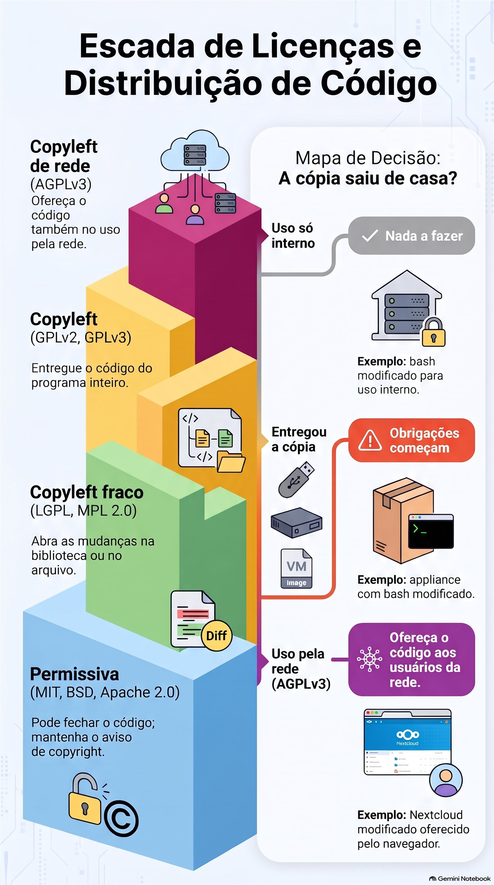
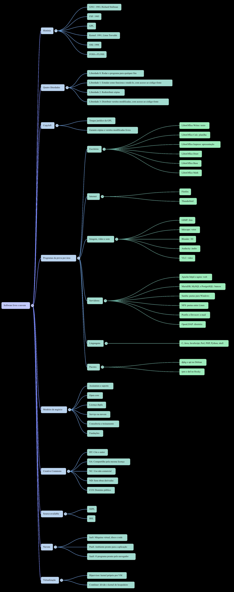
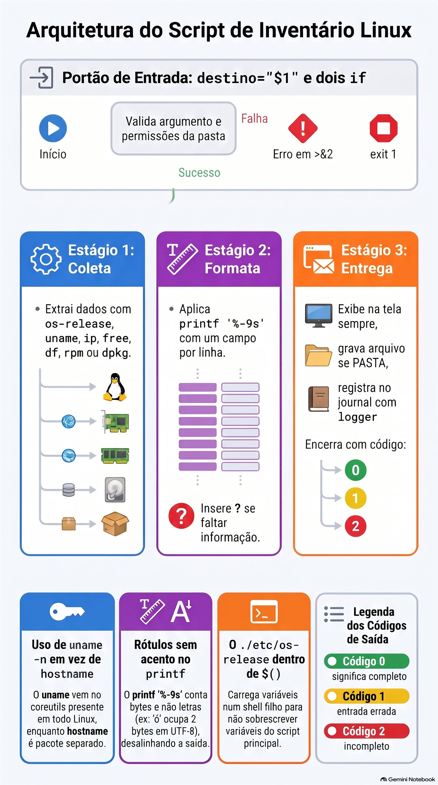

# Lezione 1.10 · Software libero in pratica

Ultima lezione del Modulo 1, composta da due metà che si incontrano alla fine. In primo luogo, impari a rispondere alla domanda che un giorno ogni cliente si pone: "cosa gira su questo server e possiamo usarlo gratuitamente?". Questa è una licenza e la licenza è una questione che riguarda l'amministratore di sistema, non solo l'avvocato. Nella seconda, metti insieme tutto quello che hai visto dalla lezione 1.1 in un vero script, `inventario.sh`: una foto di un server, nello stesso formato in Rocky e Debian, pronta per essere incollata in un ticket o salvata in una cartella.

| File | lezione 1.10 |
| --- | --- |
| Modulo | M1 · Riga di comando, lezione 10 di 10, sfida del modulo |
| Quando | Settimana 3 |
| Alla fine puoi | Spiegare le quattro libertà e la differenza tra licenza permissiva e copyleft; dire quando una licenza ti obbliga a consegnare il codice; trovare la licenza di un pacchetto in Rocky e Debian; riconoscere i principali programmi desktop e server gratuiti; dire se Linux viene eseguito su una macchina fisica, VM o contenitore; scrivere, da zero, uno script che raccolga, formatti e salvi la foto da un server |
| Articoli di prova | LE 011.2 (applicazioni gratuite più utilizzate) · LE 011.3 (licenze e modelli di business) · LE 011.4 (cloud, virtualizzazione, password e privacy) · LPIC-1 102.4 e 102.5: `dpkg -l`, `rpm -qa`, `rpm -qi` · RHCSA: script che elaborano l'output dei comandi |
| Prerequisiti | lezioni da 1.1 a 1.9; o `~/bin` in `PATH` su entrambe le VM |
| Tempo | Intorno alle 3 del mattino |
| Istantanee | m1a10-start e m1a10-end in entrambe le VM |

## 1 · Riscaldamento

Tre domande, a colpo d'occhio. Scrivi le risposte; la chiave di risposta viene visualizzata alla fine.

1. Nella lezione 1.9, `grep -q root /etc/passwd` terminava con il codice 0. E `grep -q naoexiste /etc/passwd`? Perché questo numero non è un errore?
2. Nella Lezione 1.9, qual è la differenza tra `wc -l /etc/passwd` e `wc -l < /etc/passwd` e perché è importante all'interno di una sceneggiatura?
3. Indovina: la tua azienda prende un programma GPL, ne modifica il codice e lo usa solo a casa, sui propri server, senza cederlo a nessuno. È obbligatorio pubblicare le modifiche?

## 2 · Perché è importante

Nel marzo 2024, Redis, uno dei banchi di memoria più utilizzati al mondo, ha scambiato la licenza BSD con due licenze software non libere. Nel giro di pochi giorni, la Linux Foundation ha rilasciato Valkey, una copia del codice dell'ultima versione gratuita. Nell'agosto 2023, Terraform ha fatto la stessa mossa ed è nato OpenTofu. Nel giugno del 2023, Red Hat ha iniziato a fornire il codice sorgente RHEL solo ai clienti e Rocky Linux, che usate in questo corso, ha dovuto cambiare il modo in cui era impostata la distribuzione.

Nelle tre storie, chi si occupava dei server ha dovuto rispondere, entro pochi giorni: "questo ci riguarda? Possiamo continuare a usarlo? Dobbiamo cambiarlo?". Chiunque sapesse leggere una patente ha risposto entro un'ora. Quelli che non lo sapevano sono rimasti in attesa dell'ufficio legale.

Proxmox, che gestisce le sue VM, è un altro esempio più tranquillo: è AGPLv3, gratuito, e la società che lo produce vive di abbonamenti al supporto. Sapendo questo si spiega il messaggio "Nessun abbonamento valido" che appare quando si accede e cosa significa (non è un problema di licenza).

La seconda metà della lezione risolve un'altra richiesta quotidiana: "inviami i dati per questo server". Quanta RAM, quanto disco libero, quale sistema, quale IP, se si tratta di una VM. Sai già come trovare ogni informazione. Oggi smetti di digitare otto comandi e inizi a eseguirne uno.

## 3 · Modello mentale

> La licenza è la regola per chi **passa**. Finché il software rimane con te, quasi tutto è permesso. Gli obblighi iniziano il giorno in cui ne consegni una copia o, in AGPL, il giorno in cui altre persone utilizzano il programma in rete.

Quattro famiglie, dalla più libera alla più esigente:

| Famiglia | Esempi | Se modifichi e consegna una copia | Se lo usi solo in ambienti chiusi |
| --- | --- | --- | --- |
| Permissivo | MIT, BSD, Apache 2.0 | Puoi chiudere il codice; mantenere l'avviso sul copyright | Niente da fare |
| Copyleft debole | LGPL, MPL 2.0 | Apri le modifiche **nella libreria o nel file**; il tuo programma che usi solo può essere chiuso | Niente da fare |
| Copyleft | GPLv2, GPLv3 | Fornire l'intero codice del programma, con la stessa licenza | Niente da fare |
| Copyleft di rete | AGPLv3 | Uguale a GPL | Se altre persone utilizzano la versione modificata **in rete**, offri loro il codice |

E l'inventario, la seconda metà:

> Un inventario è un'immagine: gli stessi campi, nello stesso ordine, nello stesso formato, su qualsiasi server. Se la foto di Rocky e quella di Debian non possono essere confrontate riga per riga, è inutile.

```text
   coleta                    formata                  entrega
  ┌──────────────┐        ┌───────────────┐       ┌──────────────────┐
  │ os-release   │        │ printf '%-9s' │       │ tela   (sempre)  │
  │ uname, ip    │ ─────► │ um campo por  │ ────► │ arquivo se PASTA │
  │ free, df     │        │ linha         │       │ journal (logger) │
  │ rpm ou dpkg  │        │ "?" se faltou │       │ código 0, 1 ou 2 │
  └──────────────┘        └───────────────┘       └──────────────────┘
```

## 4 · Concetto a strati

### Essenziale

**Da dove viene il software libero.** Nel 1983, Richard Stallman annunciò il progetto GNU, per scrivere un intero sistema operativo che tutti potessero usare, studiare e condividere. Nel 1985 creò la FSF, la Free Software Foundation, e successivamente la GPL, la licenza che protegge questa idea. Nel 1991 Linus Torvalds aggiunse ciò che mancava a GNU, il kernel. Ecco perché una parte della comunità dice "GNU/Linux": `bash`, `ls` e `grep` che usi dalla lezione 1.1 provengono da GNU.

**Le quattro libertà**, numerate da zero, come un buon programmatore:

| Libertà | Cosa garantisce | Richiede |
| --- | --- | --- |
| 0| Eseguire il programma per qualsiasi scopo |  |
| 1| Studia come funziona e cambialo | Accesso al codice sorgente |
| 2| Ridistribuire le copie |  |
| 3| Distribuisci le tue versioni modificate | Accesso al codice sorgente |

"Gratuito" parla di libertà, non di prezzo. La frase classica è *libero come nella libertà di parola, non come nella birra gratis*. Il software libero può essere venduto e un programma gratuito può essere chiuso.

**Open source.** Nel 1998, un gruppo ha creato OSI, l'Iniziativa Open Source, con un approccio diverso: meno etica, più vantaggi pratici, open source come modo migliore di sviluppare. Le licenze approvate dalle due organizzazioni sono quasi le stesse. Nei test e nella vita di tutti i giorni, vedrai gli acronimi **FOSS** (Software gratuito e open source) e **FLOSS** (Software gratuito/libre e open source), che combinano le due visioni.

**Copyleft** è il trucco legale della GPL: utilizzare il copyright per garantire che le copie e le versioni modificate rimangano libere. Chi riceve un programma GPL riceve le quattro libertà e non potrà toglierle a chi verrà dopo.

**Le tue licenze server.** Non è necessario memorizzarle tutte; bisogno di riconoscere le famiglie.

| Programma | Licenza | Famiglia |
| --- | --- | --- |
| Kernel Linux | GPLv2, solo versione 2 | Copyleft |
| `bash`, `coreutils`, `grep`, `tar` | GPLv3 o successiva | Copyleft |
| `glibc`, `systemd` | LGPL 2.1 o successiva, principalmente | Copyleft debole |
| Firefox, Thunderbird, LibreOffice | MPL2.0 | Copyleft debole |
| Proxmox VE, Nextcloud | AGPLv3 | Copyleft di rete |
| Apache httpd, Kubernetes | Apache2.0 | Permissivo |
| nginx, OpenSSH | BSD | Permissivo |
| PostgreSQL | Licenza PostgreSQL, simile al MIT | Permissivo |
| MariaDB | GPLv2 | Copyleft |
| Samba, Ansible | GPLv3 | Copyleft |
| Pitone | Licenza PSF | Permissivo |

**I programmi oggetto del test (LE 011.2).**

| Zona | Programmi |
| --- | --- |
| Ufficio | LibreOffice: Writer (testo), Calc (foglio di calcolo), Impress (presentazione), Draw, Base, Math |
| Internet | Firefox, Thunderbird |
| Immagine, video e suono | GIMP (foto), Inkscape (vettoriale), Blender (3D), Audacity (audio), VLC (video) |
| Server | Apache httpd e nginx (web), MariaDB, MySQL e PostgreSQL (banche), Samba (cartelle per Windows), NFS (cartelle tra Linux), Postfix e Dovecot (email), OpenLDAP (directory) |
| Lingue | C, Java, JavaScript, Perl, PHP, Python, shell |
| Pacchetti | `dpkg` e `apt` in Debian; `rpm` e `dnf` in Rocky |

**Trova la licenza per un pacchetto.** Ogni famiglia la memorizza in un unico posto.

```bash
# Rocky: o rpm guarda a licença no próprio pacote
rpm -qi bash | grep -i '^License'
rpm -q --qf '%{NAME}: %{LICENSE}\n' bash openssh-server systemd

# Debian: cada pacote traz um arquivo copyright
less /usr/share/doc/bash/copyright
grep -m3 '^License:' /usr/share/doc/openssh-server/copyright
```

In Rocky 9, il campo arriva nel vecchio formato, come `GPLv3+`. Le distribuzioni più recenti, come Rocky 10 e Fedora, stanno passando al formato SPDX, come `GPL-3.0-or-later`. È la stessa licenza con un altro nome. In Debian, i file più recenti seguono un formato letto dal computer, con le righe `License:`. I più vecchi sono testo libero: se `grep` non trova nulla, leggi l'inizio del file.

### Intermedio

**Come si fa a guadagnare con il software libero.** Il test chiede, e il mercato in cui lavori dipende da questo.

| Modello | Come funziona | Esempi |
| --- | --- | --- |
| Abbonamento e supporto | Il software è gratuito; l'azienda vende aggiornamenti testati, certificazioni e qualcuno da chiamare alle 3 del mattino | Red Hat, SUSE, Canonical, Proxmox |
| Nucleo aperto | Il nucleo è libero; si pagano e si chiudono le risorse per le imprese | GitLab (CE è MIT; EE è chiuso) |
| Doppia licenza | Lo stesso codice esce sotto GPL, gratuitamente, o sotto licenza commerciale, per chi non vuole aprire il proprio codice | MySQL, Qt |
| Servizio cloud | L'azienda gestisce il software per te e ti addebita un costo per l'utilizzo | Banche gestite, Hosted Nextcloud |
| Consulenza e formazione | Il denaro viene dalla conoscenza, non dal codice | Integratori, come Teseo |
| Fondazioni | Le aziende che utilizzano il software pagano una fondazione neutrale per mantenerlo | Linux Foundation, Apache Software Foundation |

**Creative Commons** è per i contenuti, non per il codice: testo, immagini, video, corsi. I pezzi si combinano.

| Acronimo | Significa |
| --- | --- |
| DA | Citare l'autore |
| SA | Condividi con la stessa licenza (copyleft dei contenuti) |
| NC | Uso non commerciale |
| ND | Nessuna opera derivata: non è possibile modificare |
| CC0 | Dominio pubblico: nessuna condizione |

Esempio: Wikipedia utilizza CC BY-SA. Puoi copiare un articolo nel tuo manuale interno, citando la fonte e mantenendo la stessa licenza.

**Quando il codice è visibile, ma non è gratuito.** Alcune aziende hanno iniziato a utilizzare licenze *disponibili alla fonte*: leggi il codice, ma non puoi, ad esempio, offrirlo come servizio concorrente. SSPL, creato da MongoDB nel 2018, è il più conosciuto. L'OSI non riconosce queste licenze come open source. È stato per SSPL, e per la propria licenza, che Redis è andata nel 2024; in Redis 8, nel 2025, offriva nuovamente anche AGPLv3. Terraform è passato a BSL, che ne consente l'uso in produzione, ma vieta di competere con HashiCorp.

**Cloud e virtualizzazione (LE 011.4).**

| Acronimo | Ricevi | Abbi cura di te | Esempio |
| --- | --- | --- | --- |
| IaaS | Macchina virtuale, disco e rete | Dal sistema operativo in su | Una VM in un cloud pubblico |
| PaaS | Ambiente pronto per l'applicazione | Solo codice e dati | Una banca gestita |
| SaaS | Il programma pronto, tramite il browser | Solo i tuoi dati e utenti | Webmail, CRM online |

Due modi per dividere una macchina:

- **Hypervisor** (KVM, Proxmox; VMware; Hyper-V): ogni VM ha il proprio kernel. Forte isolamento, maggiore spreco di memoria.
- **Contenitore** (LXC, anche su Proxmox; Docker; Podman): condividono tutti il ​​kernel host. Leggero e veloce, isolamento inferiore.

Linux ti dice dove è in esecuzione:

```bash
systemd-detect-virt        # kvm su una macchina virtuale Proxmox; lxc num CT; nessuno su una macchina fisica
cat /sys/class/dmi/id/sys_vendor     # QEMU su una macchina virtuale Proxmox
```

Su una macchina fisica, `systemd-detect-virt` mostra `none` **e** termina con il codice 1. Salvalo per lo script.

**Password e privacy (LE 011.4).** Le nozioni di base coperte dal test: una password lunga vale più di una password "complicata" e breve; una password per servizio, archiviata in un gestore di password; AMF, il secondo fattore, in tutto ciò che è importante; HTTPS crittografa il percorso, non garantisce che il sito sia onesto; e il browser memorizza cookie e cronologia, che la modalità privata non viene trasferita alla sessione successiva, ma il provider e il sito Web continuano a vedere.

### Windows Bridge

| Su Windows | Su Linux |
| --- | --- |
| `winver`, `systeminfo` | `cat /etc/os-release`, `uname -r` |
| "Informazioni" mostra "Macchina virtuale" | `systemd-detect-virt` |
| Programmi e risorse: elenco dei |. installati `rpm -qa` su Rocky, `dpkg -l` su Debian |
| Licenza nella sezione "Informazioni" di ciascun programma | `rpm -qi PACOTE`, `/usr/share/doc/PACOTE/copyright` |
| Script di inventario in PowerShell con `Get-ComputerInfo` | `inventario.sh`, che scrivete oggi |
| Licenza per utente o per core, Microsoft Audit | Il kernel e quasi l'intero sistema non richiedono alcuna licenza; paghi, se vuoi, per il supporto |

### Advanced

**GPLv2 contro GPLv3.** La GPLv3, del 2007, ha aggiunto due cose: la protezione contro i brevetti e la regola "anti-tivoization", che proibisce di vendere un dispositivo che esegue GPLv3 e impedisce al proprietario di installarne una versione modificata. Il kernel è rimasto in GPLv2 "solo", senza "o successivo", e quindi non potrà mai passare alla v3. Questo è anche il motivo per cui alcune aziende evitano i componenti GPLv3 sui dispositivi chiusi.

**"Distribuire" è la parola chiave.** L'esecuzione sul server non equivale alla distribuzione. Consegnare al cliente una chiavetta USB, un'appliance o un'immagine VM lo è. Un'azienda che modifica il `bash` per uso interno non deve nulla a nessuno. Un'azienda che vende un elettrodomestico con questo `bash` modificato deve consegnare il codice all'acquirente se questi lo richiede. AGPL colma la lacuna del servizio cloud: se modifichi Nextcloud e lo offri ai clienti in rete, questi hanno diritto al codice della tua versione.

**Il caso RHEL.** RHEL è composto, tra gli altri, da pacchetti GPL. Red Hat continua a rispettare la GPL fornendo il codice a coloro che ricevono il codice binario, i clienti. Ciò che è cambiato nel 2023 è stato l’accesso pubblico, che è diventato CentOS Stream, un passo avanti rispetto a RHEL. Rocky, AlmaLinux e altri hanno iniziato a creare la distribuzione da CentOS Stream e altre fonti. Per te, nella VM, non è cambiato nulla: `dnf update` continua a funzionare.


*Gli obblighi iniziano quando la copia esce di casa o, in AGPL, quando altri utilizzano il programma in rete.*

### Ciò che rientra nel test

- **LE:** le quattro libertà; La FSF contro l'OSI; copyleft contro permissivo; GPL, LGPL, BSD, Apache, MIT e Creative Commons; modelli di business; programmi gratuiti per ogni area; IaaS, PaaS e SaaS; VM vs contenitore.
- **LPIC-1:** `rpm -qa`, `rpm -qi`, `rpm -q --qf`; `dpkg -l` e il significato di `ii` e `rc`.
- **RHCSA:** uno script che raccoglie dati con comandi, li formatta e restituisce un codice di output che un altro script può leggere.


*Revisione di una pagina di quanto addebita l'esame LE su software libero, business e cloud.*

## 5 · Rocky × Debian

|  | Rocky Linux 9 e 10 | Debian 13 |
| --- | --- | --- |
| File che identifica la famiglia | `/etc/redhat-release` e `/etc/rocky-release` | `/etc/debian_version` |
| `/etc/os-release`, campo `ID` | `rocky` | `debian` |
| `/etc/os-release`, campo `ID_LIKE` | `rhel centos fedora` | Non esiste: Debian è l'origine |
| Un pacchetto di licenze | `rpm -qi PACOTE`, campo `License` | `/usr/share/doc/PACOTE/copyright` |
| Conta i pacchetti installati | `rpm -qa \| wc -l` | `dpkg -l \| grep -c '^ii'` |
| Nome della scheda di rete in una VM Proxmox | Dipende dal modello di VM: in laboratorio, `enp6s18`; in altri, `ens18` o `eth0` | Idem: `enp6s18` nel laboratorio |
| Nocciolo | Vecchio e con correzioni apportate dalle nuove versioni, come `5.14` in Rocky 9 | Più recente, come `6.12` in Debian 13 |
| `systemd-detect-virt` | Installato | Installato |

La regola che vale per entrambi: **leggere `/etc/os-release` per conoscere il sistema, e `/etc/debian_version` o `/etc/redhat-release` solo per scegliere il gestore dei pacchetti**.

Perché `grep -c '^ii'` in Debian e non `wc -l`? Perché `dpkg -l` mostra cinque righe di intestazione e anche i pacchetti rimossi che hanno lasciato la configurazione, con `rc` all'inizio. Solo `ii` significa "installato".

## 6 · Laboratorio guidato

Fai tutto su entrambe le VM, a meno che il passaggio non ne indichi solo uno. Le prove sono in `~/lab14`; la sceneggiatura finita va a `~/bin`; le foto del server vanno a `~/inventarios`. In ogni passaggio, quando viene visualizzato **Predict**, scrivere la risposta prima di premere Invio.

### Passaggio 1 · Prepararsi e chiedere "chi sei?"

Nel nodo Proxmox:

```bash
qm snapshot 201 m1a10-inicio
qm snapshot 202 m1a10-inicio
```

In ciascuna VM:

```bash
mkdir -p ~/lab14 ~/inventarios
cd ~/lab14
cat /etc/os-release
```

**Predict.** Rocky mostra `ID_LIKE="rhel centos fedora"`. Cosa mostra Debian nella riga `ID_LIKE`?

Nothing: la riga non esiste. `ID_LIKE` dice "Sono simile a" e Debian è l'origine della famiglia, non una parente. Ubuntu, che proviene da Debian, mostra `ID_LIKE=debian`.

Il file è un elenco di `NOME=valor`, esattamente il formato di una variabile di shell. Quindi puoi caricarlo:

```bash
( . /etc/os-release; echo "$ID | $VERSION_ID | $PRETTY_NAME" )
```

Rocky: qualcosa come `rocky | 9.6 | Rocky Linux 9.6 (Blue Onyx)`. Debian: `debian | 13 | Debian GNU/Linux 13 (trixie)`. Le parentesi aprono una shell figlia: le variabili del file muoiono con essa e non ingombrano il terminale. Salva questo dettaglio per la pausa A.

Confronta con i file per ciascuna famiglia:

```bash
cat /etc/redhat-release 2> /dev/null
cat /etc/debian_version 2> /dev/null
uname -n
uname -r
```

**Decidi 1 · L'origine del nome del sistema.** Il tuo script verrà eseguito su Rocky, Debian e, un giorno, su Ubuntu o AlmaLinux. Da dove prendere il nome del sistema?

- **A)** Da `/etc/redhat-release`.
- **B)** Da `PRETTY_NAME` da `/etc/os-release`.
- **C)** Da `uname -a`.
- **D)** Dalla prima riga di `/etc/issue`.

Scegliere la lettera prima di guardare la tabella.

| Se hai selezionato | Risultato | Perché |
| --- | --- | --- |
| A | ❌ Sbagliato | Esiste solo nella famiglia Red Hat. In Debian, lo script si interrompe sulla prima riga. |
| B| ✅ Giusto | `/etc/os-release` è uno standard systemd ed esiste praticamente in ogni distribuzione attuale, nello stesso formato. `PRETTY_NAME` è pronto per essere mostrato. |
| C| ❌ Sbagliato | `uname` parla del **kernel**, non della distribuzione. `Linux rocky-lab 5.14.0-...` non dice che è Rocky. |
| D | ❌ Sbagliato | `/etc/issue` è il messaggio della schermata di login. L'amministratore può modificarlo e dispone di codici come `\n` e `\l`. |

**Da sistemare:** sapere **quale sistema**, `/etc/os-release`. Per sapere **quale gestore di pacchetti**, l'esistenza di `/etc/debian_version` o `/etc/redhat-release`.

### Passo 2 · Dove sto correndo?

```bash
systemd-detect-virt; echo "rc=$?"
cat /sys/class/dmi/id/sys_vendor
cat /sys/class/dmi/id/product_name
```

`kvm` e `rc=0`; `QEMU`; e qualcosa come `Standard PC (Q35 + ICH9, 2009)`. Proxmox utilizza KVM nel kernel e QEMU per falsificare l'hardware. In un contenitore Proxmox LXC, il primo comando mostrerebbe `lxc`.

**Decide 2 · E su una macchina fisica?** Lo stesso script viene eseguito su un server reale, senza virtualizzazione. Cosa succede a `virt="$(systemd-detect-virt)"`?

- **A)** `virt` è vuoto e il codice è 0.
- **B)** `virt` vale `none` e il codice è 1.
- **C)** `virt` vale `physical` e il codice è 0.
- **D)** il comando restituisce un errore, perché funziona solo in VM.

Scegli la lettera prima di guardare la tabella.

| Se hai selezionato | Risultato | Perché |
| --- | --- | --- |
| A | ❌ Sbagliato | Scrive sempre una risposta. Vuoto, solo se il comando non esiste nemmeno. |
| B| ✅ Giusto | Scrivi `none` e termina con 1. Ecco perché lo script testa il **testo**, `[ "$virt" = "none" ]`, e non il codice: qui 1 non è un errore, è "Non sono in una VM". |
| C| ❌ Sbagliato | Non esiste una risposta `physical`. |
| D | ❌ Sbagliato | Funziona su qualsiasi macchina con systemd; esiste proprio per rispondere “fisico o virtuale?”. |

**Da risolvere:** è lo stesso caso di `grep` nella lezione 1.9. Prima di considerare un codice diverso da zero come un errore, leggere `man` del comando: `man systemd-detect-virt`, sezione *STATO USCITA*.

### Passo 3 · Memoria, disco e rete

```bash
free -m
free -h
df -h /
df -h --output=avail,size,pcent /
ip -br -4 addr show scope global
uptime -p
```

`--output` di `df` sceglie le colonne e l'ordine. `ip -br` è la modalità riassuntiva, una tavola per riga; `-4` mostra solo IPv4; `scope global` tralascia `lo`, `127.0.0.1`. `uptime -p` indica da quanto tempo la macchina è accesa, in formato testo.

**Prepara.** Nell'output di `free -m`, quale numero è più grande: colonna `free` o `available`?

Al `available`, quasi sempre e con facilità. Qualcosa come `free 118` e `available 1351`.

**Decidere 3 · La RAM sta per esaurirsi?** Un collega guarda il `free -m` di un server da 2 GB, vede `free 118` e apre un ticket urgente: "la memoria si sta esaurendo, abbiamo bisogno di più RAM". Cosa rispondi?

- **A)** Ha ragione: 118 MB liberi non sono sufficienti, serve più memoria.
- **B)** Chiedigli di eseguire `sync; echo 3 > /proc/sys/vm/drop_caches` per liberare memoria.
- **C)** Guarda la colonna `available`. La differenza sta in `buff/cache`: Linux usa la RAM di riserva come cache del disco e la restituisce quando un programma la richiede.
- **D)** Guarda la riga `Swap`: se è vuota, la memoria è in esaurimento.

Scegli la lettera prima di guardare la tabella.

| Se hai selezionato | Risultato | Perché |
| --- | --- | --- |
| A | ❌ Sbagliato | `free` è la memoria che nessuno usa, né la cache. Su un Linux sano, è volutamente piccolo: la RAM inattiva è RAM sprecata. |
| B| ❌ Sbagliato | Svuota la cache, `free` si attiva per qualche minuto e il server diventa **più lento**, perché legge nuovamente dal disco ciò che era in memoria. Non risolve nulla. |
| C| ✅ Giusto | `available` è la stima di quanto un nuovo programma può utilizzare senza che il sistema si scambi. È il numero che va nell'inventario e nell'allarme. |
| D | ❌ Sbagliato | Lo scambio vuoto è un buon segno: nessuno ne aveva bisogno. Ciò che preoccupa è che lo swap ** venga utilizzato ** e `available` basso allo stesso tempo. |

**Da correggere:** in `free`, il numero che risponde "hai memoria rimasta?" è `available`.

### Passo 4 · Chi possiede questo software?

Su Rocky:

```bash
rpm -qi bash | grep -i '^License'
rpm -q --qf '%{NAME}: %{LICENSE}\n' bash openssh-server systemd kernel
rpm -qa --qf '%{LICENSE}\n' | sort | uniq -c | sort -rn | head
```

Su Debian:

```bash
grep -m3 '^License:' /usr/share/doc/openssh-server/copyright
grep -h '^License:' /usr/share/doc/*/copyright 2> /dev/null | sort | uniq -c | sort -rn | head
```

L'ultimo comando su ciascun lato è la "ricerca licenza" dell'intero server: conta quanti pacchetti utilizzano ciascuna licenza e mostra i dieci più comuni. È la stessa riga del `sort | uniq -c | sort -rn` della lezione 1.6, che ora risponde a una domanda commerciale. Aspettatevi di vedere GPL, LGPL, MIT e BSD in cima, in entrambi.

Ora un loop dalla lezione 1.9, in Rocky:

```bash
for p in bash openssh-server systemd nginx; do
    if rpm -q "$p" > /dev/null; then
        rpm -q --qf '%{NAME}: %{LICENSE}\n' "$p"
    else
        echo "$p: não instalado"
    fi
done
```

E in Debian:

```bash
for p in bash openssh-server systemd nginx; do
    if [ -f "/usr/share/doc/$p/copyright" ]; then
        echo "$p: $(grep -m1 '^License:' "/usr/share/doc/$p/copyright")"
    else
        echo "$p: não instalado"
    fi
done
```

Su Debian, alcuni pacchetti rispondono ` bash:  ` con una licenza vuota. Non è un errore di loop: `copyright` in questo pacchetto è testo libero, senza la riga `License:`. Leggi con `less`.

**Decidi 4 · Quando devi consegnare il codice?** In quale di questi casi la licenza **richiede** di consegnare il codice sorgente a qualcuno?

- **A)** Modifichi nginx, BSD ed esegui la versione modificata sul server della tua azienda, che serve il sito web del cliente.
- **B)** Modifichi uno strumento GPL, lo installi su quello di un cliente VM e consegnare le VM a lui, che ne diventa il proprietario.
- **C)** Modifichi `bash` per l'utilizzo sui server interni della tua azienda.
- **D)** Vendi un'appliance con un programma Apache 2.0, senza modifiche.

Scegli la lettera prima di guardare la tabella.

| Se hai selezionato | Risultato | Perché |
| --- | --- | --- |
| A | ❌ Sbagliato | La licenza permissiva non richiede l'apertura di nulla e il software non ha nemmeno lasciato la tua azienda. |
| B| ✅ Giusto | Consegnare le VM significa **distribuire**. Il cliente riceve il binario GPL modificato e con esso il diritto al codice della sua versione, sotto la stessa licenza. |
| C| ❌ Sbagliato | È GPL, ma non c'è stata distribuzione: il `bash` modificato non è uscito di casa. |
| D | ❌ Sbagliato | C'era la distribuzione, ma Apache 2.0 è permissivo. È necessario includere la licenza e il file `NOTICE`, non il codice. |

**Per risolvere:** la domanda chiave della GPL è "la copia è uscita di casa?". Se non te ne sei andato, non c'è quasi alcun obbligo.

**Decidi 5 · Che ne dici di AGPL?** La tua azienda modifica Nextcloud, AGPLv3, per includere il branding e una nuova funzionalità e lo offre ai clienti tramite il browser. Nessuno riceve una copia del programma. Cosa richiede la licenza?

- **A)** Niente: non c'è stata distribuzione, quindi vale la stessa regola dell'uso interno.
- **B)** Offrire il codice della versione modificata a chi utilizza il servizio in rete.
- **C)** Pubblicare il codice a chiunque nel mondo, su GitHub, ad esempio.
- **D)** Paga una licenza commerciale alla società Nextcloud.

Scegli la lettera prima di guardare la tabella.

| Se hai selezionato | Risultato | Perché |
| --- | --- | --- |
| A | ❌ Sbagliato | Sarebbe vero nella GPL. AGPL esiste proprio per chiudere questo buco: conta l'utilizzo della rete. |
| B| ✅ Giusto | Chiunque interagisce con il programma modificato in rete ha diritto al codice di quella versione. Un collegamento "codice sorgente" nel piè di pagina fa il trucco. |
| C| ❌ Sbagliato | L’obbligo è verso gli utenti del servizio, non verso il mondo. Molte persone pubblicano per tutti perché è più semplice, ma la licenza non lo richiede. |
| D | ❌ Sbagliato | AGPL non addebita nulla. Pagare l'azienda è una scelta, avere il supporto o l'edizione enterprise. |

**Per risolvere:** GPL controlla chi **riceve una copia**; AGPL esamina anche chi **lo utilizza sulla rete**.

### Passo 5 · La sfida, prima della soluzione

Ora tocca a te. Provalo da solo per **30 minuti** prima di aprire il passaggio 6. Il crash è parte di esso; È quando smetti che la lezione 1.9 diventa tua. Scrivere in `~/lab14/inventario.sh` uno script che:

1. Accettare un argomento facoltativo, `PASTA`. Senza di esso, viene semplicemente visualizzato sullo schermo. Con esso si registra anche `PASTA/SERVIDOR-AAAA-MM-DD.txt`.
2. Se `PASTA` non è una cartella, oppure non è possibile scriverci, mostrare l'errore in `>&2` e terminare con **codice 1**.
3. Mostra, in questo ordine, un campo per riga, con le etichette allineate: server e data in un titolo; sistema; nocciolo; virtualizzazione; IP; RAM totale e disponibile in MB; disco root libero, totale e utilizzato; pacchetti installati; da quanto tempo è acceso.
4. Funziona allo stesso modo su Rocky e Debian: stesse etichette, stesso ordine.
5. Se non è possibile individuare qualche campo, mostrare invece `?`, continuare e terminare con **codice 2** e un avviso in `>&2`.
6. Lascia una riga nel giornale con `logger -t inventario`.

Tre consigli, se ti servono:

- Carica `/etc/os-release` **interno** `$( )`.
- Per ottenere colonne da una riga, usa `read -r a b c < arquivo`, come in `while read` della lezione 1.9, e non `comando | read`.
- `printf '%-9s %s\n' "Kernel:" "$kernel"` allinea l'etichetta in 9 posizioni.

### Passo 6 · Una soluzione, blocco per blocco

Confronta con la tua. Non deve essere necessariamente lo stesso: deve superare i test del passaggio 7.

```bash
cat > ~/lab14/inventario.sh <<'EOF'
#!/bin/bash
# inventario.sh - foto de um servidor Linux, no mesmo formato em qualquer distro
# Uso: inventario.sh [PASTA]
#      Sem PASTA, só mostra na tela. Com PASTA, também grava PASTA/SERVIDOR-DATA.txt
# Saída: 0 = tudo coletado; 1 = PASTA inválida; 2 = algum campo ficou sem resposta

destino="$1"
if [ -n "$destino" ] && [ ! -d "$destino" ]; then
    echo "ERRO: $destino não é uma pasta" >&2
    exit 1
fi
if [ -n "$destino" ] && [ ! -w "$destino" ]; then
    echo "ERRO: sem permissão de escrita em $destino" >&2
    exit 1
fi

faltou=0
tmp="$(mktemp)"
servidor="$(uname -n)"
agora="$(date '+%F %H:%M')"

# Sistema: o /etc/os-release existe nas duas famílias.
# Lido dentro de $( ), para as variáveis dele não se misturarem com as do script.
if [ -r /etc/os-release ]; then
    sistema="$(. /etc/os-release; echo "$PRETTY_NAME")"
else
    sistema="?"
    faltou=$((faltou + 1))
fi

kernel="$(uname -r)"

# Virtualização: numa máquina física, mostra "none" e sai com 1
virt="$(systemd-detect-virt 2> /dev/null)"
if [ "$virt" = "none" ]; then
    virt="nenhuma, máquina física"
elif [ -z "$virt" ]; then
    virt="?"
    faltou=$((faltou + 1))
fi

# IPs: uma linha por placa; com scope global, a lo fica de fora
ip -br -4 addr show scope global > "$tmp"
ips=""
while read -r placa estado endereco resto; do
    [ -n "$endereco" ] || continue
    if [ -z "$ips" ]; then
        ips="$placa $endereco"
    else
        ips="$ips, $placa $endereco"
    fi
done < "$tmp"
if [ -z "$ips" ]; then
    ips="?"
    faltou=$((faltou + 1))
fi

# Memória em MB: o total e o disponível, que é o que importa
free -m | grep '^Mem:' > "$tmp"
read -r rotulo mem_total usado livre compart cache mem_disp < "$tmp"

# Disco da raiz
df -h --output=avail,size,pcent / | tail -n 1 > "$tmp"
read -r disco_livre disco_total disco_uso < "$tmp"

# Pacotes: cada família tem o seu gerenciador
if [ -f /etc/debian_version ]; then
    pacotes="$(dpkg -l | grep -c '^ii') (dpkg)"
elif [ -f /etc/redhat-release ]; then
    pacotes="$(rpm -qa | wc -l) (rpm)"
else
    pacotes="?"
    faltou=$((faltou + 1))
fi

ligado="$(uptime -p)"
rm -f "$tmp"

saida=/dev/null
if [ -n "$destino" ]; then
    saida="$destino/$servidor-$(date +%F).txt"
fi

{
    echo "=== $servidor · $agora ==="
    printf '%-9s %s\n' "Sistema:" "$sistema"
    printf '%-9s %s\n' "Kernel:" "$kernel"
    printf '%-9s %s\n' "Virtual:" "$virt"
    printf '%-9s %s\n' "IP:" "$ips"
    printf '%-9s %s MB, %s MB disponíveis\n' "RAM:" "$mem_total" "$mem_disp"
    printf '%-9s %s livres de %s, %s usado\n' "Disco /:" "$disco_livre" "$disco_total" "$disco_uso"
    printf '%-9s %s\n' "Pacotes:" "$pacotes"
    printf '%-9s %s\n' "Ligado:" "$ligado"
} | tee "$saida"

if [ -n "$destino" ]; then
    echo "Gravado em $saida" >&2
fi

logger -t inventario "$servidor: $faltou campo(s) sem resposta"
if [ "$faltou" -gt 0 ]; then
    echo "AVISO: $faltou campo(s) sem resposta" >&2
    exit 2
fi
EOF
chmod +x ~/lab14/inventario.sh
bash -n ~/lab14/inventario.sh && echo "sintaxe ok"
```

Cosa utilizza ciascun blocco e dove lo hai visto:

| Blocca | Cosa fa | lezione |
| --- | --- | --- |
| `destino="$1"` ed entrambi `if` | Controlla prima di tutto cosa è economico: argomento, cartella, autorizzazione. Errore nei `>&2` e `exit 1` | 1.8 e 1.9 |
| `faltou=0` e `$((faltou + 1))` | Conta i campi senza risposta, senza interrompere lo script | 1.9 |
| `mktemp` | Crea un file temporaneo vuoto con un nome univoco in `/tmp` e visualizza il nome. Novità: alla fine esce `rm -f "$tmp"` | Oggi |
| `$(. /etc/os-release; echo ...)` | Legge il file in una shell figlia; solo `PRETTY_NAME` restituisce | Oggi, Fase 1 |
| `while read ... done < "$tmp"` | Scorrere le piastre senza perdere la variabile `ips` | 1.9 |
| `read -r a b c ... < "$tmp"` | Taglia una riga in colonne, per spazi | 1.9 |
| `[ -f /etc/debian_version ]` | Scegli il gestore pacchetti | Oggi, §5 |
| `saida=/dev/null` e `tee "$saida"` | Viene sempre visualizzato sullo schermo; registra solo se c'è `PASTA`. Senza `PASTA`, `tee` scrive nel "buco nero" | 1.6 |
| `{ ...; } \| tee` | Unisce l'output di diversi comandi in un unico flusso | 1.6 |
| `logger -t inventario` | Una riga nel diario, per sapere quando è stata pubblicata | 1.9 |
| `exit 2` alla fine | Cron, o un altro script, sa che la foto era incompleta | 1.9 |

Tre scelte che sembrano dettagli:

- **`uname -n`, non `hostname`.** `uname` è disponibile in `coreutils`, che è in tutto Linux. Il comando `hostname` è un pacchetto separato, che un'installazione minima potrebbe non avere.
- **Etichette non accentate.** `printf '%-9s'` conta i **byte**, non le lettere. `Memória:` ha 8 lettere e 9 byte, perché `ó` ne occupa 2 in UTF-8 e l'allineamento è storto. Quindi `RAM:`, `Disco /:` e `Virtual:`.
- **`.` all'interno di `$( )`.** `/etc/os-release` definisce `NAME`, `ID`, `VERSION` e altri. Caricato direttamente nello script, sovrascrive qualsiasi variabile con lo stesso nome. La rottura A mostra il danno.


*Raccolta, formato e consegna: la stessa foto in qualsiasi distro, con codice che un altro programma sa leggere.*

### Passo 7 · Testare i percorsi e confrontare le due VM

Innanzitutto, il percorso felice e il percorso di input sbagliato:

```bash
cd ~/lab14
./inventario.sh;                 echo "rc=$?"
./inventario.sh ~/inventarios;   echo "rc=$?"
ls ~/inventarios
./inventario.sh /naoexiste;      echo "rc=$?"
./inventario.sh /etc;            echo "rc=$?"
```

In Rocky, la prima chiamata mostra qualcosa del genere (i numeri e il nome della scheda saranno quelli della tua VM):

```text
=== rocky-lab · 2026-11-02 16:14 ===
Sistema:  Rocky Linux 9.6 (Blue Onyx)
Kernel:   5.14.0-570.17.1.el9_6.x86_64
Virtual:  kvm
IP:       enp6s18 10.1.0.51/24
RAM:      1763 MB, 1351 MB disponíveis
Disco /:  14G livres de 20G, 30% usado
Pacotes:  412 (rpm)
Ligado:   up 3 hours, 12 minutes
rc=0
```

La seconda chiamata mostra lo stesso, più `Gravado em /home/rodrigo/inventarios/rocky-lab-2026-11-02.txt` e `rc=0`. Il terzo, `ERRO: /naoexiste não é uma pasta` e `rc=1`. Il quarto, `ERRO: sem permissão de escrita em /etc` e `rc=1`.

Ora la via di mezzo: un campo che non risponde. Ingannerai lo script con un falso `ip`, che non mostra nulla, posto davanti a `PATH` solo per questa riga:

```bash
mkdir -p ~/lab14/falso
printf '#!/bin/bash\nexit 0\n' > ~/lab14/falso/ip
chmod +x ~/lab14/falso/ip
PATH=~/lab14/falso:$PATH ./inventario.sh; echo "rc=$?"
```

**Predict** la riga `IP:` e il codice.

`IP:       ?`, poi `AVISO: 1 campo(s) sem resposta` e `rc=2`. Il resto della foto è risultato normale: un campo mancante non cancella gli altri.

Il diario ha registrato ogni esecuzione:

```bash
journalctl -t inventario --since today
```

Se non appare nulla in Debian, usa `sudo journalctl -t inventario --since today`: a seconda dei gruppi dell'utente, vede solo una parte del diario.

Ora, la prova che la foto è la stessa in entrambi. Esegui su ogni VM:

```bash
./inventario.sh | tail -n +2 | cut -d: -f1
./inventario.sh | tail -n +2 | cut -d: -f1 | md5sum
```

Il `tail -n +2` salta il titolo, che riporta il nome del server; `cut` ha solo le etichette; `md5sum` riassume l'elenco in una “impronta digitale”. Se la stampa di Rocky e la stampa di Debian sono le stesse, le etichette sono identiche, nello stesso ordine: `mesmo formato`. Basta confrontare i primi caratteri dei due.

**Predict.** Se si cambia, solo nello script Debian, da `"Disco /:"` a `"Disco:"`, le stampe rimangono le stesse?

No. Un carattere diverso cambia l'intero `md5sum`. Ecco perché si usa per fare confronti: o è uguale oppure no.

Tutto giusto? Installa su entrambe le VM:

```bash
cp ~/lab14/inventario.sh ~/bin/
type inventario.sh
```

Ora il guadagno: in Windows PowerShell, con i nickname della lezione 0.2, scatta una foto di entrambi senza inserire nessuno dei due:

```powershell
ssh rocky-lab bin/inventario.sh
ssh debian-lab bin/inventario.sh
```

Ogni riga entra, esegue un comando ed esce, come `ssh debian-lab hostname` della lezione 0.2. Il percorso `bin/inventario.sh` è relativo alla cartella home, dove inizia ssh, e funziona anche se `~/bin` non è in `PATH` di una sessione senza terminale.

> **Protocollo · Script che gira su qualsiasi distro**
>
> 1. Sistema tramite `/etc/os-release`, caricato all'interno di `$( )`. Famiglia, basta scegliere `rpm` o `dpkg`, per `/etc/debian_version` o `/etc/redhat-release`.
> 2. Preferire i comandi che esistono ovunque: `uname`, `ip`, `free`, `df`, `systemd-detect-virt`. Quando non ce n'è uno comune, scegliere per famiglia con `if`.
> 3. Un campo che non risponde diventa `?`, conta in `faltou` e non per lo script.
> 4. Uscita macchina, con etichette fisse, senza accento, allineata con `printf`.
> 5. Codici di uscita documentati in alto: 0 completo, 1 immissione errata, 2 incompleto.
> 6. Testare entrambe le famiglie e confrontare le etichette, con `cut` e `md5sum`, prima di fidarsi.

## 7 · Interrompi e correggi

### Interruzione A · Il server che ha cambiato nome

Un collega ha scritto una breve scheda informativa del server. Fai come lui, su entrambe le VM:

```bash
cd ~/lab14
cat > ficha.sh <<'EOF'
#!/bin/bash
# ficha.sh - nome do servidor e sistema (versão do colega)
NAME="$(uname -n)"
. /etc/os-release
echo "Servidor: $NAME"
echo "Sistema:  $PRETTY_NAME"
EOF
chmod +x ficha.sh
```

**Osserva.**

```bash
./ficha.sh
```

No Rocky: `Servidor: Rocky Linux`. Su Debian: `Servidor: Debian GNU/Linux`. Manca il nome del server. In un inventario di 40 macchine, avrebbero tutte lo stesso "nome".

**Diagnostique.**

```bash
bash -x ./ficha.sh
```

```text
++ uname -n
+ NAME=rocky-lab
+ . /etc/os-release
++ NAME='Rocky Linux'
++ VERSION='9.6 (Blue Onyx)'
++ ID=rocky
...
+ echo 'Servidor: Rocky Linux'
```

`NAME` ricevuto `rocky-lab`, giusto. Due righe dopo, `.` esegue `/etc/os-release` **all'interno** dello script e la sua prima riga è `NAME="Rocky Linux"`. Le righe con `++` sono quelle del file caricato. La variabile del collega è stata sostituita da un'altra con lo stesso nome.

**Decidi A · La correzione.** Cosa lo risolve effettivamente?

- **A)** Usa virgolette singole: `NAME='$(uname -n)'`.
- **B)** Esporta la variabile prima: `export NAME="$(uname -n)"`.
- **C)** Carica il file in una shell figlia, `sistema="$(. /etc/os-release; echo "$PRETTY_NAME")"`, e usa nomi minuscoli nella tua variabili.
- **D)** Sostituisci `.` con `source`.

Scegli la lettera prima di guardare la tabella.

| Se hai selezionato | Risultato | Perché |
| --- | --- | --- |
| A | ❌ Sbagliato | `.` si sovrascrive allo stesso modo e l'uscita rimane `Rocky Linux`. Senza `.` sarebbe peggio: gli apici singoli mostrerebbero il testo `$(uname -n)`, senza eseguire il comando. |
| B| ❌ Sbagliato | `export` invia la variabile solo ai programmi figli. Non lo protegge: `.` continua a scriverci sopra. |
| C| ✅ Giusto | All'interno di `$( )`, il file viene eseguito in una shell figlia, che muore prendendo `NAME`, `ID` e gli altri; ritorna solo `PRETTY_NAME`, attraverso `echo`. E i nomi minuscoli non entrano in conflitto con quelli del sistema, che utilizzano le maiuscole. |
| D | ❌ Sbagliato | `source` e `.` sono lo stesso comando, con due nomi. Stesso risultato. |

**Per risolvere:** caricare un file con `.` ne incolla il contenuto nello script. Se non vuoi le sue variabili nel tuo percorso, clicca all'interno di `$( )`. E usa le lettere minuscole nel tuo: `servidor`, non `NAME`.

**Fix.**

```bash
cat > ficha.sh <<'EOF'
#!/bin/bash
# ficha.sh - nome do servidor e sistema (consertado)
servidor="$(uname -n)"
sistema="$(. /etc/os-release; echo "$PRETTY_NAME")"
echo "Servidor: $servidor"
echo "Sistema:  $sistema"
EOF
./ficha.sh
```

`Servidor: rocky-lab` e `Sistema:  Rocky Linux 9.6 (Blue Onyx)`, o l'equivalente in Debian.

### Break B · Lo script che fallisce quando funziona

Un altro collega ha scattato una foto minimale, con registrazione opzionale, e l'ha messa in monitoraggio, che richiama lo script e avvisa se il codice non lo è 0:

```bash
cat > foto.sh <<'EOF'
#!/bin/bash
# foto.sh - há quanto tempo está ligado e disco livre (versão do colega)
destino="$1"
saida=/dev/null
[ -n "$destino" ] && saida="$destino/foto.txt"
{ uptime -p; df -h --output=avail,size,pcent / | tail -n 1; } | tee "$saida"
[ -n "$destino" ] && echo "Gravado em $saida" >&2
EOF
chmod +x foto.sh
```

**Osserva.**

```bash
./foto.sh; echo "rc=$?"
./foto.sh ~/lab14; echo "rc=$?"
if ./foto.sh > /dev/null; then echo "monitor: OK"; else echo "monitor: FALHOU"; fi
```

Senza argomenti, la foto appare correttamente e il codice è `rc=1`. Con argomento, `rc=0`. Il monitoraggio grida `FALHOU` ogni giorno, per uno script che ha fatto tutto quello che doveva.

**Diagnostique.**

```bash
bash -x ./foto.sh 2>&1 | tail -3
```

L'ultima riga è `+ '[' -n '' ']'`, e dopo niente. Il test ha restituito "no", 1; `&&` saltato `echo`; e la sceneggiatura finiva lì. Senza `exit`, uno script termina con il codice dell'**ultimo comando eseguito**, che era `[`. La stessa riga, al centro dello script, non ha fatto male: il suo codice è stato dimenticato dal comando successivo.

**Decidi B · La correzione.** Cosa risolve?

- **A)** Scambia `&&` con `||` nell'ultima riga.
- **B)** Scambia l'ultima riga con `if`: `if [ -n "$destino" ]; then echo "Gravado em $saida" >&2; fi`.
- **C)** Metti `2> /dev/null` in alla fine dell'ultima riga.
- **D)** Cambia `[ -n "$destino" ]` in `[[ -n $destino ]]`.

Scegli la lettera prima di guardare la tabella.

| Se hai selezionato | Risultato | Perché |
| --- | --- | --- |
| A | ❌ Sbagliato | Il codice diventa 0, ma la logica si inverte: senza argomenti, lo script dice `Gravado em /dev/null`; con l'argomento, non avvisa nulla. Ha scambiato un errore con un altro. |
| B| ✅ Giusto | Un `if` la cui condizione dà "no", senza `else`, termina con **0**. Il messaggio appare solo quando dovrebbe e il codice è corretto in entrambi i casi. |
| C| ❌ Sbagliato | `2> /dev/null` scompare con i messaggi di errore, ma qui non c'è nessun messaggio. Il problema è il codice e rimane 1. |
| D | ❌ Sbagliato | `[[ ]]` risponde allo stesso modo: "no" vale 1, e `&&` salta allo stesso modo. |

**Per risolvere:** `teste && comando` è fantastico nella parte centrale dello script. Nell'**ultima** riga diventa il codice di uscita per l'intero script. Lì, utilizzare `if` o terminare con un `exit` esplicito.

**Fix.**

```bash
sed -i '$d' foto.sh
cat >> foto.sh <<'EOF'
if [ -n "$destino" ]; then
    echo "Gravado em $saida" >&2
fi
EOF
./foto.sh; echo "rc=$?"
./foto.sh ~/lab14; echo "rc=$?"
if ./foto.sh > /dev/null; then echo "monitor: OK"; else echo "monitor: FALHOU"; fi
```

`sed -i '$d'` cancella l'ultima riga del file; `$`, in `sed`, è "l'ultimo". Ora `rc=0` in entrambi, e `monitor: OK`. Nota che `inventario.sh` del passaggio 6 termina già così: `if` di `Gravado em` e `if` di `faltou` con `exit 2`.

### La lezione

Le due interruzioni di oggi provengono da uno script che **funziona nel tuo test e fallisce nel mondo**. L'interruzione A appare solo quando qualcuno guarda il nome del server e vede il nome della distribuzione; Break B, quando un altro programma, non tu, legge il codice di uscita. In entrambi i casi, l'output sullo schermo sembrava corretto. `bash -x` ha mostrato cosa è realmente accaduto in entrambi, in meno di un minuto. La regola pratica: prima di inserire uno script in cron o monitorarlo, eseguilo nel modo in cui **lo** eseguiranno (nessun argomento, senza che tu guardi, solo l'importazione del codice) e controlla `echo $?`.

## 8 · Insidie

| Digiti o vedi | Cosa succede | Quello giusto |
| --- | --- | --- |
| `. /etc/os-release` direttamente nello script | Sovrascrive le variabili `NAME`, `ID`, `VERSION` | `sistema="$(. /etc/os-release; echo "$PRETTY_NAME")"` e variabili minuscole |
| `printf '%-9s'` con etichetta accentata | Colonna storta: `printf` conta i byte e `ó` occupa 2 | Etichette senza accento |
| Guarda la colonna `free` di `free` | Falso allarme "memoria in esaurimento" | Guarda `available` |
| `echo 3 > /proc/sys/vm/drop_caches` per "liberare memoria" | Server più lento, rilettura dal disco | Non toccare la cache; guarda `available` |
| `hostname` in un'installazione minima | Può dare `command not found` | `uname -n` |
| `dpkg -l \| wc -l` | Conta intestazione e pacchetti `rc` | `dpkg -l \| grep -c '^ii'` |
| `systemd-detect-virt` con codice 1 trattato come errore | Ogni macchina fisica diventa un "guasto" | Testare il testo: `[ "$virt" = "none" ]` |
| `teste && comando` nell'ultima riga | Lo script termina con 1 quando il test restituisce "no" | `if teste; then comando; fi` |
| `comando \| read a b c` | Le variabili sono vuote dopo | `comando > "$tmp"` e `read -r a b c < "$tmp"` |
| `/etc/redhat-release` per conoscere il sistema | Installazione di Debian | `/etc/os-release` |
| `ssh host 'bash -s' < script.sh` in PowerShell | Errore: `<` è riservato in PowerShell | Esegui da Linux o copia lo script sul server |
| "Il software libero è software libero" | Confonde la libertà con il prezzo | Libero può essere venduto; libero può essere chiuso |
| "Il codice su GitHub è open source" | SSPL e BSL mostrano il codice, ma non sono gratuiti | Controllare la licenza e se è presente nell'elenco OSI |
| "Ho usato la GPL, devo pubblicare tutto" | Paura per nulla: l'uso interno non è obbligatorio | L'obbligo sorge al momento della distribuzione; presso AGPL, anche quando presta servizio attraverso la rete |

## 9 · Quiz

Dieci domande, senza consultazione. Scrivi la lettera o rispondi a ciascuna di esse e solo dopo apri la chiave di risposta.

**1.** Quale delle quattro libertà del software libero richiede l'accesso al codice sorgente?

- **A)** A 0 e 2
- **B)** A 1 e 3
- **C)** Solo 0
- **D)** Tutti e quattro

**2.** Un'azienda assume macchine virtuali in un cloud pubblico e installa su di esse il proprio sistema operativo e le proprie applicazioni. Che modello è questo?

- **A)** SaaS
- **B)** PaaS
- **C)** IaaS
- **D)** FOSS

**3.** La tua azienda modifica un programma GPLv3 e utilizza la versione modificata solo sui propri server, senza darne copia a nessuno. Cosa richiede la licenza?

- **A)** Pubblicare le modifiche su Internet
- **B)** Niente
- **C)** Pagare una tariffa di licenza alla FSF
- **D)** Cambiare la licenza in MIT

**4.** In LibreOffice, quale programma è il foglio di calcolo?

- **A)** Writer
- **B)** Print
- **C)** Calc
- **D)** Base

**5.** Cosa mostra `systemd-detect-virt` su una macchina fisica e con quale codice termina?

- **A)** `physical`, codice 0
- **B)** `none`, codice 1
- **C)** Niente, codice 0
- **D)** `kvm`, codice 0

**6.** In `free -m`, quale colonna risponde a "quanta memoria può utilizzare un nuovo programma senza effettuare lo scambio"?

- **A)** `free`
- **B)** `used`
- **C)** `buff/cache`
- **D)** `available`

**7.** Perché `inventario.sh` utilizza `sistema="$(. /etc/os-release; echo "$PRETTY_NAME")"` e non semplicemente `. /etc/os-release`?

**8.** Scrivi il comando che conta i pacchetti installati su Rocky e cosa fa lo stesso su Debian. In Debian, perché `dpkg -l | wc -l` non è sufficiente?

**9.** Uno script termina con la riga `[ -n "$destino" ] && echo "Gravado"`. Chiamato senza argomenti, termina con il codice 1. Perché e come risolverlo?

**10.** *Quale elemento della licenza Creative Commons richiede che le opere derivate siano distribuite con la stessa licenza dell'opera originale?*

- **A)** DA
- **B)** NC
- **C)** ND
- **D)**SA
- **E)** CC0

## 10 · Flashcard e colla

### Conoscerlo a memoria

Questa parte è da tenere in testa. È ciò che rispondi al cliente senza aprire il browser.

- Le quattro libertà: 0 ruotare, 1 studiare e cambiare, 2 ridistribuire, 3 distribuire le proprie versioni. 1 e 3 richiedono il codice sorgente
- Gratuito riguarda la libertà, non il prezzo. Il software libero può essere venduto
- Permissivo (MIT, BSD, Apache): puoi chiudere il derivato, purché mantenga l'avviso
- Copyleft (GPL): chi **distribuisce** il derivato consegna il codice, sotto la stessa licenza
- AGPL: anche il servizio in rete conta come distribuzione
- L'uso interno, senza darne copia a nessuno, non obbliga a pubblicare nulla, nemmeno sotto GPL
- `/etc/os-release` esiste in entrambe le famiglie. Leggi all'interno `$( )`
- Nome `uname -n`, kernel `uname -r`, virtualizzazione `systemd-detect-virt`
- `free -m`: la colonna che conta è `available`
- Rocky: account `rpm -qa | wc -l`, `rpm -q --qf '%{LICENSE}\n' PACOTE` mostra la licenza
- Debian: account `dpkg -l | grep -c '^ii'`, `/usr/share/doc/PACOTE/copyright` ha la licenza
- L'ultima riga di uno script ne definisce il codice. Non c'è `teste && comando` lì

### Da consultare

Non è necessario memorizzare questa parte. Tienilo dov'è.

- GPLv3 contro v2: brevetti e tivoizzazione. LGPL: la libreria può essere utilizzata da programmi chiusi
- MPL 2.0: copyleft solo sui file modificati
- SSPL, BSL e licenza Redis 2024: codice mostrato, ma non gratuito da OSI
- Creative Commons: BY cite, SA stessa licenza, NC nessun uso commerciale, ND nessuna opera derivata, CC0 dominio pubblico
- IaaS ti prendi cura del sistema verso l'alto; PaaS solo codice; SaaS solo per dati e utenti
- `systemd-detect-virt`: `kvm`, `qemu`, `vmware`, `microsoft`, `lxc`, `docker` o `none` con codice 1
- `/sys/class/dmi/id/sys_vendor` e `product_name`: chi ha prodotto la macchina, oppure l'hypervisor
- `df -h --output=avail,size,pcent /` sceglie le colonne
- `ip -br -4 addr show scope global`: una riga per tessera, senza `lo`
- `uptime -p`: da quanto tempo è connesso, in testo
- `rpm -qi PACOTE`: record completo, con `License:`
- `printf '%-9s'` righe di conteggio **byte**: etichette senza accenti
- `mktemp` crea un file temporaneo con nome univoco; cancellare con `rm -f "$tmp"` alla fine
- Formato impronta digitale: `| cut -d: -f1 | md5sum`

### Flashcards

| Davanti | Verso |
| --- | --- |
| Quali libertà richiede il codice sorgente? | 1 (studio e cambiamento) e 3 (distribuzione delle versioni modificate) |
| Il software libero può essere venduto? | Può. Gratuito riguarda la libertà, non il prezzo |
| Cos'è il copyleft? | Chi distribuisce un derivato deve utilizzare la stessa licenza e consegnare il codice |
| MIT o GPL: quale permette di chiudere la derivata? | MIT, che è permissivo |
| L'uso interno della GPL modificata richiede la pubblicazione? | No. L'obbligo sorge al momento della distribuzione |
| Cosa aggiunge AGPL alla GPL? | Chi utilizza la rete ha diritto anche al codice |
| Cos'è la tivoizzazione? | Consegnare il codice, ma bloccare l'hardware per impedire l'esecuzione delle versioni modificate. La GPLv3 vieta |
| FSF o OSI: chi parla di “open source”? | OSI, fondata nel 1998. La FSF parla di "software libero" |
| Quale elemento CC è il copyleft del contenuto? | SA, condividere con la stessa licenza |
| IaaS, PaaS o SaaS: dove installi il sistema operativo? | IaaS |
| Cosa dice `systemd-detect-virt` su una macchina fisica? | `none`, con codice 1 |
| Quale colonna del `free` risponde a "quanto può consumare un nuovo programma"? | `available` |
| Perché non fare `. /etc/os-release` direttamente nello script? | Sovrascrive `NAME`, `ID` e `VERSION`. Leggi all'interno `$( )` |
| Dov'è la licenza di un pacchetto in Debian? | In `/usr/share/doc/PACOTE/copyright` |
| E che dire di Rocky? | `rpm -q --qf '%{LICENSE}\n' PACOTE` |
| Perché `dpkg -l \| wc -l` sbaglia? | Conta i pacchetti header e `rc`, rimossi con la configurazione ancora su disco |
| Uno script termina con `[ -n "$x" ] && echo ok`. Qual è il rischio? | Con `x` vuoto, l'intero script termina con 1 |

## 11 · Esci dalla checklist

Verifica solo cosa puoi fare senza guardare la lezione:

- [ ] Recita le quattro libertà e indica quali richiedono il codice sorgente
- [ ] Spiega a un cliente la differenza tra permissivo e copyleft, con un esempio di ciascuna
- [ ] Di' quando la GPL lo richiede per fornire il codice e cosa cambia nell'AGPL
- [ ] Trova la licenza di un pacchetto in Rocky e Debian
- [ ] Nomina un programma gratuito per Office, browser, server web, database e virtualizzazione
- [ ] Distingue IaaS, PaaS e SaaS e la macchina virtuale contenitore
- [ ] Indica se un Linux funziona su una macchina fisica, VM o container e con quale comando
- [ ] Raccogli sistema, kernel, IP, memoria, disco, pacchetti e tempo di connessione, in entrambe le famiglie
- [ ] Scrivi `inventario.sh` da zero, con i codici 0, 1 e 2, e registrazione opzionale
- [ ] Trova con `bash -x` una variabile sovrascritta e un codice di uscita errato

**Ultimo esercizio, senza guardare.** Chiudi questa lezione. In `~/lab14` creare `licenca-de.sh`:

1. Prende il nome da un pacchetto. Senza alcuno, mostra `Uso: licenca-de.sh PACOTE` nell'output dell'errore e termina con 1.
2. In Rocky, mostra la licenza con `rpm -q --qf`.
3. Su Debian, mostra fino a tre righe `License:` dal file del pacchetto `copyright`. Se il file non ne contiene, viene richiesto di leggere l'intero file.
4. Se il pacchetto non è installato, avvisa nell'output dell'errore e termina con 2.
5. Funziona su entrambe le VM, senza cambiare una riga.

Prova con `bash`, `openssh-server`, `naoexiste` e senza argomenti, e controlla `echo $?` per ciascuno. Le risposte si trovano alla fine della chiave di risposta.

**Chiusura degli snapshot.** Nel nodo Proxmox:

```bash
qm snapshot 201 m1a10-fim
qm snapshot 202 m1a10-fim
```

**Fine del modulo 1.** Salva `~/bin/inventario.sh` in entrambe le VM: ritorna in M2, quando sai come leggere utenti, gruppi e permessi e vuoi aggiungerli alla foto. Il prossimo è **M2 · Sistema, utenti e autorizzazioni**, nelle settimane 4 e 5.

## 12 · Nella vita reale

**Missione della settimana, sola lettura.** Scegli un server Linux che gestisci effettivamente. Se appartiene a un cliente, fai solo ciò che il contratto consente; In caso di dubbi, utilizzare rocky-lab e debian-lab. Nessun comando in questa missione cambia la configurazione: basta leggerlo. Le uniche scritture sono un file in `/tmp` e una riga nel journal, che `inventario.sh` scrive con `logger`.

**1. La foto.** Esegui il tuo script sul server senza copiare nulla lì. Da rocky-lab, che è Linux:

```bash
ssh USUARIO@SERVIDOR 'bash -s' < ~/bin/inventario.sh
echo "rc=$?"
```

`bash -s` legge lo script dall'input standard e `<` consegna il file da rocky-lab. `ssh` restituisce il codice dello script remoto, oppure 255 se la connessione non è riuscita. Da PowerShell questo non funziona: qui è riservato `<`. Se il server non accetta la password, esegui la missione dal suo interno, con lo script copiato nella tua cartella home.

Se `?` e `rc=2` compaiono in qualsiasi campo, lo script ha fatto il suo lavoro: quel server ha qualcosa di diverso dalle VM. Scopri cosa.

**2. La licenza di ciò che è in esecuzione.** Sul server, elenca i servizi attivi e scopri da quale pacchetto proviene ciascuno. In Rocky e derivati:

```bash
systemctl list-units --type=service --state=running --no-legend --plain | cut -d' ' -f1 > /tmp/servicos.txt
while read -r u; do
    arq="$(systemctl show -p FragmentPath --value "$u")"
    rpm -qf --qf '%{NAME}: %{LICENSE}\n' "$arq"
done < /tmp/servicos.txt | sort -u
```

In Debian, sostituire la riga `rpm` con `dpkg -S "$arq"`, che mostra il pacchetto prima di `:`, quindi utilizzare il suo `licenca-de.sh` in ciascun pacchetto. Se `dpkg -S` non trova un file in `/usr/lib/systemd/system`, provare lo stesso percorso senza `/usr` davanti: i vecchi pacchetti registrano il vecchio percorso.

**3. L'abbonamento Proxmox.** Nel nodo Proxmox:

```bash
pveversion
pvesubscription get | head -5
grep -rl enterprise /etc/apt/sources.list.d/
```

`pvesubscription get` mostra lo stato dell'abbonamento. `grep` elenca i file del repository che puntano al repository *enterprise*, che funziona solo con abbonamento. Nota: il codice Proxmox è AGPLv3 in entrambi i casi. Ciò che vende l'abbonamento è l'archivio testato e il supporto, il modello di business nella sezione 4.

**Per la rivista.** Risposta in poche righe:

1. `inventario.sh` è stato eseguito sul real server con `rc=0`? In caso negativo, quale campo non è riuscito e perché?
2. Quanti servizi sono attivi? Quante licenze diverse sono apparse?
3. Ci sono servizi AGPL o concessi in licenza al di fuori dell'elenco OSI, come SSPL o BSL? Vi accedono persone esterne all'azienda?
4. Proxmox ha un abbonamento? Utilizzi il repository *enterprise* o *senza abbonamento*? È in linea con quanto paga il cliente?
5. Se domani il cliente chiedesse "possiamo usare tutto questo gratis?", cosa risponderesti, in tre frasi?

**Sfida della settimana.** L'inventario di più macchine contemporaneamente, dal laboratorio:

1. In rock-lab, creare una chiave e copiarla in debian-lab e rock-lab stesso: `ssh-keygen -t ed25519`, poi `ssh-copy-id rodrigo@10.1.0.52` e `ssh-copy-id rodrigo@10.1.0.51`. È lo stesso di quello che hai fatto per Windows nella lezione 0.2.
2. Creare `~/lab14/servidores.txt` con i due IP, uno per riga.
3. Scrivi `inventario-lote.sh`: per ogni riga del file, esegui il `inventario.sh` remoto e scrivi l'output in `~/inventarios/IP.txt`. Mostra `ok` o `FALHOU (código N)` per server e termina con 1 in caso di errore.
4. Suggerimento: all'interno di `while read` la riga `ssh "$ip" 'bash -s' < ~/bin/inventario.sh > ~/inventarios/"$ip".txt` non necessita di `ssh -n` della lezione 1.9. `<` fornisce `ssh` un'altra voce e non mangia l'elenco.
5. Prova aggiungendo un IP che non esiste, come `10.1.0.99`: dovrebbe apparire come `FALHOU (código 255)`, e lo script dovrebbe finire con 1.

**Domani, senza guardare.** Apri un terminale domani e, senza guardare niente:

1. Recita le quattro libertà e indica quali richiedono il codice.
2. Mostra il bel nome del sistema, senza rovinare nessuna delle tue variabili.
3. Indica se la VM è virtuale e con quale codice termina il comando su una macchina fisica.
4. Mostra la licenza per il pacchetto `bash`, in Rocky e Debian.
5. Spiega ad alta voce perché `[ -n "$x" ] && echo ok` non può essere l'ultima riga di uno script di monitoraggio.

Se rimani bloccato su uno, torna al passaggio relativo a quell'elemento.

## 13 · Con DeepTutor

Utilizza DeepTutor sulla rete locale dopo il laboratorio, non al suo posto. I comandi iniziano con `!`:

- `!quiz Aula 1.10`: fai dieci nuove domande su licenze, cloud e `inventario.sh`, nel formato Decides.
- `!explica copyleft`: fai tre casi aziendali reali, uno in cui la GPL richiede di consegnare il codice, uno in cui no, e uno con AGPL.
- `!feynman`: spiega a un cliente, senza gergo, perché Proxmox è gratuito eppure ha la firma. DeepTutor segnala dove è stato lasciato vacante.
- `!quebra`: chiedi una nuova versione rotta di `inventario.sh`, come un `read` dopo una pipe, un `printf` con un accento o un `free` letto dalla colonna sbagliata, e risolvilo con i soli `bash -x` e `echo "[$var]"`.
- `!simulado LE 011`: fai quindici domande a scelta multipla, in inglese, sugli argomenti 011.2, 011.3 e 011.4, in stile esame.
- `!cartoes`: genera flashcard dalla sezione 10 e rivedi in tre giorni.
- `!erro`: incolla un risultato effettivo dal tuo inventario con `?` e chiedi la probabile causa prima della soluzione.
- `!revisao`: pianifica la revisione intervallata dell'intero Modulo 1: lezione 1.10 in tre giorni e lezioni Da 1.1 a 1.9 nella prossima settimana.

## Foglio di risposte commentato

### Riscaldamento

1. **`1`.** Per `grep` 1 significa "Non l'ho trovato", una risposta, non un errore. L'errore vero, come un file che non esiste, è 2. Oggi `systemd-detect-virt` fa la stessa cosa: `none` e codice 1 su una macchina fisica.
2. **`wc -l /etc/passwd` mostra il numero e il nome; `wc -l < /etc/passwd` mostra solo il numero.** All'interno di uno script, vuoi memorizzare il numero in una variabile e fare calcoli con esso; con il nome insieme, il conto si rompe. `inventario.sh` usa la stessa cautela in `grep -c` e `wc -l` dei pacchetti.
3. **No.** La GPL obbliga solo chi **distribuisce**: a consegnare il programma ad un'altra persona o azienda. L'uso interno non è distribuito. Ma presta attenzione a due casi della lezione: se l'azienda consegna le VM con il programma a un cliente, si tratta di distribuzione (Decidi 4); e se la licenza è AGPL, servire il programma attraverso la rete è obbligatorio per gli esterni (decidere 5).

### Quiz

1. **B.** Lo studio e il cambiamento (1) e la distribuzione delle versioni modificate (3) sono possibili solo con il codice. Ruota (0) e ridistribuisci le copie (2) funzionano con binario.
2. **C.** Ricevi la macchina virtuale e ti occupi del sistema a partire: è IaaS. In PaaS, il provider si occupa del sistema e tu devi solo caricare il codice; in SaaS, usi semplicemente il programma. FOSS non è un modello cloud.
3. **B.** Niente. L'uso interno non è distribuzione. Nessuno paga per una licenza alla FSF, e chi ha degli obblighi non può scambiare la propria licenza con quella del MIT.
4. **C.** Writer è testo, Impress è presentazione, Base è database.
5. **B.** `none` e codice 1. Chi tratta 1 come errore trasforma ogni macchina fisica in un guasto: ecco perché `inventario.sh` testa il testo, non il codice.
6. **D.** `available` aggiunge la memoria libera e la cache che il kernel restituisce al volo. `free` è proprio quello che nessuno usa e su un server integro di solito è piccolo.
7. **Perché `/etc/os-release` definisce `NAME`, `ID`, `VERSION` e altre variabili**, e `.` incolla queste righe nello script, sopra le sue variabili. All'interno di `$( )` il file viene eseguito in una shell figlia, che muore prendendo tutto, e solo `PRETTY_NAME` ritorna tramite `echo`. Era Quebra A.
8. **Roccioso: `rpm -qa | wc -l`. Debian: `dpkg -l | grep -c '^ii'`.** `dpkg -l` mostra cinque righe di intestazione e anche i pacchetti rimossi con la configurazione ancora su disco, contrassegnati con `rc`. Solo le righe che iniziano con `ii` sono pacchetti installati.
9. **Senza `exit` lo script termina con il codice dell'ultimo comando eseguito.** Senza argomento, l'ultimo era `[ -n "" ]`, che ha restituito 1, e `&&` ha saltato `echo`. Correggere con `if [ -n "$destino" ]; then echo "Gravado"; fi`, che termina con 0 quando la condizione dà "no". Era Quebra B.
10. **D.** Vedere ciascuna alternativa:

| Se hai selezionato | Risultato | Perché |
| --- | --- | --- |
| A | ❌ Sbagliato | BY richiede la citazione dell'autore, niente di più. È presente in quasi tutte le licenze CC. |
| B | ❌ Sbagliato | NC vieta l'uso commerciale; non dice nulla sulla licenza del derivato. |
| C| ❌ Sbagliato | ND vieta le opere derivate. Se non può esserci un derivato, non esiste una licenza derivata. |
| D | ✅ Giusto | SA, *Condividi allo stesso modo*: il derivato deve essere rilasciato con la stessa licenza. È il copyleft del contenuto. |
| E| ❌ Sbagliato | CC0 rinuncia a tutti i diritti, senza alcuna condizione. |

### Ultimo esercizio

Una risposta possibile:

```bash
cd ~/lab14
cat > licenca-de.sh <<'EOF'
#!/bin/bash
# licenca-de.sh - mostra a licença de um pacote instalado, no Rocky ou no Debian
# Uso: licenca-de.sh PACOTE
# Saída: 0 = mostrou; 1 = faltou o PACOTE; 2 = pacote não encontrado

pacote="$1"
if [ -z "$pacote" ]; then
    echo "Uso: licenca-de.sh PACOTE" >&2
    exit 1
fi

if [ -f /etc/redhat-release ]; then
    if ! rpm -q "$pacote" > /dev/null 2>&1; then
        echo "ERRO: $pacote não está instalado" >&2
        exit 2
    fi
    rpm -q --qf '%{LICENSE}\n' "$pacote"
elif [ -f /etc/debian_version ]; then
    arquivo="/usr/share/doc/$pacote/copyright"
    if [ ! -r "$arquivo" ]; then
        echo "ERRO: $pacote não está instalado, ou não tem $arquivo" >&2
        exit 2
    fi
    if ! grep -m3 '^License:' "$arquivo"; then
        echo "Sem linha License: no formato padrão; leia $arquivo" >&2
    fi
else
    echo "ERRO: não sei ler pacotes nesta distro" >&2
    exit 2
fi
EOF
chmod +x licenca-de.sh
./licenca-de.sh; echo "rc=$?"
./licenca-de.sh bash; echo "rc=$?"
./licenca-de.sh naoexiste; echo "rc=$?"
```

1. `-z` accetta prima l'argomento vuoto, con il codice 1.
2. La famiglia è decisa dai file che solo lei possiede, come in `inventario.sh`: `/etc/redhat-release` in Rocky, `/etc/debian_version` in Debian.
3. In Rocky, solo `rpm -q` risponde se il pacchetto è installato; l'output va a `/dev/null`, perché qui conta solo il codice.
4. In Debian ogni pacchetto installato ha il suo file `copyright`; se non esiste, il pacchetto non è lì. `grep -m3` si ferma alla terza riga trovata, perché i pacchetti grandi elencano decine
5. `if ! grep` copre i vecchi pacchetti, il cui `copyright` è testo libero, senza righe `License:`. Lo script avvisa e termina con 0, perché il pacchetto esiste e il file è lì da leggere.
6. L'ultima riga che scorre è sempre un `rpm`, un `grep` all'interno di `if`, oppure un `exit`: nessun `teste &&` rilasciato alla fine. È la lezione di Quebra B.

---

<!-- navegacao -->
[← lezione 1.9 · Decidi e ripeti](1.9-decidir-e-repetir.md) · [Indice lezione](../01-aulas.md) · [lezione 2.1 · Installazione e provisioning →](2.1-instalacao-e-provisionamento.md)
