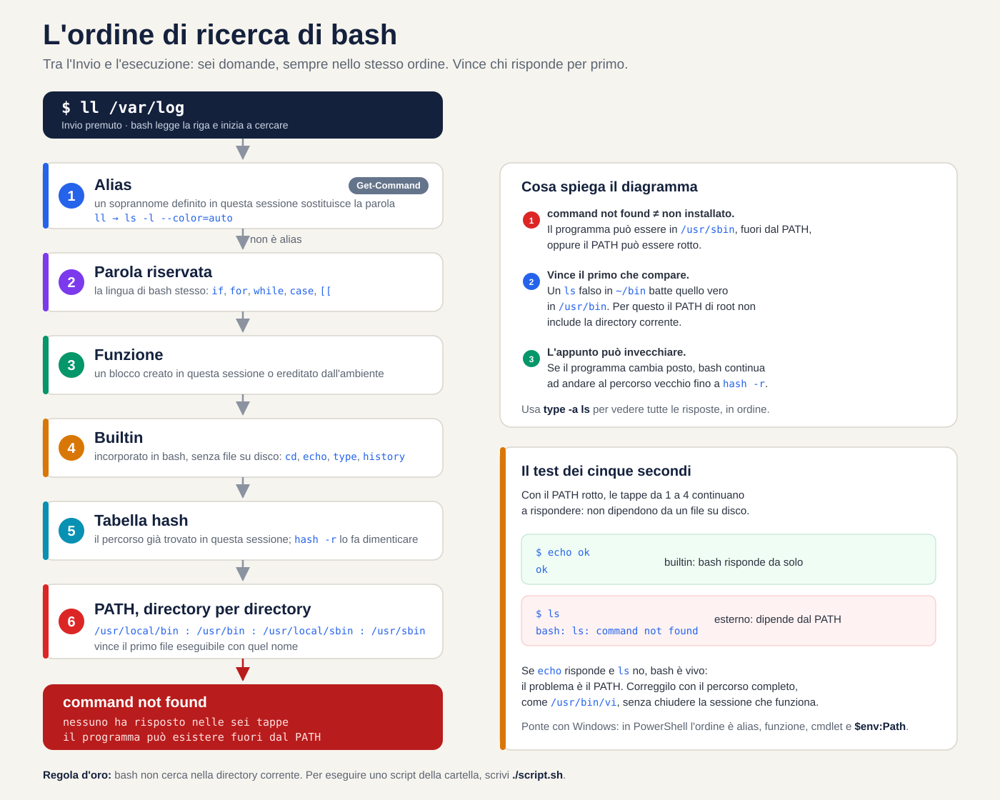
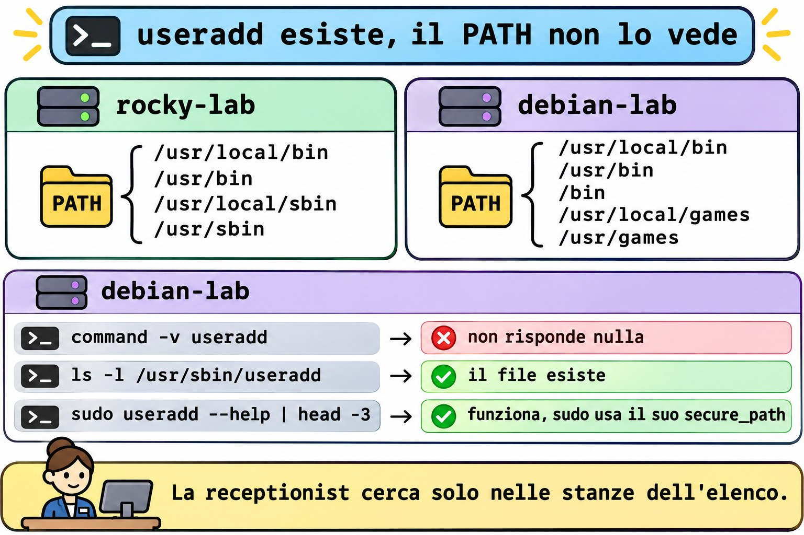
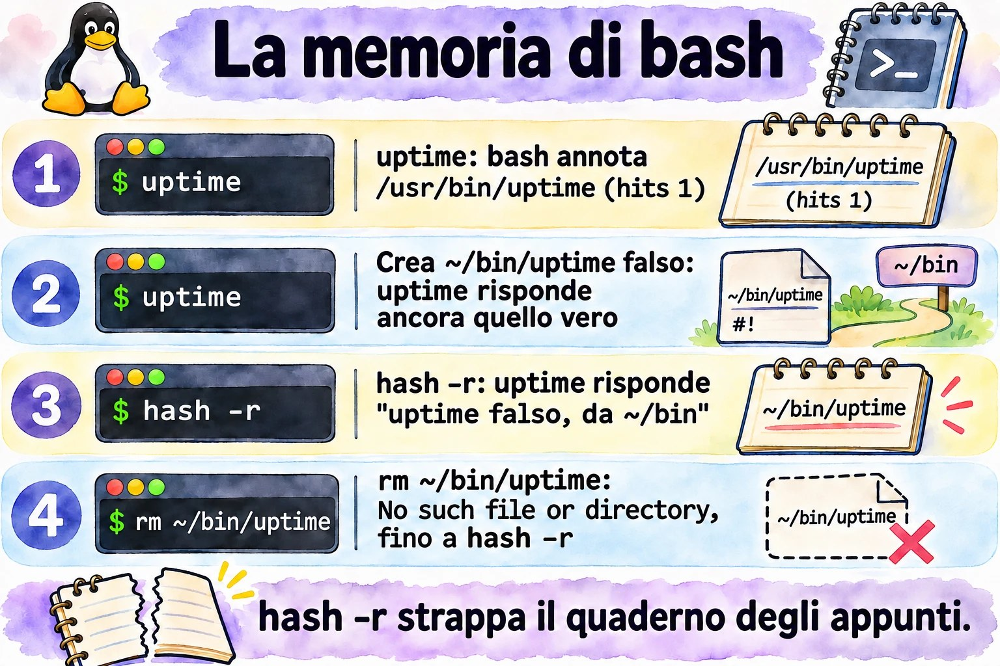

# Lezione 1.2 · La shell e l'aiuto

Impari a leggere qualsiasi comando, scopri come bash decide che cosa eseguire e cominci a trovare le risposte dentro il sistema stesso, senza internet, come su un server isolato.

| Scheda | Lezione 1.2 |
| --- | --- |
| Modulo | M1 · Riga di comando, lezione 2 di 10 |
| Quando | Settimana 1 |
| Alla fine sei in grado di | Scomporre un comando in nome, opzioni e argomenti; spiegare come bash decide che cosa eseguire; diagnosticare un PATH rotto; trovare risposte con man, apropos, info, --help e /usr/share/doc, senza internet; usare cronologia e scorciatoie senza pensarci |
| Prerequisiti | Lezione 1.1 |
| Durata | Circa 2h30 |
| Snapshot | m1a2-inicio e m1a2-fim su entrambe le VM |

## 1 · Riscaldamento

Tre domande, a memoria, prima di leggere qualsiasi cosa. Scrivi le risposte; le soluzioni le trovi alla fine per controllare.

1. Su rocky-lab, `ll` elenca i file in formato lungo. Su debian-lab risponde `bash: ll: command not found`. Esiste un programma chiamato `ll`?
2. Sei su un server senza internet. Devi ricordare quali campi ha ogni riga di `/etc/passwd`. Dove cerchi?
3. Su debian-lab, `which cd` non risponde nulla, ma `cd /etc` funziona. Dov'è il programma `cd`?

## 2 · Perché conta

Venerdì sera, server di un cliente. Aggiungi una riga al `.bashrc` per mettere una nuova directory nel PATH, sbagli un carattere, chiudi la sessione e rientri. Ora `ls`, `vi` e perfino `sudo` rispondono `command not found`. Sembra che il sistema sia stato cancellato. Se quella era la tua unica sessione aperta, il resto della serata se ne va nella console remota, o in una trasferta dal cliente.

Con questa lezione riconosci il problema in cinque secondi: `echo` e `cd` funzionano ancora, quindi bash è vivo e ha solo perso il PATH. Ripari usando il percorso completo, come `/usr/bin/vi`, e ti porti dietro un'abitudine che evita lo spavento: non chiudere mai la sessione che funziona prima di aver provato quella nuova.

La seconda metà della lezione parla di come trovare risposte senza internet. Su un server isolato o in un'emergenza non sempre c'è un browser; l'aiuto sta dentro il sistema, in `man`, in `info` e in `/usr/share/doc`. Sul lavoro vale lo stesso, per un altro motivo: il manuale installato sul server descrive esattamente la versione che c'è lì. La risposta del forum è stata scritta per un'altra distribuzione, un'altra versione, a volte un'altra decade.

## 3 · Modello mentale

> Bash è una receptionist con una lista fissa di domande.

Quando pronunci un nome, come `ls`, lei non si mette a cercare a caso. Segue sempre la stessa lista, nello stesso ordine:

1. È un soprannome? Se `ll` è il soprannome di `ls -l`, lei sostituisce il nome e prosegue la lista con il nome vero. È l'**alias**.
2. È una parola della lingua della casa, come `if` o `for`? È una **parola riservata**.
3. È qualcuno che è stato presentato in questa sessione, con nome e incarico? È una **funzione**.
4. È qualcuno della reception stessa? Allora risolve senza lasciare il banco: è un **builtin**.
5. Ho già chiamato questo nome oggi? Allora va diretta nella stanza che ha annotato: è la **tabella hash**.
6. Altrimenti, cerca stanza per stanza, nell'ordine della lista del **PATH**.

Chi risponde per primo viene chiamato, e la ricerca si ferma lì. Se nessuno risponde, lei dice che non conosce nessuno con quel nome: `command not found`.

Da questa lista discendono tre conseguenze che userai per tutta la carriera:

- `command not found` non significa che il programma non è installato. Significa che non è in nessuna stanza della lista. Può essere in `/usr/sbin`, fuori dal tuo PATH, oppure il PATH può essere rotto.
- Vince il primo che compare. Un `ls` falso in `~/bin` batte quello vero in `/usr/bin`, perché `~/bin` viene prima nella lista. Per questo il PATH di root non include mai la directory corrente.
- L'annotazione può invecchiare. Se il programma cambia stanza, la receptionist continua ad andare in quella vecchia finché qualcuno non le dice di dimenticarla, con `hash -r`.


*Sei fasi in ordine: alias, parola riservata, funzione, builtin, tabella hash e PATH. Le prime quattro non dipendono da nessun file su disco.*

Leggi il diagramma dall'alto verso il basso: ogni fase viene consultata solo se le precedenti non hanno trovato nulla. Guarda l'ultima casella. Con il PATH rotto, le fasi da 1 a 4 rispondono ancora, perché non dipendono da file su disco. È questo indizio che trasforma lo spavento del venerdì sera in una diagnosi di cinque secondi: se `echo` risponde e `ls` no, il problema è il PATH.

**Ponte Windows.** PowerShell ha la stessa receptionist. `Get-Command ls` risponde che `ls` è un alias di `Get-ChildItem`, e l'ordine di ricerca è simile: alias, funzione, cmdlet e, per ultimi, i programmi in `$env:Path`. Due differenze fregano chi viene da Windows. Il separatore del PATH in Linux è `:`, non `;`. E bash non cerca mai nella directory corrente: in `cmd.exe`, un `script.bat` della cartella corrente parte subito; in Linux devi scrivere `./script.sh`.

## 4 · Concetto a livelli

### Essenziale

| Termine | Che cos'è | Esempio |
| --- | --- | --- |
| Shell | Il programma che legge ciò che digiti e lo manda in esecuzione | `bash`, lo standard su Rocky e Debian |
| Comando esterno | Un programma su disco, trovato tramite il PATH | `/usr/bin/ls` |
| Builtin | Comando incorporato in bash stesso, senza file su disco | `cd`, `echo`, `type`, `history` |
| Alias | Soprannome che sostituisce una parola con un'altra prima dell'esecuzione | `ll` diventa `ls -l --color=auto` su Rocky |
| PATH | L'elenco delle directory in cui bash cerca i comandi esterni, separate da `:` | `/usr/local/bin:/usr/bin` |
| Tabella hash | La memoria di bash: dove ha già trovato ogni comando in questa sessione | `hash` |
| `type` | Dice che cos'è una parola per bash: alias, builtin, file | `type -a ls` |
| `--help` | Riassunto delle opzioni, stampato dal comando stesso | `ls --help` |
| `man` | Il manuale completo, diviso in sezioni | `man 5 passwd` |
| `apropos` o `man -k` | Cerca una parola nei titoli e nei riassunti del manuale | `man -k password` |
| `mandb` | Costruisce l'indice che `apropos` consulta | `sudo mandb` |
| `info` | Manuale a capitoli, più completo per gli strumenti GNU | `info coreutils` |
| `/usr/share/doc` | Documentazione extra dei pacchetti: README, esempi, novità | `ls /usr/share/doc/sudo` |
| `history` | I comandi che hai già digitato, numerati | `history 20` |

**Anatomia di un comando.** Ogni comando che leggerai in vita tua ha gli stessi pezzi:

```text
ls  -lh  --sort=time  /var/log
│   │    │            └─ argumento: sobre o que o comando age
│   │    └─ opção longa: palavra inteira, dois hífens, pode levar valor
│   └─ opções curtas juntas: -l e -h, um hífen só
└─ nome: o que o bash vai procurar, na ordem do diagrama
```

**Le sezioni del manuale che contano.**

| Sezione | Contenuto | Esempio |
| --- | --- | --- |
| 1 | Comandi per qualsiasi utente | `man 1 passwd`: il comando che cambia la password |
| 5 | Formati dei file di configurazione | `man 5 passwd`: il file `/etc/passwd` |
| 7 | Panoramiche e convenzioni | `man 7 hier`: la mappa delle directory |
| 8 | Comandi di amministrazione, quasi sempre di root | `man 8 useradd` |

`man passwd` apre la prima sezione che ha la pagina, la 1. Per il file, chiedi la sezione: `man 5 passwd`. Nel dubbio, `man -f passwd` le elenca tutte.

**La scala dell'aiuto.** Quando non sai, sali un gradino alla volta:

1. `comando --help`: il riassunto, in pochi secondi.
2. `man comando`: il manuale completo. Al suo interno, `/palavra` e Invio cercano, `n` passa all'occorrenza successiva e `q` esce. Cerca la sezione EXAMPLES.
3. `man -k palavra`: quando non sai nemmeno il nome del comando. Se risponde `nothing appropriate`, l'indice non esiste ancora; esegui `sudo mandb`.
4. `info comando`: il manuale a capitoli, più completo per gli strumenti GNU, come `ls` e `cp`.
5. `/usr/share/doc/pacote`: README, esempi di configurazione e note della distribuzione.

Per i builtin la strada è un'altra: `help cd`.


*Sali un gradino alla volta; per un file di configurazione, chiedi la sezione 5.*

### Ponte Windows

| In Windows | In Linux |
| --- | --- |
| `Get-Command ls` | `type ls` |
| `where.exe notepad` | `command -v ls` o `which ls` |
| `Get-Help comando -Full` | `man comando` |
| `comando /?` o `-?` | `comando --help` |
| `$env:Path`, separato da `;` | `$PATH`, separato da `:` |
| `Get-History`, F7 in `cmd.exe` | `history`, Ctrl+R |

### Approfondimento

**Da dove viene il PATH.** Quando entri via SSH, bash legge `/etc/profile` e poi `~/.bash_profile` su Rocky o `~/.profile` su Debian, che a loro volta caricano `~/.bashrc`. Ogni file può toccare il PATH. Su Rocky, `/etc/profile` aggiunge `/usr/local/sbin` e `/usr/sbin` anche per gli utenti normali, e `~/.bashrc` mette `~/.local/bin` e `~/bin` davanti. Su Debian, il PATH di un utente normale di solito non ha le directory `sbin`; lo verifichi nel lab.

**Sudo ha un PATH tutto suo.** La riga `secure_path` di `/etc/sudoers` definisce dove cerca `sudo`. Per questo, nello stesso terminale, `useradd` può dare `command not found` e `sudo useradd` funzionare.

**Toccare il PATH cancella la memoria.** Qualsiasi assegnazione al PATH svuota la tabella hash. Quando il PATH si rompe, non si salvano nemmeno i comandi che hai appena usato.

**Saltare le fasi di proposito.** `\ls` ignora l'alias; `command ls` ignora alias e funzione; `/usr/bin/ls` salta l'intera ricerca. `type -a ls` mostra tutti i candidati, nell'ordine in cui bash li troverebbe.

**Non fidarti di `which`.** Conosce solo il PATH. Su Debian è uno script che non vede alias né builtin; su Rocky è un alias che prova prima a leggere i tuoi alias. Per sapere che cosa eseguirà bash, usa `type`; negli script, `command -v`.

**Il `--` chiude le opzioni.** Tutto ciò che viene dopo è un argomento, anche se comincia con un trattino: `rm -- -arquivo` cancella un file chiamato `-arquivo`.

**La cronologia registra tutto.** Ogni sessione tiene i comandi in memoria e li scrive in `~/.bash_history` all'uscita. La variabile `HISTCONTROL` decide che cosa resta fuori: su Rocky, `ignoredups` scarta le ripetizioni consecutive; su Debian, `ignoreboth` scarta anche le righe che iniziano con uno spazio. Per questo la password non va mai nella riga di comando: resta nella cronologia, leggibile.

## 5 · Rocky × Debian

La shell è la stessa bash su entrambe le VM, ma ogni distribuzione monta l'ambiente a modo suo. Queste differenze spiegano metà dei "sul mio server funziona, su quello del cliente no":

|  | rocky-lab | debian-lab |
| --- | --- | --- |
| PATH di un utente normale | Include `/usr/local/sbin` e `/usr/sbin`, in fondo | Di solito senza le directory `sbin`; verifica nel Passo 3 |
| `~/bin` e `~/.local/bin` | Sempre nel PATH, messe da `~/.bashrc` | Solo se la directory esiste al login, tramite `~/.profile` |
| `ll` | Alias creato in `/etc/profile.d/colorls.sh` | Non esiste: la riga è commentata in `~/.bashrc` |
| `which` | Alias che legge i tuoi alias e le funzioni prima del PATH | Script in `/usr/bin/which`, che guarda solo il PATH |
| `HISTCONTROL` | `ignoredups` | `ignoreboth`: ignora anche le righe che iniziano con uno spazio |
| `secure_path` di `sudo` | Include `/usr/sbin` | Include `/usr/sbin` |
| Manuale delle sezioni 5 e 7 | Pacchetto `man-pages`, assente dall'installazione minima | Pacchetto `manpages` |
| Completamento delle opzioni con Tab | Pacchetto `bash-completion`, assente dall'installazione minima | Pacchetto `bash-completion` |
| Nome del servizio SSH | `sshd` | `ssh`; risponde anche `sshd`, come alias |
| Documentazione di un pacchetto | `rpm -qd sudo` | `ls /usr/share/doc/sudo` |

## 6 · Lab guidato

Apri tre terminali: uno su rocky-lab (`ssh rocky-lab`), uno su debian-lab (`ssh debian-lab`) e uno sul nodo Proxmox, per gli snapshot. A ogni passo, esegui, confronta con l'output atteso e solo dopo leggi il Decidi. Gli output sono estratti; numeri e date sul tuo schermo saranno diversi.

Ogni Decidi è un caso reale di lavoro. Scegli la lettera prima di guardare la tabella: sbagliare qui, con la spiegazione accanto, è il modo più economico di sbagliare.

**Passo 1 · Snapshot prima di tutto.** Sul nodo Proxmox:

```bash
qm snapshot 201 m1a2-inicio --description "Aula 1.2, antes do lab"
qm snapshot 202 m1a2-inicio --description "Aula 1.2, antes do lab"
qm listsnapshot 201
```

Output atteso: l'albero mostra `m0a2-fim`, `m1a1-fim`, `m1a2-inicio` e, per ultimo, `current`.

**Passo 2 · Installa l'aiuto.** Sulle VM minimali, una parte del manuale non è installata. Su rocky-lab:

```bash
sudo dnf install -y man-db man-pages info bash-completion
sudo mandb
```

Su debian-lab:

```bash
sudo apt install -y man-db manpages info bash-completion
sudo mandb
```

Ciò che è già installato viene ignorato. `mandb` costruisce l'indice che `man -k` consulta, e l'output termina con il conteggio delle pagine elaborate. Poi esci da entrambe le VM con `exit` e rientra, perché `bash-completion` venga caricato.

**Passo 3 · Leggi il tuo PATH.** Prima di eseguire, scommetti: `/usr/sbin` compare nel PATH di debian-lab? Su entrambe le VM:

```bash
echo "$PATH" | tr ':' '\n'
```

Su rocky-lab, una directory per riga, in quest'ordine:

```text
/home/rodrigo/.local/bin
/home/rodrigo/bin
/usr/local/bin
/usr/bin
/usr/local/sbin
/usr/sbin
```

Su debian-lab, qualcosa come:

```text
/usr/local/bin
/usr/bin
/bin
/usr/local/games
/usr/games
```

Ora, su debian-lab, cerca `useradd` in tre modi:

```bash
command -v useradd
ls -l /usr/sbin/useradd
sudo useradd --help | head -3
```

Se il PATH non ha `sbin`, il primo non risponde nulla, il secondo mostra che il file esiste e il terzo funziona, perché `sudo` cerca nel proprio `secure_path`. Se il tuo PATH ha già `/usr/sbin`, rispondono tutti e tre, e la lezione vale comunque per i Debian più vecchi che troverai dai clienti.

**Decidi 1 · L'useradd sparito.** Scenario: su un Debian di un cliente, loggato come utente normale, esegui `useradd --help` e ricevi `bash: useradd: command not found`. Che cosa fai?

- **A)** Reinstalla il pacchetto con `sudo apt install --reinstall passwd`.
- **B)** Verifica con `ls -l /usr/sbin/useradd` ed esegui il comando con `sudo`.
- **C)** Aggiungi la directory corrente al PATH con `PATH=$PATH:.`.
- **D)** Concludi che Debian non ha `useradd` e usa `adduser`.

Scegli un'opzione prima di continuare.

| Se hai scelto | Risultato | Perché |
| --- | --- | --- |
| A | ❌ Sbagliato | Il programma è installato; semplicemente non è nella lista di ricerca. Reinstallare non cambia il PATH e inoltre tocca un server di produzione senza motivo. |
| B | ✅ Giusto | `command not found` significa "fuori dalla lista", non "non installato". Il file è in `/usr/sbin`, e creare utenti è un compito di root: `sudo` cerca già lì. |
| C | ❌ Sbagliato | `useradd` non è nella directory corrente, quindi non cambia nulla. E mettere `.` nel PATH apre la porta a un programma falso con il nome di un comando. |
| D | ❌ Sbagliato | `useradd` esiste su Debian. E anche `adduser` sta in `/usr/sbin`: darebbe lo stesso errore. |

**Da ricordare:** la receptionist cerca solo nelle stanze della lista. Chi sta in un'altra stanza continua a esistere.



*Il file esiste in /usr/sbin; ciò che manca nel PATH normale di Debian è la directory, non il programma.*

**Passo 4 · Chiedi a bash che cos'è ogni nome.** Su entrambe le VM:

```bash
type -a ls
type ll
type cd
type if
type -a which
```

Su rocky-lab, qualcosa come:

```text
ls is aliased to `ls --color=auto'
ls is /usr/bin/ls
ll is aliased to `ls -l --color=auto'
cd is a shell builtin
if is a shell keyword
which is aliased to `(alias; declare -f) | /usr/bin/which --tty-only --read-alias --read-functions --show-tilde --show-dot'
which is /usr/bin/which
```

Su debian-lab, qualcosa come:

```text
ls is aliased to `ls --color=auto'
ls is /usr/bin/ls
ls is /bin/ls
bash: type: ll: not found
cd is a shell builtin
if is a shell keyword
which is /usr/bin/which
which is /bin/which
```

Tre letture. `ll` esiste solo dove qualcuno ha creato l'alias. `which` è una cosa diversa in ogni distribuzione. E, se il PATH di debian-lab ha `/bin`, `ls` compare due volte: è lo stesso file, perché nei Debian attuali `/bin` è un collegamento a `/usr/bin`.

**Decidi 2 · Lo script che funziona nel terminale e fallisce in cron.** Scenario: uno script di backup su rocky-lab comincia con `#!/bin/bash` e ha la riga `ll /backup > /tmp/lista.txt`. Eseguito a mano, nel terminale, funziona. Da cron, fallisce con `ll: command not found`. Perché?

- **A)** Cron usa un PATH corto, senza `/usr/bin`.
- **B)** Gli alias esistono solo nelle sessioni interattive; lo script deve usare `ls -l`.
- **C)** Cron esegue lo script con `sh`, e non con `bash`.
- **D)** L'utente di cron non ha il permesso di lettura su `/backup`.

Scegli un'opzione prima di continuare.

| Se hai scelto | Risultato | Perché |
| --- | --- | --- |
| A | ❌ Sbagliato | Il PATH di cron è corto, ma include `/usr/bin`. E non esiste nessun file `ll` da nessuna parte: nessun PATH lo troverebbe. |
| B | ✅ Giusto | `ll` è un alias creato in `/etc/profile.d/colorls.sh`, che viene caricato solo nelle sessioni interattive. In uno script, bash non espande nemmeno gli alias. Nello script, scrivi il comando vero. |
| C | ❌ Sbagliato | La prima riga, `#!/bin/bash`, garantisce bash. E, anche in bash, lo script non espande gli alias. |
| D | ❌ Sbagliato | La mancanza di permessi dà `Permission denied`, non `command not found`. Leggi il messaggio: dice quale fase è fallita. |

**Da ricordare:** l'alias è una comodità di chi digita. Lo script non digita.

**Passo 5 · La memoria di bash.** Su rocky-lab:

```bash
hash -r
hash
uptime
hash
type uptime
```

Output atteso: prima `hash: hash table empty`; dopo `uptime`, la tabella mostra `/usr/bin/uptime` con 1 nella colonna `hits`; e `type` risponde `uptime is hashed (/usr/bin/uptime)`.

Ora crea un `uptime` falso in `~/bin`, che nel PATH viene prima di `/usr/bin`:

```bash
mkdir -p ~/bin
printf '#!/bin/bash\necho "uptime falso, de ~/bin"\n' > ~/bin/uptime
chmod +x ~/bin/uptime
uptime
```

Prevedi prima di premere Invio: quale `uptime` risponde? Quello vero. Bash non ha nemmeno guardato il PATH, perché il percorso era già annotato. Digli di dimenticarlo:

```bash
hash -r
uptime
```

Ora risponde `uptime falso, de ~/bin`. Infine, cancella il falso senza svuotare la tabella:

```bash
rm ~/bin/uptime
uptime
hash -r
uptime
```

Il primo `uptime` risponde `bash: /home/rodrigo/bin/uptime: No such file or directory`: bash è andato dritto nella stanza annotata, ed era vuota. Dopo `hash -r`, torna quello vero. Tieni a mente questo messaggio: un percorso completo nell'errore, per un programma che hai chiamato solo per nome, è il segno di un'annotazione vecchia.

**Decidi 3 · La versione che non cambia.** Scenario: sul server di un cliente, installi la nuova versione di uno strumento di backup in `/usr/local/bin`. La vecchia resta in `/usr/bin`. Nella stessa sessione, l'opzione `--version` mostra ancora la vecchia. Che cosa fai?

- **A)** Reinstalli la versione nuova, perché l'installazione è fallita.
- **B)** Esegui `type` con il nome dello strumento e, se compare come `hashed`, svuoti con `hash -r`.
- **C)** Inverti l'ordine del PATH, perché `/usr/local/bin` viene dopo `/usr/bin`.
- **D)** Riavvii il server perché il sistema riconosca la versione nuova.

Scegli un'opzione prima di continuare.

| Se hai scelto | Risultato | Perché |
| --- | --- | --- |
| A | ❌ Sbagliato | L'installazione è riuscita; è bash che non ha cercato di nuovo. Reinstallare non cancella l'annotazione. |
| B | ✅ Giusto | Bash ha annotato il vecchio percorso la prima volta che hai usato lo strumento. `hash -r` cancella le annotazioni; la ricerca successiva scorre il PATH e trova per primo `/usr/local/bin`. |
| C | ❌ Sbagliato | Su Rocky e su Debian, `/usr/local/bin` viene prima di `/usr/bin`, proprio perché ciò che installi a mano batta ciò che arriva dal pacchetto. |
| D | ❌ Sbagliato | Funzionerebbe per caso, perché la nuova sessione parte senza annotazioni. Ma butta giù i servizi del cliente per qualcosa che si risolve con un comando. Uscire e rientrare in SSH sarebbe già bastato. |

**Da ricordare:** un'annotazione vecchia manda la receptionist nella stanza sbagliata. `hash -r` strappa il quaderno.



*Bash va dritto al percorso annotato; solo hash -r gli fa guardare di nuovo il PATH.*

**Passo 6 · Il manuale e le sezioni.** Su entrambe le VM:

```bash
ls --help | head -15
man -f passwd
man 5 passwd
```

`man -f` mostra qualcosa come:

```text
passwd (1)           - change user password
passwd (5)           - the password file
```

Su rocky-lab può comparire anche `passwd (1ssl)`, di OpenSSL. Dentro `man 5 passwd`, digita `/shell` e Invio: il cursore va alla descrizione del campo della shell di login. `n` passa all'occorrenza successiva e `q` esce.

Ora un caso di lavoro: un cliente vuole che un tecnico riavvii un servizio senza diventare root. La sintassi è nel sistema stesso:

```bash
man 5 sudoers
```

Al suo interno, digita `/^EXAMPLES` e Invio. La sezione degli esempi ha righe pronte da adattare. Esci con `q`.

Infine, cerca senza sapere il nome del comando:

```bash
man -k 'user account'
```

Qualcosa come:

```text
userdel (8)          - delete a user account and related files
usermod (8)          - modify a user account
```

Se la risposta è `user account: nothing appropriate`, l'indice non è stato costruito: esegui `sudo mandb` e riprova.

**Decidi 4 · Il server senza internet.** Scenario: su un server senza accesso a internet, una richiesta chiede che l'account dell'utente `ana` scada il 31 dicembre 2027. Non ricordi il comando. Che cosa fai per prima cosa?

- **A)** Apri `man passwd` e lo leggi dall'inizio alla fine.
- **B)** Esegui `man -k expir`, trovi il nome del comando e cerchi `/expir` dentro il suo manuale.
- **C)** Apri `info` e navighi finché non trovi.
- **D)** Provi `--help` su ogni comando che inizia con `user`.

Scegli un'opzione prima di continuare.

| Se hai scelto | Risultato | Perché |
| --- | --- | --- |
| A | ❌ Sbagliato | `passwd` gestisce la validità della password, non la scadenza dell'account. E leggere un manuale intero consuma minuti che non hai. |
| B | ✅ Giusto | `man -k` cerca nei riassunti di tutte le pagine, e `expir` prende "expire", "expiry" e "expiration". Compare `chage`, e dentro il suo manuale la ricerca porta all'opzione `-E`. Due comandi e sei sulla riga giusta. |
| C | ❌ Sbagliato | `info` è ottimo per gli strumenti GNU, ma non cerca in tutti i comandi, e quelli per la gestione degli utenti non hanno nemmeno una pagina `info`. |
| D | ❌ Sbagliato | È tirare a indovinare con il cronometro che corre. Potresti anche trovare `usermod -e`, ma per fortuna. |

**Da ricordare:** `man -k` è il motore di ricerca interno al server. Funziona solo dopo che `mandb` ha costruito l'indice.

**Passo 7 · info, help e /usr/share/doc.** Su entrambe le VM:

```bash
info ls
```

Spazio avanza, `n` passa al nodo successivo, `u` sale di un livello e `q` esce. L'`info` di `ls` spiega ogni opzione in modo più dettagliato di `man`. Poi:

```bash
help cd
man cd
```

Su debian-lab, `help cd` spiega il builtin e `man cd` risponde `No manual entry for cd`. Su rocky-lab, `man cd` di solito apre una pagina generale sui builtin di bash; `help cd` resta la strada breve. Infine, la documentazione dei pacchetti:

```bash
ls /usr/share/doc | wc -l
ls /usr/share/doc/sudo
```

Su rocky-lab, `rpm -qd sudo` elenca tutti i file di documentazione del pacchetto, manuali inclusi.

**Decidi 5 · Il manuale che non esiste.** Scenario: vuoi sapere che cosa fa l'opzione `-P` di `cd`. Su debian-lab, `man cd` risponde `No manual entry for cd`. Che cosa fai?

- **A)** Installi pacchetti di manuali finché la pagina non compare.
- **B)** Esegui `help cd`.
- **C)** Concludi che `cd` non ha opzioni.
- **D)** Cerchi il file `/usr/bin/cd` per leggere che cosa fa.

Scegli un'opzione prima di continuare.

| Se hai scelto | Risultato | Perché |
| --- | --- | --- |
| A | ❌ Sbagliato | Esiste un pacchetto con una pagina `cd` dello standard POSIX, ma descrive il `cd` generico, non quello di bash. La documentazione giusta è già installata. |
| B | ✅ Giusto | `cd` è un builtin: vive dentro bash, e a documentarlo è bash stesso, con `help`. Lì ci sono `-P` e `-L`. |
| C | ❌ Sbagliato | L'assenza del manuale non è assenza di opzioni. `cd` ha `-L`, `-P` e altre. |
| D | ❌ Sbagliato | Su debian-lab non esiste `/usr/bin/cd`. `cd` deve essere un builtin: un programma esterno cambierebbe la directory di se stesso e terminerebbe, e la tua shell resterebbe dov'era. |

**Da ricordare:** un builtin si chiede a bash, con `help`.

**Passo 8 · Cronologia e scorciatoie.** Su debian-lab:

```bash
ls /root
sudo !!
```

Il primo dà `Permission denied`. `!!` ripete l'ultimo comando; bash mostra `sudo ls /root` prima di eseguirlo. Poi:

```bash
ls -ld /var/log
cd !$
pwd
```

`!$` è l'ultimo argomento del comando precedente: `cd` va in `/var/log`. Ora tre scorciatoie, solo da tastiera:

- Ctrl+R e digita `uptime`: bash trova l'ultimo comando con quella parola. Invio esegue; Esc permette di modificare prima.
- Digita `systemctl status ss` e premi Tab due volte: compaiono `sshd.service` su rocky-lab e `ssh.service` su debian-lab.
- Ctrl+A va all'inizio della riga, Ctrl+E alla fine e Ctrl+U cancella tutto ciò che sta prima del cursore.

Infine, `HISTCONTROL`, su entrambe le VM. La seconda riga inizia con uno spazio:

```bash
echo "$HISTCONTROL"
 echo teste-com-espaco
history 3
```

Su debian-lab, il comando con lo spazio non compare nella cronologia. Su rocky-lab, compare.

**Decidi 6 · La cronologia come prova.** Scenario: il server di un cliente ha smesso di inviare e-mail, e il cliente giura che nessuno ha toccato nulla. Esegui `history` con il tuo utente e non vedi niente di strano. Che cosa concludi?

- **A)** Nessuno ha toccato nulla; la cronologia lo conferma.
- **B)** `history` mostra solo il tuo utente e può essere stata modificata; per sapere chi ha fatto cosa servono i registri del sistema.
- **C)** Che manca solo `sudo history` per vedere la cronologia di tutti.
- **D)** Che basta leggere il `.bash_history` di root, che registra tutto ciò che succede sul server.

Scegli un'opzione prima di continuare.

| Se hai scelto | Risultato | Perché |
| --- | --- | --- |
| A | ❌ Sbagliato | `history` mostra solo i comandi del tuo utente, delle sessioni già salvate. Ogni tecnico, e root, ha la propria. |
| B | ✅ Giusto | La cronologia è un indizio, non una prova: è per utente, viene scritta all'uscita, può essere modificata e, su Debian, ignora le righe con lo spazio davanti. Chi ha fatto cosa si ricava dai registri del sistema, come quelli di `sudo` nel journal, che imparerai a leggere più avanti nel corso. |
| C | ❌ Sbagliato | `history` è un builtin, e `sudo` esegue solo programmi su disco. La risposta è `sudo: history: command not found`: ancora l'ordine di ricerca. |
| D | ❌ Sbagliato | Conserva solo ciò che è stato digitato come root, e solo delle sessioni concluse. Serve da indizio, ma non mostra che cosa hanno fatto gli altri utenti con `sudo`. |

**Da ricordare:** `history` è l'agenda di ciascuno. L'audit è il registro della portineria.

**Il protocollo del command not found.** Quattro comandi, in quest'ordine, su qualsiasi server. L'esempio usa `useradd`; sostituiscilo con il comando del momento:

```bash
type -a useradd
echo "$PATH" | tr ':' '\n'
ls -l /usr/sbin/useradd
sudo useradd --help | head -3
```

Il primo chiede a bash che cosa conosce. Il secondo mostra dove cerca. Il terzo dice se il file esiste fuori dalla lista. Il quarto mostra se il problema sparisce con il PATH di `sudo`. In meno di un minuto sai se il caso è PATH, installazione o permessi.


*Ripetere i comandi e modificare la riga da tastiera: !!, !$, Ctrl+R e le scorciatoie di modifica.*

## 7 · Rompi e ripara

Adesso rompi di proposito ciò che manda più spesso in crisi le sessioni vere: il PATH. Sono due guasti. Il primo sparisce quando la sessione termina. Il secondo resta scritto nel file di login e torna a ogni nuova sessione. Fai tutto su rocky-lab: lo snapshot `m1a2-inicio` è lì per questo.

### Guasto A · solo in questa sessione

**Rompi.** Su rocky-lab:

```bash
PATH=/tmp
```

Nessun messaggio. Sembra che non sia cambiato nulla.

**Prevedi.** Prima di eseguire ogni riga qui sotto, di' se funziona. Annota le tue previsioni.

```bash
ls
echo "$PATH"
cd /var/log
type -a ls
sudo ls /root
/usr/bin/ls /tmp
/usr/bin/sudo ls /root
```

**Scopri.** Qualcosa come:

```text
bash: ls: command not found
/tmp
ls is aliased to `ls --color=auto'
bash: sudo: command not found
```

`cd` non risponde nulla, perché è riuscito. Gli ultimi due funzionano: con il percorso completo, bash non ha bisogno di cercare. L'ultimo può chiederti la password, e `sudo` trova `ls` da solo, grazie al suo `secure_path`.

Guarda `type -a ls`. L'alias è ancora lì, ma sostituisce solo il testo: `ls` diventa `ls --color=auto`, e quel `ls` deve comunque essere trovato nel PATH. È il diagramma del §3 dal vivo. Le fasi interne a bash rispondono: alias, builtin e lo stesso `echo`. La fase del PATH non trova nulla.

**Decidi 7 · La sessione senza comandi.** Scenario: in una sessione SSH su un server di un cliente, dopo aver incollato un blocco di comandi da un tutorial, non funziona nulla: `ls`, `vi` e `systemctl` danno `command not found`. `echo` e `cd` funzionano. Che cosa fai per prima cosa?

- **A)** Riavvii il server dal pannello dell'hypervisor.
- **B)** Esegui `echo "$PATH"` e, se è sbagliato, correggi il PATH di questa sessione.
- **C)** Reinstalli `coreutils`, perché i programmi sono spariti.
- **D)** Chiudi la sessione e rientri, senza guardare nulla.

Scegli un'opzione prima di continuare.

| Se hai scelto | Risultato | Perché |
| --- | --- | --- |
| A | ❌ Sbagliato | Risolverebbe per caso, se il guasto fosse solo della sessione. Ma butta giù i servizi del cliente e cancella l'indizio. Se il guasto è in un file di login, ritorna identico dopo il boot. |
| B | ✅ Giusto | `echo` e `cd` vivi con tutto il resto morto è la firma del PATH rotto. `echo` è un builtin, quindi funziona e mostra la causa in pochi secondi. I programmi restano raggiungibili con il percorso completo, come `/usr/bin/ls`. |
| C | ❌ Sbagliato | I programmi sono sul disco; è bash che non sa dove cercare. E anche `dnf` è un programma: con il PATH rotto non risponde nemmeno lui. |
| D | ❌ Sbagliato | Funziona se il guasto era solo della sessione, ma questo non lo sai ancora. Se il tutorial ha scritto la modifica in `.bashrc`, la nuova sessione arriva identica. Hai scambiato una diagnosi di cinque secondi con un'ipotesi. |

**Da ricordare:** quando rispondono solo i builtin, guarda il PATH prima di ogni altra cosa.

**Ripara.** Rimetti il PATH del Passo 3:

```bash
PATH=/home/rodrigo/.local/bin:/home/rodrigo/bin:/usr/local/bin:/usr/bin:/usr/local/sbin:/usr/sbin
```

Un altro modo: `exit` e rientrare. Questo guasto esisteva solo nella memoria di questa sessione.

**Verifica.**

```bash
hash
ls ~
type -a ls
```

`hash` risponde `hash: hash table empty`. L'assegnazione del PATH ha cancellato le annotazioni, come nel §4. Poi `ls` funziona e `type -a` mostra l'alias e `/usr/bin/ls`.

### Guasto B · scritto nel login

Questo è il caso del venerdì sera, nel §2. La regola d'oro viene prima del comando: **la sessione che hai aperto adesso resta aperta fino alla fine.** È il tuo paracadute.

**Rompi.** Su rocky-lab, nella sessione già aperta:

```bash
cp ~/.bashrc ~/.bashrc.bak
[ "$(hostname)" = rocky-lab ] && echo 'PATH=/tmp' >> ~/.bashrc
diff ~/.bashrc.bak ~/.bashrc
```

`diff` mostra l'unica differenza tra la copia e il file, qualcosa come:

```text
27a28
> PATH=/tmp
```

Se `diff` non mostra nulla, non sei su rocky-lab. Verifica con `hostname`. La copia `.bak` è la prima abitudine di questo guasto: prima di toccare un file di login, tieni una copia.

**Prevedi.** Apri un **secondo** terminale in Windows ed esegui `ssh rocky-lab`. Il login funzionerà? Il prompt compare? Che cosa funziona là dentro?

**Scopri.** Il login funziona e il prompt compare. SSH non dipende dal tuo PATH: `.bashrc` viene letto solo da bash, dopo che sei già entrato. Là dentro:

```bash
ls
echo "$PATH"
vi ~/.bashrc
/usr/bin/diff ~/.bashrc.bak ~/.bashrc
```

Qualcosa come:

```text
bash: ls: command not found
/tmp
bash: vi: command not found
27a28
> PATH=/tmp
```

Senza PATH, non si apre nemmeno l'editor. Ma `diff` con il percorso completo mostra esattamente la riga colpevole.

**Ripara.** Questa volta, ripara da dentro la sessione rotta, per allenare il caso in cui non è rimasto nessun paracadute:

```bash
/usr/bin/sed -i '/^PATH=\/tmp$/d' ~/.bashrc
/usr/bin/diff ~/.bashrc.bak ~/.bashrc
echo "$PATH"
```

`sed -i` cancella dal file la riga che è esattamente `PATH=/tmp`. `diff` non mostra nulla, perché i due file sono di nuovo uguali. Ma `echo` mostra ancora `/tmp`. Il file è riparato, la sessione no: ha letto il file quando è iniziata. Esci con `exit`.

Con il paracadute, la stessa riparazione sarebbe solo `sed -i '/^PATH=\/tmp$/d' ~/.bashrc`, senza percorso completo. Oppure `cp ~/.bashrc.bak ~/.bashrc`, che ripristina l'intera copia.

**Verifica.** Nel secondo terminale, apri una sessione nuova:

```bash
ssh rocky-lab
echo "$PATH" | tr ':' '\n'
ls ~
```

È tornato il PATH del Passo 3. Adesso, e solo adesso, cancella la copia e chiudi il paracadute:

```bash
rm ~/.bashrc.bak
```

**Decidi 8 · La modifica del venerdì sera.** Scenario: via SSH, hai appena modificato il `.bashrc` di root su un server di un cliente per aggiungere una directory al PATH. Qual è l'ordine giusto per testare?

- **A)** Salvare, uscire dalla sessione e rientrare per testare.
- **B)** Salvare, aprire una seconda sessione senza chiudere la prima, testare in quella e solo allora chiudere la prima.
- **C)** Salvare ed eseguire `source ~/.bashrc` nella stessa sessione. Se non dà errore, è tutto a posto.
- **D)** Salvare e riavviare il server per caricare il file nuovo.

Scegli un'opzione prima di continuare.

| Se hai scelto | Risultato | Perché |
| --- | --- | --- |
| A | ❌ Sbagliato | Se la modifica ha rotto qualcosa, lo scopri da fuori, senza una sessione buona da cui riparare. Qui il login entrerebbe ancora. Con un errore in `sshd_config` o nel firewall, nemmeno quello. |
| B | ✅ Giusto | La vecchia sessione conserva l'ambiente che funzionava, ed è da lì che ripari se quella nuova arriva rotta. Chiudi la vecchia solo dopo che la nuova ha dimostrato che è tutto a posto. |
| C | ❌ Sbagliato | Testi nel posto sbagliato: se la riga rompe il PATH, rompi la tua unica sessione buona. E `source` non riproduce un login pulito, perché ciò che era già caricato resta lì e nasconde gli errori. |
| D | ❌ Sbagliato | `.bashrc` viene letto quando la shell parte, non al boot. Riavviare non testa nulla e butta giù i servizi del cliente. |

**Da ricordare:** la sessione aperta è il paracadute. Nessuno toglie il paracadute prima di aver controllato quello nuovo.

### E lo snapshot?

Se qualcosa è sfuggito di mano, torna all'inizio del lab. Sul nodo Proxmox:

```bash
qm rollback 201 m1a2-inicio
qm start 201
```

Il rollback annulla tutto dal Passo 1, compresi i pacchetti della guida: rifai il Passo 2 prima di proseguire.

### Bonus su Debian

Ripeti il Guasto A su debian-lab e aggiungi tre test:

```bash
PATH=/tmp
/bin/ls /tmp
/usr/bin/ls -ld /bin
/usr/bin/sudo -i
```

`/bin/ls` funziona quanto `/usr/bin/ls`. Il secondo comando mostra il motivo, qualcosa come `lrwxrwxrwx 1 root root 7 ... /bin -> usr/bin`: nei Debian attuali, `/bin` è un collegamento a `/usr/bin`. L'ultimo apre una shell di root con il PATH di root, costruito da zero. Verifica con `echo "$PATH"`.

Questa è l'uscita di emergenza quando il tuo PATH si è rotto e devi riparare qualcosa del sistema. Torna indietro con `exit` e ripara la tua sessione come nel Guasto A, usando il PATH che hai annotato nel Passo 3, oppure con `exit` e un nuovo login.

**La lezione:** un file di login rotto non chiude la porta; chiude ciò che puoi fare dopo essere entrato. Con il percorso completo, ripari ancora tutto. Ma la vera difesa è di procedura: hai cambiato qualcosa che influisce sull'accesso, testa in una sessione nuova con quella vecchia aperta. Vale per `.bashrc`, `sshd_config`, le regole del firewall e sudoers.


*In meno di un minuto: è PATH, installazione o permessi. E la sessione aperta è il paracadute.*

## 8 · Trappole

| Sintomo | Causa | Via d'uscita |
| --- | --- | --- |
| `command not found` per un comando che sai essere installato | La sua directory non è nel tuo PATH. È il caso di `/usr/sbin` per l'utente normale su Debian. | `ls -l /usr/sbin/nome` per confermare; esegui con `sudo` o con il percorso completo. |
| Su Debian, dopo `su`, `useradd` dà `command not found` | Da Debian 10 in poi, `su` senza trattino diventa root, ma mantiene il tuo PATH, senza `sbin`. | `su -`, che costruisce da zero l'ambiente di root. Se l'installazione non ha impostato la password di root, `su` non entra nemmeno: usa `sudo -i`. |
| `bash: /home/rodrigo/bin/x: No such file or directory` per un comando chiamato solo per nome | Annotazione vecchia nella tabella hash: il file è cambiato di posto o è stato cancellato. | `hash -r` |
| Hai installato la versione nuova e continua a girare la vecchia | Annotazione vecchia, oppure la vecchia sta in una directory che viene prima nel PATH. | `type -a nome` le mostra tutte; `hash -r` pulisce le annotazioni. |
| `ll: command not found` su un server, e sull'altro funziona | L'alias esiste solo dove qualcuno l'ha creato. In uno script, l'alias non funziona da nessuna parte. | `ls -l`. Per tua comodità, crea l'alias nel tuo `~/.bashrc`; nello script, scrivi il comando vero. |
| `which` indica un file, ma bash esegue un'altra cosa | Il `which` di Debian guarda solo il PATH e ignora alias, funzioni e builtin. | `type -a nome` |
| `man -k` risponde `nothing appropriate` | L'indice del manuale non è stato costruito. | `sudo mandb` |
| `No manual entry for cd` | `cd` è un builtin: a documentarlo è bash. | `help cd` |
| Su Rocky, `man 5 passwd` non trova la pagina | Installazione minimale, senza il pacchetto `man-pages`. | `sudo dnf install -y man-pages` |
| `sudo cd /var/lib/mysql` dà `sudo: cd: command not found` | `sudo` esegue solo programmi su disco. I builtin come `cd` e `history` per lui non esistono. | `sudo ls /var/lib/mysql` per guardare, oppure `sudo -i` per una shell di root. |
| `script.sh: command not found` con lo script nella cartella corrente | Bash non cerca mai nella directory corrente, al contrario di `cmd.exe`. | `./script.sh` |
| Una password digitata nella riga di comando compare in `history` | Bash registra tutto. Solo Debian ignora le righe che iniziano con uno spazio. | Non passare mai la password nella riga di comando. Se l'hai fatto, consideralo compromesso e cambia la password. |
| Hai cambiato `.bashrc` e non è cambiato nulla | Il file viene letto solo quando la shell parte. | Testa in una sessione nuova, con la vecchia aperta. |
| Hai incollato un tutorial ed è arrivato `$: command not found` | Il `$` del prompt del tutorial è stato incollato insieme al comando. | Incolla solo il comando, senza il `$` davanti. |

## 9 · Quiz

Rispondi senza guardare la lezione. Le soluzioni commentate sono alla fine.

1. In che ordine bash cerca un nome che hai digitato?
2. `type ls` risponde `ls is hashed (/usr/bin/ls)`. Che cosa significa, e quando questa risposta ti inganna?
3. Su debian-lab, come utente normale, `useradd --help` dà `command not found`, ma `sudo useradd --help` funziona. Spiegalo in due frasi.
4. In che sezione del manuale sta il formato di `/etc/shadow`? Scrivi il comando che apre esattamente quella pagina.
5. Completa gli spazi: per vedere tutti i modi in cui bash interpreta `ls`, esegui `____ -a ls`. Per cercare nel manuale per descrizione, `man ___ 'user account'`. Se la ricerca risponde `nothing appropriate`, esegui `sudo _____`.
6. Perché `cd` deve essere un builtin?
7. Hai eseguito `cat /var/log/secure` e hai ricevuto `Permission denied`. Qual è il modo più breve per ripetere il comando con `sudo`?
8. Hai modificato il `.bashrc` di un server via SSH. Descrivi il test sicuro in tre passi.
9. Domanda in inglese, come nei forum e nella documentazione: *Which command displays the manual page that describes the format of the /etc/passwd file?*
   - **A)** `man passwd`
   - **B)** `man 5 passwd`
   - **C)** `info passwd 5`
   - **D)** `help passwd`

## 10 · Flashcard e promemoria

| Fronte | Retro |
| --- | --- |
| Che cosa significa `command not found`? | Che il nome non è in nessuna fase della ricerca. Non significa che il programma non è installato. |
| Ordine di ricerca di bash | Alias, parola riservata, funzione, builtin, tabella hash, PATH. Si ferma al primo che trova. |
| Vedere tutto ciò che un nome può essere | `type -a nome` |
| Il vecchio comando insiste a girare | `hash -r` |
| Vedere il PATH, una directory per riga | `echo "$PATH" \| tr ':' '\n'` |
| Sezioni 1, 5, 7 e 8 del manuale | Comandi; formati di file; panoramiche; comandi di amministrazione |
| Cercare nel manuale per descrizione | `man -k palavra`, uguale a `apropos`. Se è vuoto, `sudo mandb`. |
| Dentro `man`: cercare, successiva, uscire | `/texto`, `n`, `q` |
| Aiuto di un builtin | `help cd` |
| Documentazione extra di un pacchetto | `/usr/share/doc/pacote`; su Rocky, `rpm -qd pacote` |
| Ripetere l'ultimo comando con sudo | `sudo !!` |
| Ultimo argomento del comando precedente | `!$` |
| Cercare nella cronologia | Ctrl+R |
| `su` e `su -` | Senza trattino, mantiene il tuo PATH. Con il trattino, costruisce da zero l'ambiente di root. |
| Regola della sessione aperta | Hai cambiato qualcosa che influisce sull'accesso: testa in una sessione nuova con la vecchia aperta. |

**Da sapere a memoria.**

```bash
type -a useradd
echo "$PATH" | tr ':' '\n'
hash -r
ls --help
man -k 'user account'
man 5 passwd
help cd
sudo !!
```

**Da consultare.**

```bash
man 7 hier
man 5 sudoers
info coreutils
ls /usr/share/doc/sudo
rpm -qd sudo
dpkg -L sudo | grep /usr/share/doc
sudo mandb
history | grep useradd
```

In `man 5 sudoers`, cerca `/^EXAMPLES`. `rpm -qd` è di Rocky; `dpkg -L` è di Debian.

## 11 · Checklist e chiusura

Spunta solo ciò che sai fare senza guardare la lezione:

- [ ] Spiegare in una frase perché `command not found` non significa "non installato".
- [ ] Dire l'ordine di ricerca di bash e verificare ogni fase con un comando.
- [ ] Trovare la sezione giusta del manuale per un file di configurazione.
- [ ] Trovare un comando dalla descrizione, con `man -k`.
- [ ] Leggere l'aiuto di un builtin.
- [ ] Riparare un PATH rotto, nella sessione e in `.bashrc`, usando il percorso completo.
- [ ] Spiegare perché la vecchia sessione resta aperta mentre testi la nuova.

**Chiudi la lezione.** Sul nodo Proxmox:

```bash
qm snapshot 201 m1a2-fim --description "Aula 1.2 concluída"
qm snapshot 202 m1a2-fim --description "Aula 1.2 concluída"
qm delsnapshot 201 m1a2-inicio
qm delsnapshot 202 m1a2-inicio
qm listsnapshot 201
```

Output atteso: `m1a1-fim`, poi `m1a2-fim` e, per ultimo, `current`. `m1a2-inicio` non compare più.

## 12 · Nella vita reale

Un comando digitato una volta, senza un problema vero dietro, svanisce in un giorno. Questa sezione esiste perché non succeda: una missione sul tuo lavoro e una sfida per domani, senza guardare la lezione.

**Missione sul lavoro (entro domani, sola lettura).** Scegli un server Linux reale che amministri. Entra con il tuo utente ed esegui solo comandi che leggono:

```bash
echo "$PATH" | tr ':' '\n'
alias
type -a ll which ls
ls -l ~/.bashrc ~/.profile ~/.bash_profile
grep -n PATH ~/.bashrc ~/.profile ~/.bash_profile
```

Alcuni file potrebbero non esistere; l'errore fa parte della risposta. Annota tre risposte nel tuo diario da admin:

1. Il PATH di questo server ha `sbin`?
2. Qualche alias o riga di PATH è stato lasciato da un altro admin, e non dalla distribuzione?
3. Quando è stato modificato l'ultima volta il `.bashrc`?

E una seconda sfida, per la settimana: la prossima volta che cerchi un comando su Google durante il lavoro, prova prima `--help`, `man -k` e la ricerca con `/` dentro `man`. Cronometrati. Se in tre minuti non trovi, allora sì, vai su internet, e annota nel diario che cosa è mancato.

**Domani, senza guardare.** Riserva da 10 a 15 minuti su debian-lab. Senza aprire questa lezione, solo con `--help`, `man` e `help`:

1. Scopri in che sezione del manuale sta il formato di `/etc/group` e apri la pagina.
2. Con `man -k`, trova il comando che cambia la shell di login di un utente.
3. Esegui `PATH=/tmp`. Senza uscire dalla sessione, elenca `/etc` e rimetti il PATH a posto.
4. Scopri se `history` è un builtin o un programma, e dove sta il suo aiuto.

Suggerimento: se ti blocchi, le tre domande sono sempre le stesse. Che cos'è? (`type`). Dov'è l'aiuto? (`man -k`). È di bash? (`help`).

## 13 · Con DeepTutor

| Comando | Quando usarlo |
| --- | --- |
| `!quiz 1.2` | Subito dopo il lab: domande nuove. |
| `!explica tabela hash do bash` | Quando un concetto non ti è ancora chiaro. |
| `!feynman ordem de busca do bash` | Spieghi con le tue parole e lui indica le lacune. |
| `!quebra 1.2` | Un nuovo guasto di PATH, alias o manuale da riparare. |
| `!cartoes 1.2` | Le flashcard a ripetizione spaziata. |
| `!erro bash: useradd: command not found` | Incolla un errore reale e ti guida nella diagnosi. |
| `!revisao 1.2` | A D+1, D+3, D+7 e D+21. Insieme: `!revisao 1.1` a D+1 e `!revisao 0.2` a D+3. |

## Soluzioni commentate

**Riscaldamento.**

1. Non esiste nessun programma `ll`. Su Rocky, è un alias creato in `/etc/profile.d/colorls.sh`. Su Debian, la riga dell'alias è commentata in `~/.bashrc`. `type ll` lo mostra.
2. `man 5 passwd`. La sezione 5 descrive i formati dei file, ed è già sul server, senza internet.
3. `cd` è un builtin: vive dentro bash. Il `which` di Debian guarda solo il PATH, per questo non trova nulla. `type cd` risponde `cd is a shell builtin`, e l'aiuto arriva da `help cd`.

**Quiz.**

1. Alias, parola riservata, funzione, builtin, tabella hash, PATH. Bash si ferma al primo che trova.
2. Bash ha già trovato `ls` in `/usr/bin/ls` e ha annotato il percorso, quindi non cerca di nuovo nel PATH. Inganna quando il file è stato cancellato, è cambiato di posto o ha trovato un concorrente in una directory che viene prima nel PATH. La soluzione è `hash -r`.
3. `/usr/sbin` non è nel PATH dell'utente normale, quindi bash non trova `useradd`. `sudo` cerca nel `secure_path` di `/etc/sudoers`, che include `/usr/sbin`.
4. Sezione 5: `man 5 shadow`.
5. `type`, `-k` e `mandb`.
6. Un programma esterno gira in un processo figlio. Cambierebbe la directory del figlio, terminerebbe, e la tua shell resterebbe dov'era. Solo bash stesso può cambiare la propria directory.
7. `sudo !!`. Bash mostra il comando completo prima di eseguirlo.
8. Lascia aperta la sessione attuale. Apri una seconda sessione e testa in quella. Chiudi la prima solo quando la seconda funziona. Meglio ancora: tieni una copia `.bak` prima di modificare.
9. Scegli un'opzione prima di continuare.

| Se hai scelto | Risultato | Perché |
| --- | --- | --- |
| A | ❌ Sbagliato | `man` apre la prima sezione che trova, e la sezione 1 è il comando `passwd`, che cambia la password. |
| B | ✅ Giusto | La sezione 5 è quella dei formati dei file. È lì che stanno i campi di `/etc/passwd`. |
| C | ❌ Sbagliato | `info` non riceve il numero di sezione in questo modo. E `passwd` non ha nemmeno una pagina `info` propria. |
| D | ❌ Sbagliato | `help` documenta solo i builtin di bash, e `passwd` è un programma. La risposta è `no help topics match`. |

**Domani, senza guardare.**

1. `man -f group` mostra le sezioni. Il formato è in `man 5 group`.
2. `man -k 'login shell'` mostra `chsh`. Va bene anche `usermod -s`, come confermi in `man 8 usermod`.
3. `/usr/bin/ls /etc` funziona con il percorso completo. Per rimettere il PATH, copia il valore da un'altra sessione con `echo "$PATH"` e assegna con `PATH=`, oppure esci con `exit` e rientra.
4. `type history` risponde `history is a shell builtin`. L'aiuto è in `help history`.

---

<!-- navegacao -->
[← Lezione 1.1 · Cos'è Linux](1.1-o-que-e-linux.md) · [Indice delle lezioni](../01-aulas.md) · [Lezione 1.3 · Percorsi e navigazione →](1.3-caminhos-e-navegacao.md)
