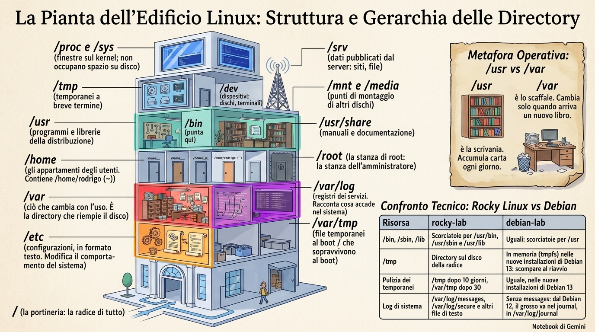
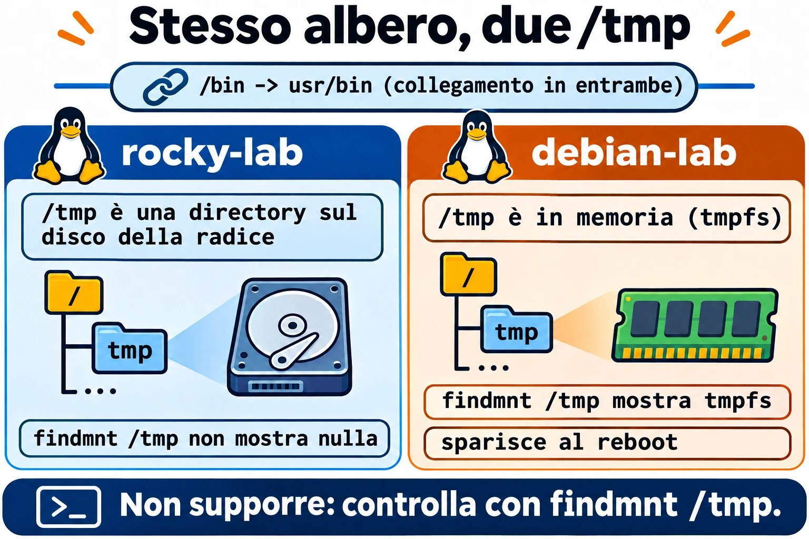
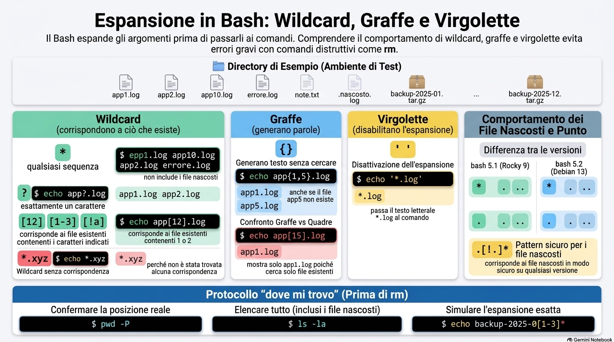
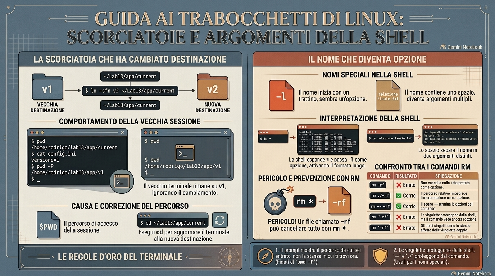

# Lezione 1.3 · Percorsi e navigazione

Impari a muoverti nell'albero di Linux senza perderti, a sapere dove vive ogni cosa su un server e a usare i caratteri jolly senza paura, perché prima controlli che cosa prenderanno.

| Scheda | Lezione 1.3 |
| --- | --- |
| Modulo | M1 · Riga di comando, lezione 3 di 10 |
| Quando | Settimana 2 |
| Alla fine sei in grado di | Arrivare a qualsiasi directory con un percorso assoluto o relativo; dire dove stanno configurazioni, log, programmi e dati su un server; leggere l'output lungo di `ls` e trovare il file più recente; mostrare i file nascosti; prevedere e controllare un carattere jolly prima di usarlo; accorgerti quando il prompt mostra un percorso che non è più quello reale |
| Prerequisiti | Lezione 1.2 |
| Durata | Circa 2h30 |
| Snapshot | m1a3-inicio e m1a3-fim su entrambe le VM |

## 1 · Riscaldamento

Tre domande, a memoria, prima di leggere qualsiasi cosa. Scrivi le risposte; le soluzioni le trovi alla fine per controllare.

1. Su debian-lab, `sudo cd /var/log` risponde `sudo: cd: command not found`. Perché?
2. Stai per modificare il `.bashrc` di un server via SSH. Qual è la regola prima di chiudere la sessione?
3. Prima di un lab che rompe cose, che cosa fai sul nodo Proxmox, e con quale comando?

## 2 · Perché conta

Lunedì mattina, il monitoraggio avvisa: la root di un server di un cliente è al 97%. Entri via SSH e devi rispondere in pochi minuti a che cosa è cresciuto, dove e da quando. Chi conosce l'albero va dritto in `/var`, elenca con `ls -ltr` e trova il log che non smette di crescere. Chi non lo conosce apre directory dopo directory, compresa `/proc`, dove un file da 128 TB sembra il colpevole e non occupa un byte del disco.

Il secondo caso è più silenzioso. Uno script di backup funziona ogni volta che qualcuno lo lancia a mano e fallisce ogni notte quando gira schedulato. Lo script non è cambiato. Quello che cambia è la directory da cui parte. Un percorso relativo è un'istruzione del tipo «due porte a sinistra», e lo scheduler non parte dalla stessa porta da cui parti tu.

Il terzo finisce in un ripristino di backup: un carattere jolly usato nella directory sbagliata, o che ha preso più nomi di quanti immaginavi. Questa lezione si chiude con due abitudini da dieci secondi che evitano tutti e tre i casi: sapere dove ti trovi davvero e vedere la lista del carattere jolly prima di usarla.

## 3 · Modello mentale

> Il file system è un palazzo con un'unica portineria: la `/`.

Ogni file del server sta in una stanza di questo palazzo, e ogni percorso è un modo per arrivarci:

1. Il **percorso assoluto** è l'indirizzo completo, a partire dalla portineria: `/var/log/messages`. Funziona da qualsiasi punto del palazzo, come un indirizzo con via, numero e città.
2. Il **percorso relativo** è un'istruzione a partire da dove ti trovi: «due porte a sinistra». `log/messages` funziona solo se sei già in `/var`.
3. Quattro scorciatoie da conversazione: `.` è «qui», `..` è «la stanza di sopra», `~` è «la mia stanza» e `cd -` è «torna dove stavo».
4. La receptionist della Lezione 1.2 legge anche le targhe. Quando dici «tutti i `.log`», è lei che va di porta in porta e compone la lista dei nomi. Il comando riceve la lista già pronta e non vede mai l'`*`.

Da questa pianta discendono tre conseguenze che userai per tutta la carriera:

- Script e schedulazioni usano percorsi assoluti. Nessuno garantisce in che stanza si sveglia uno script.
- Prima di qualsiasi comando che cancella o cambia qualcosa in massa, controlli dove sei. Un percorso relativo giusto nella stanza sbagliata è il disastro classico.
- Il carattere jolly viene tradotto dalla shell prima che il comando parta, quindi la traduzione si può vedere prima: `echo` con lo stesso carattere jolly mostra la lista esatta.

La pianta del palazzo, con ciò che vive a ogni piano:

```text
/                 a portaria: a raiz de tudo
├── etc           configurações, em texto
├── var           o que muda com o uso
│   ├── log       registros dos serviços
│   ├── lib       dados de serviços: bancos, pacotes
│   └── tmp       temporários que sobrevivem ao boot
├── home          as salas dos usuários
│   └── rodrigo   a sua: ~
├── root          a sala do root
├── tmp           temporários de curta duração
├── usr           programas e bibliotecas da distribuição
│   ├── bin       programas: /bin aponta para cá
│   └── share     manuais e documentação
├── opt           software de terceiros, instalado à parte
├── srv           dados que o servidor publica: sites, arquivos
├── mnt  media    pontos de montagem de outros discos
├── dev           dispositivos: discos, terminais
└── proc  sys     janelas para o kernel; não ocupam disco
```

Tieni a mente tre piani prima degli altri: `/etc` è dove cambi il comportamento del sistema, `/var/log` è dove scopri che cosa è successo e `/var` per intero è ciò che riempie il disco.



*Prima tre piani: /etc cambia, /var/log racconta, /var riempie.*

**Ponte Windows.** In Windows, ogni disco è un albero separato (`C:\`, `D:\`). In Linux c'è un albero solo: un altro disco compare come una directory in più al suo interno, in un punto di montaggio come `/mnt` o `/srv`. Il separatore è `/`, e le maiuscole contano: `Relatorio.txt` e `relatorio.txt` sono due file diversi. E la differenza che inganna di più: in `cmd.exe`, a interpretare l'`*` di `dir *.log` è `dir` stesso. In Linux, la shell sostituisce il carattere jolly con i nomi prima, e `ls` non sa nemmeno che c'era un carattere jolly.

## 4 · Concetto a livelli

### Essenziale

| Termine | Che cos'è | Esempio |
| --- | --- | --- |
| Root | La directory da cui parte tutto l'albero | `/` |
| Directory corrente | La stanza in cui ti trovi adesso; i percorsi relativi partono da lì | `pwd` |
| Percorso assoluto | Comincia con `/` e funziona da qualsiasi punto | `/etc/ssh/sshd_config` |
| Percorso relativo | Non comincia con `/`; parte dalla directory corrente | `../log` |
| `.` e `..` | La directory corrente e quella di sopra | `cd ..` |
| `~` | La tua home; `~ana` è la home dell'utente ana | `cd ~` |
| `cd -` | Torna alla directory precedente e mostra qual è | `cd -` |
| File nascosto | Qualsiasi nome che comincia con un punto; `ls` lo mostra solo con `-a` | `.bashrc` |
| Carattere jolly | Un modello che la shell sostituisce con i nomi esistenti | `*.log`, `app?.log` |
| Espansione con le graffe | Genera parole, esistano o no i file | `app{1,2}.log` |
| Link simbolico | Una scorciatoia che punta a un altro percorso; `ls -l` mostra la freccia | `/bin -> usr/bin` |
| FHS | Lo standard che dice che cosa va in ogni directory | `man 7 hier` |

I caratteri jolly stanno in quattro righe:

1. `*`: qualsiasi sequenza di caratteri, anche nessuna. Non prende i nomi che cominciano con un punto.
2. `?`: esattamente un carattere.
3. `[12]` e `[1-3]`: un carattere dell'elenco o dell'intervallo. `[!a]`: qualsiasi carattere tranne quello.
4. Se nessun nome corrisponde, il carattere jolly resta come testo, e il comando riceve l'`*` grezzo.

E l'`ls` di ogni giorno: `-l` formato lungo, `-a` con i nascosti, `-A` con i nascosti meno `.` e `..`, `-h` dimensioni leggibili, `-t` per data, `-r` ordine inverso, `-d` la directory stessa e non il contenuto, `-R` ricorsivo.

### Ponte Windows

| In Windows | In Linux |
| --- | --- |
| `C:\Users\rodrigo` | `/home/rodrigo`, o `~` |
| `cd` senza argomento, che mostra dove sei | `pwd`. In Linux, `cd` da solo porta alla home. |
| `dir /a` | `ls -la` |
| `dir /od` | `ls -ltr` |
| `tree` | `tree`, che va installato |
| Attributo nascosto | Nome che comincia con un punto |
| `C:`, `D:`, un albero per disco | Un albero solo; gli altri dischi vengono montati in directory |
| `\` | `/` |
| `%USERPROFILE%` | `$HOME` |

### Approfondimento

**La shell espande, il comando riceve.** In `ls *.log`, a cercare i nomi è bash. `ls` riceve `app1.log app2.log erro.log` come se li avessi digitati uno per uno. `echo` riceve la stessa lista e si limita a stamparla. Per questo `echo` è la prova generale di qualsiasi carattere jolly.

**Il carattere jolly senza corrispondenza passa grezzo.** Se nessun nome corrisponde, bash consegna il testo del carattere jolly così com'è: `ls *.xyz` risponde `ls: cannot access '*.xyz': No such file or directory`. Il messaggio è di `ls`, che cerca un file chiamato letteralmente `*.xyz`.

**Le virgolette spengono l'espansione.** `'*.log'` arriva al comando come testo. È così che passi un modello a un programma che fa la propria ricerca, come `find`, che compare più avanti nel corso.

**Le graffe non sono caratteri jolly.** `{a,b}` e `{01..12}` generano parole prima di qualsiasi ricerca, esistano o no i file. `echo app{1,5}.log` mostra `app5.log` anche se non esiste. `echo app[15].log` mostra solo ciò che esiste.

**Il punto nasconde, non protegge.** Nascosto è solo una convenzione sul nome per non sporcare l'elenco. Chiunque abbia il permesso di lettura vede i nascosti con `ls -a`. La protezione sono i permessi, che hanno una lezione tutta loro più avanti.

**Il `.*` cambia con la versione di bash.** Fino a bash 5.1, quello di Rocky 9, `.*` corrisponde anche a `.` e `..`. Da 5.2 in poi, quello di Debian 13, non corrisponde più, per via dell'opzione `globskipdots`. Con un bash vecchio, un `chown -R rodrigo .*` sale alla directory di sopra e cambia il proprietario di tutto ciò che c'è lì. Il modello che funziona in entrambi è `.[!.]*`.

**Il prompt mostra il percorso da cui sei entrato.** Bash conserva in `$PWD` il percorso che hai digitato, con le scorciatoie. Se una scorciatoia cambia destinazione dopo, resti nella stanza vecchia e il prompt non se ne accorge. `pwd -P` chiede al sistema qual è la directory reale.

**`/bin` ora è una scorciatoia.** Su Rocky e Debian attuali, `/bin`, `/sbin` e `/lib` sono link simbolici verso `/usr/bin`, `/usr/sbin` e `/usr/lib`. I tutorial vecchi li trattano come directory separate; il risultato è lo stesso.

**`/proc` e `/sys` non sono sul disco.** Sono finestre che il kernel apre in memoria. `ls -lh /proc/kcore` mostra una dimensione assurda, come 128T, e quel file non occupa un byte del disco.

## 5 · Rocky × Debian

L'albero segue lo stesso standard su entrambe le VM, ma i dettagli cambiano. Sono quelli che ti fregano sul server del cliente:

|  | rocky-lab | debian-lab |
| --- | --- | --- |
| `/bin`, `/sbin`, `/lib` | Collegamenti a `/usr/bin`, `/usr/sbin` e `/usr/lib` | Uguali: collegamenti a `/usr` |
| `/tmp` | Directory sul disco della root | In memoria (`tmpfs`) nelle installazioni nuove di Debian 13: sparisce al reboot. Verifica nel Passo 4. |
| Pulizia dei temporanei | `/tmp` dopo 10 giorni, `/var/tmp` dopo 30 | Uguale, nelle installazioni nuove di Debian 13 |
| Log di sistema | `/var/log/messages`, `/var/log/secure` e altri file di testo | Senza `messages`: da Debian 12, la maggior parte sta nel journal, in `/var/log/journal` |
| Punto dopo i permessi in `ls -l` | Compare: il file ha un contesto SELinux | Non compare |
| `ls` colorato | Alias in `/etc/profile.d/colorls.sh` | Alias in `~/.bashrc` |
| bash e il `.*` | bash 5.1: `.*` corrisponde anche a `.` e `..` | bash 5.2: non corrisponde |
| `tree` | Assente dall'installazione minimale | Assente dall'installazione minimale |
| Manuale dell'FHS | `man 7 hier`, dal pacchetto `man-pages` installato nella 1.2 | `man 7 hier`, dal pacchetto `manpages` |


*Il percorso assoluto funziona da qualsiasi punto; quello relativo dipende dalla directory in cui ti trovi.*

## 6 · Lab guidato

Apri tre terminali: uno su rocky-lab (`ssh rocky-lab`), uno su debian-lab (`ssh debian-lab`) e uno sul nodo Proxmox, per gli snapshot. A ogni passo, esegui, confronta con l'output atteso e solo dopo leggi il Decidi. Gli output sono estratti; numeri e date sul tuo schermo saranno diversi.

Ogni Decidi è un caso reale di lavoro. Scegli la lettera prima di guardare la tabella: sbagliare qui, con la spiegazione accanto, è il modo più economico di sbagliare.

**Passo 1 · Snapshot prima di tutto.** Sul nodo Proxmox:

```bash
qm snapshot 201 m1a3-inicio --description "Aula 1.3, antes do lab"
qm snapshot 202 m1a3-inicio --description "Aula 1.3, antes do lab"
qm listsnapshot 201
```

Output atteso: l'albero termina con `m1a2-fim`, `m1a3-inicio` e, per ultimo, `current`.

**Passo 2 · Dove sono?** Prima di eseguire, scommetti: dove va un `cd` senza niente dopo? Su entrambe le VM:

```bash
pwd
cd /var/log
pwd
cd
pwd
cd -
cd ..
pwd
cd ~root
```

Qualcosa come:

```text
/home/rodrigo
/var/log
/home/rodrigo
/var/log
/var
-bash: cd: /root: Permission denied
```

`cd` da solo torna alla home. `cd -` alterna tra le ultime due directory e stampa dove è andato. `..` sale di un livello. L'ultima riga è la receptionist al lavoro: la shell ha tradotto `~root` in `/root`, `cd` ha provato a entrare e il sistema ha negato, perché la home di root è chiusa agli utenti normali.

**Decidi 1 · Lo script che funziona solo a mano.** Scenario: lo script di backup di un cliente funziona ogni volta che entri in `/opt/backup` e lanci `./backup.sh`. Schedulato in cron per le 2:00, fallisce ogni notte con `tar: lista.txt: Cannot open: No such file or directory`. Che cosa fai?

- **A)** Dai permessi totali allo script e alla lista con `chmod 777`.
- **B)** Nello script, sostituisci `lista.txt` con `/opt/backup/lista.txt`, oppure metti `cd /opt/backup || exit 1` subito all'inizio.
- **C)** Schedula lo script come root.
- **D)** Aggiungi `/opt/backup` al PATH.

Scegli un'opzione prima di continuare.

| Se hai scelto | Risultato | Perché |
| --- | --- | --- |
| A | ❌ Sbagliato | Il messaggio dice `No such file or directory`, non `Permission denied`. E `777` apre il backup del cliente a qualsiasi utente del server. |
| B | ✅ Giusto | Cron fa partire lo script nella home dell'utente, non in `/opt/backup`. Un percorso relativo viene cercato a partire dalla directory corrente, quindi `tar` cerca `lista.txt` nel posto sbagliato. Con un percorso assoluto, o con il `cd` all'inizio, lo script trova la lista da qualsiasi punto. Il `\|\| exit 1` ferma lo script se `cd` fallisce. |
| C | ❌ Sbagliato | Anche root parte dalla sua home, `/root`. `lista.txt` continua a non esserci. |
| D | ❌ Sbagliato | Il PATH serve a trovare i comandi, non i file che un comando apre. `tar` non guarda mai il PATH per trovare `lista.txt`. |

**Da ricordare:** il percorso relativo è «due porte a sinistra». Funziona solo se chi legge sa da dove è partito, e uno script schedulato si sveglia senza saperlo.

**Passo 3 · Assoluto o relativo?** Prima di eseguire, scommetti: stando in `/var/log`, quali di queste righe funzionano? Su entrambe le VM:

```bash
cd /var/log
ls ../lib
ls lib
ls /etc/ssh
ls ../../etc/hostname
realpath ../../etc
```

Qualcosa come:

```text
alternatives  dnf  NetworkManager  rpm  selinux  systemd ...
ls: cannot access 'lib': No such file or directory
moduli  ssh_config  ssh_config.d  sshd_config  sshd_config.d ...
../../etc/hostname
/etc
```

Su debian-lab, la prima riga mostra `apt`, `dpkg` e `systemd`, tra gli altri. `../lib` funziona perché sale a `/var` ed entra in `lib`. `lib` da solo cerca un `lib` dentro `/var/log`, e non esiste. `/etc/ssh` funziona da qualsiasi punto. `realpath` traduce un percorso relativo in assoluto: usalo prima di incollare un percorso in uno script.

**Decidi 2 · Il tutorial incollato.** Scenario: un tutorial ti dice di eseguire `cd etc/nginx`. Sei nella tua home, incolli la riga e ricevi `No such file or directory`. nginx è installato e funziona. Che cosa fai?

- **A)** Reinstalli nginx, perché manca la configurazione.
- **B)** Esegui `cd /etc/nginx`. Il tutorial ha dimenticato la barra, o ha dato per scontato che fossi in `/`.
- **C)** Esegui `sudo cd etc/nginx`.
- **D)** Crei la directory con `mkdir -p etc/nginx` ed entri.

Scegli un'opzione prima di continuare.

| Se hai scelto | Risultato | Perché |
| --- | --- | --- |
| A | ❌ Sbagliato | La configurazione c'è. `cd` ha cercato `etc/nginx` dentro la tua home, dove non esiste. |
| B | ✅ Giusto | Senza barra davanti, il percorso parte dalla directory corrente. Con la barra, parte dalla root e arriva a `/etc/nginx` da qualsiasi punto tu sia. |
| C | ❌ Sbagliato | Doppio errore: `cd` è un builtin e `sudo` non lo trova, come hai visto nella Lezione 1.2. E il percorso resterebbe relativo. |
| D | ❌ Sbagliato | Crei un `~/etc/nginx` vuoto e cominci a modificare file che nginx non legge mai. È il tipo di errore che si mangia un pomeriggio. |

**Da ricordare:** senza barra davanti, il percorso comincia da dove sei.

**Passo 4 · La pianta del palazzo.** Su entrambe le VM:

```bash
ls /
ls -ld /bin /sbin /lib
findmnt /tmp
man 7 hier
```

`ls -ld` mostra qualcosa come:

```text
lrwxrwxrwx. 1 root root 7 Feb 10  2025 /bin -> usr/bin
lrwxrwxrwx. 1 root root 7 Feb 10  2025 /lib -> usr/lib
lrwxrwxrwx. 1 root root 8 Feb 10  2025 /sbin -> usr/sbin
```

La `l` all'inizio e la freccia dicono che sono scorciatoie. Il punto dopo i permessi compare solo su rocky-lab: il file ha un contesto SELinux, argomento del modulo sulla sicurezza.

`findmnt /tmp` non mostra nulla su rocky-lab: lì, `/tmp` è una directory normale sul disco della root. Su debian-lab, qualcosa come:

```text
TARGET SOURCE FSTYPE OPTIONS
/tmp   tmpfs  tmpfs  rw,nosuid,nodev,size=...
```

`/tmp` di debian-lab sta in memoria e si svuota a ogni reboot. Se non compare nulla, la tua installazione è stata configurata in un altro modo; ciò che conta è saper controllare.

In `man 7 hier`, digita `/log` e Invio; `n` passa all'occorrenza successiva. Leggi che cosa dice lo standard su `/var/log`, `/opt` e `/srv`. Esci con `q`.

**Decidi 3 · Il disco pieno.** Scenario: il monitoraggio avvisa che la root di un server di un cliente è al 98%. Da dove cominci a cercare?

- **A)** Da `/usr/bin`, dove stanno i programmi.
- **B)** Da `/var`, dove stanno log, cache dei pacchetti, database e code di posta.
- **C)** Da `/proc`, perché `ls -lh /proc/kcore` mostra un file da 128T.
- **D)** Da `/etc`, dove stanno le configurazioni.

Scegli un'opzione prima di continuare.

| Se hai scelto | Risultato | Perché |
| --- | --- | --- |
| A | ❌ Sbagliato | I programmi cambiano solo quando un pacchetto viene installato o aggiornato. E cancellare qualcosa lì rompe il sistema. |
| B | ✅ Giusto | `/var` è il piano che cresce da solo con l'uso: log che nessuno ruota, cache di `dnf` o `apt`, database, coda di posta bloccata. È lì che si trova la maggior parte dei dischi pieni. `/home` e `/tmp` vengono subito dopo. |
| C | ❌ Sbagliato | `/proc` non è sul disco. La dimensione di `kcore` è lo spazio di memoria che il kernel vede, non byte scritti. |
| D | ❌ Sbagliato | Sono piccoli file di testo. L'intera `/etc` di solito ha pochi megabyte. |

**Da ricordare:** `/usr` è lo scaffale, che cambia solo quando arriva un libro nuovo. `/var` è la scrivania di lavoro, che accumula carta ogni giorno.



*L'albero è lo stesso, ma il /tmp di Debian 13 sta in memoria e sparisce al reboot.*

**Passo 5 · Leggere davvero `ls`.** Su entrambe le VM:

```bash
ls -l /etc/hostname
ls -lh /var/log
ls -ltr /var/log
ls -ld /var/log
```

La prima riga, qualcosa come:

```text
-rw-r--r--. 1 root root 10 Oct 20 09:12 /etc/hostname
```

Campo per campo:

- `-`: il tipo. `-` è un file, `d` è una directory, `l` è una scorciatoia.
- `rw-r--r--`: i permessi, che hanno una lezione tutta loro.
- `1`: quanti nomi puntano a questo file.
- `root root`: il proprietario e il gruppo.
- `10`: la dimensione in byte. Con `-h`, le dimensioni diventano `4.0K` o `1.2M`.
- `Oct 20 09:12`: l'ultima modifica.
- Per ultimo, il nome.

Ora confronta gli elenchi di `/var/log`. Con `-ltr`, i più recenti stanno in fondo, subito sopra il prompt: è l'uso più comune sul lavoro. Su rocky-lab, `messages` e `secure` di solito sono tra gli ultimi. Su debian-lab, `/var/log` è più corta e `journal` è una directory. `ls -ld` mostra una riga sola: la `/var/log` stessa, non il contenuto.

**Decidi 4 · Quale log è stato toccato per ultimo?** Scenario: un servizio si è fermato dieci minuti fa. In `/opt/app/logs` ci sono 400 file, con nomi di data mescolati. Vuoi vedere quelli scritti per ultimi, senza far scorrere lo schermo. Quale comando?

- **A)** `ls -l`
- **B)** `ls -ltr`
- **C)** `ls -lS`
- **D)** `ls -R`

Scegli un'opzione prima di continuare.

| Se hai scelto | Risultato | Perché |
| --- | --- | --- |
| A | ❌ Sbagliato | Ordine alfabetico. I 400 nomi scorrono sullo schermo e il più recente può essere ovunque. |
| B | ✅ Giusto | `-t` ordina per data e `-r` inverte: il più nuovo sta nell'ultima riga, subito sopra il cursore, senza scorrere nulla. |
| C | ❌ Sbagliato | Ordina per dimensione. Aiuta con il disco pieno, non per sapere che cosa è cambiato adesso. |
| D | ❌ Sbagliato | Entra in tutte le sottodirectory e allaga lo schermo, senza ordine di data. |

**Da ricordare:** `t` come tempo, `r` come reverso. Il più nuovo sta vicinissimo al cursore.

**Passo 6 · I nascosti.** Su entrambe le VM:

```bash
ls ~
ls -a ~
ls -A ~
ls -ld ~/.ssh
```

`ls ~` può non mostrare nulla. Gli altri, qualcosa come:

```text
.  ..  .bash_history  .bash_logout  .bash_profile  .bashrc  .ssh
.bash_history  .bash_logout  .bash_profile  .bashrc  .ssh
drwx------. 2 rodrigo rodrigo 29 Oct 15 18:40 /home/rodrigo/.ssh
```

Su debian-lab, compare `.profile` al posto di `.bash_profile`. La home non era vuota: i file di configurazione dell'utente cominciano con un punto e `ls` li nasconde per impostazione predefinita. `-A` è `-a` senza `.` e `..`. `.ssh` è la directory in cui sta l'`authorized_keys` della Lezione 0.2: senza, la tua chiave non entra.

**Decidi 5 · La migrazione che ha chiuso fuori l'utente.** Scenario: hai migrato la home di un utente su un server nuovo copiando tutto con `*`. Sul server nuovo, la sua chiave SSH non funziona più e il login chiede la password. Che cosa è successo?

- **A)** Le chiavi SSH smettono di valere quando vengono copiate.
- **B)** L'`*` non prende i nomi che cominciano con un punto, e `.ssh`, con l'`authorized_keys`, è rimasta indietro.
- **C)** Il server nuovo non ha SSH installato.
- **D)** Bisogna riavviare il servizio SSH del server nuovo.

Scegli un'opzione prima di continuare.

| Se hai scelto | Risultato | Perché |
| --- | --- | --- |
| A | ❌ Sbagliato | Una chiave è solo un file di testo e vale ovunque si trovi. Il problema è che non c'è. |
| B | ✅ Giusto | L'`*` non corrisponde ai nomi con il punto davanti. Sono andati i file visibili e sono rimasti `.ssh`, `.bashrc` e il resto della configurazione. Un `ls -A` sulla destinazione mostra la mancanza in un secondo. |
| C | ❌ Sbagliato | Se il login chiede la password, SSH sta rispondendo. |
| D | ❌ Sbagliato | Il servizio legge l'`authorized_keys` a ogni login. Riavviare non crea il file che non è stato copiato. |

**Da ricordare:** l'`*` non vede chi si nasconde dietro un punto. Dopo aver copiato, controlla con `ls -A`.

**Passo 7 · Caratteri jolly: la prova generale con `echo`.** Monta una directory giocattolo su entrambe le VM. `mkdir` e `touch` sono della Lezione 1.4; qui creano solo file vuoti perché tu possa fare i test:

```bash
mkdir -p ~/lab13/logs
cd ~/lab13/logs
touch app1.log app2.log app10.log erro.log notas.txt .escondido.log
touch backup-2025-{01..12}.tar.gz
ls
```

`ls` mostra 17 file. `.escondido.log` non compare. Ora, prima di eseguire ogni riga qui sotto, scrivi la lista che ti aspetti:

```bash
echo *.log
echo app?.log
echo app*.log
echo app[12].log
echo [!a]*
echo backup-2025-0[1-3]*
echo *.xyz
echo '*.log'
echo app{1,5}.log
echo app[15].log
echo .*
```

Qualcosa come (l'ordine può cambiare a seconda della lingua del sistema):

```text
app1.log app10.log app2.log erro.log
app1.log app2.log
app1.log app10.log app2.log
app1.log app2.log
backup-2025-01.tar.gz ... backup-2025-12.tar.gz erro.log notas.txt
backup-2025-01.tar.gz backup-2025-02.tar.gz backup-2025-03.tar.gz
*.xyz
*.log
app1.log app5.log
app1.log
. .. .escondido.log
```

`echo` non sa nulla di caratteri jolly: stampa solo ciò che riceve. Quello che compare è esattamente la lista che la shell consegnerebbe a un `ls`, a un `cp` o a un `rm`. Nota quattro cose. Il `?` ha lasciato fuori `app10.log`, perché `10` sono due caratteri. `*.log` non ha preso `.escondido.log`. `*.xyz` e `'*.log'` sono tornati grezzi: uno perché nulla corrispondeva, l'altro perché le virgolette hanno spento l'espansione. E le graffe hanno inventato un `app5.log` che non esiste, mentre le parentesi quadre hanno trovato solo ciò che esiste. L'ultima riga è di rocky-lab; su debian-lab, `.*` mostra solo `.escondido.log`, come vedi nel Bonus.

**Decidi 6 · Prima di cancellare.** Scenario: il cliente chiede di cancellare i backup da gennaio a marzo 2025, in una directory con due anni di backup. Hai composto la riga `rm backup-2025-0[1-3]*`. Che cosa fai prima di premere Invio?

- **A)** Niente. Il carattere jolly è giusto, basta premere Invio.
- **B)** Esegui `pwd`, poi sostituisci `rm` con `echo` mantenendo lo stesso carattere jolly, controlli la lista e solo allora torni a `rm`.
- **C)** Lo riscrivi come `rm backup-2025-0{1..3}*`, perché le graffe sono più sicure delle parentesi quadre.
- **D)** Lo esegui con `sudo`, per non fermarti a metà per mancanza di permessi.

Scegli un'opzione prima di continuare.

| Se hai scelto | Risultato | Perché |
| --- | --- | --- |
| A | ❌ Sbagliato | Il carattere jolly può essere giusto e la directory sbagliata. Oppure esiste un `backup-2025-01-parcial` che nessuno ricordava. Lo sai solo guardando. |
| B | ✅ Giusto | `pwd` conferma la stanza, e `echo` mostra la lista esatta che `rm` riceverebbe. Costa dieci secondi, e `rm` non ha cestino né annulla. |
| C | ❌ Sbagliato | Le graffe generano tre caratteri jolly, e ciascuno viene espanso allo stesso modo. La lista è la stessa, e resta senza controllo. |
| D | ❌ Sbagliato | Più potere senza più attenzione. Se la lista è sbagliata, `sudo` garantisce solo che il danno arrivi fino in fondo. |

**Da ricordare:** `echo` è la prova generale. La prova non costa nulla; `rm` non ha prova né cestino.


*La shell sostituisce il carattere jolly prima del comando; echo mostra la lista esatta.*

**Il protocollo del «dove sono».** Tre comandi prima di qualsiasi cosa che cancella, sposta o cambia permessi in massa. L'esempio usa il carattere jolly del Decidi 6; sostituiscilo con quello del momento:

```bash
pwd -P
ls -la
echo backup-2025-0[1-3]*
```

Il primo dice dove sei davvero, anche con scorciatoie nel percorso. Il secondo mostra che cosa c'è lì, nascosti inclusi. Il terzo mostra la lista esatta che il comando riceverà. Sono dieci secondi, su qualsiasi server.

## 7 · Rompi e ripara

Adesso vedi il terminale mentire, in due modi. Nel primo guasto, il prompt mostra un posto in cui non sei più. Nel secondo, un nome di file diventa un'opzione del comando. Fai tutto su rocky-lab, dentro `~/lab13`: lo snapshot `m1a3-inicio` è lì per questo.

### Guasto A · la scorciatoia che ha cambiato destinazione

Molti deploy funzionano così: ogni versione dell'applicazione sta in una directory, e una scorciatoia chiamata `current` punta alla versione in uso. Per cambiare versione, basta cambiare la destinazione della scorciatoia.

**Rompi.** Su rocky-lab, monta un'applicazione finta con due versioni. Il `>` scrive il testo in un file, argomento della Lezione 1.6, e `ln -s` crea la scorciatoia, argomento di una lezione sui link più avanti:

```bash
mkdir -p ~/lab13/app/v1 ~/lab13/app/v2
echo "versao=1" > ~/lab13/app/v1/config.ini
echo "versao=2" > ~/lab13/app/v2/config.ini
ln -sfn v1 ~/lab13/app/current
cd ~/lab13/app/current
cat config.ini
```

Risponde `versao=1`, e il prompt mostra `current`. Lascia questa sessione dov'è. Apri una seconda sessione su rocky-lab (`ssh rocky-lab`) e fai il deploy della versione 2:

```bash
ln -sfn v2 ~/lab13/app/current
cat ~/lab13/app/current/config.ini
```

Risponde `versao=2`. Il deploy è riuscito.

**Prevedi.** Torna alla prima sessione, che è ancora in `current`. Prima di eseguire ogni riga, di' che cosa mostrerà:

```bash
pwd
cat config.ini
pwd -P
ls -l ~/lab13/app
```

**Scopri.** Qualcosa come:

```text
/home/rodrigo/lab13/app/current
versao=1
/home/rodrigo/lab13/app/v1
total 0
lrwxrwxrwx. 1 rodrigo rodrigo  2 Oct 20 10:15 current -> v2
drwxr-xr-x. 2 rodrigo rodrigo 24 Oct 20 10:10 v1
drwxr-xr-x. 2 rodrigo rodrigo 24 Oct 20 10:10 v2
```

`cd` ha seguito la scorciatoia una volta sola, nel momento in cui sei entrato, e sei rimasto dentro `v1`. La scorciatoia ha cambiato destinazione; tu no. Il prompt e `pwd` mostrano il percorso da cui sei arrivato, conservato in `$PWD`, e per questo continuano a dire `current`. `pwd -P` chiede al sistema dove sei davvero.

**Decidi 7 · La correzione che non ha funzionato.** Scenario: subito dopo un deploy da un cliente, sei in un terminale in `/srv/app/current`. Modifichi il `config.ini`, riavvii il servizio e non cambia nulla. Il prompt garantisce che sei in `current`. Che cosa fai?

- **A)** Riavvii di nuovo il servizio, perché la prima volta non ha funzionato.
- **B)** Esegui `pwd -P`. Se mostra la versione vecchia, hai modificato la release vecchia: rientra con `cd /srv/app/current` e rifai la modifica.
- **C)** Reinstalli l'applicazione.
- **D)** Cancelli la scorciatoia `current` e al suo posto metti una copia della directory della versione nuova.

Scegli un'opzione prima di continuare.

| Se hai scelto | Risultato | Perché |
| --- | --- | --- |
| A | ❌ Sbagliato | Il servizio legge il file della versione in uso, e tu hai modificato un altro. Riavviare quante volte vuoi non cambia questo. |
| B | ✅ Giusto | Il terminale è rimasto nella directory vecchia da prima del deploy. `pwd -P` lo mostra in un secondo, e rientrare dal percorso fa sì che il sistema segua la scorciatoia fino alla versione attuale. |
| C | ❌ Sbagliato | L'applicazione è a posto. A essere sbagliato era il posto in cui hai modificato. |
| D | ❌ Sbagliato | Rompe il processo di deploy: alla prossima versione, nessuno capirà perché `current` è diventata una directory. E non risolve nulla, perché il problema era il tuo terminale. |

**Da ricordare:** il prompt mostra il percorso da cui sei entrato, non la stanza in cui sei adesso.

**Ripara.** Nella prima sessione:

```bash
cd ~/lab13/app/current
cat config.ini
```

**Verifica.**

```bash
pwd -P
```

Risponde `/home/rodrigo/lab13/app/v2`, e `cat` ha mostrato `versao=2`. Chiudi la seconda sessione con `exit`.

### Guasto B · i nomi che ingannano il carattere jolly

**Rompi.** Su rocky-lab, crea due nomi problematici nella directory del Passo 7. Il `--` della Lezione 1.2 avvisa `touch` che `-l` è un nome, non un'opzione:

```bash
cd ~/lab13/logs
touch -- -l
touch "relatorio final.txt"
ls
```

`ls` li mostra entrambi, e il nome con lo spazio compare tra apici singoli. Sembra tutto normale.

**Prevedi.** Prima di eseguire ogni riga, di' che cosa mostrerà:

```bash
ls *
ls relatorio final.txt
ls *.txt
```

**Scopri.** Qualcosa come:

```text
-rw-r--r--. 1 rodrigo rodrigo 0 Oct 20 10:02 app10.log
-rw-r--r--. 1 rodrigo rodrigo 0 Oct 20 10:02 app1.log
...
ls: cannot access 'relatorio': No such file or directory
ls: cannot access 'final.txt': No such file or directory
notas.txt  'relatorio final.txt'
```

Il primo `ls` è uscito in formato lungo senza che tu lo chiedessi. La shell ha sostituito l'`*` con la lista dei nomi, e uno di essi era `-l`: `ls` ha ricevuto `-l` e l'ha interpretato come opzione, come se l'avessi digitato tu. Il secondo è fallito perché lo spazio separa gli argomenti, e `ls` ha cercato due file, `relatorio` e `final.txt`. Il terzo ha funzionato: il carattere jolly consegna ogni nome intero, spazio compreso. Il problema non è mai il nome; è come arriva al comando.

Con `ls`, il danno è solo visivo. Con `rm *` in una directory che ha un file chiamato `-rf`, `rm` riceve `-rf` come opzione e cancella anche le sottodirectory. Tienilo a mente per la Lezione 1.4.

**Decidi 8 · Il file che diventa opzione.** Scenario: su un server di un cliente, in `/srv/upload` compare un file chiamato `-rf`, inviato da un modulo difettoso. Devi cancellare solo quel file. Quale comando?

- **A)** `rm -rf`
- **B)** `rm ./-rf`
- **C)** `rm "-rf"`
- **D)** `rm '-rf'`

Scegli un'opzione prima di continuare.

| Se hai scelto | Risultato | Perché |
| --- | --- | --- |
| A | ❌ Sbagliato | `rm` riceve solo opzioni e nessun nome. Non cancella nulla e non si lamenta: te ne vai convinto di aver risolto. |
| B | ✅ Giusto | Con `./` davanti, il nome comincia con un punto e `rm` non lo scambia per un'opzione. Funziona anche `rm -- -rf`. |
| C | ❌ Sbagliato | Le virgolette proteggono dalla shell, non dal comando. La shell toglie le virgolette e `rm` riceve `-rf` allo stesso modo: di nuovo, solo opzioni. |
| D | ❌ Sbagliato | Stesso motivo del C. Apici singoli o doppi, `rm` riceve esattamente `-rf`. |

**Da ricordare:** le virgolette proteggono dalla shell; `--` e `./` proteggono dal comando.

**Ripara.**

```bash
ls -- *
ls ./*
ls "relatorio final.txt"
rm ./-l
```

`--` chiude le opzioni. `./` fa cominciare ogni nome con punto e barra, e nessuno sembra più un'opzione. Le virgolette tengono intero il nome con lo spazio. `rm ./-l` cancella solo il file `-l`; la Lezione 1.4 tratta `rm` con calma.

**Verifica.**

```bash
ls -A
ls *
```

`-l` è sparito dall'elenco, e `ls *` è tornato al formato corto.


*Il prompt mostra da dove sei entrato; le virgolette proteggono dalla shell, -- e ./ proteggono dal comando.*

### E lo snapshot?

Se qualcosa è sfuggito di mano, torna all'inizio del lab. Sul nodo Proxmox; per debian-lab, sostituisci 201 con 202:

```bash
qm rollback 201 m1a3-inicio
qm start 201
```

Il rollback annulla tutto dal Passo 1, compresa `~/lab13`, e abbatte le sessioni SSH aperte. Rientra e rifai il Passo 7 prima di proseguire.

### Bonus su Debian

Esegui le stesse righe su entrambe le VM e confronta:

```bash
bash --version | head -1
cd ~/lab13/logs
echo .*
echo .[!.]*
shopt globskipdots
```

Su rocky-lab, `echo .*` mostra `. .. .escondido.log`, e `shopt` risponde `invalid shell option name`, perché bash 5.1 non conosce l'opzione. Su debian-lab, `echo .*` mostra solo `.escondido.log` e `shopt` risponde `globskipdots on`. `.[!.]*` dà lo stesso risultato su entrambe: è il modello portabile per prendere solo i nascosti.

Per chiudere, l'albero disegnato. Su debian-lab:

```bash
sudo apt install -y tree
tree -L 1 /
tree -a ~/lab13
```

`-L 1` limita il disegno a un livello; `-a` mostra i nascosti. Su rocky-lab, il pacchetto ha lo stesso nome: `sudo dnf install -y tree`.

**La lezione:** il terminale mostra ciò che hai digitato e il percorso da cui sei entrato, e non sempre è ciò che esiste. `pwd -P` e un `echo` con il carattere jolly richiedono due secondi e mostrano la verità prima del danno. Vale per i deploy, per la pulizia del disco e per qualsiasi comando in massa su un server di un cliente.

## 8 · Trappole

| Sintomo | Causa | Via d'uscita |
| --- | --- | --- |
| `cd: etc/ssh: No such file or directory`, ma la directory esiste | Mancava la `/`: il percorso è relativo alla directory corrente. | `cd /etc/ssh`; nel dubbio, `pwd`. |
| Lo script funziona a mano e fallisce schedulato | Percorsi relativi; cron parte da un'altra directory. | Percorsi assoluti, oppure `cd /dir \|\| exit 1` all'inizio dello script. |
| `ls: cannot access '*.log': No such file or directory` | Nessun nome corrispondeva, e il carattere jolly è passato grezzo. | `ls` senza carattere jolly: la directory o l'estensione sono sbagliate. |
| `ls *` esce in formato lungo senza che tu lo chieda | Un file chiamato `-l` è diventato un'opzione. | `ls -- *` o `ls ./*` |
| `ls relatorio final.txt` dà due errori | Lo spazio separa gli argomenti. | Virgolette: `ls "relatorio final.txt"`. Tab completa il nome nel modo giusto. |
| Hai copiato tutto con `*` e manca la configurazione | L'`*` non prende i nomi che cominciano con un punto. | Controlla con `ls -A`; copia l'intera directory, come nella Lezione 1.4. |
| Hai modificato il file, non è cambiato nulla, e il prompt dice che sei nel posto giusto | Sei rimasto nella vecchia destinazione di una scorciatoia. | `pwd -P`, e rientra con `cd` sul percorso. |
| `Relatorio.txt` non si trova, ma `relatorio.txt` esiste | Linux distingue maiuscole e minuscole. | Usa Tab, che completa il nome esatto. |
| `cd ~root` dà `Permission denied` | La home di root è chiusa agli utenti normali. | `sudo ls /root` per guardare, oppure `sudo -i`. |
| Un file lasciato in `/tmp` è sparito | Su Debian 13, `/tmp` sta in memoria e si svuota al reboot. Su entrambe, i file vecchi vengono cancellati dopo 10 giorni. | Niente di ciò che deve restare va in `/tmp`. Usa la tua home o una directory di dati. |
| `ls -lh /proc/kcore` mostra 128T su un disco da 32G | `/proc` non è sul disco: è il kernel che mostra la memoria. | Ignora `/proc` e `/sys` quando cerchi ciò che riempie il disco. |
| `.*` ha preso anche `.` e `..` | bash 5.1 o precedente, come quello di Rocky 9. | `.[!.]*`, che funziona in qualsiasi versione. |
| `ls -l /var/log` elenca il contenuto, e tu volevi la directory stessa | Senza `-d`, `ls` entra nella directory. | `ls -ld /var/log` |
| `tree: command not found` | Non c'è nell'installazione minimale. | `sudo dnf install -y tree` o `sudo apt install -y tree`; oppure `ls -R`. |
| `bash: cd: OLDPWD not set` | Sessione nuova: non esiste ancora una directory precedente. | Normale. Dopo il primo `cd`, `cd -` funziona. |

## 9 · Quiz

Rispondi senza guardare la lezione. Le soluzioni commentate sono alla fine.

1. Qual è la differenza tra `/etc/ssh` e `etc/ssh`? Da dove funziona ciascuno?
2. Sei in `/var/log`. Scrivi un percorso relativo per `/etc/hostname`.
3. Che cosa fanno `cd`, `cd -`, `cd ..` e `cd ~ana`?
4. In quale directory cerchi: la configurazione di SSH; i log; i programmi della distribuzione; i dati di un database; le home degli utenti?
5. Completa gli spazi: per vedere la directory stessa e non il contenuto, `ls ___ /var/log`. Per vedere i più recenti in fondo allo schermo, `ls -l___`. Per vedere i nascosti senza `.` e `..`, `ls ___`.
6. Chi espande l'`*`: `ls` o la shell? Come lo dimostri con un comando?
7. In una directory con `app1.log`, `app2.log` e `app10.log`, che cosa mostra `echo app?.log`? E `echo app{1,5}.log`?
8. Il tuo prompt dice `/srv/app/current`, ma la modifica che hai fatto non ha effetto. Quale comando conferma dove sei davvero, e perché il prompt può essere sbagliato?
9. Domanda in inglese, come nei forum e nella documentazione: *Which pattern matches file1.txt and file2.txt, but not file10.txt?*
   - **A)** `file*.txt`
   - **B)** `file?.txt`
   - **C)** `file[10].txt`
   - **D)** `file{1,10}.txt`

## 10 · Flashcard e promemoria

| Fronte | Retro |
| --- | --- |
| Assoluto o relativo? | Comincia con `/`: assoluto, funziona da qualsiasi punto. Senza `/`: relativo alla directory corrente. |
| Tornare alla directory precedente | `cd -` |
| Andare alla home | `cd` da solo, o `cd ~` |
| Dove sono davvero, senza scorciatoie | `pwd -P` |
| Configurazioni, log, dati dei servizi | `/etc`, `/var/log`, `/var/lib` |
| Programmi della distribuzione e di terze parti | `/usr/bin`; `/opt` |
| Ciò che non occupa disco | `/proc` e `/sys` |
| I più recenti in fondo allo schermo | `ls -ltr` |
| La directory stessa, non il contenuto | `ls -ld dir` |
| Vedere i nascosti | `ls -a`; senza `.` e `..`, `ls -A` |
| `*`, `?`, `[12]`, `[!a]` | Qualsiasi sequenza; un carattere; uno dell'elenco; qualsiasi tranne quello |
| Carattere jolly senza corrispondenza | Passa grezzo al comando: `cannot access '*.xyz'` |
| Graffe o parentesi quadre? | Le graffe generano nomi, esistano o no. Le parentesi quadre corrispondono solo a ciò che esiste. |
| Prova generale di un carattere jolly | `echo` con lo stesso carattere jolly |
| Nome che comincia con un trattino | `./-nome` o `--` prima dei nomi. Le virgolette non risolvono. |

**Da sapere a memoria.**

```bash
pwd
pwd -P
cd
cd -
cd ..
ls -la
ls -ltr
ls -ld /var/log
echo *.log
ls -- *
```

**Da consultare.**

```bash
man 7 hier
realpath ../../etc
ls -lh /var/log
ls -A ~
ls -R ~/lab13
echo .[!.]*
echo backup-2025-{07..12}*
findmnt /tmp
tree -L 1 /
shopt globskipdots
```

In `man 7 hier`, cerca `/log` o `/opt`. `shopt globskipdots` esiste solo da bash 5.2 in poi.

## 11 · Checklist e chiusura

Spunta solo ciò che sai fare senza guardare la lezione:

- Dire se un percorso è assoluto o relativo, e da dove parte.
- Andare e tornare tra due directory senza digitare di nuovo il percorso.
- Dire dove stanno configurazioni, log, programmi, dati dei servizi e home.
- Trovare il file più recente di una directory con un comando.
- Mostrare i file nascosti di una directory.
- Prevedere la lista di un carattere jolly e controllarla con `echo` prima di usarlo.
- Spiegare perché il prompt può mentire, e confermare con `pwd -P`.

**Chiudi la lezione.** Sul nodo Proxmox:

```bash
qm snapshot 201 m1a3-fim --description "Aula 1.3 concluída"
qm snapshot 202 m1a3-fim --description "Aula 1.3 concluída"
qm delsnapshot 201 m1a3-inicio
qm delsnapshot 202 m1a3-inicio
qm listsnapshot 201
```

Output atteso: `m1a2-fim`, poi `m1a3-fim` e, per ultimo, `current`. `m1a3-inicio` non compare più. `~/lab13` resta nelle VM: la Lezione 1.4 parte da lì.

## 12 · Nella vita reale

Un comando digitato una volta, senza un problema vero dietro, svanisce in un giorno. Questa sezione esiste perché non succeda: una missione sul tuo lavoro e una sfida per domani, senza guardare la lezione.

**Missione sul lavoro (entro domani, sola lettura).** Scegli un server Linux reale che amministri. Entra con il tuo utente ed esegui solo comandi che leggono:

```bash
pwd -P
ls -A ~
ls -ld /etc /var/log /tmp /opt /srv
ls -ltr /var/log | tail -5
ls -A /opt /srv
findmnt /tmp
```

`tail -5` mostra solo le ultime cinque righe; è della Lezione 1.5, e il `|` è della Lezione 1.6. Annota tre risposte nel tuo diario da admin:

1. Qual è stato l'ultimo log scritto in `/var/log`, e di quale servizio è?
2. C'è qualcosa in `/opt` o in `/srv`? Viene da un pacchetto della distribuzione, o qualcuno l'ha installato a mano? Se non lo sai, annotalo come domanda per il collega che ha montato il server.
3. C'è qualche file nascosto nella tua home che non hai creato tu? Da dove viene?

E una seconda sfida, per la settimana: ogni volta che usi un carattere jolly sul lavoro con un comando che cambia qualcosa (cancellare, spostare, cambiare proprietario), esegui prima lo stesso carattere jolly con `echo`. Annota nel diario quante volte la lista è venuta diversa da come te l'aspettavi.

**Domani, senza guardare.** Riserva da 10 a 15 minuti su debian-lab. Senza aprire questa lezione:

1. Stando in `/var/log`, vai in `/etc/ssh` con un percorso relativo. Poi torna in `/var/log` senza digitare il percorso.
2. Elenca il contenuto di `/etc` con i file modificati più di recente in fondo allo schermo.
3. In `~/lab13/logs`, mostra con `echo` solo i backup del secondo semestre, da luglio a dicembre.
4. Scopri se `/sbin` è una directory o una scorciatoia, e dove punta.

Suggerimento: se ti blocchi, le tre domande sono sempre le stesse. Dove sono? (`pwd`). Che cosa c'è qui? (`ls -la`). Che cosa consegnerà la shell? (`echo`).

## 13 · Con DeepTutor

| Comando | Quando usarlo |
| --- | --- |
| `!quiz 1.3` | Subito dopo il lab: domande nuove. |
| `!explica curinga e expansão de chaves` | Quando un concetto non ti è ancora chiaro. |
| `!feynman caminho absoluto e relativo` | Spieghi con le tue parole e lui indica le lacune. |
| `!quebra 1.3` | Un nuovo guasto di percorso, scorciatoia o carattere jolly da riparare. |
| `!cartoes 1.3` | Le flashcard a ripetizione spaziata. |
| `!erro ls: cannot access '*.log': No such file or directory` | Incolla un errore reale e ti guida nella diagnosi. |
| `!revisao 1.3` | A D+1, D+3, D+7 e D+21. Insieme: `!revisao 1.2` a D+1 e `!revisao 1.1` a D+3. |

## Soluzioni commentate

**Riscaldamento.**

1. `cd` è un builtin: vive dentro bash, e `sudo` esegue solo programmi su disco. Per entrare in una directory chiusa, usa `sudo -i`; per guardare soltanto, `sudo ls` con il percorso.
2. La sessione aperta resta aperta. Testa in una sessione nuova e chiudi la prima solo quando la seconda funziona.
3. Uno snapshot delle due VM, con `qm snapshot 201 nome` e `qm snapshot 202 nome`. Se il lab sfugge di mano, `qm rollback` riporta tutto indietro.

**Quiz.**

1. `/etc/ssh` è assoluto: parte dalla root e funziona da qualsiasi punto. `etc/ssh` è relativo: cerca un `etc` dentro la directory corrente, e arriva al posto giusto solo se sei in `/`.
2. `../../etc/hostname`. Il primo `..` sale a `/var`, il secondo a `/`.
3. `cd` va alla tua home; `cd -` torna alla directory precedente e mostra qual è; `cd ..` sale di un livello; `cd ~ana` va alla home dell'utente ana.
4. `/etc/ssh`; `/var/log`; `/usr/bin` e `/usr/sbin`; `/var/lib`; `/home`.
5. `-d`, `tr` e `-A`: `ls -ld /var/log`, `ls -ltr` e `ls -A`.
6. La shell. `echo *.log` mostra la lista senza nessun `ls` di mezzo, e `echo '*.log'` mostra il carattere jolly grezzo, perché le virgolette impediscono l'espansione.
7. `app1.log app2.log`: il `?` corrisponde a un solo carattere, e `10` sono due. `app1.log app5.log`: le graffe generano le due parole, anche se `app5.log` non esiste.
8. `pwd -P`. Il prompt e `pwd` senza opzioni mostrano `$PWD`, il percorso da cui sei entrato. Se la scorciatoia `current` ha cambiato destinazione dopo, sei ancora nella directory vecchia. `-P` chiede al sistema e risolve le scorciatoie.
9. Scegli un'opzione prima di continuare.

| Se hai scelto | Risultato | Perché |
| --- | --- | --- |
| A | ❌ Sbagliato | L'`*` corrisponde a qualsiasi quantità di caratteri, compreso `10`. Prende tutti e tre i file. |
| B | ✅ Giusto | Il `?` corrisponde esattamente a un carattere. `1` e `2` passano; `10` sono due e resta fuori. |
| C | ❌ Sbagliato | `[10]` corrisponde a un carattere, `1` oppure `0`. Prende `file1.txt` e un eventuale `file0.txt`, ma non `file2.txt`. |
| D | ❌ Sbagliato | Le graffe non corrispondono a nulla: generano `file1.txt` e `file10.txt`, il contrario di ciò che si chiede. |

**Domani, senza guardare.**

1. `cd /var/log`, poi `cd ../../etc/ssh`, poi `cd -`.
2. `ls -ltr /etc`.
3. `echo backup-2025-{07..12}*`, oppure `echo backup-2025-0[7-9]* backup-2025-1[0-2]*`.
4. `ls -ld /sbin` risponde qualcosa come `/sbin -> usr/sbin`: è una scorciatoia per `/usr/sbin`.

---

<!-- navegacao -->
[← Lezione 1.2 · La shell e l'aiuto](1.2-o-shell-e-a-ajuda.md) · [Indice delle lezioni](../01-aulas.md) · [Lezione 1.4 · Creare, copiare, spostare e cancellare →](1.4-criar-copiar-mover-e-apagar.md)
