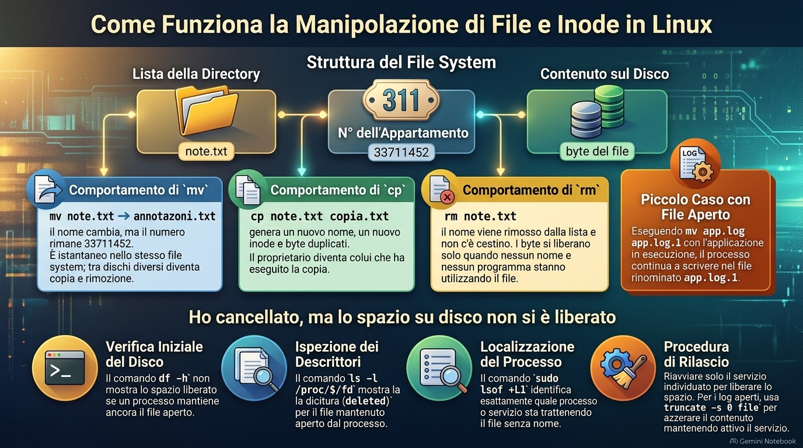
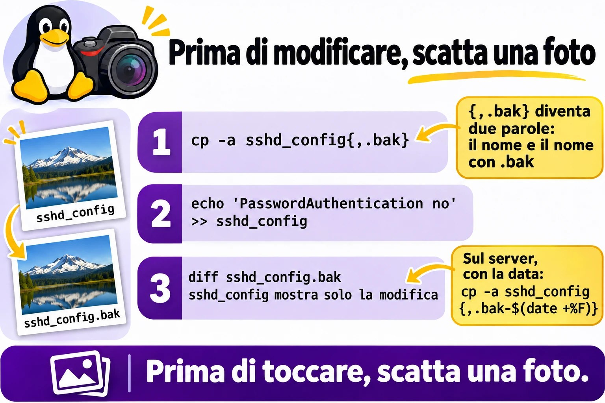
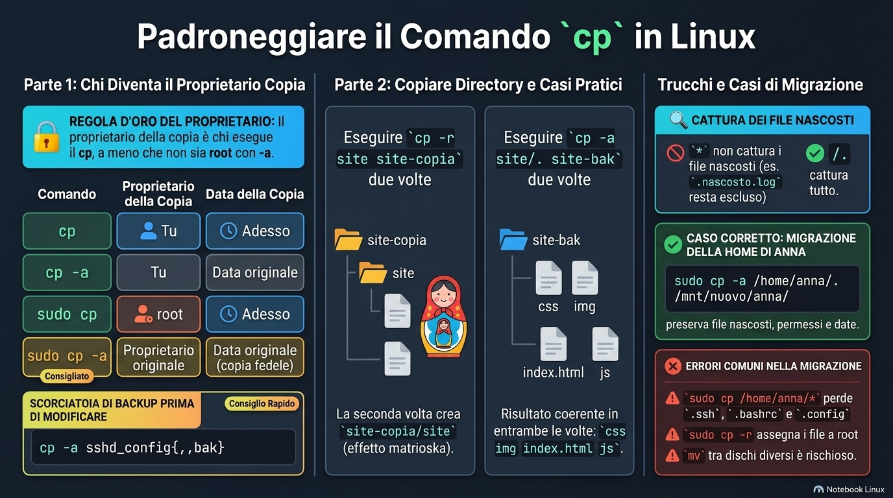
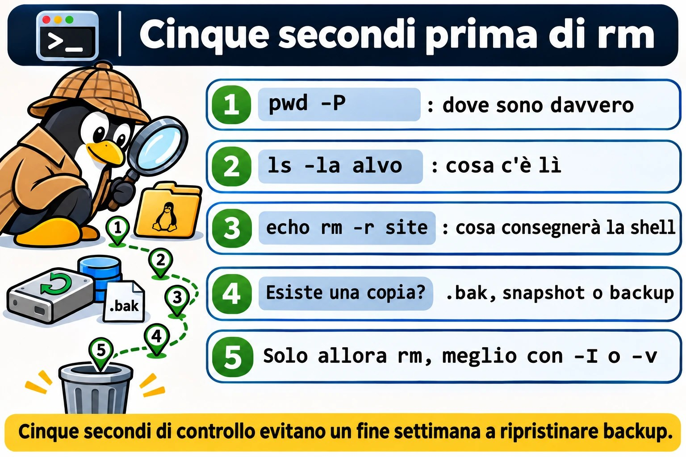

# Lezione 1.4 · Creare, copiare, spostare e cancellare

Impari a creare, copiare, spostare e cancellare file e directory senza perdere ciò che conta. La strada non è imparare a memoria le opzioni. È capire che cosa fa ogni comando al suo interno e farti tre abitudini: copiare prima di toccare, controllare prima di cancellare e diffidare dei comandi che non chiedono nulla.

| Scheda | Lezione 1.4 |
| --- | --- |
| Modulo | M1 · Riga di comando, lezione 4 di 10 |
| Quando | Settimana 2 |
| Alla fine sei in grado di | Creare un albero di directory con un solo comando; fare la copia di sicurezza di una configurazione prima di modificarla; copiare directory preservando proprietario, permessi e date; rinominare e spostare senza sostituire nulla per errore; cancellare sapendo esattamente che cosa sparirà; spiegare perché non c'è un cestino e perché a volte il disco resta pieno dopo `rm` |
| Prerequisiti | Lezione 1.3, con `~/lab13` ancora sulle VM |
| Durata | Circa 2h30 |
| Snapshot | m1a4-inicio e m1a4-fim su entrambe le VM |

## 1 · Riscaldamento

Tre domande, a memoria, prima di leggere qualsiasi cosa. Scrivi le risposte; le soluzioni le trovi alla fine per controllare.

1. In una directory con `app1.log`, `app2.log` e `app10.log`, che cosa mostra `echo app?.log`?
2. Un file si chiama `-rf`. Perché `rm "-rf"` non lo cancella, e quale comando lo cancella?
3. Il tuo prompt dice `/srv/app/current`, ma la modifica che hai fatto non ha preso. Quale comando mostra dove sei davvero?

## 2 · Perché conta

Venerdì, ore 18. Un collega deve liberare spazio sul file server di un cliente e digita `rm -rf /srv/arquivos/ antigo`, con uno spazio di troppo dopo la barra. La shell consegna a `rm` due bersagli: l'intera `/srv/arquivos/` e un `antigo` che lì nemmeno esiste. Il `-f` zittisce l'unico avviso che ci sarebbe stato. Nessuna domanda, nessun messaggio, nessun cestino. Il fine settimana diventa un ripristino di backup, se c'è un backup.

Il secondo caso è più comune e più discreto. Qualcuno ripristina una cartella dal backup con `sudo cp -r`. I file tornano, ma con root come proprietario e la data di oggi. Il sistema che usava la cartella smette di scriverci, e nessuno collega le due cose fino a lunedì.

Il terzo succede ogni settimana da qualche parte: un `mv` verso la cartella condivisa sostituisce, senza chiedere, un file con lo stesso nome che era di un'altra persona. Nel terminale, `cp`, `mv` e `rm` fanno esattamente ciò che hai digitato, senza chiedere conferma. Questa lezione mostra che cosa fa ciascuno al suo interno e le abitudini da pochi secondi che ti permettono di mettere le mani su un server di un cliente senza paura.

## 3 · Modello mentale

> Una directory è l'elenco degli inquilini alla portineria del palazzo della Lezione 1.3. Ogni nome dell'elenco punta a un appartamento, ed è nell'appartamento che vive il contenuto.

1. **`mv` cambia il nome nell'elenco.** Rinominare, o passare il nome all'elenco di un altro piano, non sposta nessuno di appartamento. Per questo è istantaneo dentro lo stesso palazzo, che in Linux è lo stesso file system. Per un altro palazzo, cioè un altro disco, allora è un trasloco vero: copiare tutto e svuotare il vecchio appartamento.
2. **`cp` arreda un appartamento nuovo uguale al vecchio.** Il proprietario diventa chi ha copiato e la data è quella di oggi, a meno che tu non chieda `-a`, che copia anche proprietario, data e permessi.
3. **`rm` cancella il nome dall'elenco.** Quando nessun nome punta più all'appartamento e nessuno è lì dentro, cioè nessun programma ha il file aperto, lo spazio si libera. Non c'è un cestino: la portineria non conserva l'elenco con i nomi cancellati.
4. **Nessuno chiede «sei sicuro?».** Per impostazione predefinita, `cp` e `mv` sostituiscono in silenzio un nome che esiste già nella destinazione, e `rm` cancella senza conferma.

Da questa pianta discendono tre conseguenze:

- Prima di toccare una configurazione, copia. `cp -a` con l'espansione delle graffe lo fa in un secondo.
- Prima di cancellare, guarda la lista: il protocollo della Lezione 1.3, con `pwd -P`, `ls -la` ed `echo`.
- Cancellare non libera spazio finché un programma usa ancora il file. È per questo che a volte il disco resta pieno dopo `rm`.

Lo stesso palazzo, disegnato:

```text
lista do diretório         nº do apartamento     conteúdo no disco
notas.txt        ───────→  33711452    ───────→  [ bytes do arquivo ]

mv notas.txt anotacoes.txt   o nome muda; o nº continua 33711452
cp notas.txt copia.txt       nome novo, nº novo, bytes duplicados
rm notas.txt                 o nome sai da lista; os bytes ficam livres
                             quando nenhum nome e nenhum programa os usa
```

Il numero dell'appartamento esiste davvero: si chiama inode, e `ls -i` lo mostra. Lo vedrai nel Passo 3.

**Ponte Windows.** In Esplora risorse, cancellare manda nel Cestino, e sostituire un file apre una finestra di conferma. Nel terminale di Linux non esiste né l'una né l'altra cosa. E un comando fa il lavoro di due: `mv` è insieme il `move` e il `ren` di `cmd.exe`.


*mv cambia la targhetta, cp arreda un altro appartamento, rm cancella il nome; lo spazio torna quando nessuno lo usa più.*

## 4 · Concetto a livelli

### Essenziale

| Termine | Che cos'è | Esempio |
| --- | --- | --- |
| `mkdir -p` | Crea la directory e i genitori mancanti; non si lamenta se esiste già | `mkdir -p ~/lab14/a/b/c` |
| `touch` | Crea un file vuoto; se esiste già, aggiorna solo la data | `touch index.html` |
| `cp` | Copia file; la copia riceve proprietario e data nuovi | `cp notas.txt /tmp/` |
| `cp -r` | Copia una directory e tutto ciò che contiene | `cp -r site site-copia` |
| `cp -a` | Copia d'archivio: ricorsiva, preservando proprietario, permessi, date e link simbolici | `cp -a /etc/ssh ~/ssh-bak` |
| `mv` | Rinomina o sposta; nello stesso file system, cambia solo il nome | `mv velho.txt novo.txt` |
| `rm` | Cancella file; le directory, solo con `-r` | `rm erro.log` |
| `rmdir` | Cancella solo directory vuote | `rmdir img` |
| `-i` | Chiede prima di ogni sostituzione o rimozione | `mv -i a.txt pasta/` |
| `-I` | Con `rm`: chiede una volta sola, prima di cancellare molto | `rm -rI copia` |
| `-v` | Mostra ogni elemento creato, copiato, spostato o cancellato | `rm -v *.tmp` |
| `-f` | Forza: non chiede e non avvisa se il bersaglio non esiste | `rm -f cache.tmp` |
| Inode | Il numero dell'appartamento: dove si trova davvero il contenuto | `ls -i` |

Tre forme di copia che userai per tutta la vita:

1. `cp -a sshd_config sshd_config.bak`: la copia di sicurezza prima di modificare. Con le graffe, `cp -a sshd_config{,.bak}`.
2. `cp -a origem destino`: la copia che preserva tutto, per backup e ripristino.
3. `cp -a origem/. destino/`: copia il contenuto dentro la destinazione e dà lo stesso risultato la prima e la decima volta.

### Ponte Windows

| In Windows | In Linux |
| --- | --- |
| `md`, che crea già i genitori | `mkdir -p` |
| `copy` | `cp` |
| `xcopy /e` o `robocopy /e` | `cp -r` |
| `robocopy /copyall` | `cp -a` |
| `move` e `ren` | `mv`, per entrambe le cose |
| `del` | `rm` |
| `rd /s` | `rm -r` |
| `rd` | `rmdir` |
| Cestino | Non esiste nel terminale: backup, snapshot e `.bak` |
| Finestra «Sostituire il file?» | Non esiste per impostazione predefinita; `-i` chiede |

### Approfondimento

**Cancellare è sganciare.** `rm` toglie il nome dall'elenco; a liberare lo spazio è il sistema, quando nessun nome e nessun programma usano più il contenuto. Esistono strumenti di recupero, ma su XFS ed ext4 raramente salvano la giornata. Ciò che salva è il backup, lo snapshot e la copia `.bak` che hai fatto prima.

**`cp` crea, `mv` rinomina.** Per questo `mv` preserva tutto, anche l'etichetta di SELinux, e `cp` no. Tra file system diversi, `mv` diventa una copia seguita da una rimozione: ci mette tempo e richiede spazio libero nella destinazione.

**Che cosa conserva `-a`.** `cp -a` equivale a `-dR --preserve=all`: entra nelle directory, copia i link simbolici come link simbolici e preserva proprietario, gruppo, permessi, date, etichette di SELinux e attributi estesi. Come utente normale, non puoi regalare file a un'altra persona, quindi il proprietario della copia sei tu. Solo root preserva il proprietario originale.

**La copia cambia a seconda che la destinazione esista.** `cp -r a b` crea `b` come copia di `a` se `b` non esiste. Se `b` esiste già, crea `b/a`. Lo stesso comando, eseguito due volte, dà risultati diversi. `cp -a a/. b/` copia sempre il contenuto di `a` dentro `b`.

**Il `-f` zittisce.** Con `rm`, il `-f` toglie le domande e anche il messaggio di bersaglio inesistente. E vale l'ultima opzione: `rm -f` spegne un alias `rm -i`. Chi digita `rm -rf` per abitudine non vede mai la domanda che farebbe l'alias.

**`-I` è meglio di `-i`.** `-i` chiede file per file, e dopo la ventesima `y` nessuno legge più niente. `-I` chiede una volta, quando la rimozione è ricorsiva o riguarda più di tre file.

**Un quasi cestino.** `cp` e `mv` accettano `--backup=numbered`: prima di sostituire, conservano il file vecchio come `nome.~1~`, `nome.~2~` e così via.

**`rm -rf /` viene rifiutato; `rm -rf /*` no.** La protezione predefinita, `--preserve-root`, riconosce solo la root scritta da sola. `/*` viene espanso dalla shell in `/bin`, `/boot`, `/etc` e il resto, e ognuno diventa un argomento normale. È per questo che una variabile vuota in uno script è pericolosa, come vedi nel Passo 7.

## 5 · Rocky × Debian

I comandi sono gli stessi, del pacchetto coreutils. Quello che cambia è ciò che sta intorno, e questo decide se il comando chiede prima o cancella in silenzio:

|  | rocky-lab | debian-lab |
| --- | --- | --- |
| Alias di root | `rm -i`, `cp -i` e `mv -i` attivi in `/root/.bashrc`: come root, tutti e tre chiedono | Le stesse righe esistono in `/root/.bashrc`, commentate: non chiedono |
| Il tuo utente | Senza questi alias: non chiede | Uguale |
| `sudo rm`, `sudo cp`, `sudo mv` | `sudo` non usa gli alias: non chiedono mai | Uguale |
| Versione di coreutils | 8.32 | 9.x: alcuni messaggi cambiano una parola o due |
| File system dell'installazione | XFS | ext4 |
| `mv` dalla home a `/tmp` | Istantaneo se i due sono nello stesso file system | Sempre copia e rimozione, perché `/tmp` è in memoria |
| Etichetta di SELinux | `mv` porta con sé l'etichetta; `cp` riceve quella della destinazione. Può rompere un servizio. | Senza SELinux: la differenza non esiste |


*Chi chiede prima di cancellare dipende dall'utente, dalla distribuzione e da sudo; l'abitudine vale più dell'alias.*

## 6 · Lab guidato

Apri tre terminali: uno su rocky-lab, uno su debian-lab e uno sul nodo Proxmox, per gli snapshot. A ogni passo, esegui, confronta con l'output e solo dopo leggi il Decidi. Gli output sono estratti: numeri, date e nomi sul tuo schermo saranno diversi.

Ogni Decidi è un caso reale di lavoro. Scegli la lettera prima di guardare la tabella: sbagliare qui, con la spiegazione accanto, è il modo più economico di sbagliare.

**Passo 1 · Snapshot prima di tutto.** Le VM devono essere nello stato `m1a3-fim`, con `~/lab13` ancora lì. Sul nodo Proxmox dove gira ogni VM:

```bash
qm snapshot 201 m1a4-inicio
qm snapshot 202 m1a4-inicio
qm listsnapshot 201
```

Output atteso: l'elenco termina con `m1a3-fim`, `m1a4-inicio` e `current`. Su entrambe le VM, controlla che la 1.3 abbia lasciato il materiale:

```bash
ls -A ~/lab13/logs
```

**Passo 2 · Creare l'intero albero in una volta.** Su entrambe le VM:

```bash
mkdir ~/lab14
cd ~/lab14
mkdir site/css
```

Qualcosa come:

```text
mkdir: cannot create directory 'site/css': No such file or directory
```

`mkdir` crea un solo livello. Il genitore `site` non esiste, quindi rifiuta. Ora con `-p`, e con `-v` per vedere ogni passaggio:

```bash
mkdir -pv site/{css,js,img}
echo site/{css,js,img}
mkdir -p site/css
mkdir site
```

Qualcosa come:

```text
mkdir: created directory 'site'
mkdir: created directory 'site/css'
mkdir: created directory 'site/js'
mkdir: created directory 'site/img'
site/css site/js site/img
mkdir: cannot create directory 'site': File exists
```

Tre cose da notare. Le graffe non sono di `mkdir`: la shell le espande prima, e `echo` mostra ciò che ha consegnato, come i caratteri jolly della 1.3. Il `mkdir -p site/css` ripetuto non dice nulla, perché esiste già ed è tutto a posto. Il `mkdir site` senza `-p` si lamenta.

**Decidi 1 · Il deploy che fallisce sul server nuovo.** Scenario: lo script di deploy esegue `mkdir /srv/app/releases/$(date +%F)` ogni notte. Su un server appena installato, fallisce con `No such file or directory`. Che cosa fai?

- **A)** Lo sostituisci con `mkdir -p` nello script.
- **B)** Cominci a eseguire lo script con `sudo`.
- **C)** Aggiungi `2>/dev/null` in fondo alla riga per far sparire l'errore.
- **D)** Crei `/srv/app/releases` a mano su quel server e vai avanti.

Scegli un'opzione prima di continuare.

| Se hai scelto | Risultato | Perché |
| --- | --- | --- |
| A | ✅ Giusto | Il `-p` crea i genitori mancanti e non fallisce se esistono già. Lo script comincia a funzionare su server nuovi e vecchi, la prima e la centesima notte. |
| B | ❌ Sbagliato | La mancanza di permessi direbbe `Permission denied`. L'errore qui è un genitore inesistente, e anche root non crea due livelli senza `-p`. |
| C | ❌ Sbagliato | Nasconde l'errore e il deploy prosegue senza la directory. Il guasto compare più avanti, lontano dalla causa. |
| D | ❌ Sbagliato | Risolve oggi e fallisce sul prossimo server nuovo. La correzione appartiene allo script. |

**Da ricordare:** `-p` significa "fai tutto il percorso e non lamentarti di ciò che esiste già".

**Passo 3 · Il numero dell'appartamento.** Prima `touch`, su entrambe le VM:

```bash
touch site/index.html site/css/style.css
ls -l --time-style=+%T site/index.html
```

Aspetta una decina di secondi e ripeti i due comandi. La dimensione resta zero, cambia solo l'ora. `touch` su un file che esiste già non cancella nulla: aggiorna solo la data. Ora l'inode, il numero dell'appartamento del Modello mentale:

```bash
echo "primeira linha" > notas.txt
ls -i notas.txt
mv notas.txt anotacoes.txt
ls -i anotacoes.txt
cp anotacoes.txt copia.txt
ls -i anotacoes.txt copia.txt
```

Qualcosa come:

```text
33711452 notas.txt
33711452 anotacoes.txt
33711452 anotacoes.txt  33711460 copia.txt
```

`mv` non ha cambiato il numero, solo il nome nell'elenco. La copia ha ricevuto un appartamento nuovo, con un numero suo.

**Decidi 2 · Il log da 40 GB.** Scenario: `app.log` pesa 40 GB, il disco ha 2 GB liberi e vuoi conservare il file attuale come `app.log.1`, nella stessa directory, con `mv app.log app.log.1`. L'app continua a girare. Che cosa succede?

- **A)** `mv` è istantaneo e non occupa spazio, ma l'app continua a scrivere nel file che ora si chiama `app.log.1`.
- **B)** `mv` fallisce per mancanza di spazio, perché deve copiare i 40 GB.
- **C)** `mv` è istantaneo, e l'app comincia automaticamente a scrivere in un nuovo `app.log`.
- **D)** `mv` ci mette qualche minuto, proporzionale alla dimensione.

Scegli un'opzione prima di continuare.

| Se hai scelto | Risultato | Perché |
| --- | --- | --- |
| A | ✅ Giusto | Nello stesso file system, `mv` cambia solo il nome nell'elenco. L'app ha aperto il file prima e tiene l'appartamento, non il nome: continua a scrivere lì. È per questo che `logrotate` avvisa il servizio dopo aver rinominato. |
| B | ❌ Sbagliato | Quello sarebbe `cp`, o un `mv` verso un altro disco. Sullo stesso disco non c'è copia. |
| C | ❌ Sbagliato | Nessuno crea il nuovo `app.log`. L'app comincia a usare un altro file solo quando riapre il log, dopo un reload o un restart. |
| D | ❌ Sbagliato | Il tempo proporzionale alla dimensione compare solo tra file system diversi. |

**Da ricordare:** `mv` sullo stesso disco è cambiare la targhetta sulla porta. Chi sta là dentro non se ne accorge nemmeno.

**Passo 4 · La copia prima di modificare.** Una configurazione finta, su entrambe le VM:

```bash
printf 'Port 22\nPermitRootLogin no\n' > sshd_config
echo cp -a sshd_config{,.bak}
cp -a sshd_config{,.bak}
ls -l sshd_config*
```

Qualcosa come:

```text
cp -a sshd_config sshd_config.bak
-rw-r--r--. 1 student student 32 Nov  2 10:12 sshd_config
-rw-r--r--. 1 student student 32 Nov  2 10:12 sshd_config.bak
```

`{,.bak}` diventa due parole: il nome senza nulla e il nome con `.bak`. Ora modifica e confronta:

```bash
echo 'PasswordAuthentication no' >> sshd_config
diff sshd_config.bak sshd_config
cp -a sshd_config{,.bak-$(date +%F)}
ls sshd_config*
```

Qualcosa come:

```text
2a3
> PasswordAuthentication no
sshd_config  sshd_config.bak  sshd_config.bak-2026-11-02
```

`diff` mostra esattamente che cosa hai cambiato. Con la data nel nome, il `.bak` di oggi non sostituisce quello di ieri. Sul server vero è lo stesso comando, con `sudo` e il percorso completo: `sudo cp -a /etc/ssh/sshd_config{,.bak-$(date +%F)}`.

**Decidi 3 · Prima di toccare l'SSH del cliente.** Scenario: stai per disattivare il login con password sull'SSH di un server di un cliente. Qual è il primo comando?

- **A)** `sudo cp -a /etc/ssh/sshd_config{,.bak-$(date +%F)}`
- **B)** `sudo cp /etc/ssh/sshd_config /tmp/`
- **C)** `sudo vi /etc/ssh/sshd_config`, con attenzione.
- **D)** `sudo mv /etc/ssh/sshd_config{,.bak}` e scrivere un file nuovo.

Scegli un'opzione prima di continuare.

| Se hai scelto | Risultato | Perché |
| --- | --- | --- |
| A | ✅ Giusto | Copia accanto all'originale, con proprietario, permessi ed etichetta preservati, e con la data. Se `sshd` non riparte, il ritorno è un `cp`. |
| B | ❌ Sbagliato | `/tmp` viene pulita al reboot, e su Debian 13 sta in memoria. Il backup sparisce proprio quando ti serve di più. |
| C | ❌ Sbagliato | L'attenzione non è una via di ritorno. Se `sshd` non riparte, puoi perdere l'accesso senza sapere com'era prima. |
| D | ❌ Sbagliato | Per un istante il file non esiste. E quello nuovo nasce senza il contenuto, l'etichetta e i permessi dell'originale. |

**Da ricordare:** prima di toccare, fai una foto. La foto è il `.bak` con la data, accanto all'originale.



*Copia, modifica, confronta: diff mostra esattamente che cosa hai cambiato.*

**Passo 5 · Chi diventa proprietario della copia.** Quattro copie dello stesso file di root, su entrambe le VM:

```bash
cp /etc/hosts hosts-cp
cp -a /etc/hosts hosts-a
sudo cp /etc/hosts hosts-sudo
sudo cp -a /etc/hosts hosts-sudo-a
ls -l /etc/hosts hosts-*
```

Qualcosa come:

```text
-rw-r--r--. 1 root    root    158 Jun 23  2020 /etc/hosts
-rw-r--r--. 1 student student 158 Jun 23  2020 hosts-a
-rw-r--r--. 1 student student 158 Nov  2 10:15 hosts-cp
-rw-r--r--. 1 root    root    158 Nov  2 10:15 hosts-sudo
-rw-r--r--. 1 root    root    158 Jun 23  2020 hosts-sudo-a
```

Leggi riga per riga:

| Comando | Proprietario della copia | Data della copia |
| --- | --- | --- |
| `cp` | Tu | Adesso |
| `cp -a`, come te | Tu, perché un utente normale non consegna file a un'altra persona | Quella dell'originale |
| `sudo cp` | root | Adesso |
| `sudo cp -a` | Il proprietario originale | Quella dell'originale: copia fedele |

Regola: il proprietario della copia è chi esegue `cp`, a meno che non sia root con `-a`.

**Decidi 4 · Il ripristino del venerdì.** Scenario: la cartella `/srv/dados/app`, dell'utente `app`, è stata cancellata. Il backup è in `/backup/app`, fatto con `cp -a`. Come si ripristina?

- **A)** `sudo cp -a /backup/app /srv/dados/`
- **B)** `sudo cp -r /backup/app /srv/dados/`
- **C)** `cp -a /backup/app /srv/dados/`, come tuo utente.
- **D)** `sudo mv /backup/app /srv/dados/`

Scegli un'opzione prima di continuare.

| Se hai scelto | Risultato | Perché |
| --- | --- | --- |
| A | ✅ Giusto | Root con `-a` restituisce proprietario, permessi, date ed etichette com'erano. E il backup resta lì. |
| B | ❌ Sbagliato | I file tornano con proprietario root e la data di oggi. Il servizio, che gira come `app`, non riesce più a scrivere. Lo provocherai nel Guasto A. |
| C | ❌ Sbagliato | Senza root non consegni i file all'utente `app`, e probabilmente non scrivi nemmeno in `/srv/dados`. |
| D | ❌ Sbagliato | Ripristina e fa sparire il backup. Se qualcosa va storto, non c'è un secondo tentativo. E se `/backup` è un altro disco, `mv` copia tutto e cancella l'origine. |

**Da ricordare:** ripristinare è `cp -a` come root. Il backup resta dov'è.

**Passo 6 · Copiare directory.** Esegui la stessa copia due volte, su entrambe le VM:

```bash
cp -r site site-copia
ls site-copia
cp -r site site-copia
ls site-copia
```

Qualcosa come:

```text
css  img  index.html  js
css  img  index.html  js  site
```

La seconda volta, `site-copia` esisteva già, quindi `cp` ha creato `site-copia/site`. In un backup notturno questo diventa una matrioska. Ora nel modo che dà sempre lo stesso risultato:

```bash
rm -r site-copia
cp -a site/. site-bak
cp -a site/. site-bak
ls site-bak
```

Entrambe le volte danno `css  img  index.html  js`. `site/.` significa "ciò che sta dentro site". Ora i nascosti, con i file della 1.3:

```bash
mkdir dest-estrela dest-ponto
cp -a ~/lab13/logs/* dest-estrela/
cp -a ~/lab13/logs/. dest-ponto/
ls -A dest-estrela
ls -A dest-ponto
```

`.escondido.log` compare solo in `dest-ponto`. L'`*` non prende i nascosti, come hai visto nella 1.3. `/.` prende tutto. Se compaiono altri nomi, avanzi della 1.3, nessun problema: ciò che conta è la differenza.

**Decidi 5 · La home di Ana sul disco nuovo.** Scenario: stai per spostare `/home/ana` su un disco nuovo montato in `/mnt/novo`. Quale comando?

- **A)** `sudo cp -a /home/ana/. /mnt/novo/ana/`
- **B)** `sudo cp -a /home/ana/* /mnt/novo/ana/`
- **C)** `sudo cp -r /home/ana /mnt/novo/`
- **D)** `sudo mv /home/ana /mnt/novo/`

Scegli un'opzione prima di continuare.

| Se hai scelto | Risultato | Perché |
| --- | --- | --- |
| A | ✅ Giusto | Copia tutto il contenuto, nascosti inclusi, con proprietario, permessi e date. L'originale resta intatto finché non controlli. |
| B | ❌ Sbagliato | L'`*` lascia indietro `.ssh`, `.bashrc` e `.config`. Ana entra e non ha né chiavi né configurazione. |
| C | ❌ Sbagliato | Porta i nascosti, ma tutto diventa di root e perde le date. `sshd` rifiuta le chiavi in una `.ssh` con il proprietario sbagliato. |
| D | ❌ Sbagliato | Tra dischi, `mv` copia e cancella. Se si interrompe a metà, ti ritrovi con metà da una parte e metà dall'altra e senza l'originale. |

**Da ricordare:** una directory intera è `origem/.` con `cp -a`.


*Una directory intera è origem/. con cp -a; solo root con -a preserva il proprietario.*

**Passo 7 · Il `mv` che sostituisce in silenzio.** Un caso di cartella condivisa, su entrambe le VM:

```bash
mkdir compartilhada
echo "versão da Maria" > compartilhada/relatorio.txt
echo "versão do João" > relatorio.txt
mv relatorio.txt compartilhada/
cat compartilhada/relatorio.txt
```

Output: `versão do João`. La versione di Maria è sparita, senza domande e senza cestino. Rifai la scena e prova le due protezioni:

```bash
echo "versão da Maria" > compartilhada/relatorio.txt
echo "versão do João" > relatorio.txt
mv -i relatorio.txt compartilhada/
```

Qualcosa come `mv: overwrite 'compartilhada/relatorio.txt'?`. Rispondi `n` e il file di João resta dov'era. Ora il quasi cestino:

```bash
mv --backup=numbered relatorio.txt compartilhada/
ls compartilhada/
cat compartilhada/relatorio.txt.~1~
```

Qualcosa come `relatorio.txt  relatorio.txt.~1~`, e `cat` mostra `versão da Maria`. Il file vecchio è stato conservato con un numero, invece di sparire.

**Decidi 6 · Il report nella cartella dell'amministrazione.** Scenario: consegni il report del mese in `/srv/financeiro`, dove scrivono anche tre colleghi. Quale comando?

- **A)** `mv relatorio.pdf /srv/financeiro/`
- **B)** `mv -i relatorio.pdf /srv/financeiro/`
- **C)** `cp relatorio.pdf /srv/financeiro/`, per non perdere il tuo.
- **D)** `mv -f relatorio.pdf /srv/financeiro/`

Scegli un'opzione prima di continuare.

| Se hai scelto | Risultato | Perché |
| --- | --- | --- |
| A | ❌ Sbagliato | Se un collega ha già scritto un `relatorio.pdf`, il suo sparisce in silenzio. |
| B | ✅ Giusto | Se il nome esiste già, `mv` chiede prima. Rinomini il tuo e nessuno perde nulla. In uno script, usa `--backup=numbered`. |
| C | ❌ Sbagliato | Il tuo è al sicuro, ma anche `cp` sostituisce in silenzio quello del collega. |
| D | ❌ Sbagliato | Il `-f` esiste proprio per non chiedere nulla. |

**Da ricordare:** nella cartella degli altri, `-i` a mano e `--backup=numbered` nello script.

**Passo 8 · Cancellare sapendo che cosa sparirà.** Prima i limiti di `rmdir` e `rm`, su entrambe le VM:

```bash
mkdir vazio
rmdir vazio
rmdir site-bak
rm site-bak
rm -rIv site-bak
```

Qualcosa come:

```text
rmdir: failed to remove 'site-bak': Directory not empty
rm: cannot remove 'site-bak': Is a directory
rm: remove 1 argument recursively? y
removed 'site-bak/index.html'
...
removed directory 'site-bak'
```

`rmdir` cancella solo directory vuote, `rm` senza `-r` non cancella directory, e `-I` chiede una volta sola. Ora guarda che cosa consegna la shell a `rm` quando avanza uno spazio, senza cancellare nulla:

```bash
printf '[%s]\n' rm -rf ~/lab14/ site-copia
```

Qualcosa come:

```text
[rm]
[-rf]
[/home/student/lab14/]
[site-copia]
```

Sono quattro argomenti. `rm` cancellerebbe l'intera `lab14`. `printf '[%s]\n'` mette ogni argomento tra parentesi quadre, ed è la radiografia di qualsiasi comando pericoloso. Infine, il caso peggiore degli script, sempre solo con `echo`:

```bash
ALVO=""
echo rm -rf "$ALVO"/*
echo rm -rf "${ALVO:?está vazia}"/*
```

Qualcosa come:

```text
rm -rf /afs /bin /boot /dev /etc /home /lib /lib64 /media /mnt /opt /proc /root /run /sbin /srv /sys /tmp /usr /var
bash: ALVO: está vazia
```

Con la variabile vuota, `"$ALVO"/*` è diventato `/*`: l'intera root, voce per voce, e `--preserve-root` non lo riconosce. L'hai visto solo perché hai usato `echo`. `${ALVO:?mensagem}` fa fermare bash lì quando la variabile è vuota o non esiste. Ora con la variabile valorizzata, per davvero:

```bash
ALVO=~/lab14/dest-estrela
echo rm -rf "${ALVO:?está vazia}"/*
rm -rf "${ALVO:?está vazia}"/*
ls -A "$ALVO"
```

`echo` mostra solo file dentro `dest-estrela`. `rm` cancella, e `ls -A` non mostra nulla.

**Decidi 7 · La pulizia di cron.** Scenario: lo script di pulizia di un cliente ha la riga `rm -rf $TMPDIR_APP/*` e gira come root ogni notte. Quale correzione fai?

- **A)** `rm -rf "$TMPDIR_APP"/*`
- **B)** `rm -rf "${TMPDIR_APP:?}"/*`
- **C)** `rm -ri $TMPDIR_APP/*`
- **D)** Nessuna: lo script funziona da anni.

Scegli un'opzione prima di continuare.

| Se hai scelto | Risultato | Perché |
| --- | --- | --- |
| A | ❌ Sbagliato | Le virgolette proteggono i percorsi con spazi, ma con la variabile vuota il risultato resta `/*`. |
| B | ✅ Giusto | Le virgolette proteggono gli spazi e `:?` interrompe lo script se la variabile arriva vuota. Una riga, due disastri evitati. |
| C | ❌ Sbagliato | In cron nessuno risponde alle domande. E con la variabile vuota resta `/*`. |
| D | ❌ Sbagliato | Funziona fino al giorno in cui qualcuno commenta la riga che definisce la variabile. Quel giorno, cancella il server. |

**Da ricordare:** una variabile in un `rm` va sempre tra virgolette e con `:?`.

**Decidi 8 · Il consiglio del collega.** Scenario: come root, su rocky-lab, `rm arquivo` chiede `remove regular file?`. Su debian-lab non chiede. Un collega dice: "usa sempre `rm -rf`, così smette di rompere". Che cosa rispondi?

- **A)** "Ottimo, il `-f` è il modo professionale."
- **B)** "Su Rocky root ha l'alias `rm -i`, e il `-f` lo spegne. Preferisco controllare con `echo` e usare `-I` quando sono tante cose."
- **C)** "Metti `alias rm='rm -i'` su ogni server e puoi usare `-rf` tranquillo."
- **D)** "Debian è configurata male; va corretta."

Scegli un'opzione prima di continuare.

| Se hai scelto | Risultato | Perché |
| --- | --- | --- |
| A | ❌ Sbagliato | Il `-f` zittisce la domanda e anche l'avviso di bersaglio inesistente. Perdi entrambi gli indizi che hai digitato male. |
| B | ✅ Giusto | La domanda viene dall'alias in `/root/.bashrc`. Un `-f` dopo di esso vince. La protezione che vale su qualsiasi server è l'abitudine: guardare prima, cancellare dopo. |
| C | ❌ Sbagliato | Il `-f` vince sull'alias, e `sudo` non usa nemmeno gli alias. La rete di protezione non protegge nulla. |
| D | ❌ Sbagliato | È una scelta di configurazione: su Debian le stesse righe sono commentate in `/root/.bashrc`. |

**Da ricordare:** la protezione non sta nell'alias, sta nell'abitudine.

**Protocollo prima di cancellare o sostituire.** I cinque secondi che separano un sysadmin tranquillo da un fine settimana passato a ripristinare backup:

```bash
pwd -P
ls -la site
echo rm -r site
```

1. `pwd -P`: dove sono davvero.
2. `ls -la alvo`: che cosa c'è lì.
3. `echo` o `printf '[%s]\n'` davanti al comando: che cosa consegnerà la shell.
4. Esiste una copia? Un `.bak`, uno snapshot o un backup.
5. Solo allora `rm`, preferibilmente con `-I` o `-v`.



*Cinque brevi controlli prima di qualsiasi rm o sostituzione.*

## 7 · Rompi e ripara

Due guasti che incontrerai dai clienti. In ciascuno: rompi, prevedi prima di guardare, scopri con i comandi, decidi, ripara e verifica. Fai prima su rocky-lab; Debian entra nel bonus. Entrambi restano dentro `~/lab14`, quindi non c'è rischio fuori da lì.

### Guasto A · Ho ripristinato e l'app ha smesso di scrivere

Il caso del Decidi 4, in miniatura. `~/lab14/app/dados` fa la parte della cartella di un servizio che gira con il tuo utente.

**Prepara.**

```bash
mkdir -p ~/lab14/app/dados ~/lab14/backup
echo "registro 1" > ~/lab14/app/dados/registro.log
cp -a ~/lab14/app/dados ~/lab14/backup/
ls -l ~/lab14/backup/dados
```

**Rompi.** Il disastro e il ripristino frettoloso:

```bash
rm -rf ~/lab14/app/dados
sudo cp -r ~/lab14/backup/dados ~/lab14/app/
```

**Prevedi.** Il "servizio" scriverà una nuova riga in `registro.log`. Funzionerà? Scrivi sì o no, e perché, prima di eseguire il blocco successivo.

**Scopri.**

```bash
echo "registro 2" >> ~/lab14/app/dados/registro.log
ls -l ~/lab14/app/dados ~/lab14/backup/dados
```

Qualcosa come:

```text
bash: /home/student/lab14/app/dados/registro.log: Permission denied
/home/student/lab14/app/dados:
-rw-r--r--. 1 root    root    11 Nov  2 10:40 registro.log

/home/student/lab14/backup/dados:
-rw-r--r--. 1 student student 11 Nov  2 10:31 registro.log
```

Il contenuto è tornato, ma il proprietario è diventato root e la data è quella del ripristino. Il file può essere letto da tutti e scritto solo dal proprietario, che ora è root. Il backup, fatto con `cp -a`, era a posto; a rovinare è stato il ripristino.

**Decidi.** Come si ripara?

- **A)** `sudo rm -rf ~/lab14/app/dados` e poi `cp -a ~/lab14/backup/dados ~/lab14/app/`
- **B)** `sudo chmod -R 777 ~/lab14/app/dados`
- **C)** Far girare il servizio come root.
- **D)** `sudo chown -R student: ~/lab14/app/dados`

Scegli un'opzione prima di continuare.

| Se hai scelto | Risultato | Perché |
| --- | --- | --- |
| A | ✅ Giusto | Rifà il ripristino nel modo giusto: proprietario, permessi e date tornano dal backup. Qui `cp -a` non ha nemmeno bisogno di `sudo`, perché i file del backup sono già tuoi. |
| B | ❌ Sbagliato | "Funziona", ma lascia scrivere nella cartella qualsiasi utente e il proprietario resta sbagliato. È la toppa più comune in produzione, e la più pericolosa. |
| C | ❌ Sbagliato | Risolve il sintomo creando un problema di sicurezza: qualsiasi guasto del servizio diventa un guasto di root. |
| D | ❌ Incompleto | Ripara il proprietario, ma le date restano sbagliate. E in un albero con proprietari diversi dovresti conoscere il proprietario di ogni file. `chown` ha una lezione tutta sua, la 2.7. |

**Ripara.** Prima il protocollo, poi il ripristino giusto:

```bash
ls -la ~/lab14/app/dados
sudo rm -rf ~/lab14/app/dados
cp -a ~/lab14/backup/dados ~/lab14/app/
```

**Verifica.**

```bash
ls -l ~/lab14/app/dados
echo "registro 2" >> ~/lab14/app/dados/registro.log
cat ~/lab14/app/dados/registro.log
```

`ls` mostra te come proprietario e l'ora del backup, non quella del ripristino. `cat` mostra `registro 1` e `registro 2`.

### Guasto B · Ho cancellato e il disco non si è liberato

Il `/var` di un cliente arriva al 100%. Qualcuno cancella il log gigante e `df` non si muove. Monterai la scena con un file da 300 MB e un processo che lo tiene aperto.

**Rompi.**

```bash
cd ~/lab14
dd if=/dev/zero of=grande.bin bs=1M count=300 status=none
df -h ~
sleep 3600 < grande.bin &
rm grande.bin
ls grande.bin
```

`sleep` riceve il file come input e resta fermo un'ora, con il file aperto. È la parte del servizio che scrive il log. `ls` risponde `No such file or directory`: per l'elenco della directory, il file non esiste più.

**Prevedi.** Il prossimo `df -h ~` mostra i 300 MB di ritorno? Annota il numero che ti aspetti nella colonna `Avail`.

**Scopri.**

```bash
df -h ~
ls -l /proc/$!/fd
sudo lsof +L1
```

Qualcosa come:

```text
Filesystem           Size  Used Avail Use% Mounted on
/dev/mapper/rl-root   17G  2.9G   15G  17% /
lr-x------. 1 student student 64 Nov  2 10:52 0 -> /home/student/lab14/grande.bin (deleted)
COMMAND  PID    USER FD TYPE DEVICE  SIZE/OFF NLINK     NODE NAME
sleep   4242 student 0r  REG  253,0 314572800     0 33711470 /home/student/lab14/grande.bin (deleted)
```

`Avail` non è cambiato. `$!` è il numero dell'ultimo processo che hai mandato in background, `sleep`, e il `(deleted)` è la prova: il nome è stato cancellato, ma l'appartamento resta occupato. Sul server non sai qual è il processo, quindi usi `lsof +L1`, che elenca i file aperti che non hanno più nessun nome (`NLINK 0`). Se `lsof` non è installato nel lab: `sudo dnf install -y lsof` su Rocky, `sudo apt install -y lsof` su Debian.

**Decidi.** Sul server del cliente, `/var` resta al 100% dopo che hai cancellato un log da 20 GB. Che cosa fai?

- **A)** Scopri chi tiene il file con `sudo lsof +L1` e riavvii solo quel servizio.
- **B)** Riavvii il server.
- **C)** Cancelli altri file finché `df` non scende.
- **D)** Esegui `fsck` su `/var`.

Scegli un'opzione prima di continuare.

| Se hai scelto | Risultato | Perché |
| --- | --- | --- |
| A | ✅ Giusto | Lo spazio torna quando l'ultimo programma chiude il file. Riavviare o ricaricare il servizio giusto risolve in pochi secondi, senza abbattere il resto. |
| B | ❌ Sbagliato | Funziona, ma butta giù tutto per colpa di un processo, e continui a non conoscere la causa. |
| C | ❌ Sbagliato | Cancelli roba utile e lo spazio del primo resta bloccato. |
| D | ❌ Sbagliato | Non c'è corruzione: il sistema sta facendo esattamente ciò che deve. E `fsck` su un sistema montato è cercare guai. |

La prossima volta, su un log aperto, non cancellare: svuota. `truncate -s 0 arquivo` azzera il contenuto e lo spazio torna subito, con il servizio in esecuzione. Nella Lezione 1.6 vedrai la scorciatoia `> arquivo`.

**Ripara.**

```bash
kill $!
df -h ~
```

Se hai cambiato terminale nel frattempo, `$!` là non esiste più. Usa il PID che `lsof` ha mostrato: `kill 4242`, con il tuo numero.

**Verifica.** `Avail` è salito di circa 300 MB, `jobs` non mostra nulla e `sudo lsof +L1` non elenca più `grande.bin`.

### E lo snapshot?

`m1a4-inicio` salva l'intera VM. Tornarci annulla tutto ciò che è venuto dopo, non solo il file che volevi. È la rete di protezione della lezione, non lo strumento di tutti i giorni. Nel quotidiano, a restituire un file è il `.bak` accanto all'originale e il backup. Nota nel Guasto A: la riparazione è arrivata dal backup, in pochi secondi, senza toccare il resto della macchina.

### Bonus su Debian

Ripeti i due Guasti su debian-lab: il risultato è lo stesso, perché i comandi sono gli stessi. Poi guarda il `mv` che diventa una copia:

```bash
findmnt -T ~
findmnt -T /tmp
dd if=/dev/zero of=~/lab14/medio.bin bs=1M count=200 status=none
time mv ~/lab14/medio.bin ~/lab14/medio2.bin
time mv ~/lab14/medio2.bin /tmp/
rm /tmp/medio2.bin
```

Nel primo `mv`, il tempo è praticamente zero. Nel secondo, se `findmnt` ha mostrato `/tmp` come `tmpfs`, `mv` copia i 200 MB in memoria e cancella l'origine, e vedi il tempo salire. Se i due sono nello stesso file system, i tempi restano simili. La lezione è la stessa: `findmnt -T` dice, prima, se `mv` sarà istantaneo.

### Bonus su Rocky · L'etichetta che `mv` si porta dietro

Solo su rocky-lab, che ha SELinux:

```bash
touch ~/lab14/etq.txt
ls -Z ~/lab14/etq.txt
sudo cp ~/lab14/etq.txt /etc/etq-cp.txt
sudo mv ~/lab14/etq.txt /etc/etq-mv.txt
ls -Z /etc/etq-cp.txt /etc/etq-mv.txt
sudo restorecon -v /etc/etq-mv.txt
sudo rm -v /etc/etq-cp.txt /etc/etq-mv.txt
```

Qualcosa come:

```text
unconfined_u:object_r:user_home_t:s0 /home/student/lab14/etq.txt
unconfined_u:object_r:etc_t:s0 /etc/etq-cp.txt
unconfined_u:object_r:user_home_t:s0 /etc/etq-mv.txt
Relabeled /etc/etq-mv.txt from unconfined_u:object_r:user_home_t:s0 to unconfined_u:object_r:etc_t:s0
removed '/etc/etq-cp.txt'
removed '/etc/etq-mv.txt'
```

La copia ha ricevuto l'etichetta del posto nuovo, `etc_t`. Il file spostato mantiene l'etichetta delle cose della home, `user_home_t`. Su un server web, è il caso classico: il file è in `/var/www/html`, i permessi sono giusti e Apache risponde 403. `restorecon` applica l'etichetta giusta per quel posto. Lo vedrai a fondo nella lezione su SELinux.

### La lezione

- `cp` crea: proprietario, data ed etichetta nuovi, a meno che tu non chieda `-a`.
- `mv` rinomina: porta tutto con sé, anche l'etichetta.
- `rm` sgancia: lo spazio torna solo quando nessun nome e nessun programma usano più il file.
- Ripristinare è `cp -a` come root, e il backup non si muove dal suo posto.

## 8 · Trappole

| Trappola | Cosa succede | Come evitarla |
| --- | --- | --- |
| `cp -r` per backup o ripristino | Proprietario e data diventano quelli di chi copia | `cp -a`, e come root se i proprietari sono altri |
| Ripetere `cp -r a b` | La seconda volta nasce `b/a` | `cp -a a/. b/` |
| `cp -a origem/* destino/` | I nascosti restano indietro | `cp -a origem/. destino/` |
| `mv` o `cp` verso una cartella con un file con lo stesso nome | Sostituisce in silenzio | `-i` a mano, `--backup=numbered` nello script |
| Spazio di troppo in `rm -rf` | Un bersaglio diventa due | `echo` o `printf '[%s]\n'` prima |
| Variabile vuota in `rm -rf "$X"/*` | Diventa `/*` | `"${X:?}"` |
| `rm` su un log aperto | Lo spazio non torna | `truncate -s 0`, oppure riavviare chi tiene il file |
| Fidarsi dell'alias `rm -i` | Il `-f` e `sudo` ci passano sopra | Il protocollo, sempre |
| `mv` verso un altro disco | Ci mette tempo, richiede spazio e, se si interrompe, lascia metà da una parte e metà dall'altra | `cp -a`, controllare, solo allora cancellare l'origine |
| `.bak` in `/tmp` | Sparisce al reboot | `.bak` con data accanto all'originale |
| `touch` per "azzerare" un file | Cambia solo la data | `truncate -s 0` |
| `mv` su Rocky verso la cartella di un servizio | L'etichetta di SELinux viaggia con il file e il servizio non legge | `cp`, oppure `restorecon` dopo il `mv` |

## 9 · Quiz

Dieci domande. Rispondi a tutte prima di aprire le soluzioni.

**1.** Quale comando crea `/srv/app/releases/v2` quando nemmeno `/srv/app` esiste?

- a) `mkdir /srv/app/releases/v2`
- b) `mkdir -p /srv/app/releases/v2`
- c) `mkdir -r /srv/app/releases/v2`
- d) `touch -p /srv/app/releases/v2`

**2.** La directory `copia` non esisteva. Esegui `cp -r site copia` due volte. Che cosa c'è in `copia`?

- a) Solo il contenuto di `site`.
- b) Il contenuto di `site` e anche `copia/site`.
- c) Solo il contenuto di `site`, perché la seconda volta dà errore.
- d) Il contenuto di `site` duplicato, con numeri nel nome.

**3.** Come utente normale, esegui `cp -a /etc/hosts ~/`. Chi è il proprietario della copia, e qual è la sua data?

- a) root, data originale.
- b) Tu, data di adesso.
- c) Tu, data originale.
- d) root, data di adesso.

**4.** Quale di questi **non** libera spazio su disco subito?

- a) `rm` di una copia che nessuno sta usando.
- b) `rm` di un log che un servizio tiene aperto.
- c) `truncate -s 0` su un log aperto.
- d) `rm -r` di una directory di vecchie copie.

**5.** Completa il comando che cancella la directory `projeto` e tutto ciò che contiene, chiedendo una volta sola: `rm ____ projeto`

**6.** Esiste già `compartilhada/relatorio.txt`. Che cosa fa `mv relatorio.txt compartilhada/`?

- a) Chiede prima di sostituire.
- b) Dà errore e non sposta.
- c) Sostituisce il file esistente senza avvisare.
- d) Crea `relatorio.txt.1`.

**7.** Quale riga protegge uno script da una variabile vuota?

- a) `rm -rf "$D"/*`
- b) `rm -rf "${D:?}"/*`
- c) `rm -rfi $D/*`
- d) `sudo rm -rf $D/*`

**8.** Un `mv` di un file da 40 GB verso un'altra directory dello stesso file system:

- a) È istantaneo e mantiene l'inode.
- b) Ci mette un tempo proporzionale alla dimensione.
- c) Richiede 40 GB liberi.
- d) Cambia l'inode.

**9.** Which command removes the empty directory `old` and fails if the directory is not empty?

- A. `rm old`
- B. `rmdir old`
- C. `rm -r old`
- D. `rm -f old`

**10.** Su rocky-lab, come root, `rm arquivo` chiede prima di cancellare. Perché?

- a) SELinux protegge i file di root.
- b) C'è un alias `rm='rm -i'` in `/root/.bashrc`.
- c) `rm` chiede sempre quando a eseguirlo è root.
- d) Il file ha un attributo speciale.

## 10 · Flashcard e promemoria

### Da sapere a memoria

| Situazione | Comando |
| --- | --- |
| Creare un percorso intero | `mkdir -p a/b/c` |
| Più cartelle in una volta | `mkdir -p site/{css,js,img}` |
| Backup prima di modificare | `cp -a arquivo{,.bak-$(date +%F)}` |
| Copiare una directory con tutto, nascosti inclusi | `cp -a origem/. destino/` |
| Ripristinare dal backup | `sudo cp -a /backup/pasta /destino/` |
| Spostare senza sostituire in silenzio | `mv -i` |
| Cancellare una directory chiedendo una volta sola | `rm -rI dir` |
| Vedere che cosa consegnerà la shell | `printf '[%s]\n'` davanti al comando |
| Variabile in un `rm` | `"${VAR:?}"` |

### Da consultare

| Situazione | Comando |
| --- | --- |
| Conservare il vecchio quando sostituisci | `mv --backup=numbered`, `cp --backup=numbered` |
| Numero dell'appartamento | `ls -i`, `stat` |
| File cancellato ancora aperto | `sudo lsof +L1`, `ls -l /proc/$!/fd` |
| Svuotare un log aperto | `truncate -s 0 arquivo` |
| `mv` sarà istantaneo? | `findmnt -T` su origine e destinazione |
| Etichetta di SELinux | `ls -Z`, `sudo restorecon -v arquivo` |
| Confrontare con il backup | `diff arquivo.bak arquivo` |
| Cancellare genitori vuoti | `rmdir -p a/b/c` |

### Flashcard

| Fronte | Retro |
| --- | --- |
| Che cosa cambia `mv`, nello stesso file system? | Solo il nome nell'elenco. L'inode e il contenuto restano. |
| Perché `df` non scende dopo `rm`? | Un programma ha ancora il file aperto. |
| `cp -r` o `cp -a` per il backup? | `-a`: preserva proprietario, permessi, date, etichette e link simbolici. |
| Che cosa succede con `cp -r a b` la seconda volta? | Nasce `b/a`. |
| Come copiare i nascosti? | `origem/.`, mai `origem/*`. |
| Che cosa fa `${X:?}`? | Ferma bash se `X` è vuota o non esiste. |
| `-i` o `-I` con `rm`? | `-i` chiede file per file; `-I` chiede una volta, quando sono tante cose. |
| Perché `sudo rm` non chiede su Rocky? | `sudo` non usa gli alias della shell. |
| Chi può cancellare un file? | Chi può scrivere nella directory, anche se il file è di un altro. |

## 11 · Checklist e chiusura

- [ ] Creo un albero intero con `mkdir -p` e le graffe, senza consultare nulla.
- [ ] Faccio il `.bak` con la data prima di modificare qualsiasi configurazione.
- [ ] Spiego chi diventa proprietario della copia con `cp`, `cp -a`, `sudo cp` e `sudo cp -a`.
- [ ] Copio una directory con i nascosti, in un modo che dà lo stesso risultato se lo rieseguo.
- [ ] So perché `mv` è istantaneo sullo stesso disco, e quando non lo è.
- [ ] Uso il protocollo prima di qualsiasi `rm`.
- [ ] Proteggo le variabili in `rm` con virgolette e `:?`.
- [ ] Trovo un file cancellato che occupa ancora spazio.

**Ultimo esercizio: cancellare `~/lab14` con il protocollo.** Su entrambe le VM:

```bash
cd ~
pwd -P
ls -la ~/lab14
printf '[%s]\n' rm -rI ~/lab14
rm -rI ~/lab14
```

Dopo la domanda del `-I`, `rm` chiede ancora per `hosts-sudo` e `hosts-sudo-a`: sono di root e protetti dalla scrittura. Rispondi `y`. Riesci a cancellarli perché cancellare significa toccare l'elenco della directory, e la directory è tua. Su rocky-lab, controlla anche che il bonus non abbia lasciato tracce: `ls /etc/etq-*` deve rispondere `No such file or directory`. `~/lab13` resta, perché la Lezione 1.5 usa i suoi log.

Snapshot di chiusura, sul nodo Proxmox:

```bash
qm snapshot 201 m1a4-fim
qm snapshot 202 m1a4-fim
```

## 12 · Nella vita reale

**Missione, sola lettura.** Apri un server Linux vero, del lavoro o tuo. Niente `cp`, `mv` o `rm` oggi: guardi soltanto.

```bash
ls -la /etc/ssh/
ls -d /etc/*.bak* /etc/*/*.bak*
sudo cat /root/.bashrc
df -h
sudo lsof +L1
findmnt -T /var/log
findmnt -T /tmp
```

Se `lsof` non è installato, non installare nulla in produzione per questo. Lo stesso risultato si ottiene con `sudo find /proc/[0-9]*/fd -lname '*(deleted)'`, che si limita a leggere.

**Domande per il diario:**

1. Quanti `.bak` hai trovato, di quando e di chi? Il team fa la copia prima di modificare, oppure non resta traccia?
2. C'è qualche file cancellato che occupa spazio adesso? Di quale servizio, e quanto?
3. Il root di questo server ha l'alias `rm -i`? Qualcuno del team lo sa?
4. Un `mv` da `/var/log` a `/tmp` sarebbe istantaneo su questo server?

**Sfida della settimana.** Ogni volta che modifichi una configurazione, su qualsiasi server, comincia con `cp -a arquivo{,.bak-$(date +%F)}` e finisci con un `diff` tra il `.bak` e il file. Annota nel diario quante volte l'hai fatto e se in qualcuna il `.bak` ti ha salvato.

**Domani, senza guardare.** Su rocky-lab, senza aprire questa lezione:

1. Crea `~/teste/a/b/c` e `~/teste/x/1`, `~/teste/x/2` e `~/teste/x/3`, con un comando per ogni albero.
2. Fai il backup con la data di `/etc/hosts`, accanto a lui, preservando tutto.
3. Copia `~/lab13/logs`, nascosti inclusi, in `~/logs-copia`, in un modo che dia lo stesso risultato se lo rieseguo.
4. Spiega in due frasi perché `df` non è sceso dopo un `rm`, e quale comando trova il colpevole.
5. Scrivi la riga di script che cancella il contenuto di `$DESTINO` senza il rischio di diventare `/*`.

## 13 · Con DeepTutor

- `!quiz` Lezione 1.4: dieci domande su `mkdir`, `cp`, `mv` e `rm`.
- `!explica` la differenza tra `cp -r` e `cp -a`, con un esempio di ripristino che va male.
- `!feynman` inode: spiegalo con le tue parole e chiedi al tutor di trovare il buco.
- `!quebra` un nuovo guasto con i file, da risolvere su rocky-lab.
- `!cartoes` con le flashcard della sezione 10.
- `!erro` con il `Permission denied` del Guasto A, chiedendo la diagnosi.
- `!revisao` tra due giorni, delle lezioni 1.3 e 1.4 insieme.

## Soluzioni commentate

### Riscaldamento

1. `app1.log app2.log`. Il `?` vale esattamente un carattere, quindi `app10.log` resta fuori.
2. Le virgolette spariscono prima che `rm` parta: riceve `-rf` e lo interpreta come opzioni. Funziona `rm ./-rf` o `rm -- -rf`.
3. `pwd -P`, che risolve le scorciatoie e mostra la directory vera.

### Quiz

1. **b.** Il `-p` crea i genitori mancanti. L'a) fallisce senza i genitori, il c) usa un'opzione che `mkdir` non ha e il d) crea un file, non una directory.
2. **b.** La seconda volta `copia` esiste già, e `cp` mette `site` al suo interno.
3. **c.** Un utente normale non consegna file a un'altra persona, quindi il proprietario sei tu. Il `-a` preserva la data.
4. **b.** Il nome esce dall'elenco, ma il servizio tiene l'appartamento. Il `truncate` del c) libera subito perché svuota il contenuto.
5. **`-rI`.** Valgono anche `-Ir` e `-r -I`.
6. **c.** Per impostazione predefinita, `mv` sostituisce in silenzio.
7. **b.** Virgolette e `:?`. Nell'a), vuota diventa `/*`. Il c) non ha nessuno che risponda in uno script, e il d) peggiora tutto con root.
8. **a.** Stesso elenco, nome nuovo, stesso inode.
9. **B.** Una spiegazione per alternativa:

| Alternativa | Risultato | Perché |
| --- | --- | --- |
| A. `rm old` | ❌ Sbagliato | Senza `-r`, `rm` rifiuta le directory, vuote o no: `Is a directory`. |
| B. `rmdir old` | ✅ Giusto | Cancella solo directory vuote e fallisce con `Directory not empty` se c'è qualcosa dentro. |
| C. `rm -r old` | ❌ Sbagliato | Cancella la directory con tutto ciò che contiene: non fallisce se c'è del contenuto. |
| D. `rm -f old` | ❌ Sbagliato | Il `-f` non dà a `rm` il potere di cancellare directory; continua a rifiutare. |

10. **b.** L'alias sta in `/root/.bashrc` di Rocky. Su Debian, le stesse righe sono commentate.

---

<!-- navegacao -->
[← Lezione 1.3 · Percorsi e navigazione](1.3-caminhos-e-navegacao.md) · [Indice delle lezioni](../01-aulas.md) · [Lezione 1.5 · Leggere e cercare testo →](1.5-ler-e-procurar-texto.md)
