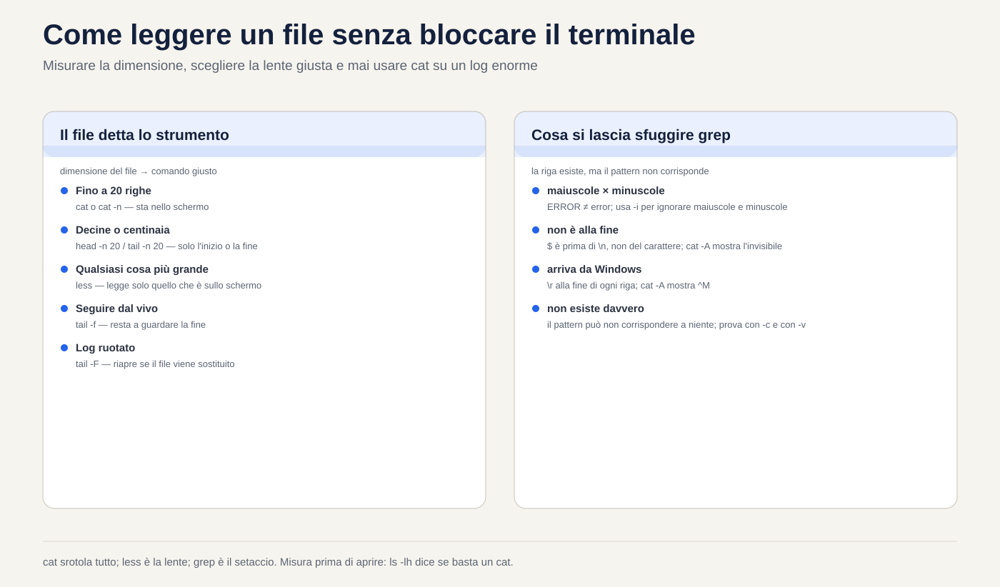
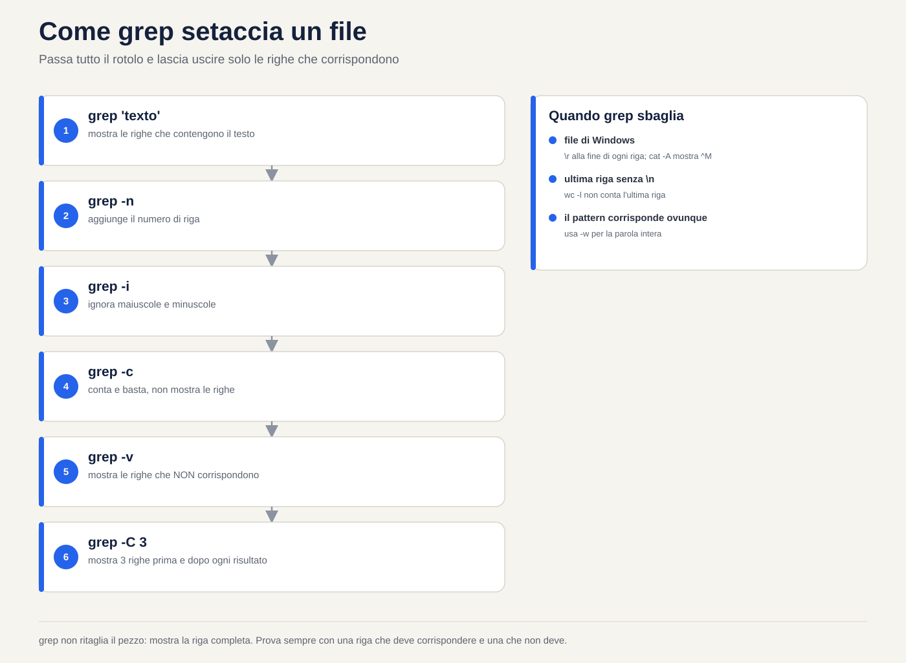
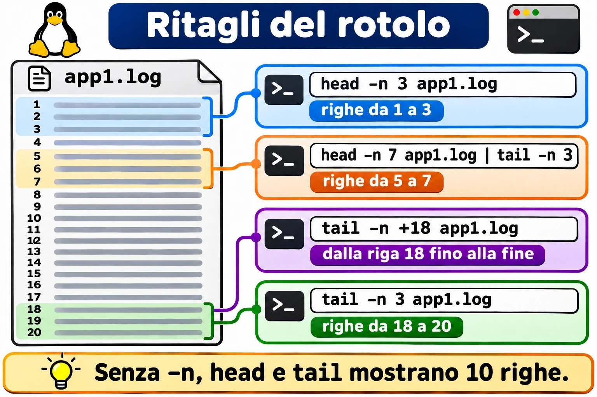
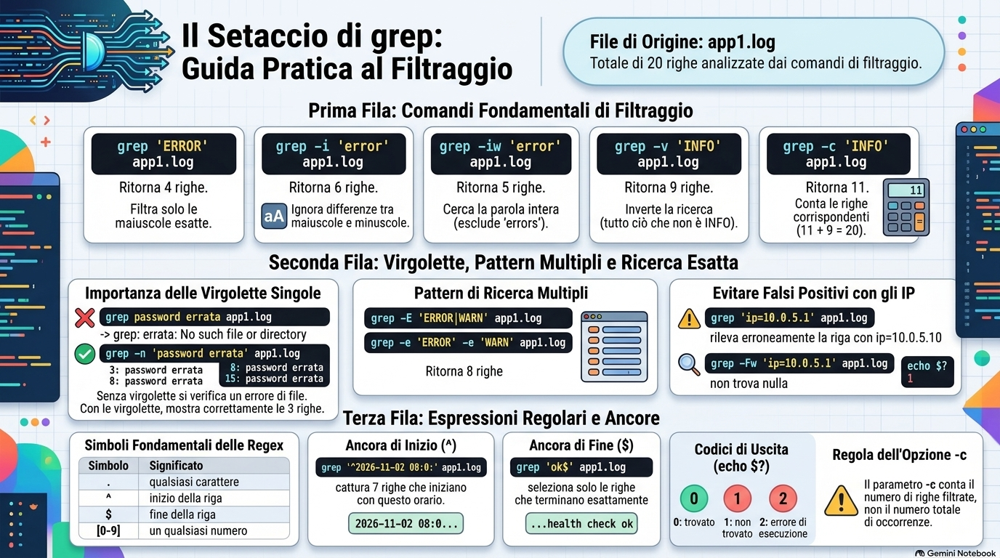
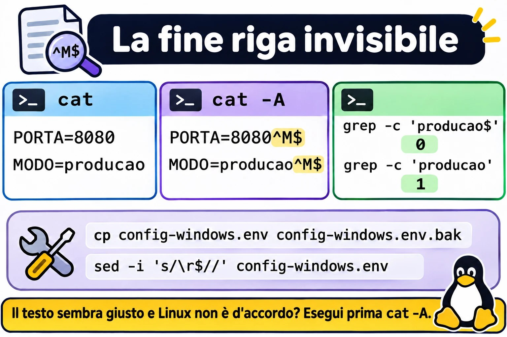

# Lezione 1.5 · Leggere e cercare testo

Impari a leggere qualsiasi file di testo del server senza bloccare il terminale e senza rischiare di modificarlo, e a trovare in pochi secondi la riga che conta. Può essere un log da 3 GB, una configurazione da 900 righe o un'intera cartella di file: il metodo è lo stesso. Misurare prima di aprire, andare dritti al punto e lasciare che `grep` faccia da setaccio.

| Scheda | Lezione 1.5 |
| --- | --- |
| Modulo | M1 · Riga di comando, lezione 5 di 10 |
| Quando | Settimana 2 |
| Alla fine sei in grado di | Leggere un file di qualsiasi dimensione senza bloccare il terminale; andare dritto in fondo a un log e seguirlo in tempo reale, anche dopo la rotazione; contare righe e occorrenze; trovare una riga in un file o in un'intera cartella; mostrare solo le righe attive di una configurazione; capire perché `grep` non trova una riga che stai vedendo sullo schermo |
| Prerequisiti | Lezione 1.4, con `~/lab13` ancora presente nelle VM |
| Durata | Circa 2h30 |
| Snapshot | m1a5-inicio e m1a5-fim su entrambe le VM |

## 1 · Riscaldamento

Tre domande, a memoria, prima di leggere qualsiasi cosa. Scrivi le risposte; le soluzioni le trovi a fine lezione.

1. Hai cancellato un log da 5 GB con `rm`, e `df` non è sceso. Quale comando mostra chi tiene ancora aperto il file?
2. Lanci `mv app.log app.log.1` sullo stesso file system. Cosa succede all'inode?
3. In `~/lab13/logs`, cosa consegna la shell a `grep` quando scrivi `grep erro *.log`? Il file `.escondido.log` viene incluso?

## 2 · Perché conta

Lunedì, ore 9. Il cliente chiama: il sistema è andato giù nella notte. Entri via SSH e scrivi `cat /var/log/app/app.log`. Il file pesa 3 GB. Il terminale scorre per minuti, `Ctrl+C` ci mette un'eternità a rispondere, e quello che è successo alle 3 ti sfila davanti in un lampo. Provi ad aprirlo nell'editor, e il server, che era già a corto di memoria, comincia a boccheggiare.

L'admin esperto fa un'altra cosa. Prima misura: `ls -lh` mostra 3 GB, quindi niente `cat`. Va dritto in fondo con `tail -n 100`, perché il problema è recente. Setaccia con `grep -n -i 'error'` e l'orario del crash. Apre cinque righe attorno al risultato con `grep -C 5`. Chiede al cliente di riprovare e segue tutto in tempo reale con `tail -F`. In due minuti ha la riga esatta da incollare nel ticket, e non ha cambiato un solo byte di niente.

Il secondo caso: cambi `PermitRootLogin no` in `sshd_config`, riavvii il servizio, e root continua a entrare. Un `sudo grep -rn PermitRootLogin /etc/ssh/` ti mostra, in tre secondi, un file dentro `sshd_config.d/` che viene letto prima e vale di più. Senza `grep`, ci metti un pomeriggio.

Il terzo è il più irritante: `grep` dice che la riga non esiste, ma è lì, sul tuo schermo. Il file arriva da Windows. Questa lezione ti mostra perché succede e come vedere l'invisibile.

## 3 · Modello mentale

> Un file di testo è un rotolo di carta con delle righe. Ogni comando di questa lezione è un modo diverso di guardare il rotolo, e nessuno di loro ci scrive sopra.

- `cat` srotola tutto il rotolo in un colpo solo davanti a te. Ottimo per 20 righe; un disastro per 2 milioni.
- `less` è una lente d'ingrandimento: va avanti e indietro, salta in fondo, cerca una parola. Legge solo il pezzo che è sullo schermo, per questo apre 3 GB all'istante.
- `head` mostra l'inizio del rotolo; `tail` mostra la fine. Con `-f`, `tail` resta a guardare la fine mentre il rotolo cresce.
- `wc` misura il rotolo: righe, parole e byte.
- `grep` è un setaccio: passa tutto il rotolo e lascia uscire solo le righe che contengono quello che hai chiesto.

```text
                 app1.log (20 linhas)
   ┌───────────────────────────────────────────┐
   │  1  08:00:01 INFO  web: servidor iniciado │ ◄── head -n 3
   │  2  08:00:02 INFO  db: conexão aberta     │
   │  3  08:03:15 WARN  web: resposta lenta    │
   │  …                                        │
   │  5  08:06:02 ERROR auth: senha incorreta  │ ◄── grep ERROR deixa passar
   │  …                                        │
   │ 18  08:45:00 INFO  cron: limpeza de /tmp  │ ◄── tail -n 3
   │ 19  08:50:27 INFO  auth: login ok         │
   │ 20  09:00:00 INFO  web: health check ok   │
   └───────────────────────────────────────────┘
      less: a lupa que anda pelo rolo inteiro
      wc -l: 20
```

**La prima idea: tutto è riga.** Per questi strumenti, una riga termina con un carattere invisibile, il fine riga, che si scrive `\n`. Chi non vede questo carattere cade nelle due trappole di questa lezione. Un file salvato in Windows termina ogni riga con `\r\n`, e quel `\r` invisibile fa sbagliare `grep`. E un'ultima riga senza `\n` non entra nel conteggio di `wc -l`.

**La seconda idea viene dalla Lezione 1.4: `tail -f` segue l'appartamento, non il nome.** Apre il file e resta a guardare quell'inode. Quando il log viene ruotato con un `mv`, il nome passa a puntare a un file nuovo, ma `tail -f` resta su quello vecchio, ormai fermo.

```text
antes:   app.log ────► inode 5001  ◄── tail -f olhando aqui

         mv app.log app.log.1      (a rotação)

depois:  app.log.1 ──► inode 5001  ◄── tail -f continua aqui, e nada mais chega
         app.log ────► inode 5002  ◄── o programa escreve aqui
```

La correzione è una lettera: `tail -F` segue il nome e riapre il file quando viene sostituito. Il Guasto B ti fa vedere tutto questo mentre succede.

**Ponte Windows.** In Windows apri il Visualizzatore eventi e filtri con il mouse. In Linux il log è un file di testo, oppure il journal, che ha una lezione tutta sua, e questi sei comandi sono il tuo filtro. La differenza che inganna di più chi viene da PowerShell: `Select-String` ignora maiuscole e minuscole per impostazione predefinita, `grep` no. Per `grep`, `ERROR` e `error` sono testi diversi finché non chiedi `-i`.

## 4 · Concetto a strati

### Essenziale

| Comando | Cosa fa | Quando usarlo |
| --- | --- | --- |
| `cat arquivo` | Mostra tutto il file | File che sta in una schermata |
| `cat -n arquivo` | Mostra il file con il numero di ogni riga | Per dire "riga 37" a qualcuno |
| `cat -A arquivo` | Mostra gli invisibili: `$` a fine riga, `^I` per il tab, `^M` per il `\r` di Windows | Quando il testo sembra giusto e non funziona |
| `less arquivo` | Lo apre con la lente | Qualsiasi cosa più grande di una schermata |
| `head -n 20 arquivo` | Le prime 20 righe | Intestazione, inizio di un CSV |
| `tail -n 20 arquivo` | Le ultime 20 righe | Cosa è successo per ultimo in un log |
| `tail -f arquivo` | Mostra la fine e aspetta nuove righe | Seguire in tempo reale |
| `tail -F arquivo` | Come sopra, ma riapre il file se viene sostituito | Seguire un log che passa da logrotate |
| `wc -l arquivo` | Conta le righe | "Quanti tentativi di login?" |
| `grep 'texto' arquivo` | Mostra le righe che contengono il testo | Trovare la riga che conta |

Senza `-n`, `head` e `tail` mostrano 10 righe. Vale la pena impararlo a memoria.

**Le opzioni di `grep` che usi ogni settimana:**

| Opzione | Effetto | Esempio |
| --- | --- | --- |
| `-i` | Ignora maiuscole e minuscole | `grep -i 'error' app1.log` |
| `-n` | Mostra il numero della riga | `grep -n 'ERROR' app1.log` |
| `-c` | Conta le righe che corrispondono, invece di mostrarle | `grep -c 'WARN' app1.log` |
| `-v` | Inverte: mostra le righe che **non** corrispondono | `grep -v 'INFO' app1.log` |
| `-w` | Solo parola intera: `error` non prende `errors` | `grep -iw 'error' app1.log` |
| `-e` | Più di un pattern nello stesso comando | `grep -e 'ERROR' -e 'WARN' app1.log` |
| `-E` | Forma estesa, con la barra verticale come "oppure" | Nel Passo 7 |
| `-F` | Testo letterale: il punto vale solo come punto | `grep -F '10.0.5.1' app1.log` |
| `-r` | Cerca in tutti i file di una cartella | `sudo grep -r 'Port' /etc/ssh/` |
| `-l` | Mostra solo il nome dei file che contengono il testo | `grep -rl 'senha' ~/lab13` |
| `-C 3` | Mostra 3 righe prima e 3 dopo ogni risultato | `grep -C 3 'timeout' app1.log` |
| `-q` | Non mostra nulla; dice solo, tramite il codice di uscita, se ha trovato | `grep -q 'ERROR' app1.log; echo $?` |

**I tasti di `less`:**

| Tasto | Cosa fa |
| --- | --- |
| `Espaço` / `b` | Scende / sale di una schermata |
| `g` / `G` | Va alla prima / all'ultima riga |
| `/texto` | Cerca in avanti |
| `?texto` | Cerca all'indietro |
| `n` / `N` | Risultato successivo / precedente |
| `&texto` | Mostra solo le righe con il testo; `&` e Invio annulla |
| `F` | Modalità in tempo reale, come `tail -f`; `Ctrl+C` ne esce |
| `-N` | Attiva e disattiva il numero delle righe |
| `-S` | Attiva e disattiva l'a capo automatico delle righe lunghe |
| `q` | Esce |
| `h` | Aiuto con tutti i tasti |


*I tasti di less che bastano per spostarsi, cercare e seguire un log.*

### Ponte Windows

| Linux | cmd | PowerShell |
| --- | --- | --- |
| `cat arquivo` | `type arquivo` | `Get-Content arquivo` |
| `less arquivo` | `more arquivo` | `Get-Content arquivo` più `Out-Host -Paging` |
| `head -n 5 arquivo` | Non esiste | `Get-Content arquivo -TotalCount 5` |
| `tail -n 5 arquivo` | Non esiste | `Get-Content arquivo -Tail 5` |
| `tail -f arquivo` | Non esiste | `Get-Content arquivo -Tail 10 -Wait` |
| `wc -l arquivo` | `find /c /v "" arquivo` | `(Get-Content arquivo).Count` |
| `grep 'texto' arquivo` | `findstr "texto" arquivo` | `Select-String 'texto' arquivo` |
| `grep -i` | `findstr /i` | È già il comportamento predefinito di `Select-String` |
| `grep -v` | `findstr /v` | `Select-String -NotMatch` |
| `grep -r` | `findstr /s` | `Get-ChildItem -Recurse` più `Select-String` |

### Approfondimento

**Perché `less` apre 3 GB all'istante e l'editor no.** `less` legge solo il pezzo che deve mostrare. L'editor carica l'intero file in memoria. Su un server in affanno, aprire un log enorme con `vi` peggiora il problema. E aprire un file di produzione in un editor solo per leggerlo è un invito a salvare per sbaglio una modifica. Per leggere, `less`. L'editor serve per modificare.

**Scorciatoie di apertura di `less`.** `less +G arquivo` si apre già in fondo. `less +F arquivo` si apre già in modalità tempo reale: `Ctrl+C` smette di seguire e ti lascia cercare all'indietro, e `F` riprende a seguire. È `tail -f` con la lente.

**Log vecchi e compressi.** logrotate conserva i log vecchi con un altro nome e, a volte, compressi in `.gz`. Per questi esistono `zcat`, `zless` e `zgrep`, che funzionano come `cat`, `less` e `grep`, ma aprono il `.gz` senza che tu debba decomprimere niente. Su Rocky e su Debian, anche `less` da solo apre i `.gz`.

**`tail -f` contro `tail -F`.** `-f` segue il file che ha aperto, cioè l'inode. `-F` segue il nome: se il file viene sostituito, avvisa e lo riapre. logrotate ha due modi di ruotare. Con `create`, il predefinito, fa un `mv` e crea un file nuovo: `-f` resta fermo su quello vecchio. Con `copytruncate`, copia e svuota l'originale: `-f` continua a funzionare, e avvisa `file truncated`.

**Espressioni regolari, solo l'inizio.** Il testo che dai a `grep` non è testo puro: è un'espressione regolare. Quattro simboli bastano già a cambiare il risultato:

| Simbolo | Significa | Esempio |
| --- | --- | --- |
| `.` | Qualsiasi carattere | `10.0.5.1` prende anche `10203541` |
| `^` | Inizio della riga | `^#` prende le righe che iniziano con `#` |
| `$` | Fine della riga | `ok$` prende le righe che finiscono con `ok` |
| `[0-9]` | Una cifra qualsiasi | `erro [0-9]` prende `erro 5` e `erro 9` |

In `grep`, `*` significa "zero o più del carattere precedente", e non "qualsiasi cosa" come nella shell. Il resto delle espressioni regolari ha una lezione tutta sua, più avanti nel corso.

**Sempre apici singoli nel pattern.** Senza virgolette, la shell tocca il pattern prima che `grep` lo veda: lo spazio separa gli argomenti, e `*` e `[0-9]` possono diventare nomi di file. Con gli apici singoli, `grep` riceve esattamente quello che hai scritto.

**Il codice di uscita.** `grep` termina con 0 quando trova, 1 quando non trova e 2 quando c'è un errore, ad esempio con un file inesistente. Gli script lo usano con `grep -q`. Il codice lo vedi con `echo $?` subito dopo il comando.

**`-c` conta righe, non occorrenze.** Una riga con tre `ERROR` conta 1. Per contare le occorrenze esiste `grep -o`, che mostra ogni risultato su una riga, insieme a `wc -l`. La barra che li collega è argomento della Lezione 1.6.

**Riga non è evento.** Un errore Java può occupare 40 righe di stack trace. `wc -l` e `grep -c` contano righe. Prima di dire al cliente "sono stati 40 errori", guarda con `-C` se non è un errore solo.

## 5 · Rocky × Debian

| Punto | rocky-lab (Rocky 9) | debian-lab (Debian 13) |
| --- | --- | --- |
| Log generale del sistema | `/var/log/messages`, scritto da rsyslog | Non esiste di default: da Debian 12 rsyslog non è installato, e i log restano solo nel journal, letto con `journalctl` |
| Log di login e di `sudo` | `/var/log/secure` | Anche questi solo nel journal |
| Chi può leggere | Entrambi i file sono solo di root: usa `sudo` | Il journal completo richiede il gruppo `adm` o `systemd-journal`, oppure `sudo` |
| Log dei pacchetti | `/var/log/dnf.log` | `/var/log/dpkg.log` e `/var/log/apt/history.log` |
| Nome dei log vecchi | `messages-20261101`: con la data e senza compressione | `dpkg.log.1`, `dpkg.log.2.gz`: numerati e compressi dal secondo in poi |
| `sshd_config` | Permessi 600: lo legge solo root, quindi `sudo grep` | Permessi 644: lo legge chiunque |
| Versione di `grep` | 3.6: `egrep` funziona in silenzio | 3.11: `egrep` funziona, ma avvisa che è obsoleto |
| Colore in `grep` | Alias `grep --color=auto` in `/etc/profile.d/` | Alias nel `~/.bashrc` dell'utente |

Per questo il laboratorio usa file che crei tu stesso, uguali su entrambe le VM. I log veri di ciascuna distribuzione compaiono nei Bonus e nella missione nella vita reale.

## 6 · Lab guidato

Tutto avviene in `~/lab13/logs`, su entrambe le VM. I file che la Lezione 1.3 ha creato lì sono vuoti; oggi si riempiono. Fai ogni passo su rocky-lab e ripetilo su debian-lab.


*Misurare la dimensione, scegliere la lente giusta e non usare mai cat su un log gigante.*



*grep non ritaglia il pezzo: mostra la riga intera. Prova sempre con una riga che deve corrispondere e una che non deve.*


### Passo 1 · Preparare il laboratorio

Sul nodo Proxmox, partendo dallo stato m1a4-fim:

```bash
qm snapshot 201 m1a5-inicio
qm snapshot 202 m1a5-inicio
```

In ciascuna VM, comincia guardando cosa esiste già:

```bash
cd ~/lab13/logs
ls -la
wc -l *.log
```

Qualcosa come:

```text
  0 app10.log
  0 app1.log
  0 app2.log
  0 erro.log
  0 total
```

Tutto a zero: `touch` crea file vuoti. E `.escondido.log` non compare, perché `*` non prende i nomi che iniziano con un punto. Se sono rimasti i nomi strani della Lezione 1.3, toglili adesso con `rm -fv -- -l 'relatorio final.txt'`.

Adesso `app1.log` riceve 20 righe di un log realistico, e `grande.log` ne riceve 200 mila:

```bash
cat > app1.log <<'EOF'
2026-11-02 08:00:01 INFO  web: servidor iniciado na porta 8080
2026-11-02 08:00:02 INFO  db: conexão aberta com pg01
2026-11-02 08:03:15 WARN  web: resposta lenta em /relatorios (2,8 s)
2026-11-02 08:05:40 INFO  auth: login ok usuario=ana ip=10.0.5.21
2026-11-02 08:06:02 ERROR auth: senha incorreta usuario=root ip=203.0.113.50
2026-11-02 08:06:05 ERROR auth: senha incorreta usuario=root ip=203.0.113.50
2026-11-02 08:06:09 ERROR auth: senha incorreta usuario=admin ip=203.0.113.50
2026-11-02 08:10:00 INFO  cron: backup diário iniciado
2026-11-02 08:12:31 error db: timeout ao consultar pedidos (30 s)
2026-11-02 08:12:32 WARN  web: erro 502 devolvido ao cliente
2026-11-02 08:15:00 INFO  cron: backup diário concluído
2026-11-02 08:20:44 INFO  auth: login ok usuario=bruno ip=10.0.5.30
2026-11-02 08:21:10 ERROR disk: /var com 95% de uso
2026-11-02 08:25:00 INFO  web: deploy v2.4.1 aplicado
2026-11-02 08:30:12 WARN  db: réplica pg02 atrasada 40 s
2026-11-02 08:31:00 INFO  auth: logout usuario=ana
2026-11-02 08:40:03 WARN  web: 3 errors no último minuto
2026-11-02 08:45:00 INFO  cron: limpeza de /tmp concluída
2026-11-02 08:50:27 INFO  auth: login ok usuario=student ip=10.0.5.10
2026-11-02 09:00:00 INFO  web: health check ok
EOF
printf 'linha %s\n' $(seq 1 200000) > grande.log
ls -lh app1.log grande.log
```

`cat > arquivo <<'EOF'` scrive tutto ciò che arriva fino alla riga `EOF`. Per ora usalo come ricetta; la Lezione 1.6 spiega ogni pezzo. `printf` ripete il modello `linha N` per ogni numero che genera `seq`. `grande.log` dovrebbe risultare di circa 2,4M.

`app1.log` è stato costruito apposta: contiene `ERROR` in maiuscolo, un `error` in minuscolo, un `errors` dentro un avviso e due IP simili. Ognuno di questi dettagli diventa una trappola nei prossimi passi.

### Passo 2 · `cat`: vedere tutto e vedere l'invisibile

```bash
cat app1.log
cat -n app1.log
cat -A app1.log
```

`-n` numera le righe: 20. `-A` mette un `$` alla fine di ogni riga. È il `\n` che non vedevi. Tieni a mente quest'immagine: nel Guasto A, un file arrivato da Windows mostra `^M$` al posto di `$`.

Adesso fai l'errore una volta, di proposito:

```bash
cat grande.log
```

Sono 200 mila righe che sfilano sullo schermo. Premi `Ctrl+C`. Ora immagina 3 GB su un SSH lento, di notte.

**Decidi 1 · Il log da 2 GB.** Scenario: il cliente dice che l'applicazione ha dato errore poco fa. `/var/log/app/app.log` pesa 2 GB. Qual è il tuo primo comando per vedere l'errore?

- **A)** `cat /var/log/app/app.log`
- **B)** `vi /var/log/app/app.log`
- **C)** `tail -n 100 /var/log/app/app.log`
- **D)** `head -n 100 /var/log/app/app.log`

Scegli la lettera prima di guardare la tabella.

| Se hai scelto | Risultato | Perché |
| --- | --- | --- |
| A | ❌ Sbagliato | Sono minuti di testo che scorre, e l'errore di poco fa ti sfila davanti in fondo. |
| B | ❌ Sbagliato | L'editor carica i 2 GB in memoria su un server che ha già un problema, e un tasto sbagliato salva una modifica. |
| C | ✅ Giusto | Ciò che è recente sta in fondo. Cento righe compaiono subito, e decidi tu il passo successivo. |
| D | ❌ Sbagliato | L'inizio del file risale a giorni o settimane fa. |

**Da ricordare:** un problema recente sta in fondo al file. Misura con `ls -lh` e poi usa `tail` o `less +G`.

### Passo 3 · `less`: la lente

```bash
less grande.log
```

Dentro `less`, procedi in quest'ordine:

1. `G`: va all'ultima riga, `linha 200000`. È stato istantaneo.
2. `g`: torna alla prima.
3. `/linha 123456` e Invio: salta alla riga cercata e la evidenzia.
4. `n`: cerca la successiva. `less` risponde `Pattern not found`, perché ce n'è una sola.
5. `-N` e Invio: attiva i numeri di riga. Ripeti per disattivarli.
6. `q`: esce.

Adesso il filtro, che pochi conoscono:

```bash
less app1.log
```

Digita `&ERROR` e Invio. Restano solo le 4 righe con `ERROR`. Digita `&` e Invio per rivedere tutto, e `q` per uscire. Infine, `less +G app1.log` si apre già in fondo.

**Decidi 2 · Solo controllare una configurazione.** Scenario: su un server di un cliente vuoi solo controllare il valore di `PermitRootLogin` in `/etc/ssh/sshd_config`. Come apri il file?

- **A)** `sudo vi /etc/ssh/sshd_config` e esci con `:q`
- **B)** `sudo less /etc/ssh/sshd_config` e cerchi con `/PermitRootLogin`
- **C)** `sudo nano /etc/ssh/sshd_config`
- **D)** `sudo cat /etc/ssh/sshd_config` e cerchi a occhio

Scegli la lettera prima di guardare la tabella.

| Se hai scelto | Risultato | Perché |
| --- | --- | --- |
| A | ❌ Sbagliato | Funziona, ma è un editor aperto come root sul file che controlla l'accesso al server. Un `:wq` per abitudine, o un `dd` involontario, cambia la produzione. |
| B | ✅ Giusto | `less` non sa scrivere. Cerchi con `/` ed esci con `q`, senza alcun rischio. |
| C | ❌ Sbagliato | Lo stesso rischio della A: un `Ctrl+O` salva. |
| D | ❌ Incompleto | Non rovina niente, ma il file ha più di cento righe, e cercare a occhio è lento e fallisce. |

**Da ricordare:** per leggere, usa uno strumento che non sa scrivere. E quando sai già cosa cerchi, `sudo grep -n 'PermitRootLogin' /etc/ssh/sshd_config` è ancora più veloce. Il Passo 8 torna su questo file.

### Passo 4 · `head` e `tail`: le estremità del rotolo

```bash
head app1.log
head -n 3 app1.log
tail -n 3 app1.log
tail -n +18 app1.log
head -n 7 app1.log | tail -n 3
```

Il primo mostra 10 righe, il valore predefinito. `tail -n +18` significa "dalla riga 18 alla fine": qui, le stesse ultime tre. L'ultimo comando mostra solo le righe da 5 a 7, le tre password sbagliate. La barra `|` passa l'output di `head` a `tail`; è il cuore della Lezione 1.6.

**In tempo reale.** Apri una seconda sessione SSH sulla stessa VM. Nella sessione 1:

```bash
touch ~/lab13/logs/ao-vivo.log
tail -f ~/lab13/logs/ao-vivo.log
```

Nella sessione 2, esegui due o tre volte:

```bash
echo "$(date '+%F %T') INFO  web: teste ao vivo" >> ~/lab13/logs/ao-vivo.log
```

Ogni riga compare nella sessione 1 nello stesso istante. `>>` aggiunge in fondo al file, senza cancellare ciò che c'è; è argomento della 1.6 anche questo. Premi `Ctrl+C` nella sessione 1 per fermarti.

**Decidi 3 · Occhio al deploy.** Scenario: lo sviluppatore pubblicherà la nuova versione tra cinque minuti. L'applicazione si riavvia e ricrea il file di log quando parte. Ti chiede di tenere d'occhio il log mentre lui testa. Cosa lanci?

- **A)** `tail -n 50 app.log`, ripetuto ogni minuto
- **B)** `tail -F app.log`
- **C)** `tail -f app.log`
- **D)** `less app.log`

Scegli la lettera prima di guardare la tabella.

| Se hai scelto | Risultato | Perché |
| --- | --- | --- |
| A | ❌ Sbagliato | Perdi quello che passa tra un giro e l'altro e passi il deploy a digitare. |
| B | ✅ Giusto | Mostra ogni nuova riga subito e, quando l'applicazione ricrea il file, riapre da solo quello nuovo. |
| C | ❌ Incompleto | Funziona finché l'applicazione non ricrea il log. Dopo, resta a guardare il file vecchio, e lo schermo si ferma proprio nel momento del test. |
| D | ❌ Sbagliato | `less` mostra il file com'era quando l'hai aperto. Lo segue solo se premi `F`. |

**Da ricordare:** in tempo reale, usa `tail -F`, con la F maiuscola, come standard. Fa tutto quello che fa `-f` e non si ferma quando il file viene sostituito.



*head e tail ritagliano le estremità del file; insieme, con una pipe, ritagliano il pezzo di mezzo.*

### Passo 5 · `wc`: misurare prima di aprire

```bash
wc app1.log
wc -l app1.log grande.log
wc -l < app1.log
```

Il primo mostra tre numeri: righe, parole e byte, in quest'ordine. Il secondo mostra `20`, `200000` e il totale. Il terzo mostra solo il numero, senza il nome del file, che è il formato che vuole uno script. Anche `<` è della 1.6.

Adesso la trappola dell'ultima riga:

```bash
printf 'primeira\nsegunda' > sem-fim.txt
wc -l sem-fim.txt
cat -A sem-fim.txt
```

`wc -l` risponde 1, per un file con due righe. `cat -A` mostra perché: `primeira$` ha il fine riga, e `segunda` no; perfino il tuo prompt compare attaccato a essa. `wc -l` conta i `\n`, non le righe che vedi. Nella vita reale, questo salta fuori in un CSV esportato da un altro sistema, in un conteggio che dà sempre uno in meno, e nel `crontab`, che rifiuta o ignora l'ultima riga senza fine riga, a seconda della versione.

**Decidi 4 · Quanti errori ci sono stati?** Scenario: il responsabile chiede quanti errori ha avuto oggi l'applicazione Java. `grep -c 'Exception' app-java.log` risponde 120. Cosa dici?

- **A)** "Sono stati 120 errori."
- **B)** "Ancora non lo so. Ne guardo alcuni con `grep -C 5`, perché un errore Java occupa più righe."
- **C)** "Circa 120, più o meno."
- **D)** Lancia `wc -l app-java.log` e comunica il totale.

Scegli la lettera prima di guardare la tabella.

| Se hai scelto | Risultato | Perché |
| --- | --- | --- |
| A | ❌ Sbagliato | `-c` conta righe. Un singolo errore Java ripete `Exception` su più righe, come in quelle che iniziano con `Caused by`. Possono essere 30 errori, o 4. |
| B | ✅ Giusto | Tre esempi con il contesto mostrano quante righe occupa ogni errore. Allora il numero diventa un'informazione. |
| C | ❌ Sbagliato | Lo stesso errore della A, solo con il dubbio nella voce. |
| D | ❌ Sbagliato | Conta tutto, comprese le righe INFO. |

**Da ricordare:** `grep -c` e `wc -l` contano righe, e una riga non è un evento. Prima che un numero finisca in un report, guarda tre esempi con `-C`.

### Passo 6 · `grep`: il setaccio

```bash
grep 'ERROR' app1.log
grep -c 'ERROR' app1.log
grep -i 'error' app1.log
grep -iw 'error' app1.log
grep -n 'senha incorreta' app1.log
grep -v 'INFO' app1.log
grep -c 'INFO' app1.log
```

Cosa dovresti vedere:

| Comando | Risultato | Cosa insegna |
| --- | --- | --- |
| `grep 'ERROR'` | 4 righe | Solo maiuscole: l'`error` di `db` resta fuori |
| `grep -c 'ERROR'` | `4` | Il numero, senza le righe |
| `grep -i 'error'` | 6 righe | Entrano l'`error` di `db` e l'avviso con `3 errors` |
| `grep -iw 'error'` | 5 righe | `errors` esce: non è la parola intera |
| `grep -n 'senha incorreta'` | Righe 5, 6 e 7 | Il numero davanti a ogni riga |
| `grep -v 'INFO'` | 9 righe | Tutto ciò che non è INFO |
| `grep -c 'INFO'` | `11` | E 11 più 9 fa 20, l'intero file |

Sullo schermo, la parte trovata compare colorata. È l'alias `--color=auto` della tabella Rocky × Debian.

**Decidi 5 · Il numero per il responsabile.** Scenario: `app1.log` è il log di oggi, e il responsabile vuole il numero di errori. Il team scrive quasi sempre `ERROR`, ma il modulo `db` scrive `error` in minuscolo. Quale comando dà il numero giusto?

- **A)** `grep -c 'ERROR' app1.log`, che risponde 4
- **B)** `grep -ci 'error' app1.log`, che risponde 6
- **C)** `grep -ciw 'error' app1.log`, che risponde 5
- **D)** `grep -c 'error' app1.log`, che risponde 1

Scegli la lettera prima di guardare la tabella.

| Se hai scelto | Risultato | Perché |
| --- | --- | --- |
| A | ❌ Sbagliato | Lascia fuori il timeout del database, che è un errore scritto in minuscolo. |
| B | ❌ Sbagliato | Conta anche la riga `WARN web: 3 errors`, che è un avviso, non un errore. |
| C | ✅ Giusto | `-i` unisce maiuscole e minuscole, e `-w` toglie `errors`. Sono 5 errori. |
| D | ❌ Sbagliato | Trova solo la riga in minuscolo. |

**Da ricordare:** leggi le righe prima di fidarti di un numero. `-i` allarga la ricerca; `-w` taglia ciò che contiene la parola solo dentro un'altra.

### Passo 7 · Virgolette, più di un pattern e il punto

```bash
grep senha incorreta app1.log
grep 'senha incorreta' app1.log
grep -E 'ERROR|WARN' app1.log
grep -c -e 'ERROR' -e 'WARN' app1.log
grep 'ip=10.0.5.1' app1.log
grep -Fw 'ip=10.0.5.1' app1.log; echo $?
grep '^2026-11-02 08:0' app1.log
grep 'ok$' app1.log
```

Il primo mostra cosa fa lo spazio senza virgolette. Qualcosa come:

```text
grep: incorreta: No such file or directory
app1.log:2026-11-02 08:06:02 ERROR auth: senha incorreta usuario=root ip=203.0.113.50
...
```

`grep` ha cercato `senha` in due file: uno chiamato `incorreta`, che non esiste, e `app1.log`. Per questo le righe arrivano con il nome del file davanti. Con le virgolette, il risultato è quello giusto: le tre righe.

I due comandi successivi danno lo stesso insieme, 8 righe di avviso e di errore. `-E` attiva la forma estesa, in cui `|` significa "oppure"; `-e` ripetuto fa lo stesso senza alcuna espressione.

Adesso il punto. `grep 'ip=10.0.5.1'` mostra una riga, ma è quella di `ip=10.0.5.10`. Il testo cercato è dentro l'IP più grande. Con `-Fw`, non compare niente, e `echo $?` mostra `1`: non ha trovato. `-F` fa valere il punto solo come punto, e `-w` esige che il risultato finisca lì.

Infine, le ancore. `^2026-11-02 08:0` prende le 7 righe prima delle 8:10. `ok$` prende solo `health check ok`: le righe di `login ok` hanno altro dopo l'`ok`.

**Decidi 6 · Tutto tranne INFO.** Scenario: per la riunione vuoi le righe di avviso e di errore di `app1.log`, tutte. Quale comando?

- **A)** `grep WARN ERROR app1.log`
- **B)** `grep -v 'INFO' app1.log`
- **C)** `grep -E 'WARN|ERROR' app1.log`
- **D)** `grep 'WARN|ERROR' app1.log`

Scegli la lettera prima di guardare la tabella.

| Se hai scelto | Risultato | Perché |
| --- | --- | --- |
| A | ❌ Sbagliato | `ERROR` diventa un nome di file: compare `No such file or directory`, e arrivano solo gli avvisi. |
| B | ✅ Giusto | Sono 9 righe: 4 avvisi, 4 `ERROR` e l'`error` in minuscolo del database. Dire cosa non vuoi prende anche ciò che non avevi previsto. |
| C | ❌ Incompleto | Sono 8 righe, e manca proprio il timeout del database, in minuscolo. Con `-iE` sarebbe giusto. |
| D | ❌ Sbagliato | Senza `-E`, la barra verticale è un carattere normale. `grep` cerca il testo `WARN` seguito da una barra e da `ERROR`, e non trova niente. |

**Da ricordare:** a volte il modo più sicuro è escludere ciò che non vuoi. `-v` non dipende dal fatto che tu abbia indovinato tutte le grafie.

**Decidi 7 · L'IP che non esiste.** Scenario: il team di sicurezza chiede se l'IP 10.0.5.1 ha avuto accesso al sistema oggi. Lanci `grep 'ip=10.0.5.1' app1.log`, e compare una riga. Cosa rispondi?

- **A)** "Sì, ha avuto accesso: è nel log."
- **B)** "No. La riga è del 10.0.5.10, e con `grep -Fw 'ip=10.0.5.1'` non compare niente."
- **C)** "Non si può sapere: `grep` non è affidabile per gli IP."
- **D)** "Sì, una volta."

Scegli la lettera prima di guardare la tabella.

| Se hai scelto | Risultato | Perché |
| --- | --- | --- |
| A | ❌ Sbagliato | `10.0.5.1` è dentro `10.0.5.10`. Hai appena accusato la macchina sbagliata. |
| B | ✅ Giusto | Hai letto la riga, hai visto l'IP vero e hai confermato con la ricerca esatta. |
| C | ❌ Sbagliato | `grep` è affidabile. Era il pattern a essere troppo largo. |
| D | ❌ Sbagliato | È lo stesso errore della A. |

**Da ricordare:** per IP, utenti e numeri usa `-w`; per testo con il punto usa `-F`. Insieme: `grep -Fw`.


*-i allarga, -w taglia, -F fa valere il punto come punto, -v esclude; e sempre apici singoli.*

### Passo 8 · Cercare nelle cartelle e nelle configurazioni

```bash
grep -rn 'senha' ~/lab13
grep -rl 'senha' ~/lab13
grep -C 2 'timeout' app1.log
```

`-r` passa per tutti i file della cartella e delle sottocartelle, e `-n` dice la riga; insieme hai l'indirizzo completo, come `/home/student/lab13/logs/app1.log:5:`. `-l` mostra solo il nome del file. È quello che vuoi quando la domanda è "in quale file c'è questo?".

`-C 2` mostra le righe da 7 a 11 e racconta una storia: alle 08:12:31 il database è andato in timeout, e un secondo dopo il sito ha restituito un errore 502 al cliente. Da sola, ogni riga è un sintomo. Con il contesto, hai la causa.

Adesso una configurazione vera, solo in lettura:

```bash
sudo grep -rn 'PermitRootLogin' /etc/ssh/
sudo grep -Ev '^[[:space:]]*(#|$)' /etc/ssh/sshd_config
```

Il primo mostra tutte le righe con `PermitRootLogin`, nel file principale e nella cartella `sshd_config.d/`. Qualcosa come `/etc/ssh/sshd_config:40:#PermitRootLogin prohibit-password`. Su Rocky può comparire anche un file dentro `sshd_config.d/`, se l'installazione ha abilitato il login di root.

Il secondo è la ricetta più utile di questa lezione: mostra solo le righe attive. Leggendo il pattern: `^` è l'inizio, `[[:space:]]*` sono spazi o tab, zero o più, e `(#|$)` è un `#` oppure la fine della riga. `-v` toglie tutto questo. Restano le righe che contano. Un file di più di cento righe diventa qualcosa come sei-dieci. E la prima di solito è `Include /etc/ssh/sshd_config.d/*.conf`, che spiega il caso del Perché conta: ciò che sta nella cartella viene letto prima del resto, e in `sshd` vale il primo valore letto.

**Decidi 8 · Solo ciò che vale.** Scenario: hai preso in carico un server e vuoi incollare nel ticket solo le righe attive di `/etc/ssh/sshd_config`, senza commenti e senza righe vuote. Quale comando?

- **A)** `grep -v '#' /etc/ssh/sshd_config`
- **B)** `sudo grep -Ev '^[[:space:]]*(#|$)' /etc/ssh/sshd_config`
- **C)** `sudo grep '^[A-Z]' /etc/ssh/sshd_config`
- **D)** `sudo cat /etc/ssh/sshd_config`, cancellando i commenti a mano nel ticket

Scegli la lettera prima di guardare la tabella.

| Se hai scelto | Risultato | Perché |
| --- | --- | --- |
| A | ❌ Sbagliato | Lascia le righe vuote e toglie qualsiasi riga con un `#` in mezzo. Su Rocky, senza `sudo`, non si apre nemmeno: `Permission denied`. |
| B | ✅ Giusto | Toglie i commenti, anche quelli indentati, e le righe vuote. Resta esattamente ciò che usa `sshd`. |
| C | ❌ Incompleto | Perde le righe indentate dentro un blocco `Match`, che di solito sono le più pericolose del file. |
| D | ❌ Sbagliato | È lento, e nella fretta cancelli una riga attiva o lasci un commento. |

**Da ricordare:** un commento è una riga che **inizia** con `#`, magari dopo degli spazi. Conserva la ricetta dell'opzione B: va bene per quasi tutti i file di configurazione di Linux.

### Protocollo · Leggere un log senza paura

1. **Misura.** `ls -lh arquivo` e, se serve, `wc -l arquivo`.
2. **Vai all'estremità giusta.** Problema recente: `tail -n 100` o `less +G`. Inizio del file: `head`.
3. **Setaccia con apici singoli.** `grep -n -i 'texto' arquivo`; per IP e numeri, `-Fw`.
4. **Apri il contesto.** `grep -C 5`, perché una riga non è un evento.
5. **Segui in tempo reale, se serve.** `tail -F arquivo`.

Mai: `cat` su un file che non hai misurato, né un editor per leggere un file di produzione.

## 7 · Rompi e ripara

Due guasti che ogni admin incontra prima o poi. Nessuno tocca il sistema: tutto avviene in file tuoi, dentro `~/lab13/logs`. In ciascuno, segui l'ordine: rompi, prevedi prima di guardare, scopri la causa con gli strumenti della lezione, decidi, ripara e verifica.

### Guasto A · Il file arrivato da Windows

**Rompi.** Questo `printf` crea un file di configurazione come lo crea il Blocco note di Windows:

```bash
cd ~/lab13/logs
printf 'PORTA=8080\r\nMODO=producao\r\n' > config-windows.env
cat config-windows.env
```

`cat` mostra due righe normali:

```text
PORTA=8080
MODO=producao
```

**Prevedi.** Adesso chiederai a `grep` quante righe terminano con `producao`. Scrivi il numero prima di eseguire.

```bash
grep -c 'producao$' config-windows.env
grep -c 'producao' config-windows.env
```

Il primo risponde `0`. Il secondo risponde `1`. La parola c'è, ma non è alla fine della riga.

**Scopri.**

```bash
cat -A config-windows.env
od -c config-windows.env
file config-windows.env
```

Qualcosa come:

```text
PORTA=8080^M$
MODO=producao^M$
0000000   P   O   R   T   A   =   8   0   8   0  \r  \n   M   O   D   O
0000020   =   p   r   o   d   u   c   a   o  \r  \n
0000033
config-windows.env: ASCII text, with CRLF line terminators
```

Tre strumenti, la stessa risposta. Prima di ogni `\n` c'è un `\r`, che `cat -A` mostra come `^M` e `od -c` mostra col suo nome. Windows termina ogni riga con due caratteri, `\r\n`; Linux solo con `\n`. Per `grep`, il `$` è il punto subito prima del `\n`. Lì c'è il `\r`, non la `o` di `producao`.

E perché `cat` non ha mostrato niente di strano? Il terminale interpreta il `\r` come "torna all'inizio della riga", come il carrello di una macchina da scrivere. Siccome dopo non arriva nulla, lo schermo resta uguale.

Se `file` risponde `command not found`, installalo solo nella VM del lab: `sudo dnf install -y file` su Rocky o `sudo apt install -y file` su Debian. `cat -A` e `od` esistono su qualsiasi Linux.

**Decidi 9 · Il `.env` dello sviluppatore.** Scenario: lo sviluppatore ha modificato il `.env` dell'applicazione sul suo notebook, con Windows, e lo ha mandato via e-mail. Hai copiato il file sul server, e l'applicazione non parte: `modo inválido: producao`. Ma c'è scritto `producao`. Cosa fai per prima cosa?

- **A)** Apre il file in `vi`, cancella la riga e la riscrive
- **B)** Esegue `cat -A` sul file e, vedendo `^M`, converte i fine riga
- **C)** Riavvia l'applicazione un'altra volta
- **D)** Chiede allo sviluppatore di rimandare il file

Scegli la lettera prima di guardare la tabella.

| Se hai scelto | Risultato | Perché |
| --- | --- | --- |
| A | ❌ Incompleto | Può risolvere questa riga, ma non scopri la causa, il `\r` resta nelle altre e la prossima volta perdi lo stesso tempo. |
| B | ✅ Giusto | `^M` spiega il messaggio: l'applicazione ha letto `producao` seguito da un `\r`. Un solo comando corregge l'intero file. |
| C | ❌ Sbagliato | Il file resta uguale, e l'errore anche. |
| D | ❌ Sbagliato | Lo manda per la stessa strada, e il file arriva uguale. |

**Da ricordare:** quando il testo sembra giusto e Linux non è d'accordo, esegui `cat -A` prima di qualsiasi altra cosa.

**Ripara.**

```bash
cp config-windows.env config-windows.env.bak
sed -i 's/\r$//' config-windows.env
```

Usalo come ricetta; `sed` ha una lezione tutta sua. `s/\r$//` sostituisce il `\r` a fine di ogni riga con niente, e `-i` scrive la modifica nel file stesso. Per questo la copia viene prima: `-i` non chiede conferma. Esiste anche `dos2unix`, che fa lo stesso, ma non sempre è installato. `sed` c'è in ogni Linux.

**Verifica.**

```bash
cat -A config-windows.env
grep -c 'producao$' config-windows.env
file config-windows.env
```

Adesso le righe terminano solo con `$`, `grep` risponde `1` e `file` dice soltanto `ASCII text`.

**Lo stesso guasto in uno script.** È qui che compare più spesso nella vita reale:

```bash
printf '#!/bin/bash\r\necho "script rodou"\r\n' > script-windows.sh
chmod +x script-windows.sh
./script-windows.sh
```

`chmod +x` permette di eseguire il file; anche i permessi hanno una lezione tutta loro. Qualcosa come:

```text
-bash: ./script-windows.sh: /bin/bash^M: bad interpreter: No such file or directory
```

Il `^M` è nel messaggio stesso: il sistema ha cercato un programma chiamato `/bin/bash` seguito da `\r`, e non esiste. Ripara con lo stesso `sed -i 's/\r$//' script-windows.sh` e riesegui: compare `script rodou`. Tieni a mente la coppia `bad interpreter` e `^M`. Quando la vedi, conosci già la causa.



*Il \r di Windows non si vede con cat, ma cat -A mostra ^M e sed -i lo toglie.*

### Guasto B · Il `tail -f` che si è fermato

Ti serviranno due sessioni SSH sulla stessa VM, come nel Passo 4.

**Prepara.** Nella sessione B:

```bash
mkdir -p ~/lab13/logs/rot
cd ~/lab13/logs/rot
echo "$(date '+%T') linha 1" > app.log
```

Nella sessione A:

```bash
tail -f ~/lab13/logs/rot/app.log
```

**Rompi.** Nella sessione B, esegui una riga alla volta e guarda la sessione A dopo ciascuna:

```bash
echo "$(date '+%T') antes da rotação" >> app.log
mv app.log app.log.1
echo "$(date '+%T') depois da rotação" >> app.log
```

`mv` fa ciò che fa `logrotate` ogni notte su un server: cambia il nome del log attuale, e l'applicazione passa a scrivere in un file nuovo, con il nome vecchio.

**Prevedi.** Prima di guardare la sessione A: la riga "antes" compare? E la "depois"?

La "antes" compare. La "depois", no: lo schermo resta fermo. Adesso, nella sessione B:

```bash
echo "$(date '+%T') escrita no arquivo antigo" >> app.log.1
```

Questa compare nella sessione A. `tail -f` continua a seguire il file che adesso si chiama `app.log.1`.

**Scopri.** Nella sessione B:

```bash
ls -li
ls -l /proc/$(pgrep -n tail)/fd
```

Qualcosa come:

```text
16777300 -rw-r--r--. 1 student student 28 Nov  2 10:21 app.log
16777299 -rw-r--r--. 1 student student 94 Nov  2 10:22 app.log.1
...
lr-x------. 1 student student 64 Nov  2 10:22 3 -> /home/student/lab13/logs/rot/app.log.1
lr-x------. 1 student student 64 Nov  2 10:22 4 -> anon_inode:inotify
```

Leggi come nella Lezione 1.4: `mv` non cambia l'inode. `app.log.1` ha il numero che aveva `app.log` quando `tail` lo ha aperto. `pgrep -n tail` trova il processo `tail` più recente, e la cartella `fd` di quel processo, dentro `/proc`, elenca i file che tiene aperti. Il descrittore 3 punta a `app.log.1`. `tail -f` segue il file che ha aperto, non il nome. È il disegno del Modello mentale, adesso sul tuo schermo.

**Decidi 10 · Il monitor fermo.** Scenario: `logrotate` gira ogni notte a mezzanotte. Il team lascia un `tail -f` del log dell'applicazione aperto su uno schermo della sala. Ogni mattina, lo schermo è fermo dalla mezzanotte. Cosa cambi?

- **A)** Sostituisci `tail -f` con `tail -F`
- **B)** Crei una pianificazione che riavvia `tail` ogni ora
- **C)** Passi a `less +F`
- **D)** Riavvii l'applicazione dopo ogni rotazione

Scegli la lettera prima di guardare la tabella.

| Se hai scelto | Risultato | Perché |
| --- | --- | --- |
| A | ✅ Giusto | `-F` segue il nome: quando il file viene sostituito, riapre da solo quello nuovo. |
| B | ❌ Sbagliato | È un rattoppo. Lo schermo resta comunque fermo fino a un'ora, e hai una cosa in più da mantenere. |
| C | ❌ Sbagliato | In modalità `F`, anche `less` segue il file che ha aperto e si ferma allo stesso modo. |
| D | ❌ Sbagliato | Il problema sta in chi legge, non in chi scrive. L'applicazione scrive già nel file nuovo. |

**Da ricordare:** `tail -f` segue il file aperto; `tail -F` segue il nome. Un log che ruota vuole `-F`.

**Ripara.** Nella sessione A, premi `Ctrl+C` ed esegui:

```bash
tail -F ~/lab13/logs/rot/app.log
```

Nella sessione B, fai un'altra rotazione:

```bash
mv app.log app.log.2
echo "$(date '+%T') depois da segunda rotação" >> app.log
```

Nella sessione A, qualcosa come:

```text
tail: '/home/student/lab13/logs/rot/app.log' has become inaccessible: No such file or directory
tail: '/home/student/lab13/logs/rot/app.log' has appeared;  following new file
10:25:40 depois da segunda rotação
```

Il messaggio esatto varia con la versione e con la velocità della sostituzione; a volte è `has been replaced;  following new file`. Quello che conta è l'ultima riga: è comparsa.

**Verifica.** Nella sessione B:

```bash
echo "$(date '+%T') teste final" >> app.log
```

La riga compare nella sessione A. Premi `Ctrl+C` per uscire.

Una nota per dopo: alcuni `logrotate` usano `copytruncate`, che copia il contenuto nel file vecchio e svuota quello attuale senza cambiare l'inode. In quel caso sopravvive anche `-f`, e mostra qualcosa come `file truncated`. Dato che non sai sempre quale sia il caso, `-F` è la scelta sicura.

### E lo snapshot?

Nessun guasto ha toccato il sistema, solo file tuoi dentro `~/lab13`. Non serve ripristinare niente. Se vuoi rifare la lezione da zero, `qm rollback 201 m1a5-inicio` sul nodo Proxmox, e lo stesso con `202` per Debian, ti riporta all'inizio del Passo 1.

### Bonus Debian · Dove sono finiti i log?

Chi viene da vecchi tutorial cerca `/var/log/syslog` e `/var/log/auth.log`. Su Debian 13 non esistono: `rsyslog` non è installato, e i log di sistema stanno solo nel journal di systemd.

```bash
ls /var/log
ls /var/log/syslog
sudo journalctl -n 20
sudo journalctl -f
```

Il secondo risponde `No such file or directory`. `journalctl -n 20` è il `tail -n 20` del journal, e `journalctl -f` è il `tail -f`; esci con `Ctrl+C`. Senza `sudo`, `journalctl` può mostrare solo i tuoi messaggi, con un suggerimento: chi è nei gruppi `adm` o `systemd-journal` vede tutto. Il journal ha una lezione tutta sua. Per ora basta sapere che restituisce testo, e il testo lo setaccia `grep`:

```bash
sudo journalctl -b | grep -ic 'error'
```

I log dei pacchetti restano in file:

```bash
tail -n 5 /var/log/dpkg.log
grep ' install ' /var/log/dpkg.log | tail -n 5
tail -n 20 /var/log/apt/history.log
ls /var/log/dpkg.log*
```

Il secondo mostra gli ultimi cinque pacchetti installati. `history.log` mostra ogni `apt install` con la data e la riga di comando completa: è il primo posto dove rispondere a "chi ha installato questo, e quando?". Se uno di loro risponde `Permission denied`, ripeti con `sudo`. Se `ls` mostra un `dpkg.log.2.gz`, è compresso, e `zgrep` lo legge senza decomprimere:

```bash
zgrep -c ' install ' /var/log/dpkg.log.2.gz
```

### Bonus Rocky · I log classici

Rocky mantiene `rsyslog` e i file di sempre, leggibili solo da root:

```bash
ls /var/log/messages* /var/log/secure*
sudo tail -n 5 /var/log/secure
sudo grep -c 'COMMAND=' /var/log/secure
sudo grep -c 'denied' /var/log/audit/audit.log
```

`ls` mostra il file attuale e quelli già ruotati, con la data nel nome, qualcosa come `messages-20261101`. Il `tail` di `secure` porta una sorpresa: l'ultima riga sei tu. Qualcosa come:

```text
Nov  2 10:30:12 rocky-lab sudo[2412]: student : TTY=pts/0 ; PWD=/home/student/lab13/logs ; USER=root ; COMMAND=/usr/bin/tail -n 5 /var/log/secure
```

Ogni `sudo` viene registrato: chi, da quale terminale, in quale cartella e con quale comando. `grep -c 'COMMAND='` conta quanti `sudo` sono stati eseguiti dall'ultima rotazione. È così che si risponde a "chi ha messo mano al server ieri notte?".

L'ultimo conta i rifiuti di SELinux nel log di audit. In un lab nuovo, il normale è zero o quasi. In un server dove "l'applicazione non riesce a leggere il file, ma il permesso è giusto", quel numero di solito è la risposta. La lezione su SELinux parte da qui.

### La lezione

Quello che vedi sullo schermo può non essere ciò che esiste. Il testo può portare caratteri invisibili, e `cat -A` li mostra tutti. Il nome può già puntare a un altro file, e solo `tail -F` segue il nome. Dietro i due guasti c'è la stessa abitudine del Protocollo: prima di concludere, guarda cos'è davvero il file.

## 8 · Trappole

| Trappola | Cosa succede | Come evitarla |
| --- | --- | --- |
| `cat` su un log enorme | Minuti di testo che scorre, e il terminale non risponde | `ls -lh` prima; poi `tail` o `less +G` |
| Editor per leggere la configurazione di produzione | Un `:wq` per abitudine cambia il server | `less`, o `grep -n` se sai cosa cerchi |
| `head` per vedere un errore recente | Mostra il passato del file | Un problema recente sta in fondo: `tail` |
| Testo con spazio senza virgolette | La seconda parola diventa un nome di file: `No such file or directory` | Sempre apici singoli |
| Dimenticare che `grep` distingue maiuscole e minuscole | `ERROR` non trova `error` | `-i`, e leggi le righe prima di contare |
| `-i` senza `-w` | `errors` e `terror` entrano nel conteggio | `-iw` per la parola intera |
| Punto in un IP | `10.0.5.1` trova `10.0.5.10` | `grep -Fw` |
| `grep -c` come numero di eventi | Un errore su più righe conta più volte | Tre esempi con `-C` prima del numero |
| `*` della regex letto come quello della shell | `grep 'app*.log'` non vuol dire "app, qualsiasi cosa, .log" | Nella regex, "qualsiasi cosa" è `.*` |
| `grep` su una cartella senza `-r` | `Is a directory` | `grep -rn` |
| `grep -v '#'` per pulire la configurazione | Sparisce la riga con `#` in mezzo, restano quelle vuote | La ricetta del Passo 8 |
| `tail -f` su un log che ruota | Lo schermo si ferma dopo la rotazione | `tail -F` |
| File arrivato da Windows | Il `$` non corrisponde, e lo script dà `bad interpreter` | `cat -A`, poi `sed -i 's/\r$//'` con copia prima |
| Ultima riga senza fine riga | `wc -l` dà uno in meno | `cat -A` mostra se l'ultimo `$` c'è |

## 9 · Quiz

Dieci domande, senza consultare. Scrivi la lettera o la risposta di ciascuna e solo dopo apri le Soluzioni.

**1.** Senza opzioni, quante righe mostrano `head` e `tail`?

- **A)** 5
- **B)** 10
- **C)** 20
- **D)** L'intero schermo

**2.** In `app1.log`, perché `grep -c 'ERROR'` risponde 4 e `grep -ic 'error'` risponde 6?

- **A)** Con `-i`, `grep` conta le occorrenze, non le righe
- **B)** Con `-i`, entrano l'`error` in minuscolo del database e l'`errors` dell'avviso
- **C)** Senza `-i`, `-c` ignora le righe ripetute
- **D)** Con `-i`, `grep` legge anche i file nascosti

**3.** Una riga contiene la parola `ERROR` tre volte. Quanto aggiunge a `grep -c 'ERROR'`?

- **A)** 3
- **B)** 1
- **C)** 0
- **D)** Dipende da `-w`

**4.** Il log ruota ogni notte, e devi seguirlo per giorni, su uno schermo. Quale comando?

- **A)** `tail -f app.log`
- **B)** `tail -F app.log`
- **C)** `less app.log`
- **D)** `head -n 100 app.log`

**5.** Completa: per vedere i caratteri invisibili di un file, come il `\r` di Windows, esegui `cat ___ arquivo`.

**6.** Cosa mostra `grep -v '^#' sshd_config`?

- **A)** Solo le righe commentate
- **B)** Le righe che non iniziano con `#`, comprese le righe vuote
- **C)** Solo le righe che non hanno nessun `#`
- **D)** Esattamente le righe attive

**7.** Dentro `less`, come vai in fondo al file e cerchi `timeout` dal basso verso l'alto?

- **A)** `G` e poi `?timeout`
- **B)** `g` e poi `/timeout`
- **C)** `F` e poi `n`
- **D)** `q` e poi `grep timeout`

**8.** Quale comando mostra la riga con `timeout` e altre due righe prima e due dopo?

- **A)** `grep -n 2 'timeout' app1.log`
- **B)** `grep -C 2 'timeout' app1.log`
- **C)** `grep -A 2 'timeout' app1.log`
- **D)** `tail -n 2 'timeout' app1.log`

**9.** In inglese, come nei forum e nella documentazione: *Which command displays the last 5 lines of the file `notes.txt`?*

- **A)** `head -n 5 notes.txt`
- **B)** `tail -n 5 notes.txt`
- **C)** `tail -n +5 notes.txt`
- **D)** `wc -l 5 notes.txt`

**10.** Su Debian 13, `egrep 'ERROR|WARN' app1.log` funziona, ma mostra un avviso che il comando è obsoleto. Come si scrive lo stesso oggi?

- **A)** `grep -F 'ERROR|WARN' app1.log`
- **B)** `grep -E 'ERROR|WARN' app1.log`
- **C)** `grep -w 'ERROR|WARN' app1.log`
- **D)** `grep -r 'ERROR|WARN' app1.log`

## 10 · Flashcard e promemoria

### Da sapere a memoria

Questa parte è da tenere in testa. Sono i comandi che usi ogni settimana.

- `ls -lh arquivo` prima di aprire qualsiasi log
- `tail -n 50 arquivo` o `less +G arquivo`: un problema recente sta in fondo
- `tail -F arquivo`: in tempo reale, e sopravvive alla rotazione
- `grep -n -i 'texto' arquivo`: sempre con apici singoli
- `grep -c` conta righe; `-v` inverte; `-w` esige la parola intera; `-r` entra nelle cartelle; `-l` mostra solo il nome del file
- `grep -C 3`: il contesto attorno al risultato
- `cat -A arquivo`: l'invisibile; `^M` vuol dire Windows
- `wc -l arquivo`: quante righe
- In `less`: `/` cerca, `n` ripete, `G` va in fondo, `g` all'inizio, `q` esce

### Da consultare

Questa parte non devi impararla a memoria. Ricorda solo dove si trova.

- `grep -Ev '^[[:space:]]*(#|$)' arquivo`: solo le righe attive di una configurazione
- `grep -Fw 'ip=10.0.5.1' arquivo`: testo esatto, con il punto che vale punto, e parola intera
- `grep -E 'ERROR|WARN'` oppure `grep -e 'ERROR' -e 'WARN'`: più di un pattern
- `grep -A 3` e `grep -B 3`: solo dopo o solo prima del risultato
- `tail -n +18 arquivo`: dalla riga 18 alla fine; `head -n -3 arquivo`: tutto tranne le ultime tre
- `less`: `&texto` filtra; `F` segue; `-N` numera; `-S` non manda a capo le righe lunghe
- `zcat`, `zless` e `zgrep`: lo stesso, sui file `.gz`
- `file arquivo`: dice se ci sono `CRLF line terminators`
- `cp arquivo arquivo.bak` e `sed -i 's/\r$//' arquivo`: converte da Windows a Linux
- `ls -l /proc/$(pgrep -n tail)/fd`: i file aperti dal `tail` più recente
- Rocky: `/var/log/messages`, `/var/log/secure`, `/var/log/audit/audit.log`. Debian: `journalctl`, `/var/log/dpkg.log`, `/var/log/apt/history.log`

### Flashcard

| Fronte | Retro |
| --- | --- |
| Quante righe mostrano `head` e `tail` senza opzioni? | 10 |
| Differenza tra `tail -f` e `tail -F` | `-f` segue il file aperto, l'inode; `-F` segue il nome e riapre il file nuovo dopo la rotazione |
| Cosa indica un `^M` in `cat -A`? | Il fine riga di Windows, `\r\n` |
| Cosa conta `grep -c`? | Le righe che corrispondono, non le occorrenze |
| Come trovare l'IP 10.0.5.1 senza prendere il 10.0.5.10? | `grep -Fw 'ip=10.0.5.1'` |
| Tre righe prima e dopo il risultato | `grep -C 3` |
| Cercare in tutti i file di una cartella, con il numero di riga | `grep -rn` |
| Solo il nome dei file che contengono il testo | `grep -rl` |
| In `less`, cercare in avanti e all'indietro | `/texto` e `?texto`; `n` ripete |
| Perché `wc -l` può dare una riga in meno? | L'ultima riga non termina con `\n` |
| Dove stanno i log di sistema su Debian 13? | Nel journal: `journalctl` |
| Dove registra Rocky ogni `sudo`? | In `/var/log/secure` |
| Cos'è oggi `egrep`? | Un vecchio nome per `grep -E` |
| Cosa significa `bad interpreter` con `^M`? | Lo script è stato salvato in Windows |

## 11 · Checklist di uscita

Spunta solo ciò che sai fare senza guardare la lezione:

- [ ] Aprire un log grande senza `cat`, andare in fondo e cercare una parola in `less`
- [ ] Mostrare le ultime N righe di un file, e dalla riga N in poi
- [ ] Seguire in tempo reale un log che ruota, senza che lo schermo si fermi
- [ ] Contare righe con `wc -l` e spiegare perché una riga non è un evento
- [ ] Usare `grep` con `-i`, `-w`, `-v`, `-c`, `-n`, `-r`, `-l` e `-C`
- [ ] Scrivere pattern con virgolette, `-E`, `-F`, `^` e `$`
- [ ] Mostrare solo le righe attive di un file di configurazione
- [ ] Riconoscere un file arrivato da Windows e convertirlo
- [ ] Dire dove stanno i log di sistema su Rocky e su Debian

**Ultimo esercizio, senza guardare.** Chiudi questa lezione. In `~/lab13/logs`, rispondi a ogni domanda con un comando:

1. Quante righe di `app1.log` sono del modulo `auth`?
2. Da quale IP sono arrivate le password sbagliate?
3. Qual è stato l'ultimo avviso, `WARN`, del giorno?
4. Quante righe non sono `INFO`?
5. `config-windows.env.bak` ha ancora il fine riga di Windows?

Le risposte sono in fondo alle Soluzioni.

**Snapshot di chiusura.** Sul nodo Proxmox:

```bash
qm snapshot 201 m1a5-fim
qm snapshot 202 m1a5-fim
```

Non cancellare niente da `~/lab13`: la Lezione 1.6 usa `app1.log` per costruire le pipe.

## 12 · Nella vita reale

**Missione della settimana, sola lettura.** Scegli un server che amministri davvero. Se è di un cliente, fai solo ciò che il contratto permette; se hai dubbi, usa rocky-lab e debian-lab. Nessun comando di questa missione modifica qualcosa: non aprire editor e non riavviare servizi.

Su un server Rocky, RHEL o Alma:

```bash
ls -lh /var/log
sudo tail -n 50 /var/log/messages
sudo grep -c 'Failed password' /var/log/secure
sudo grep 'Failed password' /var/log/secure | tail -n 5
```

Su un server Debian senza `rsyslog`:

```bash
ls -lh /var/log
sudo journalctl -n 50
sudo journalctl -u ssh --since today | grep -c 'Failed password'
```

Se il server ha `/var/log/auth.log`, come Ubuntu e le Debian più vecchie, usalo al posto di `secure`.

In uno qualsiasi dei due:

```bash
sudo grep -rn 'PermitRootLogin' /etc/ssh/
sudo grep -Ev '^[[:space:]]*(#|$)' /etc/ssh/sshd_config
```

Infine, il test in tempo reale. In una sessione, lascia in esecuzione `sudo tail -F /var/log/secure` su Rocky o `sudo journalctl -f -u ssh` su Debian. Da un altro terminale, entra nel server via SSH e guarda comparire il tuo stesso login. Esci con `Ctrl+C`.

**Per il diario.** Rispondi in poche righe:

1. Quanti tentativi con password sbagliata ha registrato il server? Arrivano da pochi IP o da molti? Contare gli IP diversi con un solo comando è argomento della Lezione 1.6; per ora, guarda.
2. Dove è definito `PermitRootLogin`: nel file principale o in un `.conf` della cartella `sshd_config.d/`? Quale valore vale?
3. Quante righe attive ha `sshd_config`? Qualcuna ti ha sorpreso?
4. Qual è il file più grande in `/var/log`? Ruota? Cerca versioni con la data, con `.1` o con `.gz`.
5. Il tuo login è comparso in tempo reale? Quanto tempo dopo che sei entrato?

**Sfida della settimana.** Ogni giorno, aprendo il terminale per la prima volta, applica il Protocollo a un log che non hai mai letto: misura, vai all'estremità giusta, setaccia, apri il contesto. Nel diario, una riga al giorno: quale log, e cosa hai trovato. In cinque giorni avrai letto cinque log diversi e saprai cosa abita in ciascuno.

**Domani, senza guardare.** Apri un terminale domani e, senza consultare niente:

1. Mostra le ultime 20 righe di un log di sistema.
2. Conta quante righe hanno `error` come parola intera, senza distinguere maiuscole e minuscole.
3. Mostra solo le righe attive di `sshd_config`.
4. Segui in tempo reale un log che sopravviva alla rotazione.
5. Spiega ad alta voce perché `tail -f` si ferma dopo `logrotate`.

Se ti blocchi su uno, torna solo al Passo di quel punto.

## 13 · Con DeepTutor

Usa il DeepTutor della tua rete locale dopo il lab, non al suo posto:

- `!quiz Aula 1.5`: chiedi dieci domande nuove con scenari di log, nel formato dei Decidi.
- `!explica tail -f e logrotate`: chiedi la spiegazione con l'inode, e confrontala con quello che hai visto in `/proc`.
- `!feynman`: spiega `-w` e `-F` come se parlassi a uno stagista. DeepTutor indica dove sei rimasto vago.
- `!quebra`: chiedi un log nuovo con una trappola nascosta, come IP simili o maiuscole mescolate, e trovala solo con `grep`.
- `!cartoes`: genera flashcard dalla sezione 10 e ripassa dopo tre giorni.
- `!erro`: incolla un messaggio vero, come `bad interpreter` o `Is a directory`, e chiedi la causa prima della soluzione.
- `!revisao`: pianifica il ripasso della Lezione 1.5 tra tre giorni e tra una settimana.

## Soluzioni commentate

### Riscaldamento

1. **`sudo lsof +L1`.** Elenca i file cancellati che qualche processo tiene ancora aperti. `rm` toglie il nome, ma lo spazio torna solo quando il processo chiude il file, o quando il servizio viene riavviato. È lo stesso meccanismo del Guasto B: il processo tiene l'inode, non il nome.
2. **L'inode resta lo stesso.** Sullo stesso file system, `mv` cambia solo il nome nella cartella; il contenuto e l'inode non si muovono. Per questo `tail -f` segue `app.log.1`.
3. **La shell consegna l'elenco dei `.log` visibili**, qualcosa come `app1.log`, `app10.log`, `app2.log` e `erro.log`, nell'ordine della lingua del sistema. `grep` non vede mai il `*`. `.escondido.log` non entra, perché `*` non prende i nomi che iniziano con un punto. E, prima del Passo 1, i file erano vuoti: `grep` non mostrava niente e terminava con codice 1.

### Quiz

1. **B.** Sono 10 righe. Per cambiare, usa `-n`.
2. **B.** `-i` non cambia cosa si conta, solo cosa corrisponde. Entrano la riga `error db: timeout` e la riga `WARN web: 3 errors`. Con `-iw`, `errors` esce e il risultato è 5.
3. **B.** `-c` conta righe. Per contare le occorrenze, usa `grep -o 'ERROR' arquivo` e conta le righe dell'output con `wc -l`. La Lezione 1.6 spiega come unire i due.
4. **B.** `tail -F` segue il nome e riapre il file nuovo dopo la rotazione. `-f` si ferma alla prima notte. `less` mostra solo ciò che esisteva all'apertura, e `head` mostra l'inizio.
5. **`-A`.** Mostra `^M` per il `\r`, `^I` per il tab e `$` alla fine di ogni riga. Anche `cat -v` e `cat -e` mostrano il `^M`; `-A` mostra tutto in una volta.
6. **B.** `^#` toglie solo le righe che iniziano con `#`. Restano le righe vuote e i commenti indentati con spazi. Per questo la risposta D è sbagliata: per le righe attive, usa la ricetta del Passo 8.
7. **A.** `G` va in fondo, e `?` cerca verso l'alto. `n` ripete nella stessa direzione.
8. **B.** `-C 2` mostra due righe prima e due dopo. `-A 2` mostra solo le due dopo. `-n 2` non esiste in questa forma: `-n` attiva i numeri di riga, e il `2` diventa il pattern cercato.
9. **B.** Vediamo ogni alternativa:

| Se hai scelto | Risultato | Perché |
| --- | --- | --- |
| A | ❌ Sbagliato | `head` mostra le prime cinque righe, non le ultime. |
| B | ✅ Giusto | `tail -n 5` mostra le ultime cinque. Anche la vecchia forma `tail -5` funziona e compare in molti script vecchi. |
| C | ❌ Sbagliato | Con il `+`, `tail` mostra dalla quinta riga fino alla fine del file. |
| D | ❌ Sbagliato | `wc -l` conta righe e tratterebbe il `5` come nome di file. |

10. **B.** `egrep` è `grep -E`, e `fgrep` è `grep -F`. Gli script vecchi usano ancora i nomi vecchi, quindi conoscili entrambi. L'alternativa A tratta la barra verticale come testo, e `-w` e `-r` non attivano la forma estesa.

### Ultimo esercizio

1. `grep -c 'auth:' app1.log` risponde 7.
2. `grep 'senha incorreta' app1.log` mostra tre righe, tutte dell'IP `203.0.113.50`.
3. `grep 'WARN' app1.log | tail -n 1` mostra l'avviso delle 08:40:03, `3 errors no último minuto`.
4. `grep -vc 'INFO' app1.log` risponde 9.
5. Sì. `cat -A config-windows.env.bak` mostra ancora `^M$`, perché la copia è stata fatta prima di `sed`. `file` lo conferma con `with CRLF line terminators`.

---

<!-- navegacao -->
[← Lezione 1.4 · Creare, copiare, spostare e cancellare](1.4-criar-copiar-mover-e-apagar.md) · [Indice delle lezioni](../01-aulas.md) · [Lezione 1.6 · Redirezioni e pipe →](1.6-redirecionamentos-e-pipes.md)
