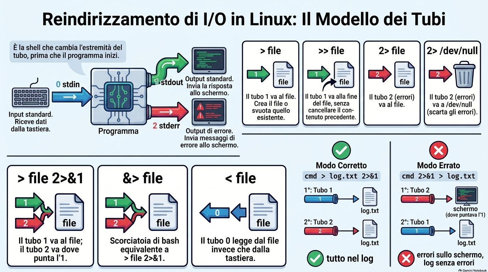
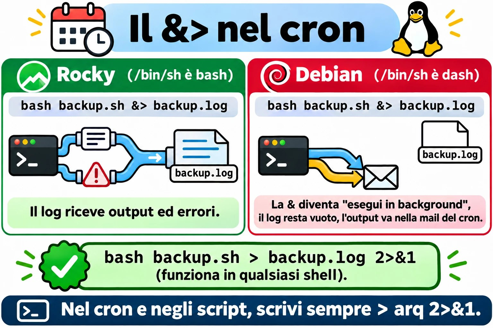
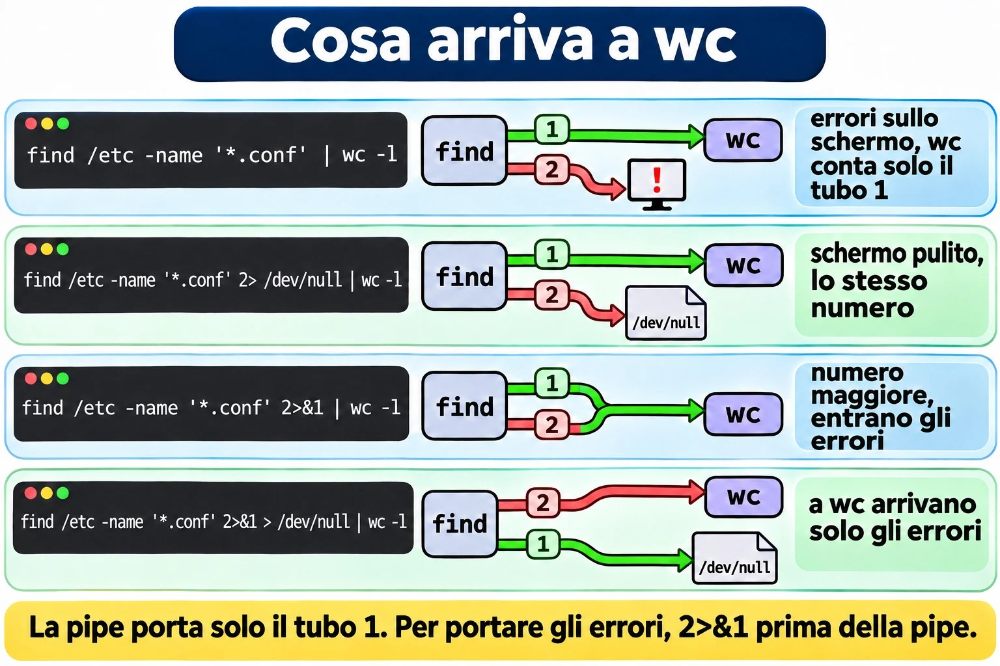
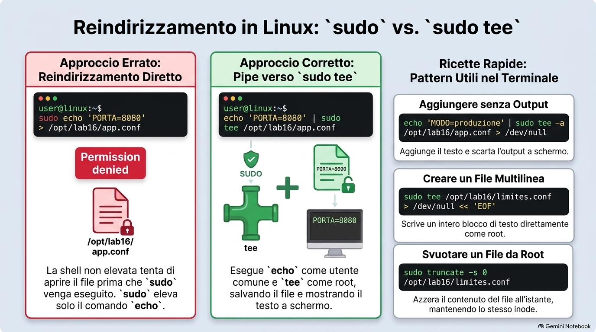
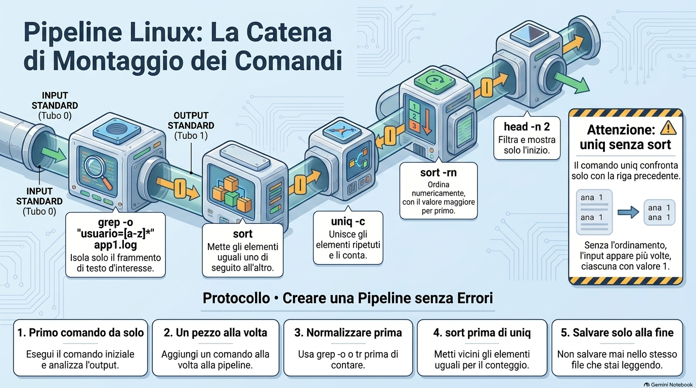
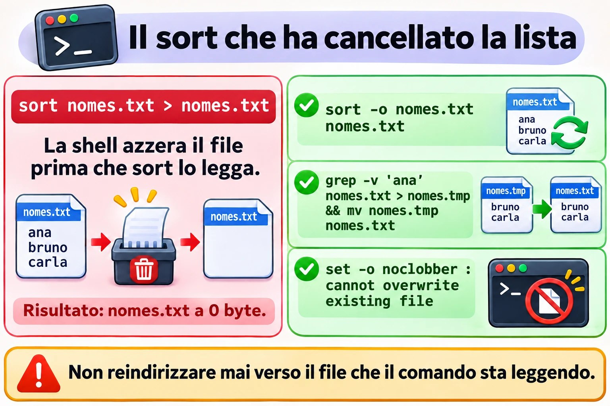

# Lezione 1.6 · Redirezioni e pipe

Impari a mandare l'output di qualsiasi comando dove vuoi: un file, la fine di un file, il cestino o l'input di un altro comando. Così una domanda come "quali IP hanno sbagliato più spesso la password oggi?" diventa una riga sola, e smetti di copiare i risultati dallo schermo al Blocco note. Impari anche i modi classici per distruggere un file con un solo `>`, per non cascarci mai su un server di un cliente.

| Scheda | Lezione 1.6 |
| --- | --- |
| Modulo | M1 · Riga di comando, lezione 6 di 10 |
| Quando | Settimana 2 |
| Alla fine sei in grado di | Salvare l'output di un comando in un file senza cancellare ciò che c'era; separare gli errori dall'output normale e buttare via ciò che non interessa; creare un file intero in un colpo solo con here-doc; scrivere in un file di root senza prenderti `Permission denied`; costruire pipe che rispondono a domande vere, come "quanti IP diversi" e "chi compare di più"; vedere e salvare l'output allo stesso tempo con `tee` |
| Prerequisiti | Lezione 1.5, con `~/lab13` ancora presente nelle VM |
| Durata | Circa 2h30 |
| Snapshot | m1a6-inicio e m1a6-fim su entrambe le VM |

## 1 · Riscaldamento

Tre domande, a memoria, prima di leggere qualsiasi cosa. Scrivi le risposte; le soluzioni le trovi a fine lezione.

1. Nella Lezione 1.5, quale comando contava le righe di `app1.log` con `ERROR`, senza mostrarle? Qual era il numero?
2. `grep` non ha trovato niente e non ha scritto niente. Come scopri, subito dopo, che non ha trovato?
3. Indovina: `ls /etc/hostname /naoexiste` mostra due righe, una normale e una di errore. Per la shell, escono entrambe dalla stessa strada?

## 2 · Perché conta

Mercoledì, ore 18. Devi aggiungere il nuovo server di database a `/etc/hosts` di una macchina di un cliente. Da root, scrivi `echo '10.0.5.40 pg03' > /etc/hosts`. Un solo `>`, dove ne servivano due. Il file ora ha una riga: la tua. `localhost` è sparito, e con lui i nomi degli altri server. Mezz'ora dopo, il supporto chiama: l'applicazione non trova più il vecchio database. È bastato un carattere.

Secondo caso. Un backup gira ogni giorno alle 2 con cron, con l'output che va in `/var/log/backup.log`. Ogni giorno il log dice `backup iniciado` e `backup concluído`. Tre settimane dopo, il cliente deve ripristinare un file, e il backup è vuoto. `tar` si lamentava ogni notte che la cartella non esisteva, ma si lamentava sul canale degli errori, e quel canale non finiva nel log. Nessuno se n'è accorto. Mancavano quattro caratteri nella riga di cron: `2>&1`.

Terzo caso, quello bello. Venerdì, ore 17, il responsabile chiede: "quanti IP diversi hanno provato a entrare come root questa settimana, e quali sono i cinque che hanno provato di più?". Senza pipe, apri il log nell'editor e cominci a contare. Con le pipe, è una riga:

```bash
sudo grep 'Failed password for root' /var/log/secure | grep -o 'from [0-9.]*' | sort | uniq -c | sort -rn | head -5
```

In due secondi hai la tabella da incollare nell'e-mail. Alla fine di questa lezione leggi quella riga senza sforzo e ne costruisci altre uguali.

E il quarto caso, che frega tutti una volta: `sudo echo 'x' > /etc/arquivo` risponde `Permission denied`, anche con `sudo`. Prima della fine della lezione sai perché, e la correzione ha tre lettere: `tee`.

## 3 · Modello mentale

> Ogni programma nasce con tre canali. Dal canale 0 entra ciò che legge; dal canale 1 esce la risposta; dal canale 2 escono gli errori. Se non dici niente, lo 0 arriva dalla tastiera, e l'1 e il 2 vanno sullo schermo. Redirigere significa cambiare l'estremità di un canale. A farlo è la shell, prima che il programma parta.

```text
                    ┌─────────────┐
  teclado ───0────► │  programa   │ ───1───► tela   (saída: stdout)
  (stdin)           │  ls, grep…  │ ───2───► tela   (erros: stderr)
                    └─────────────┘
```

I nomi inglesi compaiono in tutta la documentazione: **stdin** è lo 0, **stdout** è l'1, **stderr** è il 2. Questi numeri si chiamano descrittori di file.

Perché due canali di uscita, se vanno entrambi sullo schermo? Per poterli separare. La risposta va in un file, e gli errori restano sullo schermo, o vanno in un altro file, o nel cestino:

```text
  ls /etc/hostname /naoexiste  > saida.txt  2> erros.txt

                    ┌─────────────┐ ───1───► saida.txt   /etc/hostname
                    │     ls      │
                    └─────────────┘ ───2───► erros.txt   ls: cannot access '/naoexiste'…
```

La pipe collega il canale 1 di un programma al canale 0 del successivo. Nota cosa **non** entra nella pipe:

```text
  grep 'ERROR' app1.log | wc -l

    ┌──────┐ ──1──►━━━━ pipe ━━━━►──0──┌──────┐ ──1──► tela: 4
    │ grep │                           │  wc  │
    └──────┘ ──2──► tela               └──────┘
             (os erros do grep passam por fora do pipe)
```

**La prima idea: la shell sistema i canali prima che il comando parta.** Quando scrivi `> arquivo`, la shell apre quel file in scrittura, e aprire con `>` significa azzerare. Solo dopo parte il comando. Due conseguenze mettono nei guai anche gli esperti:

- `sort nomes.txt > nomes.txt` cancella la lista. La shell azzera `nomes.txt`, e solo dopo `sort` va a leggere, e trova un file vuoto. Il Guasto A te lo fa vedere.
- `sudo echo 'x' > /etc/arquivo` dà `Permission denied`. `sudo` eleva solo `echo`. A aprire `/etc/arquivo` è la tua shell, che gira come te, prima che `sudo` parta.

**La seconda idea: `2>&1` si legge da sinistra a destra.** Significa "il canale 2 ora punta dove punta il canale 1 **adesso**". Per questo l'ordine conta:

```text
  cmd > log.txt 2>&1              cmd 2>&1 > log.txt

  1º  1 ──► log.txt               1º  2 ──► tela   (para onde o 1 apontava)
  2º  2 ──► log.txt               2º  1 ──► log.txt
      resultado: tudo no log          resultado: erros na tela, log sem erros
```

La prima forma è quella giusta. La seconda è l'errore del backup del secondo caso, e diventa il Guasto B.

**La terza idea: in Linux, la pipe trasporta testo.** Ogni programma della catena fa una cosa sola, e la fa bene: `grep` setaccia, `cut` taglia le colonne, `sort` ordina, `uniq` unisce i ripetuti adiacenti, `wc` conta, `head` prende la cima. Mettendo insieme pezzi piccoli, costruisci la domanda che vuoi, come con il lego.

```text
  log ─► grep          ─► grep -o         ─► sort ─► uniq -c ─► sort -rn         ─► head
         só as linhas     só o pedaço                 conta      maior primeiro      o topo
         que importam     que interessa
```

**Ponte Windows.** cmd e PowerShell hanno gli stessi `>`, `>>`, `2>` e `2>&1`, e hanno anche la pipe. La differenza sta in ciò che passa nella pipe. In PowerShell passano oggetti con proprietà: chiedi `Sort-Object Length` e via. In Linux passano righe di testo, e il testo lo tagli con `cut` prima di ordinarlo. Sembra più primitivo, ma funziona con qualsiasi programma già scritto, e non solo con quelli che conoscono gli oggetti. Un tranello per chi vive in entrambi i mondi: in Windows PowerShell 5.1, `>` salva il file in UTF-16. Copia un file così su Linux, e `grep` può rispondere `binary file matches`, o semplicemente non trovare niente.


*I tre canali di ogni programma, e perché l'ordine di 2>&1 decide cosa finisce nel log.*

## 4 · Concetto a strati

### Essenziale

**Redirezioni.** Le fa la shell; il programma non ne sa nemmeno niente.

| Scrivi | Cosa fa | Esempio |
| --- | --- | --- |
| `> arq` | Manda l'output, il canale 1, nel file. Crea il file, oppure **azzera** quello che esiste già | `ls /etc > lista.txt` |
| `>> arq` | Manda l'output in fondo al file, senza cancellare niente | `date >> historico.txt` |
| `2> arq` | Manda gli errori, il canale 2, nel file | `find /etc -name '*.conf' 2> erros.txt` |
| `2> /dev/null` | Butta via gli errori | `find /etc -name '*.conf' 2> /dev/null` |
| `> arq 2>&1` | Output ed errori nello stesso file, in quest'ordine | `bash backup.sh > backup.log 2>&1` |
| `>> arq 2>&1` | Lo stesso, aggiungendo in fondo | La forma giusta per cron |
| `&> arq` | Scorciatoia di bash per `> arq 2>&1` | `bash backup.sh &> backup.log` |
| `< arq` | Il canale 0 legge dal file, non dalla tastiera | `wc -l < app1.log` |
| `<<'EOF'` | Here-doc: il canale 0 legge il testo che arriva fino alla riga `EOF` | Nel Passo 5 |
| `> arq`, senza comando | Azzera il file, oppure ne crea uno vuoto | `> app.log` |

`/dev/null` è il buco nero di Linux: tutto ciò che entra sparisce, e chi legge da lì riceve un file vuoto. Esiste su qualsiasi Linux.

**La pipe.** È la barra verticale. Collega il canale 1 di un comando al canale 0 del successivo, senza file in mezzo:

```bash
grep 'ERROR' app1.log | wc -l
cut -d: -f7 /etc/passwd | sort | uniq -c
```

**I filtri che vivono in mezzo alle pipe.** Tutti leggono da un file, se gli dai il nome, o dal canale 0, se arrivano dopo una pipe.

| Comando | Cosa fa | Esempio |
| --- | --- | --- |
| `sort` | Ordina le righe in ordine alfabetico | `sort nomes.txt` |
| `sort -n` | Ordina per numero: 9 prima di 10 | `sort -n tamanhos.txt` |
| `sort -r` | Inverte l'ordine | `sort -rn`: il più grande per primo |
| `sort -u` | Ordina e toglie le righe ripetute | `sort -u ips.txt` |
| `sort -t: -k3 -n` | Ordina per la 3ª colonna, con colonne separate da `:` | `sort -t: -k3 -n /etc/passwd` |
| `uniq` | Unisce le righe ripetute **adiacenti**: serve un `sort` prima | Sempre dopo un `sort` |
| `uniq -c` | Unisce e conta quante erano | Sempre dopo un `sort` |
| `cut -d: -f1` | Taglia la 1ª colonna, con colonne separate da `:` | `cut -d: -f1 /etc/passwd` |
| `cut -d' ' -f3` | Taglia la 3ª colonna, separata da spazio | `cut -d' ' -f3 app1.log` |
| `tr -s ' '` | Riduce gli spazi ripetuti a uno solo | Prima di un `cut -d' '` |
| `grep -o` | Mostra solo la parte che corrisponde, una per riga | `grep -o 'ip=[0-9.]*' app1.log` |
| `wc -l` | Conta le righe che arrivano | In fondo alla pipe |
| `head -n 5` | Solo le prime cinque | Dopo un `sort -rn`: la top 5 |
| `tee arq` | Mostra sullo schermo **e** salva nel file | Nel Passo 8 |
| `tee -a arq` | Lo stesso, aggiungendo in fondo | Con `sudo`, scrive in un file di root |

Due ricette che userai ogni giorno: `sort | uniq` dà lo stesso di `sort -u`, e `sort | uniq -c | sort -rn` è la ricetta della classifica.

### Ponte Windows

| Linux | cmd | PowerShell |
| --- | --- | --- |
| `cmd > arq` | `cmd > arq` | `cmd > arq` oppure `Out-File arq` |
| `cmd >> arq` | `cmd >> arq` | `cmd >> arq` oppure `Out-File arq -Append` |
| `cmd 2> arq` | `cmd 2> arq` | `cmd 2> arq` |
| `cmd > arq 2>&1` | `cmd > arq 2>&1` | `cmd > arq 2>&1`, oppure `*> arq` per tutti gli stream |
| `/dev/null` | `nul` | `$null` oppure `Out-Null` |
| `tee arq` | Non esiste | `Tee-Object arq` |
| `sort` | `sort` | `Sort-Object` |
| `sort -u` | Non esiste | `Sort-Object -Unique` |
| `uniq -c` | Non esiste | `Group-Object` |
| `cut -d: -f1` | Non esiste | `ForEach-Object { $_.Split(':')[0] }` |
| `wc -l` | `find /c /v ""` | `Measure-Object -Line` |
| Here-doc `<<'EOF'` | Non esiste | Here-string `@' … '@` |

### Avanzato

- **`set -o noclobber`** fa rifiutare a `>` di sovrascrivere un file che esiste già: `cannot overwrite existing file`. Per forzare, scrivi `>|`. Si disattiva con `set +o noclobber`. Non protegge `>>`, che non cancella mai.
- **`|&`** è la scorciatoia di bash per `2>&1 |`: manda output ed errori insieme al comando successivo.
- **`${PIPESTATUS[@]}` e `set -o pipefail`.** Il `$?` di una pipe è quello dell'ultimo comando. `grep x naoexiste.txt | wc -l` mostra un errore e il numero `0`, e `$?` vale 0, perché `wc` ha funzionato. Subito dopo, `echo ${PIPESTATUS[@]}` mostra `2 0`: il codice di ciascun pezzo. In uno script, `set -o pipefail` fa fallire la pipe se un pezzo qualsiasi fallisce. Lo userai nel modulo sugli script.
- **`<<<`**, la here-string, consegna una frase breve al canale 0: `wc -w <<< 'uma frase curta'` risponde 3.
- **`<<-EOF`** toglie i tab all'inizio di ogni riga. Serve a indentare un here-doc dentro uno script.
- **`<(comando)`**, la process substitution, consegna l'output di un comando come se fosse un file: `diff <(sort ontem.txt) <(sort hoje.txt)` confronta due elenchi senza creare file temporanei. È il modo classico per confrontare i pacchetti di due server.
- **`xargs`** trasforma righe in argomenti: `find ~/lab13 -name '*.log' | xargs wc -l` conta le righe di tutti i log in una volta. Con nomi che contengono spazi, usa `find … -print0 | xargs -0 …`. Il Passo 9 mostra perché.
- **`exec > arq 2>&1`**, dentro uno script, manda nel file tutto ciò che viene dopo. Resta per il modulo sugli script.

## 5 · Rocky × Debian

bash è lo stesso su entrambe, e ogni redirezione di questa lezione funziona uguale nel terminale. Le differenze compaiono in tre punti: in `/bin/sh`, nei programmi che metti nella pipe e nell'ordine di `sort`.

| Punto | Rocky 9 | Debian 13 |
| --- | --- | --- |
| Cos'è `/bin/sh` | bash stesso | `dash`, una shell più piccola e più veloce |
| `&>` in uno script `#!/bin/sh` o in una riga di cron | Funziona | Si rompe in silenzio: il comando va in background, e il file resta vuoto |
| Contare i pacchetti installati | `rpm -qa`, contato con `wc -l` | `dpkg -l`, solo le righe che iniziano con `ii`, contate con `wc -l` |
| Gestore che si lamenta nella pipe | `dnf` non si lamenta | `apt` scrive `WARNING: apt does not have a stable CLI interface` sul canale 2 |
| Log per costruire pipe | `/var/log/secure` e `/var/log/messages` | `journalctl`, che esce già pronto per la pipe |
| Ordine di `sort` | Dipende dalla lingua, nella variabile `LANG` | Uguale |

Controlla con `ls -l /bin/sh` su entrambe: qualcosa come `/bin/sh -> bash` su Rocky e `/bin/sh -> dash` su Debian.

La seconda riga della tabella è la più insidiosa. cron esegue ogni riga con `/bin/sh`. Su Debian, `bash backup.sh &> backup.log` diventa due cose: `bash backup.sh &`, che gira in background con l'output che va nell'e-mail di cron, che quasi nessuno legge, e `> backup.log`, che azzera soltanto il file. Il backup gira, il log resta vuoto ogni giorno, e nessuno capisce. La regola pratica: nel terminale, usa `&>` quanto vuoi. In script e in cron, scrivi sempre `> arq 2>&1`, che funziona in qualsiasi shell.

L'avviso di `apt` è l'esempio perfetto del perché esistono due canali. Su Debian, confronta:

```bash
apt list --installed | wc -l
apt list --installed 2> /dev/null | wc -l
```

I due numeri sono uguali, e solo il primo mostra l'avviso sullo schermo. L'avviso è uscito dal canale 2 e ha aggirato la pipe. `wc` non l'ha mai visto.



*Lo stesso `&>` funziona su Rocky e si rompe in silenzio nel cron di Debian: negli script e nel cron, scrivi `> arq 2>&1`.*

## 6 · Lab guidato

Fai tutto su entrambe le VM, tranne quando il passo dice una sola. I file stanno in `~/lab13/pipes`, e la materia prima è `app1.log` della Lezione 1.5. In ogni passo, quando compare **Prevedi**, scrivi la risposta prima di premere Invio.

### Passo 1 · Preparare

Sul nodo Proxmox:

```bash
qm snapshot 201 m1a6-inicio
qm snapshot 202 m1a6-inicio
```

In ciascuna VM:

```bash
mkdir -p ~/lab13/pipes
cd ~/lab13/pipes
wc -l ~/lab13/logs/app1.log
cp ~/lab13/logs/app1.log .
ls -l
```

`wc` dovrebbe rispondere `20 /home/student/lab13/logs/app1.log`. Se il numero è un altro, o il file non esiste, torna al Passo 1 della Lezione 1.5 e ricrea `app1.log`. La copia locale esiste perché tu possa sbagliare a volontà: l'originale resta al sicuro in `~/lab13/logs`.

### Passo 2 · `>` e `>>`: il file che sparisce e quello che cresce

```bash
echo 'primeira' > notas.txt
cat notas.txt
echo 'segunda' > notas.txt
```

**Prevedi.** Cosa mostrerà il prossimo `cat`: una riga o due?

```bash
cat notas.txt
```

Solo `segunda`. Il secondo `>` ha azzerato il file prima che `echo` scrivesse. Adesso aggiungi in fondo:

```bash
echo 'terceira' >> notas.txt
date >> notas.txt
cat -n notas.txt
```

Tre righe: `segunda`, `terceira` e la data. `>>` non cancella mai.

Adesso la promessa della Lezione 1.4: svuotare un file senza cambiare l'inode.

```bash
ls -li notas.txt
> notas.txt
ls -li notas.txt
> novo-vazio.txt
ls -l novo-vazio.txt
```

Il numero dell'inode, nella prima colonna, è lo stesso prima e dopo, e la dimensione è scesa a 0. È così che si svuota un log che un programma sta usando: il programma continua a scrivere nello stesso file, e lo spazio torna subito. `> novo-vazio.txt` mostra l'altro uso: senza comando, `>` crea un file vuoto.

Lo stesso effetto esiste come comando, e questo conterà nel Passo 8:

```bash
echo 'de novo' > notas.txt
truncate -s 0 notas.txt
ls -l notas.txt
```

`truncate -s 0` lascia il file con dimensione zero, come `>` da solo.

Per il Decidi, fai una copia di `hosts` del sistema. Lavori sulla copia, mai sull'originale:

```bash
cp /etc/hosts hosts.txt
wc -l hosts.txt
```

**Decidi 1 · `/etc/hosts`.** Scenario: devi aggiungere la riga `10.0.5.40 pg03` in fondo a `hosts.txt`, senza perdere niente di ciò che esiste già. Quale comando?

- **A)** `echo '10.0.5.40 pg03' > hosts.txt`
- **B)** `echo '10.0.5.40 pg03' >> hosts.txt`
- **C)** `echo '10.0.5.40 pg03' < hosts.txt`
- **D)** `cat '10.0.5.40 pg03' >> hosts.txt`

Scegli la lettera prima di guardare la tabella.

| Se hai scelto | Risultato | Perché |
| --- | --- | --- |
| A | ❌ Sbagliato | `>` azzera il file prima che `echo` giri, e resta solo la riga nuova. È il caso del mercoledì della sezione 2. |
| B | ✅ Giusto | `>>` aggiunge in fondo. `wc -l` ora mostra una riga in più, e `tail -n 2` mostra la riga nuova in fondo. |
| C | ❌ Sbagliato | `<` collega il file all'ingresso di `echo`, e `echo` non legge mai l'input. La riga compare sullo schermo, e il file resta uguale. |
| D | ❌ Sbagliato | `cat` cerca un file chiamato `10.0.5.40 pg03`, risponde `No such file or directory`, e non viene aggiunto niente. |

**Da ricordare:** prima di premere Invio su una riga con `>`, leggi il `>` ad alta voce come "azzera". Se non era quello che volevi, ne servono due.

Esegui la B e controlla:

```bash
echo '10.0.5.40 pg03' >> hosts.txt
tail -n 2 hosts.txt
wc -l hosts.txt
```

### Passo 3 · Il canale 2: gli errori non vanno nel file

```bash
ls /etc/hostname /naoexiste
```

Due righe: il nome del file e l'errore. Adesso manda l'output in un file.

**Prevedi.** Con `> saida.txt`, cosa compare ancora sullo schermo?

```bash
ls /etc/hostname /naoexiste > saida.txt
cat saida.txt
```

L'errore resta sullo schermo: `ls: cannot access '/naoexiste': No such file or directory`. `saida.txt` contiene solo `/etc/hostname`. `>` ha deviato il canale 1; il canale 2 ha continuato a puntare allo schermo. Adesso separa i due e poi butta via gli errori:

```bash
ls /etc/hostname /naoexiste 2> erros.txt
cat erros.txt
ls /etc/hostname /naoexiste > saida.txt 2> erros.txt
ls /etc/hostname /naoexiste 2> /dev/null
```

L'ultimo è il più usato nella vita reale. Un esempio che ripeterai spesso: `find` come utente normale si lamenta di ogni cartella che non può aprire.

```bash
find /etc -name '*.conf' | wc -l
find /etc -name '*.conf' 2> /dev/null | wc -l
```

Il primo riempie lo schermo di `find: '/etc/sudoers.d': Permission denied` e di altre cartelle chiuse, e alla fine mostra un numero. Il secondo mostra solo il numero. L'elenco esatto delle cartelle cambia tra Rocky e Debian.

**Decidi 2 · Il numero che non è cambiato.** Scenario: ti aspettavi che il primo numero fosse più grande, perché le righe di errore "erano nell'output". Ma i due numeri sono uguali. Perché?

- **A)** `wc` ignora le righe che iniziano con `find:`
- **B)** Gli errori sono usciti dal canale 2, che aggira la pipe; `wc` ha ricevuto solo il canale 1
- **C)** `2> /dev/null` non funziona con `find`
- **D)** La seconda esecuzione ha usato una cache, per questo è uguale

Scegli la lettera prima di guardare la tabella.

| Se hai scelto | Risultato | Perché |
| --- | --- | --- |
| A | ❌ Sbagliato | `wc` non legge il contenuto per decidere cosa contare: conta ogni riga che arriva. Le righe di errore semplicemente non sono arrivate. |
| B | ✅ Giusto | La pipe collega solo il canale 1. Gli errori sono andati dritti sullo schermo, in entrambi i casi. `wc` ha contato esattamente la stessa cosa. |
| C | ❌ Sbagliato | Funziona: la seconda volta, gli errori sono spariti dallo schermo. Il numero uguale ha un'altra causa. |
| D | ❌ Sbagliato | Non c'è nessuna cache. `find` ha percorso di nuovo le cartelle, e l'elenco dei file era lo stesso. |

**Da ricordare:** la pipe porta solo il canale 1. Se vuoi gli errori dentro la pipe, scrivi `2>&1` prima della pipe.

Controlla:

```bash
find /etc -name '*.conf' 2>&1 | wc -l
```

Adesso il numero è più grande: sono entrate le righe di errore.

### Passo 4 · Output ed errori insieme, e l'ordine che cambia tutto

```bash
ls /etc/hostname /naoexiste > tudo.txt 2>&1
cat tudo.txt
ls /etc/hostname /naoexiste &> tudo2.txt
cat tudo2.txt
```

Entrambi i file hanno le due righe. Di solito `ls` scrive prima l'errore, perché si lamenta dei nomi che non esistono prima di elencare quelli che esistono.

**Prevedi.** Adesso l'ordine invertito. Dove comparirà l'errore?

```bash
ls /etc/hostname /naoexiste 2>&1 > errado.txt
cat errado.txt
```

L'errore compare sullo schermo, e `errado.txt` contiene solo `/etc/hostname`. Torna al disegno della sezione 3: nel momento del `2>&1`, il canale 1 puntava ancora allo schermo, quindi il 2 è andato sullo schermo. Solo dopo l'1 è andato nel file.

La stessa regola, usata a tuo favore: contare solo gli errori di `find`.

```bash
find /etc -name '*.conf' 2>&1 > /dev/null | wc -l
```

Leggi da sinistra a destra. Il 2 va dove punta l'1 adesso, la pipe. Poi l'1 va nel cestino. Solo gli errori arrivano a `wc`: qualcosa come 3-6, a seconda della VM.

Infine, l'accumulo, che è la forma di cron:

```bash
date >> exec.log 2>&1
ls /naoexiste >> exec.log 2>&1
date >> exec.log 2>&1
cat exec.log
```

Tre righe: la data, l'errore e la data. Ogni esecuzione aggiunge in fondo, niente si perde, e gli errori restano registrati nell'ordine in cui sono avvenuti.

**Decidi 3 · Salvare tutto.** Scenario: stai per lanciare un comando lungo e vuoi output ed errori in `upd.log`, da leggere dopo con calma. Quale riga?

- **A)** `cmd 2>&1 > upd.log`
- **B)** `cmd > upd.log 2>1`
- **C)** `cmd > upd.log 2>&1`
- **D)** `cmd > upd.log 2> upd.log`

Scegli la lettera prima di guardare la tabella.

| Se hai scelto | Risultato | Perché |
| --- | --- | --- |
| A | ❌ Sbagliato | L'ordine è invertito: il 2 va sullo schermo, dove puntava l'1, e solo l'output va nel file. |
| B | ❌ Sbagliato | Senza la `&`, l'`1` è un nome di file. Gli errori vanno in un file chiamato `1`. Prova con `ls /naoexiste > upd.log 2>1` e poi `ls -l 1`. |
| C | ✅ Giusto | Prima l'1 va in `upd.log`; poi il 2 va dove punta l'1. Tutto nello stesso file, nell'ordine giusto. |
| D | ❌ Sbagliato | I due canali aprono lo stesso file separatamente, ciascuno scrivendo dall'inizio. Uno scrive sopra l'altro, e il testo esce rimescolato. Prova con `ls /etc/hostname /naoexiste > d.txt 2> d.txt` e `cat d.txt`. |

**Da ricordare:** la `&` in `2>&1` dice "è un canale, non un file". E l'ordine è sempre: prima la destinazione, poi `2>&1`.

Se hai provato la B e la D, pulisci: `rm -v 1 d.txt`.



*La pipe porta solo il canale 1: ciò che `wc` conta dipende da dove vanno gli errori.*

### Passo 5 · L'input: `<` e il here-doc

```bash
wc -l app1.log
wc -l < app1.log
```

Il primo risponde `20 app1.log`; il secondo, solo `20`. Con `<`, a aprire il file è la shell, e `wc` riceve solo il contenuto, senza sapere il nome. È la forma che usi negli script, quando vuoi solo il numero: `total=$(wc -l < app1.log)`.

Alcuni programmi sanno leggere solo dal canale 0. `tr`, che sostituisce caratteri, è il più comune:

```bash
tr 'a-z' 'A-Z' app1.log
tr 'a-z' 'A-Z' < app1.log | head -n 3
```

Il primo risponde `tr: extra operand 'app1.log'`. Il secondo mostra le prime tre righe in maiuscolo. Nota `CONEXãO`: `tr` sostituisce solo le lettere da a a z, senza accenti.

Adesso il here-doc, che usi dalla Lezione 1.5 come ricetta:

```bash
cat > app.conf <<'EOF'
# configuração da aplicação
PORTA=8080
MODO=producao
LOG=/var/log/app/app.log
EOF
cat -n app.conf
```

Ogni pezzo ha una funzione. `<<'EOF'` dice alla shell: leggi le prossime righe finché non trovi una riga con solo `EOF` e consegna tutto sul canale 0. `cat` senza nome di file legge dal canale 0 e scrive sul canale 1. `> app.conf` manda il canale 1 nel file. La parola `EOF` è solo un'abitudine; va bene qualsiasi parola, purché la riga finale contenga solo quella, senza spazi prima né dopo.

È il modo più sicuro per incollare una configurazione pronta su un server via SSH: niente editor, niente righe tagliate a metà.

**Prevedi.** Le due versioni qui sotto differiscono solo per le virgolette di `EOF`. Cosa mostra ciascuna?

```bash
cat <<EOF
Usuário: $USER
Pasta: $HOME
Hoje: $(date +%F)
EOF
cat <<'EOF'
Usuário: $USER
Pasta: $HOME
Hoje: $(date +%F)
EOF
```

La prima sostituisce ogni `$` con il valore: qualcosa come `Usuário: student`, `Pasta: /home/student` e la data di oggi. La seconda mostra il testo esattamente come è stato scritto, con i dollari. Senza virgolette, la shell riempie le variabili; con le virgolette, non tocca niente.

**Decidi 4 · Lo script che ha perso `$1`.** Scenario: crei uno script dal terminale e lo provi:

```bash
cat > saudacao.sh <<EOF
#!/bin/bash
echo "Olá, $1"
EOF
bash saudacao.sh Ana
```

La risposta è solo ` Olá,  `, senza il nome. Perché?

- **A)** Lo script ha bisogno di `chmod +x` per leggere `$1`
- **B)** Senza virgolette su `EOF`, la shell ha sostituito `$1` con il suo valore al momento di creare il file, e il valore era vuoto
- **C)** Il here-doc non accetta le virgolette doppie al suo interno
- **D)** `$1` funziona solo quando lo script gira come `./saudacao.sh`

Scegli la lettera prima di guardare la tabella.

| Se hai scelto | Risultato | Perché |
| --- | --- | --- |
| A | ❌ Sbagliato | Con `bash saudacao.sh`, lo script gira senza `chmod`. Il problema sta dentro il file, non nel permesso. |
| B | ✅ Giusto | `cat saudacao.sh` mostra `echo "Olá, "`: il `$1` è sparito prima che lo script esistesse. Nel tuo terminale, `$1` era vuoto. |
| C | ❌ Sbagliato | Il here-doc accetta qualsiasi testo, con virgolette semplici o doppie. |
| D | ❌ Sbagliato | `$1` è il primo argomento in entrambi i modi di eseguire. |

**Da ricordare:** un here-doc che scrive uno script o una configurazione con dei `$` dentro vuole sempre `<<'EOF'`, con le virgolette. Senza virgolette, solo quando vuoi che la shell riempia le variabili.

Ripara e prova:

```bash
cat saudacao.sh
cat > saudacao.sh <<'EOF'
#!/bin/bash
echo "Olá, $1"
EOF
cat saudacao.sh
bash saudacao.sh Ana
```

Adesso la risposta è `Olá, Ana`.

### Passo 6 · Pipe: contare, ordinare, unire

Comincia da ciò che sai già, in due modi:

```bash
grep -c 'ERROR' app1.log
grep 'ERROR' app1.log | wc -l
```

Entrambi rispondono 4. Adesso il dubbio rimasto dalla Lezione 1.5, righe contro occorrenze:

```bash
echo 'ERROR ERROR ERROR' | grep -c 'ERROR'
echo 'ERROR ERROR ERROR' | grep -o 'ERROR' | wc -l
```

Il primo risponde 1, perché è una riga. Il secondo risponde 3: `grep -o` mette ogni occorrenza su una riga a sé, e `wc -l` conta queste righe.

Adesso una domanda vera: quali IP compaiono nel log, e quante volte? Costruisci la pipe un pezzo alla volta, guardando l'output a ogni passo:

```bash
grep -o 'ip=[0-9.]*' app1.log
grep -o 'ip=[0-9.]*' app1.log | sort
grep -o 'ip=[0-9.]*' app1.log | sort | uniq -c
```

`[0-9.]` significa "una cifra o un punto", e `*`, "quanti ne arrivano". Le espressioni regolari hanno una lezione tutta loro; per ora, usale come ricetta. L'ultimo comando mostra qualcosa come:

```text
      1 ip=10.0.5.10
      1 ip=10.0.5.21
      1 ip=10.0.5.30
      3 ip=203.0.113.50
```

E quanti IP diversi:

```bash
grep -o 'ip=[0-9.]*' app1.log | sort -u | wc -l
```

Risponde 4. È il conteggio che la Lezione 1.5 aveva promesso.

**Prevedi.** Adesso gli utenti, ma senza `sort`. Quante volte comparirà la parola `ana` nell'output del secondo comando?

```bash
grep -o 'usuario=[a-z]*' app1.log
grep -o 'usuario=[a-z]*' app1.log | uniq -c
```

Qualcosa come:

```text
      1 usuario=ana
      2 usuario=root
      1 usuario=admin
      1 usuario=bruno
      1 usuario=ana
      1 usuario=student
```

`ana` compare due volte, con 1 in ciascuna. `uniq` confronta solo una riga con la precedente: le due righe di `root` erano vicine e sono diventate una; le due di `ana` erano separate e sono rimaste separate. Con `sort` prima, gli uguali diventano adiacenti:

```bash
grep -o 'usuario=[a-z]*' app1.log | sort | uniq -c
grep -o 'usuario=[a-z]*' app1.log | sort | uniq -c | sort -rn
grep -o 'usuario=[a-z]*' app1.log | sort | uniq -c | sort -rn | head -n 2
```

L'ultimo è la ricetta della classifica, la top 2: `root` e `ana`, con 2 ciascuno.

**Decidi 5 · Quanti IP diversi.** Scenario: il responsabile vuole sapere quanti IP diversi compaiono in `app1.log`. Quale comando dà la risposta giusta, oggi e su qualsiasi log?

- **A)** `grep -c 'ip=' app1.log`
- **B)** `grep -o 'ip=[0-9.]*' app1.log | uniq | wc -l`
- **C)** `grep -o 'ip=[0-9.]*' app1.log | sort -u | wc -l`
- **D)** `grep -o 'ip=[0-9.]*' app1.log | wc -l`

Scegli la lettera prima di guardare la tabella.

| Se hai scelto | Risultato | Perché |
| --- | --- | --- |
| A | ❌ Sbagliato | Risponde 6: conta le righe che hanno un IP, e `203.0.113.50` entra tre volte. |
| B | ❌ Incompleto | Qui dà 4 per fortuna, perché le tre righe di `203.0.113.50` sono vicine. In un log vero, con gli IP alternati, il conto esce più alto della realtà. |
| C | ✅ Giusto | `sort -u` ordina e toglie i ripetuti, ovunque siano. `wc -l` conta ciò che resta: 4. |
| D | ❌ Sbagliato | Risponde 6: conta tutte le occorrenze, con ripetizioni. |

**Da ricordare:** "diversi" è `sort -u`, oppure `sort` e poi `uniq`, e solo dopo `wc -l`. `uniq` da solo vede soltanto il vicino.


*Righe, occorrenze e valori diversi sono tre domande, e ognuna vuole una pipe diversa.*

### Passo 7 · Colonne con `cut`, e il doppio spazio

`/etc/passwd` è il file perfetto per allenarsi: una riga per utente, sette colonne separate da `:`. Utente, password, che oggi è solo una `x`, UID, GID, commento, cartella personale e shell. I dettagli restano per la lezione sugli utenti.

```bash
head -n 3 /etc/passwd
cut -d: -f1 /etc/passwd | head -n 5
cut -d: -f1,7 /etc/passwd | tail -n 3
cut -d: -f7 /etc/passwd | sort | uniq -c | sort -rn
sort -t: -k3 -n /etc/passwd | tail -n 3
```

Il quarto comando risponde a "quali shell hanno gli utenti, e quanti per ciascuna". Qualcosa come, su Rocky:

```text
     17 /sbin/nologin
      2 /bin/bash
      1 /sbin/shutdown
      1 /sbin/halt
      1 /bin/sync
```

Su Debian, il più comune è `/usr/sbin/nologin`, e i numeri cambiano. Ciò che conta: solo chi ha una shell vera, come `/bin/bash`, riesce a entrare e a digitare comandi. È una domanda di audit a cui risponderai sui server dei clienti. L'ultimo comando ordina per UID, la terza colonna, come numero, e mostra i tre più grandi: `student` e, in fondo, `nobody`, con 65534.

Adesso `app1.log`, le cui colonne sono separate da spazio. La terza è il livello:

```bash
cut -d' ' -f3 app1.log | sort | uniq -c
```

Qualcosa come:

```text
      1 error
      4 ERROR
     11 INFO
      4 WARN
```

L'ordine dipende dalla lingua del sistema: con `LANG=C`, `ERROR` viene prima e `error` per ultimo.

**Prevedi.** La quarta colonna dovrebbe essere il servizio: `web:`, `db:`, `auth:`. Cosa compare nelle prime sei righe?

```bash
cut -d' ' -f4 app1.log | head -n 6
cut -d' ' -f4 app1.log | head -n 6 | cat -A
```

Quattro righe vuote e due con `auth:`. `cat -A` conferma: quattro `$` da soli. Guarda di nuovo il log: dopo `INFO` e dopo `WARN` ci sono **due** spazi, per allinearsi con `ERROR`. Per `cut`, ogni spazio separa una colonna, quindi tra i due spazi c'è una colonna vuota. Nelle righe di `ERROR`, con un solo spazio, la quarta colonna è il servizio.

La riparazione è unire gli spazi prima di tagliare:

```bash
tr -s ' ' < app1.log | cut -d' ' -f4 | head -n 6
```

Adesso sì: `web:`, `db:`, `web:`, `auth:`, `auth:`, `auth:`. Nella lezione su `awk` vedrai che lui tratta già più spazi come uno solo.

**Decidi 6 · Il report per livello.** Scenario: il responsabile vuole sapere quante righe ci sono per ogni livello in `app1.log`, e l'`error` in minuscolo deve contare insieme a `ERROR`. Quale comando?

- **A)** `cut -d' ' -f3 app1.log | uniq -c`
- **B)** `cut -d' ' -f3 app1.log | sort | uniq -c`
- **C)** `cut -d' ' -f3 app1.log | tr 'a-z' 'A-Z' | sort | uniq -c`
- **D)** `cut -d' ' -f4 app1.log | sort | uniq -c`

Scegli la lettera prima di guardare la tabella.

| Se hai scelto | Risultato | Perché |
| --- | --- | --- |
| A | ❌ Sbagliato | Senza `sort`, `uniq` unisce solo i vicini, e `INFO` compare spezzettato su più righe. |
| B | ❌ Incompleto | Il conteggio è giusto, ma mostra `error` e `ERROR` separati. Il responsabile li voleva insieme. |
| C | ✅ Giusto | `tr` mette tutto in maiuscolo prima di ordinare e contare: 5 `ERROR`, 11 `INFO` e 4 `WARN`. |
| D | ❌ Sbagliato | La quarta colonna è il servizio, e arriva vuota nelle righe con doppio spazio. Non è nemmeno il livello. |

**Da ricordare:** normalizza prima di contare. Maiuscole con `tr 'a-z' 'A-Z'`, spazi con `tr -s ' '`, e sempre `sort` prima di `uniq`. Un'altra forma della C: `sort -f` con `uniq -ci`, che ignorano le maiuscole.

### Passo 8 · `tee`, e scrivere dove scrive solo root

`tee` è un raccordo a T da idraulico: copia in un file tutto ciò che passa e lascia proseguire il flusso.

```bash
grep 'ERROR' app1.log | tee erros-hoje.txt | wc -l
cat erros-hoje.txt
grep 'WARN' app1.log | tee -a erros-hoje.txt
wc -l erros-hoje.txt
```

Il primo comando mostra solo il `4`, ma il file contiene le quattro righe. Il terzo mostra gli avvisi sullo schermo e li aggiunge al file, che arriva a 8 righe. Nella vita reale, è così che segui un comando lungo sullo schermo e salvi tutto per il ticket allo stesso tempo.

Adesso il caso di `sudo`. Crea una cartella in cui può scrivere solo root:

```bash
sudo mkdir -p /opt/lab16
ls -ld /opt/lab16
echo 'PORTA=8080' > /opt/lab16/app.conf
```

Qualcosa come `bash: /opt/lab16/app.conf: Permission denied`. Normale: la cartella è di root.

**Prevedi.** E con `sudo` davanti?

```bash
sudo echo 'PORTA=8080' > /opt/lab16/app.conf
```

Lo stesso `Permission denied`. Torna alla prima idea della sezione 3: la tua shell, che gira come te, prova ad aprire il file per il `>` prima che `sudo` parta. `sudo` eleverebbe solo `echo`, che non arriva nemmeno a girare.

La correzione è chiedere a un programma che gira come root di aprire il file. `tee` lo fa:

```bash
echo 'PORTA=8080' | sudo tee /opt/lab16/app.conf
echo 'MODO=producao' | sudo tee -a /opt/lab16/app.conf > /dev/null
cat /opt/lab16/app.conf
ls -l /opt/lab16/app.conf
```

Il primo mostra `PORTA=8080` sullo schermo: è la copia che `tee` lascia passare. Nel secondo, il `> /dev/null` butta via quella copia, e lo schermo resta pulito. Quel `>` può essere tuo, senza root, perché scrive in `/dev/null`, non nel file di root. Il file finale ha due righe e appartiene a root.

Per un file intero come root, unisci `sudo tee` e here-doc:

```bash
sudo tee /opt/lab16/limites.conf > /dev/null <<'EOF'
# limites da aplicação
MAX_CONEXOES=200
TIMEOUT=30
EOF
cat /opt/lab16/limites.conf
```

E per svuotare un file di root, il comando che hai visto nel Passo 2:

```bash
sudo truncate -s 0 /opt/lab16/limites.conf
ls -l /opt/lab16/limites.conf
```

Esiste anche `sudo sh -c 'echo PORTA=8080 > /opt/lab16/app.conf'`, che esegue un'intera shell come root. Funziona, ma le virgolette si complicano in fretta. Preferisci `tee`.

**Decidi 7 · `/var` pieno.** Scenario: `/var` è al 98%. `/var/log/app/app.log` pesa 4 GB, e l'applicazione ci sta scrivendo adesso. Devi liberare spazio subito, senza fermare l'applicazione, e la storia del log può andarsene. Quale comando?

- **A)** `sudo rm /var/log/app/app.log`
- **B)** `sudo > /var/log/app/app.log`
- **C)** `sudo truncate -s 0 /var/log/app/app.log`
- **D)** `sudo mv /var/log/app/app.log /tmp/`

Scegli la lettera prima di guardare la tabella.

| Se hai scelto | Risultato | Perché |
| --- | --- | --- |
| A | ❌ Sbagliato | È la Lezione 1.4: `rm` toglie il nome, ma l'applicazione continua a tenere l'inode. Lo spazio non torna, e lei continua a scrivere in un file senza nome. |
| B | ❌ Sbagliato | A fare il `>` è la tua shell, senza root: `Permission denied`, e non cambia niente. `sudo` senza comando non arriva nemmeno a girare. |
| C | ✅ Giusto | `truncate` gira come root e azzera lo stesso inode. Lo spazio torna subito, e l'applicazione continua a scrivere nello stesso file. |
| D | ❌ Sbagliato | Se `/tmp` è sullo stesso file system, non cambia niente: è la Lezione 1.4. Se è su un altro, `mv` copia 4 GB e cancella l'originale, e lo spazio di `/var` resta bloccato, perché l'applicazione tiene ancora l'inode. |

**Da ricordare:** per azzerare un file di root, usa `sudo truncate -s 0`. Per scrivere in un file di root, manda il testo nella pipe a `sudo tee`, o `sudo tee -a` per aggiungere in fondo. E non usare mai `rm` su un log aperto.


*sudo eleva il comando, non la redirezione: chi deve essere root è chi apre il file.*

### Passo 9 · `xargs`: da righe ad argomenti

La pipe consegna testo sul canale 0. Ma molti comandi, come `wc`, `ls` e `rm`, si aspettano nomi di file come argomenti, e non sul canale 0. `xargs` fa da ponte: legge righe e le consegna come argomenti al comando che viene dopo di lui.

```bash
find ~/lab13 -name '*.log' | wc -l
find ~/lab13 -name '*.log' | xargs wc -l
```

Il primo conta **quanti file** `.log` esistono, perché `wc` ha ricevuto l'elenco dei nomi come testo. Il secondo conta **le righe dentro** ogni file, con un totale in fondo, perché `wc` ha ricevuto i nomi come argomenti, come se li avessi digitati tu.

Adesso la trappola. Crea un log con uno spazio nel nome, come `relatorio final.txt` della Lezione 1.3:

```bash
echo 'teste' > ~/lab13/pipes/'relatorio final.log'
find ~/lab13 -name '*.log' | xargs wc -l
```

Qualcosa come `wc: /home/student/lab13/pipes/relatorio: No such file or directory` e `wc: final.log: No such file or directory`. `xargs` separa gli argomenti per spazio, e un nome è diventato due. La correzione:

```bash
find ~/lab13 -name '*.log' -print0 | xargs -0 wc -l
```

`-print0` separa i nomi con un carattere nullo, che nessun nome di file può contenere, e `-0` dice a `xargs` di separare con quello. Adesso `relatorio final.log` compare con 1 riga.

**Decidi 8 · La pulizia dei `.tmp`.** Scenario: su un file server, devi cancellare tutti i `.tmp` di `/srv/dados`. Alcuni nomi hanno uno spazio, come `relatorio final.tmp`, ed esiste anche un file importante chiamato solo `relatorio`. Quale comando?

- **A)** `find /srv/dados -name '*.tmp' | xargs rm`
- **B)** `find /srv/dados -name '*.tmp' -print0 | xargs -0 rm`
- **C)** `rm $(find /srv/dados -name '*.tmp')`
- **D)** `find /srv/dados -name '*.tmp' | rm`

Scegli la lettera prima di guardare la tabella.

| Se hai scelto | Risultato | Perché |
| --- | --- | --- |
| A | ❌ Sbagliato | `relatorio final.tmp` diventa due argomenti: `relatorio` e `final.tmp`. Viene cancellato il `relatorio` importante, e il `.tmp` resta. |
| B | ✅ Giusto | Con `-print0` e `-0`, ogni nome arriva intero a `rm`, spazio compreso. |
| C | ❌ Sbagliato | Lo stesso problema della A: la shell spezza l'output di `find` sugli spazi prima di consegnarlo a `rm`. |
| D | ❌ Sbagliato | `rm` non legge nomi dal canale 0: risponde `rm: missing operand`, e non viene cancellato niente. |

**Da ricordare:** quando la pipe porta nomi di file a `xargs`, usa sempre `-print0` con `-0`. E, prima di qualsiasi `rm`, esegui la stessa riga con `ls -l` al suo posto e leggi l'elenco.

Nel lab, fai solo il controllo, senza cancellare niente:

```bash
find ~/lab13 -name '*.log' -print0 | xargs -0 ls -l
```

### Protocollo · Costruire una pipe senza errori

1. **Esegui da solo il primo pezzo** e guarda l'output. Se non contiene ciò che vuoi, nessun pezzo successivo lo sistema.
2. **Aggiungi un pezzo alla volta.** Usa la freccia su e finisci con `| head` mentre provi.
3. **Normalizza prima di contare:** `grep -o` isola il pezzo, `tr -s ' '` unisce gli spazi, `tr 'a-z' 'A-Z'` uniforma le maiuscole.
4. **`sort` sempre prima di `uniq`.** La classifica è `sort | uniq -c | sort -rn | head`.
5. **Solo alla fine, salva il risultato**: in un file nuovo o con `>>`, mai nel file che stai leggendo. Se la destinazione è di root, usa `sudo tee`.


*Una pipe si monta come il lego: un pezzo alla volta, guardando l'output di ciascuno.*

## 7 · Rompi e ripara

Due guasti che succedono davvero, e spesso. Nessuno dei due dà errore sul momento, ed è questo che li rende pericolosi. Fai tutto in `~/lab13/pipes`, su entrambe le VM.

### Guasto A · Il `sort` che ha cancellato la lista

**Rompi.**

```bash
cd ~/lab13/pipes
printf '%s\n' carla ana bruno ana davi > nomes.txt
cp nomes.txt nomes.bak
cat nomes.txt
sort nomes.txt > nomes.txt
```

Volevi ordinare la lista "sul posto", salvando il risultato nel file stesso. Il prompt è tornato senza nessun messaggio.

**Prevedi.** Prima di guardare: cosa mostra ora `cat nomes.txt`? I cinque nomi in ordine, i cinque nell'ordine vecchio, o niente?

**Scopri.**

```bash
cat nomes.txt
wc -l nomes.txt
ls -l nomes.txt nomes.bak
```

`cat` non mostra niente, `wc` risponde `0 nomes.txt`, e `ls -l` mostra 0 byte in `nomes.txt` e 25 in `nomes.bak`. La lista è sparita.

**Decidi 9 · Perché è sparita.** Scenario: `sort nomes.txt > nomes.txt` ha lasciato il file vuoto, senza nessun messaggio di errore. Qual è la spiegazione?

- **A)** `sort` ha tolto i nomi ripetuti e, insieme, si è portato via gli altri.
- **B)** La shell ha aperto `nomes.txt` per il `>` e lo ha azzerato prima che `sort` partisse. `sort` ha letto un file vuoto e non ha scritto niente.
- **C)** `sort` scrive in un file solo con `-o`. Con `>`, l'output si perde.
- **D)** `sort` sta ancora girando in background e scriverà tra poco.

Scegli la lettera prima di guardare la tabella.

| Se hai scelto | Risultato | Perché |
| --- | --- | --- |
| A | ❌ Sbagliato | `sort` toglie i ripetuti solo con `-u`. E, anche con `-u`, resterebbero quattro nomi. |
| B | ✅ Giusto | È la prima idea della sezione 3: la shell prepara i canali prima di eseguire il comando. Aprire con `>` azzera il file subito, e `sort` arriva tardi. |
| C | ❌ Sbagliato | Con `>`, l'output va nel file, sì. Il problema è il momento in cui la shell apre quel file. `-o` è la correzione, non la causa. |
| D | ❌ Sbagliato | Senza `&` in fondo, il comando gira in primo piano, e il prompt torna solo quando finisce. Il file è già vuoto, e resterà così. |

**Da ricordare:** non redirigere mai verso il file che il comando sta leggendo. Vale per `sort`, `grep`, `tr`, `cut`, qualsiasi comando.

**Ripara.** Recupera la lista da `.bak` e ordina nel modo giusto:

```bash
cp nomes.bak nomes.txt
sort -o nomes.txt nomes.txt
cat nomes.txt
```

`-o` è di `sort` stesso: legge prima tutto l'input e solo dopo apre il file di output. Adesso compaiono `ana`, `ana`, `bruno`, `carla` e `davi`. Per qualsiasi altro comando, il modo universale è un file temporaneo:

```bash
cp nomes.bak nomes.txt
grep -v 'ana' nomes.txt > nomes.tmp && mv nomes.tmp nomes.txt
cat nomes.txt
```

`&&` esegue `mv` solo se `grep` è andato bene. Restano `carla`, `bruno` e `davi`.

E per non cascarci di nuovo, la shell ha un blocco, `noclobber`:

```bash
cp nomes.bak nomes.txt
set -o noclobber
sort nomes.txt > nomes.txt
wc -l nomes.txt
```

Qualcosa come `bash: nomes.txt: cannot overwrite existing file`, e il file resta con 5 righe. Con il blocco attivo, `>` si rifiuta di sovrascrivere un file che esiste già. Per forzare, usa `>|`. `>>` continua a funzionare, perché non cancella niente. Per disattivare il blocco:

```bash
set +o noclobber
```

Un dettaglio: `cat nomes.txt >> nomes.txt` dà `cat: nomes.txt: input file is output file`. Il `cat` di GNU si accorge di questo caso e si rifiuta. Con `>` non c'è niente di cui accorgersi: quando il comando parte, il file è già stato azzerato.

**Verifica.**

```bash
wc -l nomes.txt
diff nomes.txt nomes.bak && echo 'igual ao backup'
```

Cinque righe e `igual ao backup`.



*La shell azzera il file prima che `sort` legga: tre modi di ordinare senza perdere la lista.*

### Guasto B · Il log di backup che mente

**Rompi.** Crea uno script di backup con un errore voluto: una delle cartelle non esiste.

```bash
cd ~/lab13/pipes
cat > backup.sh <<'EOF'
#!/bin/bash
echo "$(date +%T) backup iniciado"
tar -czf /tmp/backup-lab.tar.gz ~/lab13/logs ~/lab13/naoexiste
echo "$(date +%T) backup concluído"
EOF
bash backup.sh > backup.log
```

`EOF` tra virgolette conserva `$(date +%T)` e `~` come testo, perché vengano calcolati quando lo script gira. Sullo schermo compare qualcosa come:

```text
tar: Removing leading `/' from member names
tar: /home/student/lab13/naoexiste: Cannot stat: No such file or directory
tar: Exiting with failure status due to previous errors
```

**Prevedi.** Cosa dice `backup.log`? E il codice di uscita dello script, è 0 o no?

**Scopri.**

```bash
cat backup.log
bash backup.sh > backup.log 2> /dev/null
echo $?
```

Il log contiene qualcosa come:

```text
10:42:01 backup iniciado
10:42:01 backup concluído
```

E `echo $?` risponde 0. Il log dice che è andato tutto bene, e anche il codice di uscita. L'errore di `tar` è uscito dal canale 2, sullo schermo, e in cron non c'è schermo: nessuno l'avrebbe visto. Nella vita reale, è così che si scopre, il giorno del disastro, che il backup falliva da mesi.

Adesso il tentativo con l'ordine sbagliato:

```bash
bash backup.sh 2>&1 > backup.log
cat backup.log
```

Gli errori restano sullo schermo, e il log resta pulito. `2>&1` ha copiato la destinazione del canale 1 nel momento in cui è stato letto, quando il canale 1 puntava ancora allo schermo.

**Decidi 10 · La riga del crontab.** Scenario: stai per pianificare `backup.sh` in cron, ogni giorno alle 2. Ogni esecuzione deve aggiungere a `backup.log` i messaggi normali e gli errori, insieme e in ordine. Quale redirezione?

- **A)** `bash backup.sh > backup.log 2>&1`
- **B)** `bash backup.sh 2>&1 >> backup.log`
- **C)** `bash backup.sh >> backup.log 2>&1`
- **D)** `bash backup.sh &>> backup.log`

Scegli la lettera prima di guardare la tabella.

| Se hai scelto | Risultato | Perché |
| --- | --- | --- |
| A | ❌ Incompleto | Unisce i due canali nell'ordine giusto, ma `>` azzera il log a ogni esecuzione. Domani vedi solo la notte di oggi. |
| B | ❌ Sbagliato | È l'ordine sbagliato: gli errori vanno dove cron manda l'output, cioè un'e-mail locale che nessuno legge o da nessuna parte. |
| C | ✅ Giusto | `>>` aggiunge il canale 1 al log, e `2>&1` manda il canale 2 nello stesso posto. Funziona in qualsiasi shell. |
| D | ❌ Sbagliato | Su Rocky funziona, perché lo `sh` di cron è bash. Su Debian cron usa dash, che legge la `&` come "esegui in background": il backup gira per conto suo, l'output va nell'e-mail di cron, e il log non riceve niente. |

**Da ricordare:** nel crontab è sempre `>> arquivo 2>&1`, in quest'ordine, e con percorsi completi, perché cron non sa in quale cartella ti trovi. La riga completa sarebbe così, ma non installarla adesso; cron ha una lezione tutta sua:

```text
0 2 * * * /bin/bash /home/student/lab13/pipes/backup.sh >> /home/student/lab13/pipes/backup.log 2>&1
```

**Ripara.** Esegui con la redirezione giusta:

```bash
bash backup.sh >> backup.log 2>&1
cat backup.log
```

Adesso l'errore di `tar` compare nel log, tra "iniciado" e "concluído". Ma nota: lo script scrive ancora "concluído" dopo l'errore, e il codice di uscita resta 0, perché l'ultimo comando è `echo`, che va sempre a buon fine. Lo script mente in un altro modo. La correzione, con `set -e`, `set -o pipefail` e il test di `$?`, arriva nel modulo sugli script. Per ora, l'abitudine: leggi tutto il log, non solo l'ultima riga.

**Verifica.**

```bash
grep -c 'Cannot stat' backup.log
tail -n 5 backup.log
```

`grep -c` risponde 1: solo l'ultima esecuzione ha conservato l'errore. Le tre precedenti hanno scritto un log pulito, che mentiva.

### E lo snapshot?

Nessuno dei due guasti ne ha avuto bisogno, ed è questa la lezione. Nel Guasto A, hai recuperato la lista solo perché avevi fatto `nomes.bak`. Su un server vero, ripristinare l'intera VM per recuperare un file annulla tutto ciò che è successo dopo, compreso il lavoro degli utenti. L'abitudine che salva è `cp arquivo arquivo.bak` prima di mettere mano, oppure `sort -o`. Nel Guasto B, nessuno snapshot aiuta: il danno è non sapere che il backup falliva. Solo `2>&1` al posto giusto risolve.

### Bonus Debian

Prima, `&>` in `sh`, che su Debian è dash. Esegui su entrambe le VM e confronta:

```bash
sh -c 'ls /etc/hostname /naoexiste &> amp.txt'
cat amp.txt
```

Su Rocky, `amp.txt` contiene le due righe, l'output e l'errore. Su Debian, le due righe compaiono sullo schermo, e `amp.txt` resta vuoto: dash ha eseguito `ls` in background e poi ha creato il file vuoto con `> amp.txt`. È esattamente ciò che succede in uno script `sh` o nel cron di Debian.

Poi, i pacchetti, usando ciò che hai imparato oggi:

```bash
[ "$(hostname)" = debian-lab ] && dpkg -l | grep '^ii' | wc -l
[ "$(hostname)" = debian-lab ] && dpkg -l | grep '^ii' | tr -s ' ' | cut -d' ' -f2 | head -n 5
```

Il primo conta i pacchetti installati. Il secondo unisce gli spazi e taglia la seconda colonna, il nome del pacchetto. È il problema del doppio spazio del Passo 7, su un file vero.

Infine, i login via SSH, che su Debian stanno solo nel journal:

```bash
[ "$(hostname)" = debian-lab ] && sudo journalctl -u ssh --no-pager | grep -c 'Accepted'
```

Quanti login sono andati a buon fine dall'ultimo boot. Per vedere i fallimenti, generane alcuni nel lab: esegui `ssh errado@127.0.0.1` e digita una password qualsiasi sbagliata, tre volte. Poi:

```bash
[ "$(hostname)" = debian-lab ] && sudo journalctl -u ssh --no-pager | grep 'Failed password' | grep -o 'from [0-9.]*' | sort | uniq -c
```

Qualcosa come `3 from 127.0.0.1`.

### Bonus Rocky

```bash
[ "$(hostname)" = rocky-lab ] && rpm -qa | wc -l
[ "$(hostname)" = rocky-lab ] && rpm -qa | sort | head -n 5
[ "$(hostname)" = rocky-lab ] && rpm -qa --last | head -n 5
```

Quanti pacchetti, i primi cinque in ordine alfabetico e i cinque installati più di recente. Adesso la pipe della storia del responsabile, della sezione 2. Genera i fallimenti come nel bonus di Debian, con `ssh errado@127.0.0.1`, ed esegui:

```bash
[ "$(hostname)" = rocky-lab ] && sudo grep 'Failed password' /var/log/secure | grep -o 'from [0-9.]*' | sort | uniq -c | sort -rn
```

Qualcosa come `3 from 127.0.0.1`. Su un server esposto a internet, questa stessa riga mostra, in pochi secondi, chi sta cercando di indovinare la password di root.

### La lezione

La shell prepara i canali prima di eseguire il comando: `>` azzera il file prima che qualcuno lo legga. E chi non manda il canale 2 nel log perde proprio il messaggio che contava. Nessuno dei due guasti avvisa sul momento, quindi ciò che protegge è l'abitudine: `sort -o` o un file temporaneo, `>> log 2>&1` in tutto ciò che gira da solo, e leggere tutto il log.

## 8 · Trappole

| Trappola | Cosa succede | Come evitarla |
| --- | --- | --- |
| `sort f > f`, o `grep x f > f` | Il file resta vuoto, senza nessun errore. | `sort -o f f`, o un file temporaneo e poi `mv`. |
| `>` quando volevi `>>` | Il contenuto vecchio va perso. | Leggi la riga prima dell'Invio. In sessioni rischiose, `set -o noclobber`. |
| `2>&1 > arq` | Gli errori restano sullo schermo. | `> arq 2>&1`: prima la destinazione, poi la copia. |
| `2>1`, senza la `&` | Crea un file chiamato `1`. | `2>&1`. |
| `sudo echo x > /etc/arq` | `Permission denied`: a aprire il file è la tua shell, senza root. | Manda il testo nella pipe a `sudo tee /etc/arq`. |
| `sudo > arq` per azzerare | `Permission denied`, e non cambia niente. | `sudo truncate -s 0 arq`. |
| `rm` su un log aperto | Lo spazio non torna. | `truncate -s 0`. |
| `uniq` senza `sort` | I ripetuti che non sono affiancati restano separati. | `sort` sempre prima di `uniq`. |
| `cut -d' '` con spazi doppi | Compaiono colonne vuote. | `tr -s ' '` prima di `cut`, oppure `awk`. |
| `grep -c` per contare occorrenze | Conta righe, non occorrenze. | `grep -o` e poi `wc -l`. |
| `wc -l` sull'elenco di `find` | Conta file, non righe. | `xargs wc -l`, con `-print0` e `-0`. |
| `xargs` con nomi che hanno spazi | Un nome diventa due, e `rm` può cancellare il file sbagliato. | `find -print0` con `xargs -0`. Prova prima con `ls -l`. |
| `&>` in uno script `sh` o nel cron di Debian | Il comando va in background, e il log resta vuoto. | `> arq 2>&1`, che funziona in qualsiasi shell. |
| `<<EOF` senza virgolette | `$1`, `$HOME` e `$(...)` vengono sostituiti subito. | `<<'EOF'` quando il testo deve andare letterale. |
| Aspettarsi che gli errori passino dalla pipe | `wc` e `grep` non vedono il canale 2. | `2>&1` prima della pipe, o `2> /dev/null` per scartarli. |
| `tr 'a-z' 'A-Z' arquivo` | `extra operand`: `tr` legge solo dal canale 0. | `tr 'a-z' 'A-Z' < arquivo`. |
| `sort` su server con lingue diverse | L'ordine cambia da un server all'altro. | `LC_ALL=C sort` quando l'ordine deve essere uguale ovunque. |

## 9 · Quiz

Dieci domande, senza consultare. Scrivi la lettera o la risposta di ciascuna e solo dopo apri le Soluzioni.

**1.** `notas.txt` esiste già e ha dieci righe. Cosa gli succede con `echo 'oi' > notas.txt`?

- **A)** La riga `oi` va in fondo
- **B)** Il file viene azzerato e contiene solo `oi`
- **C)** La shell si rifiuta, perché il file esiste già
- **D)** `oi` compare sullo schermo, e il file non cambia

**2.** `find /etc -name '*.conf' | wc -l` mostra il numero e anche alcune righe `Permission denied` sullo schermo. Perché?

- **A)** `wc` non riesce a contare le righe di errore
- **B)** Gli errori escono dal canale 2, e la pipe porta solo il canale 1
- **C)** `find` ha bisogno di `-print0` perché la pipe funzioni
- **D)** La pipe funziona solo con `sudo`

**3.** Quale riga salva l'output normale e gli errori di `cmd` nello stesso file?

- **A)** `cmd 2>&1 > tudo.log`
- **B)** `cmd > tudo.log 2>1`
- **C)** `cmd > tudo.log 2>&1`
- **D)** `cmd 2> tudo.log`

**4.** `grep -o 'usuario=[a-z]*' app1.log | uniq -c` mostra `ana` due volte, con 1 in ciascuna. Cosa manca?

- **A)** Un `sort` prima di `uniq`
- **B)** `-i` in `grep`
- **C)** Un `sort -rn` dopo `uniq -c`
- **D)** Un `wc -l` in fondo

**5.** Completa: per aggiungere una riga a `/etc/motd`, che è di root, senza mostrare niente sullo schermo, esegui `echo 'Manutenção às 22h' | ___ > /dev/null`.

**6.** In `app1.log`, dopo `INFO` e dopo `WARN` ci sono due spazi. Cosa mostra `cut -d' ' -f4 app1.log` su quelle righe?

- **A)** Il servizio, come `web:`
- **B)** Una riga vuota
- **C)** Il livello, come `INFO`
- **D)** Un errore di `cut`

**7.** Devi scrivere `PORTA=9090` in `/etc/app.conf`, che è di root, al posto del contenuto attuale. Quale comando funziona?

- **A)** `sudo echo 'PORTA=9090' > /etc/app.conf`
- **B)** `echo 'PORTA=9090' | sudo tee /etc/app.conf`
- **C)** `sudo > /etc/app.conf echo 'PORTA=9090'`
- **D)** `echo 'PORTA=9090' | sudo cat /etc/app.conf`

**8.** Quale pipe mostra i tre utenti che compaiono di più in `app1.log`, con il conteggio?

- **A)** `grep -o 'usuario=[a-z]*' app1.log | uniq -c | head -n 3`
- **B)** `grep -o 'usuario=[a-z]*' app1.log | sort | uniq -c | sort -rn | head -n 3`
- **C)** `grep -o 'usuario=[a-z]*' app1.log | sort -u | head -n 3`
- **D)** `grep -c 'usuario=' app1.log | sort -rn | head -n 3`

**9.** In inglese, come nei forum e nella documentazione: Which command writes only the error messages of `find /` to the file `errors.txt` and discards the normal output?

- **A)** `find / > errors.txt`
- **B)** `find / 2> errors.txt > /dev/null`
- **C)** `find / 2>&1 errors.txt`
- **D)** `find / | errors.txt`

**10.** Su Debian, uno script con `#!/bin/sh` ha la riga `backup &> /var/log/bkp.log`, e il log resta sempre vuoto. Qual è la riga giusta?

- **A)** `backup &>> /var/log/bkp.log`
- **B)** `backup > /var/log/bkp.log 2>&1`
- **C)** `backup 2>&1 > /var/log/bkp.log`
- **D)** `backup | /var/log/bkp.log`

## 10 · Flashcard e promemoria

### Da sapere a memoria

Questa parte è da tenere in testa. Sono i comandi che usi ogni settimana.

- `>` crea o azzera; `>>` aggiunge in fondo; `<` consegna un file sul canale 0
- Il canale 0 è l'input, l'1 l'output, il 2 gli errori; la pipe porta solo l'1
- `2> /dev/null`: fa sparire gli errori
- `> arq 2>&1`: tutto nello stesso file; prima la destinazione, poi la copia
- `>> arq 2>&1`: la forma di cron, che funziona in qualsiasi shell
- `sort | uniq -c | sort -rn | head`: la classifica
- `sort -u | wc -l`: quanti diversi
- `grep -o 'texto' arquivo | wc -l`: occorrenze, non righe
- `cut -d: -f1`: una colonna; `tr -s ' '` prima, se ci sono spazi ripetuti
- `echo texto | sudo tee arquivo`: scrivere dove scrive solo root; `-a` aggiunge in fondo
- Mai `comando arquivo > arquivo`: usa `sort -o` o un file temporaneo

### Da consultare

Questa parte non devi impararla a memoria. Ricorda solo dove si trova.

- `sort -n`, `-r`, `-f` e `-t: -k3`: per numero, invertito, ignorando le maiuscole, per la colonna 3 separata da `:`
- `sort -o arq arq`: ordinare sul posto
- `uniq -d`: solo i ripetuti; `uniq -ci`: conta ignorando le maiuscole
- `tr 'a-z' 'A-Z' < arq`: maiuscolo; `tr -d '\r' < arq`: toglie il fine riga di Windows
- `sudo tee arq > /dev/null <<'EOF'`: un file intero come root
- `sudo truncate -s 0 arq`: azzera senza cambiare l'inode
- `find /pasta -name '*.log' -print0 | xargs -0 wc -l`: nomi con spazi
- `set -o noclobber` e `>|`: il blocco di `>` e come scavalcarlo
- `<<'EOF'` va letterale; `<<EOF` sostituisce il `$`; `<<<` consegna una parola sola
- `diff <(sort a.txt) <(sort b.txt)`: confronta l'output di due comandi
- `echo "${PIPESTATUS[@]}"` e `set -o pipefail`: il codice di uscita di ogni parte della pipe
- `LC_ALL=C sort`: lo stesso ordine su qualsiasi server
- Rocky: `rpm -qa | wc -l`. Debian: `dpkg -l | grep '^ii' | wc -l`

### Flashcard

| Fronte | Retro |
| --- | --- |
| Cosa fa `>` a un file che esiste già? | Azzera il file prima che il comando parta |
| Qual è il numero del canale degli errori? | 2. L'input è lo 0 e l'output normale è l'1 |
| Cosa passa in una pipe? | Solo il canale 1, l'output normale |
| Ordine giusto per unire output ed errori in un file | `> arq 2>&1` |
| Cosa fa `2>1`? | Crea un file chiamato `1` |
| Perché `sort` prima di `uniq`? | `uniq` confronta solo una riga con la precedente |
| Contare occorrenze, non righe | `grep -o`, e poi `wc -l` |
| Contare valori diversi | `sort -u`, e poi `wc -l` |
| Perché `sudo echo x > /etc/arq` fallisce? | A aprire il file è la tua shell, senza root |
| Scrivere in un file di root | Manda il testo nella pipe a `sudo tee`; `-a` aggiunge in fondo |
| Svuotare un log aperto | `sudo truncate -s 0 arquivo` |
| `cut` restituisce colonne vuote | Ci sono spazi ripetuti: `tr -s ' '` prima |
| Nomi con spazi in `xargs` | `find -print0` con `xargs -0` |
| `<<EOF` o `<<'EOF'`? | Con le virgolette, il testo va letterale; senza, il `$` viene sostituito |
| Perché evitare `&>` nel cron di Debian? | `sh` è dash, che legge la `&` come background |

## 11 · Checklist di uscita

Spunta solo ciò che sai fare senza guardare la lezione:

- [ ] Spiegare i tre canali, 0, 1 e 2, e quale di loro passa dalla pipe
- [ ] Scegliere tra `>` e `>>` senza esitare, e dire perché `sort f > f` azzera il file
- [ ] Scrivere `> arq 2>&1` nell'ordine giusto e spiegare perché l'altro ordine fallisce
- [ ] Scartare gli errori con `2> /dev/null` e contare solo gli errori
- [ ] Costruire una classifica con `sort`, `uniq -c`, `sort -rn` e `head`
- [ ] Contare valori diversi senza cadere nel `uniq` da solo
- [ ] Tagliare colonne con `cut`, anche quando ci sono spazi ripetuti
- [ ] Scrivere in un file di root con `sudo tee` e svuotarlo con `sudo truncate`
- [ ] Passare nomi di file a un altro comando con `find -print0` e `xargs -0`
- [ ] Creare un file con here-doc e sapere quando `EOF` va tra virgolette
- [ ] Scrivere la redirezione giusta per cron, anche su Debian

**Ultimo esercizio, senza guardare.** Chiudi questa lezione. In `~/lab13/pipes`, rispondi a ogni domanda con un comando:

1. Quanti utenti diversi compaiono in `app1.log`?
2. Quale servizio ha più righe di `WARN`, e quante?
3. Salva in `confs.txt` l'elenco dei file `.conf` di `/etc`, senza nessun errore sullo schermo, e dì quanti sono.
4. Ricrea `/opt/lab16/limites.conf` con le tre righe del Passo 8, usando `sudo tee` e un here-doc, senza niente sullo schermo.
5. Spiega in due frasi perché `cmd 2>&1 > arq` non salva gli errori nel file.

Le risposte sono in fondo alle Soluzioni.

**Snapshot di chiusura.** Sul nodo Proxmox:

```bash
qm snapshot 201 m1a6-fim
qm snapshot 202 m1a6-fim
```

Non cancellare `~/lab13`: i log tornano nelle prossime lezioni. `/opt/lab16` non sarà più usato; se vuoi, rimuovilo dopo lo snapshot con `sudo rm -rv /opt/lab16`.

## 12 · Nella vita reale

**Missione della settimana, sola lettura.** Scegli un server che amministri davvero. Se è di un cliente, fai solo ciò che il contratto permette; se hai dubbi, usa rocky-lab e debian-lab. Nessun comando di questa missione modifica il sistema: non aprire editor, non riavviare servizi e non redirigere niente fuori dalla tua cartella personale.

Su un server Rocky, RHEL o Alma, chi cerca di indovinare le password, e quanti sono:

```bash
sudo grep 'Failed password' /var/log/secure | grep -o 'from [0-9.]*' | sort | uniq -c | sort -rn | head -n 10
sudo grep 'Failed password' /var/log/secure | grep -o 'from [0-9.]*' | sort -u | wc -l
sudo grep -c 'Failed password for root' /var/log/secure
```

Su un server Debian senza `rsyslog`, lo stesso tramite il journal:

```bash
sudo journalctl -u ssh --since '7 days ago' --no-pager | grep 'Failed password' | grep -o 'from [0-9.]*' | sort | uniq -c | sort -rn | head -n 10
sudo journalctl -u ssh --since '7 days ago' --no-pager | grep 'Failed password' | grep -o 'from [0-9.]*' | sort -u | wc -l
```

Se il server ha `/var/log/auth.log`, come Ubuntu, usalo al posto di `secure`. Per salvare la classifica senza toccare il server, aggiungi `| tee ~/ips-$(date +%F).txt` in fondo al primo comando.

In uno qualsiasi dei due, chi può entrare con una shell e come cron conserva i log:

```bash
cut -d: -f7 /etc/passwd | sort | uniq -c | sort -rn
grep 'bash$' /etc/passwd | cut -d: -f1
sudo crontab -l
cat /etc/crontab
ls /etc/cron.d
sudo grep -rn '&>' /etc/crontab /etc/cron.d
sudo grep -rn '/dev/null' /etc/crontab /etc/cron.d
```

Se root non ha un crontab, `sudo crontab -l` risponde `no crontab for root`, dal canale 2. Gli ultimi due comandi mostrano le righe di cron che usano `&>` o che buttano l'output in `/dev/null`.

**Per il diario.** Rispondi in poche righe:

1. Quanti IP diversi hanno provato una password sbagliata? Questa domanda era rimasta aperta nella Lezione 1.5, e adesso si risolve con una riga. Qualche IP è della tua stessa rete?
2. Nella top 3, quanti tentativi ha ciascun IP? È un attacco insistente di pochi IP o tanti IP che provano poco?
3. Quanti account hanno `/bin/bash`? Li riconosci tutti?
4. Qualche riga di cron butta l'output in `/dev/null` o usa `&>`? Se è un backup, te ne accorgeresti se fallisse? Non cambiare niente: annota il file e la riga.

**Sfida della settimana.** Costruisci il "bollettino del mattino" di un server in un file della tua cartella personale, aggiungendo un blocco al giorno con `>>`. Ogni blocco ha la data, l'uso di `/var`, la top 3 di IP con password sbagliata e il numero di IP diversi. Comincia così e completa il resto con ciò che hai imparato oggi:

```bash
echo "== $(date +%F) ==" >> ~/boletim.txt
df -h /var >> ~/boletim.txt 2>&1
```

In cinque giorni, confronta i blocchi: gli IP cambiano? `/var` cresce? Nel diario, una riga al giorno con ciò che è cambiato.

**Domani, senza guardare.** Apri un terminale domani e, senza consultare niente:

1. Mostra la classifica degli utenti di `app1.log`, con il conteggio, in una riga sola.
2. Scrivi la redirezione giusta per una riga di cron che conserva output ed errori.
3. Scrivi `PORTA=9090` in `/opt/lab16/app.conf`, che è di root. Se hai già cancellato la cartella, ricreala con `sudo mkdir -p /opt/lab16`.
4. Ordina un file sul posto, senza perdere il contenuto.
5. Spiega ad alta voce perché `sudo echo x > /etc/arquivo` fallisce.

Se ti blocchi su uno, torna solo al Passo di quel punto.

## 13 · Con DeepTutor

Usa il DeepTutor della tua rete locale dopo il lab, non al suo posto:

- `!quiz Aula 1.6`: chiedi dieci domande nuove su redirezioni e pipe, nel formato dei Decidi.
- `!explica 2>&1`: chiedi la spiegazione con il disegno dei canali, e confrontala con l'ordine sbagliato che hai provato nel Passo 4.
- `!feynman`: spiega perché `sort f > f` azzera il file, come se parlassi a uno stagista. DeepTutor indica dove sei rimasto vago.
- `!quebra`: chiedi un log nuovo, con spazi irregolari e maiuscole mescolate, e costruisci la classifica giusta seguendo il Protocollo.
- `!cartoes`: genera flashcard dalla sezione 10 e ripassa dopo tre giorni.
- `!erro`: incolla un messaggio vero, come `extra operand`, `cannot overwrite existing file` o `missing operand`, e chiedi la causa prima della soluzione.
- `!revisao`: pianifica il ripasso delle Lezioni da 1.3 a 1.6 tra tre giorni e tra una settimana. È la fine della settimana 2.

## Soluzioni commentate

### Riscaldamento

1. **`grep -c 'ERROR' app1.log`, che risponde 4.** `-c` conta le righe senza mostrarle. Oggi hai visto un altro modo di arrivare allo stesso numero: `grep 'ERROR' app1.log | wc -l`.
2. **Con `echo $?`, subito dopo.** `grep` termina con 0 quando trova, con 1 quando non trova e con 2 quando c'è un errore, come un file che non esiste.
3. **No.** La riga normale esce dal canale 1, e quella di errore dal canale 2. Sullo schermo sembrano uguali, ma `>` devia solo il canale 1, e l'errore continua a comparire. È stato il Passo 3.

### Quiz

1. **B.** `>` azzera il file prima che `echo` parta. La shell si rifiuterebbe, come nella C, solo con `set -o noclobber` attivo.
2. **B.** `wc` non ha mai visto gli errori: sono andati dritti sullo schermo. Per contarli anch'essi, usa `2>&1` prima della pipe; per nasconderli, `2> /dev/null`.
3. **C.** La A è l'ordine sbagliato: gli errori restano sullo schermo. La B crea un file chiamato `1`. La D salva solo gli errori.
4. **A.** `uniq` unisce solo righe uguali che sono affiancate. La C ordinerebbe il risultato, ma `ana` sarebbe già stata contata in due parti.
5. **`sudo tee -a /etc/motd`.** `-a` aggiunge in fondo; senza, `tee` azzererebbe il file. `> /dev/null` butta via la copia che `tee` mostrerebbe sullo schermo, e può essere tuo, senza root.
6. **B.** Tra i due spazi c'è una colonna vuota, ed è quella che prende `-f4`. La correzione è `tr -s ' '` prima di `cut`.
7. **B.** Nella A e nella C, a aprire il file è la tua shell, senza root, e la risposta è `Permission denied`. Nella D, `cat` riceve un nome di file, ignora la pipe e mostra solo il contenuto attuale.
8. **B.** È la ricetta della classifica. La A conta male, perché manca `sort`. La C toglie i ripetuti, ma perde il conteggio. La D conta righe e restituisce un numero solo.
9. **B.** Vediamo ogni alternativa:

| Se hai scelto | Risultato | Perché |
| --- | --- | --- |
| A | ❌ Sbagliato | Salva l'output normale nel file, e gli errori restano sullo schermo. |
| B | ✅ Giusto | `2>` manda gli errori nel file, e `> /dev/null` scarta l'output normale. Qui l'ordine non conta, perché nessuno dei due copia l'altro. |
| C | ❌ Sbagliato | `2>&1` manda gli errori dove va già l'output normale, lo schermo. `errors.txt` diventa un altro percorso che `find` deve cercare, e non viene creato nessun file. |
| D | ❌ Sbagliato | La pipe prova a eseguire un programma chiamato `errors.txt`, e la risposta è qualcosa come `command not found`. |

10. **B.** Lo `sh` di Debian è dash, che legge la `&` come "esegui in background" e poi crea il log vuoto con `>`. La A ha lo stesso problema. La C è l'ordine sbagliato. La D prova a eseguire il file di log come programma.

### Ultimo esercizio

1. `grep -o 'usuario=[a-z]*' app1.log | sort -u | wc -l` risponde 5.
2. `grep 'WARN' app1.log | tr -s ' ' | cut -d' ' -f4 | sort | uniq -c | sort -rn` mostra `3 web:` e `1 db:`. È `web:`, con 3. Senza `tr -s ' '`, la quarta colonna uscirebbe vuota.
3. `find /etc -name '*.conf' > confs.txt 2> /dev/null` e poi `wc -l < confs.txt`. Il numero cambia da una VM all'altra; ciò che conta è lo schermo pulito.
4. Lo stesso blocco del Passo 8: `sudo tee /opt/lab16/limites.conf > /dev/null <<'EOF'`, le tre righe e `EOF` da solo nell'ultima riga. Controlla con `cat /opt/lab16/limites.conf`.
5. La shell legge da sinistra a destra. In `2>&1`, il canale 2 copia la destinazione che il canale 1 ha in quel momento, lo schermo; `> arq` cambia il canale 1 dopo, e il canale 2 continua a puntare allo schermo.

---

<!-- navegacao -->
[← Lezione 1.5 · Leggere e cercare testo](1.5-ler-e-procurar-texto.md) · [Indice delle lezioni](../01-aulas.md) · [Lezione 1.7 · Archiviare e comprimere →](1.7-arquivar-e-compactar.md)
