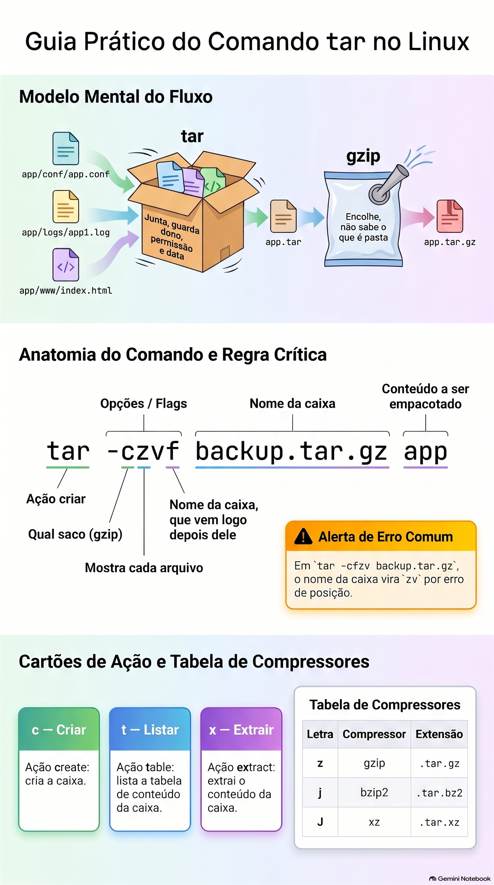
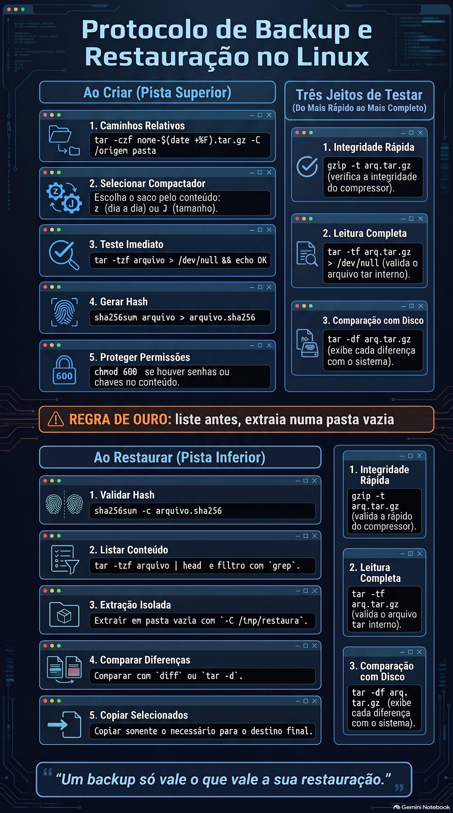

# Lezione 1.7 · Archiviazione e compattazione

Imparerai come unire un'intera cartella in un unico file, come ridurre questo file e, soprattutto, come aprire un backup senza distruggere ciò che già esiste sul server. Alla fine, "ripristina la configurazione di ieri" smette di essere un comando rischioso e diventa una procedura in cinque passaggi, da ripetere uguale su qualsiasi client.

| File | lezione 1.7 |
| --- | --- |
| Modulo | M1 · Riga di comando, lezione 7 di 10 |
| Quando | Settimana 3 |
| Alla fine puoi | Crea, elenca ed estrai archivi tar con e senza compressione; scegli tra gzip, bzip2, xz e zip conoscendo il costo di ciascuno; testare un backup prima di averne bisogno; estrai in una cartella separata e porta con te solo il file che ti interessa; scambiare file con persone che utilizzano Windows |
| Articoli di prova | LE 013.1 · LPIC-1 103.3, la parte tar, gzip, bzip2 e xz · RHCSA: archivia, comprime, decomprime e decomprime file con tar, gzip e bzip2 |
| Prerequisiti | lezioni da 1.4 a 1.6, con \~/lab13 ancora sulle VM |
| Meteo | Intorno alle 2:30 |
| Istantanee | m1a7-start e m1a7-end su entrambe le VM |

## 1 · Riscaldamento

Tre domande, a mente fredda, prima di leggere qualsiasi cosa. Scrivi le risposte; la chiave di risposta viene visualizzata alla fine.

1. Nella lezione 1.6, come avete registrato l'output e gli errori di uno script di backup nello stesso registro, senza cancellare ciò che era già presente?
2. Nella Lezione 1.5, leggi un log che termina con `.gz` senza prima decomprimerlo. Con quale comando?
3. Indovina: invii la stessa cartella di `.zip` e `.tar.gz`. Quale dei due mantiene il proprietario e il gruppo di ciascun file?

## 2 · Perché è importante

Lunedì, 9:10. Il cliente grida: "qualcuno ieri sera ha cambiato la configurazione del sistema di ordinazione, è tornato come venerdì". Sul NAS è presente il sesto backup, `etc-2026-10-30.tar.gz`. Accedere come root, andare su `/`, eseguire `tar -xzf etc-2026-10-30.tar.gz` e il prompt ritorna in due secondi, senza alcun messaggio. Il file del sistema di ordinazione è stato restituito. E anche i `/etc/passwd`, `/etc/shadow` e la configurazione di rete, che un altro collega aveva modificato sabato con autorizzazione, sono tornati alla versione di venerdì. Martedì due nuovi utenti non riescono ad accedere e nessuno collega il problema al backup ripristinato il giorno prima.

`tar` non chiede prima di sovrascrivere. Questo corso insegna l'abitudine che evita il disastro: elencare prima, estrarre in una cartella vuota, confrontare e copiare solo ciò che deve essere restituito.

Secondo caso. Lo script di backup è in esecuzione ogni notte da otto mesi e il file di ogni giorno è presente, di dimensioni ragionevoli. Il giorno in cui il disco del server muore, il backup più recente si ferma a metà: `unexpected end of file`. La copia sul NAS si riduceva sempre alla metà e nessuno aveva mai aperto un backup. Il backup che non è mai stato testato è solo una speranza. Qui impari a testare senza estrarre, in un secondo.

Terzo caso, il più comune. Il supporto di un fornitore richiede "i log del server compressi". Chiunque lo aprirà usa Windows. Devi sapere cosa si apre Windows senza installare nulla e cosa lo rovina.

E il quarto, ogni mattina: il disco di registro raggiunge il 95%. Prima di eliminare qualsiasi cosa, la compressione dei vecchi registri libera dall'80% al 95% dello spazio nel testo. Ma esiste un modo per comprimere che cancella immediatamente l'originale, ed è bene saperlo in anticipo.

## 3 · Modello mentale

> Tar è la casella di modifica. gzip, bzip2 e xz sono il sacchetto per il vuoto.

Sono due compiti diversi, eseguiti da strumenti diversi:

- Il **box**, che è `tar`, unisce molti file in uno solo. Ogni file contiene il nome, la cartella, il proprietario, il gruppo, i permessi e la data. La scatola non si restringe affatto: dieci file da 1 MB danno un `.tar` di poco più di 10 MB.
- Il **sacchetto sottovuoto**, che è il compressore, riduce un singolo flusso di byte. Non sa cosa sia una cartella. Se chiedi a `gzip` di comprimere una cartella, rifiuta.

A `.tar.gz` è la scatola all'interno della borsa. Ecco perché il nome ha due estensioni, ed è per questo che le lettere in `tar` sono divise in due gruppi: quelle che ti dicono cosa fare con la scatola e quelle che ti dicono quale borsa usare.

```text
  app/conf/app.conf ─┐
  app/logs/app1.log ─┼─► tar ─► app.tar  ─► gzip ─► app.tar.gz
  app/www/index.html ┘   caixa: junta,       saco: encolhe,
                         guarda dono,        não sabe o que
                         permissão e data    é pasta
```

`zip`, il formato Windows, fa entrambe le cose contemporaneamente, file per file. Questo ha un vantaggio: puoi togliere un file dal centro di un enorme `.zip` senza leggere il resto. E due svantaggi: si comprime peggio quando ci sono molti file simili, perché ognuno è compresso da solo e non ha proprietario o gruppo Linux.

**La prima idea che ti viene.** Le lettere in `tar` si leggono come una frase. Il primo dice l'azione e ce ne sono solo tre che usi ogni giorno:

| Testi | Azione | Ricorda come |
| --- | --- | --- |
| c | creare la scatola | **c**reate |
| t | elenca cosa c'è dentro | **t**able, il sommario |
| x| estratto | e**x**tract |

Poi arrivano i modificatori: `v` mostra ogni file come funziona, `f` dice il nome del file box e `z`, `j` o `J` sceglie la borsa. `f` ha una regola che sconcerta molte persone: **il nome della scatola viene subito dopo**. In `tar -czvf backup.tar.gz app`, `f` è l'ultima lettera e `backup.tar.gz` è il nome. In `tar -cfzv backup.tar.gz app`, il nome della casella diventa `zv`.

**La seconda idea.** Estratto ci scrive sopra, senza chiedere. `tar -x` si comporta come un `cp` senza `-i` applicato a centinaia di file contemporaneamente. Se il percorso memorizzato all'interno del box esiste già dove ti trovi, il file corrente viene sostituito con la versione del box. Da qui la regola d'oro: **elenca prima, estrai in una cartella vuota**.

**La terza idea.** Un backup vale solo quanto vale il suo ripristino. La creazione del file dimostra che lo script è stato eseguito; basta elencare o testare il file per dimostrare che puoi aprirlo.

**Windows Bridge.** Su Windows fai clic con il pulsante destro del mouse su "Invia a > Cartella compressa" e otterrai un `.zip`. Anche Windows 10 e 11 hanno un vero e proprio `tar.exe`, in `C:\Windows\System32`, che apre `.tar.gz` tramite cmd o PowerShell con lo stesso `tar -xzf`. 7-Zip apre entrambi i formati, tranne un `.tar.gz` in due passaggi: prima rimuovi la busta, poi apri la scatola. La differenza che conta è che il `.zip` di Windows non sa cosa sia il proprietario, il gruppo o il permesso di Linux. Uno script con permesso di esecuzione che passa attraverso un `.zip` creato su Windows arriva senza di esso.


*Il tar si unisce, il compressore si restringe e le lettere del comando si leggono come una frase.*

## 4 · Concetto a strati

### Essenziale

**O tar.** Le tre frasi di cui scriverai mille volte:

```bash
tar -czf app.tar.gz app/
tar -tzf app.tar.gz
tar -xzf app.tar.gz -C /tmp/restaura
```

Crea, elenca, estrai. `-C` ti dice in quale cartella estrarre; senza di essa, `tar` estrae nella cartella corrente. Durante la lettura, `tar` di GNU, che è di Rocky e Debian, scopre da solo quale compressore è stato utilizzato. Quindi funzionano anche i `tar -tf app.tar.gz` e i `tar -xf app.tar.gz`. Durante la creazione, è necessario dire.

| Testi | Compressore | Estensione | Quando utilizzare |
| --- | --- | --- | --- |
| z | gzip | .tar.gz o .tgz | Il valore predefinito. Rapidamente e l'intero sistema si aprirà |
| j| bzip2 | .tar.bz2 | Vecchio formato. Lo troverete nei vecchi file e nel test |
| J | xz | .tar.xz | File più piccolo, creazione più lenta. Comune nel codice sorgente e nei pacchetti |
| nessuno | nessuno | .tar | Quando il contenuto è già compresso, come foto, video e .zip |

Con `-a`, al posto della lettera, `tar` sceglie il compressore per estensione del nome: `tar -caf app.tar.xz app/` utilizza xz.

**Solo i compressori.** Vengono utilizzati per un unico file. Per impostazione predefinita, sostituiscono l'originale:

| Comprimi | Decomprimere | Leggi senza decomprimere | Prova |
| --- | --- | --- | --- |
| archivio gzip | gunzip arq.gz | zcat, zless, zgrep | gzip -t arq.gz |
| archivio bzip2 | bunzip2 arq.bz2 | bzcat, bzless, bzgrep | bzip2 -t arch.bz2 |
| xzfile | unxz file.xz | xzcat, xzless, xzgrep | xz -t file.xz |

`gzip arq` crea `arq.gz` e cancella `arq`. Per salvare l'originale, utilizzare `-k`, per mantieni. Per scegliere tra velocità e dimensione, i livelli vanno da `-1`, il più veloce, a `-9`, il file più piccolo. Il valore predefinito di gzip è 6.

**O zip.** Formato proprio, con due programmi:

```bash
zip -r logs.zip logs/
unzip -l logs.zip
unzip -t logs.zip
unzip logs.zip -d /tmp/restaura
```

O `-r` va nelle cartelle; senza di essa `zip` salva solo la cartella vuota. `-l` elenca, `-t` verifica e `-d` sceglie la cartella di destinazione.

**Test.** Tre modi, dal più veloce al più completo:

- `gzip -t arq.tar.gz`: il sacchetto è integro?
- `tar -tf arq.tar.gz > /dev/null`: il sacchetto è integro e anche la scatola al suo interno? Se non appare alcun errore, il file si apre.
- `tar -df arq.tar.gz`: la scatola è uguale a quella che c'è adesso sul disco? Mostra ogni differenza.

E, per le copie tra macchine, la stampa digitale: `sha256sum arq.tar.gz` prima e dopo la copia. Se i due numeri sono uguali, la copia è identica.

### Windows Bridge

| Su Windows | Su Linux | Attenzione |
| --- | --- | --- |
| Invia a > Cartella zip | zip -r cartella archivio.zip | Linux potrebbe non avere zip installato |
| Estrai tutto... | decomprimere la cartella archive.zip -d | Senza -d, estrai nella cartella corrente |
| Archivio compresso, in PowerShell | zip -r o tar -czf | Il file .zip non mantiene un proprietario o un gruppo |
| tar.exe -xzf, in cmd | tar -xzf | Lo stesso comando su entrambi i lati |
| 7-Zip con .tar.gz | tar -xzf | 7-Zip si apre in due passaggi |
| Backup di Windows Server | tar con data nel nome e test | Nessuno dei due avvisa se il backup non si apre |

### Advanced

- `tar --exclude='*.log' -czf app.tar.gz app/` tralascia ciò che corrisponde allo standard. La lezione 8.3 approfondisce la selezione e l'eliminazione.
- `tar -xzf app.tar.gz app/conf/app.conf` estrae un singolo file. Il percorso deve essere esattamente quello indicato da `tar -t`.
- `tar --strip-components=1 -xzf app.tar.gz` rimuove la prima cartella dal percorso durante l'estrazione.
- `tar --keep-old-files`, o `-k`, rifiuta di sovrascrivere un file già esistente e termina con un errore. `--skip-old-files` salta silenziosamente e `--keep-newer-files` sostituisce solo ciò che è precedente alla versione in scatola.
- Rocky, come RHEL, utilizza SELinux e talvolta ACL. Per memorizzare questi attributi, `tar --selinux --acls --xattrs`. È oggetto della lezione 8.5 e RHCSA.
- `zstd`, con `tar --zstd`, comprime quasi bene quanto xz e velocemente quasi quanto gzip. È il formato dei backup del contenitore Proxmox, i file `vzdump-lxc-*.tar.zst`.
- Con `xz -T0`, xz utilizza tutti i core della CPU. Con `tar -I 'xz -T0' -cf`, lo stesso all'interno del tar.

### Cosa rientra nel test

- **LE 013.1.** Sapere cosa fa ogni lettera di `tar`, inclusi `c`, `t`, `x`, `v`, `f`, `z`, `j` e `J`. Distinguere l'archiviazione dalla compattazione. Conoscere `gzip`, `bzip2`, `xz`, `zip` e `unzip` e le estensioni di ciascuno.
- **LPIC-1 103.3.** Lo stesso, più i comandi di decompressione e lettura compressi, come `gunzip`, `bunzip2`, `unxz`, `zcat` e `xzcat`. Il test chiede quale opzione mantiene l'originale e cosa succede al file di input.
- **RHCSA.** È un compito pratico, senza scelta multipla: "crea un file `/root/backup.tar.bz2` con il contenuto di `/usr/local`, compresso con bzip2". Se il nome, il percorso o il compressore sono errati, l'attività vale zero. Controllare sempre con `file` e `tar -tf`.

## 5 · Rocky × Debian

`tar` è lo stesso in entrambi, quello GNU, e le opzioni in questa lezione funzionano allo stesso modo. La differenza sta in ciò che viene installato e nel modo in cui ogni sistema utilizza la compressione su base giornaliera.

| Articolo | Roccioso 9 | Debian 13 |
| --- | --- | --- |
| tar, gzip e xz | Vieni installato | Vengono installati |
| bzip2, comprimi e decomprimi | Potrebbe mancare dall'installazione minima | Potrebbero mancare nell'installazione minima |
| Installa ciò che manca | sudo dnf install bzip2 zip unzip | sudo apt install bzip2 zip unzip |
| Registri ruotati da logrotate | Con la data nel nome, generalmente senza .gz | .1 senza compressione e .2.gz in poi, a causa del ritardocompress |
| Documentazione in /usr/share/doc | File comuni | Molti file .gz come changelog.Debian.gz |
| Backup automatici del sistema | Non esiste una cartella predefinita | /var/backups, con copie .gz dell'elenco dei pacchetti |

Controlla i log ruotati in entrambi:

```bash
ls /var/log | head -n 30
grep -n compress /etc/logrotate.conf
```

In Rocky, qualcosa come `messages-20261101` e `secure-20261101`, senza `.gz`. `compress` appare commentato in `logrotate.conf`. In Debian, cerca file come `dpkg.log.1` e `dpkg.log.2.gz`. In Debian, ogni file in `/etc/logrotate.d` decide:

```bash
[ "$(hostname)" = debian-lab ] && grep -l delaycompress /etc/logrotate.d/*
[ "$(hostname)" = debian-lab ] && ls -lh /var/backups
```

`delaycompress` lascia `.1` non compresso per un ciclo, perché qualche programma potrebbe ancora scrivervi. È la stessa lezione di `tail -F` della lezione 1.5, vista dall'altro lato.

In Debian, il pacchetto `.deb` stesso ha una scatola tar al suo interno. Scarica un piccolo pacchetto nella cartella corrente, senza installare nulla, e guarda il contenuto:

```bash
[ "$(hostname)" = debian-lab ] && cd /tmp && apt download hostname && dpkg-deb -c hostname_*.deb
```

Qualcosa come un elenco nel formato `tar -tv`, con permessi, proprietario `root/root`, dimensione, data e percorsi come `./usr/bin/hostname`. È esattamente la casella che `dpkg` apre in `/` quando installa il pacchetto. Elimina il file scaricato con `rm -v /tmp/hostname_*.deb`.

## 6 · Laboratorio guidato

Fai tutto su entrambe le VM, a meno che il passaggio non ne indichi solo uno. I file sono in `~/lab13/arquivo` e la materia prima è una piccola applicazione falsa, con configurazione, log, uno script e un file binario. In ogni passaggio, quando viene visualizzato **Predict**, scrivere la risposta prima di premere Invio.

### Passaggio 1 · Preparare

Nel nodo Proxmox:

```bash
qm snapshot 201 m1a7-inicio
qm snapshot 202 m1a7-inicio
```

In ogni VM, verificare se gli strumenti sono installati:

```bash
for p in tar gzip bzip2 xz zip unzip; do command -v $p > /dev/null && echo "ok    $p" || echo "FALTA $p"; done
```

Se viene visualizzato `FALTA`, installare:

```bash
[ "$(hostname)" = rocky-lab ] && sudo dnf install -y bzip2 xz zip unzip
[ "$(hostname)" = debian-lab ] && sudo apt install -y bzip2 xz-utils zip unzip
```

Esegui nuovamente `for`: tutte le righe devono indicare `ok`. Ora assembla l'applicazione:

```bash
mkdir -p ~/lab13/arquivo/app/conf ~/lab13/arquivo/app/logs ~/lab13/arquivo/app/www
cd ~/lab13/arquivo
cp ~/lab13/logs/app1.log app/logs/
for i in $(seq 1 500); do cat ~/lab13/logs/app1.log; done > app/logs/grande.log
head -c 2M /dev/urandom > app/www/foto.bin
echo '<h1>Loja</h1>' > app/www/index.html
cat > app/conf/app.conf <<'EOF'
porta=8080
banco=pg01
usuarios_max=50
EOF
printf '#!/bin/bash\necho "app ok"\n' > app/iniciar.sh
chmod 750 app/iniciar.sh
ls -lR app
du -sh app
```

`grande.log` è `app1.log` ripetuto 500 volte: 10.000 righe di testo molto ripetitivo, come un vero e proprio log. `foto.bin` sono 2 MB di byte casuali, che fungono da foto o da file già compresso. `du` dovrebbe mostrare qualcosa come `3,0M app`. Se `app1.log` non esiste, torna al Passaggio 1 della Lezione 1.5.

### Passaggio 2 · La casella: crea, elenca ed estrai

Prima di tutto, solo la casella, senza compressione:

```bash
tar -cvf app.tar app
ls -lh app.tar
```

`v` mostra ogni file in arrivo. **Previsione.** `app.tar` avrà dimensioni maggiori, minori o uguali a quelle mostrate da `du`?

Un po' di più. La casella non si comprime e memorizza comunque un'intestazione di 512 byte per ogni file, con nome, proprietario, permessi e data. Adesso guarda dentro:

```bash
tar -tf app.tar
tar -tvf app.tar
```

`-t` da solo mostra i percorsi. Con `v` appare qualcosa come `ls -l`:

```text
-rwxr-x--- rodrigo/rodrigo   27 2026-11-02 10:14 app/iniciar.sh
```

Autorizzazione, proprietario e gruppo, dimensione, data e percorso: tutto questo viaggia all'interno della scatola. Si noti che i percorsi iniziano da `app/`, senza barra davanti. Sono relativi e ciò avrà importanza nel passaggio 5.

Estraili in una cartella separata e controlla:

```bash
mkdir -p /tmp/teste1
tar -xvf app.tar -C /tmp/teste1
ls -l /tmp/teste1/app
```

Il `iniciar.sh` è tornato con `-rwxr-x---`, così com'era. Ora il percorso assoluto:

```bash
tar -cf hosts.tar /etc/hosts
tar -tf hosts.tar
```

Qualcosa come `tar: Removing leading '/' from member names` e l'elenco mostra `etc/hosts`, senza la barra. Non è un errore: `tar` rimuove la barra apposta, in modo che l'estrazione cada nella cartella in cui ti trovi, e non sopra `/etc/hosts` nel sistema. Il collega della sezione 2 ha distrutto solo `/etc` perché si trovava in `/` quando l'ha estratto.

**Decidere 1 · L'ordine delle lettere.** Scenario: in fretta si digita `tar -cfv backup.tar app`, con `v` dopo `f`. Cosa succede?

- **A)** Come `tar -cvf`. L'ordine delle lettere non ha importanza.
- **B)** `tar` crea un file chiamato `v`, mette al suo interno la cartella `app` e lamenta che `backup.tar` non esiste.
- **C)** `tar` rifiuta il comando, perché `f` deve essere la prima lettera.
- **D)** Crea `backup.tar` normalmente non mostra semplicemente i nomi sulla schermo.

Scegliere la lettera prima di guardare la tabella.

| Se hai selezionato | Risultato | Perché |
| --- | --- | --- |
| A | ❌ Sbagliato | L'ordine delle altre lettere non ha importanza, ma `f` prende la parola successiva come nome della casella. Con `-cfv` la parola è `v`. |
| B | ✅ Giusto | `f` ha ricevuto come nome `v`. `backup.tar` e `app` vengono lasciati come cose da conservare e il `backup.tar` non esiste. Viene creata la casella `v` con all'interno `app` e il comando termina con un errore. |
| C| ❌ Sbagliato | `f` può presentarsi in qualsiasi posizione. Ciò che conta è che il nome della scatola venga subito dopo. |
| D | ❌ Sbagliato | `backup.tar` non viene mai creato. `tar` lo trattava come qualcosa da conservare, non come destino. |

**Per risolvere:** `f` è sempre l'ultima lettera del gruppo e il nome della casella viene subito dopo. Leggi `-czf` come "crea, con gzip, il file...".

Check out:

```bash
tar -cfv backup.tar app
echo "código de saída: $?"
ls -l v backup.tar
tar -tf v | head -n 3
rm -v v
```

Qualcosa come `tar: backup.tar: Cannot stat: No such file or directory` e codice di uscita 2. `ls` mostra il file `v`, con la dimensione di `app.tar`, e dice che `backup.tar` non esiste. Il contenuto di `v` è la cartella `app`.

### Passo 3 · Solo la borsa: gzip, bzip2 e xz

Fai una copia del registro grande e comprimi:

```bash
cp app/logs/grande.log g1.log
ls -lh g1.log
gzip g1.log
```

**Prevedi.** Cosa mostrerà `ls` ora: `g1.log` e `g1.log.gz`, o solo uno di essi?

```bash
ls -lh g1.log*
```

Solo `g1.log.gz`. `gzip` ha sostituito l'originale con quello compresso. E la dimensione è scesa da qualcosa come 600 KB a pochi KB: il testo è così ripetitivo che quasi tutto scompare. Leggere senza decomprimere e poi decomprimere:

```bash
zcat g1.log.gz | wc -l
gunzip g1.log.gz
ls -lh g1.log*
```

Le 10.000 righe e ancora solo `g1.log`, ora senza `.gz`. Per salvare l'originale, utilizzare `-k`:

```bash
gzip -k g1.log
ls -lh g1.log*
```

Ora sono entrambi. Confronta i tre compressori nello stesso file:

```bash
for c in gzip bzip2 xz; do cp app/logs/grande.log t-$c.log; $c t-$c.log; done
ls -lh t-*
```

Qualcosa come il più piccolo `.xz`, il medio `.bz2` e il più grande `.gz`. La differenza esiste, ma tutti e tre sono molto più piccoli dell'originale. Adesso prova cosa non funziona:

```bash
gzip app
gzip -k app/www/foto.bin
ls -l app/www/foto.bin*
rm -v app/www/foto.bin.gz
```

Il primo risponde `gzip: app is a directory -- ignored`: il sacchetto non sa cos'è la pasta. Il secondo funziona, ma `foto.bin.gz` ha le stesse dimensioni dell'originale, o un po' più grande. I byte casuali non hanno ripetizioni da togliere. Questo vale per foto, video, `.zip` e tutto ciò che è già compresso: la nuova compressione utilizza solo la CPU.

**Decidere 2 · Il disco è pieno all'alba.** Scenario: il disco `/var/log/loja` è al 95%. C'è un log al giorno, da `loja-2026-10-01.log` a `loja-2026-11-01.log`, più `loja.log`, che il servizio sta scrivendo adesso. Vuoi liberare spazio senza perdere alcun registro. Cosa fai?

- **A)** `sudo gzip /var/log/loja/*.log`
- **B)** `sudo gzip /var/log/loja/loja-2026-*.log`
- **C)** `sudo tar -czf /var/log/loja/antigos.tar.gz /var/log/loja`
- **D)** `sudo rm /var/log/loja/loja-2026-10-*.log`

Scegli la lettera prima di guardare la tabella.

| Se hai selezionato | Risultato | Perché |
| --- | --- | --- |
| A | ❌ Sbagliato | `*.log` accetta anche `loja.log` che è aperto. `gzip` crea `.gz` e cancella il nome, ma il servizio continua a scrivere sul file cancellato: lo spazio non ritorna, e quello che viene scritto dopo va perso. È l'inode della lezione 1.5. |
| B | ✅ Giusto | Comprime solo i file con una data, che nessun altro scrive. Ognuno viene sostituito da `.gz` e lo spazio ritorna immediatamente. I protocolli rimangono leggibili con `zless` e `zgrep`. |
| C| ❌ Sbagliato | Crea un altro file, sullo stesso disco pieno, e non elimina nessun originale. L'utilizzo del disco aumenta. E cerca ancora di mettere dentro la scatola la scatola che si sta creando. |
| D | ❌ Sbagliato | Libera spazio, ma elimina i registri di ottobre. Nessuno ha autorizzato la perdita della storia. |

**Da correggere:** Solo `gzip` sostituisce l'originale con `.gz`. Nel registro, utilizzalo solo nei file che nessun altro scrive.

Organizza la cartella prima di procedere:

```bash
rm -v g1.log g1.log.gz t-*
```

### Passo 4 · La scatola all'interno della borsa

Ora le due cose insieme. Confronta i tre bagagli, solo con i log:

```bash
time tar -czf logs.tar.gz app/logs
time tar -cjf logs.tar.bz2 app/logs
time tar -cJf logs.tar.xz app/logs
ls -lh logs.tar*
file logs.tar*
```

`time` mostra quanto tempo ha impiegato ciascuno: guarda la riga `real`. Qualcosa come il xz più lento e più piccolo, il gzip più veloce e più grande. A 600 KB, tutto richiede frazioni di secondo; con 50 GB la differenza diventa ore. `file` guarda i primi byte e dice il formato attuale, senza fare affidamento sull'estensione: qualcosa come `gzip compressed data`, `bzip2 compressed data` e `XZ compressed data`.

**Preveja.** Ora l'intera applicazione, con `foto.bin`. I tre file avranno dimensioni molto diverse?

```bash
tar -czf app.tar.gz app
tar -cJf app.tar.xz app
ls -lh app.tar app.tar.gz app.tar.xz
```

No. Qualcosa come 3,0 MB, 2,1 MB e 2,0 MB. I 2 MB di `foto.bin` non diminuiscono in nessun caso e dominano il totale. Prima di scegliere il compressore, guarda cosa c'è dentro la scatola.

Il `tar` sceglie anche la borsa per estensione, con `-a`, e scopre da solo quale borsa aprire:

```bash
tar -caf auto.tar.bz2 app/conf
file auto.tar.bz2
tar -tf auto.tar.bz2
tar -tf logs.tar.xz
```

Né `j` né `J` nella lettura, e tutto funziona. In `-c`, senza la lettera e senza `-a`, la casella esce senza compressione, anche con `.gz` nel nome.

**Decidere 3 · Il compito RHCSA.** Scenario: l'istruzione dice "crea il file `/root/backup.tar.bz2` con il contenuto di `/usr/local`, compresso con bzip2". Quale comando esegue l'operazione?

- **A)** `sudo tar -czf /root/backup.tar.bz2 /usr/local`
- **B)** `sudo tar -cjf /root/backup.tar.bz2 /usr/local`
- **C)** `sudo bzip2 -c /usr/local > /root/backup.tar.bz2`
- **D)** `sudo tar -cfj /root/backup.tar.bz2 /usr/local`

Scegliere la lettera prima di guardare la tabella.

| Se hai selezionato | Risultato | Perché |
| --- | --- | --- |
| A | ❌ Sbagliato | `z` utilizza gzip. Il file ha il nome corretto e il formato sbagliato e lo script di correzione utilizza `file`. Il compito vale zero. |
| B | ✅ Giusto | `c` lo crea, `j` usa bzip2 e `f` prende il suo nome poco dopo. Per scrivere in `/root` è necessario `sudo`. |
| C| ❌ Sbagliato | `bzip2` non sa quale sia la cartella. Senza la scatola, non c'è nulla da comprimere. |
| D | ❌ Sbagliato | `f` prende `j` come nome della casella. È la trappola Decida 1, ora con root. |

**Per risolvere:** z è gzip, j è bzip2, J è xz. Nel test, terminare sempre con `file` e `tar -tf`.

Verifica ed eliminare in seguito:

```bash
sudo tar -cjf /root/backup.tar.bz2 /usr/local
sudo file /root/backup.tar.bz2
sudo tar -tf /root/backup.tar.bz2 | head -n 5
sudo rm -v /root/backup.tar.bz2
```

### Passaggio 5 · Elenco prima dell'estrazione

Un fornitore invia un aggiornamento. Ha creato la casella all'interno della cartella, senza nome:

```bash
cd ~/lab13/arquivo/app && tar -czf ../patch.tar.gz * && cd ..
mkdir -p downloads
touch downloads/contrato.pdf downloads/planilha.xlsx
```

Hai scaricato `patch.tar.gz` nella cartella `downloads`, dove ci sono già altri file. **Previsione.** Se estrai la patch all'interno di `downloads`, dove finiranno i file?

Non eseguire ancora l'estrazione. Guarda prima:

```bash
tar -tzf patch.tar.gz
```

I percorsi iniziano da `conf/`, `logs/`, `www/` e `iniciar.sh`. Non c'è nessuna cartella in giro. Estratto nel `downloads`, il contenuto si riverserebbe al centro del contratto e del foglio di calcolo e, se lì fosse presente un `conf/`, i file verrebbero sovrascritti. Questo tipo di scatola ha anche un soprannome, tarbomb. Il modo sicuro è assegnargli una cartella vuota:

```bash
mkdir -p /tmp/patch
tar -xzf patch.tar.gz -C /tmp/patch
ls -l /tmp/patch
ls -l downloads
```

`downloads` continua solo con i due file. Ora prendi un file da una scatola. Il percorso deve essere esattamente quello mostrato da `-t`:

```bash
mkdir -p /tmp/um
tar -xzf app.tar.gz -C /tmp/um conf/app.conf
tar -xzf app.tar.gz -C /tmp/um app/conf/app.conf
find /tmp/um
```

Il primo fallisce con qualcosa come `tar: conf/app.conf: Not found in archive`, perché all'interno di `app.tar.gz` il percorso inizia da `app/`. Il secondo funziona e `find` mostra solo `app/conf/app.conf`. Le cartelle del percorso vengono create, il resto no.

**Decidere 4 · Patch del venditore.** Scenario: il venditore invia `patch.tar.gz` e scrive "estrai nella cartella di sistema, `/opt/loja`". Qual è il primo comando?

- **A)** `cd /opt/loja && sudo tar -xzf ~/patch.tar.gz`
- **B)** `tar -tzf ~/patch.tar.gz | head -n 30`
- **C)** `sudo tar -xzf ~/patch.tar.gz -C /`
- **D)** `gunzip ~/patch.tar.gz`

Scegliere la lettera prima di guardare la tabella.

| Se hai selezionato | Risultato | Perché |
| --- | --- | --- |
| A | ❌ Sbagliato | Potrebbe anche funzionare, ma l'hai estratto come root, sul sistema, senza sapere cosa c'era nella scatola. Se i percorsi iniziano da `opt/loja/`, i file vanno a `/opt/loja/opt/loja`. Se rilasciati sovrascrivono la configurazione corrente. |
| B | ✅ Giusto | Guardare non cambia nulla. Puoi vedere se i percorsi iniziano in una cartella, quanti file ci sono e se qualcuno sostituirà un'impostazione che hai modificato. Solo allora decidi dove estrarre. |
| C| ❌ Sbagliato | Estrarre in `/` come root è il disastro della sezione 2. Fatelo solo se avete letto l'intero elenco e sapete che ogni percorso deve andare esattamente lì. |
| D | ❌ Sbagliato | Togliere la borsa e lasciare la scatola, `patch.tar`. Non ne mostra il contenuto e addirittura cancella il `.gz` originale. |

**Da correggere:** prima di ogni `-x`, un `-t`. Costa un secondo.

### Passaggio 6 · Testare prima di fidarsi

Un backup vale solo ciò che offre il ripristino. I test sono quattro, dal più veloce al più completo:

```bash
cd ~/lab13/arquivo
gzip -t app.tar.gz && echo "gzip ok"
xz -t logs.tar.xz && echo "xz ok"
tar -tzf app.tar.gz > /dev/null && echo "tar ok"
```

`gzip -t` e `xz -t` non dicono nulla quando è tutto ok: appare solo `echo`. Leggono l'intera borsa e controllano il checksum alla fine del file. `tar -t` con l'uscita giocata in `/dev/null` va oltre: apre il sacchetto e percorre l'area fino all'ultimo colpo di testa. Se manca qualche pezzo, entrambi si lamentano e restituiscono un errore.

Il terzo test confronta la scatola con il disco. Esegui dall'interno della cartella in cui i percorsi hanno un senso:

```bash
tar -dzf app.tar.gz && echo "igual ao disco"
echo "porta=9090" >> app/conf/app.conf
tar -dzf app.tar.gz
echo "código de saída: $?"
```

La prima volta, `igual ao disco`. Dopo la modifica, qualcosa come:

```text
app/conf/app.conf: Mod time differs
app/conf/app.conf: Size differs
```

e codice di uscita 1. Il `-d` (diff) ti dice cosa è cambiato dal backup, senza estrarre nulla. Annullare la modifica prima di procedere:

```bash
sed -i '/porta=9090/d' app/conf/app.conf
```

Il quarto test è l'impronta digitale. `sha256sum` calcola un numero che cambia se cambia un singolo bit del file. Conservare questo numero durante la creazione del backup e verificarlo dopo la copia, il download o prima del ripristino:

```bash
sha256sum app.tar.gz > app.tar.gz.sha256
cat app.tar.gz.sha256
cp app.tar.gz /tmp/copia.tar.gz
cd /tmp && sha256sum -c ~/lab13/arquivo/app.tar.gz.sha256 ; cd ~/lab13/arquivo
```

`-c` cerca il file con il nome scritto in `.sha256`. Nel `/tmp` non trova `app.tar.gz`, solo `copia`, e si lamenta. Confronta direttamente la copia:

```bash
sha256sum app.tar.gz /tmp/copia.tar.gz
sha256sum -c app.tar.gz.sha256
```

I due numeri sono uguali e `-c` risponde a `app.tar.gz: OK`. Ecco come controllare un ISO scaricato da Internet: il sito Web pubblica `.sha256` accanto.

**Decidi 5 · Backup di ieri.** Scenario: il file server di un client è morto ed è necessario ripristinare il `backup-2026-11-01.tar.gz` creato dallo script quotidiano sul NAS. Prima di tutto vuoi sapere se è intatto. Quale controllo risponde a questa domanda?

- **A)** `ls -lh backup-2026-11-01.tar.gz`: è 40 GB, la dimensione che è sempre.
- **B)** `tar -tzf backup-2026-11-01.tar.gz > /dev/null && echo OK`
- **C)** `file backup-2026-11-01.tar.gz`: dice `gzip compressed data`.
- **D)** Il registro dello script dice `backup concluído` e il codice di uscita 0.

Scegli la lettera prima di guardare il tabella.

| Se hai selezionato | Risultato | Perché |
| --- | --- | --- |
| A | ❌ Sbagliato | La dimensione indica solo quanti byte ci sono, non se sono corretti. Una copia tagliata verso la fine o un disco con settori danneggiati mantengono le dimensioni simili. |
| B | ✅ Giusto | Legge il file dal primo all'ultimo byte, controlla la somma gzip e controlla tutte le intestazioni delle caselle. Se qualcosa è tagliato o danneggiato, l'OK non viene visualizzato. |
| C| ❌ Sbagliato | `file` esamina solo i primi byte. Un file tagliato a metà inizia comunque come gzip. Lo vedrai in Quebra B. |
| D | ❌ Sbagliato | Dice che la sceneggiatura è terminata ieri. Non dice nulla su cosa è successo successivamente al file: copia su NAS, disco, rete. |

**Da risolvere:** "esiste" e "ha dimensioni" non sono "è intero". Leggere il file fino alla fine con `tar -t` o `gzip -t`.

### Passaggio 7 · zippare e decomprimere, per chi utilizza Windows

Creare, elencare e testare uno zip:

```bash
zip -r app.zip app
unzip -l app.zip
unzip -t app.zip
ls -lh app.zip app.tar.gz
```

`-r` è obbligatorio: senza di esso, `zip` salva solo la cartella vuota. `-l` elenca, così come `tar -t`. `-t` verifica e termina con qualcosa come `No errors detected in compressed data of app.zip.`. La dimensione è simile a quella di `.tar.gz`: l'algoritmo è lo stesso della famiglia gzip.

La differenza sta in ciò che zip ricorda. Estrai e confronta: §C0§ di 

```bash
mkdir -p /tmp/z
unzip -q app.zip -d /tmp/z
ls -l /tmp/z/app/iniciar.sh
tar -tvzf app.tar.gz app/iniciar.sh
```

`unzip` del Linux restituisce i permessi, quindi `iniciar.sh` restituisce l'eseguibile. Ma lo zip non memorizza il proprietario e il gruppo come fa `tar`: estratto come root, tutto rimane root. E se lo zip è stato creato in Windows, non esiste alcuna autorizzazione: lo script arriva senza `x` e serve un `chmod`.

Per inviare uno zip a un client, questo è tutto ciò che conta:

```bash
zip -r logs-para-fornecedor.zip app/logs -x '*.bin'
unzip -l logs-para-fornecedor.zip
```

Il `-x` esclude per impostazione predefinita. Per chi lo riceve su Windows, si apre uno zip con due click. Un `.tar.gz` si apre anche su Windows 11 con `tar.exe` o 7-Zip, ma richiede una spiegazione.

Regola pratica: tra server Linux, `tar`. Per gli utenti, soprattutto su Windows, `zip`.

### Passaggio 8 · Backup `/etc` e ripristino di un file

Ora con file reali. Eseguire il backup della configurazione del sistema:

```bash
cd ~/lab13/arquivo
sudo tar -czf etc-$(date +%F).tar.gz -C / etc
ls -lh etc-*.tar.gz
sudo tar -tzf etc-*.tar.gz | head -n 5
sudo tar -tzf etc-*.tar.gz | wc -l
```

`-C /` fa sì che `tar` entri in `/` prima di prendere `etc`. Pertanto i percorsi all'interno del riquadro iniziano da `etc/`, senza la barra e senza il messaggio `Removing leading '/'`. `sudo` è necessario perché file come `/etc/shadow` li legge solo root. `$(date +%F)` inserisce la data nel nome, qualcosa come `etc-2026-11-02.tar.gz`.

Il file di backup appartiene a root. Dai un'occhiata:

```bash
ls -l etc-*.tar.gz
```

Qualcosa come `-rw-r--r--. 1 root root`. Contiene `shadow`, con gli hash delle password, e qualsiasi utente può leggerlo. Esatto:

```bash
sudo chmod 600 etc-*.tar.gz
ls -l etc-*.tar.gz
```

Ora simula un incidente. Qualcuno ha sbagliato `/etc/hosts`:

```bash
sudo cp /etc/hosts /etc/hosts.antes-da-aula
echo "10.9.9.9 servidor-errado" | sudo tee -a /etc/hosts
tail -n 2 /etc/hosts
```

Ripristina solo questo file, senza toccare il resto di `/etc`. Innanzitutto, in una cartella separata:

```bash
sudo tar -tzf etc-*.tar.gz | grep -x 'etc/hosts'
mkdir -p /tmp/restaura
sudo tar -xzf etc-*.tar.gz -C /tmp/restaura etc/hosts
diff /tmp/restaura/etc/hosts /etc/hosts
```

`grep -x` conferma il percorso esatto prima dell'estrazione. `diff` mostra qualcosa come `> 10.9.9.9 servidor-errado`: l'unica riga che il file corrente ha in più. Ora sai esattamente cosa cambierà. Ritorno:

```bash
sudo cp /tmp/restaura/etc/hosts /etc/hosts
diff /etc/hosts.antes-da-aula /etc/hosts && echo "restaurado"
sudo rm -v /etc/hosts.antes-da-aula
sudo rm -rf /tmp/restaura
```

In Rocky, il `cp` su un file già esistente mantiene il contesto SELinux del file di destinazione. Se avessi estratto direttamente `/etc` senza `--selinux`, potresti aver bisogno di un `restorecon`. Questo ritorna nel Modulo 4.

**Decidere 6 · Il `sshd_config` rotto.** Scenario: dopo un cambio il `sshd` non sale più. Hai `etc-2026-11-01.tar.gz` di ieri e vuoi restituire solo `/etc/ssh/sshd_config`. Quale percorso segui?

- **A)** `cd / && sudo tar -xzf ~/etc-2026-11-01.tar.gz`
- **B)** Estrai `etc/ssh/sshd_config` in `/tmp/restaura`, esegui `diff` con quello corrente, quindi copia.
- **C)** `sudo tar -xzf ~/etc-2026-11-01.tar.gz -C / etc/ssh/sshd_config`
- **D)** `sudo gunzip ~/etc-2026-11-01.tar.gz` e cerca il file.

Scegli la lettera prima di guardare la tabella.

| Se hai selezionato | Risultato | Perché |
| --- | --- | --- |
| A | ❌ Sbagliato | Restituisce l'intero `/etc` a ieri: `passwd`, `shadow`, `fstab`, tutto. Chiunque abbia creato un nome utente o modificato una password oggi perde la modifica. Questo è il caso della sezione 2. |
| B | ✅ Giusto | Vedi la differenza prima di muoverti. Se il trasloco di oggi avesse una buona linea, come una porta nuova, tienilo. Il `cp` sul file esistente mantiene la proprietà, i permessi e il contesto SELinux. |
| C| ❌ Sbagliato | Funziona, ma alla cieca. Si modifica il file senza sapere cosa cambia e qualsiasi modifica legittima oggi scompare senza preavviso. In un singolo file, `diff` costa dieci secondi. |
| D | ❌ Sbagliato | Rimuovere la busta e cancellare l'originale `.tar.gz`. Ti rimane un `.tar` di diversi MB e non hai ancora ripristinato nulla. |

**Per risolvere:** ripristina a `/tmp`, confronta con `diff`, copia solo ciò che ti serve.

### Protocollo · Backup e ripristino senza paura

Incollalo nel tuo taccuino. È lo stesso ordine per un `/etc`, un sito Web o una cartella del cliente.

**Durante la creazione:**

1. Utilizzare `-C` in modo che i percorsi siano relativi e inizino in una cartella con il nome: `tar -czf nome-$(date +%F).tar.gz -C /origem pasta`.
2. Scegli la borsa in base al suo contenuto: `z` su base giornaliera, `J` se la dimensione conta più del tempo, nessuno se il contenuto è già compresso.
3. Prova sul posto: `tar -tzf arquivo > /dev/null && echo OK`.
4. Registrare l'impronta digitale: `sha256sum arquivo > arquivo.sha256`.
5. Se all'interno sono presenti password o chiavi, `chmod 600`.

**Durante il ripristino:**

1. Controllare l'impronta digitale: `sha256sum -c arquivo.sha256`.
2. Elencare prima: `tar -tzf arquivo | head` e cercare il percorso esatto con `grep`.
3. Estrarre in una cartella vuota: `-C /tmp/restaura`.
4. Confrontare con `diff` o `tar -d`.
5. Copia solo ciò che ti serve nel posto giusto.


*La creazione e il ripristino seguono la stessa logica: testare prima di fidarsi e mai estrarre dall'alto.*

## 7 · Rompi e aggiusta

### Quebra A · Il restauro che ha cancellato l'opera di oggi

Hai lavorato tutta la mattina alla configurazione dell'applicazione:

```bash
cd ~/lab13/arquivo
echo "cache=on" >> app/conf/app.conf
echo "timeout=30" >> app/conf/app.conf
cat app/conf/app.conf
```

Nel pomeriggio qualcuno chiede "riportate i log di ieri, per favore". Estrai `app.tar.gz`, che contiene l'intera applicazione, nella cartella corrente:

```bash
tar -xzf app.tar.gz
cat app/conf/app.conf
```

**Nota.** Le righe `cache=on` e `timeout=30` sono scomparse. `tar` ha sovrascritto `app.conf` con la versione di backup, senza chiedere e senza preavviso. Il codice di uscita era 0.

**Diagnosi.** Non è possibile annullare. Il nuovo file è stato eliminato e sostituito. Se non sono presenti altri backup o uno snapshot, il lavoro della mattinata andrà perso. Ripeti entrambe le righe e scopri come `tar` avrebbe potuto proteggerti:

```bash
echo "cache=on" >> app/conf/app.conf
echo "timeout=30" >> app/conf/app.conf
tar -xkzf app.tar.gz
echo "código de saída: $?"
tail -n 2 app/conf/app.conf
```

`-k` (mantieni i vecchi file) rifiuta di sovrascrivere. Qualcosa come `tar: app/conf/app.conf: Cannot open: File exists` appare per ogni file già esistente, codice di uscita 2, e le sue righe sono ancora lì. Esiste anche `--keep-newer-files`, che impedisce di sovrascrivere solo ciò che è più recente rispetto alla versione di backup:

```bash
touch app/conf/app.conf
tar -xzf app.tar.gz --keep-newer-files
tail -n 2 app/conf/app.conf
```

Qualcosa come `Current 'app/conf/app.conf' is newer or same age` e il file è intatto.

**Correzione.** Il modo corretto per richiederlo era estrarre solo i log, in una cartella separata:

```bash
mkdir -p /tmp/logs-ontem
tar -xzf app.tar.gz -C /tmp/logs-ontem app/logs
ls -l /tmp/logs-ontem/app/logs
```

**Decidi 7 · Cosa avrebbe evitato la perdita.** Scenario: dopo lo spavento, il collega chiede cosa cambia nella procedura. Quale regola da sola avrebbe evitato la perdita?

- **A)** Utilizzare `tar -xvzf`, per vedere i nomi che passano.
- **B)** Estrarre sempre in una cartella vuota con `-C` e copiare solo quanto richiesto.
- **C)** Utilizzare `zip` invece di `tar`.
- **D)** Effettuare il backup con `J` anziché `z`.

Scegli la lettera prima di guardare la tabella.

| Se hai selezionato | Risultato | Perché |
| --- | --- | --- |
| A | ❌ Sbagliato | `v` mostra i nomi man mano che si verifica il danno. Quando sullo schermo si legge `app/conf/app.conf`, questo è già stato sovrascritto. |
| B| ✅ Giusto | Nella cartella vuota non c'è nulla da sovrascrivere. Copi i log richiesti e non tocchi la configurazione. |
| C| ❌ Sbagliato | `unzip` chiede prima di sovrascrivere, ma solo perché è nel terminale. In uno script, con `-o`, sovrascrive lo stesso. E perdi proprietario e gruppo. |
| D | ❌ Sbagliato | Il compressore cambia dimensione e tempistica. L'estrazione sovrascrive allo stesso modo. |

**Da risolvere:** `-x` di `tar` sovrascrive senza chiedere. Estrai lontano e porta solo ciò che è stato richiesto.

### Break B · Il backup tagliato che nessuno ha testato

Simula una copia caduta nel mezzo, come una rete caduta o un disco pieno:

```bash
cd ~/lab13/arquivo
ls -l app.tar.gz
head -c 1000000 app.tar.gz > cortado.tar.gz
ls -lh app.tar.gz cortado.tar.gz
file cortado.tar.gz
```

**Osserva.** `cortado.tar.gz` è qualcosa come 977 KB, la metà dell'originale, ma nessuno confronta le dimensioni della memoria. `file` dice `gzip compressed data`, come nell'originale: i primi byte ci sono. Tutto sembra normale. Ora prova:

```bash
gzip -t cortado.tar.gz
echo "código de saída: $?"
tar -tzf cortado.tar.gz > /dev/null
echo "código de saída: $?"
```

**Diagnosi.** Qualcosa del tipo:

```text
gzip: cortado.tar.gz: unexpected end of file
código de saída: 1
gzip: stdin: unexpected end of file
tar: Unexpected EOF in archive
tar: Error is not recoverable: exiting now
código de saída: 2
```

Entrambi i test leggono fino alla fine e scoprono che la fine non c'è. Guarda cosa resta:

```bash
tar -tzf cortado.tar.gz
```

`iniciar.sh`, `conf` e parte dei log compaiono prima dell'errore. Ciò che è venuto dopo il taglio è andato perduto. Se questo fosse l'unico backup, ripristinerei metà server.

**Correzione.** Non esiste alcuna correzione per il file tagliato. La soluzione è nel processo: test subito dopo la creazione e subito dopo la copia. Controlla con l'impronta digitale del passaggio 6:

```bash
sha256sum app.tar.gz cortado.tar.gz
rm -v cortado.tar.gz
```

I numeri sono completamente diversi. Se `.sha256` fosse stato scritto al momento della creazione, `sha256sum -c` alla copia avrebbe rilevato immediatamente il problema.

**Decidere 8 · Quale controllo rileva il taglio.** Scenario: lo script di backup copia il file sul NAS ogni notte. Aggiungerai un controllo dopo la copia. Quale prende una copia tagliata?

- **A)** `[ -s backup.tar.gz ] && echo OK`, che controlla se il file esiste e non è vuoto.
- **B)** `file backup.tar.gz | grep -q gzip && echo OK`
- **C)** `gzip -t backup.tar.gz && echo OK`, esegui sulla copia che si trova sul NAS.
- **D)** `sha256sum backup.tar.gz > backup.sha256`, esegui sulla copia che si trova sul NAS.

Scegliere la lettera prima di guardare la tabella.

| Se hai selezionato | Risultato | Perché |
| --- | --- | --- |
| A | ❌ Sbagliato | `cortado.tar.gz` è quasi 1 MB. Non è vuoto e il test viene superato. |
| B | ❌ Sbagliato | `file` legge solo l'inizio. Hai visto: il file tagliato è ancora `gzip compressed data`. |
| C| ✅ Giusto | Legge la copia dal primo all'ultimo byte e controlla la somma alla fine. Un taglio in qualsiasi punto appare come `unexpected end of file`. |
| D | ❌ Sbagliato | Calcola l'impronta digitale della copia già danneggiata. Domani si colpirà. La stampa digitale protegge solo se viene registrata sull'originale, prima della copia. |

**Per risolvere:** testare la copia, non l'originale. E l'impronta digitale nasce insieme al backup.

### E lo snapshot?

Perché `tar` se Proxmox ha uno snapshot? Perché non sono la stessa cosa:

- Lo **istantanea** restituisce l'intera VM in un momento. È ottimo per annullare un lab o un aggiornamento. Ma si trova sullo stesso storage della VM: se lo storage muore, anche lo snapshot muore con esso. E non puoi tornare indietro di un solo file senza tornare indietro anche del resto.
- **tar** memorizza le cartelle scelte, in un file che copi dove vuoi: un altro disco, il NAS, un altro edificio. E ti permette di prendere un solo file.

Proxmox `vzdump`, che vedrai nel Modulo 17, unisce i due mondi: per i container, il backup è proprio un `tar` compresso, qualcosa come `vzdump-lxc-108-2026_11_01-02_00_00.tar.zst`. Vale la pena aprire e controllare questo file per quello che hai imparato oggi.

### Bonus · Debian e Rocky

- In **Rocky**, per eseguire il backup delle cartelle con contesto SELinux, come `/var/www`, utilizzare `tar --selinux --acls --xattrs`, anche durante l'estrazione. Senza questo, i file ritornano con il contesto predefinito della cartella in cui si trovavano e Apache potrebbe rifiutarsi di servire.
- Su **Debian**, guardare `/var/backups`. Il sistema memorizza lì, ogni giorno, copie compresse di `passwd`, `group` e l'elenco dei pacchetti `dpkg`, come `dpkg.status.0` e `dpkg.status.1.gz`. Molti amministratori di sistema non sanno nemmeno che esiste.

### La lezione

Le due interruzioni hanno la stessa radice: fidarsi senza guardare. In A lo hai estratto senza sapere dove sarebbe caduto. In B lo ha conservato senza sapere se fosse integro. `tar` non chiede né avverte. Sei tu a chiedere, con `-t` prima dell'estrazione e con un test dopo la creazione.

## 8 · Insidie

| Trappola | Cosa succede | Come evitare |
| --- | --- | --- |
| `tar -cfv x.tar pasta` | Crea un file chiamato `v` e lamenta che `x.tar` non esiste. | `f` è l'ultima lettera del gruppo: `-cvf`. |
| Estrai in `/` o su una cartella già esistente | Sovrascrivi senza chiedere e senza preavviso. Il codice di uscita è 0. | Estrarre in una cartella vuota con `-C`. Se è necessario estrarre sul posto, utilizzare `-k` o `--keep-newer-files`. |
| `gzip arquivo` quando si voleva salvare l'originale | L'originale scompare e rimane solo `.gz`. | `gzip -k arquivo` o `gzip -c arquivo > arquivo.gz`. |
| `gzip pasta` | `is a directory -- ignored` e non succede nulla. | Prima la casella: `tar -czf pasta.tar.gz pasta`. |
| `tar -cf x.tar.gz pasta` | Il nome dice gzip, ma il contenuto non è compresso. | Utilizzare `z`, `j` o `J` oppure `-a`. Verificare con `file`. |
| Scatola senza cartella in giro, la tarbomba | I file sono sparsi tra quelli che già c'erano. | `tar -tf` prima ed estrazione con `-C` in una nuova cartella. |
| Estrai un file con il percorso sbagliato | `Not found in archive`. | Copia il percorso esattamente come mostrato `tar -t`. |
| Comprimi ciò che è già compresso | Utilizza CPU e le dimensioni non cambiano. | Foto, video, `.zip` e `.gz` vanno nella scatola senza sacchetto. |
| Backup di `/etc` con autorizzazione `644` | Qualsiasi utente legge `shadow` dall'interno della scatola. | `chmod 600` subito dopo la creazione. |
| Testare il backup con `ls` o `file` | Un file tagliato passa entrambi. | `gzip -t`, oppure `tar -tf arquivo > /dev/null` e `sha256sum -c`. |
| `zip pasta.zip pasta`, senza `-r` | Lo zip memorizza solo la cartella vuota. | `zip -r`. Verificare con `unzip -l`. |
| Ripristina su Rocky senza `--selinux` | I file ritornano con il contesto sbagliato e il servizio si rifiuta di leggerli. | `tar --selinux --acls --xattrs` al momento della creazione ed estrazione, oppure `restorecon -Rv` dopo. |

## 9 · Quiz

Dieci domande, senza consultazione. Scrivi la lettera o rispondi a ciascuna e solo dopo apri la chiave di risposta.

**1.** Esegui `gzip relatorio.txt`. Cosa c'è nella cartella?

- **A)** `relatorio.txt` e `relatorio.txt.gz`
- **B)** Solo `relatorio.txt.gz`
- **C)** Solo `relatorio.txt`, con il contenuto compresso
- **D)** `relatorio.tar.gz`

**2.** Cosa fa `tar -tvf backup.tar`?

- **A)** Testare il backup e correggere eventuali danni
- **B)** Elenca il contenuto con proprietario, permessi, dimensione e data, senza estrarre
- **C)** Estrae il contenuto mostrando ciascun nome
- **D)** Crea `backup.tar` mostrando ciascun nome

**3.** Quale lettera di `tar` sceglie xz?

- **A)** `x`
- **B)** `z`
- **C)** `j`
- **D)** `J`

**4.** È necessario inviare 20 GB di registri di testo dall'altra parte del mondo, tramite un collegamento lento. Il tempo della CPU non ha importanza. Quale compressore rimpicciolisce il file?

- **A)** gzip
- **B)** bzip2
- **C)** xz
- **D)** Nessuno: i log non vengono compressi

**5.** Sei in `/home/rodrigo` ed esegui `tar -xzf etc.tar.gz etc/hosts`. Dove finirà il file?

- **A)** In `/etc/hosts`, sopra il file di sistema
- **B)** In `/home/rodrigo/etc/hosts`
- **C)** In `/home/rodrigo/hosts`
- **D)** In `/tmp/etc/hosts`

**6.** Quale opzione in `tar` modifica la cartella prima di crearla o estrarla?

**7.** Uno script di backup è terminato correttamente, e il file ha le stesse dimensioni del solito. Quale comando conferma che può essere letto dal primo all'ultimo byte?

- **A)** `file backup.tar.gz`
- **B)** `du -h backup.tar.gz`
- **C)** `gzip -t backup.tar.gz`
- **D)** `stat backup.tar.gz`

**8.** Cos'è un file `.tgz`?

- **A)** Un formato Windows che Linux legge solo con `unzip`
- **B)** Uguale a `.tar.gz`, con un nome più breve
- **C)** Un `tar` compresso con xz
- **D)** Un pacchetto di installazione Debian

**9.** *Il quale comando crea un archivio compresso con gzip denominato `docs.tar.gz` contenente la directory `docs`?*

- **A)** `tar -xzf docs.tar.gz docs`
- **B)** `tar -czf docs docs.tar.gz`
- **C)** `tar -czf docs.tar.gz docs`
- **D)** `gzip -r docs > docs.tar.gz`

**10.** Il comando `tar czf site.tar.gz site`, senza trattino, funziona?

- **A)** No. `tar` richiede il trattino dal 2010
- **B)** Sì. `tar` accetta lettere insieme senza trattino nel primo argomento, il vecchio stile
- **C)** Solo se `site` è un file, non una cartella
- **D)** Solo come root

## 10 · Flashcard e colla

### Da sapere a memoria

Questa parte è da tenere a mente. Questi sono i comandi che usi ogni settimana.

- `tar -czf nome.tar.gz pasta`: crea. `c` crea, `z` gzip, `f` il nome subito dopo
- `tar -tzf nome.tar.gz`: list. Sempre prima dell'estrazione
- `tar -xzf nome.tar.gz -C /tmp/pasta`: estrarre in una cartella vuota
- `z` gzip, `j` bzip2, `J` xz. Durante la lettura, `tar` lo scopre da solo
- `gzip -k arquivo` conserva l'originale; `gunzip` o `gzip -d` decomprimere
- `zcat`, `zless` e `zgrep` leggere senza decomprimere
- `tar -tzf nome.tar.gz > /dev/null && echo OK`: scansionare fino alla fine
- `zip -r nome.zip pasta`, `unzip -l` elenco, `unzip -t` scansionare, `unzip -d` scegliere la cartella
- `file nome`: il formato reale, senza fare affidamento sull'estensione

### Per consult

Non è necessario memorizzare questa parte. Mantienilo dov'è.

- `tar -czf nome.tar.gz -C /origem pasta`: percorsi relativi, senza `Removing leading '/'`
- `tar -xzf nome.tar.gz -C /tmp/r caminho/exato`: un singolo file
- `tar -dzf nome.tar.gz`: cosa è cambiato sul disco dopo il backup
- `tar -xkzf` non si sovrascrive; `--keep-newer-files` non sovrascrive ciò che è più recente; `--skip-old-files` salta silenzioso
- `--exclude='*.log'`: lascialo fuori per impostazione predefinita; `--strip-components=1` prende la prima cartella dai percorsi
- `tar -caf nome.tar.xz pasta`: la borsa con l'estensione
- `sha256sum arq > arq.sha256` e `sha256sum -c arq.sha256`: l'impronta
- `xz -T0`: utilizza tutti i core; `gzip -9` o `xz -9`: più compressione, più tempo
- `zip -r nome.zip pasta -x '*.bin'`: esclude per impostazione predefinita
- Rocky: `tar --selinux --acls --xattrs`. Debian: `/var/backups`. Nextmox: `vzdump-lxc-*.tar.zst`

### Flashcards

| Davanti | Verso |
| --- | --- |
| Cosa significano `c`, `t` e `x` in `tar`? | Creare, elencare ed estrarre |
| Perché `f` arriva ultimo nel gruppo? | Perché la parola successiva diventa il nome della scatola |
| lettere gzip, bzip2 e xz in `tar` | `z`, `j` e `J` |
| Cosa fa `gzip` all'originale? | Cancellatelo e lasciate solo `.gz`. Con `-k` salvare |
| Perché `gzip` da solo non comprime una cartella? | Conosce solo i file. La cartella deve entrare in una casella `tar` prima di |
| Quale compressore è il più veloce e quale comprime di più? | gzip è il più veloce; xz comprime di più |
| Cos'è una tarbomba? | Una scatola senza cartella attorno, che disperde i file ovunque venga estratto |
| Perché `tar` rimuove la barra dall'inizio dei percorsi? | Affinché l'estrazione ricada nella cartella corrente e non sopra il sistema |
| Quale opzione sceglie la cartella di destinazione? | `-C` |
| Come testare un `.tar.gz` fino alla fine? | `gzip -t` o `tar -tzf arquivo > /dev/null` |
| `file` esegue un backup tagliato? | No. Legge solo l'inizio |
| Cosa non memorizza zip come fa tar? | Proprietario e gruppo |
| Quando protegge l'impronta digitale `sha256`? | Quando viene registrato insieme all'originale, prima della copia |
| Uno snapshot è un backup? | No. Rimane nella stessa memoria e non restituisce un solo file |

## 11 · Checklist di output

Controlla solo cosa puoi fare senza guardare la lezione:

- [ ] Crea, elenca ed estrai un `tar` con e senza compressione
- [ ] Scegli tra gzip, bzip2 e xz e spiega perché
- [ ] Comprimi un file salvando l'originale e leggere un `.gz` senza decomprimere
- [ ] Elenco prima di estrarre e riconoscere un tarbomb
- [ ] Estrai in una cartella scelta, ed estrai un singolo file
- [ ] Testare un backup fino in fondo e controllare l'impronta digitale
- [ ] Creare e testare uno zip per chi usa Windows
- [ ] Eseguire il backup di `/etc` con relativi percorsi e permessi `600`
- [ ] Ripristina un singolo file, con `diff` prima della copia
- [ ] Spiega perché uno snapshot non è un backup

**Ultimo esercizio, senza guardare.** Chiudi questa lezione. In `~/lab13/arquivo` risolvere ogni elemento con il comando:

1. Creare `conf.tar.xz`, con la cartella `app/conf`, compressa con xz.
2. Elenca il contenuto di `conf.tar.xz` senza estrarre.
3. Testare `conf.tar.xz` fino alla fine.
4. Estrarre solo `app.conf` da esso in `/tmp/ex`.
5. Comprimi `app/logs/grande.log` con gzip, senza perdere l'originale.

Le risposte sono alla fine della chiave di risposta.

**Chiusura istantanee.** Nel nodo Proxmox:

```bash
qm snapshot 201 m1a7-fim
qm snapshot 202 m1a7-fim
```

Non eliminare `~/lab13/arquivo`: la lezione 1.8 trasforma il protocollo di questa lezione nel tuo primo script di backup.

## 12 · Nella vita reale

**Missione della settimana, sola lettura.** Scegli un server che gestisci effettivamente. Se appartiene a un cliente, fai solo ciò che il contratto consente; In caso di dubbi, utilizzare rocky-lab e debian-lab. Nessun comando in questa missione crea, estrae o elimina nulla.

I registri eseguono:

```bash
ls -lh /var/log | head -n 40
ls -lh /var/log/*.gz 2> /dev/null | head
sudo zgrep -il 'error' /var/log/*.gz 2> /dev/null | head
```

Se il secondo comando non mostra nulla, il `logrotate` di quel server non si comprime. E' lo standard di Rocky. Verificare con `grep -n compress /etc/logrotate.conf`.

Un backup già esistente. Cerca dove sono i backup di questo server, come una cartella `/backup`, un NAS montato o `/var/backups` di Debian:

```bash
ls -lh /var/backups 2> /dev/null
sudo find / -xdev \( -name '*.tar.gz' -o -name '*.tgz' -o -name '*.tar.xz' -o -name '*.tar.zst' \) -size +1M 2> /dev/null | head
```

Scegli un piccolo backup e guarda al suo interno:

```bash
ls -lh caminho/do/backup.tar.gz
file caminho/do/backup.tar.gz
sudo tar -tvf caminho/do/backup.tar.gz | head -n 20
sudo gzip -t caminho/do/backup.tar.gz && echo "inteiro"
```

`gzip -t` legge l'intero file. In un backup di tanti GB ci vuole tempo e grava sul disco: su un server di produzione fatelo fuori orario oppure scegliete quello più piccolo. Per un `.tar.xz` utilizzare `xz -t`; per un `.tar.zst`, `zstd -t`.

No Proxmox:

```bash
pvesm status
ls -lh /var/lib/vz/dump
tar -tf /var/lib/vz/dump/vzdump-lxc-NNN-AAAA_MM_DD-HH_MM_SS.tar.zst | head -n 20
```

Sostituisci il nome con quello di un file realmente esistente. Se la cartella è vuota, i backup vanno su un altro storage, come un Proxmox Backup Server o NFS: `pvesm status` mostra quali esistono. I backup delle VM sono `.vma.zst`, un altro formato, che non si apre con `tar`.

**Per il journal.** Risposta in poche righe:

1. I log eseguiti da questo server sono compressi? Con quale compressore? Quanti giorni vengono risparmiati?
2. Dove sono i backup? C'è un `.sha256` accanto o qualche test dopo la copia?
3. All'interno del backup che hai aperto, i percorsi iniziano con una cartella o sono sciolti? Iniziano con `/`?
4. Se il disco di questo server morisse adesso, quale sarebbe l'ultimo backup completo? Hai provato o indovinato?
5. Qualche backup aveva il permesso di lettura per tutti, con password o chiavi all'interno?

**Sfida della settimana.** Scegli un backup al giorno, da server diversi, e applica la metà del protocollo "Durante il ripristino" fino al passaggio 3, in una cartella in `/tmp` del tuo laboratorio: copia il backup su Rocky-Lab, controllalo, elencalo ed estrailo lì. Nel diario, una riga al giorno: quale backup, se era completo e quanto tempo ci è voluto per trovare un determinato file.

**Domani, senza guardare.** Domani apri un terminale e, senza consultare nulla:

1. Creare un `.tar.gz` da qualsiasi cartella.
2. Elenca il suo contenuto con proprietario e autorizzazioni.
3. Testare il file fino alla fine.
4. Estrarre un file in una cartella in `/tmp`.
5. Spiega ad alta voce perché `file` non rileva un backup tagliato.

Se rimani bloccato su uno, torna al passaggio relativo a quell'elemento.

## 13 · Con DeepTutor

Utilizza DeepTutor sulla tua rete locale dopo il laboratorio, non al suo posto:

- `!quiz Aula 1.7`: fai dieci nuove domande con scenari di backup e ripristino, nel formato Decidi.
- `!explica tar e gzip`: chiedi la differenza tra scatola e borsa, e verifica con quanto visto in `foto.bin`.
- `!feynman`: spiega a uno stagista perché estrarre in `/` è pericoloso. DeepTutor indica dove è stato lasciato vacante.
- `!quebra`: chiedi un nuovo scenario, come un backup con percorsi assoluti o una tarbomb, e risolvilo solo con `tar -t` e `-C`.
- `!simulado RHCSA tar`: chiedi tre attività di prova, ciascuna con il comando di verifica che utilizzerebbe un correttore.
- `!cartoes`: genera flashcard dalla sezione 10 e rivedi in tre giorni.
- `!erro`: incolla un messaggio vero e proprio, come `Unexpected EOF in archive` o `Not found in archive`, e chiedi la causa prima della soluzione.
- `!revisao`: pianifica la revisione della lezione 1.7 tra tre giorni e tra una settimana.

## Chiave di risposta commentata

### Riscaldamento

1. **`./backup.sh >> backup.log 2>&1`.** `>>` aggiunge alla fine, senza cancellare. `2>&1` viene dopo e invia gli errori nello stesso posto dell'output. In ordine inverso, gli errori continuano sullo schermo.
2. **`zless`, `zcat` o `zgrep`.** Lo scompattano in memoria, mentre lo leggono, e `.gz` rimane com'era. In questo corso hai visto perché funzionano: gzip è solo la borsa e al suo interno c'è il testo.
3. **`.tar.gz`.** `tar` memorizza proprietario, gruppo, permessi e data nell'intestazione di ciascun file e restituisce tutto quando l'estrazione viene eseguita come root. `unzip` di Linux restituisce i permessi, ma estratto come root lascia tutto come root. E uno zip creato su Windows non ha nemmeno i permessi.

### Quiz

1. **B.** `gzip` sostituisce l'originale con `.gz`. Per salvarli entrambi, `gzip -k`.
2. **B.** `t` elenca e `v` aggiunge dettagli, come in `ls -l`. Niente viene estratto o modificato. `tar` non ripara alcun file.
3. **D.** La capitale `J` è xz. Il `x` minuscolo è estratto, il `z` minuscolo è gzip e il `j` minuscolo è bzip2.
4. **C.** xz comprime di più degli altri due ed è più lento. Dato che la CPU non ha importanza e il collegamento è lento, vale la pena spendere ogni MB in meno. I registri di testo vengono compressi molto bene, quindi D è sbagliato.
5. **B.** Senza `-C`, `tar` estrae nella cartella corrente e il percorso all'interno della casella è `etc/hosts`, senza barra. Vengono create le cartelle del percorso. Il file di sistema non viene toccato.
6. **`-C`.** Ad esempio, `tar -czf etc.tar.gz -C / etc` sulla creazione e `tar -xzf etc.tar.gz -C /tmp/r` sull'estrazione.
7. **C.** `gzip -t` legge fino alla fine e controlla il checksum. `file` legge solo l'inizio e `du` e `stat` mostrano solo la dimensione e i dati dell'inode.
8. **B.** `.tgz` è solo un soprannome breve per `.tar.gz`, dai tempi in cui i nomi dei file avevano solo poche lettere. Si apre con `tar -xzf`.
9. **C.** Vedere ciascuna alternativa:

| Se hai selezionato | Risultato | Perché |
| --- | --- | --- |
| A | ❌ Sbagliato | Estratto `x`. Il comando proverebbe a rimuovere `docs` dall'interno di un `docs.tar.gz` che ancora non esiste. |
| B | ❌ Sbagliato | L'ordine è cambiato. Il nome che viene dopo `f` è la casella, quindi `tar` proverebbe a scrivere la casella in `docs`, che è una cartella, e fallirebbe con `Is a directory`. |
| C| ✅ Giusto | `c` lo crea, `z` usa gzip e `f` prende `docs.tar.gz` come nome. La cartella `docs` viene per ultima. |
| D | ❌ Sbagliato | `gzip -r` comprime ogni file nella cartella separatamente, sul posto. Non crea una scatola e non scrive nulla di utile nell'output. |

10. **B.** È il vecchio stile, da prima che le opzioni avessero un trattino. Funziona ancora e appare in molti script e nel test LPIC-1. Preferisco la corsa quotidiana, che è lo stile di altri strumenti.

### Ultimo esercizio

1. `tar -cJf conf.tar.xz app/conf`. Verificare con `file conf.tar.xz`, che dovrebbe dire `XZ compressed data`.
2. `tar -tf conf.tar.xz`. `J` la lettura è facoltativa: `tar` scopre solo la borsa.
3. `xz -t conf.tar.xz && echo OK`, oppure `tar -tf conf.tar.xz > /dev/null && echo OK`.
4. `mkdir -p /tmp/ex && tar -xf conf.tar.xz -C /tmp/ex app/conf/app.conf`. Il sentiero inizia al `app/`, come mostrato al punto 2. Il file si trova in `/tmp/ex/app/conf/app.conf`.
5. `gzip -k app/logs/grande.log`. Verificare con `ls -lh app/logs/grande.log*`: ci sono entrambi i file.

---

<!-- navegacao -->
[← lezione 1.6 · Reindirizzamenti e pipe](1.6-redirecionamentos-e-pipes.md) · [Indice lezioni](../01-aulas.md) · [lezione 1.8 · Primo script →](1.8-primeiro-script.md)
