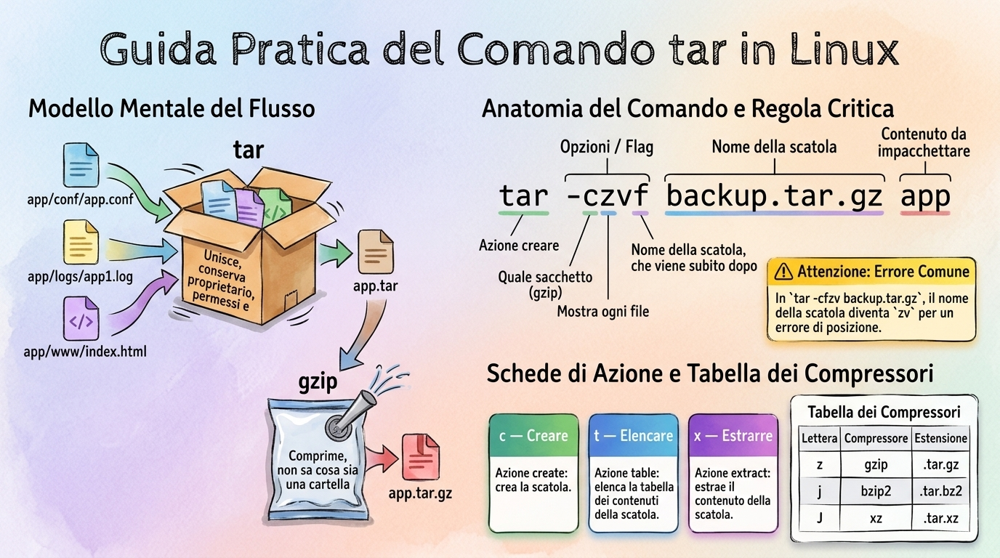
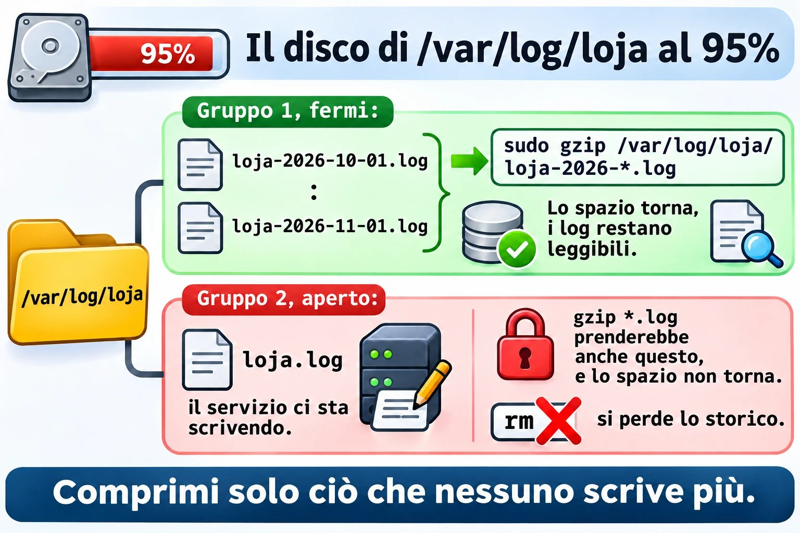
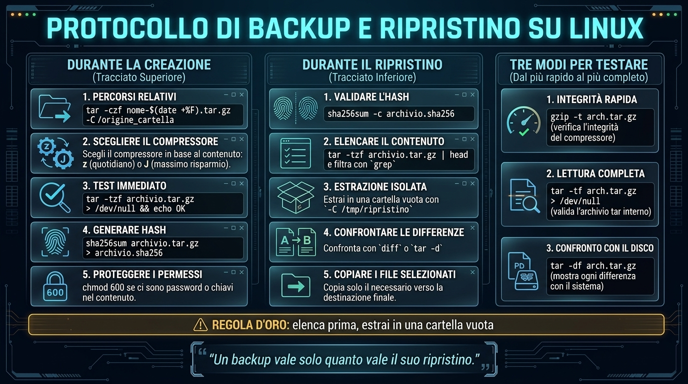
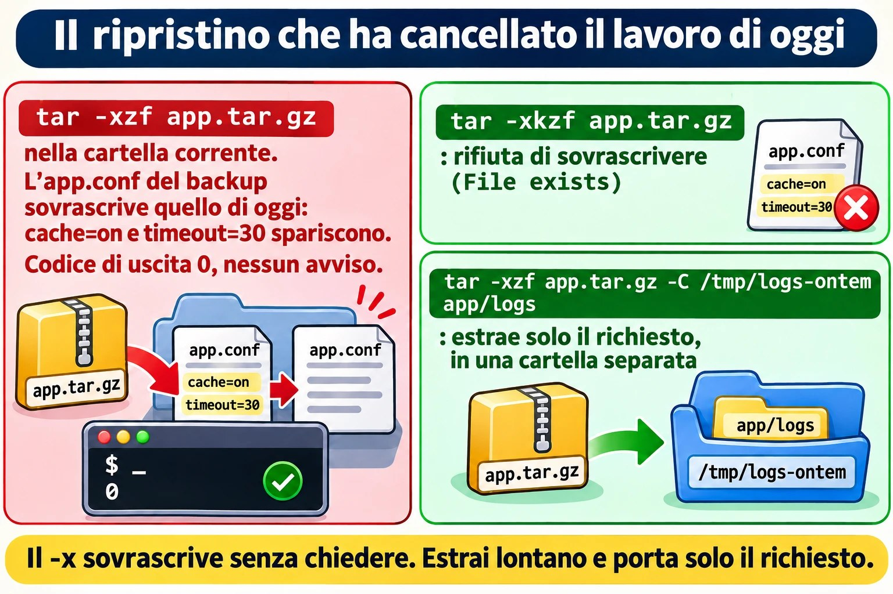

# Lezione 1.7 · Archiviare e comprimere

Impari a mettere un'intera cartella in un file solo, a rimpicciolire quel file e, soprattutto, ad aprire un backup senza distruggere quello che c'è già sul server. Alla fine, "ripristina la configurazione di ieri" smette di essere un comando rischioso e diventa una procedura in cinque passi, che ripeti identica su qualsiasi cliente.

| Scheda | Lezione 1.7 |
| --- | --- |
| Modulo | M1 · Riga di comando, lezione 7 di 10 |
| Quando | Settimana 3 |
| Alla fine sai | Creare, elencare ed estrarre archivi tar con e senza compressione; scegliere tra gzip, bzip2, xz e zip conoscendo il costo di ciascuno; testare un backup prima di averne bisogno; estrarre in una cartella separata e prendere solo il file che serve; scambiare file con chi usa Windows |
| Prerequisiti | Lezioni 1.4–1.6, con \~/lab13 ancora presente nelle VM |
| Durata | Circa 2h30 |
| Snapshot | m1a7-inicio e m1a7-fim su entrambe le VM |

## 1 · Riscaldamento

Tre domande, a memoria, prima di leggere qualsiasi cosa. Scrivi le risposte; le Soluzioni le verificano in fondo.

1. Nella Lezione 1.6, come registravi l'output e gli errori di uno script di backup nello stesso log, senza cancellare quello che c'era già?
2. Nella Lezione 1.5 hai letto un log che finiva in `.gz` senza decomprimerlo prima. Con quale comando?
3. Scommessa: mandi la stessa cartella come `.zip` e come `.tar.gz`. Quale dei due conserva proprietario e gruppo di ogni file?

## 2 · Perché conta

Lunedì, 9:10. Il cliente chiama: "qualcuno ha toccato la configurazione del sistema ordini ieri sera, rimettila com'era venerdì". Hai il backup di venerdì, `etc-2026-10-30.tar.gz`, sul NAS. Entri come root, vai in `/`, lanci `tar -xzf etc-2026-10-30.tar.gz` e il prompt torna in due secondi, senza nessun messaggio. Il file del sistema ordini è tornato a posto. Ma sono tornati alla versione di venerdì anche `/etc/passwd`, `/etc/shadow` e la configurazione di rete, che un altro collega aveva modificato sabato con regolare autorizzazione. Martedì due utenti nuovi non riescono ad accedere, e nessuno collega il problema al backup ripristinato il giorno prima.

`tar` non chiede prima di sovrascrivere. Questa lezione insegna l'abitudine che evita il disastro: elencare prima, estrarre in una cartella vuota, confrontare e copiare solo ciò che deve tornare.

Secondo caso. Lo script di backup gira ogni notte da otto mesi, e il file di ogni giorno è lì, con una dimensione ragionevole. Il giorno in cui il disco del server muore, il backup più recente si interrompe a metà: `unexpected end of file`. La copia sul NAS si fermava sempre a metà, e nessuno aveva mai aperto un backup. Un backup mai testato è solo una speranza. Qui impari a testare senza estrarre, in un secondo.

Terzo caso, il più comune. Il supporto di un fornitore chiede "i log del server, compressi". Chi li aprirà usa Windows. Devi sapere cosa Windows apre senza installare nulla, e cosa rovina.

E il quarto, di ogni notte: il disco dei log arriva al 95%. Prima di cancellare qualsiasi cosa, comprimere i log vecchi libera, nel caso del testo, dall'80% al 95% dello spazio. Ma c'è un modo di comprimere che cancella subito l'originale, ed è bene saperlo prima.

## 3 · Modello mentale

> tar è lo scatolone del trasloco. gzip, bzip2 e xz sono il sacchetto sottovuoto.

Sono due compiti diversi, svolti da strumenti diversi:

- Lo **scatolone**, cioè `tar`, mette tanti file in uno solo. Dentro va ogni file con il suo nome, cartella, proprietario, gruppo, permessi e data. Lo scatolone non rimpicciolisce niente: dieci file da 1 MB danno un `.tar` di poco più di 10 MB.
- Il **sacchetto sottovuoto**, cioè il compressore, riduce un unico flusso di byte. Non sa cos'è una cartella. Se chiedi a `gzip` di comprimere una cartella, rifiuta.

Un `.tar.gz` è lo scatolone dentro il sacchetto. Per questo il nome ha due estensioni, e per questo le lettere di `tar` vengono in due gruppi: quelle che dicono cosa fare con lo scatolone e quella che dice quale sacchetto usare.

```text
  app/conf/app.conf ─┐
  app/logs/app1.log ─┼─► tar ─► app.tar  ─► gzip ─► app.tar.gz
  app/www/index.html ┘   caixa: junta,       saco: encolhe,
                         guarda dono,        não sabe o que
                         permissão e data    é pasta
```

`zip`, il formato di Windows, fa le due cose insieme, file per file. Questo ha un vantaggio: si può estrarre un file dal mezzo di un enorme `.zip` senza leggere il resto. E due svantaggi: comprime peggio quando ci sono molti file simili, perché ognuno viene compresso da solo, e non conserva proprietario e gruppo di Linux.

**La prima idea da portarti via.** Le lettere di `tar` si leggono come una frase. La prima dice l'azione, e ce ne sono solo tre che usi ogni giorno:

| Lettera | Azione | Ricordala così |
| --- | --- | --- |
| c | creare lo scatolone | **c**reate |
| t | elencare cosa c'è dentro | **t**able, l'indice del contenuto |
| x | estrarre | e**x**tract |

Poi vengono i modificatori: `v` mostra ogni file mentre lavora, `f` indica il nome del file dello scatolone, e `z`, `j` o `J` scelgono il sacchetto. La `f` ha una regola che fa inciampare molti: **il nome dello scatolone viene subito dopo di lei**. In `tar -czvf backup.tar.gz app`, la `f` è l'ultima lettera, e `backup.tar.gz` è il nome. In `tar -cfzv backup.tar.gz app`, il nome dello scatolone diventa `zv`.

**La seconda idea.** Estrarre scrive sopra, senza chiedere. `tar -x` si comporta come un `cp` senza `-i` applicato a centinaia di file in una volta. Se il percorso salvato dentro lo scatolone esiste già dove ti trovi, il file attuale viene sostituito dalla versione dello scatolone. Per questo la regola d'oro: **elenca prima, estrai in una cartella vuota**.

**La terza idea.** Un backup vale quanto vale il suo ripristino. Creare il file dimostra che lo script è girato; solo elencare o testare il file dimostra che si può aprire.

**Ponte Windows.** In Windows fai clic destro su "Invia a > Cartella compressa" e ottieni un `.zip`. Windows 10 e 11 includono anche un vero `tar.exe`, in `C:\Windows\System32`, che apre i `.tar.gz` da cmd o da PowerShell con lo stesso `tar -xzf`. 7-Zip apre entrambi i formati, ma un `.tar.gz` in due passaggi: prima toglie il sacchetto, poi apre lo scatolone. La differenza che conta: lo `.zip` di Windows non sa cosa siano proprietario, gruppo o permessi di Linux. Uno script con il permesso di esecuzione che passa per uno `.zip` creato in Windows arriva senza.


*tar raggruppa, il compressore rimpicciolisce, e le lettere del comando si leggono come una frase.*

## 4 · Il concetto a strati

### Essenziale

**tar.** Le tre frasi che scriverai mille volte:

```bash
tar -czf app.tar.gz app/
tar -tzf app.tar.gz
tar -xzf app.tar.gz -C /tmp/restaura
```

Crea, elenca, estrai. `-C` dice in quale cartella estrarre; senza, `tar` estrae nella cartella corrente. In lettura, il `tar` di GNU, che è quello di Rocky e di Debian, capisce da solo quale compressore è stato usato. Quindi anche `tar -tf app.tar.gz` e `tar -xf app.tar.gz` funzionano. In creazione, invece, devi dirlo.

| Lettera | Compressore | Estensione | Quando usarlo |
| --- | --- | --- | --- |
| z | gzip | .tar.gz o .tgz | Lo standard. Veloce, e ogni sistema lo apre |
| j | bzip2 | .tar.bz2 | Formato vecchio. Lo trovi negli archivi datati |
| J | xz | .tar.xz | File più piccolo, creazione più lenta. Comune nei sorgenti e nei pacchetti |
| nessuna | nessuno | .tar | Quando il contenuto è già compresso, come foto, video e .zip |

Con `-a`, al posto della lettera, `tar` sceglie il compressore dall'estensione del nome: `tar -caf app.tar.xz app/` usa xz.

**I compressori da soli.** Servono per un file singolo. Di default sostituiscono l'originale:

| Comprimere | Decomprimere | Leggere senza decomprimere | Testare |
| --- | --- | --- | --- |
| gzip arq | gunzip arq.gz | zcat, zless, zgrep | gzip -t arq.gz |
| bzip2 arq | bunzip2 arq.bz2 | bzcat, bzless, bzgrep | bzip2 -t arq.bz2 |
| xz arq | unxz arq.xz | xzcat, xzless, xzgrep | xz -t arq.xz |

`gzip arq` crea `arq.gz` e cancella `arq`. Per tenere l'originale usa `-k`, da keep. Per scegliere tra velocità e dimensione, i livelli vanno da `-1`, il più veloce, a `-9`, il file più piccolo. Il default di gzip è 6.

**zip.** Formato a sé, con due programmi:

```bash
zip -r logs.zip logs/
unzip -l logs.zip
unzip -t logs.zip
unzip logs.zip -d /tmp/restaura
```

`-r` entra nelle cartelle; senza, `zip` salva solo la cartella vuota. `-l` elenca, `-t` testa e `-d` sceglie la cartella di destinazione.

**Testare.** Tre modi, dal più rapido al più completo:

- `gzip -t arq.tar.gz`: il sacchetto è integro?
- `tar -tf arq.tar.gz > /dev/null`: il sacchetto è integro, e lo è anche lo scatolone al suo interno? Se non compare nessun errore, il file si apre.
- `tar -df arq.tar.gz`: lo scatolone è uguale a ciò che c'è ora sul disco? Mostra ogni differenza.

E, per le copie tra macchine, l'impronta digitale: `sha256sum arq.tar.gz` prima e dopo la copia. Se i due numeri sono uguali, la copia è identica.

### Ponte Windows

| In Windows | In Linux | Attenzione |
| --- | --- | --- |
| Invia a > Cartella compressa | zip -r arq.zip pasta | Linux potrebbe non avere zip installato |
| Estrai tutto... | unzip arq.zip -d pasta | Senza -d, estrae nella cartella corrente |
| Compress-Archive, in PowerShell | zip -r oppure tar -czf | Lo .zip non conserva proprietario e gruppo |
| tar.exe -xzf, in cmd | tar -xzf | Lo stesso comando da entrambe le parti |
| 7-Zip con .tar.gz | tar -xzf | 7-Zip apre in due passaggi |
| Backup di Windows Server | tar con data nel nome e test | Nessuno dei due avvisa se il backup non si apre |

### Avanzato

- `tar --exclude='*.log' -czf app.tar.gz app/` lascia fuori ciò che corrisponde al pattern. La Lezione 8.3 approfondisce selezione ed esclusione.
- `tar -xzf app.tar.gz app/conf/app.conf` estrae un file solo. Il percorso deve essere esattamente quello che mostra `tar -t`.
- `tar --strip-components=1 -xzf app.tar.gz` toglie la prima cartella del percorso durante l'estrazione.
- `tar --keep-old-files`, o `-k`, rifiuta di sovrascrivere un file che esiste già, e termina con errore. `--skip-old-files` salta in silenzio, e `--keep-newer-files` sostituisce solo ciò che è più vecchio della versione nello scatolone.
- Rocky, come RHEL, usa SELinux e a volte le ACL. Per conservare questi attributi, `tar --selinux --acls --xattrs`. È un argomento della Lezione 8.5.
- `zstd`, con `tar --zstd`, comprime quasi quanto xz e quasi veloce quanto gzip. È il formato dei backup dei container di Proxmox, i file `vzdump-lxc-*.tar.zst`.
- Con `xz -T0`, xz usa tutti i core della CPU. Con `tar -I 'xz -T0' -cf`, lo stesso dentro tar.

## 5 · Rocky × Debian

`tar` è lo stesso su entrambe, quello di GNU, e le opzioni di questa lezione funzionano allo stesso modo. La differenza sta in cosa viene installato e in come ciascun sistema usa la compressione ogni giorno.

| Voce | Rocky 9 | Debian 13 |
| --- | --- | --- |
| tar, gzip e xz | Preinstallati | Preinstallati |
| bzip2, zip e unzip | Possono mancare nell'installazione minimale | Possono mancare nell'installazione minimale |
| Installare ciò che manca | sudo dnf install bzip2 zip unzip | sudo apt install bzip2 zip unzip |
| Log ruotati da logrotate | Con la data nel nome, in genere senza .gz | .1 non compresso e .2.gz in poi, per via di delaycompress |
| Documentazione in /usr/share/doc | File normali | Molti file .gz, come changelog.Debian.gz |
| Backup automatici del sistema | Non c'è una cartella standard | /var/backups, con copie .gz dell'elenco dei pacchetti |

Controlla i log ruotati su entrambe:

```bash
ls /var/log | head -n 30
grep -n compress /etc/logrotate.conf
```

Su Rocky, qualcosa come `messages-20261101` e `secure-20261101`, senza `.gz`. `compress` compare commentato in `logrotate.conf`. Su Debian, cerca file come `dpkg.log.1` e `dpkg.log.2.gz`. Su Debian, a decidere è ogni file in `/etc/logrotate.d`:

```bash
[ "$(hostname)" = debian-lab ] && grep -l delaycompress /etc/logrotate.d/*
[ "$(hostname)" = debian-lab ] && ls -lh /var/backups
```

`delaycompress` lascia il `.1` non compresso per un ciclo, perché qualche programma potrebbe ancora starci scrivendo. È la stessa lezione di `tail -F` della Lezione 1.5, vista dall'altra parte.

Su Debian, anche il pacchetto `.deb` porta uno scatolone tar al suo interno. Scarica un pacchetto piccolo nella cartella corrente, senza installare nulla, e guarda il contenuto:

```bash
[ "$(hostname)" = debian-lab ] && cd /tmp && apt download hostname && dpkg-deb -c hostname_*.deb
```

Qualcosa come un elenco nel formato di `tar -tv`, con permessi, proprietario `root/root`, dimensione, data e percorsi come `./usr/bin/hostname`. È esattamente lo scatolone che `dpkg` apre in `/` quando installa il pacchetto. Cancella il file scaricato con `rm -v /tmp/hostname_*.deb`.


*Il contenuto decide il sacchetto: il testo ripetuto si rimpicciolisce molto, e ciò che è già compresso no.*

## 6 · Lab guidato

Fai tutto su entrambe le VM, a meno che il passo non ne indichi una sola. I file stanno in `~/lab13/arquivo`, e la materia prima è una piccola applicazione finta, con configurazione, log, uno script e un file binario. In ogni passo, quando compare **Prevedi**, scrivi la risposta prima di premere Invio.

### Passo 1 · Preparare

Sul nodo Proxmox:

```bash
qm snapshot 201 m1a7-inicio
qm snapshot 202 m1a7-inicio
```

Su ogni VM, controlla che gli strumenti siano installati:

```bash
for p in tar gzip bzip2 xz zip unzip; do command -v $p > /dev/null && echo "ok    $p" || echo "FALTA $p"; done
```

Se compare qualche `FALTA`, installa:

```bash
[ "$(hostname)" = rocky-lab ] && sudo dnf install -y bzip2 xz zip unzip
[ "$(hostname)" = debian-lab ] && sudo apt install -y bzip2 xz-utils zip unzip
```

Rilancia il `for`: tutte le righe devono dire `ok`. Ora monta l'applicazione:

```bash
mkdir -p ~/lab13/arquivo/app/conf ~/lab13/arquivo/app/logs ~/lab13/arquivo/app/www
cd ~/lab13/arquivo
cp ~/lab13/logs/app1.log app/logs/
for i in $(seq 1 500); do cat ~/lab13/logs/app1.log; done > app/logs/grande.log
head -c 2M /dev/urandom > app/www/foto.bin
echo '<h1>Loja</h1>' > app/www/index.html
cat > app/conf/app.conf <<'EOF'
porta=8080
banco=pg01
usuarios_max=50
EOF
printf '#!/bin/bash\necho "app ok"\n' > app/iniciar.sh
chmod 750 app/iniciar.sh
ls -lR app
du -sh app
```

`grande.log` è `app1.log` ripetuto 500 volte: 10.000 righe di testo molto ripetitivo, come un log vero. `foto.bin` sono 2 MB di byte casuali, che fanno la parte di una foto o di un file già compresso. `du` deve mostrare qualcosa come `3,0M app`. Se `app1.log` non esiste, torna al Passo 1 della Lezione 1.5.

### Passo 2 · Lo scatolone: creare, elencare ed estrarre

Prima, solo lo scatolone, senza compressione:

```bash
tar -cvf app.tar app
ls -lh app.tar
```

`v` mostra ogni file che entra. **Prevedi.** `app.tar` sarà più grande, più piccolo o della stessa dimensione che ha mostrato `du`?

Un po' più grande. Lo scatolone non comprime, e in più salva un'intestazione di 512 byte per ogni file, con nome, proprietario, permessi e data. Ora guarda al suo interno:

```bash
tar -tf app.tar
tar -tvf app.tar
```

`-t` da solo mostra i percorsi. Con `v`, compare qualcosa come un `ls -l`:

```text
-rwxr-x--- student/student   27 2026-11-02 10:14 app/iniciar.sh
```

Permessi, proprietario e gruppo, dimensione, data e percorso: tutto questo viaggia dentro lo scatolone. Nota che i percorsi iniziano con `app/`, senza barra davanti. Sono relativi, e questo conterà nel Passo 5.

Estrai in una cartella separata e controlla:

```bash
mkdir -p /tmp/teste1
tar -xvf app.tar -C /tmp/teste1
ls -l /tmp/teste1/app
```

`iniciar.sh` è tornato con `-rwxr-x---`, com'era. Ora, il percorso assoluto:

```bash
tar -cf hosts.tar /etc/hosts
tar -tf hosts.tar
```

Qualcosa come `tar: Removing leading '/' from member names`, e l'elenco mostra `etc/hosts`, senza barra. Non è un errore: `tar` toglie la barra di proposito, perché l'estrazione finisca nella cartella dove ti trovi, e non sopra l'`/etc/hosts` del sistema. Il collega della sezione 2 ha distrutto `/etc` solo perché era in `/` quando ha estratto.

**Decidi 1 · L'ordine delle lettere.** Scenario: di fretta, digiti `tar -cfv backup.tar app`, con la `v` dopo la `f`. Cosa succede?

- **A)** Lo stesso di `tar -cvf`. L'ordine delle lettere non conta.
- **B)** `tar` crea un file chiamato `v`, ci mette dentro la cartella `app`, e si lamenta che `backup.tar` non esiste.
- **C)** `tar` rifiuta il comando, perché la `f` deve essere la prima lettera.
- **D)** Crea `backup.tar` normalmente, solo che non mostra i nomi a schermo.

Scegli un'opzione prima di continuare.

| Se hai scelto | Risultato | Perché |
| --- | --- | --- |
| A | ❌ Sbagliato | L'ordine delle altre lettere non conta, ma la `f` prende la parola successiva come nome dello scatolone. Con `-cfv`, quella parola è `v`. |
| B | ✅ Giusto | La `f` ha ricevuto `v` come nome. Restano `backup.tar` e `app` come cose da archiviare, e `backup.tar` non esiste. Lo scatolone `v` viene creato con `app` dentro, e il comando termina con un errore. |
| C | ❌ Sbagliato | La `f` può stare in qualsiasi posizione. Conta che il nome dello scatolone venga subito dopo di lei. |
| D | ❌ Sbagliato | `backup.tar` non viene mai creato. `tar` l'ha trattato come qualcosa da archiviare, non come destinazione. |

**Da ricordare:** la `f` è sempre l'ultima lettera del gruppo, e il nome dello scatolone viene subito dopo. Leggi `-czf` come "crea, con gzip, il file...".

Controlla:

```bash
tar -cfv backup.tar app
echo "código de saída: $?"
ls -l v backup.tar
tar -tf v | head -n 3
rm -v v
```

Qualcosa come `tar: backup.tar: Cannot stat: No such file or directory` e codice di uscita 2. `ls` mostra il file `v`, con la dimensione di `app.tar`, e dice che `backup.tar` non esiste. Il contenuto di `v` è la cartella `app`.

### Passo 3 · Il sacchetto da solo: gzip, bzip2 e xz

Fai una copia del log grande e comprimila:

```bash
cp app/logs/grande.log g1.log
ls -lh g1.log
gzip g1.log
```

**Prevedi.** Cosa mostrerà ora `ls`: `g1.log` e `g1.log.gz`, o uno solo dei due?

```bash
ls -lh g1.log*
```

Solo `g1.log.gz`. `gzip` ha sostituito l'originale con il file compresso. E la dimensione è scesa da circa 600 KB a pochi KB: il testo è così ripetitivo che quasi tutto sparisce. Leggi senza decomprimere e poi decomprimi:

```bash
zcat g1.log.gz | wc -l
gunzip g1.log.gz
ls -lh g1.log*
```

Le 10.000 righe, e di nuovo solo `g1.log`, ora senza `.gz`. Per tenere l'originale, usa `-k`:

```bash
gzip -k g1.log
ls -lh g1.log*
```

Ora ci sono entrambi. Confronta i tre compressori sullo stesso file:

```bash
for c in gzip bzip2 xz; do cp app/logs/grande.log t-$c.log; $c t-$c.log; done
ls -lh t-*
```

Qualcosa come `.xz` più piccolo, `.bz2` nel mezzo e `.gz` più grande. La differenza c'è, ma tutti e tre restano molto più piccoli dell'originale. Ora prova quello che non si può fare:

```bash
gzip app
gzip -k app/www/foto.bin
ls -l app/www/foto.bin*
rm -v app/www/foto.bin.gz
```

Il primo risponde `gzip: app is a directory -- ignored`: il sacchetto non sa cos'è una cartella. Il secondo funziona, ma `foto.bin.gz` resta della stessa dimensione dell'originale, o un po' più grande. I byte casuali non hanno ripetizioni da eliminare. Vale per foto, video, `.zip` e qualsiasi cosa già compressa: comprimere di nuovo consuma solo CPU.

**Decidi 2 · Il disco pieno di notte.** Scenario: il disco di `/var/log/loja` è al 95%. Lì c'è un log al giorno, da `loja-2026-10-01.log` a `loja-2026-11-01.log`, più `loja.log`, che il servizio sta scrivendo adesso. Vuoi liberare spazio senza perdere nessun log. Cosa fai?

- **A)** `sudo gzip /var/log/loja/*.log`
- **B)** `sudo gzip /var/log/loja/loja-2026-*.log`
- **C)** `sudo tar -czf /var/log/loja/antigos.tar.gz /var/log/loja`
- **D)** `sudo rm /var/log/loja/loja-2026-10-*.log`

Scegli un'opzione prima di continuare.

| Se hai scelto | Risultato | Perché |
| --- | --- | --- |
| A | ❌ Sbagliato | `*.log` prende anche `loja.log`, che è aperto. `gzip` crea il `.gz` e cancella il nome, ma il servizio continua a scrivere nel file cancellato: lo spazio non torna, e quello che viene scritto dopo va perso. È l'inode della Lezione 1.5. |
| B | ✅ Giusto | Comprime solo i file con la data, che nessuno scrive più. Ognuno viene sostituito dal `.gz`, e lo spazio torna subito. I log restano leggibili con `zless` e `zgrep`. |
| C | ❌ Sbagliato | Crea un altro file, sullo stesso disco pieno, e non cancella nessun originale. L'uso del disco sale. E per di più cerca di mettere dentro lo scatolone lo scatolone stesso che sta creando. |
| D | ❌ Sbagliato | Libera spazio, ma cancella i log di ottobre. Nessuno ha autorizzato a perdere lo storico. |

**Da ricordare:** `gzip` da solo scambia l'originale con il `.gz`. Sui log, usalo solo sui file che nessuno scrive più.

Sistema la cartella prima di continuare:

```bash
rm -v g1.log g1.log.gz t-*
```



*Comprimi solo i log con la data, che nessuno scrive più; il log aperto resta in pace.*

### Passo 4 · Lo scatolone dentro il sacchetto

Ora le due cose insieme. Confronta i tre sacchetti, solo con i log:

```bash
time tar -czf logs.tar.gz app/logs
time tar -cjf logs.tar.bz2 app/logs
time tar -cJf logs.tar.xz app/logs
ls -lh logs.tar*
file logs.tar*
```

`time` mostra quanto ci ha messo ciascuno: guarda la riga `real`. Qualcosa come xz più lento e più piccolo, gzip più veloce e più grande. Con 600 KB, tutto richiede frazioni di secondo; con 50 GB, la differenza diventa ore. `file` guarda i primi byte e dice il formato vero, senza fidarsi dell'estensione: qualcosa come `gzip compressed data`, `bzip2 compressed data` e `XZ compressed data`.

**Prevedi.** Ora l'applicazione intera, con `foto.bin`. I tre file avranno dimensioni molto diverse?

```bash
tar -czf app.tar.gz app
tar -cJf app.tar.xz app
ls -lh app.tar app.tar.gz app.tar.xz
```

No. Qualcosa come 3,0 MB, 2,1 MB e 2,0 MB. I 2 MB di `foto.bin` non si riducono con nessun sacchetto e dominano il totale. Prima di scegliere il compressore, guarda cosa c'è dentro lo scatolone.

`tar` sceglie il sacchetto anche dall'estensione, con `-a`, e capisce da solo quale sacchetto aprire:

```bash
tar -caf auto.tar.bz2 app/conf
file auto.tar.bz2
tar -tf auto.tar.bz2
tar -tf logs.tar.xz
```

Nessuna `j` né `J` in lettura, e tutto funziona. In `-c`, invece, senza la lettera e senza `-a`, lo scatolone esce senza compressione, anche con `.gz` nel nome.

**Decidi 3 · La richiesta alla lettera.** Scenario: la richiesta dice "crea il file `/root/backup.tar.bz2` con il contenuto di `/usr/local`, compresso con bzip2". Quale comando svolge il compito?

- **A)** `sudo tar -czf /root/backup.tar.bz2 /usr/local`
- **B)** `sudo tar -cjf /root/backup.tar.bz2 /usr/local`
- **C)** `sudo bzip2 -c /usr/local > /root/backup.tar.bz2`
- **D)** `sudo tar -cfj /root/backup.tar.bz2 /usr/local`

Scegli un'opzione prima di continuare.

| Se hai scelto | Risultato | Perché |
| --- | --- | --- |
| A | ❌ Sbagliato | La `z` usa gzip. Il file ha il nome giusto e il formato sbagliato, e lo script di correzione usa `file`. Il compito vale zero. |
| B | ✅ Giusto | La `c` crea, la `j` usa bzip2, e la `f` riceve il nome subito dopo. `sudo` serve per scrivere in `/root`. |
| C | ❌ Sbagliato | `bzip2` non sa cos'è una cartella. Senza lo scatolone, non c'è nulla da comprimere. |
| D | ❌ Sbagliato | La `f` prende `j` come nome dello scatolone. È la trappola di Decidi 1, stavolta con root. |

**Da ricordare:** z è gzip, j è bzip2, J è xz. Con una richiesta precisa, chiudi sempre con `file` e `tar -tf`.

Controlla, e poi cancella:

```bash
sudo tar -cjf /root/backup.tar.bz2 /usr/local
sudo file /root/backup.tar.bz2
sudo tar -tf /root/backup.tar.bz2 | head -n 5
sudo rm -v /root/backup.tar.bz2
```

### Passo 5 · Elenca prima di estrarre

Un fornitore manda un aggiornamento. Ha creato lo scatolone da dentro la cartella, senza il nome di quest'ultima:

```bash
cd ~/lab13/arquivo/app && tar -czf ../patch.tar.gz * && cd ..
mkdir -p downloads
touch downloads/contrato.pdf downloads/planilha.xlsx
```

Hai scaricato `patch.tar.gz` nella cartella `downloads`, dove ci sono già altri file. **Prevedi.** Se estrai la patch dentro `downloads`, dove finiranno i file?

Non estrarre ancora. Guarda prima:

```bash
tar -tzf patch.tar.gz
```

I percorsi iniziano con `conf/`, `logs/`, `www/` e `iniciar.sh`. Non c'è una cartella che li contenga. Estratto in `downloads`, il contenuto si spargerebbe in mezzo al contratto e al foglio di calcolo, e, se lì ci fosse una `conf/`, i file verrebbero sovrascritti. Questo tipo di scatolone ha perfino un soprannome, tarbomb. Il modo sicuro è dargli una cartella vuota:

```bash
mkdir -p /tmp/patch
tar -xzf patch.tar.gz -C /tmp/patch
ls -l /tmp/patch
ls -l downloads
```

`downloads` resta solo con i due file. Ora prendi un file solo da uno scatolone. Il percorso deve essere esattamente quello che mostra `-t`:

```bash
mkdir -p /tmp/um
tar -xzf app.tar.gz -C /tmp/um conf/app.conf
tar -xzf app.tar.gz -C /tmp/um app/conf/app.conf
find /tmp/um
```

Il primo fallisce con qualcosa come `tar: conf/app.conf: Not found in archive`, perché dentro `app.tar.gz` il percorso inizia con `app/`. Il secondo funziona, e `find` mostra solo `app/conf/app.conf`. Le cartelle del percorso vengono create, il resto no.

**Decidi 4 · La patch del fornitore.** Scenario: il fornitore manda `patch.tar.gz` e scrive "estrai nella cartella del sistema, `/opt/loja`". Qual è il primo comando?

- **A)** `cd /opt/loja && sudo tar -xzf ~/patch.tar.gz`
- **B)** `tar -tzf ~/patch.tar.gz | head -n 30`
- **C)** `sudo tar -xzf ~/patch.tar.gz -C /`
- **D)** `gunzip ~/patch.tar.gz`

Scegli un'opzione prima di continuare.

| Se hai scelto | Risultato | Perché |
| --- | --- | --- |
| A | ❌ Sbagliato | Può anche andare bene, ma hai estratto come root, sopra il sistema, senza sapere cosa c'era nello scatolone. Se i percorsi iniziano con `opt/loja/`, i file vanno in `/opt/loja/opt/loja`. Se sono sciolti, sovrascrivono la configurazione attuale. |
| B | ✅ Giusto | Guardare non cambia nulla. Vedi se i percorsi iniziano con una cartella, quanti file sono e se qualcuno sostituirà una configurazione che hai modificato. Solo dopo decidi dove estrarre. |
| C | ❌ Sbagliato | Estrarre in `/` come root è il disastro della sezione 2. Fallo solo se hai letto tutto l'elenco e sai che ogni percorso deve andare esattamente lì. |
| D | ❌ Sbagliato | Toglie il sacchetto e lascia lo scatolone, `patch.tar`. Non mostra il contenuto e per di più cancella il `.gz` originale. |

**Da ricordare:** prima di ogni `-x`, un `-t`. Costa un secondo.

### Passo 6 · Testare prima di fidarsi

Un backup vale quanto vale il ripristino che restituisce. Ci sono quattro test, dal più rapido al più completo:

```bash
cd ~/lab13/arquivo
gzip -t app.tar.gz && echo "gzip ok"
xz -t logs.tar.xz && echo "xz ok"
tar -tzf app.tar.gz > /dev/null && echo "tar ok"
```

`gzip -t` e `xz -t` non dicono nulla quando è tutto a posto: compare solo l'`echo`. Leggono l'intero sacchetto e controllano il checksum che sta in fondo al file. `tar -t` con l'output buttato in `/dev/null` va più a fondo: apre il sacchetto e scorre lo scatolone fino all'ultima intestazione. Se manca un pezzo qualsiasi, entrambi si lamentano e restituiscono un errore.

Il terzo test confronta lo scatolone con il disco. Eseguilo da dentro la cartella in cui i percorsi hanno senso:

```bash
tar -dzf app.tar.gz && echo "igual ao disco"
echo "porta=9090" >> app/conf/app.conf
tar -dzf app.tar.gz
echo "código de saída: $?"
```

La prima volta, `igual ao disco`. Dopo la modifica, qualcosa come:

```text
app/conf/app.conf: Mod time differs
app/conf/app.conf: Size differs
```

e codice di uscita 1. `-d` (diff) dice cosa è cambiato dal backup, senza estrarre nulla. Annulla la modifica prima di continuare:

```bash
sed -i '/porta=9090/d' app/conf/app.conf
```

Il quarto test è l'impronta digitale. `sha256sum` calcola un numero che cambia se cambia un solo bit del file. Conserva quel numero al momento di creare il backup, e controllalo dopo aver copiato, scaricato o prima di ripristinare:

```bash
sha256sum app.tar.gz > app.tar.gz.sha256
cat app.tar.gz.sha256
cp app.tar.gz /tmp/copia.tar.gz
cd /tmp && sha256sum -c ~/lab13/arquivo/app.tar.gz.sha256 ; cd ~/lab13/arquivo
```

`-c` cerca il file con il nome scritto nel `.sha256`. In `/tmp` non trova `app.tar.gz`, solo `copia`, e si lamenta. Confronta direttamente la copia:

```bash
sha256sum app.tar.gz /tmp/copia.tar.gz
sha256sum -c app.tar.gz.sha256
```

I due numeri sono uguali, e `-c` risponde `app.tar.gz: OK`. È così che si verifica una ISO scaricata da internet: il sito pubblica il `.sha256` accanto.

**Decidi 5 · Il backup di ieri.** Scenario: il file server di un cliente è morto, e devi ripristinare `backup-2026-11-01.tar.gz`, che lo script quotidiano ha creato sul NAS. Prima di tutto vuoi sapere se è integro. Quale verifica risponde a questo?

- **A)** `ls -lh backup-2026-11-01.tar.gz`: pesa 40 GB, come sempre.
- **B)** `tar -tzf backup-2026-11-01.tar.gz > /dev/null && echo OK`
- **C)** `file backup-2026-11-01.tar.gz`: dice `gzip compressed data`.
- **D)** Il log dello script dice `backup concluído` e codice di uscita 0.

Scegli un'opzione prima di continuare.

| Se hai scelto | Risultato | Perché |
| --- | --- | --- |
| A | ❌ Sbagliato | La dimensione dice solo quanti byte ci sono, non se sono giusti. Una copia tagliata vicino alla fine o un disco con settori danneggiati mantiene una dimensione simile. |
| B | ✅ Giusto | Legge il file dal primo all'ultimo byte, controlla il checksum di gzip e scorre tutte le intestazioni dello scatolone. Se qualcosa è tagliato o corrotto, l'OK non compare. |
| C | ❌ Sbagliato | `file` guarda solo i primi byte. Un file tagliato a metà continua a iniziare come gzip. Lo vedrai nel Guasto B. |
| D | ❌ Sbagliato | Dice che lo script è terminato ieri. Non dice nulla su cosa è successo al file dopo: copia sul NAS, disco, rete. |

**Da ricordare:** "esiste" e "ha una dimensione" non significano "è integro". Leggi il file fino in fondo con `tar -t` o `gzip -t`.


*Ogni test prova una cosa diversa: dimensione e `file` non provano che il backup è integro.*

### Passo 7 · zip e unzip, per chi usa Windows

Crea, elenca e testa uno zip:

```bash
zip -r app.zip app
unzip -l app.zip
unzip -t app.zip
ls -lh app.zip app.tar.gz
```

`-r` è obbligatorio: senza, `zip` salva solo la cartella vuota. `-l` elenca, come `tar -t`. `-t` testa e termina con qualcosa come `No errors detected in compressed data of app.zip.`. La dimensione è simile a quella del `.tar.gz`: l'algoritmo è lo stesso della famiglia di gzip.

La differenza sta in ciò che lo zip ricorda. Estrai e confronta:

```bash
mkdir -p /tmp/z
unzip -q app.zip -d /tmp/z
ls -l /tmp/z/app/iniciar.sh
tar -tvzf app.tar.gz app/iniciar.sh
```

`unzip` di Linux restituisce i permessi, quindi `iniciar.sh` torna eseguibile. Ma lo zip non conserva proprietario e gruppo come fa `tar`: estratto come root, tutto diventa di root. E se lo zip è stato creato in Windows, non ci sono permessi di nessun tipo: lo script arriva senza la `x`, e serve un `chmod`.

Per mandare uno zip a un cliente, solo ciò che interessa:

```bash
zip -r logs-para-fornecedor.zip app/logs -x '*.bin'
unzip -l logs-para-fornecedor.zip
```

`-x` esclude tramite pattern. Per chi riceve in Windows, uno zip si apre con due clic. Un `.tar.gz` si apre anche in Windows 11 con `tar.exe` o 7-Zip, ma richiede una spiegazione.

Regola pratica: tra server Linux, `tar`. Per le persone, soprattutto su Windows, `zip`.

### Passo 8 · Backup di `/etc` e ripristino di un file

Ora con file veri. Fai il backup della configurazione del sistema:

```bash
cd ~/lab13/arquivo
sudo tar -czf etc-$(date +%F).tar.gz -C / etc
ls -lh etc-*.tar.gz
sudo tar -tzf etc-*.tar.gz | head -n 5
sudo tar -tzf etc-*.tar.gz | wc -l
```

`-C /` fa entrare `tar` in `/` prima di prendere `etc`. Così, i percorsi dentro lo scatolone iniziano con `etc/`, senza la barra, e senza il messaggio `Removing leading '/'`. `sudo` serve perché file come `/etc/shadow` li legge solo root. `$(date +%F)` mette la data nel nome, qualcosa come `etc-2026-11-02.tar.gz`.

Il file di backup appartiene a root. Controlla:

```bash
ls -l etc-*.tar.gz
```

Qualcosa come `-rw-r--r--. 1 root root`. Contiene `shadow`, con gli hash delle password, e qualsiasi utente può leggerlo. Correggi:

```bash
sudo chmod 600 etc-*.tar.gz
ls -l etc-*.tar.gz
```

Ora simula un incidente. Qualcuno ha rovinato `/etc/hosts`:

```bash
sudo cp /etc/hosts /etc/hosts.antes-da-aula
echo "10.9.9.9 servidor-errado" | sudo tee -a /etc/hosts
tail -n 2 /etc/hosts
```

Ripristina solo quel file, senza toccare il resto di `/etc`. Prima, in una cartella separata:

```bash
sudo tar -tzf etc-*.tar.gz | grep -x 'etc/hosts'
mkdir -p /tmp/restaura
sudo tar -xzf etc-*.tar.gz -C /tmp/restaura etc/hosts
diff /tmp/restaura/etc/hosts /etc/hosts
```

`grep -x` conferma il percorso esatto prima di estrarre. `diff` mostra qualcosa come `> 10.9.9.9 servidor-errado`: l'unica riga in più del file attuale. Ora sai esattamente cosa cambierà. Rimettilo a posto:

```bash
sudo cp /tmp/restaura/etc/hosts /etc/hosts
diff /etc/hosts.antes-da-aula /etc/hosts && echo "restaurado"
sudo rm -v /etc/hosts.antes-da-aula
sudo rm -rf /tmp/restaura
```

Su Rocky, `cp` sopra un file che esiste già mantiene il contesto SELinux del file di destinazione. Se avessi estratto direttamente in `/etc` senza `--selinux`, avresti potuto aver bisogno di un `restorecon`. Torna nel Modulo 4.

**Decidi 6 · Lo `sshd_config` rotto.** Scenario: dopo una modifica, `sshd` non parte più. Hai `etc-2026-11-01.tar.gz` di ieri e vuoi riportare indietro solo `/etc/ssh/sshd_config`. Quale strada segui?

- **A)** `cd / && sudo tar -xzf ~/etc-2026-11-01.tar.gz`
- **B)** Estrarre `etc/ssh/sshd_config` in `/tmp/restaura`, eseguire `diff` con quello attuale, e poi copiare.
- **C)** `sudo tar -xzf ~/etc-2026-11-01.tar.gz -C / etc/ssh/sshd_config`
- **D)** `sudo gunzip ~/etc-2026-11-01.tar.gz` e cercare il file.

Scegli un'opzione prima di continuare.

| Se hai scelto | Risultato | Perché |
| --- | --- | --- |
| A | ❌ Sbagliato | Riporta tutto `/etc` a ieri: `passwd`, `shadow`, `fstab`, tutto. Chi ha creato un utente o cambiato una password oggi perde la modifica. È il caso della sezione 2. |
| B | ✅ Giusto | Vedi la differenza prima di toccare. Se la modifica di oggi aveva una riga buona, come una porta nuova, la conservi. `cp` sopra il file esistente mantiene proprietario, permessi e contesto SELinux. |
| C | ❌ Sbagliato | Funziona, ma alla cieca. Sostituisci il file senza sapere cosa cambia, e qualsiasi correzione legittima di oggi sparisce senza avviso. Su un file solo, `diff` costa dieci secondi. |
| D | ❌ Sbagliato | Toglie il sacchetto e cancella il `.tar.gz` originale. Ti ritrovi con un `.tar` di vari MB e non hai ancora ripristinato nulla. |

**Da ricordare:** ripristina in `/tmp`, confronta con `diff`, copia solo ciò che serve.

### Protocollo · Backup e ripristino senza sorprese

Copialo sul tuo quaderno. È lo stesso ordine per un `/etc`, un sito o una cartella di un cliente.

**In creazione:**

1. Usa `-C` perché i percorsi siano relativi e inizino con una cartella dotata di nome: `tar -czf nome-$(date +%F).tar.gz -C /origem pasta`.
2. Scegli il sacchetto in base al contenuto: `z` nell'uso quotidiano, `J` se la dimensione conta più del tempo, nessuno se il contenuto è già compresso.
3. Testa subito: `tar -tzf arquivo > /dev/null && echo OK`.
4. Salva l'impronta digitale: `sha256sum arquivo > arquivo.sha256`.
5. Se dentro ci sono password o chiavi, `chmod 600`.

**In ripristino:**

1. Controlla l'impronta digitale: `sha256sum -c arquivo.sha256`.
2. Elenca prima: `tar -tzf arquivo | head`, e cerca il percorso esatto con `grep`.
3. Estrai in una cartella vuota: `-C /tmp/restaura`.
4. Confronta con `diff` o `tar -d`.
5. Copia solo ciò che serve nel posto giusto.


*Creare e ripristinare seguono la stessa logica: testare prima di fidarsi, e non estrarre mai sopra l'esistente.*

## 7 · Rompi e ripara

### Guasto A · Il ripristino che ha cancellato il lavoro di oggi

Hai lavorato tutta la mattina sulla configurazione dell'applicazione:

```bash
cd ~/lab13/arquivo
echo "cache=on" >> app/conf/app.conf
echo "timeout=30" >> app/conf/app.conf
cat app/conf/app.conf
```

Nel pomeriggio, qualcuno chiede "rimetti i log di ieri, per favore". Estrai `app.tar.gz`, che contiene tutta l'applicazione, nella cartella corrente:

```bash
tar -xzf app.tar.gz
cat app/conf/app.conf
```

**Osserva.** Le righe `cache=on` e `timeout=30` sono sparite. `tar` ha sovrascritto `app.conf` con la versione del backup, senza chiedere e senza avvisare. Il codice di uscita era 0.

**Diagnostica.** Non si torna indietro. Il file nuovo è stato cancellato e sostituito. Se non c'è un altro backup, o uno snapshot, il lavoro della mattina è perso. Rifai le due righe e guarda come `tar` avrebbe potuto proteggerti:

```bash
echo "cache=on" >> app/conf/app.conf
echo "timeout=30" >> app/conf/app.conf
tar -xkzf app.tar.gz
echo "código de saída: $?"
tail -n 2 app/conf/app.conf
```

`-k` (keep old files) rifiuta di sovrascrivere. Compare qualcosa come `tar: app/conf/app.conf: Cannot open: File exists` per ogni file che esiste già, codice di uscita 2, e le tue righe restano lì. C'è anche `--keep-newer-files`, che evita di sovrascrivere solo ciò che è più recente della versione del backup:

```bash
touch app/conf/app.conf
tar -xzf app.tar.gz --keep-newer-files
tail -n 2 app/conf/app.conf
```

Qualcosa come `Current 'app/conf/app.conf' is newer or same age`, e il file resta intatto.

**Ripara.** La strada giusta per la richiesta era estrarre solo i log, in una cartella separata:

```bash
mkdir -p /tmp/logs-ontem
tar -xzf app.tar.gz -C /tmp/logs-ontem app/logs
ls -l /tmp/logs-ontem/app/logs
```

**Decidi 7 · Cosa avrebbe evitato la perdita.** Scenario: dopo lo spavento, il collega chiede cosa cambia nella procedura. Quale regola da sola avrebbe evitato la perdita?

- **A)** Usare `tar -xvzf`, per vedere i nomi che scorrono.
- **B)** Estrarre sempre in una cartella vuota con `-C` e copiare solo ciò che è stato richiesto.
- **C)** Usare `zip` al posto di `tar`.
- **D)** Fare il backup con `J` al posto di `z`.

Scegli un'opzione prima di continuare.

| Se hai scelto | Risultato | Perché |
| --- | --- | --- |
| A | ❌ Sbagliato | `v` mostra i nomi mentre il danno avviene. Quando leggi `app/conf/app.conf` sullo schermo, è già stato sovrascritto. |
| B | ✅ Giusto | In una cartella vuota non c'è nulla da sovrascrivere. Copi i log richiesti e non tocchi la configurazione. |
| C | ❌ Sbagliato | `unzip` chiede prima di sovrascrivere, ma solo perché è in un terminale. In uno script, con `-o`, sovrascrive allo stesso modo. E perdi proprietario e gruppo. |
| D | ❌ Sbagliato | Il compressore cambia dimensione e tempo. L'estrazione sovrascrive allo stesso modo. |

**Da ricordare:** `-x` di `tar` sovrascrive senza chiedere. Estrai lontano e porta qui solo ciò che è stato richiesto.



*`tar -x` sovrascrive senza chiedere: estrai lontano e porta qui solo ciò che è stato richiesto.*

### Guasto B · Il backup tagliato che nessuno ha testato

Simula una copia interrotta a metà, come una rete caduta o un disco pieno:

```bash
cd ~/lab13/arquivo
ls -l app.tar.gz
head -c 1000000 app.tar.gz > cortado.tar.gz
ls -lh app.tar.gz cortado.tar.gz
file cortado.tar.gz
```

**Osserva.** `cortado.tar.gz` pesa qualcosa come 977 KB, la metà dell'originale, ma nessuno confronta le dimensioni a memoria. `file` dice `gzip compressed data`, come per l'originale: i primi byte ci sono. Sembra tutto normale. Ora testa:

```bash
gzip -t cortado.tar.gz
echo "código de saída: $?"
tar -tzf cortado.tar.gz > /dev/null
echo "código de saída: $?"
```

**Diagnostica.** Qualcosa come:

```text
gzip: cortado.tar.gz: unexpected end of file
código de saída: 1
gzip: stdin: unexpected end of file
tar: Unexpected EOF in archive
tar: Error is not recoverable: exiting now
código de saída: 2
```

I due test leggono fino in fondo e scoprono che la fine non c'è. Guarda cosa resta:

```bash
tar -tzf cortado.tar.gz
```

`iniciar.sh`, `conf` e parte dei log compaiono prima dell'errore. Ciò che veniva dopo il taglio è andato perso. Se questo fosse l'unico backup, ripristineresti metà di un server.

**Ripara.** Per il file tagliato non c'è rimedio. Il rimedio sta nel processo: testare subito dopo la creazione e subito dopo la copia. Verifica con l'impronta digitale del Passo 6:

```bash
sha256sum app.tar.gz cortado.tar.gz
rm -v cortado.tar.gz
```

I numeri sono completamente diversi. Se il `.sha256` fosse stato salvato alla creazione, `sha256sum -c` sulla copia avrebbe individuato il problema subito.

**Decidi 8 · Quale verifica individua il taglio.** Scenario: lo script di backup copia il file sul NAS ogni notte. Aggiungerai una verifica dopo la copia. Quale di queste individua una copia tagliata?

- **A)** `[ -s backup.tar.gz ] && echo OK`, che controlla se il file esiste e non è vuoto.
- **B)** `file backup.tar.gz | grep -q gzip && echo OK`
- **C)** `gzip -t backup.tar.gz && echo OK`, eseguito sulla copia che sta sul NAS.
- **D)** `sha256sum backup.tar.gz > backup.sha256`, eseguito sulla copia che sta sul NAS.

Scegli un'opzione prima di continuare.

| Se hai scelto | Risultato | Perché |
| --- | --- | --- |
| A | ❌ Sbagliato | `cortado.tar.gz` pesa quasi 1 MB. Non è vuoto, e il test passa. |
| B | ❌ Sbagliato | `file` legge solo l'inizio. Lo hai visto: il file tagliato continua a essere `gzip compressed data`. |
| C | ✅ Giusto | Legge la copia dal primo all'ultimo byte e controlla il checksum in fondo. Un taglio in qualsiasi punto compare come `unexpected end of file`. |
| D | ❌ Sbagliato | Calcola l'impronta digitale della copia già rovinata. Domani coinciderà con se stessa. L'impronta digitale protegge solo se viene salvata sull'originale, prima della copia. |

**Da ricordare:** testa la copia, non l'originale. E l'impronta digitale nasce insieme al backup.

### E lo snapshot?

Perché fare `tar` se Proxmox ha lo snapshot? Perché non sono la stessa cosa:

- Lo **snapshot** riporta l'intera VM a un momento preciso. È ottimo per annullare un laboratorio o un aggiornamento. Ma sta sullo stesso storage della VM: se lo storage muore, muore anche lo snapshot. E non si può riportare indietro un file solo senza riportare indietro il resto.
- **tar** salva cartelle scelte, in un file che copi dove vuoi: un altro disco, il NAS, un altro edificio. E ti permette di prendere un file solo.

Il `vzdump` di Proxmox, che vedrai nel Modulo 17, unisce i due mondi: per un container, il backup è proprio un `tar` compresso, qualcosa come `vzdump-lxc-108-2026_11_01-02_00_00.tar.zst`. Quello che hai imparato oggi vale per aprire e controllare quel file.

### Bonus · Debian e Rocky

- Su **Rocky**, per fare il backup di cartelle con contesto SELinux, come `/var/www`, usa `tar --selinux --acls --xattrs`, anche in estrazione. Senza, i file tornano con il contesto predefinito della cartella in cui sono finiti, e Apache potrebbe rifiutarsi di servirli.
- Su **Debian**, guarda `/var/backups`. Il sistema vi conserva, ogni giorno, copie compresse di `passwd`, `group` e dell'elenco dei pacchetti di `dpkg`, come `dpkg.status.0` e `dpkg.status.1.gz`. Molti sysadmin non sanno nemmeno che esiste.

### La lezione

Le due rotture hanno la stessa radice: fidarsi senza guardare. Nella A, hai estratto senza sapere dove sarebbe finito il contenuto. Nella B, hai conservato senza sapere se era integro. `tar` non chiede e non avvisa. Chi chiede sei tu, con `-t` prima di estrarre e con un test dopo aver creato.

## 8 · Trappole

| Trappola | Cosa succede | Come evitarla |
| --- | --- | --- |
| `tar -cfv x.tar pasta` | Crea un file chiamato `v` e si lamenta che `x.tar` non esiste. | La `f` è l'ultima lettera del gruppo: `-cvf`. |
| Estrarre in `/` o sopra una cartella che esiste già | Sovrascrive senza chiedere e senza avvisare. Il codice di uscita è 0. | Estrai in una cartella vuota con `-C`. Se devi estrarre sul posto, usa `-k` o `--keep-newer-files`. |
| `gzip arquivo` quando volevi tenere l'originale | L'originale sparisce, e resta solo il `.gz`. | `gzip -k arquivo`, oppure `gzip -c arquivo > arquivo.gz`. |
| `gzip pasta` | `is a directory -- ignored`, e non succede nulla. | Prima lo scatolone: `tar -czf pasta.tar.gz pasta`. |
| `tar -cf x.tar.gz pasta` | Il nome dice gzip, ma il contenuto non è stato compresso. | Usa `z`, `j` o `J`, oppure `-a`. Controlla con `file`. |
| Scatolone senza cartella attorno, la tarbomb | I file si spargono in mezzo a quelli che c'erano già. | `tar -tf` prima, ed estrazione con `-C` in una cartella nuova. |
| Estrarre un file con il percorso sbagliato | `Not found in archive`. | Copia il percorso esattamente come lo mostra `tar -t`. |
| Comprimere ciò che è già compresso | Consuma CPU e la dimensione non cambia. | Foto, video, `.zip` e `.gz` vanno nello scatolone senza sacchetto. |
| Backup di `/etc` con permessi `644` | Qualsiasi utente legge `shadow` dall'interno dello scatolone. | `chmod 600` subito dopo la creazione. |
| Testare il backup con `ls` o `file` | Un file tagliato passa entrambi. | `gzip -t`, oppure `tar -tf arquivo > /dev/null`, e `sha256sum -c`. |
| `zip pasta.zip pasta`, senza `-r` | Lo zip salva solo la cartella vuota. | `zip -r`. Controlla con `unzip -l`. |
| Ripristinare su Rocky senza `--selinux` | I file tornano con il contesto sbagliato, e il servizio rifiuta di leggerli. | `tar --selinux --acls --xattrs` in creazione e in estrazione, oppure `restorecon -Rv` dopo. |

## 9 · Quiz

Dieci domande, senza consultare nulla. Scrivi la lettera o la risposta di ciascuna e solo dopo apri le Soluzioni.

**1.** Esegui `gzip relatorio.txt`. Cosa resta nella cartella?

- **A)** `relatorio.txt` e `relatorio.txt.gz`
- **B)** Solo `relatorio.txt.gz`
- **C)** Solo `relatorio.txt`, con il contenuto compresso
- **D)** `relatorio.tar.gz`

**2.** Cosa fa `tar -tvf backup.tar`?

- **A)** Testa il backup e ripara ciò che è corrotto
- **B)** Elenca il contenuto con proprietario, permessi, dimensione e data, senza estrarre
- **C)** Estrae il contenuto mostrando ogni nome
- **D)** Crea `backup.tar` mostrando ogni nome

**3.** Quale lettera di `tar` sceglie xz?

- **A)** `x`
- **B)** `z`
- **C)** `j`
- **D)** `J`

**4.** Devi mandare dall'altra parte del mondo, su un link lento, 20 GB di log di testo. Il tempo di CPU non conta. Quale compressore rende il file più piccolo?

- **A)** gzip
- **B)** bzip2
- **C)** xz
- **D)** Nessuno: i log non si comprimono

**5.** Sei in `/home/student` ed esegui `tar -xzf etc.tar.gz etc/hosts`. Dove finisce il file?

- **A)** In `/etc/hosts`, sopra il file di sistema
- **B)** In `/home/student/etc/hosts`
- **C)** In `/home/student/hosts`
- **D)** In `/tmp/etc/hosts`

**6.** Quale opzione di `tar` cambia la cartella prima di creare o estrarre?

**7.** Uno script di backup è terminato con successo, e il file ha la dimensione di sempre. Quale comando conferma che si può leggere dal primo all'ultimo byte?

- **A)** `file backup.tar.gz`
- **B)** `du -h backup.tar.gz`
- **C)** `gzip -t backup.tar.gz`
- **D)** `stat backup.tar.gz`

**8.** Cos'è un file `.tgz`?

- **A)** Un formato di Windows che Linux legge solo con `unzip`
- **B)** Lo stesso di `.tar.gz`, con un nome più corto
- **C)** Un `tar` compresso con xz
- **D)** Un pacchetto di installazione di Debian

**9.** *Which command creates a gzip-compressed archive named `docs.tar.gz` containing the directory `docs`?*

- **A)** `tar -xzf docs.tar.gz docs`
- **B)** `tar -czf docs docs.tar.gz`
- **C)** `tar -czf docs.tar.gz docs`
- **D)** `gzip -r docs > docs.tar.gz`

**10.** Il comando `tar czf site.tar.gz site`, senza il trattino, funziona?

- **A)** No. `tar` richiede il trattino dal 2010
- **B)** Sì. `tar` accetta le lettere unite senza trattino nel primo argomento, lo stile vecchio
- **C)** Solo se `site` è un file, non una cartella
- **D)** Solo come root

## 10 · Flashcard e promemoria

### Da sapere a memoria

Questa parte è da tenere in testa. Sono i comandi che usi ogni settimana.

- `tar -czf nome.tar.gz pasta`: crea. `c` crea, `z` gzip, `f` il nome subito dopo
- `tar -tzf nome.tar.gz`: elenca. Sempre prima di estrarre
- `tar -xzf nome.tar.gz -C /tmp/pasta`: estrae in una cartella vuota
- `z` gzip, `j` bzip2, `J` xz. In lettura, `tar` lo capisce da solo
- `gzip -k arquivo` conserva l'originale; `gunzip` o `gzip -d` decomprime
- `zcat`, `zless` e `zgrep` leggono senza decomprimere
- `tar -tzf nome.tar.gz > /dev/null && echo OK`: testa fino in fondo
- `zip -r nome.zip pasta`, `unzip -l` elenca, `unzip -t` testa, `unzip -d` sceglie la cartella
- `file nome`: il formato vero, senza fidarsi dell'estensione

### Da consultare

Questa parte non devi impararla a memoria. Ricorda solo dove si trova.

- `tar -czf nome.tar.gz -C /origem pasta`: percorsi relativi, senza `Removing leading '/'`
- `tar -xzf nome.tar.gz -C /tmp/r caminho/exato`: un file solo
- `tar -dzf nome.tar.gz`: cosa è cambiato sul disco dal backup
- `tar -xkzf` non sovrascrive; `--keep-newer-files` non sovrascrive ciò che è più recente; `--skip-old-files` salta in silenzio
- `--exclude='*.log'`: lascia fuori tramite pattern; `--strip-components=1` toglie la prima cartella dai percorsi
- `tar -caf nome.tar.xz pasta`: il sacchetto in base all'estensione
- `sha256sum arq > arq.sha256` e `sha256sum -c arq.sha256`: l'impronta digitale
- `xz -T0`: usa tutti i core; `gzip -9` o `xz -9`: più compressione, più tempo
- `zip -r nome.zip pasta -x '*.bin'`: esclude tramite pattern
- Rocky: `tar --selinux --acls --xattrs`. Debian: `/var/backups`. Proxmox: `vzdump-lxc-*.tar.zst`

### Flashcard

| Fronte | Retro |
| --- | --- |
| Cosa significano `c`, `t` e `x` in `tar`? | Creare, elencare ed estrarre |
| Perché la `f` viene per ultima nel gruppo? | Perché la parola successiva diventa il nome dello scatolone |
| Lettere di gzip, bzip2 e xz in `tar` | `z`, `j` e `J` |
| Cosa fa `gzip` all'originale? | Lo cancella, e lascia solo il `.gz`. Usa `-k` per conservarlo |
| Perché `gzip` da solo non comprime una cartella? | Conosce solo i file. La cartella deve prima entrare in uno scatolone `tar` |
| Quale compressore è il più veloce e quale comprime di più? | gzip è il più veloce; xz comprime di più |
| Cos'è una tarbomb? | Uno scatolone senza cartella attorno, che sparge file ovunque venga estratto |
| Perché `tar` toglie la barra iniziale dai percorsi? | Perché l'estrazione cada nella cartella corrente, e non sopra il sistema |
| Quale opzione sceglie la cartella di destinazione? | `-C` |
| Come testare un `.tar.gz` fino in fondo? | `gzip -t` oppure `tar -tzf arquivo > /dev/null` |
| `file` individua un backup tagliato? | No. Legge solo l'inizio |
| Cosa non conserva lo zip come lo conserva tar? | Proprietario e gruppo |
| Quando protegge l'impronta digitale `sha256`? | Quando viene salvata insieme all'originale, prima della copia |
| Lo snapshot è un backup? | No. Sta sullo stesso storage e non riporta indietro un file solo |

## 11 · Checklist di uscita

Spunta solo ciò che sai fare senza guardare la lezione:

- [ ] Creare, elencare ed estrarre un `tar` con e senza compressione
- [ ] Scegliere tra gzip, bzip2 e xz e spiegare perché
- [ ] Comprimere un file tenendo l'originale, e leggere un `.gz` senza decomprimerlo
- [ ] Elencare prima di estrarre e riconoscere una tarbomb
- [ ] Estrarre in una cartella scelta, ed estrarre un file solo
- [ ] Testare un backup fino in fondo e controllare l'impronta digitale
- [ ] Creare e testare uno zip per chi usa Windows
- [ ] Fare il backup di `/etc` con percorsi relativi e permessi `600`
- [ ] Ripristinare un file solo, con `diff` prima di copiare
- [ ] Spiegare perché lo snapshot non è un backup

**Ultimo esercizio, senza guardare.** Chiudi questa lezione. In `~/lab13/arquivo`, risolvi ogni punto con un comando:

1. Crea `conf.tar.xz`, con la cartella `app/conf`, compresso con xz.
2. Elenca il contenuto di `conf.tar.xz` senza estrarre.
3. Testa `conf.tar.xz` fino in fondo.
4. Estrai solo `app.conf` da esso in `/tmp/ex`.
5. Comprimi `app/logs/grande.log` con gzip, senza perdere l'originale.

Le risposte sono alla fine delle Soluzioni.

**Snapshot di chiusura.** Sul nodo Proxmox:

```bash
qm snapshot 201 m1a7-fim
qm snapshot 202 m1a7-fim
```

Non cancellare `~/lab13/arquivo`: la Lezione 1.8 trasforma il Protocollo di questa lezione nel tuo primo script di backup.

## 12 · Nella vita reale

**Missione della settimana, sola lettura.** Scegli un server che amministri davvero. Se è di un cliente, fai solo ciò che il contratto consente; se hai dubbi, usa rocky-lab e debian-lab. Nessun comando di questa missione crea, estrae o cancella nulla.

I log ruotati:

```bash
ls -lh /var/log | head -n 40
ls -lh /var/log/*.gz 2> /dev/null | head
sudo zgrep -il 'error' /var/log/*.gz 2> /dev/null | head
```

Se il secondo comando non mostra nulla, il `logrotate` di quel server non comprime. È il default di Rocky. Controlla con `grep -n compress /etc/logrotate.conf`.

Un backup che esiste già. Cerca dove stanno i backup di quel server, come una cartella `/backup`, un NAS montato o il `/var/backups` di Debian:

```bash
ls -lh /var/backups 2> /dev/null
sudo find / -xdev \( -name '*.tar.gz' -o -name '*.tgz' -o -name '*.tar.xz' -o -name '*.tar.zst' \) -size +1M 2> /dev/null | head
```

Scegli un backup piccolo e guarda al suo interno:

```bash
ls -lh caminho/do/backup.tar.gz
file caminho/do/backup.tar.gz
sudo tar -tvf caminho/do/backup.tar.gz | head -n 20
sudo gzip -t caminho/do/backup.tar.gz && echo "inteiro"
```

`gzip -t` legge l'intero file. Su un backup di molti GB, richiede tempo e pesa sul disco: su un server di produzione, fallo fuori orario o scegli il più piccolo. Per un `.tar.xz`, usa `xz -t`; per un `.tar.zst`, `zstd -t`.

Su Proxmox:

```bash
pvesm status
ls -lh /var/lib/vz/dump
tar -tf /var/lib/vz/dump/vzdump-lxc-NNN-AAAA_MM_DD-HH_MM_SS.tar.zst | head -n 20
```

Sostituisci il nome con quello di un file che esiste davvero. Se la cartella è vuota, i backup vanno su un altro storage, come un Proxmox Backup Server o un NFS: `pvesm status` mostra quali esistono. I backup delle VM sono `.vma.zst`, un altro formato, che non si apre con `tar`.

**Per il diario.** Rispondi in poche righe:

1. I log ruotati di quel server sono compressi? Con quale compressore? Quanti giorni vengono conservati?
2. Dove stanno i backup? C'è un `.sha256` accanto, o qualche test dopo la copia?
3. Dentro il backup che hai aperto, i percorsi iniziano con una cartella o sono sciolti? Iniziano con `/`?
4. Se il disco di quel server morisse adesso, quale sarebbe l'ultimo backup integro? L'hai testato, o l'hai supposto?
5. Qualche backup aveva il permesso di lettura per tutti, con password o chiavi dentro?

**Sfida della settimana.** Scegli un backup al giorno, di server diversi, e applica la metà "In ripristino" del Protocollo fino al punto 3, in una cartella in `/tmp` del tuo laboratorio: copia il backup su rocky-lab, controlla, elenca ed estrai lì. Nel diario, una riga al giorno: quale backup, se era integro e quanto tempo hai impiegato a trovare un file specifico.

**Domani, senza guardare.** Apri un terminale domani e, senza consultare nulla:

1. Crea un `.tar.gz` di una cartella qualsiasi.
2. Elenca il suo contenuto con proprietario e permessi.
3. Testa il file fino in fondo.
4. Estrai un file solo in una cartella in `/tmp`.
5. Spiega a voce alta perché `file` non individua un backup tagliato.

Se ti blocchi su uno, torna solo al Passo di quel punto.

## 13 · Con DeepTutor

Usa il DeepTutor della tua rete locale dopo il lab, non al posto suo:

- `!quiz Aula 1.7`: chiedi dieci domande nuove con scenari di backup e ripristino, nel formato dei Decidi.
- `!explica tar e gzip`: chiedi la differenza tra lo scatolone e il sacchetto, e confrontala con quello che hai visto con `foto.bin`.
- `!feynman`: spiega a un tirocinante perché estrarre in `/` è pericoloso. DeepTutor indica dove sei rimasto vago.
- `!quebra`: chiedi uno scenario nuovo, come un backup con percorsi assoluti o una tarbomb, e risolvilo solo con `tar -t` e `-C`.
- `!quiz 1.7 tar`: chiedi tre compiti pratici, ciascuno con il comando di verifica che ne conferma il risultato.
- `!cartoes`: genera flashcard dalla sezione 10 e ripassale dopo tre giorni.
- `!erro`: incolla un messaggio vero, come `Unexpected EOF in archive` o `Not found in archive`, e chiedi la causa prima della soluzione.
- `!revisao`: programma il ripasso della Lezione 1.7 tra tre giorni e tra una settimana.

## Soluzioni commentate

### Riscaldamento

1. **`./backup.sh >> backup.log 2>&1`.** `>>` accoda alla fine, senza cancellare. `2>&1` viene dopo e manda gli errori nello stesso posto dell'output. Nell'ordine inverso, gli errori restano sullo schermo.
2. **`zless`, `zcat` o `zgrep`.** Decomprimono in memoria, mentre leggono, e il `.gz` resta com'era. In questa lezione hai visto perché funzionano: gzip è solo il sacchetto, e dentro c'è il testo.
3. **Il `.tar.gz`.** `tar` conserva proprietario, gruppo, permessi e data nell'intestazione di ogni file, e restituisce tutto quando l'estrazione è fatta come root. `unzip` di Linux restituisce i permessi, ma estratto come root lascia tutto di root. E uno zip creato in Windows non porta nemmeno i permessi.

### Quiz

1. **B.** `gzip` sostituisce l'originale con il `.gz`. Per tenere entrambi, `gzip -k`.
2. **B.** `t` elenca, e `v` aggiunge i dettagli, come in un `ls -l`. Non viene estratto né modificato nulla. `tar` non ripara nessun file.
3. **D.** La `J` maiuscola è xz. La `x` minuscola è estrarre, la `z` è gzip e la `j` minuscola è bzip2.
4. **C.** xz comprime più degli altri due, ed è più lento. Dato che la CPU non conta e il link è lento, ogni MB in meno vale. I log di testo si comprimono molto bene, quindi D è sbagliata.
5. **B.** Senza `-C`, `tar` estrae nella cartella corrente, e il percorso dentro lo scatolone è `etc/hosts`, senza barra. Le cartelle del percorso vengono create. Il file di sistema non viene toccato.
6. **`-C`.** Per esempio, `tar -czf etc.tar.gz -C / etc` in creazione e `tar -xzf etc.tar.gz -C /tmp/r` in estrazione.
7. **C.** `gzip -t` legge fino in fondo e controlla il checksum. `file` legge solo l'inizio, e `du` e `stat` mostrano solo la dimensione e i dati dell'inode.
8. **B.** `.tgz` è solo un soprannome corto per `.tar.gz`, dal tempo in cui i nomi dei file avevano poche lettere. Si apre con `tar -xzf`.
9. **C.** Guarda ogni alternativa:

| Se hai scelto | Risultato | Perché |
| --- | --- | --- |
| A | ❌ Sbagliato | `x` estrae. Il comando proverebbe a prendere `docs` da dentro un `docs.tar.gz` che non esiste ancora. |
| B | ❌ Sbagliato | L'ordine è invertito. Il nome che viene dopo la `f` è lo scatolone, quindi `tar` proverebbe a scrivere lo scatolone in `docs`, che è una cartella, e fallirebbe con `Is a directory`. |
| C | ✅ Giusto | `c` crea, `z` usa gzip, e la `f` riceve `docs.tar.gz` come nome. La cartella `docs` viene per ultima. |
| D | ❌ Sbagliato | `gzip -r` comprime ogni file della cartella separatamente, sul posto. Non crea uno scatolone e non scrive nulla di utile nell'output. |

10. **B.** È lo stile vecchio, di prima che le opzioni avessero il trattino. Funziona ancora e compare in molti script vecchi. Preferisci il trattino nell'uso quotidiano, che è lo stile degli altri strumenti.

### Ultimo esercizio

1. `tar -cJf conf.tar.xz app/conf`. Controlla con `file conf.tar.xz`, che deve dire `XZ compressed data`.
2. `tar -tf conf.tar.xz`. La `J` in lettura è facoltativa: `tar` capisce da solo il sacchetto.
3. `xz -t conf.tar.xz && echo OK`, oppure `tar -tf conf.tar.xz > /dev/null && echo OK`.
4. `mkdir -p /tmp/ex && tar -xf conf.tar.xz -C /tmp/ex app/conf/app.conf`. Il percorso inizia con `app/`, come ha mostrato il punto 2. Il file finisce in `/tmp/ex/app/conf/app.conf`.
5. `gzip -k app/logs/grande.log`. Controlla con `ls -lh app/logs/grande.log*`: i due file ci sono.

---

<!-- navegacao -->
[← Lezione 1.6 · Redirezioni e pipe](1.6-redirecionamentos-e-pipes.md) · [Indice delle lezioni](../01-aulas.md) · [Lezione 1.8 · Il primo script →](1.8-primeiro-script.md)
