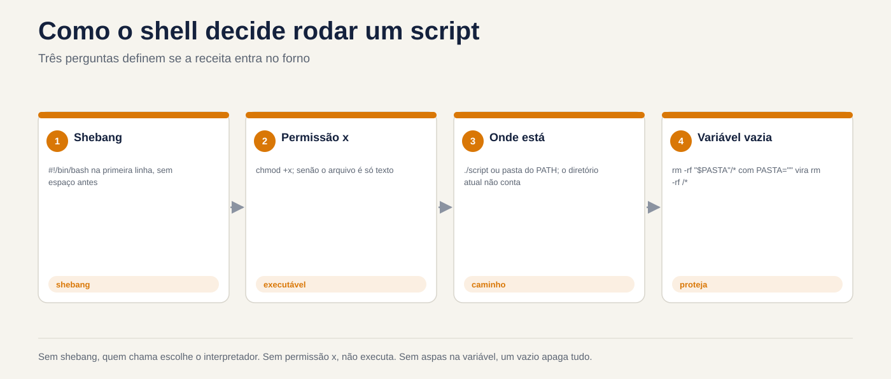
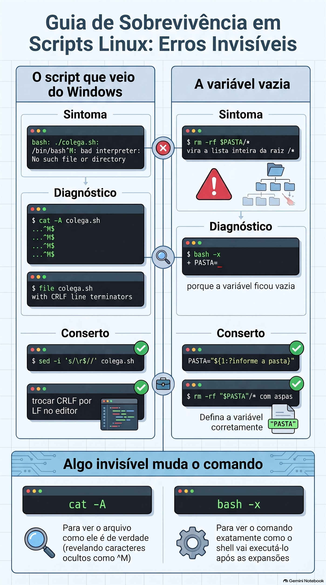

# Lezione 1.8 · Primo script

Trasformi il Protocollo di Backup della lezione 1.7 in un vero e proprio script: un file che chiami per nome, da qualsiasi cartella, passandoci dentro quello che vuoi salvare, e che esegue i cinque passi sempre nello stesso ordine. Lungo il percorso, apprende i tre errori che fanno fallire il primo script di tutti: l'autorizzazione mancante, la virgoletta mancante e il file proveniente da Windows.

| File | lezione 1.8 |
| --- | --- |
| Modulo | M1 · Riga di comando, lezione 8 di 10 |
| Quando | Settimana 3 |
| Alla fine puoi | Scrivi uno script con shebang, commenti e variabili; renderlo eseguibile e chiamarlo in tre modi, conoscendo la differenza; utilizzare le virgolette singole e doppie senza sorprese; ricevere argomenti con `$1`, `$2`, `$#` e `"$@"`; proteggere lo script da una variabile vuota; eseguire il debug con `bash -n` e `bash -x`; installare lo script in `~/bin` |
| Articoli di prova | LE 013.3 · LPIC-1 105.2, la parte degli script semplici · RHCSA: creare script semplici ed elaborare l'input degli script (`$1`, `$2`...) |
| Prerequisiti | lezione 1.7 completata, con `~/lab13/arquivo` ancora nelle VM |
| Meteo | Intorno alle 2:30 |
| Istantanee | m1a8-start e m1a8-end su entrambe le VM |

## 1 · Riscaldamento

Tre domande, a mente fredda, prima di leggere qualsiasi cosa. Scrivi le risposte; la chiave di risposta viene visualizzata alla fine.

1. Nella lezione 1.7, quale comando testa un `.tar.gz` fino all'ultimo byte, senza estrarre nulla?
2. Nella lezione 1.7, perché il Protocollo utilizza `-C` durante la creazione del backup?
3. Indovina: salvi un file `ola.sh` con un `echo` all'interno e scrivi `ola.sh` nel terminale, nella stessa cartella. Cosa succede?

## 2 · Perché è importante

Venerdì, 18:00. È necessario eseguire il backup del `/etc` di sei server prima di un aggiornamento. Nella lezione 1.7, il Protocollo prevedeva cinque passaggi. Sei server per cinque passaggi sono trenta comandi digitati a mano, alla fine della giornata. Sul quarto server dimentichi `chmod 600`. Nella quinta digitate `-cfz` invece di `-czf`. Nessuno se ne accorge fino al giorno in cui ha bisogno del backup.

Uno script non si stanca. Esegue i cinque passaggi nello stesso ordine, ogni volta, e tu controlli semplicemente il risultato. È la differenza tra conoscere una procedura ed avere una procedura.

Secondo caso. Un collega scrive uno script nel Blocco note di Windows, lo copia sul server e lo esegue. L'errore è `bad interpreter: No such file or directory`, che punta a `/bin/bash`, che ovviamente esiste. Perde un'ora reinstallando bash. Il problema era un carattere invisibile alla fine di ogni riga. Vedrai questo errore oggi, di proposito, e lo risolverai con un comando.

Terzo caso, quello pericoloso. Uno script di pulizia ha `rm -rf "$PASTA"/*`. Un giorno la variabile `PASTA` arriva vuota. Il comando diventa `rm -rf /*`. Ciò è già successo in prodotti noti e su molti server client. Oggi imparerai la riga che lo impedisce e testerai senza cancellare nulla.

E la quarta, la dimostrazione: RHCSA richiede script semplici che accettano argomenti. Non è programmazione, è esattamente ciò che insegna questo corso.

## 3 · Modello mentale

> Uno script è una ricetta scritta. La shell è la cuoca che legge riga per riga.

Tutto ciò che scrivi nel terminale può finire in un file, una riga sotto l'altra. Quando dici esegui, una shell apre il file e fa esattamente quello che farebbe se lo digitassi. Non c'è un nuovo linguaggio qui: sono gli stessi comandi delle lezioni da 1.2 a 1.7.

Tre domande definiscono se la ricetta funziona:

- **Chi legge la ricetta?** La prima riga, lo *shebang*, dice quale cuoco: `#!/bin/bash`. Senza di essa, chi sceglie è chi ha chiamato, e il risultato cambia da macchina a macchina.
- **La ricetta può essere eseguita?** Linux non controlla l'estensione `.sh`. Guarda l'autorizzazione `x`. Senza di esso, il file è solo testo.
- **Dov'è la ricetta?** Se si digita solo il nome, la shell cerca nelle cartelle `PATH` e la cartella corrente non è lì. O dici dove si trova, con `./`, oppure lo installi in una cartella in `PATH`.

E due pezzi rendono la ricetta riutilizzabile:

- **Variabili** sono le note del cuoco: `destino=/backup`. Durante la lettura, `$destino`.
- **Argomenti** sono gli ingredienti che fornisci subito: `backup-app.sh /etc` fa sì che `$1` valga `/etc`. La stessa ricetta funziona per qualsiasi pasta.

```text
  você digita:   backup-app.sh  /etc  /backup
                      │           │      │
                      $0          $1     $2        $# = 2

  o shell:  1. acha o arquivo (PATH ou ./)
            2. confere a permissão x
            3. lê a 1ª linha  #!/bin/bash  e chama o bash
            4. o bash executa linha por linha, trocando $1 e $2 pelos valores
```

## 4 · Concetto a strati

### Essenziale

**Il file.** Uno script minimo:

```bash
#!/bin/bash
# ola.sh - meu primeiro script
echo "Olá, $USER. Hoje é $(date +%F)."
```

- `#!/bin/bash` è lo shebang. Deve essere la prima riga, che inizia esattamente con `#!`, senza spazi prima.
- Le righe che iniziano con `#` sono commenti. La shell lo ignora. Non tu, tra sei mesi.
- Il resto sono comandi comuni. Hai già utilizzato `$(date +%F)` nella lezione 1.7: la shell esegue il comando e mette a posto l'output. Dettagli della lezione 1.9.

**Esegui.** Tre modi, con risultati diversi:

| Come si chiama | Cosa ti serve | Cosa succede |
| --- | --- | --- |
| `bash ola.sh` | Sola lettura | Scegli bash; lo shebang viene ignorato |
| `./ola.sh` | Autorizzazione `x` | Il kernel legge lo shebang e chiama il programma indicato |
| `ola.sh` | Autorizzazione `x` e permanenza in una cartella `PATH` | La shell si presenta in `PATH`; la cartella corrente non conta |

Per dare il permesso: `chmod +x ola.sh`. La lezione 2.7 spiega i permessi in dettaglio; per ora basta `+x`.

**Variabili.**

```bash
destino=/backup        # crea: NO spazio prima o dopo =
echo $destino          # leggere con $
echo "${destino}_old"  # le parentesi graffe separano il nome dal testo incollato
```

`destino = /backup`, con gli spazi, non crea nulla: la shell capisce che vuoi eseguire un comando chiamato `destino` con argomenti `=` e `/backup`.

**Virgolette.**

| Ha scritto | La shell fa | Esempio con `nome=Rodrigo` |
| --- | --- | --- |
| `'...'` semplice | Niente. Tutto è letterale | `echo 'Oi $nome'` → `Oi $nome` |
| `"..."` raddoppia | Scambia `$variável` e `$(comando)`, mantieni gli spazi | `echo "Oi $nome"` → `Oi Rodrigo` |
| Senza virgolette | Scambia, quindi **dividi negli spazi** ed espandi `*` | Pericolo con nomi di file con spazi |

Regola pratica: **variabile sempre racchiusa tra virgolette doppie**, `"$destino"`. Nessuna eccezione, finché non sai perché desideri l'eccezione.

**Argomenti.**

| Variabile | Valore |
| --- | --- |
| `$0` | Il nome con cui si chiamava lo script |
| `$1`, `$2`... `${10}` | Il primo, il secondo... il decimo argomento |
| `$#` | Quanti argomenti sono arrivati ​​|
| `"$@"` | Tutti gli argomenti, ogni numero intero, anche con lo spazio |
| `$?` | Il codice di uscita dell'ultimo comando. La lezione 1.9 utilizza molti |

**Valore predefinito e valore obbligatorio.**

```bash
destino="${2:-$HOME/backups}"     # se $2 risultano vuoti, utilizza $HOME/backups
origem="${1:?uso: $0 PASTA}"      # se $1 risulta vuoto, interrompi lo script con questo messaggio
```

`:?` è la cintura di sicurezza dello script. La lezione 1.9 comprende `if`, che fa lo stesso in modo più flessibile; Fino ad allora, `:?` risolve.

**Debug.**

```bash
bash -n script.sh     # controlla solo la sintassi, non esegue nulla
bash -x script.sh     # viene eseguito mostrando ogni riga, con le variabili modificate
```

### Windows Bridge

| Su Windows | Su Linux | Attenzione |
| --- | --- | --- |
| `.bat`, `.cmd`, `.ps1` decidono l'interprete con l'estensione | Lo shebang decide; l'estensione `.sh` è riservata solo agli esseri umani | Un `.sh` con `#!/usr/bin/python3` funziona come Python |
| `Set-ExecutionPolicy` decide se gli script vengono eseguiti | Il permesso `x` di ciascun file decide | Non esiste uno switch globale |
| La cartella attuale è contenuta nel `cmd` | La cartella corrente **non** è in `PATH` | Ecco perché `./` |
| `set destino=C:\bkp` e `%destino%` | `destino=/bkp` e `$destino` | Su Linux, lo spazio attorno a `=` interrompe |
| `%1`, `%2`, `%*` | `$1`, `$2`, `"$@"` |  |
| Fine riga CRLF (`\r\n`) | Fine riga LF (`\n`) | Lo script salvato su Windows si interrompe su Linux. Wrap A |

In PowerShell, `$destino = "C:\bkp"` accetta spazi attorno a `=`. È l'abitudine che più abbatte chi viene da Windows.

### Advanced

- **`source` o `.` non vengono eseguiti: includono.** `./script.sh` viene eseguito in una nuova shell, una tua figlia. Un `cd` o una variabile creata all'interno muore quando lo script termina. `source script.sh` esegue le righe nella propria shell e `cd` rimane. Così si legge il `~/.bashrc`.
- **`export`.** Una variabile creata nel terminale non raggiunge lo script, a meno che non venga esportata: `export DESTINO=/backup`. Le variabili di ambiente come `PATH`, `HOME` e `USER` sono già esportate.
- **`set -u`** fa sì che lo script si interrompa quando si utilizza una variabile che non esiste, invece di trattarla come vuota. **`set -e`** si ferma al primo comando che fallisce. Sono utili, ma presentano delle insidie; La lezione 1.9 mostra quando fidarsi di loro.
- **`#!/usr/bin/env bash`** cerca bash in `PATH`, utile quando non è in `/bin`, come su alcuni BSD. In Rocky e Debian, `#!/bin/bash` funziona sempre.
- **`readonly`** impedisce che una variabile venga modificata in seguito: `readonly DESTINO=/backup`.

### Cosa rientra nel test

- **LE 013.3:** shebang, `chmod +x`, eseguito con `./`, variabili, `$1` e `$#`, commenti. Domande brevi come "quale riga crea correttamente la variabile".
- **LPIC-1 105.2:** parametri posizionali, `$?`, `$#`, `$@`, `source`, differenza tra esegui e include.
- **RHCSA:** un'attività come "crea `/usr/local/bin/meuscript` che accetta un argomento e fa X", e il correttore esegue lo script con i suoi argomenti. Cavolo, il giusto permesso e il giusto percorso valgono quanto la logica.

## 5 · Rocky × Debian

|  | Rocky Linux 9 e 10 | Debian 13 |
| --- | --- | --- |
| `/bin/sh` punta a | `bash` | `dash`, una shell più piccola e più veloce |
| Script con `#!/bin/sh` e funzionalità bash come `{1..3}` | Funziona, perché è bash | Interrompe o fornisce risultati diversi |
| `~/bin` in `PATH` | Secondo `~/.bashrc` c'è già, anche se la cartella non esiste ancora | Accedere tramite `~/.profile`, solo se la cartella esiste **al login**. Creare e uscire dalla sessione |
| `~/.local/bin` in `PATH` | E' fatto | Stessa regola di `~/bin` |
| `dos2unix` per rimuovere il CRLF | `sudo dnf install dos2unix` | `sudo apt install dos2unix` |
| `bash --version` | 5.1 in Rocky 9, 5.2 in Rocky 10 | 5.2 |

La regola che evita la prima riga della tabella: **se usi risorse bash, scrivi `#!/bin/bash`**. Utilizzare `#!/bin/sh` solo quando lo script è POSIX puro e testarlo su Debian.

## 6 · Laboratorio guidato

Esegui tutto su entrambe le VM, a meno che il passaggio non ne indichi solo uno. Gli script sono in `~/lab13/scripts` e la materia prima è l'applicazione di bugie della lezione 1.7, in `~/lab13/arquivo/app`. Ad ogni passaggio, quando viene visualizzato **Predict**, scrivere la risposta prima di premere Invio.


*Senza shebang, il chiamante sceglie l'interprete. Senza il permesso x, non verrà eseguito. Senza virgolette nella variabile, una vuota cancella tutto.*


### Passo 1 · Preparare

Nel nodo Proxmox:

```bash
qm snapshot 201 m1a8-inicio
qm snapshot 202 m1a8-inicio
```

In ogni VM:

```bash
ls ~/lab13/arquivo/app
mkdir -p ~/lab13/scripts
cd ~/lab13/scripts
echo "$SHELL"
bash --version | head -1
```

Il `ls` deve mostrare `conf`, `iniciar.sh`, `logs` e `www`. Se la cartella non esiste, ripetere il passaggio 1 della lezione 1.7. `$SHELL` dovrebbe essere `/bin/bash`.

### Passo 2 · Il primo file e i tre modi per chiamarlo

Crea lo script con un *here-document*, il `cat > arquivo <<'EOF'` che hai usato nella lezione 1.7. Le virgolette in `'EOF'` fanno sì che il testo entri nel file esattamente così com'è, senza modificare `$USER` adesso.

```bash
cat > ola.sh <<'EOF'
#!/bin/bash
# ola.sh - meu primeiro script
echo "Olá, $USER. Hoje é $(date +%F)."
echo "Estou rodando em $(hostname)."
EOF
cat ola.sh
ls -l ola.sh
```

**Anteprima.** Digiterai `ola.sh`, solo il nome, essendo nella stessa cartella. Cosa appare?

```bash
ola.sh
```

`bash: ola.sh: command not found`. Il file c'è, ma la shell non cerca nella cartella corrente: cerca nelle cartelle `PATH`. Guarda cosa sono:

```bash
echo "$PATH"
```

Ora di' dove si trova il file, con `./`:

```bash
./ola.sh
```

`bash: ./ola.sh: Permission denied`. `ls -l` di prima mostrava `-rw-r--r--`: non c'è `x`. Per Linux, questo è testo, non programma.

**Decidi 1 · Come funziona senza `x`.** Prima di dare il permesso, esegui `bash ola.sh`. Cosa succede?

- **A)** `Permission denied`, come in `./ola.sh`.
- **B)** Funziona, perché `bash` è in esecuzione e `ola.sh` è semplicemente un file che legge.
- **C)** Funziona, perché `bash` ignora i permessi di qualsiasi file.
- **D)** `command not found`, perché `ola.sh` non è in `PATH`.

Scegli la lettera prima di guardare la tabella.

| Se hai selezionato | Risultato | Perché |
| --- | --- | --- |
| A | ❌ Sbagliato | `x` è richiesto a coloro che vengono giustiziati. Qui l'imputato è `/bin/bash`, che ha `x`. Basta leggere il `ola.sh` e c'è il `r`. |
| B | ✅ Giusto | `bash` prende come argomento il nome del file, lo apre e lo legge riga per riga, come faresti con un `cat`. Lo shebang diventa un commento comune. |
| C| ❌ Sbagliato | Se prendi `r` con `chmod -r ola.sh`, `bash ola.sh` fallisce con `Permission denied`. Rispetta la lettura; semplicemente non hai bisogno di `x`. |
| D | ❌ Sbagliato | `PATH` entra in gioco solo per trovare il primo nome della riga, che qui è `bash`. `ola.sh` è un argomento di percorso relativo. |

**Da risolvere:** `bash script.sh` necessita di `r`; `./script.sh` necessita di `r` e `x`; `script.sh` necessita di `r`, `x` ed essere in `PATH`.

Dai un'occhiata:

```bash
bash ola.sh
chmod +x ola.sh
ls -l ola.sh
./ola.sh
```

Ora `ls -l` mostra `-rwxr-xr-x` e `./ola.sh` funziona. Un ultimo esperimento con lo shebang:

```bash
head -1 ola.sh
file ola.sh
```

`file` risponde qualcosa come `Bourne-Again shell script, Unicode text, UTF-8 text executable`. Ha letto la prima riga, come fa il kernel.

### Passo 3 · Variabili e virgolette, nel terminale

Prima di inserire variabili in uno script, commettere l'errore nel terminale, dove è economico:

```bash
destino = /backup
```

**Prevedere** il messaggio. È `bash: destino: command not found`. La shell legge `destino` come un comando, con due argomenti. Adesso nel modo giusto:

```bash
destino=/backup
echo $destino
echo "Os backups vão para $destino"
echo 'Os backups vão para $destino'
echo "${destino}_antigo"
echo "$destino_antigo"
```

Le ultime due righe sono lo scherzo delle chiavi. `"${destino}_antigo"` mostra `/backup_antigo`. `"$destino_antigo"` mostra una riga vuota: la shell ha cercato una variabile chiamata `destino_antigo`, che non esiste, e l'ha sostituita con niente, senza alcun errore.

Ora un nome file con uno spazio, il caso che rompe la maggior parte degli script:

```bash
cd /tmp
arq="relatorio final.txt"
```

**Decidi 2 · La virgoletta mancante.** Si digita `touch $arq`, senza virgolette, e poi `ls`. Cosa appare?

- **A)** Un file `relatorio final.txt`.
- **B)** Due file: `relatorio` e `final.txt`.
- **C)** Un file chiamato `$arq`.
- **D)** Errore, perché `touch` non accetta spazi nel nome.

Scegliere la lettera prima di guardare la tabella.

| Se hai selezionato | Risultato | Perché |
| --- | --- | --- |
| A | ❌ Sbagliato | Sarebbe il risultato del `touch "$arq"`. Senza virgolette, dopo aver modificato la variabile la shell avvolge il testo tra spazi. |
| B | ✅ Giusto | La shell scambia `$arq` con `relatorio final.txt` e poi si divide negli spazi. `touch` accetta due argomenti e crea due file. |
| C| ❌ Sbagliato | Ciò accadrebbe con virgolette singole: `touch '$arq'`. Senza virgolette, la variabile viene scambiata. |
| D | ❌ Sbagliato | `touch` accetta qualsiasi nome. Non sa nemmeno che c'era uno spazio: riceve due nomi distinti. |

**Da correggere:** variabile sempre racchiusa tra virgolette doppie. `touch "$arq"`, `rm "$arq"`, `cp "$arq" "$destino"`.

Controlla e pulisci:

```bash
touch $arq
ls -l relatorio final.txt
touch "$arq"
ls -l "$arq"
rm -v relatorio final.txt "$arq"
cd ~/lab13/scripts
```

Immagina lo stesso errore con `rm $arq`: elimineresti `relatorio` e `final.txt`, che potrebbero essere altri file, e `relatorio final.txt` sarebbe ancora lì.

### Passo 4 · Argomenti

Um script che mostra solo ciò che ha ricevuto:

```bash
cat > args.sh <<'EOF'
#!/bin/bash
# args.sh - mostra os argumentos recebidos
echo "Nome do script: $0"
echo "Primeiro:       $1"
echo "Segundo:        $2"
echo "Quantidade:     $#"
echo "Todos, um por linha:"
printf '  [%s]\n' "$@"
EOF
chmod +x args.sh
```

Il `printf` si ripete il modello `[%s]` una volta per ogni argomento. È un trucco vedere esattamente dove inizia e finisce ogni argomento.

**Prevedere** il `$#` di ogni riga prima di eseguire:

```bash
./args.sh
./args.sh um dois tres
./args.sh um "dois tres"
./args.sh "$HOME" *.sh
```

Risposte: 0, 3, 2, e l'ultima dipende da quanti `.sh` ci sono nella cartella. `*.sh` viene espanso **prima** che parta lo script: non vede mai l'asterisco, riceve solo la lista dei nomi. Si noti inoltre che, senza discussione, `$1` risulta vuoto e la sceneggiatura va avanti, senza lamentarsi. Conservalo per la pausa B.

**Decidi 3 · Il decimo argomento.** Esegui `./args.sh a b c d e f g h i j`. All'interno dello script, una riga dice `echo "$10"`. Cosa mostra?

- **A)** `j`, il decimo argomento.
- **B)** `a0`, il primo argomento seguito da uno zero.
- **C)** Una riga vuota, perché ci sono solo da `$1` a `$9`.
- **D)** Errore di sintassi.

Scegliere la lettera prima di guardare tabella.

| Se hai selezionato | Risultato | Perché |
| --- | --- | --- |
| A | ❌ Sbagliato | Sarebbe il risultato del `"${10}"`. Senza parentesi graffe la shell legge solo una cifra dopo `$`. |
| B | ✅ Giusto | La shell legge `$1`, che è `a`, e incolla `0` come testo. È lo stesso scherzo del `$destino_antigo`. |
| C| ❌ Sbagliato | Ci sono `${10}`, `${11}` e quanti ne superi. Solo la forma breve, senza chiavi, si ferma a 9. |
| D | ❌ Sbagliato | Non c'è nessun errore: la shell accetta `$10` e lo interpreta, nel modo che non volevi. |

**Per impostare:** sopra 9 utilizzare i tasti: `${10}`. In caso di dubbio, utilizzare sempre le chiavi.

Controlla:

```bash
echo 'echo "com \$10:   $10"'   >> args.sh
echo 'echo "com \${10}: ${10}"' >> args.sh
tail -2 args.sh
./args.sh a b c d e f g h i j
```

### Passaggio 5 · Il protocollo diventa uno script

Questo è il passaggio centrale. Scriverai lo stesso script tre volte, ogni versione migliore della precedente.

**Versione 1, tutto corretto.** È il protocollo della lezione 1.7, incollato in un file:

```bash
cat > backup-app.sh <<'EOF'
#!/bin/bash
# backup-app.sh v1 - tudo fixo
mkdir -p ~/backups
tar -czf ~/backups/app-$(date +%F_%H%M).tar.gz -C ~/lab13/arquivo app
ls -lh ~/backups
EOF
chmod +x backup-app.sh
./backup-app.sh
```

Funziona, ma viene utilizzato solo per questa cartella e il nome del file appare solo all'interno di `tar`. Se vuoi testare e salvare `sha256sum` dovrai ripetere il nome, con l'ora, che è già cambiata.

**Versione 2, con variabili.** Il nome viene calcolato una volta e utilizzato ovunque:

```bash
cat > backup-app.sh <<'EOF'
#!/bin/bash
# backup-app.sh v2 - variáveis
origem="$HOME/lab13/arquivo/app"
destino="$HOME/backups"
data="$(date +%F_%H%M)"
arquivo="$destino/app-$data.tar.gz"

mkdir -p "$destino"
tar -czf "$arquivo" -C "$HOME/lab13/arquivo" app
tar -tzf "$arquivo" > /dev/null && echo "OK: o arquivo abre até o fim"
sha256sum "$arquivo" > "$arquivo.sha256"
chmod 600 "$arquivo" "$arquivo.sha256"
ls -lh "$arquivo" "$arquivo.sha256"
EOF
bash -n backup-app.sh
./backup-app.sh
```

`bash -n` non mostra nulla quando la sintassi è corretta. Da notare che all'interno dello script ho usato `$HOME`, e non `~`: `~` non viene scambiato tra virgolette, e una variabile tra virgolette è più sicura.

**Preve.** Eseguilo di nuovo, ora con `bash -x`. Quante righe che iniziano con `+` appariranno?

```bash
bash -x ./backup-app.sh
```

Una per ogni comando, con le variabili già scambiate per i valori: `+ data=2026-11-02_1430`, `+ tar -czf /home/rodrigo/backups/app-2026-11-02_1430.tar.gz ...`. `-x` è la radiografia dello script: quando qualcosa va storto, è la prima cosa che esegui.

**Versione 3, con argomenti.** Ora la cartella viene dall'esterno e la destinazione ha un valore predefinito:

```bash
cat > backup-app.sh <<'EOF'
#!/bin/bash
# backup-app.sh - backup de uma pasta pelo Protocolo da Aula 1.7
# Uso: backup-app.sh PASTA [DESTINO]
#   PASTA    o que guardar, obrigatório
#   DESTINO  onde guardar, padrão ~/backups

origem="${1:?uso: $0 PASTA [DESTINO]}"
destino="${2:-$HOME/backups}"
nome="$(basename "$origem")"
pai="$(dirname "$origem")"
data="$(date +%F_%H%M)"
arquivo="$destino/$nome-$data.tar.gz"

echo "Backup de $origem para $arquivo"
mkdir -p "$destino"
tar -czf "$arquivo" -C "$pai" "$nome"
tar -tzf "$arquivo" > /dev/null && echo "OK: o arquivo abre até o fim"
sha256sum "$arquivo" > "$arquivo.sha256"
chmod 600 "$arquivo" "$arquivo.sha256"
ls -lh "$arquivo" "$arquivo.sha256"
EOF
bash -n backup-app.sh
```

`basename` restituisce l'ultimo bit del percorso e `dirname` il resto. Per `/home/rodrigo/lab13/arquivo/app` restituiscono `app` e `/home/rodrigo/lab13/arquivo`. È `-C` del Protocollo, calcolato da solo.

Prova i tre casi:

```bash
./backup-app.sh
./backup-app.sh ~/lab13/arquivo/app
./backup-app.sh ~/lab13/arquivo/app /tmp/bkp-teste
ls -l ~/backups /tmp/bkp-teste
```

Il primo si ferma subito con `./backup-app.sh: line 7: 1: uso: ./backup-app.sh PASTA [DESTINO]`, senza creare nulla. Il secondo utilizza la destinazione predefinita. Il terzo scrive al `/tmp/bkp-teste`. Controlla l'impronta digitale dell'ultimo:

```bash
sha256sum -c /tmp/bkp-teste/app-*.sha256
```

`OK`. Poiché `sha256sum` ha registrato il percorso completo, la conferenza funziona da qualsiasi cartella.

**Decidi 4 · Il backup di `/etc`.** Esegui `./backup-app.sh /etc` come utente normale. Cosa succede?

- **A)** Funziona allo stesso modo, con tutti i `/etc` all'interno.
- **B)** `tar` si lamenta di diversi file che non riesce a leggere, come `shadow`, crea un backup incompleto e `OK: o arquivo abre até o fim` appare ancora.
- **C)** Lo script si ferma sulla prima riga, perché `/etc` non è una cartella utente.
- **D)** `tar` rifiuta l'intero backup e non viene creato nulla.

Scegliere la lettera prima di guardare la tabella.

| Se hai selezionato | Risultato | Perché |
| --- | --- | --- |
| A | ❌ Sbagliato | L'utente normale non legge `/etc/shadow`, `/etc/sudoers` e altri. `tar` non può memorizzare ciò che non può leggere. |
| B| ✅ Giusto | `tar` mostra per ognuno `Cannot open: Permission denied`, salva il resto e termina con un errore. Ma la riga successiva verifica solo se il file si apre, e lo fa. Lo script dice OK per un backup senza i file più importanti. |
| C| ❌ Sbagliato | `:?` controlla solo se è arrivato `$1`. È arrivato `/etc`, quindi segue la sceneggiatura. |
| D | ❌ Sbagliato | `tar` è testardo: salta ciò che non riesce a leggere e continua. Ecco perché esiste il backup, solo incompleto. |

**Per risolvere:** uno script che non controlla il risultato di ogni passaggio è colpa tua. La lezione 1.9 insegna `if` e `$?`, e questa è la prima cosa che risolverai con loro.

Controlla, guardando la fine dell'output:

```bash
./backup-app.sh /etc /tmp/bkp-teste 2>&1 | tail -5
sudo ./backup-app.sh /etc /tmp/bkp-teste | tail -3
```

Con `sudo`, non ci sono reclami e il file ha proprietario `root` e autorizzazione 600. Questo è ciò che dovrebbe essere un backup di `/etc`.

### Passo 6 · Installa in `~/bin`

Uno script richiamato con `./` dall'interno di una cartella non è ancora uno strumento. Installa:

```bash
mkdir -p ~/bin
cp backup-app.sh ~/bin/
cd /
backup-app.sh ~/lab13/arquivo/app
```

**Decidi 5 · Rocky e Debian.** Hai fatto esattamente questo su entrambe le VM, senza uscire dalla sessione. Qual è il risultato?

- **A)** Funziona su entrambi.
- **B)** Funziona su Rocky-Lab; su debian-lab, `command not found`.
- **C)** Funziona su debian-lab; in rocky-lab, `command not found`.
- **D)** Non funziona in nessuno finché non si riavvia la VM.

Scegli la lettera prima di guardare la tabella.

| Se hai selezionato | Risultato | Perché |
| --- | --- | --- |
| A | ❌ Sbagliato | In Debian, `~/bin` entra in `PATH` solo se esiste al momento del login. Non esisteva quando sei entrato. |
| B| ✅ Giusto | Il `~/.bashrc` di Rocky inserisce sempre `~/bin` in `PATH`. `~/.profile` di Debian lo inserisce solo se la cartella esiste già al momento dell'inserimento. |
| C| ❌ Sbagliato | E' il contrario. Verificare con `echo "$PATH"` su entrambi. |
| D | ❌ Sbagliato | Il riavvio risolve il problema, ma è eccessivo. Basta disconnettersi e riconnettersi oppure leggere nuovamente il file con `source ~/.profile`. |

**Per risolvere:** dopo aver creato `~/bin`, disconnettersi e riconnettersi. Controllare con `type nome-do-script`.

Check, in debian-lab:

```bash
echo "$PATH" | tr ':' '\n' | grep bin
source ~/.profile
type backup-app.sh
cd / && backup-app.sh ~/lab13/arquivo/app
```

`type` risponde a `backup-app.sh is /home/rodrigo/bin/backup-app.sh`. Lo script è diventato un comando.

> **Protocollo · Script che non crea imbarazzo**
>
> 1. Prima riga: `#!/bin/bash`. Secondo: un commento che dice cosa fa. Terzo: `# Uso:` con argomenti.
> 2. Argomento obbligatorio con `${1:?uso: ...}`; opzionale con `${2:-padrão}`.
> 3. Calcola i nomi una volta, in variabili, e utilizza le variabili ovunque.
> 4. Ogni variabile tra virgolette doppie: `"$arquivo"`.
> 5. Prima dell'esecuzione: `bash -n`. Se succede qualcosa di strano: `bash -x`.
> 6. Test senza argomenti, con un argomento e con un percorso che contenga spazio.
> 7. `chmod +x`, installa in `~/bin` o, per tutti gli utenti, in `/usr/local/bin`.

## 7 · Interrompi e correggi

### Interruzione A · Lo script fornito da Windows

Un collega invia uno script che ha scritto nel Blocco note. Simula il suo file: il `\r\n` alla fine di ogni riga è esattamente ciò che registra il Blocco note.

```bash
cd ~/lab13/scripts
printf '#!/bin/bash\r\n# do colega\r\necho "versao do colega"\r\n' > colega.sh
chmod +x colega.sh
./colega.sh
```

**Osserva.** Il messaggio è qualcosa del tipo:

```text
bash: ./colega.sh: /bin/bash^M: bad interpreter: No such file or directory
```

Il `/bin/bash` esiste. Ma nota il `^M` incollato sopra.

**Diagnostique.** Mostra cosa nasconde il normale `cat`:

```bash
cat colega.sh
cat -A colega.sh
file colega.sh
```

`cat -A` mostra `^M$` alla fine di ogni riga: `^M` è `\r` e `$` segna la fine della riga. `file` dice `with CRLF line terminators`. Il kernel leggeva la prima riga come `/bin/bash\r` e cercava un programma con quel nome, con un carattere invisibile alla fine. Non esiste.

**Decidi A · La soluzione.** Cosa risolve il problema una volta per tutte?

- **A)** Esegui con `bash colega.sh`.
- **B)** Rimuovi `\r` dalla fine di ogni riga: `sed -i 's/\r$//' colega.sh`, o `dos2unix colega.sh`.
- **C)** Reinstalla bash.
- **D)** Cambia lo shebang in `#!/bin/sh`.

Scegli la lettera prima di guardare la tabella.

| Se hai selezionato | Risultato | Perché |
| --- | --- | --- |
| A | ❌ Sbagliato | Sfugge allo shebang, ma bash legge ogni riga con `\r` alla fine. `echo` stampa un `\r` nascosto e un `cd /tmp\r` fallisce con `No such file or directory`. Il problema cambia sede. |
| B | ✅ Giusto | Il file ora ha estremità di riga Linux. `sed` è già installato su entrambe le VM; `dos2unix` fa lo stesso e deve essere installato. |
| C| ❌ Sbagliato | Bash è perfetto. È il caso della sezione 2: uma hora perdida no lugar errado. |
| D | ❌ Sbagliato | A primeira linha continua com `\r`, agora `/bin/sh^M`, e o erro é o mesmo. |

**Da correggere:** `bad interpreter` con `^M` è sempre CRLF. Confira com `cat -A` e conserte com `sed -i 's/\r$//'`.

**Conserte.**

```bash
sed -i 's/\r$//' colega.sh
cat -A colega.sh
file colega.sh
./colega.sh
```

Agora o `cat -A` mostra só `$` no fim, e o script roda. Per non ricevere il problema: no VS Code, o canto inferiore direito mostra `CRLF`; fare clic e passare a `LF` prima di salvare. In Blocco note++, menu Modifica, Conversione fine riga.

### Interruzione B · La variabile vuota

Questo è l'errore che ha già eliminato interi server. Ti riprodurrai in tutta sicurezza: lo script **mostra** solo il comando, con `echo`, e non cancella nulla.

```bash
cat > limpa.sh <<'EOF'
#!/bin/bash
# limpa.sh - limpa uma pasta de temporários (versão perigosa)
PASTA=$1
echo "Vou executar:" rm -rf $PASTA/*
EOF
chmod +x limpa.sh
```

Primo, utilizzo normale:

```bash
mkdir -p /tmp/temporarios && touch /tmp/temporarios/a.tmp /tmp/temporarios/b.tmp
./limpa.sh /tmp/temporarios
```

`Vou executar: rm -rf /tmp/temporarios/a.tmp /tmp/temporarios/b.tmp`. Giusto. Adesso qualche cosa esquece l'argomento.

**Observe.**

```bash
./limpa.sh
```

`Vou executar: rm -rf /bin /boot /dev /etc /home /lib ...`. L'intero elenco delle radici; in Rocky inizia con `/afs`. Senza `echo`, questa era la fine del server.

**Diagnose.** Usa raggi X:

```bash
bash -x ./limpa.sh
```

La prima riga con `+` è `+ PASTA=`: la variabile non ha ricevuto nulla. Quindi `$PASTA/*` è diventato `/*` e la shell ha espanso l'asterisco a tutto ciò che si trova nella radice.

**Decidere B · La cintura di sicurezza.** Quale compromesso previene il disastro?

- **A)** Metti le virgolette: `rm -rf "$PASTA"/*`.
- **B)** Richiedi l'argomento: `PASTA="${1:?informe a pasta}"` e mantieni le virgolette in `rm`.
- **C)** Sostituisci `rm -rf` con `rm -r`.
- **D)** Eseguire sempre lo script come utente normale.

Scegliere la lettera prima di guardare la tabella.

| Se hai selezionato | Risultato | Perché |
| --- | --- | --- |
| A | ❌ Sbagliato | As aspas protegem contra espaços, mas `"$PASTA"/*` com `PASTA` vazio continua sendo `""/*`, ou seja, `/*`. Aiuta, non salva. |
| B | ✅ Giusto | Senza argomento, lo script per la linea della variabile, prima di consultare il `rm`. As aspas continuam lá para o caso de a pasta ter espaço no nome. |
| C| ❌ Sbagliato | Senza `f`, `rm` chiede i file protetti e mostra errori, ma cancella tutto ciò che ha il permesso di cancellare. |
| D | ❌ Sbagliato | Riduce i danni, ma l'utente cancella comunque tutto ciò che è suo, compreso il suo `/home`. E gli script di pulizia di solito vengono eseguiti come root, in cron. |

**Per correggere:** ogni variabile utilizzata in un `rm`, `mv` o `chmod -R` deve essere obbligatoria, con `:?`, ed essere racchiusa tra virgolette.

**Fix.**

```bash
sed -i 's|^PASTA=\$1$|PASTA="${1:?informe a pasta}"|' limpa.sh
sed -i 's|rm -rf \$PASTA/\*|rm -rf "$PASTA"/*|' limpa.sh
cat limpa.sh
./limpa.sh
./limpa.sh /tmp/temporarios
```

Ora, senza argomento, lo script si ferma con `line 3: 1: informe a pasta` e con un argomento funziona come prima. Apri `backup-app.sh` e vedi che è nato con questa cintura, in `$1`.

### La lezione

I due errori di oggi hanno la stessa faccia: qualcosa di invisibile che cambia il comando. Un `\r` che non vedi alla fine della riga. Una variabile vuota che non vedi al centro di `rm`. Entrambi si rivelano con gli stessi strumenti: `cat -A` per vedere il file così com'è, e `bash -x` per vedere il comando mentre la shell lo eseguirà. Quando uno script fa qualcosa che non hai richiesto, non leggere lo script: eseguilo con `-x` e leggi cosa ha fatto.


*Un carattere che non vedi e una variabile che non vedi: cat -A e bash -x li rivelano entrambi.*

## 8 · Insidie

| Digiti o vedi | Cosa succede | Quello giusto |
| --- | --- | --- |
| `destino = /backup` | `destino: command not found` | `destino=/backup`, senza spazi |
| `script.sh`, nella cartella degli script | `command not found` | `./script.sh` oppure installarlo in `PATH` |
| `./script.sh` subito dopo aver creato | `Permission denied` | `chmod +x script.sh` |
| `bad interpreter` con `^M` | File CRLF di Windows | `sed -i 's/\r$//' script.sh` |
| `echo '$HOME'` | Mostra `$HOME`, letterale | Virgolette doppie: `echo "$HOME"` |
| `touch $arq` con spazio nel nome | Crea due file | `touch "$arq"` |
| `"$nome_backup"` | Cerca una variabile chiamata `nome_backup`, che non esiste, e risulta vuota, senza errori | `"${nome}_backup"`, sempre tra parentesi graffe quando si incolla il testo |
| `echo "$10"` | Mostra `$1` seguito da `0` | `"${10}"` |
| `rm -rf "$PASTA"/*` senza verificare `$PASTA` | Con la variabile vuota diventa `rm -rf /*` | `PASTA="${1:?...}"` prima |
| `#!/bin/sh` e `{1..5}` nella scrittura | Funziona su Rocky, si rompe su Debian | `#!/bin/bash` |
| `~` tra virgolette: `"~/backups"` | Non viene scambiato; crea una cartella denominata `~` | `"$HOME/backups"` |
| `cd /var/log` all'interno della scrittura | Al termine, rimani nella cartella di prima | Normale: lo script viene eseguito in una shell figlia. Per restare, `source` |
| Script con `tar` fallito e `OK` alla fine | Il seguente test non sa che `tar` ha fallito | Vedi `$?`. lezione 1.9 |

## 9 · Quiz

Dieci domande, senza consultazione. Per ognuno scrivere la lettera o la risposta e solo dopo aprire il tasto di risposta.

**1.** Quale riga crea la variabile `porta` con il valore 8080?

- **A)** `porta = 8080`
- **B)** `$porta=8080`
- **C)** `porta=8080`
- **D)** `set porta 8080`

**2.** `s.sh` ha l'autorizzazione `-rw-r--r--`. Quale di queste chiamate **fallisce**?

- **A)** `bash s.sh`
- **B)** `./s.sh`
- **C)** `source s.sh`
- **D)** `sh s.sh`

**3.** Esegui `./args.sh "um dois" tres`. Quanto valgono i `$#` e `$1`?

- **A)** `3` e `um`
- **B)** `2` e `um dois`
- **C)** `2` e `"um dois"`, tra virgolette
- **D)** `3` e `um dois`

**4.** Con `nome=web01`, cosa vale `echo 'Servidor: $nome'`?

- **A)** `Servidor: web01`
- **B)** `Servidor: $nome`
- **C)** `Servidor:`
- **D)** Errore di sintassi

**5.** Lo shebang di uno script dice `#!/bin/bsh`, con un errore di battitura. Cosa succede con `./script.sh` e `bash script.sh`?

- **A)** Entrambi funzionano: bash corregge il nome.
- **B)** Entrambi falliscono con `bad interpreter`.
- **C)** `./script.sh` fallisce con `bad interpreter`; `bash script.sh` funziona, perché la faccenda diventa un commento.
- **D)** `./script.sh` funziona; `bash script.sh` fallisce.

**6.** Nello script, `destino="${2:-/backup}"`. Quanto vale `destino` in `./s.sh /etc` e `./s.sh /etc /mnt/usb`?

- **A)** `/backup` sia in
- **B)** vuoto che in `/mnt/usb`
- **C)** `/backup` e `/mnt/usb`
- **D)** `/etc` e `/mnt/usb`

**7.** Cosa fa `origem="${1:?falta a pasta}"` quando lo script viene richiamato senza argomenti?

**8.** Hai creato `~/bin` e copiato `meu.sh` lì, su una VM Debian, senza uscire dalla sessione. `meu.sh` dà `command not found`. Qual è la causa più probabile e come confermarla?

**9.** `vai.sh` contiene solo `cd /var/log`. Dove ti trovi dopo `./vai.sh`? E dopo `source vai.sh`?

**10.** *Quale delle seguenti variabili contiene il numero di argomenti passati a uno script di shell?*

- **A)** `$@`
- **B)** `$#`
- **C)** `$*`
- **D)** `$0`
- **E)** `$?`

## 10 · Flashcard e colla

### Da conoscere a memoria

Questa parte è da tenere a mente. È lo scheletro di ogni script che scriverai.

- `#!/bin/bash` sulla prima riga, senza spazio prima di
- `chmod +x script.sh` e poi `./script.sh`
- `nome=valor`, senza spazio; `"$nome"` da leggere sempre tra virgolette
- `'...'` non cambia nulla; `"..."` scambia `$variável` e `$(comando)`
- `$1`, `$2`: argomenti; `$#`: quanti; `"$@"`: tutti; `$0`: il nome dello script
- `${1:?mensagem}`: obbligatorio; `${2:-padrão}`: facoltativo
- `bash -n script.sh`: verifica la sintassi; `bash -x script.sh`: mostra ogni riga eseguita
- `cat -A script.sh`: mostra `^M` di Windows; `sed -i 's/\r$//' script.sh` fix

### Per consultare

Non è necessario memorizzare questa parte. Mantienilo dov'è.

- `"${nome}_texto"`: tasti per incollare il testo nel nome; `${10}` sopra 9
- `basename /a/b/c` dà `c`; `dirname /a/b/c` restituisce `/a/b`
- `source script.sh` o `. script.sh`: viene eseguito nella shell corrente; `cd` e variabili get
- `export NOME=valor`: la variabile raggiunge gli script chiamati dopo
- `type comando` o `command -v comando`: da dove proviene per te il comando
- `~/bin`; `/usr/local/bin` per tutti gli utenti, con `sudo`
- Debian: `~/bin` inserisce `PATH` al login, se esiste. Rocky: sempre
- `#!/bin/sh` in Debian è `dash`, senza le funzionalità bash
- `set -u` si ferma in una variabile inesistente; `set -e` si ferma al primo errore. La lezione 1.9
- `file script.sh` mostra `with CRLF line terminators` quando proviene da Windows

### Flashcards

| Davanti | Verso |
| --- | --- |
| Qual è lo shebang? | La prima riga, `#!/bin/bash`, indica al kernel quale programma legge lo script |
| Linux decide sull'estensione `.sh`? | No. Decidi per ordine e autorizzazione `x` |
| Perché `script.sh` fornisce `command not found` nella cartella degli script? | La cartella attuale non si trova in `PATH`. Utilizzare `./script.sh` |
| Quale autorizzazione richiede il `bash script.sh`? | Sola lettura. `bash` |
| Cosa c'è che non va nel `nome = valor`? | Gli spazi. La shell esegue un comando chiamato `nome` |
| Differenza tra `'$HOME'` e `"$HOME"`? | Semplice è letterale; le coppie si scambiano per valore |
| Cosa succede a `touch $arq` se `arq` ha spazio? | Crea un file per ogni parola |
| Cosa vale `$#`? | Quanti argomenti ha ricevuto lo script |
| Perché `"$@"` e non `$*`? | `"$@"` mantiene ogni argomento intero, anche con lo spazio |
| Cosa mostra `"$10"`? | `$1` seguito da un `0`. Utilizzare `${10}` |
| Cosa fa `${1:?msg}`? | Per lo script con il messaggio se `$1` è vuoto |
| Cosa fa `${2:-/backup}`? | Utilizzare `/backup` se `$2` è vuoto |
| `bad interpreter` con `^M`: causa? | La riga di Windows termina, CRLF |
| A cosa serve `bash -x`? | Mostra ciascun comando con le variabili modificate |
| Perché un `cd` all'interno dello script non cambia la sua cartella? | Lo script viene eseguito in una shell secondaria, che muore alla fine |

## 11 · Checklist di output

Controlla solo cosa puoi fare senza guardare la lezione:

- [ ] Scrivi uno script con shebang, commenti sull'utilizzo e variabili
- [ ] Spiega perché `script.sh`, `./script.sh` e `bash script.sh` danno risultati diversi
- [ ] Usa virgolette singole e doppie e prevedi il risultato
- [ ] Ricevi argomenti con `$1`, `$2` e `$#` e mostrali tutti con `"$@"`
- [ ] Rendi obbligatorio un argomento e assegna un valore predefinito a un altro
- [ ] Debug con `bash -n` e `bash -x`
- [ ] Riconosci e correggi uno script con CRLF
- [ ] Spiega perché una variabile vuota in un `rm` è pericoloso e impedisce
- [ ] Installa uno script in `~/bin` e fallo funzionare in Rocky e Debian
- [ ] Spiega la differenza tra eseguire e utilizzare `source`

**Ultimo esercizio, senza guardare.** Chiudi questa lezione. In `~/lab13/scripts` creare `saudacao.sh`:

1. Richiede un nome come primo argomento, obbligatorio. Senza di esso si ferma con il messaggio `uso: saudacao.sh NOME [CIDADE]`.
2. Riceve una città come secondo argomento facoltativo, con il valore predefinito `Roma`.
3. Mostra `Olá, NOME, de CIDADE. Você me passou N argumentos.`
4. Funziona con `./saudacao.sh "Ana Maria" Milano`, mostrando il nome intero.
5. Si installa in `~/bin` e funziona da `/tmp`.

Le risposte si trovano alla fine della chiave di risposta.

**Chiusura snapshot.** Nel nodo Proxmox:

```bash
qm snapshot 201 m1a8-fim
qm snapshot 202 m1a8-fim
```

Non eliminare `~/bin/backup-app.sh`: nella lezione 1.9 guadagna `if`, codice di uscita e un log e smette di dire OK per un backup incompleto.

## 12 · Nella vita reale

**Missione della settimana, sola lettura.** Scegli un server che gestisci effettivamente. Se appartiene a un cliente, fai solo ciò che il contratto consente; In caso di dubbi, utilizzare rocky-lab e debian-lab. Nessun comando in questa missione crea, modifica, esegue o elimina alcuno script: basta leggerlo.

Dove risiedono gli script della casa:

```bash
ls -l /usr/local/bin /usr/local/sbin ~/bin 2> /dev/null
ls -l /etc/cron.daily /etc/cron.d 2> /dev/null
sudo crontab -l 2> /dev/null
crontab -l 2> /dev/null
```

Per ogni script che appare, guarda la prima riga e il tipo:

```bash
file /usr/local/bin/*
head -n 1 /usr/local/bin/* 2> /dev/null
```

Cerca gli script che provengono da Windows:

```bash
grep -l $'\r' /usr/local/bin/* /usr/local/sbin/* 2> /dev/null
```

`$'\r'` è il modo in cui bash scrive `\r` sulla riga di comando. Se appare un nome, questo script funziona per fortuna, o viene chiamato con `bash script`, oppure non funziona e nessuno se ne è accorto.

Scegli lo script più importante, come il backup, e leggilo con calma:

```bash
less /usr/local/bin/NOME-DO-SCRIPT
grep -n 'rm ' /usr/local/bin/NOME-DO-SCRIPT
```

Per ogni `rm` che `grep` mostra, guarda se la variabile è tra virgolette e se qualcuno garantisce che non sia vuota.

In Proxmox, gli script di solito risiedono `/root`, in `/usr/local/bin` o negli hook di backup:

```bash
ls -l /root/*.sh /usr/local/bin 2> /dev/null
grep -n 'script' /etc/vzdump.conf
```

**Per il journal.** Risposta in poche righe:

1. Quanti copioni domestici hai trovato? Quali funzionano da soli, tramite cron?
2. Tutti hanno lo shebang? Qualcuno usa `#!/bin/sh` con risorse bash, su una Debian?
3. Qualcuno ha avuto `^M`?
4. Lo script più importante ha un commento che dice cosa fa e come usarlo?
5. Qualsiasi `rm` con una variabile senza virgolette o senza controllo vuoto? Annotare il file e la riga, e non modificarlo: proporre la correzione a chi di competenza.

**Sfida della settimana.** Una sceneggiatura al giorno. Copia uno script reale, da un server che gestisci, a Rocky-Lab, senza password o chiavi all'interno. Leggere il Protocollo nella sezione 6 a fianco e notare cosa manca: shebang, utilizzo, virgolette, `:?`. Riscrivere la copia, in laboratorio, con ciò che mancava, ed eseguirla con `bash -n` e `bash -x`. Nel diario, una riga al giorno: quale script, quanti elementi del Protocollo mancavano e quale era il più pericoloso.

**Domani, senza guardare.** Domani apri un terminale e, senza consultare nulla:

1. Scrivi uno script di tre righe che mostri `hostname` e la data.
2. Esegui con `bash`, prova con `./`, dai il permesso ed esegui di nuovo.
3. Fagli ricevere un nome come argomento obbligatorio.
4. Ruotare con `bash -x` e spiegare ogni riga con `+`.
5. Spiega ad alta voce perché `rm -rf $PASTA/*` è pericoloso.

Se rimani bloccato su uno, torna al passaggio relativo a quell'elemento.

## 13 · Con DeepTutor

Utilizza DeepTutor sulla rete locale dopo il laboratorio, non al suo posto. I comandi iniziano con `!`:

- `!quiz Aula 1.8`: pone dieci nuove domande su virgolette, argomenti e permessi, nel formato Decisioni.
- `!explica aspas`: chiede la differenza tra singolo, doppio e nessuno, con un esempio che non funziona in ciascun caso.
- `!feynman`: spiega a uno stagista perché `script.sh` fornisce `command not found` nella cartella degli script. DeepTutor indica dove è stato lasciato vacante.
- `!quebra`: chiedi un nuovo script rotto, come un `$10`, un `~` tra virgolette o una variabile con spazio, e correggilo solo con `bash -x` e `cat -A`.
- `!simulado RHCSA script`: chiedi tre attività di test del tipo "crea `/usr/local/bin/x` che accetta un argomento", ciascuna con il comando che il broker farebbe utilizzare.
- `!cartoes`: generare flashcard dalla sezione 10 e rivedere in tre giorni.
- `!erro`: incollare un messaggio vero e proprio, come `bad interpreter` o `unbound variable`, e chiedere la causa prima della soluzione.
- `!revisao`: programmare la revisione della lezione 1.8 qui tre giorni e tra una settimana.

## Risposta commentata

### Riscaldamento

1. **`gzip -t arquivo.tar.gz` o `tar -tzf arquivo.tar.gz > /dev/null`.** Entrambi leggono il file fino all'ultimo byte. `file` legge solo l'inizio e non esegue il backup tagliato.
2. **Affinché i percorsi siano relativi e inizino in una cartella con un nome.** In questo modo l'estrazione avviene nella cartella in cui ti trovi, all'interno di un'unica cartella e mai sul sistema. Oggi lo script ha calcolato solo questo `-C`, con `dirname`.
3. **`command not found`.** La shell cerca il comando nelle cartelle `PATH` e la cartella corrente non è presente. Con `./ola.sh` l'errore cambia in `Permission denied` perché manca `x`. Sono presenti due ostacoli e il passaggio 2 li ha mostrati entrambi.

### Quiz

1. **C.** Nessuno spazio attorno a `=` e nessun `$` durante la creazione. `$` è di sola lettura. A è l'errore per chi proviene da PowerShell e D è la sintassi di `csh`.
2. **B.** `./` richiede `x`. Gli altri tre passano il file a una shell che deve solo leggerlo.
3. **B.** Le virgolette raggruppano `um dois` in un unico argomento e non fanno parte del valore. Sono disponibili due argomenti.
4. **B.** Le virgolette singole non cambiano nulla. Tra virgolette doppie sarebbe `Servidor: web01`.
5. **C.** Il kernel tenta di eseguire `/bin/bsh`, che non esiste. Con `bash script.sh`, bash lo esegue e la prima riga è solo un commento.
6. **C.** Senza `$2` vale la norma. Con `$2` vale quello per cui è venuto.
7. **Lo script si ferma immediatamente**, mostrando qualcosa come `./s.sh: line 3: 1: falta a pasta`, e termina con un codice di uscita diverso da zero. Nessuna riga successiva all'esecuzione.
8. **`~/.profile` di Debian inserisce `~/bin` in `PATH` solo se la cartella esiste al momento del login**, e non esisteva quando hai effettuato il login. Conferma con `echo "$PATH"` o `type meu.sh`. Per risolvere, uscire e rientrare oppure eseguire `source ~/.profile`.
9. **Con `./vai.sh` nella stessa cartella di prima**: `cd` si è verificato in una shell figlia, che è terminata. **Con `source vai.sh`, in `/var/log`**: le righe correvano nella propria shell.
10. **B.** Vedere ciascuna alternativa:

| Se hai selezionato | Risultato | Perché |
| --- | --- | --- |
| A | ❌ Sbagliato | `$@` sono gli argomenti stessi, non la quantità. |
| B| ✅ Giusto | `$#` è il numero di argomenti posizionali. |
| C| ❌ Sbagliato | `$*` sono anche gli argomenti, riuniti in un unico testo. |
| D | ❌ Sbagliato | `$0` è il nome con cui è stato chiamato lo script. |
| E| ❌ Sbagliato | `$?` è il codice di uscita dell'ultimo comando. |

### Ultimo esercizio

Una risposta possibile:

```bash
cat > saudacao.sh <<'EOF'
#!/bin/bash
# saudacao.sh - cumprimenta alguém
# Uso: saudacao.sh NOME [CIDADE]
nome="${1:?uso: saudacao.sh NOME [CIDADE]}"
cidade="${2:-Roma}"
echo "Olá, $nome, de $cidade. Você me passou $# argumentos."
EOF
chmod +x saudacao.sh
./saudacao.sh
./saudacao.sh "Ana Maria" Milano
cp saudacao.sh ~/bin/
cd /tmp && saudacao.sh Rodrigo
```

1. Senza argomenti, `:?` interrompe lo script con il messaggio.
2. `:-` dà `Roma` quando non arriva in città.
3. `$#` conta gli argomenti arrivati.
4. Tra virgolette nel bando, il `Ana Maria` giunge integralmente al `$1`. Tra virgolette in `echo` esce per intero.
5. Su Debian, se `~/bin` è stato creato in questa sessione, esci e rientra prima dell'ultimo comando.

---

<!-- navegacao -->
[← Lezione 1.7 · Archivio e zip](1.7-arquivar-e-compactar.md) · [Indice lezioni](../01-aulas.md) · [Lezione 1.9 · Decidi e ripeti →](1.9-decidir-e-repetir.md)
