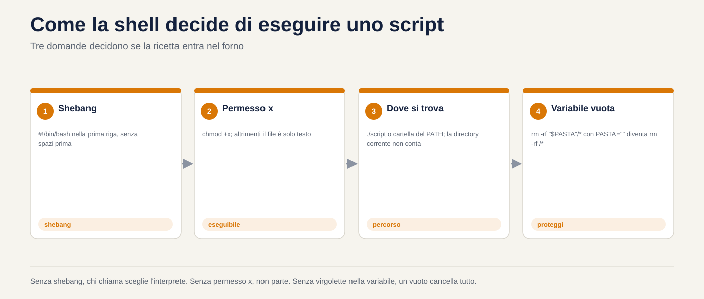
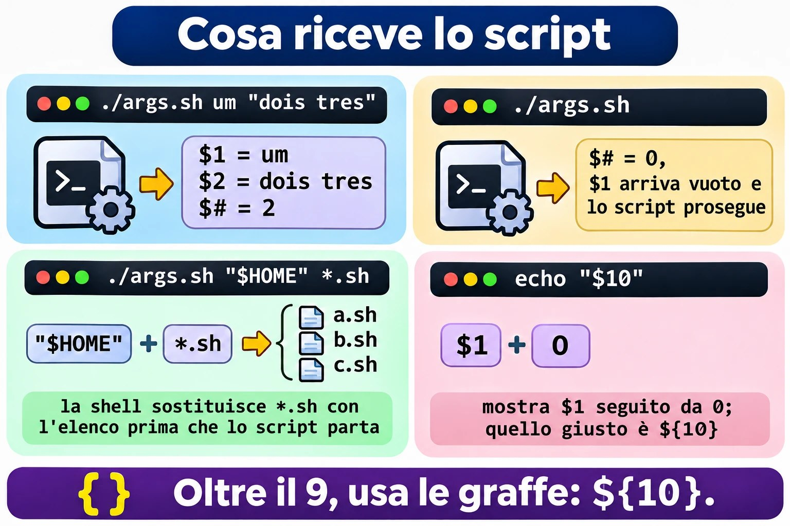
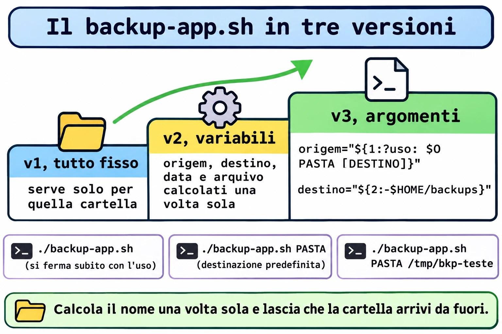
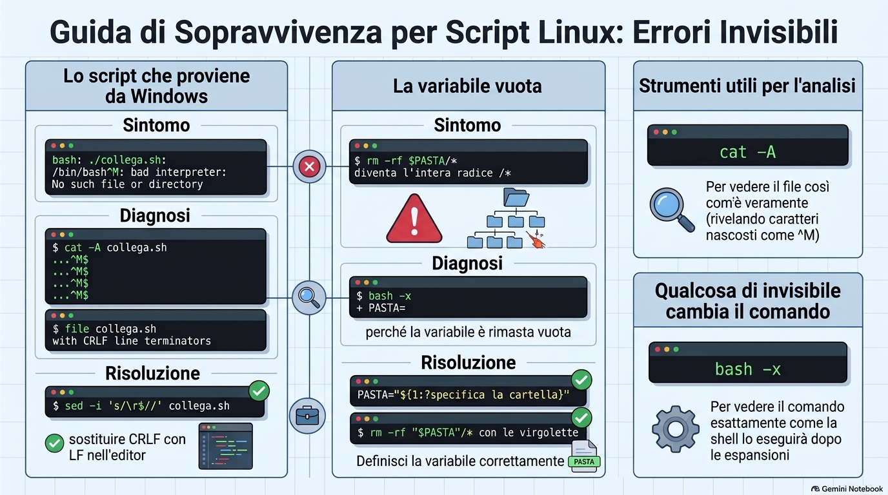

# Lezione 1.8 · Il primo script

Trasformi il Protocollo di backup della Lezione 1.7 in uno script vero: un file che richiami per nome, da qualsiasi cartella, passandogli ciò che vuoi salvare, e che esegue i cinque passi sempre nello stesso ordine. Strada facendo, impari i tre errori che fanno inciampare il primo script di tutti: il permesso che manca, la virgoletta che manca e il file arrivato da Windows.

| Scheda | Lezione 1.8 |
| --- | --- |
| Modulo | M1 · Riga di comando, lezione 8 di 10 |
| Quando | Settimana 3 |
| Alla fine sai | Scrivere uno script con shebang, commenti e variabili; renderlo eseguibile e richiamarlo in tre modi, conoscendo la differenza; usare virgolette singole e doppie senza sorprese; ricevere argomenti con `$1`, `$2`, `$#` e `"$@"`; proteggere lo script da una variabile vuota; fare il debug con `bash -n` e `bash -x`; installare lo script in `~/bin` |
| Prerequisiti | Lezione 1.7 completa, con `~/lab13/arquivo` ancora presente nelle VM |
| Durata | Circa 2h30 |
| Snapshot | m1a8-inicio e m1a8-fim su entrambe le VM |

## 1 · Riscaldamento

Tre domande, a memoria, prima di leggere qualsiasi cosa. Scrivi le risposte; le Soluzioni le verificano in fondo.

1. Nella Lezione 1.7, quale comando testa un `.tar.gz` fino all'ultimo byte, senza estrarre nulla?
2. Nella Lezione 1.7, perché il Protocollo usa `-C` nella creazione del backup?
3. Scommessa: salvi un file `ola.sh` con un `echo` dentro e digiti `ola.sh` nel terminale, nella stessa cartella. Cosa succede?

## 2 · Perché conta

Venerdì, 18:00. Devi fare il backup di `/etc` di sei server prima di un aggiornamento. Nella Lezione 1.7, il Protocollo aveva cinque passi. Sei server per cinque passi fanno trenta comandi digitati a mano, a fine giornata. Sul quarto server dimentichi il `chmod 600`. Sul quinto, digiti `-cfz` invece di `-czf`. Nessuno se ne accorge fino al giorno in cui serve il backup.

Uno script non si stanca. Esegue i cinque passi nello stesso ordine, ogni volta, e tu controlli solo il risultato. È la differenza tra conoscere una procedura e avere una procedura.

Secondo caso. Un collega scrive uno script nel Blocco note di Windows, lo copia sul server e lo esegue. L'errore è `bad interpreter: No such file or directory`, riferito a `/bin/bash`, che ovviamente esiste. Perde un'ora a reinstallare bash. Il problema era un carattere invisibile alla fine di ogni riga. Oggi vedrai questo errore, di proposito, e lo risolverai con un comando.

Terzo caso, quello pericoloso. Uno script di pulizia contiene `rm -rf "$PASTA"/*`. Un giorno, la variabile `PASTA` arriva vuota. Il comando diventa `rm -rf /*`. È già successo in prodotti noti e in molti server di clienti. Oggi impari la riga che lo impedisce, e la testi senza cancellare nulla.

E il quarto, la vita di tutti i giorni: quasi ogni compito ripetuto diventa uno script semplice che riceve argomenti. Non è programmazione, è esattamente ciò che insegna questa lezione.

## 3 · Modello mentale

> Uno script è una ricetta scritta. La shell è il cuoco che la legge riga per riga.

Tutto ciò che digiti nel terminale può finire in un file, una riga sotto l'altra. Quando ne ordini l'esecuzione, una shell apre il file e fa esattamente ciò che farebbe se tu digitassi. Qui non esiste un linguaggio nuovo: sono gli stessi comandi delle lezioni da 1.2 a 1.7.

Tre domande decidono se la ricetta gira:

- **Chi legge la ricetta?** La prima riga, lo *shebang*, dice quale cuoco: `#!/bin/bash`. Senza, sceglie chi la richiama, e il risultato cambia da macchina a macchina.
- **La ricetta può essere eseguita?** Linux non guarda l'estensione `.sh`. Guarda il permesso `x`. Senza, il file è solo testo.
- **Dov'è la ricetta?** Se digiti solo il nome, la shell cerca nelle cartelle del `PATH`, e la cartella corrente non c'è. O dici dove sta, con `./`, oppure la installi in una cartella del `PATH`.

E due elementi rendono la ricetta riutilizzabile:

- Le **variabili** sono gli appunti del cuoco: `destino=/backup`. In lettura, `$destino`.
- Gli **argomenti** sono gli ingredienti che consegni al momento: `backup-app.sh /etc` fa valere `$1` come `/etc`. La stessa ricetta serve per qualsiasi cartella.

```text
  você digita:   backup-app.sh  /etc  /backup
                      │           │      │
                      $0          $1     $2        $# = 2

  o shell:  1. acha o arquivo (PATH ou ./)
            2. confere a permissão x
            3. lê a 1ª linha  #!/bin/bash  e chama o bash
            4. o bash executa linha por linha, trocando $1 e $2 pelos valores
```

## 4 · Il concetto a strati

### Essenziale

**Il file.** Uno script minimo:

```bash
#!/bin/bash
# ola.sh - il mio primo script
echo "Olá, $USER. Hoje é $(date +%F)."
```

- `#!/bin/bash` è lo shebang. Deve essere la prima riga, e iniziare esattamente con `#!`, senza spazi prima.
- Le righe che iniziano con `#` sono commenti. La shell li ignora. Tu, fra sei mesi, no.
- Il resto sono comandi normali. `$(date +%F)` lo hai già usato nella Lezione 1.7: la shell esegue il comando e mette l'output al suo posto. La Lezione 1.9 lo approfondisce.

**Eseguire.** Tre modi, con risultati diversi:

| Come lo richiami | Cosa serve | Cosa succede |
| --- | --- | --- |
| `bash ola.sh` | Solo il permesso di lettura | Scegli tu bash; lo shebang viene ignorato |
| `./ola.sh` | Permesso `x` | Il kernel legge lo shebang e avvia il programma indicato |
| `ola.sh` | Permesso `x` e trovarsi in una cartella del `PATH` | La shell cerca nel `PATH`; la cartella corrente non conta |

Per dare il permesso: `chmod +x ola.sh`. La Lezione 2.7 spiega i permessi nel dettaglio; per ora, `+x` basta.

**Variabili.**

```bash
destino=/backup        # crea: SENZA spazio prima né dopo il =
echo $destino          # legge con $
echo "${destino}_old"  # le graffe separano il nome dal testo attaccato
```

`destino = /backup`, con gli spazi, non crea nulla: la shell capisce che vuoi eseguire un comando chiamato `destino` con gli argomenti `=` e `/backup`.

**Virgolette.**

| Hai scritto | La shell fa | Esempio con `nome=Ana` |
| --- | --- | --- |
| `'...'` singole | Niente. Tutto è letterale | `echo 'Oi $nome'` → `Oi $nome` |
| `"..."` doppie | Sostituisce `$variável` e `$(comando)`, mantiene gli spazi | `echo "Oi $nome"` → `Oi Ana` |
| Senza virgolette | Sostituisce, e poi **spezza sugli spazi** ed espande `*` | Pericolo con nomi di file con spazi |

La regola pratica: **variabile sempre tra virgolette doppie**, `"$destino"`. Senza eccezioni, finché non sai perché vuoi l'eccezione.

**Argomenti.**

| Variabile | Valore |
| --- | --- |
| `$0` | Il nome con cui lo script è stato richiamato |
| `$1`, `$2`... `${10}` | Il primo, il secondo... il decimo argomento |
| `$#` | Quanti argomenti sono arrivati |
| `"$@"` | Tutti gli argomenti, ciascuno intero, anche con spazi |
| `$?` | Il codice di uscita dell'ultimo comando. La Lezione 1.9 lo usa molto |

**Valore predefinito e valore obbligatorio.**

```bash
destino="${2:-$HOME/backups}"     # se $2 è arrivato vuoto, usa $HOME/backups
origem="${1:?uso: $0 PASTA}"      # se $1 è arrivato vuoto, ferma lo script con questo messaggio
```

`:?` è la cintura di sicurezza dello script. La Lezione 1.9 porta `if`, che fa lo stesso in modo più flessibile; fino ad allora, `:?` risolve.

**Fare il debug.**

```bash
bash -n script.sh     # controlla solo la sintassi, non esegue nulla
bash -x script.sh     # esegue mostrando ogni riga, già con le variabili sostituite
```


*Le virgolette singole non sostituiscono nulla, le doppie sostituiscono la variabile, e senza virgolette la shell spezza ancora sugli spazi.*

### Ponte Windows

| In Windows | In Linux | Attenzione |
| --- | --- | --- |
| `.bat`, `.cmd`, `.ps1` decidono l'interprete dall'estensione | Decide lo shebang; l'estensione `.sh` è solo per gli umani | Un `.sh` con `#!/usr/bin/python3` gira come Python |
| `Set-ExecutionPolicy` decide se gli script girano | Decide il permesso `x` di ogni file | Non esiste un interruttore globale |
| La cartella corrente entra nella ricerca di `cmd` | La cartella corrente **non** è nel `PATH` | Per questo il `./` |
| `set destino=C:\bkp` e `%destino%` | `destino=/bkp` e `$destino` | In Linux, uno spazio attorno al `=` rompe tutto |
| `%1`, `%2`, `%*` | `$1`, `$2`, `"$@"` |  |
| Fine riga CRLF (`\r\n`) | Fine riga LF (`\n`) | Uno script salvato in Windows si rompe in Linux. Guasto A |

In PowerShell, `$destino = "C:\bkp"` accetta spazi attorno al `=`. È l'abitudine che fa inciampare di più chi viene da Windows.

### Avanzato

- **`source` o `.` non eseguono: includono.** `./script.sh` gira in una shell nuova, figlia della tua. Un `cd` o una variabile creata lì dentro muore quando lo script termina. `source script.sh` esegue le righe nella tua shell, e il `cd` resta. È così che viene letto `~/.bashrc`.
- **`export`.** Una variabile creata nel terminale non arriva allo script, a meno che non venga esportata: `export DESTINO=/backup`. Le variabili d'ambiente, come `PATH`, `HOME` e `USER`, sono già esportate.
- **`set -u`** fa fermare lo script quando usa una variabile che non esiste, invece di trattarla come vuota. **`set -e`** si ferma al primo comando che fallisce. Sono utili, ma hanno delle trappole; la Lezione 1.9 mostra quando fidarsene.
- **`#!/usr/bin/env bash`** cerca bash nel `PATH`, utile quando non è in `/bin`, come in alcuni BSD. Su Rocky e Debian, `#!/bin/bash` funziona sempre.
- **`readonly`** impedisce che una variabile venga modificata dopo: `readonly DESTINO=/backup`.

## 5 · Rocky × Debian

|  | Rocky Linux 9 e 10 | Debian 13 |
| --- | --- | --- |
| `/bin/sh` punta a | `bash` | `dash`, una shell più piccola e più veloce |
| Script con `#!/bin/sh` e una funzione di bash, come `{1..3}` | Funziona, perché è bash | Si rompe o dà un risultato diverso |
| `~/bin` nel `PATH` | Già presente, tramite `~/.bashrc`, anche se la cartella non esiste ancora | Entra tramite `~/.profile`, solo se la cartella esiste **al login**. Creala ed esci dalla sessione |
| `~/.local/bin` nel `PATH` | Già presente | Stessa regola di `~/bin` |
| `dos2unix` per togliere il CRLF | `sudo dnf install dos2unix` | `sudo apt install dos2unix` |
| `bash --version` | 5.1 su Rocky 9, 5.2 su Rocky 10 | 5.2 |

La regola che evita la prima riga della tabella: **se usi funzioni di bash, scrivi `#!/bin/bash`**. Usa `#!/bin/sh` solo quando lo script è POSIX puro, e testalo su Debian.

## 6 · Lab guidato

Fai tutto su entrambe le VM, a meno che il passo non ne indichi una sola. Gli script stanno in `~/lab13/scripts`, e la materia prima è l'applicazione finta della Lezione 1.7, in `~/lab13/arquivo/app`. In ogni passo, quando compare **Prevedi**, scrivi la risposta prima di premere Invio.


*Senza shebang, chi richiama sceglie l'interprete. Senza il permesso x, non si esegue. Senza virgolette sulla variabile, un vuoto cancella tutto.*


### Passo 1 · Preparare

Sul nodo Proxmox:

```bash
qm snapshot 201 m1a8-inicio
qm snapshot 202 m1a8-inicio
```

Su ogni VM:

```bash
ls ~/lab13/arquivo/app
mkdir -p ~/lab13/scripts
cd ~/lab13/scripts
echo "$SHELL"
bash --version | head -1
```

`ls` deve mostrare `conf`, `iniciar.sh`, `logs` e `www`. Se la cartella non esiste, rifai il Passo 1 della Lezione 1.7. `$SHELL` deve essere `/bin/bash`.

### Passo 2 · Il primo file e i tre modi di richiamarlo

Crea lo script con un *here-document*, il `cat > arquivo <<'EOF'` che hai usato nella Lezione 1.7. Le virgolette in `'EOF'` fanno entrare il testo nel file esattamente com'è, senza sostituire `$USER` adesso.

```bash
cat > ola.sh <<'EOF'
#!/bin/bash
# ola.sh - il mio primo script
echo "Olá, $USER. Hoje é $(date +%F)."
echo "Estou rodando em $(hostname)."
EOF
cat ola.sh
ls -l ola.sh
```

**Prevedi.** Digiterai `ola.sh`, solo il nome, trovandoti nella stessa cartella. Cosa compare?

```bash
ola.sh
```

`bash: ola.sh: command not found`. Il file è lì, ma la shell non cerca nella cartella corrente: cerca nelle cartelle del `PATH`. Guarda quali sono:

```bash
echo "$PATH"
```

Ora di' dove sta il file, con `./`:

```bash
./ola.sh
```

`bash: ./ola.sh: Permission denied`. L'`ls -l` di prima ha mostrato `-rw-r--r--`: non c'è nessuna `x`. Per Linux, questo è testo, non un programma.

**Decidi 1 · Il modo che funziona senza `x`.** Prima di dare il permesso, esegui `bash ola.sh`. Cosa succede?

- **A)** `Permission denied`, come con `./ola.sh`.
- **B)** Funziona, perché ciò che viene eseguito è `bash`, e `ola.sh` è solo un file che lui legge.
- **C)** Funziona, perché `bash` ignora i permessi di qualsiasi file.
- **D)** `command not found`, perché `ola.sh` non è nel `PATH`.

Scegli un'opzione prima di continuare.

| Se hai scelto | Risultato | Perché |
| --- | --- | --- |
| A | ❌ Sbagliato | La `x` è richiesta a ciò che viene eseguito. Qui ciò che viene eseguito è `/bin/bash`, che ha la `x`. `ola.sh` deve solo essere letto, e ha la `r`. |
| B | ✅ Giusto | `bash` riceve il nome del file come argomento, lo apre e lo legge riga per riga, come farebbe con un `cat`. Lo shebang diventa un normale commento. |
| C | ❌ Sbagliato | Se togli la `r` con `chmod -r ola.sh`, `bash ola.sh` fallisce con `Permission denied`. Rispetta la lettura; solo che non ha bisogno della `x`. |
| D | ❌ Sbagliato | Il `PATH` entra in gioco solo per trovare il primo nome della riga, che qui è `bash`. `ola.sh` è un argomento con percorso relativo. |

**Da ricordare:** `bash script.sh` richiede `r`; `./script.sh` richiede `r` e `x`; `script.sh` richiede `r`, `x` e trovarsi nel `PATH`.

Controlla:

```bash
bash ola.sh
chmod +x ola.sh
ls -l ola.sh
./ola.sh
```

Ora `ls -l` mostra `-rwxr-xr-x`, e `./ola.sh` funziona. Un ultimo esperimento con lo shebang:

```bash
head -1 ola.sh
file ola.sh
```

`file` risponde qualcosa come `Bourne-Again shell script, Unicode text, UTF-8 text executable`. Ha letto la prima riga, come fa il kernel.

### Passo 3 · Variabili e virgolette, nel terminale

Prima di mettere variabili in uno script, sbaglia nel terminale, dove costa poco:

```bash
destino = /backup
```

**Prevedi** il messaggio. È `bash: destino: command not found`. La shell ha letto `destino` come un comando, con due argomenti. Ora nel modo giusto:

```bash
destino=/backup
echo $destino
echo "Os backups vão para $destino"
echo 'Os backups vão para $destino'
echo "${destino}_antigo"
echo "$destino_antigo"
```

Le ultime due righe sono la trappola delle graffe. `"${destino}_antigo"` mostra `/backup_antigo`. `"$destino_antigo"` mostra una riga vuota: la shell ha cercato una variabile chiamata `destino_antigo`, che non esiste, e l'ha sostituita con nulla, senza alcun errore.

Ora un nome di file con uno spazio, il caso che rompe più script:

```bash
cd /tmp
arq="relatorio final.txt"
```

**Decidi 2 · La virgoletta mancante.** Digiti `touch $arq`, senza virgolette, e poi `ls`. Cosa compare?

- **A)** Un file `relatorio final.txt`.
- **B)** Due file: `relatorio` e `final.txt`.
- **C)** Un file chiamato `$arq`.
- **D)** Un errore, perché `touch` non accetta spazi nel nome.

Scegli un'opzione prima di continuare.

| Se hai scelto | Risultato | Perché |
| --- | --- | --- |
| A | ❌ Sbagliato | Sarebbe il risultato di `touch "$arq"`. Senza virgolette, dopo aver sostituito la variabile la shell spezza il testo sugli spazi. |
| B | ✅ Giusto | La shell sostituisce `$arq` con `relatorio final.txt` e poi divide sugli spazi. `touch` riceve due argomenti e crea due file. |
| C | ❌ Sbagliato | Succederebbe con le virgolette singole: `touch '$arq'`. Senza virgolette, la variabile viene sostituita. |
| D | ❌ Sbagliato | `touch` accetta qualsiasi nome. Non sa nemmeno che c'era uno spazio: riceve due nomi separati. |

**Da ricordare:** variabile sempre tra virgolette doppie. `touch "$arq"`, `rm "$arq"`, `cp "$arq" "$destino"`.

Controlla e ripulisci:

```bash
touch $arq
ls -l relatorio final.txt
touch "$arq"
ls -l "$arq"
rm -v relatorio final.txt "$arq"
cd ~/lab13/scripts
```

Immagina lo stesso errore con `rm $arq`: cancelleresti `relatorio` e `final.txt`, che potevano essere altri file, e `relatorio final.txt` resterebbe lì.

### Passo 4 · Argomenti

Uno script che mostra solo ciò che ha ricevuto:

```bash
cat > args.sh <<'EOF'
#!/bin/bash
# args.sh - mostra gli argomenti ricevuti
echo "Nome do script: $0"
echo "Primeiro:       $1"
echo "Segundo:        $2"
echo "Quantidade:     $#"
echo "Todos, um por linha:"
printf '  [%s]\n' "$@"
EOF
chmod +x args.sh
```

`printf` ripete il modello `[%s]` una volta per ogni argomento. È un trucco per vedere esattamente dove ogni argomento inizia e finisce.

**Prevedi** il `$#` di ogni riga prima di eseguire:

```bash
./args.sh
./args.sh um dois tres
./args.sh um "dois tres"
./args.sh "$HOME" *.sh
```

Risposte: 0, 3, 2, e l'ultima dipende da quanti `.sh` ci sono nella cartella. `*.sh` viene espanso **prima** che lo script parta: lui non vede mai l'asterisco, riceve solo l'elenco dei nomi. Nota anche che, senza argomenti, `$1` arriva vuoto e lo script va avanti, senza lamentarsi. Tienilo a mente per il Guasto B.

**Decidi 3 · Il decimo argomento.** Esegui `./args.sh a b c d e f g h i j`. Dentro lo script, una riga dice `echo "$10"`. Cosa mostra?

- **A)** `j`, il decimo argomento.
- **B)** `a0`, il primo argomento seguito da uno zero.
- **C)** Una riga vuota, perché esistono solo da `$1` a `$9`.
- **D)** Un errore di sintassi.

Scegli un'opzione prima di continuare.

| Se hai scelto | Risultato | Perché |
| --- | --- | --- |
| A | ❌ Sbagliato | Sarebbe il risultato di `"${10}"`. Senza graffe, la shell legge solo una cifra dopo il `$`. |
| B | ✅ Giusto | La shell legge `$1`, che vale `a`, e attacca lo `0` come testo. È la stessa trappola di `$destino_antigo`. |
| C | ❌ Sbagliato | Esistono `${10}`, `${11}` e quanti ne passi. Solo la forma corta, senza graffe, si ferma a 9. |
| D | ❌ Sbagliato | Non c'è errore: la shell accetta `$10` e lo interpreta, in un modo che non volevi. |

**Da ricordare:** oltre il 9, usa le graffe: `${10}`. Nel dubbio, usa sempre le graffe.

Controlla:

```bash
echo 'echo "com \$10:   $10"'   >> args.sh
echo 'echo "com \${10}: ${10}"' >> args.sh
tail -2 args.sh
./args.sh a b c d e f g h i j
```



*Cosa riceve lo script: ogni argomento intero, il `*.sh` già sostituito dalla shell, e le graffe dal decimo in poi.*

### Passo 5 · Il Protocollo diventa script

Questo è il passo centrale. Scriverai lo stesso script tre volte, ogni versione migliore della precedente.

**Versione 1, tutto fisso.** È il Protocollo della Lezione 1.7, incollato in un file:

```bash
cat > backup-app.sh <<'EOF'
#!/bin/bash
# backup-app.sh v1 - tutto fisso
mkdir -p ~/backups
tar -czf ~/backups/app-$(date +%F_%H%M).tar.gz -C ~/lab13/arquivo app
ls -lh ~/backups
EOF
chmod +x backup-app.sh
./backup-app.sh
```

Funziona, ma serve solo per quella cartella, e il nome del file compare solo dentro `tar`. Se poi vuoi testare e salvare il `sha256sum`, dovrai ripetere il nome, con l'ora, che nel frattempo è cambiata.

**Versione 2, con variabili.** Il nome viene calcolato una volta e usato ovunque:

```bash
cat > backup-app.sh <<'EOF'
#!/bin/bash
# backup-app.sh v2 - variabili
origem="$HOME/lab13/arquivo/app"
destino="$HOME/backups"
data="$(date +%F_%H%M)"
arquivo="$destino/app-$data.tar.gz"

mkdir -p "$destino"
tar -czf "$arquivo" -C "$HOME/lab13/arquivo" app
tar -tzf "$arquivo" > /dev/null && echo "OK: o arquivo abre até o fim"
sha256sum "$arquivo" > "$arquivo.sha256"
chmod 600 "$arquivo" "$arquivo.sha256"
ls -lh "$arquivo" "$arquivo.sha256"
EOF
bash -n backup-app.sh
./backup-app.sh
```

`bash -n` non mostra nulla quando la sintassi è corretta. Nota che dentro lo script ho usato `$HOME`, e non `~`: la `~` non viene sostituita dentro le virgolette, e una variabile tra virgolette è più sicura.

**Prevedi.** Eseguilo di nuovo, ora con `bash -x`. Quante righe che iniziano con `+` compariranno?

```bash
bash -x ./backup-app.sh
```

Una per ogni comando, con le variabili già sostituite dai valori: `+ data=2026-11-02_1430`, `+ tar -czf /home/student/backups/app-2026-11-02_1430.tar.gz ...`. `-x` è la radiografia dello script: quando qualcosa va storto, è la prima cosa che esegui.

**Versione 3, con argomenti.** Ora la cartella arriva da fuori, e la destinazione ha un valore predefinito:

```bash
cat > backup-app.sh <<'EOF'
#!/bin/bash
# backup-app.sh - backup di una cartella secondo il Protocollo della Lezione 1.7
# Uso: backup-app.sh PASTA [DESTINO]
#   PASTA    cosa salvare, obbligatorio
#   DESTINO  dove salvare, predefinito ~/backups

origem="${1:?uso: $0 PASTA [DESTINO]}"
destino="${2:-$HOME/backups}"
nome="$(basename "$origem")"
pai="$(dirname "$origem")"
data="$(date +%F_%H%M)"
arquivo="$destino/$nome-$data.tar.gz"

echo "Backup de $origem para $arquivo"
mkdir -p "$destino"
tar -czf "$arquivo" -C "$pai" "$nome"
tar -tzf "$arquivo" > /dev/null && echo "OK: o arquivo abre até o fim"
sha256sum "$arquivo" > "$arquivo.sha256"
chmod 600 "$arquivo" "$arquivo.sha256"
ls -lh "$arquivo" "$arquivo.sha256"
EOF
bash -n backup-app.sh
```

`basename` restituisce l'ultimo pezzo del percorso, e `dirname` il resto. Per `/home/student/lab13/arquivo/app`, restituiscono `app` e `/home/student/lab13/arquivo`. È il `-C` del Protocollo, calcolato da solo.

Testa i tre casi:

```bash
./backup-app.sh
./backup-app.sh ~/lab13/arquivo/app
./backup-app.sh ~/lab13/arquivo/app /tmp/bkp-teste
ls -l ~/backups /tmp/bkp-teste
```

Il primo si ferma subito con `./backup-app.sh: line 7: 1: uso: ./backup-app.sh PASTA [DESTINO]`, senza creare nulla. Il secondo usa la destinazione predefinita. Il terzo scrive in `/tmp/bkp-teste`. Controlla l'impronta digitale dell'ultimo:

```bash
sha256sum -c /tmp/bkp-teste/app-*.sha256
```

`OK`. Siccome `sha256sum` ha salvato il percorso completo, il controllo funziona da qualsiasi cartella.

**Decidi 4 · Il backup di `/etc`.** Esegui `./backup-app.sh /etc`, come utente normale. Cosa succede?

- **A)** Funziona uguale, con tutto `/etc` dentro.
- **B)** `tar` si lamenta di vari file che non riesce a leggere, come `shadow`, crea un backup incompleto, e ciononostante compare `OK: o arquivo abre até o fim`.
- **C)** Lo script si ferma alla prima riga, perché `/etc` non è una cartella dell'utente.
- **D)** `tar` rifiuta l'intero backup e non viene creato nulla.

Scegli un'opzione prima di continuare.

| Se hai scelto | Risultato | Perché |
| --- | --- | --- |
| A | ❌ Sbagliato | Un utente normale non legge `/etc/shadow`, `/etc/sudoers` e altri. `tar` non ha modo di salvare ciò che non riesce a leggere. |
| B | ✅ Giusto | `tar` mostra `Cannot open: Permission denied` per ognuno, salva il resto e termina con un errore. Ma la riga successiva testa solo se il file si apre, e si apre. Lo script dice OK per un backup senza i file più importanti. |
| C | ❌ Sbagliato | `:?` controlla solo se `$1` è arrivato. `/etc` è arrivato, quindi lo script prosegue. |
| D | ❌ Sbagliato | `tar` è testardo: salta ciò che non riesce a leggere e continua. Per questo il backup esiste, solo che è incompleto. |

**Da ricordare:** uno script che non controlla il risultato di ogni passo ti mente. La Lezione 1.9 insegna `if` e `$?`, e questa è la prima cosa che sistemerai con loro.

Controlla, guardando la fine dell'output:

```bash
./backup-app.sh /etc /tmp/bkp-teste 2>&1 | tail -5
sudo ./backup-app.sh /etc /tmp/bkp-teste | tail -3
```

Con `sudo`, nessuna lamentela, e il file ha proprietario `root` e permessi 600. È com'è giusto che sia un backup di `/etc`.

### Passo 6 · Installare in `~/bin`

Uno script che richiami con `./` da dentro una cartella non è ancora uno strumento. Installalo:

```bash
mkdir -p ~/bin
cp backup-app.sh ~/bin/
cd /
backup-app.sh ~/lab13/arquivo/app
```

**Decidi 5 · Rocky e Debian.** Hai fatto esattamente questo su entrambe le VM, senza uscire dalla sessione. Qual è il risultato?

- **A)** Funziona su entrambe.
- **B)** Funziona su rocky-lab; su debian-lab, `command not found`.
- **C)** Funziona su debian-lab; su rocky-lab, `command not found`.
- **D)** Non funziona su nessuna finché non riavvii la VM.

Scegli un'opzione prima di continuare.

| Se hai scelto | Risultato | Perché |
| --- | --- | --- |
| A | ❌ Sbagliato | Su Debian, `~/bin` entra nel `PATH` solo se esiste al momento del login. Non esisteva quando sei entrato. |
| B | ✅ Giusto | Il `~/.bashrc` di Rocky mette sempre `~/bin` nel `PATH`. Il `~/.profile` di Debian lo mette solo se la cartella esiste già all'accesso. |
| C | ❌ Sbagliato | È il contrario. Controlla con `echo "$PATH"` su entrambe. |
| D | ❌ Sbagliato | Riavviare risolve, ma è esagerato. Basta uscire e rientrare, oppure rileggere il file con `source ~/.profile`. |

**Da ricordare:** dopo aver creato `~/bin`, esci e rientra. Controlla con `type nome-do-script`.

Controlla, su debian-lab:

```bash
echo "$PATH" | tr ':' '\n' | grep bin
source ~/.profile
type backup-app.sh
cd / && backup-app.sh ~/lab13/arquivo/app
```

`type` risponde `backup-app.sh is /home/student/bin/backup-app.sh`. Lo script è diventato un comando.

> **Protocollo · Script che non fa vergognare**
>
> 1. Prima riga: `#!/bin/bash`. Seconda: un commento che dice cosa fa. Terza: `# Uso:` con gli argomenti.
> 2. Argomento obbligatorio con `${1:?uso: ...}`; opzionale con `${2:-padrão}`.
> 3. Calcola i nomi una volta, in variabili, e usa le variabili ovunque.
> 4. Ogni variabile tra virgolette doppie: `"$arquivo"`.
> 5. Prima di eseguire: `bash -n`. Se succede qualcosa di strano: `bash -x`.
> 6. Testa senza argomenti, con un argomento e con un percorso che contiene spazi.
> 7. `chmod +x`, installa in `~/bin` oppure, per tutti gli utenti, in `/usr/local/bin`.



*Lo stesso backup in tre versioni: tutto fisso, con variabili e con argomenti.*

## 7 · Rompi e ripara

### Guasto A · Lo script arrivato da Windows

Un collega ti manda uno script che ha scritto nel Blocco note. Simula il suo file: il `\r\n` alla fine di ogni riga è esattamente ciò che scrive il Blocco note.

```bash
cd ~/lab13/scripts
printf '#!/bin/bash\r\n# do colega\r\necho "versao do colega"\r\n' > colega.sh
chmod +x colega.sh
./colega.sh
```

**Osserva.** Il messaggio è qualcosa come:

```text
bash: ./colega.sh: /bin/bash^M: bad interpreter: No such file or directory
```

`/bin/bash` esiste. Ma nota il `^M` attaccato.

**Diagnostica.** Mostra ciò che il normale `cat` nasconde:

```bash
cat colega.sh
cat -A colega.sh
file colega.sh
```

`cat -A` mostra `^M$` alla fine di ogni riga: `^M` è il `\r`, e `$` segna la fine della riga. `file` dice `with CRLF line terminators`. Il kernel ha letto la prima riga come `/bin/bash\r` e ha cercato un programma con quel nome, con un carattere invisibile in fondo. Non esiste.

**Decidi A · La riparazione.** Cosa risolve il problema una volta per tutte?

- **A)** Eseguire con `bash colega.sh`.
- **B)** Togliere il `\r` alla fine di ogni riga: `sed -i 's/\r$//' colega.sh`, oppure `dos2unix colega.sh`.
- **C)** Reinstallare bash.
- **D)** Cambiare lo shebang in `#!/bin/sh`.

Scegli un'opzione prima di continuare.

| Se hai scelto | Risultato | Perché |
| --- | --- | --- |
| A | ❌ Sbagliato | Evita lo shebang, ma bash legge ogni riga con il `\r` in fondo. L'`echo` stampa un `\r` nascosto, e un `cd /tmp\r` fallisce con `No such file or directory`. Il problema cambia posto. |
| B | ✅ Giusto | Il file passa ad avere le fini riga di Linux. `sed` è già installato su entrambe le VM; `dos2unix` fa lo stesso e va installato. |
| C | ❌ Sbagliato | bash è perfetto. È il caso della sezione 2: un'ora persa nel posto sbagliato. |
| D | ❌ Sbagliato | La prima riga continua ad avere il `\r`, ora `/bin/sh^M`, e l'errore è lo stesso. |

**Da ricordare:** `bad interpreter` con `^M` è sempre CRLF. Controlla con `cat -A` e ripara con `sed -i 's/\r$//'`.

**Ripara.**

```bash
sed -i 's/\r$//' colega.sh
cat -A colega.sh
file colega.sh
./colega.sh
```

Ora `cat -A` mostra solo `$` alla fine, e lo script gira. Per non ricevere il problema: in VS Code, l'angolo in basso a destra mostra `CRLF`; clicca e passa a `LF` prima di salvare. In Notepad++, menu Modifica, Conversione fine riga.

### Guasto B · La variabile vuota

Questo è l'errore che ha già cancellato server interi. Lo riprodurrai in sicurezza: lo script **mostra** solo il comando, con `echo`, e non cancella nulla.

```bash
cat > limpa.sh <<'EOF'
#!/bin/bash
# limpa.sh - pulisce una cartella di file temporanei (versione pericolosa)
PASTA=$1
echo "Vou executar:" rm -rf $PASTA/*
EOF
chmod +x limpa.sh
```

Prima, l'uso normale:

```bash
mkdir -p /tmp/temporarios && touch /tmp/temporarios/a.tmp /tmp/temporarios/b.tmp
./limpa.sh /tmp/temporarios
```

`Vou executar: rm -rf /tmp/temporarios/a.tmp /tmp/temporarios/b.tmp`. Giusto. Ora qualcuno dimentica l'argomento.

**Osserva.**

```bash
./limpa.sh
```

`Vou executar: rm -rf /bin /boot /dev /etc /home /lib ...`. L'intero elenco della radice; su Rocky, comincia con `/afs`. Senza l'`echo`, questa era la fine del server.

**Diagnostica.** Usa la radiografia:

```bash
bash -x ./limpa.sh
```

La prima riga con `+` è `+ PASTA=`: la variabile non ha ricevuto nulla. Subito dopo, `$PASTA/*` è diventato `/*`, e la shell ha espanso l'asterisco in tutto ciò che esiste nella radice.

**Decidi B · La cintura di sicurezza.** Quale modifica impedisce il disastro?

- **A)** Mettere le virgolette: `rm -rf "$PASTA"/*`.
- **B)** Esigere l'argomento: `PASTA="${1:?informe a pasta}"`, e mantenere le virgolette nel `rm`.
- **C)** Sostituire `rm -rf` con `rm -r`.
- **D)** Eseguire sempre lo script come utente normale.

Scegli un'opzione prima di continuare.

| Se hai scelto | Risultato | Perché |
| --- | --- | --- |
| A | ❌ Sbagliato | Le virgolette proteggono dagli spazi, ma `"$PASTA"/*` con `PASTA` vuota resta `""/*`, cioè `/*`. Aiuta, non salva. |
| B | ✅ Giusto | Senza argomento, lo script si ferma sulla riga della variabile, prima di arrivare al `rm`. Le virgolette restano per il caso in cui la cartella abbia uno spazio nel nome. |
| C | ❌ Sbagliato | Senza la `f`, `rm` chiede conferma sui file protetti e mostra errori, ma cancella tutto ciò che ha il permesso di cancellare. |
| D | ❌ Sbagliato | Riduce il danno, ma l'utente cancella comunque tutto ciò che è suo, compresa la sua `/home`. E gli script di pulizia di solito girano come root, nel cron. |

**Da ricordare:** ogni variabile usata in un `rm`, `mv` o `chmod -R` deve essere obbligatoria, con `:?`, e stare tra virgolette.

**Ripara.**

```bash
sed -i 's|^PASTA=\$1$|PASTA="${1:?informe a pasta}"|' limpa.sh
sed -i 's|rm -rf \$PASTA/\*|rm -rf "$PASTA"/*|' limpa.sh
cat limpa.sh
./limpa.sh
./limpa.sh /tmp/temporarios
```

Ora, senza argomento, lo script si ferma con `line 3: 1: informe a pasta`, e con l'argomento funziona come prima. Apri `backup-app.sh` e controlla che sia nato già con questa cintura, sul `$1`.

### La lezione

I due errori di oggi hanno la stessa faccia: qualcosa di invisibile che cambia il comando. Un `\r` che non vedi alla fine della riga. Una variabile vuota che non vedi in mezzo al `rm`. Entrambi si rivelano con gli stessi strumenti: `cat -A` per vedere il file com'è, e `bash -x` per vedere il comando come lo eseguirà la shell. Quando uno script fa qualcosa che non gli hai chiesto, non leggere lo script: eseguilo con `-x` e leggi ciò che ha fatto.


*Un carattere che non vedi e una variabile che non vedi: cat -A e bash -x rivelano entrambi.*

## 8 · Trappole

| Digiti o vedi | Cosa succede | Il modo giusto |
| --- | --- | --- |
| `destino = /backup` | `destino: command not found` | `destino=/backup`, senza spazi |
| `script.sh`, nella cartella dello script | `command not found` | `./script.sh`, oppure installarlo nel `PATH` |
| `./script.sh` subito dopo averlo creato | `Permission denied` | `chmod +x script.sh` |
| `bad interpreter` con `^M` | File con CRLF di Windows | `sed -i 's/\r$//' script.sh` |
| `echo '$HOME'` | Mostra `$HOME`, letterale | Virgolette doppie: `echo "$HOME"` |
| `touch $arq` con uno spazio nel nome | Crea due file | `touch "$arq"` |
| `"$nome_backup"` | Cerca una variabile chiamata `nome_backup`, che non esiste, e mostra vuoto, senza errore | `"${nome}_backup"`, sempre con le graffe quando attacchi testo |
| `echo "$10"` | Mostra `$1` seguito da `0` | `"${10}"` |
| `rm -rf "$PASTA"/*` senza controllare `$PASTA` | Con la variabile vuota, diventa `rm -rf /*` | `PASTA="${1:?...}"` prima |
| `#!/bin/sh` e `{1..5}` nello script | Funziona su Rocky, si rompe su Debian | `#!/bin/bash` |
| `~` dentro le virgolette: `"~/backups"` | Non viene sostituita; crea una cartella chiamata `~` | `"$HOME/backups"` |
| `cd /var/log` dentro lo script | Alla fine, resti nella cartella di prima | Normale: lo script gira in una shell figlia. Per restare, `source` |
| Script con `tar` fallito e `OK` alla fine | Il test successivo non sa che `tar` è fallito | Controllare `$?`. Lezione 1.9 |

## 9 · Quiz

Dieci domande, senza consultare nulla. Scrivi la lettera o la risposta di ciascuna e solo dopo apri le Soluzioni.

**1.** Quale riga crea la variabile `porta` con il valore 8080?

- **A)** `porta = 8080`
- **B)** `$porta=8080`
- **C)** `porta=8080`
- **D)** `set porta 8080`

**2.** `s.sh` ha i permessi `-rw-r--r--`. Quale di queste chiamate **fallisce**?

- **A)** `bash s.sh`
- **B)** `./s.sh`
- **C)** `source s.sh`
- **D)** `sh s.sh`

**3.** Esegui `./args.sh "um dois" tres`. Quanto valgono `$#` e `$1`?

- **A)** `3` e `um`
- **B)** `2` e `um dois`
- **C)** `2` e `"um dois"`, con le virgolette
- **D)** `3` e `um dois`

**4.** Con `nome=web01`, cosa mostra `echo 'Servidor: $nome'`?

- **A)** `Servidor: web01`
- **B)** `Servidor: $nome`
- **C)** `Servidor:`
- **D)** Errore di sintassi

**5.** Lo shebang di uno script dice `#!/bin/bsh`, con un errore di battitura. Cosa succede con `./script.sh` e con `bash script.sh`?

- **A)** Funzionano entrambi: bash corregge il nome.
- **B)** Falliscono entrambi con `bad interpreter`.
- **C)** `./script.sh` fallisce con `bad interpreter`; `bash script.sh` funziona, perché lo shebang diventa un commento.
- **D)** `./script.sh` funziona; `bash script.sh` fallisce.

**6.** Nello script, `destino="${2:-/backup}"`. Quanto vale `destino` con `./s.sh /etc` e con `./s.sh /etc /mnt/usb`?

- **A)** `/backup` in entrambi
- **B)** vuoto e `/mnt/usb`
- **C)** `/backup` e `/mnt/usb`
- **D)** `/etc` e `/mnt/usb`

**7.** Cosa fa `origem="${1:?falta a pasta}"` quando lo script viene richiamato senza argomenti?

**8.** Hai creato `~/bin` e hai copiato `meu.sh` lì dentro, su una VM Debian, senza uscire dalla sessione. `meu.sh` dà `command not found`. Qual è la causa più probabile, e come confermarla?

**9.** `vai.sh` contiene solo `cd /var/log`. Dove ti trovi dopo `./vai.sh`? E dopo `source vai.sh`?

**10.** *Which of the following variables contains the number of arguments passed to a shell script?*

- **A)** `$@`
- **B)** `$#`
- **C)** `$*`
- **D)** `$0`
- **E)** `$?`

## 10 · Flashcard e promemoria

### Da sapere a memoria

Questa parte è da tenere in testa. È lo scheletro di ogni script che scriverai.

- `#!/bin/bash` nella prima riga, senza spazi prima
- `chmod +x script.sh` e poi `./script.sh`
- `nome=valor`, senza spazi; `"$nome"` per leggere, sempre con virgolette doppie
- `'...'` non sostituisce nulla; `"..."` sostituisce `$variável` e `$(comando)`
- `$1`, `$2`: argomenti; `$#`: quanti; `"$@"`: tutti; `$0`: il nome dello script
- `${1:?mensagem}`: obbligatorio; `${2:-padrão}`: opzionale
- `bash -n script.sh`: controlla la sintassi; `bash -x script.sh`: mostra ogni riga eseguita
- `cat -A script.sh`: mostra il `^M` di Windows; `sed -i 's/\r$//' script.sh` lo ripara

### Da consultare

Questa parte non devi impararla a memoria. Ricorda solo dove si trova.

- `"${nome}_texto"`: graffe quando attacchi testo al nome; `${10}` oltre il 9
- `basename /a/b/c` dà `c`; `dirname /a/b/c` dà `/a/b`
- `source script.sh` o `. script.sh`: gira nella shell corrente; `cd` e variabili restano
- `export NOME=valor`: la variabile arriva agli script richiamati dopo
- `type comando` o `command -v comando`: da dove viene il comando
- `~/bin` per te; `/usr/local/bin` per tutti gli utenti, con `sudo`
- Debian: `~/bin` entra nel `PATH` al login, se esiste. Rocky: sempre
- `#!/bin/sh` su Debian è `dash`, senza le funzioni di bash
- `set -u` si ferma su una variabile inesistente; `set -e` si ferma al primo errore. Lezione 1.9
- `file script.sh` mostra `with CRLF line terminators` quando arriva da Windows

### Flashcard

| Fronte | Retro |
| --- | --- |
| Cos'è lo shebang? | La prima riga, `#!/bin/bash`, che dice al kernel quale programma legge lo script |
| Linux decide in base all'estensione `.sh`? | No. Decide in base allo shebang e al permesso `x` |
| Perché `script.sh` dà `command not found` nella cartella dello script? | La cartella corrente non è nel `PATH`. Usa `./script.sh` |
| Quale permesso richiede `bash script.sh`? | Solo lettura. Ciò che viene eseguito è `bash` |
| Cosa c'è di sbagliato in `nome = valor`? | Gli spazi. La shell esegue un comando chiamato `nome` |
| Differenza tra `'$HOME'` e `"$HOME"`? | Le singole sono letterali; le doppie sostituiscono con il valore |
| Cosa succede con `touch $arq` se `arq` ha uno spazio? | Crea un file per ogni parola |
| Cosa contiene `$#`? | Quanti argomenti ha ricevuto lo script |
| Perché `"$@"` e non `$*`? | `"$@"` mantiene ogni argomento intero, anche con spazi |
| Cosa mostra `"$10"`? | `$1` seguito da uno `0`. Usa `${10}` |
| Cosa fa `${1:?msg}`? | Ferma lo script con il messaggio se `$1` arriva vuoto |
| Cosa fa `${2:-/backup}`? | Usa `/backup` se `$2` arriva vuoto |
| `bad interpreter` con `^M`: causa? | Fini riga di Windows, CRLF |
| A cosa serve `bash -x`? | A mostrare ogni comando già con le variabili sostituite |
| Perché un `cd` dentro lo script non cambia la tua cartella? | Lo script gira in una shell figlia, che muore alla fine |

## 11 · Checklist di uscita

Spunta solo ciò che sai fare senza guardare la lezione:

- [ ] Scrivere uno script con shebang, commento d'uso e variabili
- [ ] Spiegare perché `script.sh`, `./script.sh` e `bash script.sh` danno risultati diversi
- [ ] Usare virgolette singole e doppie e prevedere il risultato
- [ ] Ricevere argomenti con `$1`, `$2` e `$#`, e mostrarli tutti con `"$@"`
- [ ] Rendere obbligatorio un argomento e dare un valore predefinito a un altro
- [ ] Fare il debug con `bash -n` e `bash -x`
- [ ] Riconoscere e riparare uno script con CRLF
- [ ] Spiegare perché una variabile vuota in un `rm` è pericolosa, e impedirlo
- [ ] Installare uno script in `~/bin` e farlo funzionare su Rocky e su Debian
- [ ] Spiegare la differenza tra eseguire e usare `source`

**Ultimo esercizio, senza guardare.** Chiudi questa lezione. In `~/lab13/scripts`, crea `saudacao.sh`:

1. Riceve un nome come primo argomento, obbligatorio. Senza, si ferma con il messaggio `uso: saudacao.sh NOME [CIDADE]`.
2. Riceve una città come secondo argomento, opzionale, con predefinito `Roma`.
3. Mostra `Olá, NOME, de CIDADE. Você me passou N argumentos.`
4. Funziona con `./saudacao.sh "Ana Maria" Milano`, mostrando il nome intero.
5. È installato in `~/bin` e funziona da `/tmp`.

Le risposte sono alla fine delle Soluzioni.

**Snapshot di chiusura.** Sul nodo Proxmox:

```bash
qm snapshot 201 m1a8-fim
qm snapshot 202 m1a8-fim
```

Non cancellare `~/bin/backup-app.sh`: nella Lezione 1.9 acquisisce `if`, codice di uscita e un log, e smette di dire OK per un backup incompleto.

## 12 · Nella vita reale

**Missione della settimana, sola lettura.** Scegli un server che amministri davvero. Se è di un cliente, fai solo ciò che il contratto consente; se hai dubbi, usa rocky-lab e debian-lab. Nessun comando di questa missione crea, modifica, esegue o cancella alcuno script: tu leggi soltanto.

Dove vivono gli script di casa:

```bash
ls -l /usr/local/bin /usr/local/sbin ~/bin 2> /dev/null
ls -l /etc/cron.daily /etc/cron.d 2> /dev/null
sudo crontab -l 2> /dev/null
crontab -l 2> /dev/null
```

Per ogni script che compare, guarda la prima riga e il tipo:

```bash
file /usr/local/bin/*
head -n 1 /usr/local/bin/* 2> /dev/null
```

Cerca script arrivati da Windows:

```bash
grep -l $'\r' /usr/local/bin/* /usr/local/sbin/* 2> /dev/null
```

`$'\r'` è il modo di bash di scrivere il `\r` sulla riga di comando. Se compare qualche nome, quello script funziona per fortuna, o viene richiamato con `bash script`, o non funziona e nessuno se n'è accorto.

Scegli lo script più importante, come quello di backup, e leggilo con calma:

```bash
less /usr/local/bin/NOME-DO-SCRIPT
grep -n 'rm ' /usr/local/bin/NOME-DO-SCRIPT
```

Per ogni `rm` che `grep` mostra, guarda se la variabile è tra virgolette e se qualcuno garantisce che non arrivi vuota.

Su Proxmox, gli script di solito vivono in `/root`, in `/usr/local/bin` o negli hook di backup:

```bash
ls -l /root/*.sh /usr/local/bin 2> /dev/null
grep -n 'script' /etc/vzdump.conf
```

**Per il diario.** Rispondi in poche righe:

1. Quanti script di casa hai trovato? Quali girano da soli, tramite cron?
2. Hanno tutti lo shebang? Qualcuno usa `#!/bin/sh` con funzioni di bash, su un Debian?
3. Qualcuno aveva `^M`?
4. Lo script più importante ha un commento che dice cosa fa e come si usa?
5. Qualche `rm` con una variabile senza virgolette, o senza controllo del vuoto? Annota il file e la riga, e non toccare: proponi la correzione a chi ne è responsabile.

**Sfida della settimana.** Uno script al giorno. Copia uno script reale, di un server che amministri, su rocky-lab, senza password né chiavi dentro. Leggilo con il Protocollo della sezione 6 accanto e annota cosa manca: shebang, uso, virgolette, `:?`. Riscrivi la copia, nel laboratorio, con ciò che mancava, ed eseguila con `bash -n` e `bash -x`. Nel diario, una riga al giorno: quale script, quanti punti del Protocollo mancavano, e qual era il più pericoloso.

**Domani, senza guardare.** Apri un terminale domani e, senza consultare nulla:

1. Scrivi uno script di tre righe che mostra `hostname` e la data.
2. Eseguilo con `bash`, prova con `./`, dai il permesso ed eseguilo di nuovo.
3. Fagli ricevere un nome come argomento obbligatorio.
4. Eseguilo con `bash -x` e spiega ogni riga con `+`.
5. Spiega a voce alta perché `rm -rf $PASTA/*` è pericoloso.

Se ti blocchi su uno, torna solo al Passo di quel punto.

## 13 · Con DeepTutor

Usa il DeepTutor della tua rete locale dopo il lab, non al posto suo. I comandi iniziano con `!`:

- `!quiz Aula 1.8`: chiedi dieci domande nuove su virgolette, argomenti e permessi, nel formato dei Decidi.
- `!explica aspas`: chiedi la differenza tra singole, doppie e nessuna, con un esempio che si rompe in ogni caso.
- `!feynman`: spiega a un tirocinante perché `script.sh` dà `command not found` nella cartella dello script. DeepTutor indica dove sei rimasto vago.
- `!quebra`: chiedi un nuovo script rotto, come un `$10`, una `~` tra virgolette o una variabile con uno spazio, e ripara solo con `bash -x` e `cat -A`.
- `!quiz 1.8 script`: chiedi tre compiti pratici del tipo "crea `/usr/local/bin/x` che riceve un argomento", ciascuno con il comando che ne conferma il risultato.
- `!cartoes`: genera flashcard dalla sezione 10 e ripassale dopo tre giorni.
- `!erro`: incolla un messaggio vero, come `bad interpreter` o `unbound variable`, e chiedi la causa prima della soluzione.
- `!revisao`: programma il ripasso della Lezione 1.8 tra tre giorni e tra una settimana.

## Soluzioni commentate

### Riscaldamento

1. **`gzip -t arquivo.tar.gz`, oppure `tar -tzf arquivo.tar.gz > /dev/null`.** Entrambi leggono il file fino all'ultimo byte. `file` legge solo l'inizio e non individua un backup tagliato.
2. **Perché i percorsi siano relativi e inizino con una cartella dotata di nome.** Così, l'estrazione cade nella cartella in cui ti trovi, dentro una cartella sola, e mai sopra il sistema. Oggi lo script ha calcolato questo `-C` da solo, con `dirname`.
3. **`command not found`.** La shell cerca il comando nelle cartelle del `PATH`, e la cartella corrente non c'è. Con `./ola.sh`, l'errore cambia in `Permission denied`, perché manca la `x`. Sono due ostacoli, e il Passo 2 li ha mostrati entrambi.

### Quiz

1. **C.** Senza spazi attorno al `=` e senza `$` in creazione. Il `$` serve solo per leggere. A è l'errore di chi viene da PowerShell, e D è la sintassi di `csh`.
2. **B.** `./` richiede la `x`. Le altre tre passano il file a una shell che deve solo leggerlo.
3. **B.** Le virgolette raggruppano `um dois` in un argomento solo e non fanno parte del valore. Sono due argomenti.
4. **B.** Le virgolette singole non sostituiscono nulla. Con le doppie, sarebbe `Servidor: web01`.
5. **C.** Il kernel prova a eseguire `/bin/bsh`, che non esiste. Con `bash script.sh`, a eseguire è bash, e la prima riga è solo un commento.
6. **C.** Senza `$2`, vale il predefinito. Con `$2`, vale ciò che è arrivato.
7. **Lo script si ferma subito**, mostrando qualcosa come `./s.sh: line 3: 1: falta a pasta`, e termina con un codice di uscita diverso da zero. Nessuna riga dopo di essa viene eseguita.
8. **Il `~/.profile` di Debian mette `~/bin` nel `PATH` solo se la cartella esiste al login**, e non esisteva quando sei entrato. Conferma con `echo "$PATH"` o `type meu.sh`. Per risolvere, esci e rientra, oppure esegui `source ~/.profile`.
9. **Con `./vai.sh`, nella stessa cartella di prima**: il `cd` è avvenuto in una shell figlia, che è terminata. **Con `source vai.sh`, in `/var/log`**: le righe sono state eseguite nella tua shell.
10. **B.** Guarda ogni alternativa:

| Se hai scelto | Risultato | Perché |
| --- | --- | --- |
| A | ❌ Sbagliato | `$@` sono gli argomenti stessi, non la quantità. |
| B | ✅ Giusto | `$#` è il numero di argomenti posizionali. |
| C | ❌ Sbagliato | Anche `$*` sono gli argomenti, uniti in un testo solo. |
| D | ❌ Sbagliato | `$0` è il nome con cui lo script è stato richiamato. |
| E | ❌ Sbagliato | `$?` è il codice di uscita dell'ultimo comando. |

### Ultimo esercizio

Una risposta possibile:

```bash
cat > saudacao.sh <<'EOF'
#!/bin/bash
# saudacao.sh - saluta qualcuno
# Uso: saudacao.sh NOME [CIDADE]
nome="${1:?uso: saudacao.sh NOME [CIDADE]}"
cidade="${2:-Roma}"
echo "Olá, $nome, de $cidade. Você me passou $# argumentos."
EOF
chmod +x saudacao.sh
./saudacao.sh
./saudacao.sh "Ana Maria" Milano
cp saudacao.sh ~/bin/
cd /tmp && saudacao.sh Ana
```

1. Senza argomento, il `:?` ferma lo script con il messaggio.
2. Il `:-` dà `Roma` quando la città non arriva.
3. `$#` conta gli argomenti arrivati.
4. Con le virgolette nella chiamata, `Ana Maria` arriva intero in `$1`. Con le virgolette nell'`echo`, esce intero.
5. Su Debian, se `~/bin` è stato creato in questa sessione, esci e rientra prima dell'ultimo comando.

---

<!-- navegacao -->
[← Lezione 1.7 · Archiviare e comprimere](1.7-arquivar-e-compactar.md) · [Indice delle lezioni](../01-aulas.md) · [Lezione 1.9 · Decidere e ripetere →](1.9-decidir-e-repetir.md)
