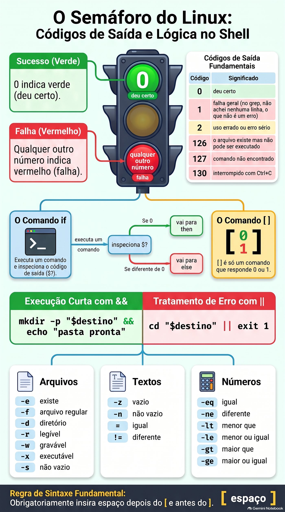
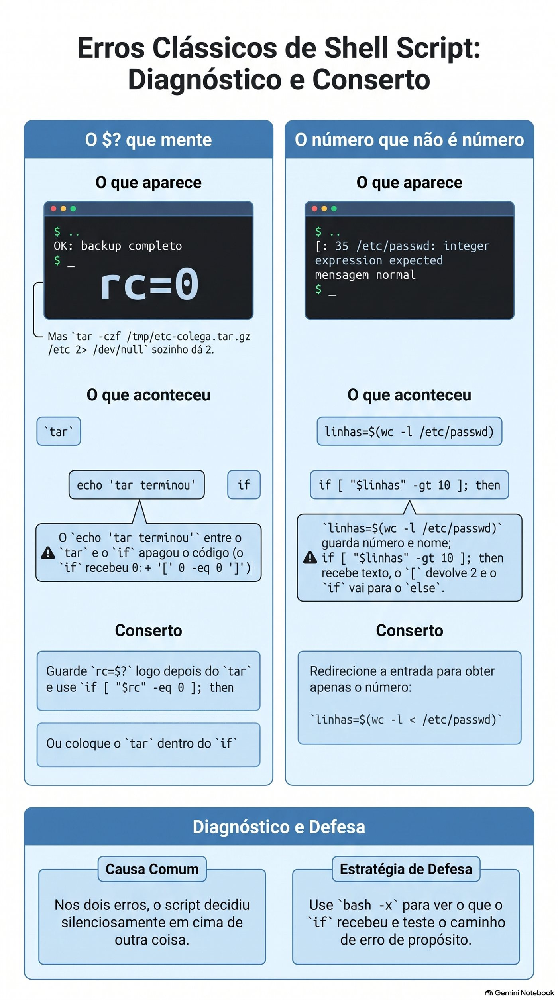

# Lezione 1.9 · Decidi e ripeti

Nella Lezione 1.8, `backup-app.sh` ha detto OK per un backup di `/etc` che è stato lasciato senza i file più importanti. Oggi impara a essere diffidente: controlla il risultato di ogni passaggio, così quando qualcosa va storto lascia un record nel log e restituisce un codice che un altro script, o cron, può leggere. Quindi esegui lo stesso backup per un elenco di cartelle, con un ciclo, senza ripetere una riga.

| File | lezione 1.9 |
| --- | --- |
| Modulo | M1 · Riga di comando, lezione 9 di 10 |
| Quando | Settimana 3 |
| Alla fine puoi | Leggere e utilizzare il codice di uscita, `$?`; testare file, testi e numeri con `test` e `[ ]`; decidere con `if`, `elif`, `else`, `&&` e `\|\|`; ripetere con `for` e `while read`; salvare l'output di un comando con `$(...)` ed eseguire calcoli con `$((...))`; terminare uno script con `exit N`; log con `logger` |
| Articoli di prova | LE 013.3 · LPIC-1 105.2: `test`, `if`, `for`, `while`, codice di uscita, sostituzione di comandi · RHCSA: esegue il codice in modo condizionale, utilizza cicli per elaborare file e argomenti, elaborare l'output del comando all'interno dello script |
| Prerequisiti | lezione 1.8 completata, con `~/bin/backup-app.sh` su entrambe le VM |
| Tempo | Intorno alle 2:30 |
| Istantanee | m1a9-start e m1a9-end su entrambe le VM |

## 1 · Riscaldamento

Tre domande, a mente fredda, prima di leggere qualsiasi cosa. Scrivi le risposte; la chiave di risposta viene visualizzata alla fine.

1. Nella Lezione 1.8, cosa fa `origem="${1:?uso: ...}"` quando lo script viene chiamato senza argomenti?
2. Nella lezione 1.8, perché `backup-app.sh /etc`, eseguito come utente comune, finisce per dire che il file è aperto fino alla fine?
3. Indovina: esegui `ls /naoexiste` e poi `echo $?`. Quale numero appare?

## 2 · Perché è importante

Uno script di backup viene eseguito in cron, ogni giorno alle 2 del mattino, per otto mesi. Nessuno guarda l'uscita perché "ha sempre funzionato". Il giorno in cui il disco del server muore, apri la cartella dei backup e trovi file da 45 byte di marzo: `tar` falliva ogni notte e lo script andava avanti e copiava il file vuoto sul NAS. Il comando ha avvertito. Lo script non ha chiesto.

Ogni comando Linux risponde, una volta terminato, con un numero: zero se ha funzionato, un altro numero se non ha funzionato. Sono le informazioni più importanti di uno script e quasi tutti gli script scadenti la ignorano. Oggi impari a leggere questo numero e decidi in base ad esso.

Secondo caso. È necessario eseguire il backup di sei cartelle, controllare dieci server o rinominare trecento registri. Copiare la stessa riga sei volte funziona fino al giorno in cui ne correggi una e dimentichi le altre cinque. Un ciclo scrive la riga una volta e la ripete per ciascun elemento.

E la prova: RHCSA richiede script che decidano e si ripetano. Un'attività tipica è "creare uno script che, per ogni utente in un elenco, esegua X; se l'argomento non viene fornito, termina con il codice 1". Il broker controlla il codice di uscita.

## 3 · Modello mentale

> Ogni comando termina con l'accensione di un semaforo. Lo zero è verde; qualsiasi altro numero è rosso e il numero indica quale era il problema.

Il semaforo non è quello che il comando mostra sullo schermo. Un `grep` potrebbe non mostrare nulla e funzionare comunque; a `tar` potrebbe mostrare un mucchio di righe e non essere riuscito. La shell memorizza il semaforo dell'**ultimo** comando in `$?` e lo modifica con ogni nuovo comando, incluso un `echo`.

Con il semaforo, tre strumenti:

- **`if` decide.** Esegue un comando e guarda il semaforo. Verde, entra in `then`; rosso, vai al `else`. `if` non capisce testi né numeri: solo il semaforo.
- **chiede `[ ]`.** È un comando come un altro, il cui unico compito è rispondere con il verde o il rosso. `[ -d /etc ]` chiede "`/etc` è una cartella?" e risponde con il semaforo. Ecco perché appare così spesso all'interno di `if`, ma non è obbligatorio.
- **`for` e `while` si ripetono.** `for` si ripete una volta per ogni elemento di un elenco. `while` si ripete finché un comando è verde, come `read`, che è verde finché ci sono ancora righe da leggere.

```text
  if  tar -czf ...  ;  then  ...  else  ...  fi
      └── roda ───┘
            │
            └─ semáforo ($?)   0 ──► then
                              ≠0 ──► else

  [ -d "$origem" ]   é só um comando que responde 0 (sim) ou 1 (não)
```


*Lo zero è verde, qualsiasi altro numero è rosso: la mappa dei codici di uscita, `if`, `[ ]` e `&&`/`||`.*

## 4 · Concetto a più livelli

### Essenziale

**Il codice di uscita.**

```bash
ls /etc/hostname
echo $?          # 0: ha funzionato
ls /naoexiste
echo $?          # 2: è andato storto; 2 è il codice ls per "Non potevo farlo"
```

| Codice | Significato più comune |
| --- | --- |
| `0` | Ha funzionato |
| `1` | Fallimento generale. In `grep` "Non ho trovato nessuna riga", che non è un errore |
| `2` | Uso improprio o errore grave. In `grep` e `tar` errore vero |
| `126` | Il file esiste ma non può essere eseguito |
| `127` | Comando non trovato |
| `130` | Arrestato con Ctrl+C |

Anche il vostro script termina con un codice: quello dell'ultimo comando eseguito, oppure quello scelto da voi con `exit N`. Chiunque chiami il tuo script, che tu, un altro script o cron, legge questo numero.

**`&&` e `||`.** Il modo più breve per decidere in una riga:

```bash
mkdir -p "$destino" && echo "pasta pronta"     # esegui echo solo se mkdir ha funzionato
cd "$destino" || exit 1                         # se il cd fallisce, termina lo script
```

**`test` e `[ ]`.** Sono lo stesso comando con due grafie. All'interno delle parentesi, **spazio dopo `[` e prima di `]`**, sempre.

| Domanda | Verde quando |
| --- | --- |
| `[ -e "$x" ]` | `$x` esiste, qualunque sia |
| `[ -f "$x" ]` | `$x` è un file comune |
| `[ -d "$x" ]` | `$x` è una cartella |
| `[ -r "$x" ]`, `-w`, `-x` | Puoi leggere, scrivere, eseguire |
| `[ -s "$x" ]` | `$x` esiste e non è vuoto |
| `[ -z "$v" ]` | Il testo è vuoto |
| `[ -n "$v" ]` | Il testo non è vuoto |
| `[ "$a" = "$b" ]`, `!=` | Stessi testi diversi |
| `[ "$n" -eq 5 ]`, `-ne`, `-lt`, `-le`, `-gt`, `-ge` | Numeri: uguali, diversi, minori, minori o uguali, maggiori, maggiori o uguali |
| `[ ! -d "$x" ]` | `!` inverte la domanda |

**`if`.**

```bash
if [ -d "$origem" ]; then
    echo "pasta encontrada"
elif [ -e "$origem" ]; then
    echo "existe, mas não é uma pasta"
else
    echo "não existe"
fi
```

`if` accetta qualsiasi comando, non solo `[ ]`:

```bash
if grep -q root /etc/passwd; then echo "tem root"; fi
if ! tar -czf "$arquivo" -C "$pai" "$nome"; then echo "o tar falhou"; fi
```

**`for`.** Una volta per ogni elemento:

```bash
for servidor in rocky-lab debian-lab; do
    echo "conferindo $servidor"
done

for arquivo in /var/log/*.log; do      # la shell assembla l'elenco, anche con spazi nei nomi
    echo "$arquivo"
done

for i in {1..5}; do echo "$i"; done    # da 1 a 5
```

**`while read`.** Una volta per ogni riga di un file:

```bash
while read -r pasta; do
    echo "vou guardar $pasta"
done < pastas.txt
```

`-r` fa o `read` non utilizza le barre rovesciate. Utilizzare sempre.

**`$(...)` e `$((...))`.**

```bash
hoje="$(date +%F)"              # memorizza l'output di un comando
linhas="$(wc -l < /etc/passwd)" # con <, wc mostra solo il numero
total=$((total + 1))            # conta con numeri interi
```

Il backtick, `` `date` ``, ha la stessa funzione di `$(date)`. Lo troverai nelle vecchie scritture; scrivere con `$(...)`, che è più facile da leggere e annidare.

**`exit N`.** Termina immediatamente lo script, con il codice `N`. D'accordo con chi leggerà: 0 per successo e numeri diversi per errori diversi, documentati nel commento in alto.

**`logger`.** Scrive una riga nel log di sistema, con un'etichetta: `logger -t backup-app "OK /etc"`. Da leggere: `journalctl -t backup-app`. Ecco come uno script cron racconta ciò che ha fatto, senza che nessuno guardi lo schermo.

### Windows Bridge

| Su Windows | Su Linux | Attenzione |
| --- | --- | --- |
| `%ERRORLEVEL%` in `cmd`, `$LASTEXITCODE` in PowerShell | `$?` | Su Linux, `$?` cambia dopo **qualsiasi** comando, fino a `echo` |
| In PowerShell, `$?` è `True` o `False` | In bash, `$?` è un numero e 0 è successo | È l'opposto dell'intuizione: 0 è buono |
| `if exist arquivo` | `if [ -e "$arquivo" ]` | Gli spazi all'interno del `[ ]` sono obbligatori |
| In PowerShell, `-eq` e `-gt` confrontano qualsiasi cosa | Al `[ ]`, `-eq` e `-gt` sono solo per numeri; i testi usano `=` | `[ 10 \> 9 ]` confronta come testo e restituisce false |
| `for %%f in (*.log) do` | `for f in *.log; do ...; done` |  |
| `exit /b 1` | `exit 1` |  |
| Visualizzatore eventi, `Write-EventLog` | `logger` e `journalctl` |  |

### Avanzato

- **`[[ ]]`** è la versione bash: accetta `&&` e `||` all'interno, confronta i modelli con `==` e non si interrompe con variabili vuote senza virgolette. Non esiste in `dash`, `/bin/sh` di Debian. In questa lezione, `[ ]` tra virgolette, che funziona in qualsiasi shell.
- **Pipeline.** `$?` di `comando1 | comando2` è l'**ultimo** comando. Un `tar ... | gzip` con `tar` fallito dà il verde. `set -o pipefail` rende la tubazione rossa se qualche parte si guasta; `${PIPESTATUS[@]}` mostra il codice per ogni parte.
- **`set -e`** per lo script nel primo comando che fallisce, ma non è valido all'interno di `if`, né prima di `&&` e `||`, né nelle pipeline senza `pipefail`. Aiuta, ma non sostituisce l'esplicito `if` nei passaggi che contano.
- **`while read` e `ssh`.** Un `ssh` all'interno di un `while read ... done < lista` mangia il resto dell'elenco, perché legge dalla stessa voce. Utilizzare `ssh -n`.
- **`case`** decide tra più testi contemporaneamente, come `start`, `stop` e `status`. È per il Modulo 4, negli script di servizio.
- **`tar` e i suoi codici.** GNU tar esce con 1 quando un file viene modificato durante il salvataggio e con 2 in caso di errore fatale, come `Permission denied`. Entrambi sono rossi per `if`.

### Cosa rientra nel test

- **LE 013.3:** cos'è `$?`, `if` e `test` base, `for` in un elenco. Domande come "qual è il valore di `$?` dopo...".
- **LPIC-1 105.2:** `test` con `-f`, `-d`, `-z`, `-eq`; `if`, `for`, `while`, `seq`; `exit`; sostituzione dei comandi; codici di uscita. C'è molta differenza tra `-eq` e `=`.
- **RHCSA:** uno script che riceve argomenti, decide e ripete e termina con un codice di uscita specifico. Esempio: "crea `/usr/local/bin/checa`, che riceve nomi utente; per ognuno che non esiste, mostra un messaggio; termina con 1 se ne manca uno."

## 5 · Rocky × Debian

|  | Rocky Linux 9 e 10 | Debian 13 |
| --- | --- | --- |
| `[[ ]]` in una scrittura con `#!/bin/sh` | Funziona, perché `/bin/sh` è bash | `[[: not found`, perché `/bin/sh` è `dash` |
| `{1..5}` in una scrittura con `#!/bin/sh` | Funziona | Mostra `{1..5}`, letterale |
| Messaggio di `[ "abc" -gt 1 ]` | `integer expression expected` | `integer expression expected`. Nella nuova bash 5.3, la frase è stata abbreviata in `integer expected` |
| `logger -t backup-app "msg"` | Vai al diario; `rsyslog` copia anche in `/var/log/messages` | Vai al diario; senza `rsyslog` installato non c'è `/var/log/syslog` |
| Leggi cosa ha registrato `logger` | `journalctl -t backup-app` | `journalctl -t backup-app` |
| `seq 1 5` | Installato | Installato |

La regola che si applica a entrambi: **`#!/bin/bash` in ogni script di questa lezione, `[ ]` tra virgolette e `journalctl -t` per leggere il registro**.

## 6 · Laboratorio guidato

Fai tutto in entrambe le VM, a meno che il passaggio non ne indichi solo uno. I test rapidi sono al terminal; le scritture sono in `~/lab13/scripts`; `backup-app.sh` installato nella lezione 1.8 è in `~/bin`. In ogni passaggio, quando appare **Predict**, scrivere la risposta prima di premere Invio.

### Passaggio 1 · Prepara

Nel nodo Proxmox:

```bash
qm snapshot 201 m1a9-inicio
qm snapshot 202 m1a9-inicio
```

In ogni VM:

```bash
type backup-app.sh
ls ~/lab13/arquivo/app
cd ~/lab13/scripts
```

`type` deve rispondere `backup-app.sh is /home/SEU_USUARIO/bin/backup-app.sh`. Se rispondi `not found`, rifai il passo 6 della Lezione 1.8.

### Passo 2 · Il semaforo, `$?`

```bash
ls /etc/hostname
echo $?
ls /naoexiste
echo $?
```

`0` e poi `2`. Sullo schermo appare il messaggio di errore `ls`; il codice va a `$?`.

**Preveja.** Subito dopo `ls /naoexiste`, esegui `echo $?` due volte di seguito. Cosa mostra ognuno?

```bash
ls /naoexiste
echo $?
echo $?
```

`2` e poi `0`. Il secondo `echo` mostra il codice del **primo** `echo` che ha funzionato. `$?` viene cancellato ad ogni comando. Tienilo: è il Break A di questo corso.

Ora `grep`, che ha tre risposte:

```bash
grep -q root /etc/passwd;        echo "achou: $?"
grep -q naoexiste /etc/passwd;   echo "não achou: $?"
grep -q root /arquivo/inexistente; echo "erro: $?"
```

`0`, `1` e `2`. `-q` lascia stare `grep`: non mostra nulla, risponde solo con il codice.

**Decidi 1 · Cosa significa 1.** In uno script, `grep -q "ERRO" app.log` terminava con il codice 1. Cos'è successo?

- **A)** `grep` non riuscito: il file probabilmente non esiste.
- **B)** `grep` ha funzionato e non ha trovato alcuna riga con `ERRO`.
- **C)** `grep` trovato esattamente una riga con `ERRO`.
- **D)** `grep` è stato interrotto.

Scegliere la lettera prima di guardare la tabella.

| Se hai selezionato | Risultato | Perché |
| --- | --- | --- |
| A | ❌ Sbagliato | File inesistente riporta `2`, con messaggio `No such file or directory`. |
| B| ✅ Giusto | Per `grep`, 1 è "Ho cercato e non l'ho trovato". Nel monitoraggio dei log, questa è la buona notizia. |
| C| ❌ Sbagliato | Il codice non conta le righe. Trovarne uno o mille dà `0`. Per contare, `grep -c`. |
| D | ❌ Sbagliato | Interrotto con Ctrl+C restituisce `130`. |

**Da risolvere:** il rosso non è sempre un errore. Leggi `man` del comando, nella sezione *STATO USCITA*, prima di decidere cosa significa ciascun numero.

Check out:

```bash
man grep | grep -A6 'EXIT STATUS'
```

### Passo 3 · Chiedi con `[ ]`

```bash
[ -d /etc ];            echo "pasta: $?"
[ -f /etc ];            echo "arquivo: $?"
[ -f /etc/hostname ];   echo "arquivo: $?"
[ -z "" ];              echo "vazio: $?"
[ 10 -gt 9 ];           echo "maior: $?"
```

`0`, `1`, `0`, `0`, `0`. `[` è un comando vero e proprio:

```bash
type [
ls -l /usr/bin/[
```

Essendo un comando necessita di spazi, come tutti gli altri. Guarda cosa succede senza:

```bash
[-d /etc]
```

`bash: [-d: command not found`, codice 127. La shell ha cercato un programma chiamato `[-d`.

**Predict.** `[ 10 \> 9 ]` confronta 10 con 9 usando `>`. Verde o rosso?

```bash
[ 10 \> 9 ];  echo $?
[ 10 -gt 9 ]; echo $?
```

`1` e `0`. Con `>` i due lati vengono confrontati come **testo**, lettera per lettera, come nel dizionario: `"1"` viene prima di `"9"`, quindi `"10"` è più piccolo. I numeri si confrontano con `-gt`, `-lt` e azienda.

**Decidi 2 · La variabile vuota in `[ ]`.** Lo script ha `if [ $resposta = sim ]; then`. Un giorno `resposta` arriva vuoto. Cosa succede?

- **A)** Il test restituisce falso, in silenzio, e lo script va a `else`.
- **B)** Appare `[: =: unary operator expected`, il test restituisce 2 e lo script va a `else`.
- **C)** Lo script si interrompe immediatamente con un errore di sintassi.
- **D)** Il test restituisce vero, perché vuoto è uguale a qualsiasi cosa.

Scegli la lettera prima di guardare la tabella.

| Se hai selezionato | Risultato | Perché |
| --- | --- | --- |
| A | ❌ Sbagliato | Sarebbe così tra virgolette. Senza virgolette, la variabile vuota scompare dalla riga. |
| B| ✅ Giusto | Senza virgolette, la shell assembla `[ = sim ]`. `[` vede solo due pezzi e si lamenta. Il codice 2 è rosso, quindi `if` va a `else` e lo script segue, con uno strano messaggio sullo schermo. |
| C| ❌ Sbagliato | Non è un errore di sintassi di bash: è `[`, un comando, che si lamenta degli argomenti. La sceneggiatura continua. |
| D | ❌ Sbagliato | Nessun comando considera vuoto come un carattere jolly. |

**Da correggere:** variabile tra `[ ]` sempre tra virgolette: `[ "$resposta" = sim ]`. È la regola della lezione 1.8 con un motivo in più.

Check out:

```bash
resposta=
[ $resposta = sim ];   echo $?
[ "$resposta" = sim ]; echo $?
```

`unary operator expected` e `2`, poi solo `1`, pulito.

### Passo 4 · Decidi con `if`

```bash
cat > existe.sh <<'EOF'
#!/bin/bash
# existe.sh - diz o que é cada caminho recebido
# Uso: existe.sh CAMINHO
alvo="${1:?uso: $0 CAMINHO}"

if [ -d "$alvo" ]; then
    echo "$alvo é uma pasta"
elif [ -f "$alvo" ]; then
    echo "$alvo é um arquivo de $(wc -c < "$alvo") bytes"
elif [ -e "$alvo" ]; then
    echo "$alvo existe, mas não é pasta nem arquivo comum"
else
    echo "$alvo não existe" >&2
    exit 1
fi
EOF
chmod +x existe.sh
./existe.sh /etc;           echo "rc=$?"
./existe.sh /etc/hostname;  echo "rc=$?"
./existe.sh /dev/null;      echo "rc=$?"
./existe.sh /naoexiste;     echo "rc=$?"
```

Cartella, file, "esiste ma non è" e `não existe` con `rc=1`. `>&2` invia il messaggio di errore all'output di errore, lezione 1.5: chi reindirizza solo l'output normale vede comunque l'errore.

**Decidi 3 · Quale `if` è corretto?** Vuoi sapere se l'utente `root` appare in `/etc/passwd`.

- **A)** `if [ grep -q root /etc/passwd ]; then`
- **B)** `if grep -q root /etc/passwd; then`
- **C)** `if [ $(grep root /etc/passwd) ]; then`
- **D)** `if grep -q root /etc/passwd = 0; then`

Scegli la lettera prima di guardare la tabella.

| Se hai selezionato | Risultato | Perché |
| --- | --- | --- |
| A | ❌ Sbagliato | `[` riceve le parole `grep`, `-q`, `root` e `/etc/passwd` come testo e non sa cosa farne: si lamenta con un errore di sintassi, la cui frase cambia a seconda della versione di bash, e restituisce 2. `grep` non viene mai eseguito, e `if` va a `else`. |
| B| ✅ Giusto | `if` corre `grep` e guarda il semaforo. È la forma più breve e corretta. |
| C| ❌ Sbagliato | Funziona per caso finché l'output è una sola parola: la riga fondamentale non ha spazi. Se `grep` trova due righe, oppure una con spazio, `[` riceve troppi pezzi e protesta. Usa l'output, quando ciò che conta è il codice. |
| D | ❌ Sbagliato | `grep` riceve `=` e `0` come nomi di file. Con `-q` si ferma al primo colpo e non apre nemmeno i due, quindi sembra funzionare. Il giorno in cui non lo trovi, lamentati che `=` e `0` non esistono e restituisci 2. Giusto sembra essere sbagliato. |

**Per risolvere:** `if` riceve un **comando**. Utilizzare `[ ]` solo quando la domanda riguarda file, testi o numeri; Quando è "questo comando ha funzionato?", inserisci il comando diretto.

Selezionare A per visualizzare il messaggio:

```bash
if [ grep -q root /etc/passwd ]; then echo sim; else echo não; fi
if grep -q root /etc/passwd; then echo sim; else echo não; fi
```

E nel modo più breve, con `&&` e `||`:

```bash
grep -q root /etc/passwd && echo "tem root" || echo "sem root"
```

### Passaggio 5 · Ripetere con `for`

```bash
for vm in rocky-lab debian-lab; do
    echo "vou conferir $vm"
done

for i in {1..3}; do echo "volta $i"; done
for i in $(seq 1 3); do echo "volta $i"; done
```

Ora, una cartella con nomi di registro, uno dei quali con uno spazio, come accade quando il file proviene da Windows:

```bash
mkdir -p ~/lab13/logs-teste
cd ~/lab13/logs-teste
touch app.log "nota fiscal.log" erro.log
ls -l
```

**Decidi 4 · Esamina i registri.** Quale ciclo esamina i tre file, uno alla volta, con il nome intero?

- **A)** `for f in $(ls); do echo "[$f]"; done`
- **B)** `for f in *.log; do echo "[$f]"; done`
- **C)** `for f in "$(ls)"; do echo "[$f]"; done`
- **D)** `for f in $(ls *.log); do echo "[$f]"; done`

Scegli la lettera prima di guardare la tabella.

| Se hai selezionato | Risultato | Perché |
| --- | --- | --- |
| A | ❌ Sbagliato | L'output di `ls` è suddiviso in spazi: `[nota]` e `[fiscal.log]` compaiono separatamente. Quattro giri, due sbagliati. |
| B| ✅ Giusto | La shell stessa assembla la lista con `*`, e ogni nome diventa un intero elemento, con o senza spazio. Tre giri. |
| C| ❌ Sbagliato | Le virgolette riuniscono tutto in un unico elemento: un ritorno a capo, con all'interno i tre nomi e le interruzioni di riga. |
| D | ❌ Sbagliato | Lo stesso problema di A. `*.log` aiuta `ls`, ma l'interruzione degli spazi avviene più tardi. |

**Per risolvere:** per scorrere i file, utilizzare `*` direttamente in `for`. Mai `for f in $(ls)`.

Check out:

```bash
for f in $(ls); do echo "[$f]"; done
for f in *.log; do echo "[$f]"; done
```

E un ciclo utile, che conta le righe di ogni registro:

```bash
for f in *.log; do
    echo "$(wc -l < "$f") linhas  $f"
done
cd ~/lab13/scripts
```

### Passo 6 · Ripeti con `while read` e conta

Un elenco di cartelle, una per riga, con una riga vuota e una cartella che non esiste, apposta:

```bash
cat > pastas.txt <<'EOF'
/home/SEU_USUARIO/lab13/arquivo/app
/home/SEU_USUARIO/lab13/logs-teste

/home/SEU_USUARIO/naoexiste
EOF
sed -i "s|SEU_USUARIO|$USER|" pastas.txt
cat -A pastas.txt
```

Il `cat -A` mostra la riga vuota solo come `$`. Ora leggi riga per riga, saltando quella vuota:

```bash
total=0
while read -r pasta; do
    [ -z "$pasta" ] && continue
    total=$((total + 1))
    if [ -d "$pasta" ]; then
        echo "OK      $pasta"
    else
        echo "FALTA   $pasta"
    fi
done < pastas.txt
echo "Total: $total"
```

Due righe `OK`, una `FALTA`, `Total: 3`. `continue` passa al ciclo successivo.

**Decidi 5 · Il totale che somma.** Un collega ha scritto lo stesso ciclo in questo modo: `cat pastas.txt | while read -r pasta; do ... done`, quindi `echo "Total: $total"`. Cosa appare alla fine?

- **A)** `Total: 3`, lo stesso.
- **B)** `Total: 0`.
- **C)** `Total: 4`, perché ora conta la riga vuota.
- **D)** Errore: `while` non accetta pipe.

Scegliere la lettera prima di guardare la tabella.

| Se hai selezionato | Risultato | Perché |
| --- | --- | --- |
| A | ❌ Sbagliato | All'interno del loop il conteggio arriva a 3. Ma succede altrove. |
| B| ✅ Giusto | In una pipe, bash esegue `while` in una shell figlia. Il `total` che arriva a 3 è quello del figlio, e muore con lui. Il `echo` all'esterno vede il `total` prima del loop: 0. È lo stesso motivo del `cd` che non resta, nella lezione 1.8. |
| C| ❌ Sbagliato | `[ -z ]` con `continue` salta la riga vuota in entrambe le direzioni. |
| D | ❌ Sbagliato | `while` accetta la pipa senza lamentarsi. Ecco perché l'errore è insidioso: non c'è nessun messaggio. |

**Per risolvere:** in un ciclo che memorizza qualcosa per dopo, leggere il file con `done < arquivo`, mai con `cat arquivo |`.

Check out:

```bash
total=0
cat pastas.txt | while read -r pasta; do [ -z "$pasta" ] && continue; total=$((total + 1)); done
echo "Total pelo pipe: $total"
total=0
while read -r pasta; do [ -z "$pasta" ] && continue; total=$((total + 1)); done < pastas.txt
echo "Total pelo <: $total"
```

### Passo 7 · `backup-app.sh` impara a diffidare

È la correzione promessa nella Decisione 4 della lezione 1.8. La nuova versione controlla ogni passaggio, restituisce un codice diverso per ogni tipo di problema, registra tutto nel proprio registro e diario e non lascia un backup incompleto che sembra buono.

```bash
cp ~/bin/backup-app.sh ~/bin/backup-app.sh.v3
cat > ~/bin/backup-app.sh <<'EOF'
#!/bin/bash
# backup-app.sh - backup de uma pasta pelo Protocolo da Aula 1.7
# Uso: backup-app.sh PASTA [DESTINO]
#   PASTA    o que guardar, obrigatório
#   DESTINO  onde guardar, padrão ~/backups
# Saída: 0 = backup completo e conferido
#        1 = o backup falhou ou ficou incompleto
#        2 = a pasta não existe

origem="${1:?uso: $0 PASTA [DESTINO]}"
destino="${2:-$HOME/backups}"
nome="$(basename "$origem")"
pai="$(dirname "$origem")"
data="$(date +%F_%H%M)"
arquivo="$destino/$nome-$data.tar.gz"
log="$destino/backup-app.log"

mkdir -p "$destino" || exit 1

if [ ! -d "$origem" ]; then
    echo "ERRO: $origem não é uma pasta" >&2
    echo "$(date '+%F %T') ERRO pasta $origem" >> "$log"
    logger -t backup-app "ERRO pasta $origem"
    exit 2
fi

echo "Backup de $origem para $arquivo"

if ! tar -czf "$arquivo" -C "$pai" "$nome"; then
    echo "ERRO: o tar falhou; o backup de $origem está incompleto" >&2
    mv "$arquivo" "$arquivo.INCOMPLETO" 2> /dev/null
    echo "$(date '+%F %T') ERRO tar $origem" >> "$log"
    logger -t backup-app "ERRO tar $origem"
    exit 1
fi

if ! tar -tzf "$arquivo" > /dev/null; then
    echo "ERRO: $arquivo não abre até o fim" >&2
    echo "$(date '+%F %T') ERRO teste $arquivo" >> "$log"
    logger -t backup-app "ERRO teste $arquivo"
    exit 1
fi

sha256sum "$arquivo" > "$arquivo.sha256"
chmod 600 "$arquivo" "$arquivo.sha256"
echo "$(date '+%F %T') OK $origem $arquivo" >> "$log"
logger -t backup-app "OK $origem $arquivo"
ls -lh "$arquivo" "$arquivo.sha256"
EOF
bash -n ~/bin/backup-app.sh && echo "sintaxe ok"
```

Leggi lo script dall'alto verso il basso prima di eseguirlo. Notare tre scelte:

- La cartella test viene **prima** di qualsiasi `tar`. Prima l'errore di poco conto.
- `tar` è **dentro** `if`. Non c'è nessun `$?` da eliminare lungo il percorso.
- Un backup non riuscito non viene eliminato: viene rinominato `.INCOMPLETO`. Nessuno lo confonde con uno buono e puoi ancora guardare quello che hai inserito.

Ora i tre percorsi, controllando il codice di ognuno:

```bash
backup-app.sh ~/lab13/arquivo/app /tmp/bkp9;  echo "rc=$?"
backup-app.sh ~/naoexiste /tmp/bkp9;          echo "rc=$?"
backup-app.sh /etc /tmp/bkp9 2> /tmp/bkp9-erros.txt;  echo "rc=$?"
```

**Predict.** Prima di eseguire la terza riga: quale `rc` e quali nuovi file compaiono in `/tmp/bkp9`?

```bash
ls -l /tmp/bkp9
tail -3 /tmp/bkp9-erros.txt
cat /tmp/bkp9/backup-app.log
```

`rc=0`, `rc=2` e `rc=1`. Per `/etc`, `tar` si è lamentato dei file che l'utente medio non legge, si è concluso con l'avviso `Exiting with failure status due to previous errors` e lo script ha rinominato il file in `etc-...tar.gz.INCOMPLETO`. Il registro ha una riga `OK`, una `ERRO pasta` e una `ERRO tar`. Nella lezione 1.8, questo stesso comando diceva OK.

Lo stesso record è nel diario di sistema, dove cron e monitoraggio cercano:

```bash
journalctl -t backup-app --since today
```

Con `sudo`, `/etc` va per intero:

```bash
sudo ~/bin/backup-app.sh /etc /tmp/bkp9; echo "rc=$?"
```

`rc=0`.

**Il loop in alto.** Ora lo script che esegue il backup di un intero elenco, chiama `backup-app.sh` per ogni riga e conta il risultato:

```bash
cat > ~/bin/backup-lista.sh <<'EOF'
#!/bin/bash
# backup-lista.sh - roda o backup-app.sh para cada pasta de uma lista
# Uso: backup-lista.sh LISTA [DESTINO]
#   LISTA    arquivo com uma pasta por linha
#   DESTINO  repassado ao backup-app.sh

lista="${1:?uso: $0 LISTA [DESTINO]}"
destino="${2:-$HOME/backups}"
ok=0
falhas=0

while read -r pasta; do
    [ -z "$pasta" ] && continue
    if backup-app.sh "$pasta" "$destino"; then
        ok=$((ok + 1))
    else
        falhas=$((falhas + 1))
    fi
done < "$lista"

echo "Resumo: $ok OK, $falhas com erro"
[ "$falhas" -eq 0 ]
EOF
chmod +x ~/bin/backup-lista.sh
backup-lista.sh ~/lab13/scripts/pastas.txt /tmp/bkp9; echo "rc=$?"
```

`Resumo: 2 OK, 1 com erro` e `rc=1`. L'ultima riga dello script è un test: diventa il codice di uscita. Zero guasti, verde; qualsiasi guasto, rosso. Cron, o chi lo chiama, sa che qualcosa è andato storto senza leggere l'output.

Fai lo stesso sull'altra VM e confronta i log.

> **Protocollo · Script che ti avvisa quando fallisce**
>
> 1. Nel commento in alto, documenta i codici di uscita: `# Saída: 0 = ..., 1 = ..., 2 = ...`.
> 2. Controlla cosa è economico prima di ciò che è costoso: argomenti e cartelle prima di `tar`.
> 3. Inserisci il comando che conta **dentro** `if`: `if ! tar ...; then`. Se avete bisogno del numero, salvatelo nella riga successiva: `rc=$?`.
> 4. Messaggio di errore per `>&2` e una riga nel registro con la data, `ERRO` e il motivo. Utilizzare `logger -t nome` per andare al diario.
> 5. Il risultato non riuscito non sembra corretto: rinominare, contrassegnare o spostare.
> 6. Terminare con `exit N` in ogni output di errore; alla fine, l'ultimo comando decide.
> 7. Testare i tre percorsi, successo, errore di input ed errore centrale, controllando il `echo $?` di ciascuno.

## 7 · Interrompi e correggi

### Interruzione A · Il `$?` che giace

Un collega ha scritto un backup di `/etc` "con conferenza". Fate come lui, da utente comune, senza `sudo`:

```bash
cd ~/lab13/scripts
cat > confere.sh <<'EOF'
#!/bin/bash
# confere.sh - backup do /etc com conferência (versão do colega)
tar -czf /tmp/etc-colega.tar.gz /etc 2> /dev/null
echo "tar terminou"
if [ $? -eq 0 ]; then
    echo "OK: backup completo"
else
    echo "ERRO: backup com problema"
fi
EOF
chmod +x confere.sh
```

**Osservare.**

```bash
./confere.sh; echo "rc=$?"
```

`tar terminou`, `OK: backup completo` e `rc=0`. Ma si sa dalla lezione 1.8 che un utente comune non legge l'intero `/etc`.

**Diagnostique.** Eseguitelo con la radiografia e controllate solo il `tar`:

```bash
bash -x ./confere.sh
tar -czf /tmp/etc-colega.tar.gz /etc 2> /dev/null; echo "tar sozinho: $?"
```

`tar` da solo dà `2`. Nel `bash -x`, la riga `+ '[' 0 -eq 0 ']'` mostra che `if` ha ricevuto `0`. Questo `0` proviene da `echo "tar terminou"`, che si trovava tra `tar` e `if`, ha funzionato e ha cancellato il codice da `tar`.

**Decidi A · La correzione.** Cosa risolve?

- **A)** Scambia `-eq` con `=`: `if [ $? = 0 ]`.
- **B)** Rimuovi `2> /dev/null`, per vedere gli errori.
- **C)** Inserisci `tar` all'interno di `if`, `if tar -czf ...; then`, o salva il codice subito dopo, `rc=$?`, e prova `"$rc"`.
- **D)** Cambia `echo` con `printf`.

Scegli la lettera prima di guardare la tabella.

| Se hai selezionato | Risultato | Perché |
| --- | --- | --- |
| A | ❌ Sbagliato | Confronta come testo invece che come numero, ma `$?` rimane quello di `echo`: `0`. |
| B| ❌ Sbagliato | Sullo schermo vengono visualizzati errori, il che aiuta chiunque guardi. In cron nessuno guarda e lo script continua a dire OK. |
| C| ✅ Giusto | Con `tar` all'interno di `if` non c'è nessun `$?` da cancellare. Se avete bisogno del numero, per la registrazione o per decidere tra 1 e 2, salvatelo in `rc` nella riga **subito** successiva. |
| D | ❌ Sbagliato | Anche `printf` funziona e cancella anche il codice. Qualsiasi comando intermedio fa lo stesso. |

**Da risolvere:** `$?` è valido solo fino al comando successivo. Testare il comando direttamente in `if` o salvare `rc=$?` nella riga successiva, senza nulla in mezzo.

**Fix.**

```bash
cat > confere.sh <<'EOF'
#!/bin/bash
# confere.sh - backup do /etc com conferência (consertado)
tar -czf /tmp/etc-colega.tar.gz /etc 2> /dev/null
rc=$?
echo "tar terminou com código $rc"
if [ "$rc" -eq 0 ]; then
    echo "OK: backup completo"
else
    echo "ERRO: backup com problema" >&2
    exit 1
fi
EOF
./confere.sh; echo "rc=$?"
sudo ./confere.sh; echo "rc=$?"
```

Come utente: `tar terminou com código 2`, `ERRO` e `rc=1`. Con `sudo`: codice 0, `OK` e `rc=0`.

### Interruzione B · Il numero che non è un numero

Uno script di avviso conta gli account utente e avvisa se supera 10:

```bash
cat > contas.sh <<'EOF'
#!/bin/bash
# contas.sh - avisa se há muitas contas no sistema
linhas=$(wc -l /etc/passwd)
if [ "$linhas" -gt 10 ]; then
    echo "ALERTA: $linhas contas"
else
    echo "normal: $linhas contas"
fi
EOF
chmod +x contas.sh
```

**Nota.**

```bash
./contas.sh; echo "rc=$?"
```

Qualcosa come `[: 35 /etc/passwd: integer expression expected`, seguito da `normal: 35 /etc/passwd contas` e `rc=0`. Sì, `normal`: `[` ha presentato reclamo, ne ha restituiti 2 e `if` è andato a `else`. Su un server con 500 account, il messaggio sarebbe lo stesso. In bash 5.3, più recente di VMs, la frase è `integer expected`.

**Diagnostique.** Scopri cosa ha memorizzato la variabile:

```bash
linhas=$(wc -l /etc/passwd)
echo "[$linhas]"
wc -l < /etc/passwd
```

`[35 /etc/passwd]`. Quando viene fornito il nome del file, `wc` visualizza il numero **e** il nome. `-gt` accetta solo numeri interi. Con `<`, `wc` legge dall'input, non conosce il nome del file e mostra solo il numero.

**Decidi B · La correzione.** Cosa risolve?

- **A)** Sostituisci `-gt` con `>`: `[ "$linhas" \> 10 ]`.
- **B)** Togliere le virgolette: `[ $linhas -gt 10 ]`.
- **C)** `linhas=$(wc -l < /etc/passwd)`.
- **D)** Utilizzare `[[ ]]` al posto di `[ ]`.

Scegliere la lettera prima di guardare la tabella.

| Se hai selezionato | Risultato | Perché |
| --- | --- | --- |
| A | ❌ Sbagliato | Aggiungete il messaggio, ma il confronto diventa testo: `"35 /etc/passwd"` contro `"10"`, lettera per lettera. Un sistema con 9 account darebbe un avviso, perché `"9"` viene dopo `"1"`. |
| B| ❌ Sbagliato | Senza virgolette, `[` riceve quattro pezzi, `35`, `/etc/passwd`, `-gt` e `10`, e rivendica un altro modo: `too many arguments`. Il problema è il contenuto, non le virgolette. |
| C| ✅ Giusto | La variabile riceve solo `35` e `-gt` funziona. È lo stesso `<` del passaggio 4 e `for` dei log. |
| D | ❌ Sbagliato | Anche `[[ ]]` richiede un numero in `-gt` e dà un errore simile. |

**Per risolvere:** prima di confrontare i numeri, guardare la variabile con `echo "[$var]"`. Le parentesi mostrano spazi e bit extra che non ti aspettavi.

**Risolvi il problema.**

```bash
sed -i 's|wc -l /etc/passwd|wc -l < /etc/passwd|' contas.sh
cat contas.sh
./contas.sh; echo "rc=$?"
```

`ALERTA: 35 contas` o `normal`, se la tua VM ne ha 10 o meno. Nessun messaggio strano.

### La lezione

I due errori di oggi hanno la stessa faccia: lo script **sembra** aver deciso, ma ha deciso sopra qualcos'altro. Nella pausa A, da un `$?` che proveniva già da un altro comando. Nella pausa B, da un test che non ha nemmeno confrontato e ha restituito 2, che `if` considera "no". In entrambi i casi, la sceneggiatura terminava con `rc=0` e un messaggio silenzioso. La difesa è la stessa: `bash -x` vedere cosa `if` ha effettivamente ricevuto e testare apposta il percorso di errore, come nel passo 7, prima di fidarsi del percorso felice.


*In entrambi i casi, lo script terminava con rc=0 e ha deciso qualcos'altro.*

## 8 · Traps

| Digiti o vedi | Cosa succede | Quello giusto |
| --- | --- | --- |
| `[-d /etc]` | `[-d: command not found` | `[ -d /etc ]`, con spazi |
| `if [ $var = sim ]` con `var` vuoto | `unary operator expected` e `if` vanno a `else` | `[ "$var" = sim ]` |
| `[ "$n" > 5 ]` | Non confronta nulla: **crea un file chiamato `5`**, perché `>` è il reindirizzamento | `[ "$n" -gt 5 ]` |
| `[ 10 \> 9 ]` | Falso: confronta come testo | `-gt`, `-lt` per i numeri |
| `[ "$a" -eq "$b" ]` con testi | `integer expression expected` | `=` per i testi |
| `comando; echo "..."; if [ $? -eq 0 ]` | Testare il codice `echo` | `if comando; then`, oppure `rc=$?` subito dopo |
| `if [ grep -q x arq ]` | `[` lamenta; `grep` non viene mai eseguito | `if grep -q x arq; then` |
| `grep` con codice 1 trattato come errore | Falso allarme ogni volta che tutto è chiaro | 1 è "non trovato"; 2 è l'errore |
| `for f in $(ls)` | I nomi con spazi diventano due elementi | `for f in *` |
| `cat arq \| while read ...` e poi utilizzare la variabile | La variabile ritorna al valore prima del ciclo | `while read ...; done < arq` |
| `read` senza `-r` | Le barre rovesciate scompaiono dal testo letto | `read -r` |
| `x=$(wc -l arquivo)` | Salva numero **e** nome | `x=$(wc -l < arquivo)` |
| `total=total+1` | Salvare il testo `total+1` | `total=$((total + 1))` |
| Script senza `exit` in errore | Cron ottiene 0 anche in caso di fallimento | `exit 1` su ciascun percorso di errore |
| `tar ... \| gzip` e verificare `$?` | È valido il codice `gzip` | `set -o pipefail`, oppure `tar -czf` diretto |
| `ssh servidor cmd` all'interno `while read` | Il ciclo si interrompe dopo il primo server | `ssh -n servidor cmd` |

## 9 · Quiz

Dieci domande, senza consultazione. Scrivi la lettera o rispondi a ciascuna e solo dopo apri la chiave di risposta.

**1.** Esegui `ls /naoexiste`, poi `echo $?` e ancora `echo $?`. Cosa mostra il secondo `echo`?

- **A)** `2`
- **B)** `0`
- **C)** `1`
- **D)** `127`

**2.** Quale riga verifica correttamente se `/backup` è una cartella?

- **A)** `[ -f /backup ]`
- **B)** `[-d /backup]`
- **C)** `[ -d /backup ]`
- **D)** `[ -e /backup ]`

**3.** La variabile `n` vale `7`. Quale test risponde in verde se `n` è maggiore di 5, senza effetti collaterali?

- **A)** `[ "$n" > 5 ]`
- **B)** `[ "$n" -gt 5 ]`
- **C)** `[ "$n" \> 5 ]`
- **D)** `[ n -gt 5 ]`

**4.** `grep -q ERRO app.log` termina con il codice 1. Cosa è successo?

- **A)** Il file non non esiste.
- **B)** C'è esattamente una riga con `ERRO`.
- **C)** `grep` ha funzionato e non ha trovato `ERRO`.
- **D)** `grep` non ha il permesso di leggere il file.

**5.** In una cartella con file `a b.log` e `c.log`, quanti giri fa `for f in *.log; do echo "$f"; done`? E `for f in $(ls *.log); do echo "$f"; done`?

- **A)** 2 e 2
- **B)** 3 e 3
- **C)** 2 e 3
- **D)** 3 e 2

**6.** Con `n=0` e un file `lista` di tre righe, che mostra `cat lista | while read -r l; do n=$((n + 1)); done; echo "$n"`?

- **A)** `3`
- **B)** `0`
- **C)** Vuoto
- **D)** Errore di sintassi

**7.** Spiega, in una frase, cosa fa `cd "$destino" || exit 1` all'interno di uno script.

**8.** Lo script ha rilevato che il backup non è riuscito. Quale riga fa sì che cron o un altro script lo sappiano senza leggere l'output? E come controlli, nel terminale, che abbia funzionato?

**9.** `linhas=$(wc -l /etc/passwd)` seguito da `[ "$linhas" -gt 10 ]` dà `integer expression expected`. Perché e come risolverlo?

**10.** *Uno script di shell contiene la riga `if [ -f "$1" ]; then`. Quando è vera questa condizione?*

- **A)** Quando `$1` è una directory
- **B)** Quando `$1` esiste ed è un file normale
- **C)** Quando `$1` non è vuoto
- **D)** Quando `$1` è un file eseguibile
- **E)** Quando `$1` è un file che non vuoto

## 10 · Flashcard e colla

### Da sapere a memoria

Questa parte è da tenere a mente. È ciò che trasforma un elenco di comandi in uno script che decide.

- `$?`: il codice dell'ultimo comando. `0` è il successo; qualsiasi altro numero è fallimento
- `$?` cambia dopo **qualsiasi** comando, fino a `echo`. Salvare con `rc=$?` nella riga successiva
- `if comando; then ...; elif ...; else ...; fi`. `if` guarda il codice, non l'output
- Cartella `[ -d "$x" ]`, file `[ -f "$x" ]`, `[ -e "$x" ]` esiste, `[ -z "$v" ]` vuoto, `[ ! ... ]` inverte
- Spazio dopo `[` e prima `]`; variabile sempre racchiusa tra virgolette
- Testi: `=` e `!=`. Numeri: `-eq -ne -lt -le -gt -ge`
- `comando && se_deu_certo`; `comando || se_falhou`
- `for f in *.log; do ...; done`, mai `for f in $(ls)`
- `while read -r linha; do ...; done < arquivo`, mai `cat arquivo | while`
- `x="$(comando)"` sorveglia l'uscita; `n=$((n + 1))` conta
- `exit N` termina con il codice `N`

### Per consultare

Non è necessario memorizzare questa parte. Tienilo dov'è.

- `grep`: 0 trovato, 1 non trovato, 2 errore. `tar`: 0 ok, 1 file modificato durante il backup, 2 errori fatali
- `126` nessun permesso di esecuzione; `127` comando non trovato; `130` Ctrl+C
- Sezione `man COMANDO`, *STATO USCITA*, per i codici di ciascun permesso
- `[ -r ]`, `[ -w ]`, `[ -x ]`; `[ -s ]` esiste e non è vuoto
- `{1..5}` o `$(seq 1 5)` da contare; `continue` salta il turno; `break` esce dal loop
- `wc -l < arquivo` mostra solo il numero
- `logger -t etiqueta "mensagem"` scrive sul giornale; `journalctl -t etiqueta` legge
- `[[ ]]` solo in bash; su Debian, `#!/bin/sh` è `dash`, senza `[[`
- `set -o pipefail` e `${PIPESTATUS[@]}` per i codici pipeline
- `set -e` si ferma al primo errore, ma non all'interno di `if`, `&&` e `||`
- `ssh -n` all'interno di `while read`

### Flashcards

| Davanti | Verso |
| --- | --- |
| Quale codice indica il successo? | `0`. Qualsiasi altro numero è un errore |
| Dov'è il codice per l'ultimo comando? | In `$?` |
| Perché `echo $?` fornisce numeri diversi due volte di seguito? | Il secondo riporta il codice del primo `echo` |
| Cosa esamina il `if`? | Il codice di uscita del comando, non quello che mostra |
| Cos'è `[`? | Un comando, come qualsiasi altro, che risponde 0 o 1 |
| Perché `[-d /etc]` dà `command not found`? | Senza spazio, la shell cerca un programma chiamato `[-d` |
| `[ $v = sim ]` con `v` vuoto: cosa succede? | `unary operator expected`, codice 2, e `if` va a `else` |
| `-eq` o `=`? | `-eq` per numeri, `=` per testi |
| Cosa fa `[ "$n" > 5 ]`? | Crea un file chiamato `5`. `>` è il reindirizzamento |
| `grep -q` ha dato 1. È un errore? | No. Significa "Non l'ho trovato" |
| Come scorrere i file con spazio nel nome? | `for f in *` |
| Perché `cat arq \| while` perde il contatore? | Il ciclo viene eseguito in una shell figlia, che termina alla fine della pipe |
| Come salvare solo il numero di righe? | `n=$(wc -l < arquivo)` |
| Come fa cron a sapere che lo script non è riuscito? | Per codice di uscita: `exit 1` |
| Dove leggere cosa ha scritto uno script con `logger -t x`? | `journalctl -t x` |

## 11 · Checklist di uscita

Controlla solo cosa puoi fare senza guardare la lezione:

- [ ] Spiega qual è il codice di uscita e controlla con `echo $?`
- [ ] Spiega cosa significano 0, 1 e 2 in `grep` e in `tar`
- [ ] Verifica se qualcosa è una cartella, un file o esiste, con `[ ]` e virgolette
- [ ] Confrontare testi con `=` e numeri con `-gt`, sapendo perché non scambiare 
- [ ] Scrivere un `if` con `elif` e `else`, e un altro con comando diretto, senza `[ ]`
- [ ] Scorrere i file con `for`, anche con uno spazio nel nome
- [ ] Leggere un file riga per riga con `while read -r`, contare, senza perdere il totale
- [ ] Salvare l'output di un comando e fare i calcoli con `$((...))`
- [ ] Terminare uno script con codici diversi per errori diversi
- [ ] Registrarsi nel diario con `logger` e leggere con `journalctl -t`

**Ultimo esercizio, senza guardare.** Chiudere questa lezione. In `~/lab13/scripts` creare `conta-linhas.sh`:

1. Richiede uno o più file come argomenti. Senza alcuno, mostra `uso: conta-linhas.sh ARQUIVO...` e termina con 1.
2. Per ogni argomento che è un file, mostrare `N linhas  NOME`, solo con il numero.
3. Per ogni argomento che non è un file, mostra `AVISO: NOME não existe` nell'output degli errori e conta gli errori.
4. Funziona con nomi che contengono uno spazio.
5. Termina con 0 se esistono tutti e con 1 se ne mancano.

Prova con `./conta-linhas.sh /etc/passwd /etc/hostname /naoexiste; echo $?`. Le risposte si trovano alla fine della chiave di risposta.

**Chiusura degli snapshot.** Nel nodo Proxmox:

```bash
qm snapshot 201 m1a9-fim
qm snapshot 202 m1a9-fim
```

Non eliminare `~/bin/backup-app.sh` o `~/lab13`: la lezione 1.10 è la sfida del modulo e ti servirà tutto ciò che è stato creato dal Modulo 1.

## 12 · Nella vita reale

**Missione della settimana, sola lettura.** Scegli un server che gestisci effettivamente. Se appartiene a un cliente, fai solo ciò che il contratto consente; In caso di dubbi, utilizzare rocky-lab e debian-lab. Nessun comando in questa missione cambia nulla: basta chiedere e leggere il codice di uscita.

Il semaforo dei servizi e della rete:

```bash
systemctl is-active sshd; echo "ssh: $?"
systemctl is-active ssh;  echo "ssh no Debian: $?"
ip route | grep default
ping -c1 -W1 IP_DO_GATEWAY > /dev/null; echo "gateway: $?"
```

Sostituisci `IP_DO_GATEWAY` con l'indirizzo indicato da `ip route`. `systemctl is-active` risponde `active` e codice 0, o qualcos'altro e codice diverso da 0: ecco come gli script di monitoraggio chiedono se un servizio è attivo.

Ora, gli script per la casa che hai trovato nella missione della lezione 1.8. Controllano qualcosa?

```bash
grep -n -E '\$\?|if |exit ' /usr/local/bin/* 2> /dev/null | head -30
grep -L -E '\$\?|if |exit ' /usr/local/bin/* 2> /dev/null
```

Il primo mostra dove decidono gli script. Il secondo, con `-L`, elenca quelli che **non** hanno né `$?`, né `if`, né `exit`: script che fanno tutto in sequenza e non chiedono mai se ha funzionato.

In Proxmox, controlla se è avvenuto il backup di ieri sera, contando i nuovi file:

```bash
find /var/lib/vz/dump -newermt "$(date -d yesterday +%F)" -name '*.zst' | wc -l
grep -l 'ERROR' /var/log/vzdump/*.log 2> /dev/null | tail -5
```

Se l'archivio dei tuoi backup non è `/var/lib/vz/dump`, cambia il suo percorso. Confronta il numero con il numero di VM che avrebbero dovuto essere salvate.

**Per il diario.** Risposta in poche righe:

1. Quali codici hanno restituito `systemctl is-active` e `ping`? Qualsiasi diverso da 0?
2. Quanti script domestici non controllano mai nulla? Qualcuno di loro viene eseguito tramite cron?
3. Lo script di backup più importante può dirti che ha fallito? Con `exit`, con log, con email?
4. Il backup Proxmox di ieri ha generato il numero previsto di file?
5. Quale correzione della Sezione 6 proporresti per prima e a chi? Annotatelo e non cambiatelo: la produzione è di sola lettura.

**Sfida della settimana.** In rocky-lab, scrivete `checa-servidor.sh`, di sola lettura:

1. Accetta un limite come argomento facoltativo, il valore predefinito è 80.
2. Per ogni file system di `df --output=pcent,target -x tmpfs -x devtmpfs` viene visualizzato `ok` o `ALERTA` con utilizzo e punto di montaggio. Suggerimento: `tail -n +2` rimuove l'intestazione e `tr -d '%'` rimuove `%`.
3. Mostra `Alertas: N` alla fine e termina con 1 se ce n'è uno.
4. Attenzione alla Decisione 5: se leggete `df` attraverso un tubo, il contatore scompare. Scrivere l'output in un file in `/tmp` e leggerlo con `done <`.

Prova con il limite 1, per vedere gli avvisi, e con 99. Quando funziona su entrambe le VM, eseguilo una volta sul server reale, solo per leggere. Nel diario, una riga al giorno con il risultato.

**Domani, senza guardare.** Domani apri un terminale e, senza consultare nulla:

1. Esegui un comando che funziona e uno che fallisce e mostra il codice per ciascuno.
2. Scrivere un `if` che indichi se `/etc/hostname` è un file.
3. Scrivi un `for` che mostri la dimensione di ciascun `.conf` in `/etc`, con `wc -c <`.
4. Leggi `/etc/passwd` con `while read -r` e conta le righe che finiscono in `bash`.
5. Spiegare ad alta voce perché il `echo` tra `tar` e `if` rovina la conferenza.

Se rimani bloccato su uno, torna al passaggio relativo a quell'elemento.

## 13 · Con DeepTutor

Utilizza DeepTutor sulla tua rete locale dopo il laboratorio, non al suo posto. I comandi iniziano con `!`:

- `!quiz Aula 1.9`: porre dieci nuove domande su `$?`, `[ ]`, `if` e parità, nel formato Decide.
- `!explica $?`: chiedere tre esempi in cui il codice di uscita è fuorviante, come `grep` con 1 e `echo` in mezzo.
- `!feynman`: spiegare a uno stagista perché `cat arquivo | while read` perde il commercialista. DeepTutor indica dove è rimasto libero.
- `!quebra`: ordina un nuovo script rotto, come un `[ $v -eq 1 ]` con un `v` vuoto, un `for f in $(ls)` o un `if [ comando ]`, e correggilo solo con `bash -x` e `echo "[$var]"`.
- `!simulado RHCSA script`: chiedere tre attività di test del tipo "crea uno script che, per ogni utente in una lista, faccia X e finisca con 1 se ne manca qualcuno", ciascuno con il comando che utilizzerebbe il correttore.
- `!cartoes`: genera flashcard dalla sezione 10 e rivedi in tre giorni.
- `!erro`: incolla un messaggio vero e proprio, come `integer expression expected` o `unary operator expected`, e chiedi la causa prima della soluzione.
- `!revisao`: programmare la revisione della lezione 1.9 tra tre giorni e una settimana da oggi.

## Feedback commentato

### Riscaldamento

1. **Arresta immediatamente lo script**, mostrando il messaggio dopo `?` e termina con un codice diverso da zero. Non viene eseguita alcuna riga successiva. Oggi avete visto lo stesso effetto con `if` e `exit 2`, solo con più controllo.
2. **Perché lo script verificava solo se il file si apriva, non se `tar` aveva funzionato.** `tar` saltava ciò che non poteva leggere, terminava con il codice 2 e nessuno guardava quel codice. Il file incompleto si è aperto perfettamente. La versione del passaggio 7 inserisce `tar` all'interno di `if` e rinomina il file in `.INCOMPLETO`.
3. **`2`.** `ls` usa 2 per "Non sono riuscito ad accedere". Non è 1, come molti pensano: ogni comando ha la propria tabella, nella sezione *STATO USCITA* di `man`.

### Quiz

1. **B.** Il secondo `echo` mostra il codice del primo `echo` che ha funzionato. `2` di `ls` è sopravvissuto solo fino al primo.
2. **C.** A testa un file comune, B non ha spazi e diventa `command not found`, D dice semplicemente che esiste, qualunque cosa.
3. **B.** A crea un file chiamato `5` e risponde verde perché `"7"` non è vuoto. C si confronta come testo e lo azzecca per caso: con `n=10` sarebbe falso. D confronta la lettera `n`, non la variabile, e si lamenta di `integer expression expected`.
4. **C.** Per `grep`, 1 è "Non l'ho trovato". Un file inesistente o non autorizzato dà 2, mentre trovare una o mille righe dà 0.
5. **C.** `*.log` fornisce due nomi interi. `$(ls *.log)` è suddiviso negli spazi dopo: `a`, `b.log` e `c.log`.
6. **B.** `while` viene eseguito in una shell figlia, a causa della pipe. Il `n` che arriva a 3 muore con esso, e il `echo` vede dall'esterno il `n` che è ancora 0.
7. **Cerca di entrare nella cartella; se fallisce, lo script termina con il codice 1.** Senza questo, lo script rimarrebbe nella cartella sbagliata e un successivo `tar` o `rm` agirebbe nel posto sbagliato.
8. **`exit 1`**, o altro numero diverso da zero, documentato in alto. Nel terminale: eseguire lo script e poi `echo $?`.
9. **Perché `wc` mostra il numero e il nome del file**, e la variabile ha `35 /etc/passwd`, che non è un numero. Correggere con `linhas=$(wc -l < /etc/passwd)`. Per individuare il problema, `echo "[$linhas]"`.
10. **B.** Vedere ciascuna alternativa:

| Se hai selezionato | Risultato | Perché |
| --- | --- | --- |
| A | ❌ Sbagliato | La cartella è `-d`. `-f` risponde 1 per una cartella. |
| B| ✅ Giusto | `-f` è vero quando il percorso esiste ed è un file normale. |
| C| ❌ Sbagliato | Il testo non vuoto è `-n "$1"`. |
| D | ❌ Sbagliato | L'eseguibile è `-x`. |
| E| ❌ Sbagliato | Il file non vuoto è `-s`. Un file vuoto passa `-f`. |

### Ultimo esercizio

Una risposta possibile:

```bash
cat > conta-linhas.sh <<'EOF'
#!/bin/bash
# conta-linhas.sh - mostra quantas linhas tem cada arquivo
# Uso: conta-linhas.sh ARQUIVO...
# Saída: 0 = todos existem; 1 = faltou algum
if [ "$#" -eq 0 ]; then
    echo "uso: conta-linhas.sh ARQUIVO..." >&2
    exit 1
fi

faltou=0
for arq in "$@"; do
    if [ -f "$arq" ]; then
        echo "$(wc -l < "$arq") linhas  $arq"
    else
        echo "AVISO: $arq não existe" >&2
        faltou=$((faltou + 1))
    fi
done

[ "$faltou" -eq 0 ]
EOF
chmod +x conta-linhas.sh
./conta-linhas.sh; echo "rc=$?"
./conta-linhas.sh /etc/passwd /etc/hostname /naoexiste; echo "rc=$?"
./conta-linhas.sh /etc/passwd /etc/hostname; echo "rc=$?"
```

1. `$#` conta gli argomenti; con zero, lo script si ferma con 1 prima di tutto.
2. `wc -l <` mostra solo il numero, senza il nome.
3. `>&2` invia l'avviso all'uscita errore e il contatore memorizza l'errore.
4. `"$@"`, tra virgolette, consegna ogni intero argomento a `for`.
5. L'ultima riga è un test: zero fallimenti danno 0; ogni fallimento dà 1. È lo stesso trucco di `backup-lista.sh`.

---

<!-- navegacao -->
[← lezione 1.8 · Primo script](1.8-primeiro-script.md) · [Indice lezione](../01-aulas.md) · [lezione 1.10 · Software libero nella pratica →](1.10-software-livre-na-pratica.md)
