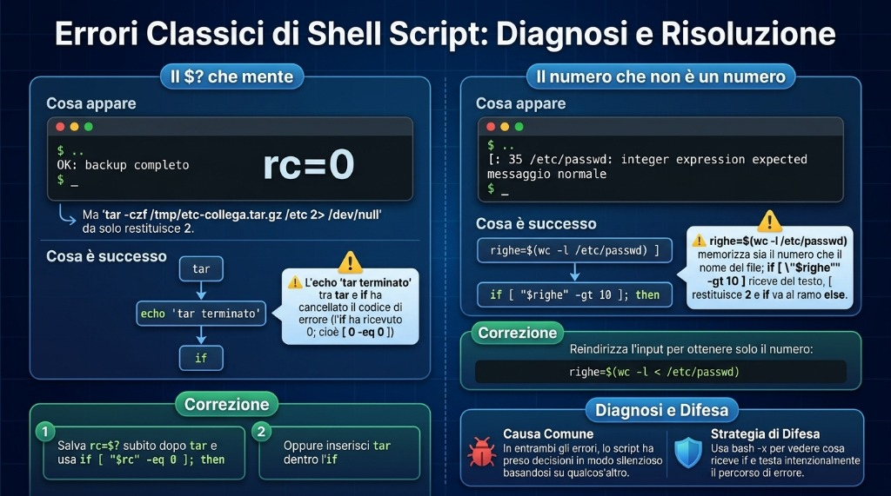

# Lezione 1.9 · Decidere e ripetere

Nella Lezione 1.8, `backup-app.sh` ha detto OK per un backup di `/etc` rimasto senza i file più importanti. Oggi impara a diffidare: controlla il risultato di ogni passo, si ferma quando qualcosa va storto, lascia una traccia nel log e restituisce un codice che un altro script, o il cron, riesce a leggere. Poi fai lo stesso backup per un elenco di cartelle, con un ciclo, senza ripetere una riga.

| Scheda | Lezione 1.9 |
| --- | --- |
| Modulo | M1 · Riga di comando, lezione 9 di 10 |
| Quando | Settimana 3 |
| Alla fine sei in grado di | Leggere e usare il codice di uscita, `$?`; testare file, testi e numeri con `test` e `[ ]`; decidere con `if`, `elif`, `else`, `&&` e `\|\|`; ripetere con `for` e `while read`; salvare l'output di un comando con `$(...)` e fare calcoli con `$((...))`; terminare uno script con `exit N`; scrivere nel log con `logger` |
| Prerequisiti | Lezione 1.8 completa, con `~/bin/backup-app.sh` su entrambe le VM |
| Durata | Circa 2h30 |
| Snapshot | m1a9-inicio e m1a9-fim su entrambe le VM |

## 1 · Riscaldamento

Tre domande, a memoria, prima di leggere qualsiasi cosa. Scrivi le risposte; le Soluzioni le controllano alla fine.

1. Nella Lezione 1.8, cosa fa `origem="${1:?uso: ...}"` quando lo script viene chiamato senza argomenti?
2. Nella Lezione 1.8, perché `backup-app.sh /etc`, lanciato come utente normale, si è concluso dicendo che il file era stato letto fino in fondo?
3. Scommessa: lanci `ls /naoexiste` e subito dopo `echo $?`. Che numero compare?

## 2 · Perché conta

Uno script di backup gira nel cron, ogni giorno alle 2, da otto mesi. Nessuno guarda l'output, perché "ha sempre funzionato". Il giorno in cui il disco del server muore, apri la cartella dei backup e trovi file da 45 byte a partire da marzo: `tar` falliva ogni notte, e lo script andava avanti e copiava il file vuoto sul NAS. Il comando aveva avvisato. Lo script non ha ascoltato.

Ogni comando Linux, quando termina, risponde con un numero: zero se è andato a buon fine, un altro numero se no. È l'informazione più importante che uno script ha, e quasi tutti gli script fatti male la ignorano. Oggi impari a leggere quel numero e a decidere in base a esso.

Secondo caso. Devi fare il backup di sei cartelle, o controllare dieci server, o rinominare trecento log. Copiare la stessa riga sei volte funziona, fino al giorno in cui ne correggi una e dimentichi le altre cinque. Un ciclo scrive la riga una volta sola e la ripete per ogni elemento.

E poi il lavoro vero chiede script che decidono e ripetono. Un compito tipico è "crea uno script che, per ogni utente di un elenco, faccia X; se l'argomento non viene passato, termini con codice 1". Chi chiama lo script, che sia tu, il cron o un altro script, controlla il codice di uscita.

## 3 · Modello mentale

> Ogni comando, quando finisce, accende un semaforo. Zero è verde; qualsiasi altro numero è rosso, e il numero dice quale problema c'è stato.

Il semaforo non è ciò che il comando mostra a schermo. Un `grep` può non mostrare niente ed essere andato bene; un `tar` può mostrare un mucchio di righe ed essere fallito. La shell conserva il semaforo dell'**ultimo** comando in `$?` e lo sostituisce a ogni nuovo comando, compreso un `echo`.

Con il semaforo, tre strumenti:

- **`if` decide.** Esegue un comando e guarda il semaforo. Verde, entra nel `then`; rosso, va all'`else`. L'`if` non capisce testi né numeri: solo il semaforo.
- **`[ ]` domanda.** È un comando come tutti gli altri, il cui unico compito è rispondere con verde o rosso. `[ -d /etc ]` chiede "`/etc` è una cartella?" e risponde con il semaforo. Per questo compare così spesso dentro l'`if`, ma non è obbligatorio.
- **`for` e `while` ripetono.** Il `for` ripete una volta per ogni elemento di un elenco. Il `while` ripete finché un comando dà verde, come `read`, che dà verde finché ci sono ancora righe da leggere.

```text
  if  tar -czf ...  ;  then  ...  else  ...  fi
      └── roda ───┘
            │
            └─ semáforo ($?)   0 ──► then
                              ≠0 ──► else

  [ -d "$origem" ]   é só um comando que responde 0 (sim) ou 1 (não)
```


*Zero è verde, qualsiasi altro numero è rosso: la mappa dei codici di uscita, dell'`if`, del `[ ]` e di `&&`/`||`.*

## 4 · Concetto a strati

### Essenziale

**Il codice di uscita.**

```bash
ls /etc/hostname
echo $?          # 0: è andato a buon fine
ls /naoexiste
echo $?          # 2: è andato male; 2 è il codice di ls per "non ce l'ho fatto"
```

| Codice | Significato più comune |
| --- | --- |
| `0` | È andato a buon fine |
| `1` | Fallimento generico. In `grep`, "non ho trovato nessuna riga", che non è un errore |
| `2` | Uso sbagliato o errore grave. In `grep` e `tar`, errore vero |
| `126` | Il file esiste, ma non può essere eseguito |
| `127` | Comando non trovato |
| `130` | Interrotto con Ctrl+C |

Anche il tuo script termina con un codice: quello dell'ultimo comando eseguito, oppure quello che scegli con `exit N`. Chi chiama il tuo script, che sia tu, un altro script o il cron, legge quel numero.

**`&&` e `||`.** Il modo breve di decidere in una riga:

```bash
mkdir -p "$destino" && echo "pasta pronta"     # esegue l'echo solo se mkdir è andato a buon fine
cd "$destino" || exit 1                         # se cd è fallito, termina lo script
```

**`test` e `[ ]`.** Sono lo stesso comando con due grafie. Dentro le parentesi quadre, **spazio dopo `[` e prima di `]`**, sempre.

| Domanda | Verde quando |
| --- | --- |
| `[ -e "$x" ]` | `$x` esiste, qualunque cosa sia |
| `[ -f "$x" ]` | `$x` è un file normale |
| `[ -d "$x" ]` | `$x` è una cartella |
| `[ -r "$x" ]`, `-w`, `-x` | Puoi leggere, scrivere, eseguire |
| `[ -s "$x" ]` | `$x` esiste e non è vuoto |
| `[ -z "$v" ]` | Il testo è vuoto |
| `[ -n "$v" ]` | Il testo non è vuoto |
| `[ "$a" = "$b" ]`, `!=` | Testi uguali, diversi |
| `[ "$n" -eq 5 ]`, `-ne`, `-lt`, `-le`, `-gt`, `-ge` | Numeri: uguale, diverso, minore, minore o uguale, maggiore, maggiore o uguale |
| `[ ! -d "$x" ]` | Il `!` inverte la domanda |

**`if`.**

```bash
if [ -d "$origem" ]; then
    echo "pasta encontrada"
elif [ -e "$origem" ]; then
    echo "existe, mas não é uma pasta"
else
    echo "não existe"
fi
```

L'`if` accetta qualsiasi comando, non solo `[ ]`:

```bash
if grep -q root /etc/passwd; then echo "tem root"; fi
if ! tar -czf "$arquivo" -C "$pai" "$nome"; then echo "o tar falhou"; fi
```

**`for`.** Una volta per ogni elemento:

```bash
for servidor in rocky-lab debian-lab; do
    echo "conferindo $servidor"
done

for arquivo in /var/log/*.log; do      # la shell costruisce l'elenco, anche con spazi nei nomi
    echo "$arquivo"
done

for i in {1..5}; do echo "$i"; done    # da 1 a 5
```

**`while read`.** Una volta per ogni riga di un file:

```bash
while read -r pasta; do
    echo "vou guardar $pasta"
done < pastas.txt
```

Con `-r`, `read` non tocca i backslash. Usalo sempre.

**`$(...)` e `$((...))`.**

```bash
hoje="$(date +%F)"              # salva l'output di un comando
linhas="$(wc -l < /etc/passwd)" # con il <, wc mostra solo il numero
total=$((total + 1))            # calcola con numeri interi
```

Il backtick, `` `date` ``, fa lo stesso di `$(date)`. Lo troverai negli script vecchi; scrivi con `$(...)`, che è più facile da leggere e da annidare.

**`exit N`.** Termina lo script all'istante, con il codice `N`. Mettiti d'accordo con chi lo leggerà: 0 per il successo e numeri diversi per errori diversi, documentati nel commento in cima.

**`logger`.** Scrive una riga nel log di sistema, con un'etichetta: `logger -t backup-app "OK /etc"`. Per leggere: `journalctl -t backup-app`. È così che uno script del cron racconta cosa ha fatto, senza nessuno che guardi lo schermo.

### Ponte Windows

| In Windows | In Linux | Attenzione |
| --- | --- | --- |
| `%ERRORLEVEL%` in `cmd`, `$LASTEXITCODE` in PowerShell | `$?` | In Linux, `$?` cambia dopo **qualsiasi** comando, anche un `echo` |
| In PowerShell, `$?` è `True` o `False` | In bash, `$?` è un numero, e 0 è successo | È contro l'intuito: lo 0 è quello buono |
| `if exist arquivo` | `if [ -e "$arquivo" ]` | Gli spazi dentro `[ ]` sono obbligatori |
| In PowerShell, `-eq` e `-gt` confrontano qualsiasi cosa | In `[ ]`, `-eq` e `-gt` valgono solo per i numeri; i testi usano `=` | `[ 10 \> 9 ]` confronta come testo e dà falso |
| `for %%f in (*.log) do` | `for f in *.log; do ...; done` |  |
| `exit /b 1` | `exit 1` |  |
| Visualizzatore eventi, `Write-EventLog` | `logger` e `journalctl` |  |

### Avanzato

- **`[[ ]]`** è la versione di bash: accetta `&&` e `||` al suo interno, confronta i pattern con `==` e non si rompe con una variabile vuota senza virgolette. Non esiste in `dash`, la `/bin/sh` di Debian. In questa lezione, `[ ]` con le virgolette, che funziona in qualsiasi shell.
- **Pipeline.** Il `$?` di `comando1 | comando2` è quello dell'**ultimo** comando. Un `tar ... | gzip` con `tar` che fallisce dà verde. `set -o pipefail` fa diventare rossa la pipeline se una qualsiasi parte fallisce; `${PIPESTATUS[@]}` mostra il codice di ogni parte.
- **`set -e`** ferma lo script al primo comando che fallisce, ma non vale dentro un `if`, né prima di `&&` e `||`, né nelle pipeline senza `pipefail`. Aiuta, ma non sostituisce l'`if` esplicito nei passi che contano.
- **`while read` e `ssh`.** Un `ssh` dentro un `while read ... done < lista` si mangia il resto della lista, perché legge dallo stesso input. Usa `ssh -n`.
- **`case`** decide tra più testi in una volta, come `start`, `stop` e `status`. Lo vedremo nel Modulo 4, negli script di servizio.
- **`tar` e i suoi codici.** GNU tar esce con 1 quando un file è cambiato mentre veniva archiviato, e con 2 in caso di errore fatale, come `Permission denied`. Per l'`if`, entrambi sono rossi.

![Le domande del [ ]](../img/1.9-perguntas-do-colchete.it.jpg)

*Le domande che il `[ ]` sa fare su file, testi e numeri.*

## 5 · Rocky × Debian

|  | Rocky Linux 9 e 10 | Debian 13 |
| --- | --- | --- |
| `[[ ]]` in uno script con `#!/bin/sh` | Funziona, perché `/bin/sh` è bash | `[[: not found`, perché `/bin/sh` è `dash` |
| `{1..5}` in uno script con `#!/bin/sh` | Funziona | Mostra `{1..5}`, letterale |
| Messaggio di `[ "abc" -gt 1 ]` | `integer expression expected` | `integer expression expected`. In bash 5.3, più recente, la frase si è accorciata in `integer expected` |
| `logger -t backup-app "msg"` | Va nel journal; anche `rsyslog` lo copia in `/var/log/messages` | Va nel journal; senza `rsyslog` installato, `/var/log/syslog` non esiste |
| Leggere ciò che ha scritto `logger` | `journalctl -t backup-app` | `journalctl -t backup-app` |
| `seq 1 5` | Installato | Installato |

La regola che vale su entrambe: **`#!/bin/bash` in ogni script di questa lezione, `[ ]` con le virgolette, e `journalctl -t` per leggere il log**.

## 6 · Lab guidato

Fai tutto su entrambe le VM, a meno che il passo non dica una sola. I test rapidi si fanno nel terminale; gli script stanno in `~/lab13/scripts`; il `backup-app.sh` installato nella Lezione 1.8 è in `~/bin`. In ogni passo, quando compare **Prevedi**, scrivi la risposta prima di premere Invio.

### Passo 1 · Preparare

Sul nodo Proxmox:

```bash
qm snapshot 201 m1a9-inicio
qm snapshot 202 m1a9-inicio
```

Su ogni VM:

```bash
type backup-app.sh
ls ~/lab13/arquivo/app
cd ~/lab13/scripts
```

`type` deve rispondere `backup-app.sh is /home/SEU_USUARIO/bin/backup-app.sh`. Se risponde `not found`, rifai il Passo 6 della Lezione 1.8.

### Passo 2 · Il semaforo, `$?`

```bash
ls /etc/hostname
echo $?
ls /naoexiste
echo $?
```

`0` e poi `2`. Il messaggio di errore di `ls` va a schermo; il codice va in `$?`.

**Prevedi.** Subito dopo `ls /naoexiste`, lanci `echo $?` due volte di fila. Cosa mostra ciascuno?

```bash
ls /naoexiste
echo $?
echo $?
```

`2` e poi `0`. Il secondo `echo` mostra il codice del **primo** `echo`, che è andato a buon fine. `$?` viene cancellato a ogni comando. Tienilo a mente: è il Guasto A di questa lezione.

Ora `grep`, che ha tre risposte:

```bash
grep -q root /etc/passwd;        echo "achou: $?"
grep -q naoexiste /etc/passwd;   echo "não achou: $?"
grep -q root /arquivo/inexistente; echo "erro: $?"
```

`0`, `1` e `2`. Con `-q`, `grep` sta zitto: non mostra niente, risponde solo con il codice.

**Decidi 1 · Cosa significa l'1.** In uno script, `grep -q "ERRO" app.log` è terminato con codice 1. Cos'è successo?

- **A)** `grep` è fallito: probabilmente il file non esiste.
- **B)** `grep` ha funzionato e non ha trovato nessuna riga con `ERRO`.
- **C)** `grep` ha trovato esattamente una riga con `ERRO`.
- **D)** `grep` è stato interrotto.

Scegli un'opzione prima di guardare la tabella.

| Se hai scelto | Risultato | Perché |
| --- | --- | --- |
| A | ❌ Sbagliato | Un file inesistente dà `2`, con il messaggio `No such file or directory`. |
| B | ✅ Giusto | Per `grep`, 1 significa "ho cercato e non ho trovato". In un monitoraggio dei log, è la buona notizia. |
| C | ❌ Sbagliato | Il codice non conta le righe. Trovarne una o mille dà `0`. Per contare, `grep -c`. |
| D | ❌ Sbagliato | Interrotto con Ctrl+C dà `130`. |

**Da ricordare:** rosso non vuol sempre dire errore. Leggi il `man` del comando, nella sezione *EXIT STATUS*, prima di decidere cosa significa ogni numero.

Verifica:

```bash
man grep | grep -A6 'EXIT STATUS'
```

### Passo 3 · Domandare con `[ ]`

```bash
[ -d /etc ];            echo "pasta: $?"
[ -f /etc ];            echo "arquivo: $?"
[ -f /etc/hostname ];   echo "arquivo: $?"
[ -z "" ];              echo "vazio: $?"
[ 10 -gt 9 ];           echo "maior: $?"
```

`0`, `1`, `0`, `0`, `0`. Il `[` è un comando vero:

```bash
type [
ls -l /usr/bin/[
```

Essendo un comando, ha bisogno degli spazi, come qualsiasi altro. Guarda cosa succede senza:

```bash
[-d /etc]
```

`bash: [-d: command not found`, codice 127. La shell ha cercato un programma chiamato `[-d`.

**Prevedi.** `[ 10 \> 9 ]` confronta 10 con 9 usando `>`. Verde o rosso?

```bash
[ 10 \> 9 ];  echo $?
[ 10 -gt 9 ]; echo $?
```

`1` e `0`. Con `>`, i due lati vengono confrontati come **testo**, lettera per lettera, come nel dizionario: `"1"` viene prima di `"9"`, quindi `"10"` è minore. I numeri si confrontano con `-gt`, `-lt` e compagnia.

**Decidi 2 · La variabile vuota in `[ ]`.** Lo script ha `if [ $resposta = sim ]; then`. Un giorno, `resposta` arriva vuota. Cosa succede?

- **A)** Il test dà falso, in silenzio, e lo script va all'`else`.
- **B)** Compare `[: =: unary operator expected`, il test restituisce 2, e lo script va all'`else`.
- **C)** Lo script si ferma subito con un errore di sintassi.
- **D)** Il test dà vero, perché vuoto è uguale a qualsiasi cosa.

Scegli un'opzione prima di guardare la tabella.

| Se hai scelto | Risultato | Perché |
| --- | --- | --- |
| A | ❌ Sbagliato | Sarebbe così con le virgolette. Senza virgolette, la variabile vuota sparisce dalla riga. |
| B | ✅ Giusto | Senza virgolette, la shell costruisce `[ = sim ]`. Il `[` vede solo due pezzi e protesta. Il codice 2 è rosso, quindi l'`if` va all'`else` e lo script prosegue, con uno strano messaggio a schermo. |
| C | ❌ Sbagliato | Non è un errore di sintassi di bash: è il `[`, un comando, che si lamenta degli argomenti. Lo script continua. |
| D | ❌ Sbagliato | Nessun comando tratta il vuoto come un jolly. |

**Da ricordare:** una variabile dentro `[ ]` sempre tra virgolette: `[ "$resposta" = sim ]`. È la regola della Lezione 1.8 con un motivo in più.

Verifica:

```bash
resposta=
[ $resposta = sim ];   echo $?
[ "$resposta" = sim ]; echo $?
```

`unary operator expected` e `2`, poi solo `1`, pulito.

### Passo 4 · Decidere con `if`

```bash
cat > existe.sh <<'EOF'
#!/bin/bash
# existe.sh - dice cos'è ogni percorso ricevuto
# Uso: existe.sh CAMINHO
alvo="${1:?uso: $0 CAMINHO}"

if [ -d "$alvo" ]; then
    echo "$alvo é uma pasta"
elif [ -f "$alvo" ]; then
    echo "$alvo é um arquivo de $(wc -c < "$alvo") bytes"
elif [ -e "$alvo" ]; then
    echo "$alvo existe, mas não é pasta nem arquivo comum"
else
    echo "$alvo não existe" >&2
    exit 1
fi
EOF
chmod +x existe.sh
./existe.sh /etc;           echo "rc=$?"
./existe.sh /etc/hostname;  echo "rc=$?"
./existe.sh /dev/null;      echo "rc=$?"
./existe.sh /naoexiste;     echo "rc=$?"
```

Cartella, file, "esiste, ma non è", e `não existe` con `rc=1`. Il `>&2` manda il messaggio di errore sullo standard error, la Lezione 1.5: chi redirige solo l'output normale vede comunque l'errore.

**Decidi 3 · Quale `if` è giusto?** Vuoi sapere se l'utente `root` compare in `/etc/passwd`.

- **A)** `if [ grep -q root /etc/passwd ]; then`
- **B)** `if grep -q root /etc/passwd; then`
- **C)** `if [ $(grep root /etc/passwd) ]; then`
- **D)** `if grep -q root /etc/passwd = 0; then`

Scegli un'opzione prima di guardare la tabella.

| Se hai scelto | Risultato | Perché |
| --- | --- | --- |
| A | ❌ Sbagliato | Il `[` riceve le parole `grep`, `-q`, `root` e `/etc/passwd` come testo e non sa che farsene: protesta con un errore di sintassi, la cui frase cambia a seconda della versione di bash, e restituisce 2. `grep` non gira mai, e l'`if` va all'`else`. |
| B | ✅ Giusto | L'`if` esegue `grep` e guarda il semaforo. È la forma più breve e la più corretta. |
| C | ❌ Sbagliato | Funziona per caso finché l'output è una parola sola: la riga di root non ha spazi. Se `grep` trova due righe, o una con uno spazio, il `[` riceve troppi pezzi e protesta. Usa l'output, quando quello che conta è il codice. |
| D | ❌ Sbagliato | `grep` riceve `=` e `0` come nomi di file. Con `-q`, si ferma al primo riscontro e non arriva nemmeno ad aprire quei due, quindi sembra funzionare. Il giorno in cui non trova niente, si lamenta che `=` e `0` non esistono e restituisce 2. Giusto per caso è sbagliato. |

**Da ricordare:** l'`if` riceve un **comando**. Usa `[ ]` solo quando la domanda riguarda file, testi o numeri; quando la domanda è "questo comando è andato bene?", metti direttamente il comando.

Verifica la A, per vedere il messaggio:

```bash
if [ grep -q root /etc/passwd ]; then echo sim; else echo não; fi
if grep -q root /etc/passwd; then echo sim; else echo não; fi
```

E il modo breve, con `&&` e `||`:

```bash
grep -q root /etc/passwd && echo "tem root" || echo "sem root"
```


*L'`if` esegue un comando e guarda il semaforo; il `[ ]` è solo uno dei comandi possibili.*

### Passo 5 · Ripetere con `for`

```bash
for vm in rocky-lab debian-lab; do
    echo "vou conferir $vm"
done

for i in {1..3}; do echo "volta $i"; done
for i in $(seq 1 3); do echo "volta $i"; done
```

Ora, una cartella con nomi di log, uno dei quali con uno spazio, come succede quando il file arriva da Windows:

```bash
mkdir -p ~/lab13/logs-teste
cd ~/lab13/logs-teste
touch app.log "nota fiscal.log" erro.log
ls -l
```

**Decidi 4 · Scorrere i log.** Quale ciclo passa per i tre file, uno alla volta, con il nome intero?

- **A)** `for f in $(ls); do echo "[$f]"; done`
- **B)** `for f in *.log; do echo "[$f]"; done`
- **C)** `for f in "$(ls)"; do echo "[$f]"; done`
- **D)** `for f in $(ls *.log); do echo "[$f]"; done`

Scegli un'opzione prima di guardare la tabella.

| Se hai scelto | Risultato | Perché |
| --- | --- | --- |
| A | ❌ Sbagliato | L'output di `ls` viene spezzato sugli spazi: compaiono `[nota]` e `[fiscal.log]`, separati. Quattro giri, due sbagliati. |
| B | ✅ Giusto | È la shell stessa che costruisce l'elenco con il `*`, e ogni nome diventa un elemento intero, con spazio o senza. Tre giri. |
| C | ❌ Sbagliato | Le virgolette mettono tutto in un elemento solo: un giro, con i tre nomi e gli a capo dentro. |
| D | ❌ Sbagliato | Lo stesso problema della A. Il `*.log` aiuta `ls`, ma la divisione sugli spazi avviene dopo. |

**Da ricordare:** per scorrere dei file, usa il `*` direttamente nel `for`. Mai `for f in $(ls)`.

Verifica:

```bash
for f in $(ls); do echo "[$f]"; done
for f in *.log; do echo "[$f]"; done
```

E un ciclo utile, che conta le righe di ogni log:

```bash
for f in *.log; do
    echo "$(wc -l < "$f") linhas  $f"
done
cd ~/lab13/scripts
```

### Passo 6 · Ripetere con `while read` e contare

Un elenco di cartelle, una per riga, con una riga vuota e una cartella che non esiste, apposta:

```bash
cat > pastas.txt <<'EOF'
/home/SEU_USUARIO/lab13/arquivo/app
/home/SEU_USUARIO/lab13/logs-teste

/home/SEU_USUARIO/naoexiste
EOF
sed -i "s|SEU_USUARIO|$USER|" pastas.txt
cat -A pastas.txt
```

`cat -A` mostra la riga vuota come un `$` da solo. Ora leggi riga per riga, saltando quella vuota:

```bash
total=0
while read -r pasta; do
    [ -z "$pasta" ] && continue
    total=$((total + 1))
    if [ -d "$pasta" ]; then
        echo "OK      $pasta"
    else
        echo "FALTA   $pasta"
    fi
done < pastas.txt
echo "Total: $total"
```

Due righe `OK`, una `FALTA`, `Total: 3`. Il `continue` salta al giro successivo.

**Decidi 5 · Il totale che sparisce.** Un collega ha scritto lo stesso ciclo così: `cat pastas.txt | while read -r pasta; do ... done`, e poi `echo "Total: $total"`. Cosa compare alla fine?

- **A)** `Total: 3`, uguale.
- **B)** `Total: 0`.
- **C)** `Total: 4`, perché ora la riga vuota conta.
- **D)** Errore: il `while` non accetta la pipe.

Scegli un'opzione prima di guardare la tabella.

| Se hai scelto | Risultato | Perché |
| --- | --- | --- |
| A | ❌ Sbagliato | Dentro il ciclo, il conto arriva a 3. Ma avviene da un'altra parte. |
| B | ✅ Giusto | In una pipe, bash esegue il `while` in una shell figlia. Il `total` che arriva a 3 è quello del figlio, e muore con lui. L'`echo` fuori vede il `total` di prima del ciclo: 0. È lo stesso motivo del `cd` che non resta, della Lezione 1.8. |
| C | ❌ Sbagliato | Il `[ -z ]` con `continue` salta la riga vuota in entrambi i modi. |
| D | ❌ Sbagliato | Il `while` accetta la pipe senza lamentarsi. Per questo l'errore è subdolo: non c'è nessun messaggio. |

**Da ricordare:** in un ciclo che accumula qualcosa per dopo, leggi il file con `done < arquivo`, mai con `cat arquivo |`.

Verifica:

```bash
total=0
cat pastas.txt | while read -r pasta; do [ -z "$pasta" ] && continue; total=$((total + 1)); done
echo "Total pelo pipe: $total"
total=0
while read -r pasta; do [ -z "$pasta" ] && continue; total=$((total + 1)); done < pastas.txt
echo "Total pelo <: $total"
```

### Passo 7 · `backup-app.sh` impara a diffidare

È la riparazione promessa nella Decidi 4 della Lezione 1.8. La versione nuova controlla ogni passo, restituisce un codice diverso per ogni tipo di problema, registra tutto in un log suo e nel journal, e non lascia che un backup incompleto abbia l'aria di uno buono.

```bash
cp ~/bin/backup-app.sh ~/bin/backup-app.sh.v3
cat > ~/bin/backup-app.sh <<'EOF'
#!/bin/bash
# backup-app.sh - backup di una cartella con il Protocollo della Lezione 1.7
# Uso: backup-app.sh PASTA [DESTINO]
#   PASTA    cosa salvare, obbligatorio
#   DESTINO  dove salvare, predefinito ~/backups
# Uscita: 0 = backup completo e verificato
#         1 = il backup è fallito o è rimasto incompleto
#         2 = la cartella non esiste

origem="${1:?uso: $0 PASTA [DESTINO]}"
destino="${2:-$HOME/backups}"
nome="$(basename "$origem")"
pai="$(dirname "$origem")"
data="$(date +%F_%H%M)"
arquivo="$destino/$nome-$data.tar.gz"
log="$destino/backup-app.log"

mkdir -p "$destino" || exit 1

if [ ! -d "$origem" ]; then
    echo "ERRO: $origem não é uma pasta" >&2
    echo "$(date '+%F %T') ERRO pasta $origem" >> "$log"
    logger -t backup-app "ERRO pasta $origem"
    exit 2
fi

echo "Backup de $origem para $arquivo"

if ! tar -czf "$arquivo" -C "$pai" "$nome"; then
    echo "ERRO: o tar falhou; o backup de $origem está incompleto" >&2
    mv "$arquivo" "$arquivo.INCOMPLETO" 2> /dev/null
    echo "$(date '+%F %T') ERRO tar $origem" >> "$log"
    logger -t backup-app "ERRO tar $origem"
    exit 1
fi

if ! tar -tzf "$arquivo" > /dev/null; then
    echo "ERRO: $arquivo não abre até o fim" >&2
    echo "$(date '+%F %T') ERRO teste $arquivo" >> "$log"
    logger -t backup-app "ERRO teste $arquivo"
    exit 1
fi

sha256sum "$arquivo" > "$arquivo.sha256"
chmod 600 "$arquivo" "$arquivo.sha256"
echo "$(date '+%F %T') OK $origem $arquivo" >> "$log"
logger -t backup-app "OK $origem $arquivo"
ls -lh "$arquivo" "$arquivo.sha256"
EOF
bash -n ~/bin/backup-app.sh && echo "sintaxe ok"
```

Leggi lo script dall'alto in basso prima di lanciarlo. Nota tre scelte:

- Il test sulla cartella viene **prima** di qualsiasi `tar`. Prima l'errore che costa poco.
- `tar` sta **dentro** l'`if`. Non c'è nessun `$?` che possa essere cancellato lungo la strada.
- Un backup fallito non viene cancellato: viene rinominato in `.INCOMPLETO`. Nessuno lo scambia per uno buono, e puoi comunque guardare cosa c'è dentro.

Ora i tre percorsi, controllando il codice di ciascuno:

```bash
backup-app.sh ~/lab13/arquivo/app /tmp/bkp9;  echo "rc=$?"
backup-app.sh ~/naoexiste /tmp/bkp9;          echo "rc=$?"
backup-app.sh /etc /tmp/bkp9 2> /tmp/bkp9-erros.txt;  echo "rc=$?"
```

**Prevedi.** Prima di lanciare la terza riga: quale `rc`, e quali file nuovi compaiono in `/tmp/bkp9`?

```bash
ls -l /tmp/bkp9
tail -3 /tmp/bkp9-erros.txt
cat /tmp/bkp9/backup-app.log
```

`rc=0`, `rc=2` e `rc=1`. Per `/etc`, `tar` si è lamentato dei file che l'utente normale non legge, è terminato con l'avviso `Exiting with failure status due to previous errors`, e lo script ha rinominato il file in `etc-...tar.gz.INCOMPLETO`. Il log ha una riga `OK`, una `ERRO pasta` e una `ERRO tar`. Nella Lezione 1.8, questo stesso comando diceva OK.

La stessa registrazione è nel journal di sistema, dove la cercano il cron e il monitoraggio:

```bash
journalctl -t backup-app --since today
```

Con `sudo`, `/etc` entra per intero:

```bash
sudo ~/bin/backup-app.sh /etc /tmp/bkp9; echo "rc=$?"
```

`rc=0`.

**Il ciclo sopra.** Ora lo script che fa il backup di un intero elenco, chiamando `backup-app.sh` per ogni riga e contando il risultato:

```bash
cat > ~/bin/backup-lista.sh <<'EOF'
#!/bin/bash
# backup-lista.sh - esegue backup-app.sh per ogni cartella di un elenco
# Uso: backup-lista.sh LISTA [DESTINO]
#   LISTA    file con una cartella per riga
#   DESTINO  passato a backup-app.sh

lista="${1:?uso: $0 LISTA [DESTINO]}"
destino="${2:-$HOME/backups}"
ok=0
falhas=0

while read -r pasta; do
    [ -z "$pasta" ] && continue
    if backup-app.sh "$pasta" "$destino"; then
        ok=$((ok + 1))
    else
        falhas=$((falhas + 1))
    fi
done < "$lista"

echo "Resumo: $ok OK, $falhas com erro"
[ "$falhas" -eq 0 ]
EOF
chmod +x ~/bin/backup-lista.sh
backup-lista.sh ~/lab13/scripts/pastas.txt /tmp/bkp9; echo "rc=$?"
```

`Resumo: 2 OK, 1 com erro` e `rc=1`. L'ultima riga dello script è un test: diventa il codice di uscita. Zero fallimenti, verde; qualsiasi fallimento, rosso. Il cron, o chi lo chiama, sa che qualcosa è andato storto senza leggere l'output.

Fai lo stesso sull'altra VM e confronta i log.

> **Protocollo · Script che avvisa quando fallisce**
>
> 1. Nel commento in cima, documenta i codici di uscita: `# Saída: 0 = ..., 1 = ..., 2 = ...`.
> 2. Controlla ciò che costa poco prima di ciò che costa molto: argomenti e cartelle prima del `tar`.
> 3. Metti il comando che conta **dentro** l'`if`: `if ! tar ...; then`. Se ti serve il numero, salvalo nella riga successiva: `rc=$?`.
> 4. Messaggio di errore su `>&2`, e una riga nel log con data, `ERRO` e il motivo. Usa `logger -t nome` per arrivare al journal.
> 5. Un risultato fallito non deve sembrare buono: rinominalo, marcalo o spostalo.
> 6. Termina con `exit N` in ogni uscita di errore; nel finale felice, decide l'ultimo comando.
> 7. Testa i tre percorsi, successo, errore in ingresso ed errore a metà, controllando l'`echo $?` di ciascuno.


*Il nuovo `backup-app.sh` ha tre percorsi, ciascuno con il proprio codice di uscita e la propria registrazione.*

## 7 · Rompi e ripara

### Guasto A · Il `$?` che mente

Un collega ha scritto un backup di `/etc` "con verifica". Fai come lui, da utente normale, senza `sudo`:

```bash
cd ~/lab13/scripts
cat > confere.sh <<'EOF'
#!/bin/bash
# confere.sh - backup di /etc con verifica (versione del collega)
tar -czf /tmp/etc-colega.tar.gz /etc 2> /dev/null
echo "tar terminou"
if [ $? -eq 0 ]; then
    echo "OK: backup completo"
else
    echo "ERRO: backup com problema"
fi
EOF
chmod +x confere.sh
```

**Sintomo.**

```bash
./confere.sh; echo "rc=$?"
```

`tar terminou`, `OK: backup completo` e `rc=0`. Ma sai, dalla Lezione 1.8, che un utente normale non legge tutto `/etc`.

**Indagine.** Lancia con i raggi X e controlla `tar` da solo:

```bash
bash -x ./confere.sh
tar -czf /tmp/etc-colega.tar.gz /etc 2> /dev/null; echo "tar sozinho: $?"
```

`tar` da solo dà `2`. In `bash -x`, la riga `+ '[' 0 -eq 0 ']'` mostra che l'`if` ha ricevuto `0`. Quello `0` è dell'`echo "tar terminou"`, che è capitato tra `tar` e `if`, è andato a buon fine e ha cancellato il codice di `tar`.

**Decidi A · La riparazione.** Cosa risolve?

- **A)** Sostituire `-eq` con `=`: `if [ $? = 0 ]`.
- **B)** Togliere il `2> /dev/null`, per vedere gli errori.
- **C)** Mettere `tar` dentro l'`if`, `if tar -czf ...; then`, oppure salvare il codice subito dopo, `rc=$?`, e testare `"$rc"`.
- **D)** Sostituire l'`echo` con un `printf`.

Scegli un'opzione prima di guardare la tabella.

| Se hai scelto | Risultato | Perché |
| --- | --- | --- |
| A | ❌ Sbagliato | Confronta come testo invece che come numero, ma `$?` resta quello dell'`echo`: `0`. |
| B | ❌ Sbagliato | Gli errori compaiono a schermo, il che aiuta chi sta guardando. Nel cron nessuno guarda, e lo script continua a dire OK. |
| C | ✅ Giusto | Con `tar` dentro l'`if`, non c'è nessun `$?` che possa essere cancellato. Se ti serve il numero, per registrarlo o per decidere tra 1 e 2, salvalo in `rc` nella riga **immediatamente** successiva. |
| D | ❌ Sbagliato | Anche `printf` va a buon fine e cancella il codice allo stesso modo. Qualsiasi comando nel mezzo fa lo stesso. |

**Da ricordare:** `$?` vale solo fino al comando successivo. Testa il comando direttamente nell'`if`, oppure salva `rc=$?` nella riga seguente, senza niente in mezzo.

**Riparazione.**

```bash
cat > confere.sh <<'EOF'
#!/bin/bash
# confere.sh - backup di /etc con verifica (riparato)
tar -czf /tmp/etc-colega.tar.gz /etc 2> /dev/null
rc=$?
echo "tar terminou com código $rc"
if [ "$rc" -eq 0 ]; then
    echo "OK: backup completo"
else
    echo "ERRO: backup com problema" >&2
    exit 1
fi
EOF
./confere.sh; echo "rc=$?"
sudo ./confere.sh; echo "rc=$?"
```

Da utente: `tar terminou com código 2`, `ERRO` e `rc=1`. Con `sudo`: codice 0, `OK` e `rc=0`.

### Guasto B · Il numero che non è un numero

Uno script di allarme conta gli account utente e avvisa se superano 10:

```bash
cat > contas.sh <<'EOF'
#!/bin/bash
# contas.sh - avvisa se ci sono troppi account nel sistema
linhas=$(wc -l /etc/passwd)
if [ "$linhas" -gt 10 ]; then
    echo "ALERTA: $linhas contas"
else
    echo "normal: $linhas contas"
fi
EOF
chmod +x contas.sh
```

**Sintomo.**

```bash
./contas.sh; echo "rc=$?"
```

Qualcosa come `[: 35 /etc/passwd: integer expression expected`, seguito da `normal: 35 /etc/passwd contas`, e `rc=0`. Sì, `normal`: il `[` si è lamentato, ha restituito 2, e l'`if` è andato all'`else`. Su un server con 500 account, il messaggio sarebbe lo stesso. In bash 5.3, più recente di quello delle VM, la frase è `integer expected`.

**Indagine.** Guarda cosa ha salvato la variabile:

```bash
linhas=$(wc -l /etc/passwd)
echo "[$linhas]"
wc -l < /etc/passwd
```

`[35 /etc/passwd]`. Quando riceve il nome del file, `wc` mostra il numero **e** il nome. `-gt` accetta solo numeri interi. Con `<`, `wc` legge dall'input, non conosce il nome del file e mostra solo il numero.

**Decidi B · La riparazione.** Cosa risolve?

- **A)** Sostituire `-gt` con `>`: `[ "$linhas" \> 10 ]`.
- **B)** Togliere le virgolette: `[ $linhas -gt 10 ]`.
- **C)** `linhas=$(wc -l < /etc/passwd)`.
- **D)** Usare `[[ ]]` al posto di `[ ]`.

Scegli un'opzione prima di guardare la tabella.

| Se hai scelto | Risultato | Perché |
| --- | --- | --- |
| A | ❌ Sbagliato | Il messaggio sparisce, ma il confronto diventa di testo: `"35 /etc/passwd"` contro `"10"`, lettera per lettera. Un sistema con 9 account darebbe l'allarme, perché `"9"` viene dopo `"1"`. |
| B | ❌ Sbagliato | Senza virgolette, il `[` riceve quattro pezzi, `35`, `/etc/passwd`, `-gt` e `10`, e si lamenta in un altro modo: `too many arguments`. Il problema è il contenuto, non le virgolette. |
| C | ✅ Giusto | La variabile riceve solo `35`, e `-gt` funziona. È lo stesso `<` del Passo 4 e del `for` dei log. |
| D | ❌ Sbagliato | Anche `[[ ]]` esige un numero con `-gt` e dà un errore simile. |

**Da ricordare:** prima di confrontare dei numeri, guarda la variabile con `echo "[$var]"`. Le parentesi quadre mostrano spazi e pezzi in più che non ti aspettavi.

**Riparazione.**

```bash
sed -i 's|wc -l /etc/passwd|wc -l < /etc/passwd|' contas.sh
cat contas.sh
./contas.sh; echo "rc=$?"
```

`ALERTA: 35 contas`, oppure `normal`, se la tua VM ne ha 10 o meno. Nessun messaggio strano.

### La morale

I due errori di oggi hanno la stessa faccia: lo script **sembra** aver deciso, ma ha deciso su qualcos'altro. Nel Guasto A, su un `$?` che era già di un altro comando. Nel Guasto B, su un test che non è nemmeno arrivato a confrontare e ha restituito 2, che l'`if` tratta come un "no". In entrambi i casi, lo script è terminato con `rc=0` e un messaggio rassicurante. La difesa è la stessa: `bash -x` per vedere cosa ha ricevuto davvero l'`if`, e provare apposta il percorso di errore, come nel Passo 7, prima di fidarti del percorso felice.


*In entrambi i casi, lo script è terminato con rc=0 e ha deciso su qualcos'altro.*

## 8 · Trappole

| Cosa digiti o vedi | Cosa succede | Come evitarla |
| --- | --- | --- |
| `[-d /etc]` | `[-d: command not found` | `[ -d /etc ]`, con gli spazi |
| `if [ $var = sim ]` con `var` vuota | `unary operator expected` e l'`if` va all'`else` | `[ "$var" = sim ]` |
| `[ "$n" > 5 ]` | Non confronta niente: **crea un file chiamato `5`**, perché `>` è una redirezione | `[ "$n" -gt 5 ]` |
| `[ 10 \> 9 ]` | Falso: confronta come testo | `-gt`, `-lt` per i numeri |
| `[ "$a" -eq "$b" ]` con dei testi | `integer expression expected` | `=` per i testi |
| `comando; echo "..."; if [ $? -eq 0 ]` | Testa il codice dell'`echo` | `if comando; then`, oppure `rc=$?` subito dopo |
| `if [ grep -q x arq ]` | Il `[` protesta; `grep` non gira mai | `if grep -q x arq; then` |
| `grep` con codice 1 trattato come errore | Falso allarme ogni volta che è tutto pulito | 1 è "non trovato"; 2 è errore |
| `for f in $(ls)` | I nomi con spazio diventano due elementi | `for f in *` |
| `cat arq \| while read ...` e poi usare la variabile | La variabile torna al valore di prima del ciclo | `while read ...; done < arq` |
| `read` senza `-r` | I backslash spariscono dal testo letto | `read -r` |
| `x=$(wc -l arquivo)` | Salva numero **e** nome | `x=$(wc -l < arquivo)` |
| `total=total+1` | Salva il testo `total+1` | `total=$((total + 1))` |
| Script senza `exit` nell'errore | Il cron riceve 0, anche con un fallimento | `exit 1` in ogni percorso di errore |
| `tar ... \| gzip` e controllare `$?` | Vale il codice di `gzip` | `set -o pipefail`, oppure `tar -czf` diretto |
| `ssh servidor cmd` dentro un `while read` | Il ciclo si ferma dopo il primo server | `ssh -n servidor cmd` |

## 9 · Quiz

Dieci domande, senza consultare niente. Scrivi la lettera o la risposta di ognuna e solo dopo apri le Soluzioni.

**1.** Lanci `ls /naoexiste`, poi `echo $?`, e di nuovo `echo $?`. Cosa mostra il secondo `echo`?

- **A)** `2`
- **B)** `0`
- **C)** `1`
- **D)** `127`

**2.** Quale riga testa correttamente se `/backup` è una cartella?

- **A)** `[ -f /backup ]`
- **B)** `[-d /backup]`
- **C)** `[ -d /backup ]`
- **D)** `[ -e /backup ]`

**3.** La variabile `n` vale `7`. Quale test risponde verde se `n` è maggiore di 5, senza effetti collaterali?

- **A)** `[ "$n" > 5 ]`
- **B)** `[ "$n" -gt 5 ]`
- **C)** `[ "$n" \> 5 ]`
- **D)** `[ n -gt 5 ]`

**4.** `grep -q ERRO app.log` è terminato con codice 1. Cos'è successo?

- **A)** Il file non esiste.
- **B)** C'è esattamente una riga con `ERRO`.
- **C)** `grep` ha funzionato e non ha trovato `ERRO`.
- **D)** `grep` non ha il permesso di leggere il file.

**5.** In una cartella con i file `a b.log` e `c.log`, quanti giri fa `for f in *.log; do echo "$f"; done`? E `for f in $(ls *.log); do echo "$f"; done`?

- **A)** 2 e 2
- **B)** 3 e 3
- **C)** 2 e 3
- **D)** 3 e 2

**6.** Con `n=0` e un file `lista` di tre righe, cosa mostra `cat lista | while read -r l; do n=$((n + 1)); done; echo "$n"`?

- **A)** `3`
- **B)** `0`
- **C)** Vuoto
- **D)** Errore di sintassi

**7.** Spiega, in una frase, cosa fa `cd "$destino" || exit 1` dentro uno script.

**8.** Il tuo script ha rilevato che il backup è fallito. Quale riga fa sapere al cron, o a un altro script, che è andata male senza leggere l'output? E come verifichi, nel terminale, che ha funzionato?

**9.** `linhas=$(wc -l /etc/passwd)` seguito da `[ "$linhas" -gt 10 ]` dà `integer expression expected`. Perché, e come si ripara?

**10.** *A shell script contains the line `if [ -f "$1" ]; then`. When is this condition true?*

- **A)** When `$1` is a directory
- **B)** When `$1` exists and is a regular file
- **C)** When `$1` is not empty
- **D)** When `$1` is an executable file
- **E)** When `$1` is a file that is not empty

## 10 · Flashcard e promemoria

### Da sapere a memoria

Questa parte è da tenere in testa. È ciò che trasforma un elenco di comandi in uno script che decide.

- `$?`: il codice dell'ultimo comando. `0` è successo; qualsiasi altro numero è fallimento
- `$?` cambia dopo **qualsiasi** comando, anche un `echo`. Salvalo con `rc=$?` nella riga successiva
- `if comando; then ...; elif ...; else ...; fi`. L'`if` guarda il codice, non l'output
- `[ -d "$x" ]` cartella, `[ -f "$x" ]` file, `[ -e "$x" ]` esiste, `[ -z "$v" ]` vuoto, `[ ! ... ]` inverte
- Spazio dopo `[` e prima di `]`; variabile sempre tra virgolette
- Testi: `=` e `!=`. Numeri: `-eq -ne -lt -le -gt -ge`
- `comando && se_deu_certo`; `comando || se_falhou`
- `for f in *.log; do ...; done`, mai `for f in $(ls)`
- `while read -r linha; do ...; done < arquivo`, mai `cat arquivo | while`
- `x="$(comando)"` salva l'output; `n=$((n + 1))` fa i conti
- `exit N` termina con il codice `N`

### Da consultare

Questa parte non devi impararla a memoria. Ricorda dove si trova.

- `grep`: 0 trovato, 1 non trovato, 2 errore. `tar`: 0 ok, 1 file cambiato durante il backup, 2 errore fatale
- `126` senza permesso di esecuzione; `127` comando non trovato; `130` Ctrl+C
- `man COMANDO`, sezione *EXIT STATUS*, per i codici di ciascuno
- `[ -r ]`, `[ -w ]`, `[ -x ]` permessi; `[ -s ]` esiste e non è vuoto
- `{1..5}` o `$(seq 1 5)` per contare; `continue` salta il giro; `break` esce dal ciclo
- `wc -l < arquivo` mostra solo il numero
- `logger -t etiqueta "mensagem"` scrive nel journal; `journalctl -t etiqueta` legge
- `[[ ]]` solo in bash; su Debian, `#!/bin/sh` è `dash`, senza `[[`
- `set -o pipefail` e `${PIPESTATUS[@]}` per i codici di una pipeline
- `set -e` si ferma al primo errore, ma non dentro `if`, `&&` e `||`
- `ssh -n` dentro un `while read`

### Flashcard

| Fronte | Retro |
| --- | --- |
| Quale codice indica successo? | `0`. Qualsiasi altro numero è fallimento |
| Dov'è il codice dell'ultimo comando? | In `$?` |
| Perché `echo $?` due volte di fila dà numeri diversi? | Il secondo mostra il codice del primo `echo` |
| Cosa guarda l'`if`? | Il codice di uscita del comando, non ciò che mostra |
| Cos'è il `[`? | Un comando, come tutti gli altri, che risponde 0 o 1 |
| Perché `[-d /etc]` dà `command not found`? | Senza spazio, la shell cerca un programma chiamato `[-d` |
| `[ $v = sim ]` con `v` vuota: cosa succede? | `unary operator expected`, codice 2, e l'`if` va all'`else` |
| `-eq` o `=`? | `-eq` per i numeri, `=` per i testi |
| Cosa fa `[ "$n" > 5 ]`? | Crea un file chiamato `5`. Il `>` è una redirezione |
| `grep -q` ha dato 1. È un errore? | No. Significa "non ho trovato" |
| Come scorrere file con spazi nel nome? | `for f in *` |
| Perché `cat arq \| while` perde il contatore? | Il ciclo gira in una shell figlia, che muore alla fine della pipe |
| Come salvare solo il numero di righe? | `n=$(wc -l < arquivo)` |
| Come fa il cron a sapere che lo script è fallito? | Dal codice di uscita: `exit 1` |
| Dove leggere ciò che uno script ha scritto con `logger -t x`? | `journalctl -t x` |

## 11 · Checklist di uscita

Spunta solo ciò che sai fare senza guardare la lezione:

- [ ] Spiegare cos'è il codice di uscita e verificarlo con `echo $?`
- [ ] Dire cosa significano 0, 1 e 2 in `grep` e `tar`
- [ ] Testare se qualcosa è una cartella, un file o esiste, con `[ ]` e le virgolette
- [ ] Confrontare testi con `=` e numeri con `-gt`, sapendo perché non scambiarli
- [ ] Scrivere un `if` con `elif` e `else`, e un altro con un comando diretto, senza `[ ]`
- [ ] Scorrere file con `for`, anche con spazi nel nome
- [ ] Leggere un file riga per riga con `while read -r`, contando, senza perdere il totale
- [ ] Salvare l'output di un comando e fare calcoli con `$((...))`
- [ ] Terminare uno script con codici diversi per errori diversi
- [ ] Scrivere nel journal con `logger` e leggere con `journalctl -t`

**Ultimo esercizio, senza guardare.** Chiudi questa lezione. In `~/lab13/scripts`, crea `conta-linhas.sh`:

1. Riceve uno o più file come argomenti. Senza nessuno, mostra `uso: conta-linhas.sh ARQUIVO...` e termina con 1.
2. Per ogni argomento che è un file, mostra `N linhas  NOME`, con il numero da solo.
3. Per ogni argomento che non è un file, mostra `AVISO: NOME não existe`, sullo standard error, e conta il fallimento.
4. Funziona con nomi che contengono spazi.
5. Termina con 0 se esistono tutti, e con 1 se ne mancava qualcuno.

Prova con `./conta-linhas.sh /etc/passwd /etc/hostname /naoexiste; echo $?`. Le risposte sono alla fine delle Soluzioni.

**Snapshot di chiusura.** Sul nodo Proxmox:

```bash
qm snapshot 201 m1a9-fim
qm snapshot 202 m1a9-fim
```

Non cancellare `~/bin/backup-app.sh` né `~/lab13`: la Lezione 1.10 è la sfida del modulo, e ti servirà tutto ciò che il Modulo 1 ha costruito.

## 12 · Nella vita reale

**Missione della settimana, sola lettura.** Scegli un server che amministri davvero. Se è di un cliente, fai solo ciò che il contratto permette; se hai dubbi, usa rocky-lab e debian-lab. Nessun comando di questa missione cambia qualcosa: ti limiti a domandare e a leggere il codice di uscita.

Il semaforo dei servizi e della rete:

```bash
systemctl is-active sshd; echo "ssh: $?"
systemctl is-active ssh;  echo "ssh no Debian: $?"
ip route | grep default
ping -c1 -W1 IP_DO_GATEWAY > /dev/null; echo "gateway: $?"
```

Sostituisci `IP_DO_GATEWAY` con l'indirizzo che `ip route` ha mostrato. `systemctl is-active` risponde `active` e codice 0, oppure altro e codice diverso da 0: è così che gli script di monitoraggio chiedono se un servizio è in piedi.

Ora, gli script di casa che hai trovato nella missione della Lezione 1.8. Controllano qualcosa?

```bash
grep -n -E '\$\?|if |exit ' /usr/local/bin/* 2> /dev/null | head -30
grep -L -E '\$\?|if |exit ' /usr/local/bin/* 2> /dev/null
```

Il primo mostra dove gli script decidono. Il secondo, con `-L`, elenca quelli che **non** hanno né `$?`, né `if`, né `exit`: script che fanno tutto in sequenza e non chiedono mai se è andata bene.

Su Proxmox, verifica se il backup dell'ultima notte è avvenuto, contando i file nuovi:

```bash
find /var/lib/vz/dump -newermt "$(date -d yesterday +%F)" -name '*.zst' | wc -l
grep -l 'ERROR' /var/log/vzdump/*.log 2> /dev/null | tail -5
```

Se il tuo storage di backup non è `/var/lib/vz/dump`, sostituiscilo con il suo percorso. Confronta il numero con la quantità di VM che avrebbero dovuto essere salvate.

**Per il diario.** Rispondi in poche righe:

1. Quali codici hanno restituito `systemctl is-active` e `ping`? Qualcuno diverso da 0?
2. Quanti script di casa non controllano mai niente? Qualcuno di loro gira dal cron?
3. Lo script di backup più importante sa dire che è fallito? Con `exit`, con un log, con una e-mail?
4. Il backup di ieri su Proxmox ha generato il numero atteso di file?
5. Quale riparazione della sezione 6 proporresti per prima, e a chi? Annotala, e non toccare niente: la produzione è sola lettura.

**Sfida della settimana.** Su rocky-lab, scrivi `checa-servidor.sh`, in sola lettura:

1. Riceve un limite come argomento opzionale, predefinito 80.
2. Per ogni file system di `df --output=pcent,target -x tmpfs -x devtmpfs`, mostra `ok` o `ALERTA` con l'uso e il punto di montaggio. Suggerimento: `tail -n +2` toglie l'intestazione, e `tr -d '%'` toglie il `%`.
3. Mostra `Alertas: N` alla fine e termina con 1 se ce n'è qualcuno.
4. Attenzione alla Decidi 5: se leggi `df` tramite una pipe, il contatore sparisce. Salva l'output in un file in `/tmp` e leggi con `done <`.

Prova con limite 1, per vedere gli alert, e con 99. Quando funziona su entrambe le VM, lancialo una volta sul server vero, solo per leggere. Nel diario, una riga al giorno con il risultato.

**Domani, senza guardare.** Apri un terminale domani e, senza consultare niente:

1. Lancia un comando che va a buon fine e uno che fallisce, e mostra il codice di ciascuno.
2. Scrivi un `if` che dice se `/etc/hostname` è un file.
3. Scrivi un `for` che mostra la dimensione di ogni `.conf` in `/etc`, con `wc -c <`.
4. Leggi `/etc/passwd` con `while read -r` e conta le righe che terminano con `bash`.
5. Spiega a voce alta perché l'`echo` tra `tar` e `if` rovina la verifica.

Se ti blocchi su qualcuno, torna solo al Passo di quel punto.

## 13 · Con DeepTutor

Usa il DeepTutor della tua rete locale dopo il lab, non al posto del lab. I comandi iniziano con `!`:

- `!quiz Aula 1.9`: chiedi dieci domande nuove su `$?`, `[ ]`, `if` e cicli, nel formato delle Decidi.
- `!explica $?`: chiedi tre esempi in cui il codice di uscita inganna, come `grep` con 1 e l'`echo` nel mezzo.
- `!feynman`: spiega a un tirocinante perché `cat arquivo | while read` perde il contatore. DeepTutor indica dove sei rimasto vago.
- `!quebra`: chiedi un nuovo script rotto, come un `[ $v -eq 1 ]` con `v` vuota, un `for f in $(ls)` o un `if [ comando ]`, e ripara usando solo `bash -x` e `echo "[$var]"`.
- `!quiz 1.9 script`: chiedi tre compiti pratici del tipo "crea uno script che, per ogni utente di un elenco, faccia X e termini con 1 se ne manca qualcuno", ciascuno con il comando che conferma il risultato.
- `!cartoes`: genera flashcard dalla sezione 10 e ripassa tra tre giorni.
- `!erro`: incolla un messaggio vero, come `integer expression expected` o `unary operator expected`, e chiedi la causa prima della soluzione.
- `!revisao`: pianifica il ripasso della Lezione 1.9 tra tre giorni e tra una settimana.

## Soluzioni commentate

### Riscaldamento

1. **Si ferma subito**, mostrando il messaggio dopo il `?`, e termina con un codice diverso da zero. Nessuna riga successiva viene eseguita. Oggi hai visto lo stesso effetto con `if` e `exit 2`, solo con più controllo.
2. **Perché lo script controllava solo se il file si apriva, non se `tar` era andato a buon fine.** `tar` ha saltato ciò che non riusciva a leggere, è terminato con codice 2, e nessuno ha guardato quel codice. Il file incompleto si apriva perfettamente. La versione del Passo 7 mette `tar` dentro l'`if` e rinomina il file in `.INCOMPLETO`.
3. **`2`.** `ls` usa 2 per "non sono riuscito ad accedere". Non è 1, come molti tirano a indovinare: ogni comando ha la sua tabella, nella sezione *EXIT STATUS* del `man`.

### Quiz

1. **B.** Il secondo `echo` mostra il codice del primo `echo`, che è andato a buon fine. Il `2` di `ls` è sopravvissuto solo fino al primo.
2. **C.** A testa un file normale, B non ha spazi e diventa `command not found`, D dice solo che esiste, qualunque cosa sia.
3. **B.** A crea un file chiamato `5` e risponde verde perché `"7"` non è vuoto. C confronta come testo e ci azzecca per caso: con `n=10`, darebbe falso. D confronta la lettera `n`, non la variabile, e si lamenta con `integer expression expected`.
4. **C.** Per `grep`, 1 significa "non trovato". File inesistente o senza permesso dà 2, e trovare una o mille righe dà 0.
5. **C.** Il `*.log` consegna due nomi interi. `$(ls *.log)` viene spezzato dopo sugli spazi: `a`, `b.log` e `c.log`.
6. **B.** Il `while` gira in una shell figlia, a causa della pipe. L'`n` che arriva a 3 muore con lei, e l'`echo` vede l'`n` di fuori, che è ancora 0.
7. **Prova a entrare nella cartella; se non ci riesce, termina lo script con codice 1.** Senza questo, lo script continuerebbe nella cartella sbagliata, e un `tar` o un `rm` successivo agirebbe sul posto sbagliato.
8. **`exit 1`**, o un altro numero diverso da zero, documentato in cima. Nel terminale: lancia lo script e, subito dopo, `echo $?`.
9. **Perché `wc` mostra il numero e il nome del file**, e la variabile resta con `35 /etc/passwd`, che non è un numero. Ripara con `linhas=$(wc -l < /etc/passwd)`. Per vedere il problema, `echo "[$linhas]"`.
10. **B.** Guarda ogni alternativa:

| Se hai scelto | Risultato | Perché |
| --- | --- | --- |
| A | ❌ Sbagliato | Una cartella è `-d`. `-f` risponde 1 per una cartella. |
| B | ✅ Giusto | `-f` è vero quando il percorso esiste ed è un file normale. |
| C | ❌ Sbagliato | Il testo non vuoto è `-n "$1"`. |
| D | ❌ Sbagliato | Eseguibile è `-x`. |
| E | ❌ Sbagliato | File non vuoto è `-s`. Un file vuoto passa `-f`. |

### Ultimo esercizio

Una risposta possibile:

```bash
cat > conta-linhas.sh <<'EOF'
#!/bin/bash
# conta-linhas.sh - mostra quante righe ha ogni file
# Uso: conta-linhas.sh ARQUIVO...
# Uscita: 0 = esistono tutti; 1 = ne mancava qualcuno
if [ "$#" -eq 0 ]; then
    echo "uso: conta-linhas.sh ARQUIVO..." >&2
    exit 1
fi

faltou=0
for arq in "$@"; do
    if [ -f "$arq" ]; then
        echo "$(wc -l < "$arq") linhas  $arq"
    else
        echo "AVISO: $arq não existe" >&2
        faltou=$((faltou + 1))
    fi
done

[ "$faltou" -eq 0 ]
EOF
chmod +x conta-linhas.sh
./conta-linhas.sh; echo "rc=$?"
./conta-linhas.sh /etc/passwd /etc/hostname /naoexiste; echo "rc=$?"
./conta-linhas.sh /etc/passwd /etc/hostname; echo "rc=$?"
```

1. `$#` conta gli argomenti; con zero, lo script si ferma con 1 prima di tutto.
2. `wc -l <` mostra solo il numero, senza il nome.
3. `>&2` manda l'avviso sullo standard error, e il contatore registra il fallimento.
4. `"$@"`, con le virgolette, consegna ogni argomento intero al `for`.
5. L'ultima riga è un test: zero fallimenti dà 0; qualsiasi fallimento dà 1. È lo stesso trucco di `backup-lista.sh`.

---

<!-- navegacao -->
[← Lezione 1.8 · Il primo script](1.8-primeiro-script.md) · [Indice delle lezioni](../01-aulas.md) · [Lezione 1.10 · Il software libero in pratica →](1.10-software-livre-na-pratica.md)
