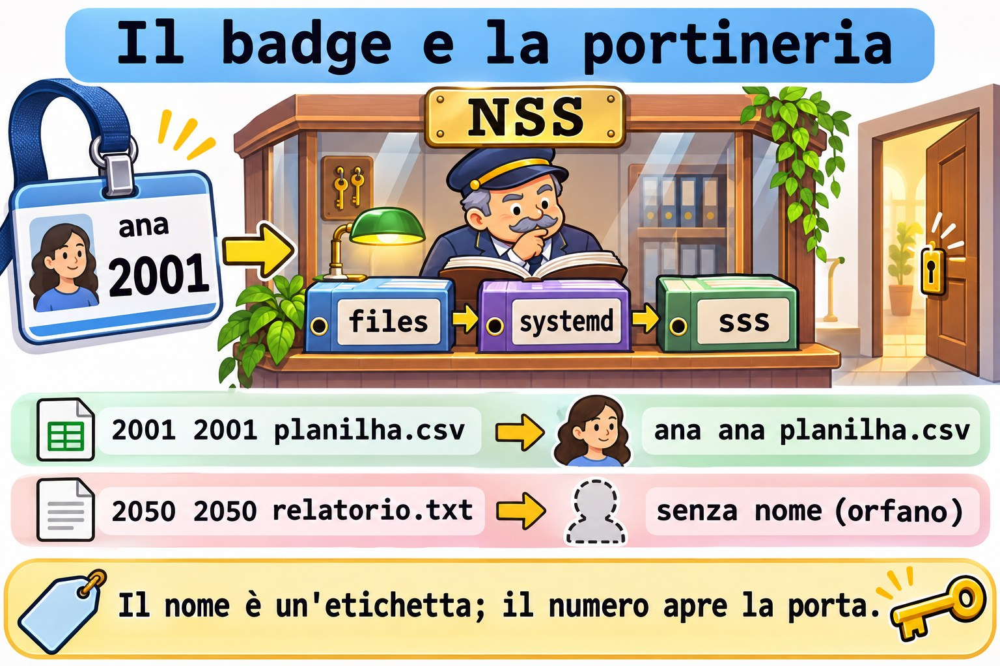
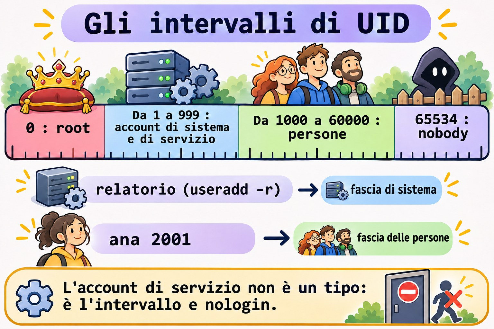
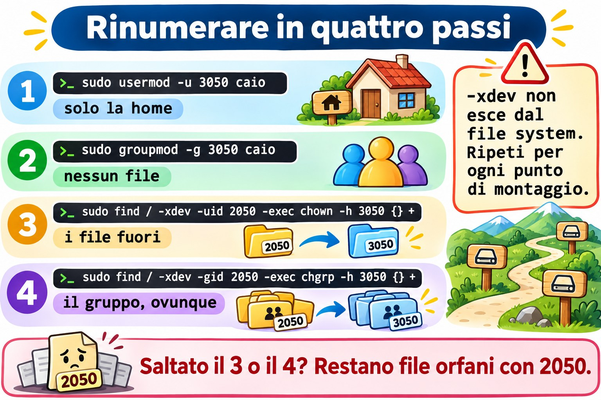

# Lezione 10.1 · Account

In Windows un account è un SID: rinomini l'utente e non si rompe nulla, perché i permessi puntano al numero, non al nome. In Linux è uguale, solo che il numero si chiama UID ed è in vista. Nella Lezione 2.6 hai creato, modificato e cancellato account. In questa lezione vedi da dove il sistema prende gli account, crei account di servizio nel modo giusto, rinomini e rinumeri un utente senza lasciare file orfani, e crei account in blocco a partire da un elenco.

> **Il cuore di questa lezione:** consultare gli account con `getent`, che segue `/etc/nsswitch.conf`; leggere gli intervalli di UID in `/etc/login.defs`; creare un account di servizio con `useradd -r` o `systemd-sysusers`; rinominare con `usermod -l -d -m` e `groupmod -n`; rinumerare con `usermod -u` e `groupmod -g`, e sistemare il resto con `find -uid` e `find -nouser`. Il resto è approfondimento.

| Scheda |  |
| --- | --- |
| **Modulo** | M10 · Utenti e accesso privilegiato, lezione 1 di 4 |
| **Quando** | Settimana 15 |
| **Alla fine** | Separi gli account delle persone da quelli dei servizi, cambi nome e numero di un account in sicurezza e trovi i file senza proprietario |
| **Prerequisiti** | Lezioni 2.6, 8.2 e 9.6 |
| **Durata** | circa 2h |
| **Snapshot** | `m10a1-inicio` e `m10a1-fim` su rocky-lab e debian-lab |

## 1 · Riscaldamento

Rispondi prima di leggere.

1. `ls -l` mostra `2050` al posto del nome del proprietario. Cosa è successo a quell'account?
2. Un servizio nuovo ha bisogno di un account. Deve avere una password? E una home?
3. Ana è diventata Ana Souza e vuole il login `asouza`. Cosa cambia nei suoi file?

## 2 · Perché conta

| La richiesta | La risposta sbagliata | Cosa provoca |
| --- | --- | --- |
| "Cambia il login della stagista" | `vipw` e cambiare il nome a mano | La home, il gruppo e il crontab restano con il nome vecchio |
| "Gli UID non coincidono tra i server" | `usermod -u` e basta | I file fuori dalla home restano con il numero vecchio, senza proprietario |
| "Crea un account per il servizio dei report" | Un `useradd relatorio` normale | Account con Bash, home e UID da persona: un bersaglio facile |
| "Crea i 30 account del nuovo corso" | 30 comandi digitati a mano | Errori di battitura, UID duplicati, un account dimenticato |
| "`id fulano` funziona e `grep fulano /etc/passwd` no" | Concludere che l'account non esiste | L'account arriva da un'altra fonte, come LDAP o SSSD |

## 3 · Modello mentale

> Pensa a un **badge con un numero**. Il nome sul badge (il login) è solo un'etichetta che leggono le persone. Ciò che apre le porte è il **numero** (UID e GID), scritto in ogni file del disco. Cambiare il nome è ristampare il badge: le porte continuano ad aprirsi. Cambiare il numero è cambiare la serratura di chi ha il badge: ogni porta che aveva il numero vecchio va cambiata anche lei, una per una. E la **portineria** (l'NSS) può consultare più di un elenco di badge: `/etc/passwd`, systemd o una directory aziendale.

```
quem pergunta            quem responde (na ordem do /etc/nsswitch.conf)
id ana         →  NSS →  files   /etc/passwd, /etc/group, /etc/shadow
ls -l                    systemd contas dinâmicas e de fallback
getent passwd            sss     LDAP ou AD, via SSSD (quando existe)

o disco guarda só números:   -rw-r--r--  2001  2001  planilha.csv
o NSS traduz para nomes:     -rw-r--r--  ana   ana   planilha.csv
sem tradução:                -rw-r--r--  2050  2050  relatorio.txt  (órfão)
```



*Il nome è un'etichetta; il numero apre la porta.*

### Ponte Windows

| In Windows | In Linux | Dove il paragone inganna |
| --- | --- | --- |
| SID | UID e GID | L'UID è corto e lo scegli tu; due server possono dare lo stesso numero a persone diverse |
| Utenti locali (SAM) | `/etc/passwd` e `/etc/shadow` | Sono file di testo: si possono leggere, confrontare e versionare |
| Account di dominio (AD) | Account che arriva da SSSD, tramite NSS | Non compare in `/etc/passwd`, solo in `getent` |
| `NT SERVICE\...`, account di servizio | Account di sistema, sotto 1000 | Non c'è un tipo speciale: è l'intervallo di UID e la shell `nologin` |
| `Rename-LocalUser` | `usermod -l` | Linux non sposta la home da solo: serve `-d -m` |
| `Import-Csv` e `New-LocalUser` | Ciclo `while read` con `useradd` | Linux ha anche `newusers`, che legge un file nel formato di `passwd` |

## 4 · L'essenziale

### Chiedere alla portineria

| Voglio... | Comando |
| --- | --- |
| Un account, da qualsiasi fonte | `getent passwd ana` |
| Per numero | `getent passwd 2001` |
| Solo dal file locale | `getent -s files passwd ana` |
| Un gruppo | `getent group equipe` |
| Le fonti configurate | `grep -E '^(passwd\|group\|shadow):' /etc/nsswitch.conf` |

`grep` su `/etc/passwd` vede solo il file. `getent` chiede come chiede il sistema, nell'ordine di `nsswitch.conf`. Su un server collegato a un dominio, solo `getent` mostra la verità.

### Gli intervalli di numeri

| Intervallo | Chi lo usa | Dove si definisce |
| --- | --- | --- |
| 0 | `root` | Fisso |
| Da 1 a 999 | Account di sistema e di servizio | `SYS_UID_MIN` e `SYS_UID_MAX` |
| Da 1000 a 60000 | Persone | `UID_MIN` e `UID_MAX` |
| 65534 | `nobody` | Fisso |

```bash
grep -E '^#?\s*(SYS_)?[UG]ID_(MIN|MAX)' /etc/login.defs
```



*L'account di servizio non è un tipo: è l'intervallo e nologin.*

### Account di servizio

```bash
sudo useradd -r -s /usr/sbin/nologin -d /var/lib/relatorio -M -c "Relatorios" relatorio
```

`-r` prende l'UID dall'intervallo di sistema e non applica la scadenza della password. `-M` non crea la home. `nologin` rifiuta il login interattivo. L'account non riceve password: nessuno entra come lui, e il servizio gira con `User=relatorio` nella unit.

Il modo di systemd è dichiarare l'account in un file, e `systemd-sysusers` crea ciò che manca:

```text
u coletor - "Coletor de metricas" /var/lib/coletor /usr/sbin/nologin
```

Il `-` lascia scegliere l'UID al sistema. I pacchetti portano i loro file in `/usr/lib/sysusers.d/`; i tuoi stanno in `/etc/sysusers.d/`.

### Rinominare: il nome cambia, il numero resta

```bash
sudo usermod -l caio -d /home/caio -m estag   # nuovo login, nuova home, sposta il contenuto
sudo groupmod -n caio estag                   # anche il gruppo personale ha un nome
```

`usermod -l` non rinomina ciò che è salvato per nome: il crontab in `/var/spool/cron/`, le regole di `sudoers`, la casella di posta e gli script che citano il login.

### Rinumerare: il numero cambia, i file no

| Passo | Comando | Cosa fa |
| --- | --- | --- |
| 1 | `sudo usermod -u 3050 caio` | Cambia l'UID e sistema solo i file **dentro la home** |
| 2 | `sudo groupmod -g 3050 caio` | Cambia il GID del gruppo; non sistema nessun file |
| 3 | `sudo find / -xdev -uid 2050 -exec chown -h 3050 {} +` | Sistema i file fuori |
| 4 | `sudo find / -xdev -gid 2050 -exec chgrp -h 3050 {} +` | Sistema il gruppo, anche dentro la home |

`-xdev` non esce dal file system di partenza: ripeti per ogni punto di montaggio (`/srv/app`, `/boot`, i volumi dati). L'account non può avere processi in esecuzione.



*Saltato il 3 o il 4? Restano file orfani con 2050.*

### Trovare gli orfani

```bash
sudo find / -xdev \( -nouser -o -nogroup \) -ls 2>/dev/null
```

### Rocky × Debian

|  | Rocky | Debian |
| --- | --- | --- |
| Chi scrive `nsswitch.conf` | `authselect` (Lezione 10.2): non modificarlo a mano | Tu, direttamente nel file |
| Fonti di `passwd` | `files`, `systemd` e, se c'è SSSD, `sss` | `files` e `systemd` |
| `SYS_UID_MIN` | `201`, attivo in `login.defs` | Commentato: vale il default di `useradd` |
| Password di un account nuovo, prima di `passwd` | `!!` in `shadow` | `!` in `shadow` |
| `nologin` | `/usr/sbin/nologin` (e `/sbin/nologin`, lo stesso file) | `/usr/sbin/nologin` |
| Crontab degli utenti | `/var/spool/cron/NOME` | `/var/spool/cron/crontabs/NOME` |
| Strumento amichevole | Solo `useradd` | `adduser`, che chiede tutto (Lezione 2.6) |

## 5 · Lab guidato

**Passo 0 · Snapshot e stato.** In Proxmox: `qm snapshot 201 m10a1-inicio` e `qm snapshot 202 m10a1-inicio`. Su rocky-lab, controlla cosa hanno lasciato le lezioni precedenti:

```bash
getent passwd ana bruno
getent group equipe
sudo ls -ld /srv/equipe
```

Ana (2001) e Bruno (2002) devono comparire, entrambi nel gruppo `equipe` (2000), e `/srv/equipe` deve essere `drwxrws--T root equipe`. Se Ana è sparita da rocky-lab (una versione vecchia della sfida della 8.5 la cancellava), ricreala con lo stesso numero:

```bash
sudo useradd -u 2001 -c "Ana Lima" -m -s /bin/bash -G equipe ana
```

**Passo 1 · La portineria.**

```bash
grep -E '^(passwd|group|shadow):' /etc/nsswitch.conf
getent passwd student
getent -s files passwd student
getent passwd | wc -l
wc -l < /etc/passwd
```

I due conteggi di solito coincidono. Se `getent` ne conta di più, ci sono account che arrivano da un'altra fonte. Ora chiedi un account che non è nel file:

```bash
getent -s files passwd nobody
getent passwd 65534
```

Su entrambe le VM `nobody` è in `/etc/passwd`. In un sistema minimale senza di lui, il modulo `systemd` dell'NSS risponderebbe da solo: è per questo che è nell'elenco.

**Passo 2 · Gli intervalli.**

```bash
grep -E '^#?\s*(SYS_)?[UG]ID_(MIN|MAX)' /etc/login.defs
getent passwd | awk -F: '$3 >= 1000 && $3 < 60000 {print $3, $1}' | sort -n
getent passwd | awk -F: '$3 < 1000 {print $3, $1, $7}' | sort -n | head
```

Il secondo comando elenca le persone, il terzo gli account di sistema. Guarda l'ultima colonna del terzo: quasi tutti con `nologin` o `false`.

**Passo 3 · Due account di servizio.**

```bash
sudo useradd -r -s /usr/sbin/nologin -d /var/lib/relatorio -M -c "Relatorios" relatorio
getent passwd relatorio
sudo chage -l relatorio | head -n 3
```

L'UID esce sotto 1000, la cartella non esiste e la password non scade mai. Ora con systemd:

```bash
command -v systemd-sysusers
ls /usr/lib/sysusers.d/ | head
echo 'u coletor - "Coletor de metricas" /var/lib/coletor /usr/sbin/nologin' | sudo tee /etc/sysusers.d/coletor.conf
sudo systemd-sysusers /etc/sysusers.d/coletor.conf
getent passwd coletor
ls -ld /var/lib/coletor
```

L'ultimo `ls` risponde `No such file or directory`: `systemd-sysusers` crea l'account, non la cartella. A creare la cartella è la unit del servizio, con `StateDirectory=coletor`, oppure un `tmpfiles.d`. Lancia di nuovo `systemd-sysusers`: non fa nulla, perché l'account esiste già. È questo che permette a ogni pacchetto di dichiarare gli account che gli servono senza paura di duplicarli.

**Passo 4 · Rinominare.** Crea l'account della stagista e un suo file fuori dalla home:

```bash
sudo useradd -u 2050 -c "Estagiaria" -m -s /bin/bash estag
sudo install -d -m 1777 /srv/lab101
sudo -u estag touch /srv/lab101/relatorio.txt
echo '0 8 * * 1 echo bom dia' | sudo crontab -u estag -
```

È stata assunta e si chiamerà `caio`:

```bash
sudo usermod -l caio -d /home/caio -m estag
sudo groupmod -n caio estag
getent passwd caio
ls -ld /home/caio
ls -l /srv/lab101
sudo crontab -l -u caio
```

La cartella ha cambiato nome, e il file fuori compare come `caio caio`: il numero non è cambiato, e il disco salva solo il numero. Il crontab non compare con il nome nuovo: `no crontab for caio`. È nel file vecchio:

```bash
sudo ls /var/spool/cron/            # Rocky
sudo ls /var/spool/cron/crontabs/   # Debian
```

Il file ha ancora il nome `estag`. Spostalo sul nome nuovo e controlla:

```bash
sudo mv /var/spool/cron/estag /var/spool/cron/caio                     # Rocky
sudo mv /var/spool/cron/crontabs/estag /var/spool/cron/crontabs/caio   # Debian
sudo crontab -l -u caio
```

**Passo 5 · Rinumerare.** I server del team usano l'intervallo 3000 per le persone assunte. `caio` passa da 2050 a 3050:

```bash
sudo usermod -u 3050 caio
sudo groupmod -g 3050 caio
ls -ln /home/caio /srv/lab101
sudo find / -xdev \( -nouser -o -nogroup \) -ls 2>/dev/null
```

Nella home, il proprietario è diventato 3050 e il gruppo resta 2050: `groupmod` non tocca i file. In `/srv/lab101`, proprietario e gruppo restano 2050: `usermod` non esce dalla home. `find` trova gli orfani. Sistema:

```bash
sudo find / -xdev -uid 2050 -exec chown -h 3050 {} +
sudo find / -xdev -gid 2050 -exec chgrp -h 3050 {} +
sudo find / -xdev \( -nouser -o -nogroup \) -ls 2>/dev/null
ls -l /home/caio /srv/lab101
```

L'ultimo `find` torna vuoto, e tutto compare come `caio caio`. Se `/srv/app` della 9.6 avesse file di `caio`, `-xdev` li avrebbe saltati: lì è un altro file system, e `find` deve partire anche da lì.

**Passo 6 · Account in blocco.** Un elenco con login, UID e nome:

```bash
printf '%s\n' 'gil:2201:Gil Prado' 'helo:2202:Helo Dias' 'ivo:2203:Ivo Matos' | sudo tee /srv/lab101/novos.txt
while IFS=: read -r nome uid gecos; do
  sudo useradd -u "$uid" -c "$gecos" -m -s /bin/bash "$nome" && echo "criada: $nome"
done < /srv/lab101/novos.txt
for u in gil helo ivo; do sudo passwd -S "$u"; done
```

I tre account nascono senza password: `passwd -S` mostra `LK` su Rocky e `L` su Debian. Nessuno entra finché non imposti una password, ed è lo stato giusto per un account appena creato. Rilancia il ciclo: ogni riga fallisce con `user 'gil' already exists`, e nulla si duplica.

**Passo 7 · subuid.** Ogni persona creata da `useradd` riceve anche un intervallo di numeri extra, che i container senza root (M18) useranno:

```bash
grep -E '^(ana|caio|gil):' /etc/subuid /etc/subgid
```

Ogni riga dice `nome:início:quantidade`, come `gil:100000:65536`. Gli intervalli non si sovrappongono. Se Ana non compare, è stata creata prima che il sistema avesse `/etc/subuid`: annotalo per l'M18.

**Passo 8 · debian-lab.** Ripeti i passi da 0 a 7. Al Passo 4, usa il percorso del crontab di Debian.

### Decidi 1

`caio` riceverà la cartella di un altro team via NFS, e lì il suo UID è 3050. Sulla tua macchina è 2050. Cosa fai?

A) Solo `usermod -u 3050 caio`. B) `usermod -u` e `groupmod -g`, e poi `find -uid` e `find -gid` su ogni file system. C) Creare un secondo account con UID 3050.

Scegli un'opzione prima di continuare.

| Se hai scelto | Risultato | Perché |
| --- | --- | --- |
| A | A metà | I file fuori dalla home e il gruppo restano con il numero vecchio |
| B | Giusto | Cambia i numeri e sistema tutto il disco |
| C | Confusione | Due account per la stessa persona, e i file divisi tra loro |

**Da ricordare:** il disco salva numeri. Hai cambiato il numero, sistema il disco.

### Decidi 2

Un nuovo servizio di backup ha bisogno di un account. Quale comando?

A) `useradd backupsvc`. B) `useradd -r -s /usr/sbin/nologin -M backupsvc`. C) Far girare il servizio come `root`, che è più semplice.

Scegli un'opzione prima di continuare.

| Se hai scelto | Risultato | Perché |
| --- | --- | --- |
| A | Debole | UID da persona, Bash e home: chi scopre la password entra |
| B | Giusto | Intervallo di sistema, senza login e senza cartella |
| C | Pericoloso | Un difetto nel servizio diventa l'intero server |

**Da ricordare:** un servizio ha un account suo, senza login.

## 6 · Rompi e ripara

### Guasto 1 · Il numero che ha già un proprietario

```bash
sudo useradd -u 2001 -m -s /bin/bash teste
```

**Sintomo:** `useradd: UID 2001 is not unique`.

**Indagine:** `getent passwd 2001` mostra Ana.

**Causa:** ogni UID appartiene a un solo account. `useradd -o` permetterebbe di duplicarlo, ed è quasi sempre un errore: per il kernel i due account diventano la stessa persona.

**Riparazione:** scegli un numero libero. Per vedere il prossimo dell'intervallo: `getent passwd | awk -F: '$3 >= 2000 && $3 < 3000 {print $3}' | sort -n | tail -n 1`.

### Guasto 2 · L'account in uso

```bash
sudo systemd-run --uid=gil --unit=lab101 sleep 600
sudo usermod -l gilberto gil
```

**Sintomo:** `usermod: user gil is currently used by process` seguito da un numero.

**Indagine:** `ps -u gil -o pid,cmd` mostra lo `sleep`.

**Causa:** `usermod` rifiuta di cambiare nome, numero o cartella di un account con processi attivi, perché continuerebbero con l'identità vecchia.

**Riparazione:** ferma ciò che sta girando (`sudo systemctl stop lab101`, oppure `sudo loginctl terminate-user gil` per le sessioni) e ripeti. Nella vita reale, questo rientra nella finestra di manutenzione. Rimetti il nome: `sudo usermod -l gil gilberto`.

### Guasto 3 · Il gruppo che è ancora di qualcuno

```bash
sudo groupdel caio
```

**Sintomo:** `groupdel: cannot remove the primary group of user 'caio'`.

**Indagine:** `id caio` e `getent passwd caio`: il quarto campo è 3050, il GID del gruppo `caio`.

**Causa:** un gruppo che è il principale di qualcuno non può sparire: l'account resterebbe con un GID senza nome.

**Riparazione:** cancella prima l'account (`userdel` cancella insieme il gruppo personale) oppure cambia il suo gruppo principale con `usermod -g`. Qui il gruppo resta: ci pensa la pulizia.

### Pulizia

```bash
sudo systemctl stop lab101 2>/dev/null
for u in caio gil helo ivo; do sudo userdel -r "$u"; done
sudo userdel relatorio
sudo userdel coletor
sudo rm /etc/sysusers.d/coletor.conf
sudo rm -r /srv/lab101
sudo find / -xdev \( -nouser -o -nogroup \) -ls 2>/dev/null
getent passwd ana bruno
```

`userdel -r caio` può avvisare `caio mail spool (/var/spool/mail/caio) not found`: non aveva posta, e l'avviso è innocuo. `find` deve tornare vuoto, e Ana e Bruno restano come erano.

## 7 · Trappole

| Trappola | Cosa succede | Come evitarla |
| --- | --- | --- |
| Controllare un account con `grep /etc/passwd` | Non vede gli account di SSSD | `getent passwd` |
| Modificare `nsswitch.conf` su Rocky | `authselect` lo riscrive | `authselect` (Lezione 10.2) |
| `usermod -l` senza `-d -m` | La cartella resta con il nome vecchio | Sempre `-l NOVO -d /home/NOVO -m` |
| Dimenticare il gruppo personale | Login nuovo, gruppo con il nome vecchio | `groupmod -n` subito dopo |
| `usermod -u` e basta | I file fuori dalla home restano orfani | `find -uid` su ogni file system |
| `find /` senza `-xdev` | Scende in `/proc` e nelle condivisioni di rete | `-xdev` e un `find` per mount |
| Account di servizio con un `useradd` normale | Bash, home e password che scade | `useradd -r -s /usr/sbin/nologin -M` |
| `useradd -o` | Due account con lo stesso numero | Mai, salvo un motivo raro e documentato |

## 8 · Quiz

Rispondi senza guardare. Le soluzioni sono alla fine della lezione.

1. Perché `getent passwd` può mostrare un account che `/etc/passwd` non ha?
2. In quale intervallo cade l'UID di un account creato con `useradd -r`, e perché?
3. Cosa fa `systemd-sysusers` se l'account esiste già?
4. Dopo `usermod -l caio -d /home/caio -m estag`, cosa resta ancora con il nome vecchio?
5. Dopo `usermod -u`, quali file restano con il numero vecchio?
6. A cosa serve `-xdev` nel `find` degli orfani?

## 9 · Promemoria

**Da sapere a memoria:**

| Voglio... | Comando |
| --- | --- |
| Consultare un account | `getent passwd NOME` |
| Account di servizio | `sudo useradd -r -s /usr/sbin/nologin -M NOME` |
| Rinominare | `sudo usermod -l NOVO -d /home/NOVO -m VELHO` e `sudo groupmod -n NOVO VELHO` |
| Rinumerare | `sudo usermod -u NOVO NOME` e `sudo groupmod -g NOVO NOME` |
| Sistemare il disco | `sudo find / -xdev -uid VELHO -exec chown -h NOVO {} +` |
| Trovare gli orfani | `sudo find / -xdev \( -nouser -o -nogroup \) -ls` |

**Da consultare:**

| Voglio... | Comando |
| --- | --- |
| Solo il file locale | `getent -s files passwd NOME` |
| Fonti dell'NSS | `grep -E '^(passwd\|group):' /etc/nsswitch.conf` |
| Intervalli di UID | `grep -E '^#?\s*(SYS_)?[UG]ID_(MIN\|MAX)' /etc/login.defs` |
| Dichiarare un account (systemd) | `/etc/sysusers.d/NOME.conf` e `sudo systemd-sysusers` |
| Stato della password | `sudo passwd -S NOME` |
| Intervalli di subuid | `grep NOME /etc/subuid /etc/subgid` |

**Flashcard:**

- UID → *il numero che il disco salva.*
- Login → *l'etichetta che l'NSS traduce.*
- `getent` → *chiede come chiede il sistema.*
- `useradd -r` → *intervallo di sistema, senza scadenza.*
- Rinominare → *il numero resta, la cartella cambia con `-d -m`.*
- Rinumerare → *il disco non segue: `find -uid`.*

## 10 · Checklist e chiusura

- [ ] Consulto gli account con `getent` e so da quali fonti arrivano
- [ ] Leggo gli intervalli di UID e separo persone e servizi
- [ ] Creo un account di servizio con `useradd -r` e con `systemd-sysusers`
- [ ] Rinomino un account con la cartella, il gruppo e il crontab
- [ ] Rinumero un account e sistemo i file con `find`
- [ ] Creo account in blocco da un elenco, senza duplicare
- [ ] Lascio Ana e Bruno come erano, e nessun orfano sul disco

**Ultimo esercizio, senza guardare la lezione:** su debian-lab, crea l'account di servizio `filas`, senza login e senza cartella, tramite `/etc/sysusers.d/`. Controlla l'UID e la shell, e cancella l'account e il file.

**Snapshot di fine** (in Proxmox):

```bash
qm snapshot 201 m10a1-fim
qm snapshot 202 m10a1-fim
```

## 11 · Nella vita reale

**Missione, sola lettura.** Su un server Linux che amministri (o con autorizzazione), lancia **solo**:

```bash
grep -E '^(passwd|group):' /etc/nsswitch.conf
getent passwd | awk -F: '$3 >= 1000 && $3 < 60000 {print $3, $1, $7}' | sort -n
getent passwd | awk -F: '$3 < 1000 && $7 !~ /(nologin|false)$/ {print $3, $1, $7}'
sudo find / -xdev \( -nouser -o -nogroup \) 2>/dev/null | head -n 20
```

Domande a cui rispondere:

1. Gli account arrivano solo da file, o anche da un dominio?
2. Qualche account di sistema ha una shell di login? Ne ha bisogno?
3. Ci sono file orfani? Di quale numero, e di chi era quel numero?

## 12 · Approfondire quando vuoi

- **`man nsswitch.conf`, `man getent`:** le fonti e l'ordine.
- **`man sysusers.d`, `man systemd-sysusers`:** il formato completo, con gruppi (`g`) e membri (`m`).
- **`man newusers`:** crea account in blocco da un file nel formato di `passwd`, con password.
- **`man login.defs`:** tutti gli intervalli e i default di `useradd`.

**DeepTutor** (http://10.1.0.149:3782, KB "Curso Linux Sysadmin"):

- `!explica UID, login e NSS com uma metáfora`
- `!feynman por que renumerar um usuário deixa arquivos órfãos`
- `!quiz Aula 10.1, 5 perguntas sobre contas`

## Soluzioni commentate

### Riscaldamento

1. L'account è stato cancellato o rinumerato, e il file è rimasto con il numero vecchio. L'NSS non trova un nome per 2050, e `ls` mostra il numero.
2. No, e no. Un account di servizio non fa login: senza password, con `nologin` e senza home, a parte la cartella dati del servizio.
3. Nulla, se cambia solo il nome: i file salvano l'UID. Cambiano la home (se usi `-d -m`), il gruppo personale (con `groupmod -n`) e ciò che è salvato per nome, come il crontab.

### Quiz

1. Perché `getent` consulta tutte le fonti di `nsswitch.conf`, come SSSD e systemd, e il file è solo una di esse.
2. Nell'intervallo di sistema, sotto 1000, tra `SYS_UID_MIN` e `SYS_UID_MAX`: così nessuno scambia l'account per una persona.
3. Nulla: crea solo ciò che manca. Per questo può girare sempre.
4. Il crontab, le regole di `sudoers`, la casella di posta e gli script che citano il login. Anche il gruppo personale, fino a `groupmod -n`.
5. Quelli fuori dalla home. E, dopo `groupmod -g`, il gruppo di tutti i file, anche dentro la home.
6. Per non uscire dal file system di partenza: evita `/proc`, `/sys` e le condivisioni di rete. Ogni mount locale ha bisogno del suo `find`.

---

<!-- navegacao -->
[← Lezione 9.7 · Crescere senza distruggere](9.7-crescer-sem-destruir.md) · [Indice delle lezioni](../01-aulas.md) · [Lezione 10.2 · Password e scadenza →](10.2-senhas-e-validade.md)
