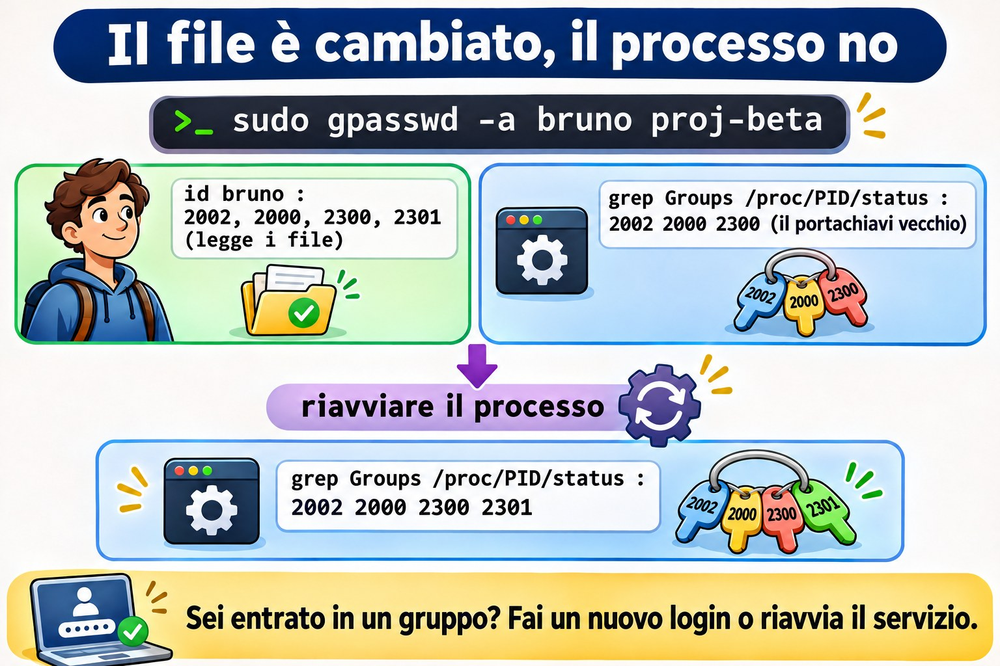

# Lezione 10.3 · Gruppi e lavoro di squadra

In Windows crei un gruppo in AD, dai il permesso al gruppo sulla cartella e deleghi a un'altra persona il diritto di cambiare chi ne fa parte. Chi entra nel gruppo ottiene l'accesso solo dopo un nuovo logon. In Linux l'idea è la stessa, e perfino il trabocchetto del logon è identico. Nella Lezione 2.8 hai montato una cartella di team con setgid. In questa lezione organizzi più progetti, ognuno con il suo gruppo, deleghi la gestione di un gruppo senza dare `sudo`, capisci perché l'accesso nuovo non arriva a chi è già collegato e sistemi l'`umask` di chi lavora insieme.

> **Il cuore di questa lezione:** separare il gruppo principale (uno solo, in `/etc/passwd`) da quelli supplementari (in `/etc/group`); ricordare che chi ha il gruppo come principale non compare nell'elenco dei membri; creare una cartella per progetto con `install -d -m 2770 -g`; delegare la gestione con `gpasswd -A`; sapere che un processo conserva i gruppi che aveva quando è nato; e sapere che cambiare il gruppo principale di qualcuno cambia il suo `umask`. Il resto è approfondimento.

| Scheda |  |
| --- | --- |
| **Modulo** | M10 · Utenti e accesso privilegiato, lezione 3 di 4 |
| **Quando** | Settimana 15 |
| **Alla fine** | Monti gruppi di progetto con cartelle proprie, deleghi la gestione di un gruppo e spieghi perché un accesso nuovo non funziona ancora |
| **Prerequisiti** | Lezioni 2.7, 2.8, 8.5 e 10.2 |
| **Durata** | circa 2h |
| **Snapshot** | `m10a3-inicio` e `m10a3-fim` su rocky-lab e debian-lab |

## 1 · Riscaldamento

Rispondi prima di leggere.

1. `getent group equipe` non elenca Bruno, eppure lui scrive in `/srv/equipe`. Come mai?
2. Hai messo Bruno in un gruppo nuovo. Era già collegato. Ha l'accesso?
3. Ana coordina il progetto Alfa. Le serve `sudo` per aggiungere qualcuno al gruppo del progetto?

## 2 · Perché conta

| La richiesta | La risposta sbagliata | Cosa provoca |
| --- | --- | --- |
| "Elenca chi ha accesso al progetto" | Solo `getent group` | Mancano le persone che hanno il gruppo come principale |
| "Sono entrato nel gruppo e continuo a non avere accesso" | Toccare i permessi della cartella | Il problema è la sessione vecchia; la cartella era giusta |
| "La coordinatrice vuole aggiungere gente al suo gruppo" | Darle `sudo` per `gpasswd` | Con `sudo` cambia qualsiasi gruppo, compreso `wheel` |
| "Metti il gruppo del progetto come principale di tutti" | `usermod -g proj-alfa` su ognuno | Il loro `umask` diventa `022`, e i colleghi smettono di modificare i file gli uni degli altri |
| "Cancella il gruppo del vecchio progetto" | `groupdel` con la cartella ancora lì | I file restano con un numero al posto del gruppo |

## 3 · Modello mentale

> Pensa a un **portachiavi**. Ogni persona ha una **chiave principale**, quella che va sul file nuovo che crea, e un **mazzo di chiavi extra**, una per ogni gruppo di cui fa parte. Il portachiavi viene montato **al login**: chi riceve una chiave nuova comincia a portarla solo quando rimonta il portachiavi. E ogni cartella di progetto ha una **serratura** sola: il gruppo del progetto, che il setgid passa a ogni file creato lì dentro.

```
/etc/passwd   bruno:x:2002:2002:...      ← chave principal (GID 2002, o grupo bruno)
/etc/group    equipe:x:2000:ana,bruno    ← chaves extras: quem está na lista
              proj-alfa:x:2300:ana,bruno
/etc/gshadow  proj-alfa:!:ana:ana,bruno  ← quem pode mudar a lista: ana

login do bruno → o chaveiro é montado: 2002, 2000, 2300
                 todo processo filho herda o mesmo chaveiro
entrou num grupo depois? → o chaveiro só muda num login novo
```


*Hai ricevuto una chiave nuova? La porti solo dopo un nuovo login.*

### Ponte Windows

| In Windows | In Linux | Dove il paragone inganna |
| --- | --- | --- |
| Gruppo di sicurezza di AD | Gruppo di `/etc/group` | Linux non annida i gruppi: un gruppo dentro un gruppo non esiste |
| "Gruppo primario" dell'utente | Gruppo principale di `/etc/passwd` | In Linux conta ogni giorno: è il gruppo dei file che la persona crea |
| "Gestito da", con il diritto di cambiare i membri | `gpasswd -A` (amministratore del gruppo) | Sta in `/etc/gshadow`, e vale solo per quel gruppo |
| Token di accesso montato al logon | Gruppi del processo, montati al login | Identico: sei entrato nel gruppo, fai un login nuovo |
| Permesso di lettura per i revisori | ACL di gruppo (Lezione 8.5) | Il modo ha un solo gruppo; il secondo gruppo ha bisogno di una ACL |

## 4 · L'essenziale

### Principale e supplementari

| Tipo | Dove sta | Quanti | Cosa decide |
| --- | --- | --- | --- |
| Principale | Quarto campo di `/etc/passwd` | Uno | Il gruppo dei file che la persona crea (fuori dalle cartelle con setgid) |
| Supplementare | Quarto campo di `/etc/group` | Diversi | L'accesso a cartelle e file di quel gruppo |

Con `USERGROUPS_ENAB yes` in `login.defs`, il default di entrambe le distribuzioni, ogni `useradd` crea anche un gruppo personale, con lo stesso nome. È per questo che il gruppo può avere `w` nell'`umask` (Lezione 2.7): nessun altro sta nel gruppo personale.

**Il trabocchetto dell'elenco:** `/etc/group` elenca solo i membri supplementari. Per conoscere tutti i membri di un gruppo, somma i due:

```bash
getent group equipe | cut -d: -f4
getent passwd | awk -F: '$4 == 2000 {print $1}'
```

### Una cartella per progetto

```bash
sudo groupadd -g 2300 proj-alfa
sudo install -d -m 2770 -o root -g proj-alfa /srv/projetos/alfa
```

`install -d` crea la cartella già con proprietario, gruppo e modo, in un solo comando. `2770`: setgid, tutto per il proprietario e il gruppo, niente per gli altri.

### Chi gestisce l'elenco

| Comando | Chi può lanciarlo | Fa |
| --- | --- | --- |
| `gpasswd -A ana proj-alfa` | `root` | Ana diventa amministratrice del gruppo |
| `gpasswd -a bruno proj-alfa` | `root` o un amministratore del gruppo | Aggiunge |
| `gpasswd -d bruno proj-alfa` | `root` o un amministratore del gruppo | Toglie |
| `gpasswd -M ana,bruno proj-alfa` | `root` o un amministratore del gruppo | Sostituisce l'elenco intero |

`gpasswd` è setuid: Ana lo lancia senza `sudo`, e lui controlla in `/etc/gshadow` se lei amministra quel gruppo.

### Il portachiavi si monta al login

| Dove | Quando arrivano i gruppi nuovi |
| --- | --- |
| Sessione SSH o console | Al prossimo login |
| Servizio di systemd | Al prossimo `restart` |
| `sudo -u bruno ...` | Subito: `sudo` rimonta i gruppi |
| Shell attuale | `newgrp` apre una shell nuova con il gruppo (Lezione 2.6) |

Per vedere i gruppi di un processo già in esecuzione: `grep Groups /proc/PID/status`. `id bruno` mostra ciò che c'è nei file, non ciò che il processo porta con sé.



*Sei entrato in un gruppo? Fai un nuovo login o riavvia il servizio.*

### Da dove viene l'umask

| Dove | Rocky | Debian |
| --- | --- | --- |
| `UMASK` e `USERGROUPS_ENAB` in `/etc/login.defs` | Letti | Letti |
| Chi lo applica al login | `/etc/profile` e `/etc/bashrc`, oppure `pam_umask` | `pam_umask`, nelle versioni recenti |
| Regola del gruppo personale | Se il nome del gruppo principale è uguale a quello dell'utente, `002`; altrimenti, `022` | La stessa |

La conseguenza pratica: chi cambia il gruppo principale di qualcuno in un gruppo di progetto gli cambia, senza volerlo, l'`umask` in `022`.


*Cambiare il gruppo principale cambia l'umask senza avvisare.*

### Rocky × Debian

|  | Rocky | Debian |
| --- | --- | --- |
| `groupadd`, `gpasswd`, `install` | Uguali | Uguali |
| Strumento amichevole | Non c'è | `adduser bruno proj-alfa` aggiunge a un gruppo |
| `umask` di un utente con gruppo personale | Di solito `0002` | Di solito `0002`; dipende dalla versione |
| Dove cercare la regola | `grep -n umask /etc/profile /etc/bashrc` | `grep -rn umask /etc/pam.d/common-session /etc/login.defs` |
| `setfacl` | Già installato | Pacchetto `acl`, se manca (Lezione 8.5) |

## 5 · Lab guidato

**Passo 0 · Snapshot e stato.** In Proxmox: `qm snapshot 201 m10a3-inicio` e `qm snapshot 202 m10a3-inicio`. Su rocky-lab:

```bash
id ana
id bruno
getent group equipe
sudo stat -c '%A %U:%G %n' /srv/equipe
sudo passwd -S bruno
```

Ana e Bruno hanno il gruppo personale come principale (`gid=2001(ana)` e `gid=2002(bruno)`) e `equipe` come supplementare. Bruno ha la password che hai definito nella Lezione 10.2.

**Passo 1 · Principale e supplementari.**

```bash
id -gn bruno
id -Gn bruno
grep -E '^(bruno|equipe):' /etc/group
getent passwd | awk -F: '$4 == 2000 {print $1}'
```

Il primo mostra solo il principale, il secondo tutti. In `/etc/group`, il gruppo `bruno` ha l'elenco dei membri vuoto: è il principale di Bruno, e il principale non entra nell'elenco. L'`awk` cerca chi ha `equipe` (2000) come principale: per ora, nessuno.

**Passo 2 · Due progetti.**

```bash
sudo groupadd -g 2300 proj-alfa
sudo groupadd -g 2301 proj-beta
sudo install -d -m 0755 /srv/projetos
sudo install -d -m 2770 -o root -g proj-alfa /srv/projetos/alfa
sudo install -d -m 2770 -o root -g proj-beta /srv/projetos/beta
sudo gpasswd -a ana proj-alfa
ls -l /srv/projetos
```

Le due cartelle compaiono come `drwxrws---`, una per gruppo. Ana è in Alfa; in Beta non c'è nessuno.

**Passo 3 · Delegare Alfa ad Ana.**

```bash
sudo gpasswd -A ana proj-alfa
sudo getent gshadow proj-alfa
sudo -u ana gpasswd -a bruno proj-alfa
getent group proj-alfa
```

`gshadow` mostra Ana nel terzo campo, quello degli amministratori. Ha aggiunto Bruno senza `sudo`: qui `sudo -u ana` serve solo a te per agire come lei. Ora prova a toccare Beta:

```bash
sudo -u ana gpasswd -a bruno proj-beta
```

La risposta è `gpasswd: Permission denied.`: amministra Alfa, e solo Alfa.

**Passo 4 · Il portachiavi vecchio.** Fai girare un processo di Bruno, come se fosse una sessione aperta:

```bash
sudo systemd-run --uid=bruno --unit=lab103 sleep 600
pid=$(systemctl show -p MainPID --value lab103)
grep Groups /proc/$pid/status
```

La riga mostra numeri: `2002`, `2000` e `2300`. Ora aggiungi Bruno a Beta:

```bash
sudo gpasswd -a bruno proj-beta
id bruno
grep Groups /proc/$pid/status
```

`id` mostra già `proj-beta`, perché legge i file. Il processo continua a non avere il `2301`: il suo portachiavi è stato montato prima. Riavvia e controlla:

```bash
sudo systemctl stop lab103
sudo systemd-run --uid=bruno --unit=lab103 sleep 600
pid=$(systemctl show -p MainPID --value lab103)
grep Groups /proc/$pid/status
sudo systemctl stop lab103
```

Ora il `2301` compare. Con una persona è lo stesso: uscire e rientrare.

**Passo 5 · L'umask di chi lavora insieme.**

```bash
grep -E '^(UMASK|USERGROUPS_ENAB)' /etc/login.defs
sudo su - bruno -c umask
sudo su - bruno -c 'touch /srv/projetos/alfa/plano.txt'
sudo stat -c '%A %U:%G %n' /srv/projetos/alfa/plano.txt
sudo -u ana sh -c 'echo "revisado" >> /srv/projetos/alfa/plano.txt'
```

L'`umask` di Bruno è quello che hai annotato nella Lezione 2.7, di solito `0002`. Il file nasce `-rw-rw-r--`, di Bruno, con il gruppo `proj-alfa` che arriva dal setgid, e Ana riesce a modificarlo.

**Passo 6 · Chi legge soltanto.** La revisora Lia deve leggere Alfa, senza cambiare nulla:

```bash
sudo groupadd -g 2302 revisao
sudo useradd -u 2310 -c "Lia Revisora" -m -s /bin/bash -G revisao lia
sudo setfacl -m g:revisao:rx -m d:g:revisao:rx /srv/projetos/alfa
sudo -u lia ls /srv/projetos/alfa
sudo -u lia cat /srv/projetos/alfa/plano.txt
sudo -u lia touch /srv/projetos/alfa/lia.txt
```

Elenca e legge, e il `touch` dà `Permission denied`. `ls -ld /srv/projetos/alfa` ora mostra un `+` alla fine del modo: la cartella ha una ACL. La riga con `d:` vale per i file che devono ancora nascere (Lezione 8.5).

**Passo 7 · debian-lab.** Ripeti i passi da 0 a 6. Nel Passo 5, confronta l'`umask` con quello di Rocky e cerca da dove arriva:

```bash
grep -rn umask /etc/pam.d/common-session /etc/login.defs
```

### Decidi 1

Bruno è uscito dal progetto Alfa, e hai lanciato `gpasswd -d bruno proj-alfa`. Ha una sessione SSH aperta da stamattina. Il suo accesso alla cartella è finito?

A) Sì, subito. B) No: la sessione aperta porta il gruppo finché non termina; chiudi le sue sessioni. C) Solo dopo aver riavviato il server.

Scegli un'opzione prima di continuare.

| Se hai scelto | Risultato | Perché |
| --- | --- | --- |
| A | Sbagliato | I processi già aperti conservano i gruppi che avevano |
| B | Giusto | Chiudi con `sudo loginctl terminate-user bruno` e, se fa girare un servizio, riavvia il servizio |
| C | Esagerato | Basta terminare i suoi processi |

**Da ricordare:** togliere dal gruppo cambia i file; chi è già collegato perde l'accesso solo quando esce.

### Decidi 2

Ana coordina Alfa e vuole aggiungere e togliere persone da sola. Come?

A) Una regola di `sudo` per `/usr/bin/gpasswd`. B) `gpasswd -A ana proj-alfa`. C) Mettere Ana in `wheel`.

Scegli un'opzione prima di continuare.

| Se hai scelto | Risultato | Perché |
| --- | --- | --- |
| A | Pericoloso | Con `sudo` cambia qualsiasi gruppo, compresi `wheel` e `sudo` |
| B | Giusto | Amministra solo quel gruppo, senza `sudo` |
| C | Molto pericoloso | Diventa amministratrice dell'intero server |

**Da ricordare:** delega il gruppo, non `root`.

## 6 · Rompi e ripara

### Guasto 1 · Il membro che non compare

```bash
sudo usermod -g equipe bruno
sudo gpasswd -d bruno equipe
getent group equipe | cut -d: -f4
sudo -u bruno touch /srv/equipe/teste-bruno.txt && echo gravou
```

**Sintomo:** Bruno è sparito dall'elenco di `equipe` e continua a scrivere nella cartella del team. Se il ciclo di `chage` della Lezione 10.2 girasse adesso, resterebbe senza la politica delle password.

**Indagine:** `id bruno` mostra `gid=2000(equipe)`. L'`awk` del Passo 1 ora trova Bruno. Nota anche che `usermod -g` ha passato a `equipe` i file della cartella personale che erano del gruppo `bruno`: il ritorno, nel Guasto 2, annulla questo.

**Causa:** `equipe` è diventato il suo gruppo principale, e il principale non entra nell'elenco di `/etc/group`.

**Riparazione:** non ancora: lascialo così per il Guasto 2. Resta la regola: ogni script che elenca i membri di un gruppo usa i due comandi del Passo 1.

### Guasto 2 · I colleghi che non modificano

```bash
sudo su - bruno -c umask
sudo su - bruno -c 'touch /srv/projetos/alfa/v2.txt'
sudo stat -c '%A %U:%G %n' /srv/projetos/alfa/v2.txt
sudo -u ana sh -c 'echo "nota" >> /srv/projetos/alfa/v2.txt'
```

**Sintomo:** il file nasce `-rw-r--r--`, e Ana riceve `Permission denied`.

**Indagine:** l'`umask` di Bruno, che era `0002`, ora è `0022`. Non è cambiato nulla né in `login.defs` né nella cartella.

**Causa:** la regola del gruppo personale: il gruppo principale di Bruno (`equipe`) non ha più il suo nome, e il login applica `022`.

**Riparazione:** rimetti il gruppo personale come principale e `equipe` come supplementare; correggi il file nato sbagliato:

```bash
sudo usermod -g bruno bruno
sudo gpasswd -a bruno equipe
sudo chmod g+w /srv/projetos/alfa/v2.txt
sudo rm /srv/equipe/teste-bruno.txt
id bruno
sudo su - bruno -c umask
```

### Guasto 3 · Il gruppo diventato un numero

```bash
sudo groupdel proj-beta
ls -ld /srv/projetos/beta
```

**Sintomo:** la cartella compare con `2301` al posto del gruppo.

**Indagine:** `getent group 2301` non risponde nulla. `sudo find / -xdev -nogroup` trova la cartella (Lezione 10.1).

**Causa:** `groupdel` cancella la riga di `/etc/group`, e non tocca il disco. Ha accettato perché `proj-beta` non era il principale di nessuno.

**Riparazione:** ricrealo con lo **stesso numero**, e la cartella torna ad avere un nome:

```bash
sudo groupadd -g 2301 proj-beta
ls -ld /srv/projetos/beta
```

I membri, però, non tornano: Bruno va aggiunto di nuovo. Prima di cancellare un gruppo, cerca i suoi file con `find / -xdev -group NOME`.

### Pulizia

```bash
sudo userdel -r lia
sudo rm -r /srv/projetos
sudo groupdel proj-alfa
sudo groupdel proj-beta
sudo groupdel revisao
id ana
id bruno
sudo find / -xdev \( -nouser -o -nogroup \) -ls 2>/dev/null
```

Ana e Bruno tornano allo stato del Passo 0: gruppo personale come principale, `equipe` come supplementare. Il `find` torna vuoto.

## 7 · Trappole

| Trappola | Cosa succede | Come evitarla |
| --- | --- | --- |
| Elencare i membri solo da `/etc/group` | Mancano quelli che hanno il gruppo come principale | Aggiungere l'`awk` su `/etc/passwd` |
| Aspettarsi l'accesso senza un login nuovo | "Sono entrato nel gruppo e non funziona" | Uscire e rientrare; riavviare il servizio |
| `usermod -G grupo` senza `-a` | Toglie la persona da tutti gli altri gruppi | Sempre `-aG`, oppure `gpasswd -a` |
| Gruppo di progetto come principale | L'`umask` diventa `022` | Gruppo personale come principale, progetto come supplementare |
| `sudo` per `gpasswd` | La persona cambia qualsiasi gruppo | `gpasswd -A` su quel gruppo |
| `groupdel` con file sul disco | File con un numero al posto del nome | `find -group` prima |
| Più di 16 gruppi e NFS con `AUTH_SYS` | Il server NFS vede solo i primi 16 | Meno gruppi per persona; NFS arriva nell'M13 |

## 8 · Quiz

Rispondi senza guardare. Le soluzioni sono alla fine della lezione.

1. Dove sta il gruppo principale di un account, e dove stanno i supplementari?
2. Perché un membro di un gruppo può non comparire in `getent group`?
3. Cosa permette ad Ana `gpasswd -A ana proj-alfa`, e cosa non permette?
4. Hai aggiunto Bruno a un gruppo. Perché un processo che aveva già aperto non ha ottenuto l'accesso?
5. Perché cambiare il gruppo principale di qualcuno può cambiare il suo `umask`?
6. Hai cancellato un gruppo e la cartella è rimasta con un numero. Come le restituisci il nome?

## 9 · Promemoria

**Da sapere a memoria:**

| Voglio... | Comando |
| --- | --- |
| Gruppo principale e tutti | `id -gn NOME` e `id -Gn NOME` |
| Tutti i membri | `getent group G \| cut -d: -f4` e `getent passwd \| awk -F: '$4 == GID {print $1}'` |
| Cartella di progetto | `sudo install -d -m 2770 -o root -g G /srv/projetos/P` |
| Delegare il gruppo | `sudo gpasswd -A NOME G` |
| Aggiungere e togliere | `gpasswd -a NOME G` e `gpasswd -d NOME G` |
| Gruppi di un processo | `grep Groups /proc/PID/status` |

**Da consultare:**

| Voglio... | Comando |
| --- | --- |
| Amministratori del gruppo | `sudo getent gshadow G` |
| Sostituire l'elenco intero | `gpasswd -M a,b,c G` |
| Chiudere le sessioni di qualcuno | `sudo loginctl terminate-user NOME` |
| `umask` di un login | `sudo su - NOME -c umask` |
| Gruppo che legge soltanto | `sudo setfacl -m g:G:rx -m d:g:G:rx PASTA` |
| File di un gruppo | `sudo find / -xdev -group G` |

**Flashcard:**

- Gruppo principale → *uno solo, in `/etc/passwd`.*
- Elenco di `/etc/group` → *solo i supplementari.*
- `gpasswd -A` → *amministra quel gruppo, senza `sudo`.*
- Gruppo nuovo → *arriva al prossimo login.*
- Gruppo principale cambiato → *`umask` `022`.*
- `groupdel` → *cancella il nome, non i file.*

## 10 · Checklist e chiusura

- [ ] Distinguo il gruppo principale dal supplementare ed elenco tutti i membri di un gruppo
- [ ] Creo gruppi di progetto con cartelle `2770` e setgid
- [ ] Delego la gestione di un gruppo con `gpasswd -A`
- [ ] Spiego perché un accesso nuovo vale solo con un login nuovo, e vedo i gruppi di un processo
- [ ] So da dove viene l'`umask` e perché cambia con il gruppo principale
- [ ] Do accesso in sola lettura a un secondo gruppo con una ACL
- [ ] Lascio Ana e Bruno come erano

**Ultimo esercizio, senza guardare la lezione:** su debian-lab, crea il gruppo `proj-gama` (GID 2303) con la cartella `/srv/gama`, metti Bruno come amministratore, fagli aggiungere Ana e dimostra che Ana modifica un file creato da Bruno. Annulla tutto.

**Snapshot di fine** (in Proxmox):

```bash
qm snapshot 201 m10a3-fim
qm snapshot 202 m10a3-fim
```

## 11 · Nella vita reale

**Missione, sola lettura.** Su un server Linux che amministri (o con autorizzazione), lancia **solo**:

```bash
getent group | awk -F: '$3 >= 1000 && $3 < 60000 {print $3, $1, $4}' | sort -n
getent passwd | awk -F: '$3 >= 1000 && $3 < 60000 {print $1, $4}'
sudo getent gshadow | awk -F: '$3 != "" {print $1, $3}'
grep -E '^(UMASK|USERGROUPS_ENAB)' /etc/login.defs
```

Domande a cui rispondere:

1. Qualche persona ha un gruppo di progetto come principale? Il suo `umask` è giusto?
2. Qualche gruppo ha un amministratore? Qualcuno lo sa?
3. Quanti gruppi ha la persona con più gruppi? Supera i 16?

## 12 · Approfondire quando vuoi

- **`man gpasswd`, `man gshadow`:** amministratori, membri e password di gruppo.
- **`man pam_umask`, `man login.defs`:** la regola del gruppo personale, e `HOME_MODE`.
- **`man credentials`:** UID, GID e gruppi supplementari di un processo.
- **`man systemd.exec`:** `SupplementaryGroups=` e `UMask=`, per dare gruppi e `umask` a un servizio senza toccare l'account.

**DeepTutor** (http://10.1.0.149:3782, KB "Curso Linux Sysadmin"):

- `!explica grupo principal e suplementar com a metáfora do chaveiro`
- `!feynman por que um grupo novo só vale depois de um login novo`
- `!quiz Aula 10.3, 5 perguntas sobre grupos, gpasswd e umask`

## Soluzioni commentate

### Riscaldamento

1. `equipe` è il suo gruppo principale, in `/etc/passwd`. L'elenco di `/etc/group` mostra solo i supplementari.
2. No, se non fa un login nuovo. La sua sessione porta i gruppi che aveva quando è entrato.
3. No. Con `gpasswd -A ana proj-alfa`, aggiunge e toglie membri di quel gruppo da sola.

### Quiz

1. Il principale sta nel quarto campo di `/etc/passwd`; i supplementari, nel quarto campo di ogni riga di `/etc/group`.
2. Perché l'elenco di `/etc/group` contiene solo i supplementari. Chi ha il gruppo come principale compare solo in `/etc/passwd`.
3. Permette di aggiungere, togliere e sostituire l'elenco dei membri di `proj-alfa`, senza `sudo`. Non permette di toccare nessun altro gruppo, né i permessi delle cartelle.
4. Perché i gruppi di un processo vengono montati quando nasce e passano ai figli. Il processo va riavviato, oppure la persona deve fare un login nuovo.
5. Perché il login dà `002` solo quando il gruppo principale ha lo stesso nome dell'utente. Con un altro gruppo come principale, applica `022`.
6. Ricreando il gruppo con lo stesso GID: `groupadd -g NÚMERO NOME`. I membri vanno aggiunti di nuovo.

---

<!-- navegacao -->
[← Lezione 10.2 · Password e scadenza](10.2-senhas-e-validade.md) · [Indice delle lezioni](../01-aulas.md) · [Lezione 10.4 · sudo sul serio →](10.4-sudo-de-verdade.md)
