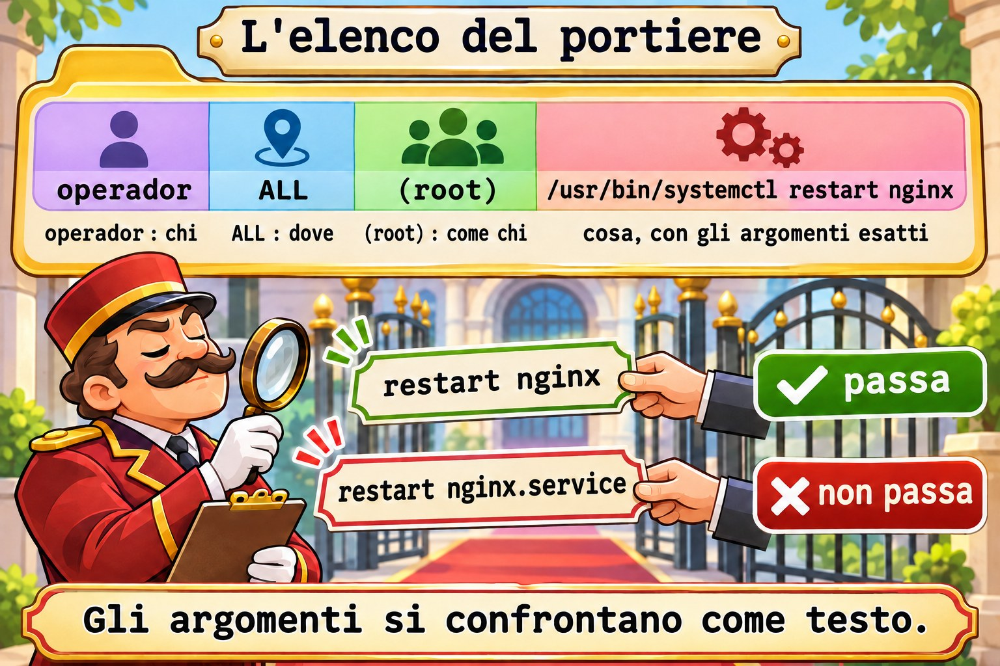
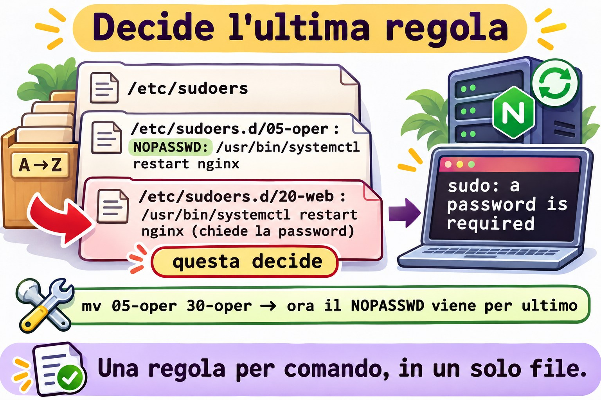

# Lezione 10.4 · sudo sul serio

In Windows, mettere qualcuno nel gruppo Administrators risolve subito e consegna tutto. Per dare un solo compito, monti una delega, o un endpoint JEA, con l'elenco esatto dei comandi. In Linux, `wheel` (Rocky) e `sudo` (Debian) sono il gruppo Administrators, e `sudoers` è la delega fine. Nella Lezione 2.5 hai scritto la prima regola. In questa lezione scrivi regole che non aprono falle: solo i comandi e gli argomenti giusti, senza caratteri jolly pericolosi, con modifica sicura dei file e con la registrazione di tutto. Alla fine arriva la Sfida dell'M10.

> **Il cuore di questa lezione:** leggere una regola come `quem onde=(como quem) o quê`; raggruppare comandi in un `Cmnd_Alias`; ricordare che gli argomenti devono corrispondere esattamente; provare una regola con `sudo -l -U` prima di usarla; controllare un file con `visudo -cf` prima di installarlo; evitare `*` negli argomenti; e sapere che, tra due regole che corrispondono, vale l'ultima. Il resto è approfondimento.

| Scheda |  |
| --- | --- |
| **Modulo** | M10 · Utenti e accesso privilegiato, lezione 4 di 4, con la Sfida del modulo |
| **Quando** | Settimana 15 |
| **Alla fine** | Dai a una persona esattamente un comando come `root`, dimostri che non passa nient'altro e trovi chi ha più accesso del dovuto |
| **Prerequisiti** | Lezioni 2.5, 10.2 e 10.3 |
| **Durata** | circa 2h30, più 1h per la Sfida |
| **Snapshot** | `m10a4-inicio` e `m10a4-fim` su rocky-lab e debian-lab |

## 1 · Riscaldamento

Rispondi prima di leggere.

1. La regola permette `/usr/bin/systemctl restart nginx`. L'operatore riesce a lanciare `sudo systemctl restart nginx.service`?
2. Perché dare a qualcuno `sudo less /var/log/secure` equivale a dargli `root`?
3. Due file di `/etc/sudoers.d/` parlano dello stesso comando, uno con `NOPASSWD` e l'altro senza. Quale vale?

## 2 · Perché conta

| La richiesta | La risposta sbagliata | Cosa provoca |
| --- | --- | --- |
| "L'operatore deve riavviare nginx" | Metterlo in `wheel` | Può tutto, perfino distruggere il server |
| "Fagli toccare solo nginx" | `/usr/bin/systemctl * nginx` | L'`*` accetta `edit nginx`, che apre un editor come `root`, e `stop sshd nginx` |
| "Deve leggere i log" | `sudo less /var/log/...` | Dentro `less`, `!sh` apre una shell di `root` |
| "Deve modificare la configurazione del sito" | `sudo vi /etc/nginx/...` | Stessa cosa: anche `vi` apre una shell |
| "Ho creato la regola e non funziona" | Modificare di nuovo il file, alla cieca | Il problema era l'argomento diverso o un'altra regola dopo questa |

## 3 · Modello mentale

> Pensa all'**elenco del portiere**. Ogni riga dice **chi** può, **in quale palazzo**, **al posto di chi** e **fare cosa**. Il portiere legge l'elenco intero, dall'alto in basso, file per file, e **decide l'ultima riga che corrisponde alla richiesta**. Ed è letterale: se l'elenco dice "aprire la sala 12", "aprire la sala 12 e la 13" non corrisponde.

```
operador   ALL  =(root)  /usr/bin/systemctl restart nginx
quem       onde   como     o quê, com os argumentos exatos

leitura:   /etc/sudoers  →  /etc/sudoers.d/ em ordem alfabética (05-..., 20-..., 30-...)
decisão:   a última linha que combina com quem, onde, como e o quê
```



*Gli argomenti si confrontano come testo.*

### Ponte Windows

| In Windows | In Linux | Dove il paragone inganna |
| --- | --- | --- |
| Gruppo Administrators | `wheel` (Rocky) e `sudo` (Debian) | Chi ne fa parte può tutto, con la propria password |
| "Esegui come amministratore" (UAC) | `sudo comando` | `sudo` chiede la password **di chi lo lancia**, non quella di `root` |
| JEA, con l'elenco dei comandi permessi | `Cmnd_Alias` e una regola in `sudoers.d` | Gli argomenti si confrontano come testo: uno in più e non passa |
| Log di sicurezza (4688, 4672) | `journalctl _COMM=sudo` e `/var/log/secure` | Ogni `sudo` diventa una riga, accettato o negato |
| Politica applicata da GPO | File in `/etc/sudoers.d/` | Un errore di sintassi può togliere `sudo` a tutti: controlla prima |

## 4 · L'essenziale

### La regola

| Parte | Esempio | Significa |
| --- | --- | --- |
| Chi | `operador`, `%web` | Un account, o un gruppo con `%` |
| Dove | `ALL` | Su qualsiasi macchina che usi questo file |
| Come chi | `(root)` | Gira come `root`; `(ALL)` lascia scegliere chiunque |
| Opzioni | `NOPASSWD:` | Non chiede la password |
| Cosa | `/usr/bin/systemctl restart nginx` | Percorso completo e argomenti esatti |

```text
Cmnd_Alias WEB_OPER = /usr/bin/systemctl restart nginx, /usr/bin/systemctl reload nginx
operador ALL=(root) WEB_OPER
```

Gli argomenti si confrontano come testo: `restart nginx` non accetta né `restart nginx.service` né `restart nginx sshd`. Un comando senza argomenti nella regola accetta **qualsiasi** argomento; per vietarli tutti, scrivi `""` dopo il comando.

E `status`? Non ha bisogno di `sudo`: qualsiasi utente lancia `systemctl status nginx`. Non dare via `sudo` ciò che la persona può già fare senza.

### Controllare prima di installare

```bash
sudo visudo -cf /tmp/20-web
sudo install -m 0440 -o root -g root /tmp/20-web /etc/sudoers.d/20-web
sudo -l -U operador
sudo -l -U operador /usr/bin/systemctl restart nginx; echo $?
```

`visudo -cf` controlla la sintassi di un file prima che arrivi in `sudoers.d`. `sudo -l -U` mostra le regole di un'altra persona; con un comando in fondo, risponde se quel comando passa (codice 0) o no (codice 1), senza lanciare nulla.


*Un errore in sudoers.d può togliere sudo a tutti.*

### Le falle note

| Dare questo | Apre | Dare questo al suo posto |
| --- | --- | --- |
| `/usr/bin/systemctl * nginx` | `edit nginx` e `stop sshd nginx` | Ogni azione, per esteso |
| `/usr/bin/vi ARQUIVO` | `:!sh` come `root` | `sudoedit ARQUIVO` |
| `/usr/bin/less LOG` | `!sh` come `root` | Il gruppo `systemd-journal` (o `adm` su Debian) |
| Uno script in `/home/operador/` | Lui stesso modifica lo script | Script di `root`, in `/usr/local/sbin/`, modo `0755` |
| `(ALL)` nel "come chi" | Girare come qualsiasi account | `(root)` o l'account del servizio |

`sudoedit` copia il file in una cartella temporanea, apre l'editor **come la persona stessa** e lo riscrive, come `root`, solo quando lei esce dall'editor. Un `:!sh` lì dentro apre una shell della persona, non di `root`.


*L'asterisco accetta gli spazi, e l'editor apre una shell.*

### Opzioni utili

| Opzione | Fa |
| --- | --- |
| `Defaults:operador timestamp_timeout=5` | La password vale 5 minuti per lui |
| `Defaults logfile=/var/log/sudo.log` | Un log solo di `sudo`, oltre al journal |
| `Defaults:operador log_output` | Registra l'output di ogni comando; `sudoreplay` lo riproduce |
| `NOEXEC:` prima del comando | Impedisce al comando di aprire altri programmi, quando funziona |

### Rocky × Debian

|  | Rocky | Debian |
| --- | --- | --- |
| Gruppo degli amministratori | `wheel` | `sudo` |
| Inclusione di `sudoers.d` | `#includedir /etc/sudoers.d` | `@includedir /etc/sudoers.d` |
| `systemctl` | `/usr/bin/systemctl` | `/usr/bin/systemctl` |
| `nginx` | `sudo dnf install -y nginx` e `systemctl enable --now nginx` | `sudo apt install -y nginx` (parte da solo) |
| Log di `sudo` | `/var/log/secure` e il journal | Il journal, e `/var/log/auth.log`, se c'è |
| Gruppo di lettura dei log | `systemd-journal` | `systemd-journal` e `adm` |

## 5 · Lab guidato

**Passo 0 · Snapshot e stato.** In Proxmox: `qm snapshot 201 m10a4-inicio` e `qm snapshot 202 m10a4-inicio`. Su rocky-lab:

```bash
sudo ls -l /etc/sudoers.d/
getent group wheel
sudo visudo -c
```

`visudo -c` controlla tutti i file e termina con `parsed OK` su ognuno. Annota ciò che esiste già in `sudoers.d`: alla fine lo lascerai uguale.

**Passo 1 · nginx e l'elenco principale.**

```bash
sudo dnf install -y nginx
sudo systemctl enable --now nginx
systemctl is-active nginx
sudo grep -vE '^\s*$|^#( |#|$)' /etc/sudoers
```

Il `grep` toglie i commenti e lascia `#includedir`, che non è un commento. Restano i `Defaults`, la riga di `root`, quella di `%wheel` e `#includedir /etc/sudoers.d`. Leggi quella di `%wheel` con la tabella della sezione 4: chi è nel gruppo, su qualsiasi macchina, come qualsiasi account, qualsiasi comando.

**Passo 2 · L'operatore.**

```bash
sudo useradd -u 2410 -c "Operador Web" -m -s /bin/bash operador
sudo passwd operador
id operador
```

Dagli una password che rispetti la politica della Lezione 10.2 e annotala nel quaderno del lab. L'operatore non è in `wheel`: per ora non ha nessun `sudo`.

```bash
sudo -l -U operador
```

La risposta dice che non può lanciare `sudo` su questa macchina.

**Passo 3 · La regola, controllata prima di installarla.**

```bash
cat > /tmp/20-web <<'FIM'
Cmnd_Alias WEB_OPER = /usr/bin/systemctl restart nginx, /usr/bin/systemctl reload nginx
operador ALL=(root) WEB_OPER
FIM
sudo visudo -cf /tmp/20-web
sudo install -m 0440 -o root -g root /tmp/20-web /etc/sudoers.d/20-web
rm /tmp/20-web
sudo visudo -c
sudo -l -U operador
```

`visudo -cf` risponde `parsed OK`, e solo allora il file entra in `sudoers.d`, già con proprietario e modo giusti. Ora `sudo -l -U` elenca i due comandi, come `(root)`.

**Passo 4 · Provare senza lanciare.**

```bash
sudo -l -U operador /usr/bin/systemctl restart nginx; echo $?
sudo -l -U operador /usr/bin/systemctl restart nginx.service; echo $?
sudo -l -U operador /usr/bin/systemctl stop nginx; echo $?
```

Il primo stampa il percorso del comando e `0`. Gli altri due terminano con `1`: `nginx.service` non è il testo della regola, e `stop` non c'è.

**Passo 5 · Ora come operatore.**

```bash
su - operador
sudo systemctl restart nginx
systemctl status nginx --no-pager | head -n 5
sudo systemctl restart nginx.service
sudo systemctl stop nginx
exit
```

`sudo` chiede la password **dell'operatore**, una volta. Il `restart` funziona, e lo `status` gira senza `sudo`. Gli ultimi due rispondono qualcosa come `Sorry, user operador is not allowed to execute '/usr/bin/systemctl stop nginx' as root on rocky-lab.`

**Passo 6 · La registrazione.**

```bash
sudo journalctl _COMM=sudo --since '-10min' --no-pager | grep operador
```

Ogni tentativo è diventato una riga, con `TTY`, `PWD`, `USER=root` e il `COMMAND`. Quelli negati riportano `command not allowed`. È questo che mostri in un audit.

**Passo 7 · Il carattere jolly, solo guardando.** Installa una regola sbagliata per un istante e chiedi a `sudo`, **senza lanciare**:

```bash
echo 'operador ALL=(root) /usr/bin/systemctl * nginx' > /tmp/25-curinga
sudo visudo -cf /tmp/25-curinga
sudo install -m 0440 -o root -g root /tmp/25-curinga /etc/sudoers.d/25-curinga
sudo -l -U operador /usr/bin/systemctl edit nginx; echo $?
sudo -l -U operador /usr/bin/systemctl stop sshd nginx; echo $?
sudo rm /etc/sudoers.d/25-curinga /tmp/25-curinga
```

Passano entrambi, con `0`. `edit` apre un editor come `root`, e da lì esce una shell. Il secondo butta giù `sshd`. La sintassi era giusta; era la regola a essere sbagliata. Non lanciare questi comandi.

**Passo 8 · Modificare in sicurezza.**

```bash
sudo install -m 0644 /dev/null /etc/nginx/conf.d/curso.conf
echo 'operador ALL=(root) sudoedit /etc/nginx/conf.d/curso.conf, /usr/sbin/nginx -t' > /tmp/21-web-conf
sudo visudo -cf /tmp/21-web-conf
sudo install -m 0440 -o root -g root /tmp/21-web-conf /etc/sudoers.d/21-web-conf
rm /tmp/21-web-conf
su - operador
sudoedit /etc/nginx/conf.d/curso.conf
```

L'editor apre un file temporaneo. Scrivi una riga `# editado pelo operador`, salva ed esci. Sempre come operatore:

```bash
sudo /usr/sbin/nginx -t
sudo systemctl reload nginx
cat /etc/nginx/conf.d/curso.conf
exit
```

`nginx -t` risponde `syntax is ok` e `test is successful`, e il file ha la riga nuova. L'operatore ha modificato un file di `root` senza mai avere un editor in esecuzione come `root`.

**Passo 9 · Verificare chi può cosa.**

```bash
getent group wheel
for u in $(getent passwd | awk -F: '$3 >= 1000 && $3 < 60000 {print $1}'); do
  echo "== $u"; sudo -l -U "$u" | sed -n '/may run/,$p'
done
```

Ogni persona compare con ciò che può fare, o senza nessuna riga, se non può nulla. `student` ha `(ALL) ALL`, tramite `wheel`; l'operatore, solo i suoi tre comandi.

**Passo 10 · debian-lab.** Ripeti i passi da 0 a 9. Installa con `sudo apt install -y nginx`, e nel Passo 9 sostituisci `wheel` con `sudo`.

### Decidi 1

Chiedono che l'operatore possa fermare, avviare, riavviare e ricaricare nginx. Quale regola?

A) `operador ALL=(root) /usr/bin/systemctl * nginx`. B) Un `Cmnd_Alias` con le quattro azioni per esteso. C) `operador ALL=(root) /usr/bin/systemctl`.

Scegli un'opzione prima di continuare.

| Se hai scelto | Risultato | Perché |
| --- | --- | --- |
| A | Pericoloso | L'`*` accetta gli spazi: `edit nginx` e `stop sshd nginx` passano |
| B | Giusto | Solo le quattro righe, con il testo esatto |
| C | Molto pericoloso | Senza argomenti nella regola, passa qualsiasi argomento: l'operatore ferma l'intero server |

**Da ricordare:** scrivi ogni comando per esteso; l'`*` negli argomenti accetta più di quanto sembri.

### Decidi 2

L'operatore deve leggere i log di nginx. Come?

A) `operador ALL=(root) /usr/bin/less /var/log/nginx/error.log`. B) Mettere l'operatore nel gruppo che legge i log (`systemd-journal`, e `adm` su Debian) e usare `journalctl -u nginx`. C) `chmod 644` su tutti i log.

Scegli un'opzione prima di continuare.

| Se hai scelto | Risultato | Perché |
| --- | --- | --- |
| A | Pericoloso | Dentro `less`, `!sh` apre una shell di `root` |
| B | Giusto | Legge senza `sudo`; nulla gira come `root` |
| C | Debole | Tutti cominciano a leggere, e la prossima rotazione dei log lo annulla |

**Da ricordare:** l'accesso in lettura si dà con un gruppo, non con `sudo`.

## 6 · Rompi e ripara

### Guasto 1 · Il percorso incompleto

```bash
echo 'operador ALL=(root) systemctl restart nginx' > /tmp/22-ruim
sudo visudo -cf /tmp/22-ruim; echo $?
```

**Sintomo:** `visudo` rifiuta il file, con codice `1` e un messaggio di errore di sintassi che indica la riga e la colonna; nelle versioni attuali, dice che si aspettava un percorso completo.

**Indagine:** la colonna indicata è quella di `systemctl`.

**Causa:** `sudoers` esige il percorso completo del comando. Senza, andrebbe bene qualsiasi `systemctl` che la persona mettesse nel `PATH`.

**Riparazione:** `command -v systemctl` dà il percorso; correggi in `/usr/bin/systemctl`. E nota cosa **non** è successo: siccome hai controllato prima di installare, `sudoers.d` non ha mai ricevuto il file sbagliato. Cancellalo: `rm /tmp/22-ruim`.

### Guasto 2 · L'operatore che può tutto

```bash
sudo usermod -aG wheel operador
sudo -l -U operador | sed -n '/may run/,$p'
```

Su Debian, usa il gruppo `sudo`.

**Sintomo:** oltre ai tre comandi, compare `(ALL) ALL`.

**Indagine:** `id operador` mostra `wheel`. La regola di `20-web` resta giusta: ad aprire tutto è stata la riga `%wheel` di `/etc/sudoers`.

**Causa:** qualcuno ha "risolto in fretta" una richiesta. È il rilievo più comune negli audit di `sudo`.

**Riparazione:** `sudo gpasswd -d operador wheel` e di nuovo `sudo -l -U operador`. Se aveva una sessione aperta, questa porta ancora `wheel` (Lezione 10.3): chiudila con `sudo loginctl terminate-user operador`.

### Guasto 3 · Il NOPASSWD che non vale

```bash
echo 'operador ALL=(root) NOPASSWD: /usr/bin/systemctl restart nginx' > /tmp/05-oper
sudo visudo -cf /tmp/05-oper
sudo install -m 0440 -o root -g root /tmp/05-oper /etc/sudoers.d/05-oper
sudo -u operador sudo -k
sudo -u operador sudo -n /usr/bin/systemctl restart nginx; echo $?
```

`sudo -k` cancella la password che l'operatore aveva già digitato, e `-n` vieta a `sudo` di chiedere la password.

**Sintomo:** `sudo: a password is required`, con codice `1`, nonostante il `NOPASSWD`.

**Indagine:** `sudo -l -U operador` elenca le due regole: quella di `05-oper`, con `NOPASSWD`, e quella di `20-web`, senza.

**Causa:** i file vengono letti in ordine alfabetico, e decide l'ultima regola che corrisponde. `20-web` viene dopo `05-oper`.

**Riparazione:** cambia l'ordine e riprova; ora il codice è `0`:

```bash
sudo mv /etc/sudoers.d/05-oper /etc/sudoers.d/30-oper
sudo -u operador sudo -n /usr/bin/systemctl restart nginx; echo $?
sudo rm /etc/sudoers.d/30-oper /tmp/05-oper
```

La riparazione che dura è un'altra: una sola regola per comando, in un solo file.



*Una regola per comando, in un solo file.*

### Pulizia

```bash
sudo rm /etc/sudoers.d/20-web /etc/sudoers.d/21-web-conf
sudo rm /etc/nginx/conf.d/curso.conf
sudo systemctl reload nginx
sudo userdel -r operador
sudo ls -l /etc/sudoers.d/
sudo visudo -c
```

`sudoers.d` torna a ciò che hai annotato nel Passo 0. nginx resta installato: serve alla Sfida.

## 7 · Trappole

| Trappola | Cosa succede | Come evitarla |
| --- | --- | --- |
| Modificare `sudoers.d` direttamente, senza controllare | Un errore di sintassi toglie `sudo` a tutti | `visudo -cf` su un file temporaneo, poi `install` |
| `*` negli argomenti | Passa molto più di quanto volevi | Ogni comando per esteso |
| Comando senza argomenti nella regola | Passa qualsiasi argomento | Argomenti espliciti, o `""` per nessuno |
| `sudo` per un editor, `less` o `more` | Shell di `root` | `sudoedit` e gruppi di lettura |
| `(ALL)` nel "come chi" | La persona gira come qualsiasi account | `(root)` o l'account del servizio |
| Due file con regole per lo stesso comando | Vale l'ultimo in ordine alfabetico | Una regola per comando |
| Persona in `wheel` "solo per oggi" | Resta per sempre | Audit con `sudo -l -U` |
| Provare solo con il tuo account | Hai `ALL` e funziona tutto | `sudo -l -U NOME COMANDO` e una prova come la persona |

## 8 · Quiz

Rispondi senza guardare. Le soluzioni sono alla fine della lezione.

1. Quali sono le parti di `operador ALL=(root) /usr/bin/systemctl restart nginx`?
2. Cosa risponde `sudo -l -U operador /usr/bin/systemctl stop nginx`, e perché è sicuro?
3. Perché `/usr/bin/systemctl * nginx` è una regola pericolosa?
4. Cosa fa `sudoedit` di diverso da `sudo vi`?
5. Due file di `sudoers.d` danno regole diverse per lo stesso comando. Quale vale?
6. Perché controllare con `visudo -cf` prima di copiare il file in `sudoers.d`?

## 9 · Promemoria

**Da sapere a memoria:**

| Voglio... | Comando |
| --- | --- |
| Controllare un file nuovo | `sudo visudo -cf ARQUIVO` |
| Installare con proprietario e modo | `sudo install -m 0440 -o root -g root ARQUIVO /etc/sudoers.d/NN-nome` |
| Controllare tutto | `sudo visudo -c` |
| Vedere le regole di qualcuno | `sudo -l -U NOME` |
| Provare un comando senza lanciarlo | `sudo -l -U NOME /caminho/comando args; echo $?` |
| Vedere la registrazione | `sudo journalctl _COMM=sudo --since '-1h'` |

**Da consultare:**

| Voglio... | Comando |
| --- | --- |
| Elenco principale senza commenti | `sudo grep -vE '^\s*$\|^#( \|#\|$)' /etc/sudoers` |
| Raggruppare comandi | `Cmnd_Alias NOME = /cmd1 args, /cmd2 args` |
| Modificare un file protetto | `NOME ALL=(root) sudoedit /caminho/arquivo` |
| Dimenticare la password digitata | `sudo -k` |
| Provare senza chiedere la password | `sudo -n comando` |
| Chi è amministratore | `getent group wheel` (Rocky) e `getent group sudo` (Debian) |

**Flashcard:**

- Regola → *chi, dove, come chi, cosa.*
- Argomenti → *confrontati come testo.*
- Senza argomenti → *qualsiasi argomento.*
- `*` → *accetta gli spazi.*
- Due regole → *vale l'ultima.*
- `sudoedit` → *l'editor gira come te.*

## 10 · Checklist e chiusura

- [ ] Leggo una regola di `sudoers` parte per parte
- [ ] Scrivo un `Cmnd_Alias` con argomenti esatti
- [ ] Controllo con `visudo -cf` e installo con `install -m 0440`
- [ ] Provo una regola con `sudo -l -U` senza lanciare il comando
- [ ] Riconosco caratteri jolly, editor e paginatori pericolosi
- [ ] Do una modifica sicura con `sudoedit`
- [ ] Verifico chi ha `sudo` e cosa può fare

**Ultimo esercizio, senza guardare la lezione:** su debian-lab, dai ad Ana il diritto di lanciare solo `/usr/bin/systemctl reload nginx`, senza password. Dimostra con `sudo -u ana sudo -n` che il `reload` passa e il `restart` no. Cancella la regola.

**Snapshot di fine** (in Proxmox):

```bash
qm snapshot 201 m10a4-fim
qm snapshot 202 m10a4-fim
```

## 11 · Nella vita reale

**Missione, sola lettura.** Su un server Linux che amministri (o con autorizzazione), lancia **solo**:

```bash
getent group wheel sudo
sudo ls -l /etc/sudoers.d/
sudo grep -rhvE '^\s*$|^#( |#|$)' /etc/sudoers /etc/sudoers.d/
sudo journalctl _COMM=sudo --since '-7d' --no-pager | grep -c 'command not allowed'
```

Domande a cui rispondere:

1. Quante persone sono nel gruppo degli amministratori? Servono tutte?
2. Qualche regola ha `*` negli argomenti, un editor, un paginatore o `NOPASSWD: ALL`?
3. Quanti rifiuti ci sono stati nell'ultima settimana? Di chi?

## 12 · Approfondire quando vuoi

- **`man sudoers`:** la grammatica completa, i caratteri jolly, `Defaults`, `NOEXEC` e l'ordine delle regole.
- **`man sudoreplay`:** riprodurre una sessione registrata con `log_output`.
- **`man sudoedit`:** come funziona la modifica sicura e le cartelle che rifiuta.
- **GTFOBins:** un elenco pubblico di programmi che aprono una shell quando girano tramite `sudo`. Consultalo prima di concedere qualsiasi programma.

**DeepTutor** (http://10.1.0.149:3782, KB "Curso Linux Sysadmin"):

- `!explica uma regra do sudoers com a metáfora da lista do porteiro`
- `!feynman por que um curinga nos argumentos do sudo é perigoso`
- `!quiz Aula 10.4, 5 perguntas sobre sudoers, sudoedit e auditoria`

## Sfida dell'M10 · La squadra di reperibilità

> **La missione:** su rocky-lab, monta la squadra di reperibilità: tre persone, una cartella comune, una politica delle password e una persona che può solo riavviare nginx. Tutto con uno script che può girare di nuovo senza rompere nulla.

Senza passo passo. I suggerimenti sono nelle Soluzioni.

**Prima di cominciare:** in Proxmox, `qm snapshot 201 m10-desafio-inicio`.

**Requisiti:**

1. Gruppo `plantao` con GID 2400. Account `dora` (2401), `edu` (2402) e `fabi` (2403), con il gruppo personale come principale, `plantao` come supplementare, cartella personale e Bash.
2. Cartella `/srv/plantao`, del gruppo `plantao`, in cui i tre creano e modificano i file gli uni degli altri, e non entra nessun altro.
3. Dora amministra il gruppo `plantao`, senza `sudo`.
4. Le password dei tre scadono in 90 giorni, con 1 giorno minimo tra un cambio e l'altro e avviso 14 giorni prima. Ognuno riceve una password provvisoria e deve cambiarla al primo accesso.
5. Fabi può lanciare come `root` solo `/usr/bin/systemctl restart nginx`, con la propria password. Dora ed Edu non hanno `sudo`.
6. I requisiti 1, 2, 3, 5 e la scadenza del requisito 4 escono da uno script `~/m10-desafio.sh`, che gira come `root`, può girare due volte di seguito senza errori e non duplica nulla.

**Criteri di accettazione:**

- [ ] `sudo bash ~/m10-desafio.sh` gira due volte di seguito senza errori
- [ ] `getent group plantao` mostra i tre, e `sudo getent gshadow plantao` mostra Dora come amministratrice
- [ ] `sudo chage -l edu` mostra 90, 1 e 14, e `password must be changed`
- [ ] `sudo -u dora bash -c 'umask 002; echo escala > /srv/plantao/escala.txt'` e `sudo -u edu bash -c 'echo troca >> /srv/plantao/escala.txt'` funzionano
- [ ] `sudo -l -U fabi` mostra solo il `restart` di nginx; `sudo -l -U fabi /usr/bin/systemctl stop nginx; echo $?` dà `1`
- [ ] `sudo -l -U dora` e `sudo -l -U edu` dicono che non possono usare `sudo`
- [ ] `sudo visudo -c` non mostra errori

**Alla fine:**

```bash
sudo rm /etc/sudoers.d/30-plantao
for u in dora edu fabi; do sudo userdel -r "$u"; done
sudo rm -r /srv/plantao
sudo groupdel plantao
```

In Proxmox: `qm snapshot 201 m10-desafio-fim`.

**Hai chiuso l'M10.** Ora gestisci account di persone e di servizi, cambi nomi e numeri senza lasciare file orfani, definisci e applichi una politica delle password, organizzi gruppi con delega e dai accesso privilegiato nella misura esatta, con registrazione. Il prossimo modulo è nel [piano del corso](../00-plano-do-curso.md).

## Soluzioni commentate

### Riscaldamento

1. No. Gli argomenti si confrontano come testo, e `nginx.service` non è `nginx`.
2. Perché `less` gira come `root` e accetta `!sh`, che apre una shell con lo stesso utente: `root`.
3. Quello che viene per ultimo in ordine alfabetico: decide l'ultima regola che corrisponde.

### Quiz

1. `operador` è chi; `ALL` è dove; `(root)` è come chi; `/usr/bin/systemctl restart nginx` è cosa, con gli argomenti esatti.
2. Risponde se il comando passa (stampa il percorso, codice 0) o no (codice 1). È sicuro perché consulta solo la politica: non gira nulla.
3. Perché l'`*` accetta qualsiasi testo, spazi compresi: passano `edit nginx`, che apre un editor come `root`, e `stop sshd nginx`.
4. `sudoedit` apre l'editor come la persona stessa, su una copia, e scrive il file come `root` solo alla fine. Con `sudo vi`, l'intero editor gira come `root`, e un `:!sh` diventa una shell di `root`.
5. Quello letto per ultimo, in ordine alfabetico, perché decide l'ultima regola che corrisponde.
6. Perché un errore di sintassi in un file di `sudoers.d` può far rifiutare tutto a `sudo`, anche a te. Controllando prima, il file sbagliato non arriva mai lì.

### Suggerimenti per la Sfida

Leggine una alla volta.

1. **Rigirare senza errori:** prima di creare, chiedi se esiste già: `getent group plantao >/dev/null || groupadd -g 2400 plantao`, e lo stesso con `getent passwd` prima di ogni `useradd`. `install -d`, `chage -M` e `gpasswd -A` possono girare di nuovo senza problemi.
2. **La cartella:** `install -d -m 2770 -o root -g plantao /srv/plantao`. L'`umask 002` del criterio di accettazione fa la parte del login (Lezione 2.8).
3. **La regola:** scrivila in un file temporaneo (`mktemp`), controllala con `visudo -cf` e installala con `install -m 0440` come `/etc/sudoers.d/30-plantao`. Se `visudo` la rifiuta, `set -e` ferma lo script prima dell'installazione.
4. **L'ordine delle password:** prima `passwd` per ognuno, poi `chage -d 0`. Al contrario, `passwd` registra la data di oggi come ultimo cambio e annulla il `chage -d 0`. Per questo le password provvisorie restano fuori dallo script.
5. **Uno script possibile:**

```bash
#!/bin/bash
set -euo pipefail
getent group plantao >/dev/null || groupadd -g 2400 plantao
for linha in dora:2401 edu:2402 fabi:2403; do
  nome=${linha%%:*}
  uid=${linha##*:}
  getent passwd "$nome" >/dev/null || useradd -u "$uid" -m -s /bin/bash -G plantao "$nome"
  chage -M 90 -m 1 -W 14 "$nome"
done
install -d -m 2770 -o root -g plantao /srv/plantao
gpasswd -A dora plantao
regra=$(mktemp)
echo 'fabi ALL=(root) /usr/bin/systemctl restart nginx' > "$regra"
visudo -cf "$regra" >/dev/null
install -m 0440 -o root -g root "$regra" /etc/sudoers.d/30-plantao
rm -f "$regra"
```

Dopo lo script: `sudo passwd dora` e `sudo chage -d 0 dora`, e lo stesso per Edu e Fabi.

---

<!-- navegacao -->
[← Lezione 10.3 · Gruppi e lavoro di squadra](10.3-grupos-e-trabalho-em-equipe.md) · [Indice delle lezioni](../01-aulas.md) · [Lezione 11.1 · TCP/IP per chi amministra →](11.1-tcp-ip-para-quem-administra.md)
