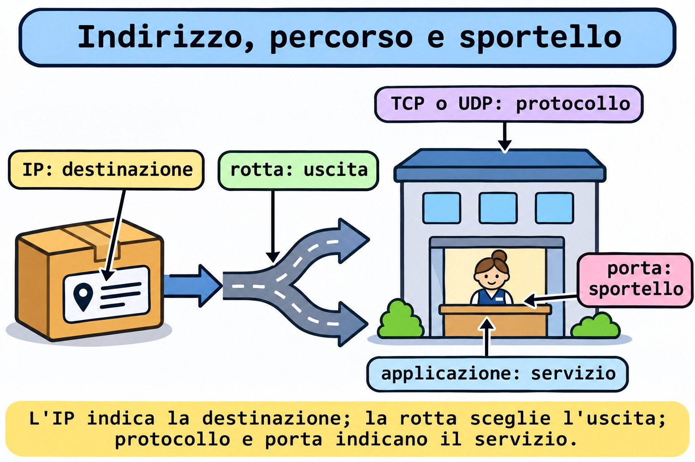
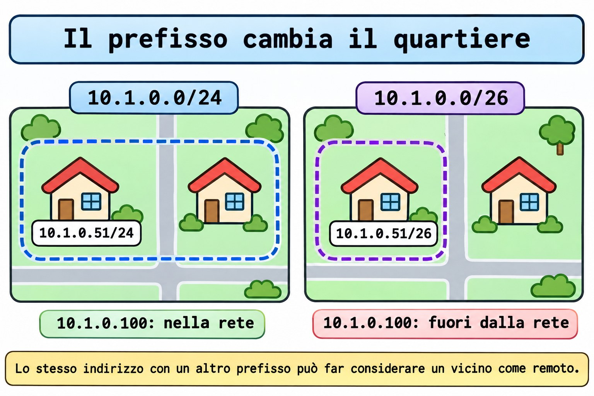

# Lezione 11.1 · TCP/IP per chi amministra

In Windows Server, separi indirizzo, maschera, gateway e porta prima di dare la colpa al servizio. In Linux il ragionamento non cambia. Nella Lezione 2.4 hai usato gli strumenti di rete; ora spieghi cosa mostrano. Leggerai IPv4 e IPv6, calcolerai un prefisso e distinguerai ICMP, TCP e UDP con test sulle due VM. La configurazione persistente è per le Lezioni 11.2 e 11.3.

> **Il cuore di questa lezione:** un indirizzo identifica un'interfaccia; un prefisso descrive una rete; la tabella di routing sceglie il percorso; protocollo e porta identificano il servizio. Un `ping` che risponde non conferma un servizio. Il resto è approfondimento.

| Scheda |  |
| --- | --- |
| **Modulo** | M11 · Rete, lezione 1 di 5 |
| **Quando** | Settimana 16 |
| **Alla fine** | Spieghi il percorso scelto per una destinazione e dimostri indirizzo, famiglia, protocollo e porta di un servizio |
| **Prerequisiti** | Lezioni 2.4, 2.5, 3.1 e 10.4; SSH con chiave e `sudo` sulle due VM |
| **Durata** | Circa 90 minuti, più 30 minuti per ripetere senza consultare |
| **Snapshot** | `m11a1-inicio` e `m11a1-fim` sulle VM 201 e 202 |

## 1 · Riscaldamento

Rispondi senza consultare. Le soluzioni sono in fondo.

1. Quale comando mostra gli indirizzi delle interfacce senza cambiare la configurazione?
2. Un processo è in ascolto solo su `127.0.0.1`. Un'altra macchina raggiunge quel servizio tramite l'IP della VM?
3. Per scoprire chi ha aperto una porta, basta sapere che il servizio è attivo in `systemd`?

## 2 · Perché conta

Il ticket dice: "Il server risponde al ping, ma l'applicazione non si apre". Una persona cambia il gateway. Un'altra riavvia il servizio. La terza apre porte a caso. Tu parti da quattro dati: destinazione, famiglia di indirizzi, protocollo e porta.

| Evidenza | Cosa permette di affermare | Cosa manca ancora |
| --- | --- | --- |
| `ping` riceve risposte | C'è stata una risposta ICMP da quella destinazione | L'applicazione può essere ancora ferma |
| `ss` mostra un socket TCP in `LISTEN` | Esiste un servizio locale su quell'indirizzo e quella porta | Il percorso remoto e l'applicazione possono fallire |
| Una connessione TCP completa | L'handshake TCP ha funzionato in questo test | Autenticazione e operazione dell'applicazione possono ancora fallire |
| L'applicazione risponde alla richiesta prevista | L'operazione testata ha funzionato | Altre operazioni possono dare un altro risultato |

L'obiettivo è ridurre il dubbio con un test alla volta. Non cambiare una configurazione che l'evidenza non ha ancora indicato.

## 3 · Modello mentale

Pensa alla consegna di un pacco a un palazzo. L'indirizzo IP indica dove consegnare. La rotta sceglie l'uscita. La porta identifica lo sportello del servizio. Il protocollo definisce come avviene la conversazione. Il prefisso aiuta a descrivere quali indirizzi appartengono alla stessa rete.

```text
aplicação → protocolo + porta → IP de destino → consulta às rotas
                                                   |
                           saída direta ou próximo roteador

destino local: outro processo na própria máquina
destino no enlace: entrega ao vizinho
destino por gateway: entrega ao próximo roteador
```

La metafora finisce qui: una porta TCP è un numero di servizio, non una porta fisica della scheda. In Ethernet, la consegna al salto successivo usa un frame e un indirizzo MAC. IPv4 di norma scopre il MAC del vicino con ARP; IPv6 usa Neighbor Discovery. Non devi imparare a memoria questi pacchetti oggi. Devi separare il salto successivo dalla destinazione finale.



*L'IP indica la destinazione; la rotta sceglie l'uscita; protocollo e porta indicano il servizio.*

### Ponte Windows

| Windows Server | Linux | Cosa confrontare |
| --- | --- | --- |
| `Get-NetIPAddress` | `ip -br address` | Indirizzo e prefisso per interfaccia |
| `Get-NetRoute` | `ip route` e `ip -6 route` | Rotte IPv4 e IPv6, separatamente |
| `Get-NetTCPConnection` | `ss -tn` e `ss -ltn` | Connessioni e servizi in ascolto TCP |
| `Get-NetUDPEndpoint` | `ss -uan` | Socket UDP; non c'è l'handshake del TCP |
| `Test-NetConnection -Port` | Client del protocollo, come `curl` per HTTP | Connettersi alla porta è diverso dal completare l'operazione |
| `ping -4` e `ping -6` | `ping -4` e `ping -6` | Scegliere la famiglia in modo esplicito |

## 4 · L'essenziale

### IPv4: indirizzo e prefisso sono due informazioni

Un IPv4 ha 32 bit. Il `/24` indica quanti bit formano il prefisso. Nell'esempio **didattico** `10.1.0.51/24`, i primi 24 bit identificano `10.1.0.0/24`. Equivale alla maschera `255.255.255.0`. L'indirizzo resta `10.1.0.51`.

| Esempio | Rete | Intervallo della sottorete |
| --- | --- | --- |
| `10.1.0.51/24` | `10.1.0.0/24` | `10.1.0.0` a `10.1.0.255` |
| `10.1.0.51/26` | `10.1.0.0/26` | `10.1.0.0` a `10.1.0.63` |
| `10.1.0.100/26` | `10.1.0.64/26` | `10.1.0.64` a `10.1.0.127` |

Nel `/26` tradizionale, `.0` è la rete e `.63` è il broadcast della prima sottorete. Restano 62 indirizzi host usuali. Il calcolo è diverso per `/31` e `/32`, usati in situazioni specifiche. Le VM usano `.51` e `.52`, ma il prefisso reale va letto su di esse. Non dare per scontato `/24` solo dall'indirizzo.



*Lo stesso indirizzo con un altro prefisso può far considerare un vicino come remoto.*

### La rotta sceglie il salto successivo

Nel routing comune di questo lab, il kernel confronta la destinazione con la tabella e preferisce la rotta con il prefisso più specifico. Le rotte con lo stesso prefisso si distinguono per preferenza e metrica. L'indirizzo con prefisso crea di norma una rotta connessa. Una rotta più specifica cambia il salto successivo scelto. Per questo, calcola la sottorete e poi controlla la decisione reale con `ip route get`.

```bash
ip -4 route
ip -6 route
ip -4 route get 192.0.2.1
```

L'ultimo comando interroga la decisione locale; non invia un pacchetto alla destinazione. Leggi `dev` come interfaccia di uscita e `src` come origine scelta. Quando c'è `via`, indica il router successivo. Senza una rotta applicabile, l'interrogazione segnala che non c'è percorso. `192.0.2.1` è solo una destinazione di documentazione per questa interrogazione. Non configurarla sulla scheda.

### Un indirizzo privato non è una politica di accesso

Gli intervalli privati IPv4 sono `10.0.0.0/8`, `172.16.0.0/12` e `192.168.0.0/16`. Non sono indirizzi pubblici globali. Questo non impedisce a un'altra macchina della rete di raggiungere un servizio. Il NAT, quando è usato, traduce gli indirizzi; il firewall decide il traffico secondo regole. Sono compiti diversi.

### IPv6: un altro formato, la stessa necessità di controllare il percorso

IPv6 ha 128 bit e usa gruppi esadecimali. Gli zeri iniziali si possono omettere. Una sequenza di gruppi a zero si può comprimere con `::`, una sola volta nell'indirizzo. `2001:db8:11::51/64` è un esempio di documentazione, non un indirizzo da installare nel lab.

| Indirizzo o prefisso | Significato pratico |
| --- | --- |
| `::1` | Loopback IPv6, la macchina stessa |
| `fe80::/10` | Indirizzi link-local; la portata è il collegamento |
| `fc00::/7` | Intervallo di indirizzi locali univoci, ULA |
| `::` in un bind di server | Indirizzo non specificato, usato per rimanere in ascolto sugli indirizzi locali IPv6 |
| `/64` | Lunghezza di sottorete comune nelle reti IPv6; non è una regola per ogni tipo di collegamento |

Un indirizzo link-local può richiedere l'indicazione dell'interfaccia, come `%enp6s18`, perché lo stesso ambito esiste su collegamenti diversi. Avere un IPv6 link-local non dimostra che esista una rotta IPv6 verso internet. Controlla IPv4 e IPv6 separatamente: un bind su `::` non dimostra un servizio IPv4.

### Porta, protocollo e indirizzo di ascolto

Un numero di porta ha 16 bit. TCP e UDP hanno spazi di porte distinti. `18080/TCP` e `18080/UDP` non sono lo stesso servizio. Il client di solito usa una porta temporanea. Il server di solito mantiene una porta nota. Una connessione TCP si distingue per gli indirizzi e le porte di origine e destinazione, all'interno del protocollo.

| Ascolto | Chi può provare a raggiungerlo |
| --- | --- |
| `127.0.0.1:18080` | Processi della stessa macchina via IPv4 |
| `[::1]:18080` | Processi della stessa macchina via IPv6 |
| `0.0.0.0:18080` | Indirizzi locali IPv4; l'accesso esterno dipende ancora dal percorso e dalle politiche |
| `[::]:18080` | Indirizzi locali IPv6; controlla separatamente il comportamento IPv4 |

`0.0.0.0` è utile per spiegare il bind, ma non è l'indirizzo che dai al client remoto. Nel lab, il servizio resterà sul loopback. Non pubblicherai una porta sulla rete condivisa.

### TCP, UDP e ICMP rispondono a domande diverse

| Protocollo | Cosa offre | Cosa non promette |
| --- | --- | --- |
| TCP | Flusso di byte ordinato, con handshake e meccanismi di ritrasmissione | Che l'applicazione abbia completato l'operazione; cifratura automatica |
| UDP | Datagrammi, senza handshake obbligatorio né garanzia propria di consegna o ordine | Che un invio accettato dal sistema sia arrivato al server |
| ICMP e ICMPv6 | Controllo, messaggi di errore e test come Echo | Che una porta TCP o UDP sia in ascolto |

L'handshake TCP inizia con `SYN`, `SYN-ACK` e `ACK` nel caso usuale. Un riscontro TCP non conferma che l'applicazione abbia scritto un file o accettato un login. UDP non significa applicazione senza affidabilità: l'applicazione può implementare conferme e ritrasmissioni. ICMP non usa porte TCP/UDP. Bloccare tutto ICMPv6 può anche rompere funzioni di base di IPv6.


*Ping, connessione TCP e risposta dell'applicazione sono evidenze diverse.*

### Rocky × Debian

| Voce | Rocky 9, VM 201 | Debian 13, VM 202 |
| --- | --- | --- |
| Accesso del corso | `ssh rocky-lab`, IP `10.1.0.51` | `ssh debian-lab`, IP `10.1.0.52` |
| Pacchetto di `ip` e `ss` | `iproute` | `iproute2` |
| Pacchetto di `ping` | `iputils` | `iputils-ping` |
| Strumenti del test locale | `python3` e `curl` | `python3` e `curl` |
| Gestione persistente | NetworkManager, Lezione 11.2 | Controlla il gestore installato; Lezione 11.3 |
| Nome della scheda | Controlla con `ip -br link`; di solito è `enp6s18` | Controlla allo stesso modo; non copiare il nome alla cieca |
| `ip` e `ss` in questo lab | Stessa sintassi | Stessa sintassi |

## 5 · Lab guidato

Fai l'intera sequenza prima su `rocky-lab` e poi su `debian-lab`, come `student`. Apri tre sessioni per la VM in test: A per il server TCP, B per i client e C per il server UDP. Non mischiare la finestra A di una VM con la B dell'altra: il loopback punta sempre alla macchina in cui ti trovi.

**Prima di qualsiasi futura modifica dell'IP:** usa la console noVNC di Proxmox o un piano di ritorno testato. Cambiare l'indirizzo usato da SSH può far cadere la sessione. Oggi leggi solo la scheda reale e crei servizi locali temporanei. Non modificare firewall, SELinux, gateway o DHCP. Non creare un server DHCP su `vmbr0`.

**Passo 0 · Salvare il punto di ritorno.** Nella console del nodo Proxmox che ospita ogni VM:

**Ipotesi:** questi comandi salvano anche la memoria della VM accesa, o solo dischi e configurazione?

```bash
qm snapshot 201 m11a1-inicio
qm snapshot 202 m11a1-inicio
qm listsnapshot 201
qm listsnapshot 202
```

**Output atteso:** la creazione termina senza errori e l'elenco contiene `m11a1-inicio`. Senza `--vmstate`, questi comandi non salvano la memoria della VM accesa.

**Verifica:** se uno qualsiasi degli snapshot fallisce, fermati e risolvi prima del lab. Non lanciare `qm` dentro le VM.

**Passo 1 · Preparare gli strumenti.** Entra con la chiave usando `ssh rocky-lab` o `ssh debian-lab`.

**Ipotesi:** cambiare il nome del pacchetto tra le distro cambia anche la funzione di `ip` e `ss`?

```bash
# Rocky 9 only
sudo dnf install -y iproute iputils python3 curl
# Debian 13 only
sudo apt update
sudo apt install -y iproute2 iputils-ping python3 curl
```

**Output atteso:** installazione completata o pacchetti già presenti. Esegui solo le righe della tua distro.

**Verifica:** `command -v ip ss ping python3 curl` deve trovare i cinque programmi; `id -un` deve mostrare `student`. Queste installazioni richiedono repository raggiungibili. Se falliscono, annota il messaggio e non andare avanti senza gli strumenti.

**Passo 2 · Fare l'inventario di indirizzo e rotta.** Nella finestra B:

**Ipotesi:** qual è l'indirizzo della VM, il suo prefisso e l'interfaccia di uscita?

```bash
hostname
ip -br link
ip -br address
ip -4 route
ip -6 route
ip -4 route get 192.0.2.1
```

**Output atteso:** il tuo hostname, le interfacce e le rotte reali. L'ultima interrogazione mostra una rotta applicabile oppure segnala che non c'è percorso.

**Verifica:** annota indirizzo, prefisso, interfaccia, salto successivo e origine scelta, senza riempire dati per supposizione. Su Rocky, consulta anche `ip -4 route get 10.1.0.52`; su Debian, `ip -4 route get 10.1.0.51`. Confronta l'uscita diretta con un'uscita che usa `via`, se esiste.

**Passo 3 · Calcolare senza cambiare la scheda.** Sempre nella finestra B:

**Ipotesi:** `10.1.0.52` appartiene alla rete di `10.1.0.51/26`? E `10.1.0.100`?

```bash
python3 - <<'PY'
import ipaddress
net = ipaddress.ip_network('10.1.0.51/26', strict=False)
print(net, net.netmask, net.broadcast_address)
for value in ('10.1.0.52', '10.1.0.100'):
    print(value, ipaddress.ip_address(value) in net)
PY
```

**Output atteso:** `10.1.0.0/26 255.255.255.192 10.1.0.63`, poi `.52` con `True` e `.100` con `False`.

**Verifica:** fai il conto a blocchi di 64 indirizzi e confronta. Questo programma calcola esempi; non configura nessun indirizzo.

**Passo 4 · Separare loopback e ICMP.** Nella finestra B:

**Ipotesi:** il test ha bisogno della scheda virtuale, del gateway o di internet?

```bash
ip -4 address show dev lo
ip -6 address show dev lo
ping -4 -c 2 -W 2 127.0.0.1
ping -6 -c 2 -W 2 ::1
```

**Output atteso:** gli indirizzi di loopback e risposte locali. Tempi e identificatori variano; non confrontare i numeri con una cattura già pronta.

**Verifica:** spiega perché questo non dimostra l'uscita della VM. Se `::1` non esiste o IPv6 non è disponibile, annota questa condizione e salta il Passo 7 e il Guasto 2; non cambiare `sysctl` per nascondere la differenza.

**Passo 5 · Aprire un servizio TCP ristretto.** Nella finestra B, controlla prima le porte usate dal lab e dai guasti:

**Ipotesi:** un servizio legato a `127.0.0.1` apparirà su `0.0.0.0`?

```bash
ss -ltn 'sport = :18080'
ss -ltn 'sport = :18082'
ss -lun 'sport = :18080'
ss -lun 'sport = :18081'
mkdir -m 0700 "$HOME/m11a1" && printf 'TCP ok\n' > "$HOME/m11a1/index.html"
```

**Output atteso:** solo l'intestazione dei filtri, cartella creata e file scritto. Se compare una riga di socket o la cartella esiste già, fermati e indaga prima di usare queste risorse.

**Verifica:** `cat "$HOME/m11a1/index.html"` mostra `TCP ok`. Nella finestra A della stessa VM, lascia in primo piano il comando qui sotto:

```bash
python3 -m http.server 18080 --bind 127.0.0.1 --directory "$HOME/m11a1"
```

**Output atteso:** qualcosa come `Serving HTTP on 127.0.0.1 port 18080`. Se compare `Address already in use`, non uccidere il processo sconosciuto.

**Verifica:** nella B, `ss -ltnp 'sport = :18080'` deve mostrare `LISTEN` su `127.0.0.1:18080` e il processo, quando visibile. La finestra A resta occupata dal server; non digitarci il client.

**Passo 6 · Chiedere e ricevere tramite l'applicazione.** Nella finestra B:

**Ipotesi:** quale protocollo, indirizzo e porta userà il client? Quale testo deve ricevere?

```bash
curl --noproxy '*' --connect-timeout 2 --max-time 4 -fsS http://127.0.0.1:18080/
echo $?
ss -tn state established
```

**Output atteso:** `TCP ok` e codice `0`. La connessione HTTP può essere già terminata quando lanci `ss`; non è necessario che compaia in `ESTAB`.

**Verifica:** la finestra A registra la richiesta. `--noproxy '*'` evita che un proxy dell'ambiente dirotti questo test locale. Hai dimostrato una risposta HTTP, oltre al servizio TCP.

**Passo 7 · Ripetere con IPv6.** Solo se `::1` ha funzionato. Nella finestra A, premi `Ctrl+C` per terminare il server IPv4.

**Ipotesi:** cambiare l'indirizzo del bind modifica il prefisso o il gateway della scheda reale?

```bash
python3 -m http.server 18080 --bind ::1 --directory "$HOME/m11a1"
```

**Output atteso:** il server è in ascolto su `::1`. Nella finestra B:

```bash
ss -6 -ltn 'sport = :18080'
curl --noproxy '*' --connect-timeout 2 --max-time 4 -gfsS 'http://[::1]:18080/'
```

**Verifica:** il socket IPv6 e il testo `TCP ok`. Le parentesi quadre separano l'indirizzo IPv6 dalla porta nell'URL. Poi, nella A, termina con `Ctrl+C` e rilancia il comando del Passo 5, con `--bind 127.0.0.1`; conferma il bind nella B prima di continuare.

**Passo 8 · Fare una vera domanda UDP.** Nella finestra B, crea un piccolo risponditore da laboratorio:

**Ipotesi:** un invio UDP riuscito basta per affermare che c'è stata una risposta?

```bash
cat > "$HOME/m11a1/udp_echo.py" <<'PY'
import socket
with socket.socket(socket.AF_INET, socket.SOCK_DGRAM) as server:
    server.bind(('127.0.0.1', 18081))
    print('UDP ready', flush=True)
    while True:
        data, peer = server.recvfrom(1024)
        if data == b'PING':
            server.sendto(b'PONG', peer)
PY
```

**Output atteso:** nessun messaggio alla scrittura del file. Nella finestra C, esegui `python3 "$HOME/m11a1/udp_echo.py"`; deve comparire `UDP ready`. Lascia questo processo in primo piano.

**Verifica:** nella B, `ss -lunp 'sport = :18081'` mostra il socket UDP locale, di solito in `UNCONN`, senza il `LISTEN` del TCP. Poi lancia:

```bash
python3 - <<'PY'
import socket
with socket.socket(socket.AF_INET, socket.SOCK_DGRAM) as client:
    client.settimeout(2)
    client.sendto(b'PING', ('127.0.0.1', 18081))
    print(client.recvfrom(1024)[0].decode())
PY
```

**Output atteso:** `PONG`.

**Verifica:** hai aspettato una risposta dell'applicazione; il programma non ha dichiarato successo solo per aver inviato. Il codice serve solo come strumento locale; la lezione non richiede di imparare Python.

### Decidi 1

Il ping risponde, ma l'applicazione non si apre. Quale test successivo porta un'evidenza utile?

A) Cambiare il gateway. B) Controllare indirizzo, protocollo e porta con `ss` e un client dell'applicazione. C) Spegnere il firewall.

| Se hai scelto | Risultato | Perché |
| --- | --- | --- |
| A | Senza giustificazione | Il ping non ha indicato un errore nel gateway |
| B | Giusto | Controlli il servizio e testi l'operazione |
| C | Pericoloso | Cambi la politica prima di individuare il guasto |

### Decidi 2

Il servizio è su `127.0.0.1:18080`. Vuoi accedervi da un'altra macchina. Cosa spiega il fallimento iniziale?

A) Il bind è locale alla VM stessa. B) Manca l'autorizzazione per ICMP. C) Ogni porta sopra `1024` funziona solo in locale.

| Se hai scelto | Risultato | Perché |
| --- | --- | --- |
| A | Giusto | Il loopback non pubblica il servizio sulla scheda della VM |
| B | Sbagliato | Una risposta ICMP non cambia l'indirizzo di ascolto TCP |
| C | Sbagliato | La restrizione di questo test viene dal bind, non da questo intervallo di porte |

## 6 · Rompi e ripara

Fai i tre guasti su entrambe le VM. Tieni A in ascolto su `127.0.0.1:18080` via TCP e C su `127.0.0.1:18081` via UDP. Ogni errore qui sotto è nella richiesta del client, senza far cadere la tua connessione SSH.

### Guasto 1 · Il numero della porta è sbagliato

**Ipotesi:** il ping cambierà quando sbagli la porta dell'HTTP?

```bash
ping -4 -c 1 -W 2 127.0.0.1
curl --noproxy '*' --connect-timeout 2 --max-time 4 -fsS http://127.0.0.1:18082/
echo $?
ss -ltn 'sport = :18080'
ss -ltn 'sport = :18082'
```

**Sintomo:** il ping risponde, ma la richiesta HTTP alla porta `18082` fallisce con codice `7`. Il messaggio di `curl` indica che non è riuscito a connettersi.

**Indagine:** confronta le due interrogazioni di `ss`: c'è un servizio su `18080` e nessuno su `18082`.

**Causa:** il client ha chiesto la porta sbagliata. L'ICMP del ping non verifica le porte TCP.

**Riparazione:** ripeti il `curl` del Passo 6, con `18080`.

**Verifica:** `TCP ok` e codice `0`.

**Prevenzione:** annota destinazione, protocollo e porta insieme alla configurazione dell'applicazione. Non accettare "il server risponde" come diagnosi completa.

### Guasto 2 · La famiglia è sbagliata

**Ipotesi:** la presenza di `::1` obbliga un server legato a `127.0.0.1` a rispondere in IPv6?

```bash
curl --noproxy '*' --connect-timeout 2 --max-time 4 -gfsS 'http://[::1]:18080/'
ss -4 -ltn 'sport = :18080'
ss -6 -ltn 'sport = :18080'
```

**Sintomo:** la richiesta IPv6 fallisce. Esegui questo guasto con il server ripristinato su IPv4 dopo il Passo 7.

**Indagine:** l'interrogazione `ss -4` mostra il servizio; l'interrogazione `ss -6` non ne mostra nessuno.

**Causa:** il client ha chiesto `::1`, ma il processo è in ascolto su `127.0.0.1`. Sono famiglie diverse.

**Riparazione:** usa l'URL IPv4 del Passo 6.

**Verifica:** la risposta torna senza modificare rotta o firewall.

**Prevenzione:** testa IPv4 e IPv6 separatamente quando entrambi fanno parte del requisito. Se IPv6 non era disponibile nel Passo 4, annota questa condizione invece di eseguire questo guasto.

### Guasto 3 · Il numero coincide, il protocollo no

**Ipotesi:** il server HTTP risponde a un datagramma UDP solo perché la porta è `18080`?

```bash
python3 - <<'PY'
import socket
with socket.socket(socket.AF_INET, socket.SOCK_DGRAM) as client:
    client.settimeout(2)
    client.connect(('127.0.0.1', 18080))
    client.send(b'PING')
    try:
        print(client.recv(1024).decode())
    except OSError as error:
        print(type(error).__name__)
PY
ss -ltn 'sport = :18080'
ss -lun 'sport = :18080'
ss -lun 'sport = :18081'
```

**Sintomo:** il client stampa `ConnectionRefusedError`. Senza un ascoltatore UDP su `127.0.0.1:18080`, il kernel restituisce un ICMP di porta irraggiungibile; non c'è `PONG`.

**Indagine:** `ss` mostra TCP su `18080`, nessun UDP su `18080` e UDP su `18081`.

**Causa:** il client ha inviato un datagramma al numero usato da HTTP/TCP. Il `connect` del socket UDP definisce solo la destinazione; non fa l'handshake del TCP.

**Riparazione:** ripeti il client UDP del Passo 8, diretto a `18081`.

**Verifica:** `PONG` dimostra la risposta del risponditore.

**Prevenzione:** scrivi `18080/TCP` o `18081/UDP`, mai soltanto "porta aperta".


*Una porta TCP non risponde a una richiesta UDP solo perché il numero coincide.*

### Pulizia

**Ipotesi:** terminare i due processi cancella gli indirizzi della scheda della VM?

Nella finestra A e nella C, premi `Ctrl+C`. Non usare un `kill` per nome che potrebbe terminare un altro servizio. Nella finestra B, controlla e cancella solo i file che questa lezione ha creato:

```bash
ss -ltn 'sport = :18080'
ss -lun 'sport = :18081'
rm -- "$HOME/m11a1/index.html" "$HOME/m11a1/udp_echo.py"
rmdir -- "$HOME/m11a1"
ip -br address
```

**Output atteso:** nessun servizio in ascolto sulle porte del lab; file e cartella rimossi.

**Verifica:** gli indirizzi reali restano uguali all'inventario. Se `rmdir` rifiuta perché c'è un altro file, ispeziona la cartella; non cancellare in modo ricorsivo.

## 7 · Trappole

| Errore comune | Cosa fare | Perché |
| --- | --- | --- |
| Chiamare `/24` parte dell'indirizzo dell'host | Separare indirizzo e prefisso | Il prefisso descrive la rete |
| Dedurre il prefisso dai primi tre numeri | Leggere la configurazione reale | La sottorete può essere `/26`, `/23` o altro |
| Usare il ping come test dell'applicazione | Fare una richiesta del protocollo previsto | ICMP non verifica una porta TCP/UDP |
| Chiamare `UNCONN` un fallimento in UDP | Leggere protocollo e bind | Non esiste l'handshake obbligatorio del TCP |
| Dichiarare la porta libera senza guardare | Consultare `ss` prima del bind | Un altro processo può esserne il proprietario |
| Testare IPv6 e controllare solo IPv4 | Usare `ss -4` e `ss -6` | Potresti guardare un altro servizio |
| Usare `http.server` per pubblicare dati | Tenere solo la directory di test e il bind locale | È uno strumento semplice da laboratorio, non un server di produzione |
| Cambiare l'IP dalla sessione SSH senza via di ritorno | Usare noVNC o un piano testato | La sessione dipende dall'indirizzo e dal percorso che stai modificando |

## 8 · Quiz

Rispondi senza aprire il promemoria. Giustifica ogni risposta con un'evidenza.

1. Qual è la rete di `10.1.0.100/26`? `10.1.0.51` ne fa parte?
2. Cosa mostra `ip route get`? Invia un pacchetto alla destinazione?
3. Perché `ping 127.0.0.1` può funzionare con la scheda virtuale scollegata?
4. Cosa cambia tra `127.0.0.1:18080` e `[::1]:18080`?
5. Un `sendto` UDP è terminato senza errori. Puoi affermare che l'applicazione ha risposto?
6. L'HTTP ha risposto `TCP ok`. Cosa ha dimostrato questo test oltre all'esistenza di un socket in `LISTEN`?

## 9 · Promemoria

| Compito | Comando |
| --- | --- |
| Riassumere gli indirizzi | `ip -br address` |
| Vedere le rotte IPv4 | `ip -4 route` |
| Vedere le rotte IPv6 | `ip -6 route` |
| Interrogare il percorso, senza trasmettere | `ip -4 route get 192.0.2.1` |
| Vedere i servizi TCP in ascolto, in forma numerica | `ss -ltn` |
| Vedere i socket UDP locali | `ss -lun` |
| Filtrare una porta TCP | `ss -ltnp 'sport = :18080'` |
| Separare le famiglie | `ss -4 -ltn` e `ss -6 -ltn` |
| Vedere le connessioni TCP | `ss -tn state established` |
| Testare ICMP locale | `ping -4 -c 2 127.0.0.1` e `ping -6 -c 2 ::1` |
| Vedere i dettagli dell'interfaccia reale | `ip address show dev enp6s18`, se è il nome osservato |

**Flashcard:** indirizzo → *destinazione*; prefisso → *rete*; rotta → *percorso*; porta e protocollo → *servizio*; loopback → *questa macchina*; ping → *ICMP, non applicazione*. Ripassa a D+1, D+3, D+7 e D+21. Rifai un guasto senza consultare e spiega quale ipotesi elimina ogni comando.

## 10 · Checklist e chiusura

- [ ] Leggo indirizzo e prefisso senza confondere le due informazioni
- [ ] Calcolo gli esempi `/24` e `/26` e controllo con il calcolo locale
- [ ] Distinguo destinazione finale, salto successivo e interfaccia di uscita
- [ ] Riconosco `127.0.0.1`, `::1` e link-local IPv6
- [ ] Controllo famiglia, indirizzo, protocollo e porta prima di cambiare una configurazione
- [ ] Distinguo `LISTEN`, invio UDP e risposta dell'applicazione
- [ ] Ho fatto i tre guasti su entrambe le distro, oppure ho annotato l'indisponibilità di IPv6
- [ ] Ho terminato i due server temporanei e rimosso i file del lab

**Ultimo esercizio:** senza consultare, spiega perché il ping del Guasto 1 ha risposto, l'HTTP è fallito e l'UDP del Guasto 3 non ha ricevuto `PONG`. Annota un test che distinguerebbe ogni causa.

**Reboot di verifica:** la pulizia deve già essere terminata. Su ogni VM, lancia `sudo systemctl reboot`; la sessione SSH cadrà. Segui da noVNC, riconnettiti con l'alias e controlla `ip -br address`, `ss -ltn 'sport = :18080'` e `ss -lun 'sport = :18081'`. Nessun servizio dell'esercizio deve tornare da solo.

**Snapshot di fine**, sul nodo Proxmox di ogni VM, dopo aver controllato il ritorno:

```bash
qm snapshot 201 m11a1-fim
qm snapshot 202 m11a1-fim
```

Nella Lezione 11.2 passi dalla lettura alla configurazione persistente con NetworkManager. La Sfida dell'M11 è nell'ultima lezione del modulo.

## 11 · Nella vita reale

**Missione, sola lettura.** Su un server che amministri o che hai l'autorizzazione di osservare, lancia solo i comandi qui sotto. Non aprire server di test, non installare pacchetti e non cambiare la configurazione in questa missione.

```bash
ip -br link
ip -br address
ip -4 route
ip -6 route
ss -ltn
ss -lun
```

1. Quali indirizzi e prefissi esistono sull'interfaccia di servizio?
2. Quali servizi sono limitati al loopback e quali usano altri indirizzi locali?
3. Esiste una rotta predefinita IPv4? E IPv6? Cosa permette di concludere l'assenza di una delle due?
4. Scegli un servizio noto e annota famiglia, indirizzo, protocollo e porta. Hai un'evidenza del funzionamento dell'applicazione, o solo del socket?

Non copiare output con indirizzi e nomi interni su un servizio esterno. Annota solo il necessario nel diario autorizzato.

## 12 · Approfondire quando vuoi

- [`man ip-address`](https://manpages.debian.org/trixie/iproute2/ip-address.8.en.html): indirizzi, prefissi e ambiti.
- [`man ip-route`](https://manpages.debian.org/trixie/iproute2/ip-route.8.en.html): rotte e interrogazione con `get`.
- [`man ss`](https://manpages.debian.org/trixie/iproute2/ss.8.en.html): filtri, famiglie e stati dei socket.
- [`man ping`](https://manpages.debian.org/trixie/iputils-ping/ping.8.en.html): ICMP e scelta di IPv4 o IPv6.
- [`man udp`](https://man7.org/linux/man-pages/man7/udp.7.html): datagrammi, destinazione del socket e rifiuto quando non c'è un ascoltatore.
- [Documentazione di `http.server`](https://docs.python.org/3.9/library/http.server.html): opzioni `--bind` e `--directory`; uso limitato al lab.
- [Manuale di `curl`](https://curl.se/docs/manpage.html): `--noproxy`, limiti di tempo e URL IPv6.

**DeepTutor** (http://10.1.0.149:3782, KB "Curso Linux Sysadmin"):

- `!explica endereço, prefixo, rota, protocolo e porta com a metáfora da entrega ao prédio`
- `!feynman respondi ao ping, mas o HTTP falhou: critique minha explicação separando ICMP, TCP e aplicação`
- `!quiz Aula 11.1, 6 perguntas sobre IPv4, IPv6, prefixos, TCP, UDP e ICMP, uma por vez`

## Soluzioni commentate

### Riscaldamento

1. `ip -br address`. Riassume la configurazione; non cambia gli indirizzi. Leggi anche il prefisso, non solo l'IP.
2. Non con quel bind. `127.0.0.1` è loopback; un'altra macchina ha bisogno di un servizio su un indirizzo raggiungibile e di un percorso consentito.
3. No. Lo stato dell'unit da solo non informa sul bind. Consulta `ss` e associa indirizzo, protocollo, porta e processo quando disponibile.

### Quiz

1. `10.1.0.64/26`. L'intervallo finisce a `.127`; `.51` è nella sottorete precedente. Questo è un calcolo di sottorete, non una lettura delle rotte installate.
2. Mostra la decisione di routing locale per la destinazione, considerando i parametri forniti. L'interrogazione non trasmette un pacchetto per testare il percorso.
3. La destinazione è sulla macchina stessa. Il test usa il loopback, senza bisogno di uscire dalla scheda o passare dal gateway.
4. La famiglia e l'indirizzo di destinazione: IPv4 in un caso, IPv6 nell'altro. Lo stesso numero di porta non crea automaticamente un servizio in entrambe le famiglie.
5. No. Il sistema ha accettato l'invio; questo non conferma consegna, elaborazione né risposta. Nel lab, solo la ricezione di `PONG` ha dimostrato la risposta del risponditore.
6. C'è stata una connessione TCP e un'operazione HTTP che ha restituito il contenuto previsto su quell'indirizzo e quella porta. Questo non dimostra accesso remoto, autenticazione di un altro servizio o funzionamento generale della rete.

<!-- navegacao -->
[← Lezione 10.4 · sudo sul serio](10.4-sudo-de-verdade.md) · [Indice delle lezioni](../01-aulas.md) · [Lezione 11.2 · NetworkManager e nmcli →](11.2-networkmanager-e-nmcli.md)
