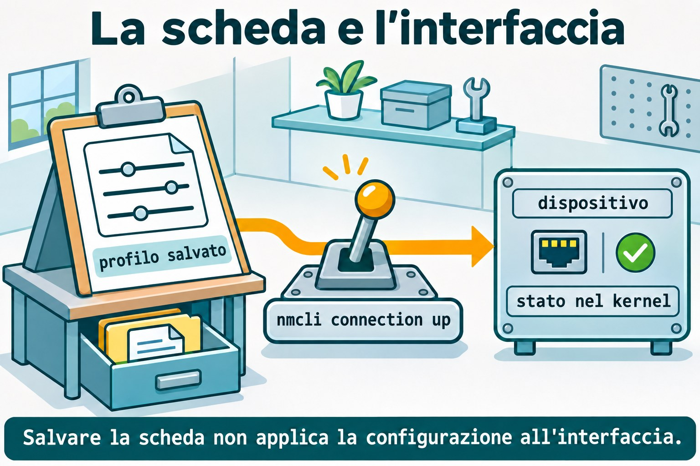
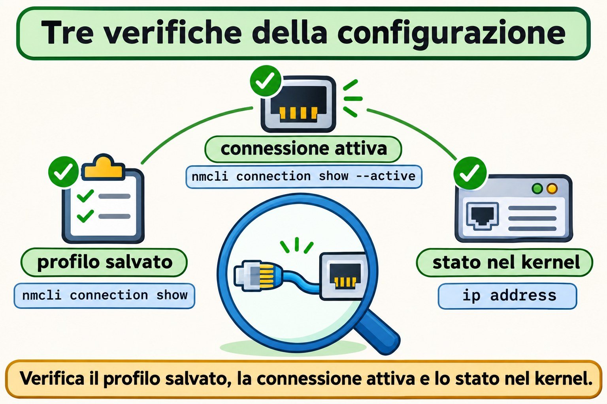

# Lezione 11.2 · NetworkManager e nmcli

Su Windows Server distingui la scheda dalla configurazione che le viene applicata. Su Linux con NetworkManager, questa distinzione si presenta come dispositivo e profilo di connessione. Nella Lezione 11.1 hai letto indirizzi, prefissi e rotte; ora salverai una configurazione, la attiverai e verificherai cosa rimane dopo il reboot. Svolgerai lo stesso esercizio su Rocky e Debian, senza migrare l'interfaccia usata da SSH.

> **Il cuore di questa lezione:** il dispositivo è l'interfaccia; il profilo è la configurazione salvata; attivarlo applica il profilo al dispositivo. Salvare, caricare e applicare sono operazioni diverse. Il resto è approfondimento.

| Scheda |  |
| --- | --- |
| **Modulo** | M11 · Rete, lezione 2 di 5 |
| **Quando** | Settimana 16 |
| **Alla fine** | Crei un profilo persistente, configuri IPv4 e IPv6, distingui il DNS salvato da quello in uso e riconosci un keyfile |
| **Prerequisiti** | Lezione 11.1; accesso SSH, `sudo` e console noVNC delle VM 201 e 202 |
| **Durata** | Circa 90 minuti, più 30 minuti per ripetere senza consultare |
| **Snapshot** | `m11a2-inicio` e `m11a2-fim` su entrambe le VM |

## 1 · Riscaldamento

Rispondi prima di aprire il terminale. Controlla le soluzioni alla fine.

1. Cosa indica `/26` in un indirizzo IPv4?
2. `ip route get` verifica la consegna di un pacchetto o consulta una decisione locale?
3. Un servizio su `127.0.0.1` diventa disponibile alle altre macchine solo perché la VM ha un IP sulla rete?

## 2 · Perché conta

Ti viene affidato un server che ieri funzionava. Qualcuno ha aggiunto un indirizzo con `ip address add`; dopo il reboot, è scomparso. Un'altra persona ha modificato un file di connessione e si aspettava che l'interfaccia cambiasse immediatamente. In entrambi i casi, mancava la distinzione tra stato attuale e configurazione persistente.

| Cosa osservi | Dove controllare | Cosa dimostra |
| --- | --- | --- |
| Indirizzo attuale | `ip address` | Cosa usa il kernel adesso |
| Profilo salvato | `nmcli connection show` | La configurazione nota a NetworkManager |
| Profilo attivo | `nmcli connection show --active` | Quale configurazione è applicata |
| File persistente | Keyfile su disco | Cosa potrà caricare di nuovo il servizio |

Il tuo lavoro termina quando la configurazione attesa è in uso e torna dopo il reboot. La sola presenza di un file non conclude questa verifica.

## 3 · Modello mentale

Pensa a una stanza con una scheda di installazione. La stanza è il dispositivo. La scheda indica quale indirizzo, quali rotte e quali server DNS usare. Conservare una scheda nell'archivio non cambia la stanza; qualcuno deve eseguire l'installazione descritta.

```text
keyfile su disco → profilo caricato → attivazione → dispositivo → stato nel kernel
      salvare         caricare          applicare               verificare con ip
```

Puoi conservare più profili per un'interfaccia. Nell'esercizio ci sarà un profilo attivo e un altro usato soltanto per pianificare. Il nome del profilo ti aiuta a riconoscerlo; l'UUID identifica quella configurazione indipendentemente dal nome.



*Salvare la scheda non applica la configurazione all'interfaccia.*

### Ponte Windows

| Windows Server | NetworkManager | Concetto che riutilizzi |
| --- | --- | --- |
| Scheda di rete | Dispositivo in `nmcli device` | L'interfaccia che riceve la configurazione |
| Configurazione IP della scheda | Profilo in `nmcli connection` | Indirizzo, rotte e DNS come insieme |
| Consultare l'IP attuale | `ip -br address` | Controllare lo stato effettivo |
| Configurazione persistente | Profilo salvato su disco | Riapplicare dopo il boot |
| Server DNS della scheda | Proprietà `ipv4.dns` e `ipv6.dns` | La risoluzione ha una configurazione propria |

Il profilo di connessione di NetworkManager non è il profilo firewall Pubblico o Privato di Windows. Qui descrive come configurare l'interfaccia.

## 4 · L'essenziale

### Dispositivo e connessione non sono sinonimi

`nmcli device status` elenca le interfacce e lo stato di gestione. `nmcli connection show` elenca i profili. Un profilo può esistere senza essere attivo; un'interfaccia può esistere senza essere gestita da NetworkManager.

```bash
nmcli device status
nmcli connection show
nmcli connection show --active
```

Su Rocky, NetworkManager è il gestore previsto. Su Debian, scopri prima chi amministra l'interfaccia reale. La Lezione 11.3 tratta `ifupdown`, NetworkManager e `systemd-networkd`; installare un altro gestore non significa affidargli la scheda.

### Salvare, caricare e applicare

| Operazione | Comando | Effetto |
| --- | --- | --- |
| Creare un profilo | `nmcli connection add` | Salva una nuova configurazione |
| Modificare un profilo | `nmcli connection modify` | Aggiorna le proprietà salvate |
| Ricaricare i file | `nmcli connection reload` | Rilegge i profili dal disco |
| Caricare un file | `nmcli connection load ARQUIVO` | Legge quel keyfile |
| Attivare un profilo | `nmcli connection up PERFIL` | Applica la configurazione |
| Riapplicare modifiche compatibili | `nmcli device reapply INTERFACE` | Aggiorna la connessione già attiva |

`modify` non equivale a `up`. Dopo aver modificato un profilo attivo, controlla lo stato effettivo; per questo lab, riattiva soltanto il profilo dell'interfaccia interna. Riattivare la scheda di SSH può interrompere il tuo accesso.

### IPv4 statico significa indirizzo con prefisso

`ipv4.method manual` usa gli indirizzi indicati in `ipv4.addresses`. `ipv4.method auto` richiede una configurazione automatica, normalmente tramite DHCP su Ethernet. Non usare mai `shared` in questo esercizio: questa modalità condivide la connettività e non rappresenta un normale client DHCP.

Un profilo interno non richiede un gateway. Configura `ipv4.never-default yes` per evitare che diventi un candidato per la rotta predefinita IPv4. La stessa distinzione esiste per IPv6.

### IPv6 ha una configurazione propria

| Proprietà | Concetto |
| --- | --- |
| `ipv6.method auto` | Configurazione automatica IPv6 |
| `ipv6.method manual` | Indirizzi IPv6 indicati nel profilo |
| `ipv6.addresses` | Indirizzo con prefisso IPv6 |
| `ipv6.gateway` | Prossimo salto predefinito IPv6 |
| `ipv6.never-default yes` | Impedisce una rotta predefinita tramite questo profilo |

Sull'interfaccia interna userai `2001:db8:11::10/64`. Questo prefisso è riservato alla documentazione e rimarrà soltanto nella VM, senza bridge, cavo o annunci verso la rete del corso. Non installarlo sull'interfaccia Ethernet reale.

### DNS salvato non significa query riuscita

`ipv4.dns` e `ipv6.dns` memorizzano gli indirizzi dei server DNS. Con il metodo automatico, `ignore-auto-dns yes` scarta i server ricevuti automaticamente per quella famiglia. Questo non crea un server DNS e non dimostra che risponda.

Il sistema riunisce le informazioni DNS delle connessioni attive secondo la propria configurazione. Per osservare i dati dell'interfaccia, usa `nmcli device show`. L'integrazione con `resolv.conf` sarà approfondita nella Lezione 11.4.

Nel lab salverai il DNS in un profilo inattivo. Non lo attiverai: gli indirizzi di esempio non rispondono alle query e non devono entrare nella risoluzione usata dal sistema.



*Verifica il profilo salvato, la connessione attiva e lo stato nel kernel.*

### Keyfile e permessi

I profili in formato keyfile usano sezioni come `[connection]`, `[ipv4]` e `[ipv6]`. La directory di configurazione persistente è `/etc/NetworkManager/system-connections/`; i file in `/run/NetworkManager/system-connections/` sono temporanei.

Un keyfile può contenere segreti. Usa proprietario `root:root` e modalità `600`. NetworkManager rifiuta i file con accesso non consentito ad altri utenti. Preferisci `nmcli` per le modifiche comuni; dopo aver modificato direttamente un file, caricalo e attiva il profilo quando è il momento di applicarlo.

### Rocky × Debian

| Voce | Rocky 9, VM 201 | Debian 13, VM 202 |
| --- | --- | --- |
| Nome e accesso | `rocky-lab`, `ssh rocky-lab` | `debian-lab`, `ssh debian-lab` |
| IP reale del corso | `10.1.0.51` | `10.1.0.52` |
| Pacchetto | `NetworkManager` | `network-manager` |
| Unità | `NetworkManager.service` | `NetworkManager.service` |
| Interfaccia reale | Normalmente gestita da NetworkManager | Identifica il gestore prima di modificarla |
| Esercizio di questa lezione | Profilo `dummy` interno | Stesso profilo, con preparazione isolata se necessaria |
| Keyfile persistente | `/etc/NetworkManager/system-connections/` | Stessa directory |

## 5 · Lab guidato

Ripeti la sequenza su Rocky e Debian come `student`. Usa una sessione Bash per VM per mantenere le variabili dell'esercizio. I profili iniziano con `m11a2-`; l'unica interfaccia modificata sarà `m11dummy0`, che non è collegata alla rete esterna.

**Prima di modificare qualsiasi configurazione di rete:** apri la console noVNC e verifica di poter accedere come `student` e usare `sudo`. Le modifiche alla scheda usata da SSH richiedono questa console o un piano di ripristino collaudato. Questo lab non modifica l'IP, il gateway o il profilo della scheda reale.

**Passo 0 · Salvare il punto di ripristino.** Sul nodo Proxmox che ospita ogni VM:

**Ipotesi:** uno snapshot sullo stesso storage ti protegge dalla perdita di quello storage?

```bash
qm snapshot 201 m11a2-inicio
qm snapshot 202 m11a2-inicio
qm listsnapshot 201
qm listsnapshot 202
```

**Output atteso:** gli elenchi contengono `m11a2-inicio`.

**Verifica:** controlla entrambe le VM prima di continuare. Lo snapshot è un punto di ripristino del lab, non un sostituto del backup.

**Passo 1 · Registrare la rete e il gestore.** All'interno di ogni VM:

**Ipotesi:** installare `nmcli` dimostra che NetworkManager amministra già la tua scheda?

```bash
test ! -e "$HOME/m11a2" && mkdir -m 0700 "$HOME/m11a2"
ip -br address | tee "$HOME/m11a2/enderecos-inicio.txt"
ip -4 route | tee "$HOME/m11a2/rotas-inicio.txt"
systemctl is-active NetworkManager.service
systemctl is-enabled NetworkManager.service
systemctl is-active networking.service systemd-networkd.service
```

**Output atteso:** la rete reale e lo stato delle unità. Un'unità assente può risultare `not-found`; un servizio inattivo non significa che tutta la rete sia guasta.

**Verifica:** se la cartella esiste già, fermati per non mescolare tentativi diversi. Registra chi gestisce la scheda del corso. Non arrestare quel gestore.

**Passo 2 · Preparare NetworkManager senza affidargli la scheda reale.** Su Rocky il servizio deve essere attivo; controlla `nmcli --version` e passa al Passo 3. Anche su Debian con il servizio già attivo, passa al Passo 3.

**Ipotesi:** due gestori che cercano di configurare la stessa scheda rendono la diagnosi più semplice o più difficile?

Su Debian senza NetworkManager attivo, usa la preparazione seguente soltanto se è assente o disabilitato. Se è mascherato, in errore oppure abilitato ma fermo, indaga su questa condizione prima di continuare.

```bash
if test -e /etc/NetworkManager/conf.d/99-m11a2-isolado.conf; then
  printf 'Existing lab configuration; stop here.\n'
else
sudo install -d -m 0755 /etc/NetworkManager/conf.d
sudo tee /etc/NetworkManager/conf.d/99-m11a2-isolado.conf > /dev/null <<'EOF'
[main]
dns=none
[keyfile]
unmanaged-devices=*,except:interface-name:m11dummy0
EOF
sudo apt update
sudo apt install -y network-manager
sudo systemctl start NetworkManager.service
printf 'debian-isolado\n' > "$HOME/m11a2/preparacao"
fi
```

**Output atteso:** NetworkManager si avvia lasciando fuori dalla propria gestione tutte le interfacce tranne `m11dummy0`; `dns=none` gli impedisce di modificare la risoluzione del sistema in questa preparazione.

**Verifica:** fermati se il controllo iniziale indica che il file esiste già. Controlla `nmcli device status`, `ip -br address` e `ip -4 route`: la scheda reale mantiene la propria configurazione e risulta non gestita da NetworkManager in questa preparazione. Non hai migrato `ifupdown` né `systemd-networkd`.

**Passo 3 · Identificare i due elenchi.** Su entrambe le VM, con NetworkManager attivo:

**Ipotesi:** un profilo senza dispositivo nell'elenco ha smesso di esistere?

```bash
nmcli --version
nmcli device status
nmcli -f NAME,UUID,TYPE,DEVICE connection show
nmcli connection show --active
ip link show m11dummy0
```

**Output atteso:** profili e dispositivi reali; l'ultimo comando indica che `m11dummy0` non esiste ancora.

**Verifica:** controlla che non esista un profilo chiamato `m11a2-interno` o `m11a2-plano`. Se una di queste risorse esiste già, fermati e identifica il tentativo precedente.

**Passo 4 · Creare IPv4 e IPv6 statici sull'interfaccia interna.**

**Ipotesi:** senza gateway nel profilo, i due indirizzi locali smetteranno di esistere?

```bash
sudo nmcli connection add type dummy ifname m11dummy0 \
  con-name m11a2-interno connection.autoconnect no \
  ipv4.method manual ipv4.addresses 192.0.2.10/24 \
  ipv4.never-default yes ipv6.method manual \
  ipv6.addresses 2001:db8:11::10/64 ipv6.never-default yes
nmcli -f connection.id,connection.interface-name,connection.autoconnect,ipv4,ipv6 \
  connection show m11a2-interno
sudo nmcli connection up m11a2-interno
```

**Output atteso:** il profilo viene salvato e attivato; NetworkManager crea l'interfaccia `dummy` con gli indirizzi indicati.

**Verifica:** `ip -br address show dev m11dummy0` mostra IPv4 e IPv6. Se IPv6 è disattivato nel kernel, registra la condizione e sistema il prerequisito del lab prima di proseguire; non modificare la politica della VM per tentativi.

**Passo 5 · Controllare lo stato effettivamente applicato.**

**Ipotesi:** una rotta connessa dell'interfaccia interna sostituisce la rotta predefinita della scheda reale?

```bash
nmcli connection show --active
nmcli -f GENERAL,IP4,IP6 device show m11dummy0
ip -4 route show dev m11dummy0
ip -6 route show dev m11dummy0
ip -4 route show default
ping -4 -c 2 -W 2 192.0.2.10
ping -6 -c 2 -W 2 2001:db8:11::10
```

**Output atteso:** profilo attivo, indirizzi e rotte interne. I ping ricevono risposte dalla VM stessa.

**Verifica:** la rotta predefinita IPv4 continua a passare dall'interfaccia originale. Questi ping confermano indirizzi locali; non dimostrano la comunicazione con un altro computer.

**Passo 6 · Pianificare il DNS senza pubblicare DNS di esempio.**

**Ipotesi:** compilare `ipv4.dns` in un profilo inattivo cambia già le query del sistema?

```bash
sudo nmcli connection clone m11a2-interno m11a2-plano
sudo nmcli connection modify m11a2-plano connection.autoconnect no \
  ipv4.dns 192.0.2.53 ipv4.ignore-auto-dns yes \
  ipv6.dns 2001:db8:11::53 ipv6.ignore-auto-dns yes
nmcli -f connection.id,connection.autoconnect,ipv4.dns,ipv4.ignore-auto-dns,ipv6.dns \
  connection show m11a2-plano
nmcli connection show --active
```

**Output atteso:** DNS di esempio salvato in `m11a2-plano`; su questa interfaccia rimane attivo soltanto `m11a2-interno`.

**Verifica:** non attivare `m11a2-plano`. Il clone ha un altro UUID, ma ha ereditato gli indirizzi e l'interfaccia dell'originale. Una clonazione richiede di controllare le proprietà ereditate prima dell'uso.

**Passo 7 · Leggere il keyfile creato.** Individualo tramite UUID, senza presumere il nome del file:

**Ipotesi:** rinominare il profilo obbliga l'UUID a cambiare?

```bash
PLANO_UUID=$(nmcli -g connection.uuid connection show m11a2-plano)
PLANO_FILE=$(sudo grep -rlF --include='*.nmconnection' "uuid=$PLANO_UUID" /etc/NetworkManager/system-connections/)
printf '%s\n' "$PLANO_FILE"
sudo stat -c '%U:%G %a %n' "$PLANO_FILE"
sudo sed -n '/^\[connection\]/,/^\[/p' "$PLANO_FILE"
```

**Output atteso:** esattamente un percorso, proprietario `root:root` e modalità `600`. Il frammento mostra la sezione di connessione del profilo.

**Verifica:** prima di usare il percorso nei guasti, controlla che sia un unico file del profilo `m11a2-plano` nella directory indicata. Non mostrare i file di altre connessioni: possono contenere segreti.

**Passo 8 · Preparare la persistenza.**

**Ipotesi:** `connection.autoconnect no` impedisce anche un'attivazione manuale?

```bash
sudo nmcli connection modify m11a2-interno connection.autoconnect yes
sudo systemctl enable NetworkManager.service
nmcli -g connection.autoconnect connection show m11a2-interno
nmcli -g connection.autoconnect connection show m11a2-plano
```

**Output atteso:** `yes` per il profilo interno e `no` per quello di pianificazione.

**Verifica:** servizio al boot e autoconnessione del profilo sono due condizioni distinte. Il reboot verrà eseguito dopo i guasti; non hai ancora dimostrato la persistenza.

### Decidi 1

Hai modificato `ipv4.addresses` nel profilo, ma `ip address` mostra ancora l'indirizzo precedente. Cosa fai prima?

A) Riavvii l'intera VM. B) Controlli profilo e dispositivo, poi applichi la modifica all'interfaccia corretta. C) Elimini la rotta predefinita.

| Se hai scelto | Risultato | Perché |
| --- | --- | --- |
| A | Prematuro | Puoi applicare e verificare la modifica localmente |
| B | Corretto | Salvare e applicare sono passaggi diversi |
| C | Non pertinente | L'indirizzo salvato non è stato applicato al dispositivo |

### Decidi 2

Un Debian usa `ifupdown` sulla scheda di SSH. Installare NetworkManager autorizza ad attivare un altro profilo su quella scheda?

A) Sì, decide l'ultima installazione. B) Sì, se il nome del profilo è diverso. C) No; prima devi pianificare chi gestisce l'interfaccia e come tornare indietro.

| Se hai scelto | Risultato | Perché |
| --- | --- | --- |
| A | Errato | Installare non è una migrazione pianificata |
| B | Errato | Nomi diversi non isolano lo stesso dispositivo |
| C | Corretto | Il controllo dell'interfaccia e il ripristino devono essere chiari |

## 6 · Rompi e ripara

Esegui i guasti soltanto su `m11dummy0` e sui due profili della lezione. L'interfaccia reale rimane sotto il gestore originale. Se hai aperto un'altra sessione Bash, ricalcola `PLANO_UUID` e `PLANO_FILE` seguendo il Passo 7.

### Guasto 1 · Hai cambiato la scheda, non l'interfaccia

**Ipotesi:** il vecchio indirizzo scompare solo perché hai modificato il profilo?

```bash
sudo nmcli connection modify m11a2-interno ipv4.addresses 192.0.2.20/24
nmcli -g ipv4.addresses connection show m11a2-interno
ip -4 address show dev m11dummy0
```

**Sintomo:** il profilo salvato mostra `192.0.2.20/24`; l'interfaccia usa ancora `192.0.2.10/24`.

**Indagine:** confronta la proprietà del profilo con l'output di `ip`. Hai consultato due livelli diversi.

**Causa:** `connection modify` ha salvato la modifica senza riattivare la connessione in uso.

**Riparazione:** applica soltanto il profilo interno e poi ripristina il suo indirizzo iniziale:

```bash
sudo nmcli connection up m11a2-interno
ip -4 address show dev m11dummy0
sudo nmcli connection modify m11a2-interno ipv4.addresses 192.0.2.10/24
sudo nmcli connection up m11a2-interno
```

**Verifica:** la prima attivazione imposta `.20`; la seconda ripristina `.10`. IPv6 rimane configurato.

**Prevenzione:** quando registri una modifica, annota il profilo salvato e la verifica dello stato applicato.

### Guasto 2 · Funziona a mano, non torna da solo

**Ipotesi:** un profilo con autoconnessione disattivata può funzionare quando richiedi `up`?

```bash
sudo nmcli connection modify m11a2-interno connection.autoconnect no
sudo nmcli connection down m11a2-interno
nmcli connection show --active
sudo nmcli connection up m11a2-interno
nmcli -g connection.autoconnect connection show m11a2-interno
```

**Sintomo:** l'attivazione manuale funziona, ma la proprietà rimane `no`.

**Indagine:** controlla la connessione attiva e `connection.autoconnect`. Essere attivo adesso non dimostra l'attivazione automatica al prossimo boot.

**Causa:** hai autorizzato l'attivazione manuale senza autorizzare l'autoconnessione del profilo.

**Riparazione:** `sudo nmcli connection modify m11a2-interno connection.autoconnect yes`.

**Verifica:** la proprietà torna a `yes`; nella chiusura, il reboot confermerà il risultato.

**Prevenzione:** controlla l'unità abilitata e l'autoconnessione del profilo prima del test di persistenza.

### Guasto 3 · Il file esiste, ma viene rifiutato

**Ipotesi:** un keyfile leggibile da qualsiasi utente viene accettato perché si trova nella directory corretta?

```bash
sudo chmod 0644 "$PLANO_FILE"
sudo nmcli connection load "$PLANO_FILE"
sudo stat -c '%U:%G %a %n' "$PLANO_FILE"
sudo journalctl -u NetworkManager.service -n 20 --no-pager
```

**Sintomo:** il caricamento esplicito fallisce; il file mostra modalità `644`. Il messaggio segnala il rifiuto del file, con dettagli nei messaggi del servizio.

**Indagine:** controlla il percorso, il proprietario e i permessi. Il profilo già caricato può rimanere elencato; questo non dimostra che la nuova lettura sia stata accettata.

**Causa:** altri utenti possono leggere il keyfile, in contrasto con la protezione richiesta da NetworkManager.

**Riparazione:** ripristina i permessi del profilo di pianificazione e caricalo:

```bash
sudo chown root:root "$PLANO_FILE"
sudo chmod 0600 "$PLANO_FILE"
sudo nmcli connection load "$PLANO_FILE"
```

**Verifica:** il caricamento termina senza errori e `stat` mostra `root:root 600`. Il profilo rimane inattivo.

**Prevenzione:** crea i profili con `nmcli`; quando copi un keyfile, controlla proprietario e modalità prima di caricarlo.


*Salvare, caricare e applicare sono azioni diverse.*

### Pulizia

**Ipotesi:** eliminare il profilo di pianificazione richiede di disattivare la scheda usata da SSH?

```bash
sudo nmcli connection delete m11a2-plano
nmcli connection show --active
nmcli -g connection.autoconnect connection show m11a2-interno
```

**Output atteso:** il profilo di pianificazione viene rimosso; quello interno rimane attivo con autoconnessione `yes`.

**Verifica:** conserva il profilo interno fino al reboot di verifica. La rimozione finale e il ripristino del Debian preparato in questa lezione vengono subito dopo quel test.

## 7 · Trappole

| Errore comune | Cosa fare | Perché |
| --- | --- | --- |
| Confondere profilo e dispositivo | Confrontare `connection show` e `device status` | Sono oggetti diversi |
| Salvare e presumere l'applicazione | Controllare con `ip` dopo l'attivazione | Stato salvato e stato effettivo sono diversi |
| Modificare la scheda di SSH senza ripristino | Aprire prima noVNC | La modifica può interrompere l'accesso |
| Installare un altro gestore e attivare tutto | Stabilire chi controlla ogni interfaccia | Due gestori possono contendersi la configurazione |
| Usare `shared` al posto di `auto` | Scegliere il metodo in base all'obiettivo | La condivisione non è un normale client DHCP |
| Clonare senza controllare | Controllare interfaccia, indirizzi, DNS e autoconnessione | Il clone eredita le proprietà |
| Attivare DNS di esempio | Mantenere inattivo il profilo di pianificazione | Indirizzo salvato non significa server raggiungibile |
| Usare `reload` per applicare l'IP | Caricare e poi attivare quando necessario | Rilegge il file, non riattiva l'interfaccia |
| Lasciare un keyfile con modalità `644` | Usare `root:root 600` | I profili possono contenere segreti |

## 8 · Quiz

Rispondi senza consultare il laboratorio.

1. Qual è la differenza tra dispositivo, profilo salvato e connessione attiva?
2. Hai modificato un keyfile. Cosa fa `connection load` e cosa manca ancora per applicarlo?
3. Un indirizzo aggiunto soltanto con `ip address add` dimostra la persistenza?
4. A cosa servono `ipv4.never-default` e `ipv6.never-default` nell'esercizio?
5. Un profilo ha DNS configurato ed è inattivo. Questo dimostra che il sistema usa quel DNS?
6. Perché un `up` riuscito non dimostra che la connessione tornerà al prossimo boot?

## 9 · Promemoria

| Voglio... | Comando |
| --- | --- |
| Elencare i dispositivi | `nmcli device status` |
| Elencare i profili | `nmcli connection show` |
| Vedere i profili attivi | `nmcli connection show --active` |
| Esaminare il profilo | `nmcli connection show m11a2-interno` |
| Esaminare lo stato dell'interfaccia | `nmcli device show m11dummy0` |
| Attivare il profilo interno | `sudo nmcli connection up m11a2-interno` |
| Consentire l'autoconnessione | `sudo nmcli connection modify m11a2-interno connection.autoconnect yes` |
| Ricaricare i file | `sudo nmcli connection reload` |
| Caricare un keyfile | `sudo nmcli connection load "$PLANO_FILE"` |
| Controllare il kernel | `ip -br address show dev m11dummy0` |

**Flashcard:** dispositivo → *interfaccia*; profilo → *configurazione salvata*; `up` → *attivare*; `reload` → *rileggere i file*; autoconnessione → *attivazione automatica consentita*; keyfile → *profilo su disco*.

Ripassa a D+1, D+3, D+7 e D+21. Ripeti il primo guasto senza consultare e spiega dove ogni comando ha cercato le proprie informazioni.

## 10 · Checklist e chiusura

- [ ] Distinguo dispositivo, profilo e connessione attiva
- [ ] Identifico il gestore prima di modificare l'interfaccia reale
- [ ] Ho configurato IPv4 e IPv6 statici sull'interfaccia interna di entrambe le distribuzioni
- [ ] Ho mantenuto gateway e DNS della rete reale fuori dall'esercizio
- [ ] Ho confrontato la configurazione salvata con lo stato nel kernel
- [ ] Ho riparato i tre guasti senza modificare la scheda di SSH
- [ ] Riconosco proprietario e permessi di un keyfile

**Ultimo esercizio:** prima del reboot, controlla `.10`, IPv6 e autoconnessione `yes` nel profilo interno. Spiega perché serve ancora il test seguente.

**Reboot di verifica:** su ogni VM esegui `sudo systemctl reboot`, segui l'avvio tramite noVNC e riconnettiti tramite l'alias. Poi:

```bash
nmcli connection show --active
ip -br address show dev m11dummy0
ip -4 route show default
```

**Output atteso:** il profilo interno è tornato, con `192.0.2.10/24` e `2001:db8:11::10/64`; la rotta predefinita passa ancora dalla scheda originale.

**Verifica:** confronta con l'inventario iniziale dell'interfaccia reale. Hai dimostrato la persistenza del profilo interno, non hai migrato la configurazione Ethernet.

**Ripristino dello stato di rete iniziale:** rimuovi il profilo dell'esercizio su entrambe le VM:

```bash
sudo nmcli connection delete m11a2-interno
ip -br address
ip -4 route
```

Sul Debian che ha ricevuto la preparazione isolata, controlla il file `~/m11a2/preparacao` prima di eseguire il ripristino seguente. Non eseguire questo blocco dove NetworkManager era già attivo prima della lezione.

```bash
cat "$HOME/m11a2/preparacao"
sudo systemctl disable --now NetworkManager.service
sudo rm -- /etc/NetworkManager/conf.d/99-m11a2-isolado.conf
systemctl is-active NetworkManager.service
systemctl is-enabled NetworkManager.service
```

Il servizio rimane inattivo e disabilitato, come nella preparazione iniziale; il pacchetto resta installato per la Lezione 11.3. Non eseguire `nmcli` su questo Debian dopo il ripristino, perché il client può richiedere l'attivazione del servizio tramite D-Bus.

**Verifica:** su entrambe le VM, controlla l'indirizzo reale e la rotta predefinita con `ip`; conserva i registri in `~/m11a2` nel diario del laboratorio. Se il dispositivo interno esiste ancora dopo aver eliminato il profilo, rimuovi soltanto quello con `sudo ip link delete m11dummy0`.

**Snapshot finale:** sul nodo Proxmox, dopo il ripristino:

```bash
qm snapshot 201 m11a2-fim
qm snapshot 202 m11a2-fim
```

## 11 · Nella vita reale

**Missione, sola lettura.** Su un server che amministri o che sei autorizzato a osservare, consulta prima il servizio e gli indirizzi:

```bash
systemctl is-active NetworkManager.service
ip -br address
ip -4 route
ip -6 route
```

Soltanto se NetworkManager è già attivo, consulta anche `nmcli device status`, `nmcli connection show --active` e le proprietà senza segreti di un profilo noto. Non avviare un gestore fermo per svolgere questa missione.

1. Quale interfaccia serve la rete di servizio e chi la gestisce?
2. Il nome del profilo corrisponde al nome dell'interfaccia o lo stavi presumendo?
3. Cosa è salvato e cosa è applicato? Quali evidenze sostengono la tua risposta?
4. Esiste una verifica della persistenza nel registro della modifica, oppure soltanto una schermata prima del reboot?

## 12 · Approfondire quando vuoi

- [`man nmcli`](https://networkmanager.pages.freedesktop.org/NetworkManager/NetworkManager/nmcli.html): oggetti, filtri e operazioni sulle connessioni.
- [`man nm-settings-nmcli`](https://networkmanager.pages.freedesktop.org/NetworkManager/NetworkManager/nm-settings-nmcli.html): metodi IP, DNS e autoconnessione.
- [`man nm-settings-keyfile`](https://networkmanager.pages.freedesktop.org/NetworkManager/NetworkManager/nm-settings-keyfile.html): sezioni, directory e protezione dei file.
- [`man NetworkManager.conf`](https://networkmanager.pages.freedesktop.org/NetworkManager/NetworkManager/NetworkManager.conf.html): `dns=none` e selezione dei dispositivi non gestiti.
- [Ethernet con NetworkManager nella famiglia RHEL 9](https://docs.redhat.com/en/documentation/red_hat_enterprise_linux/9/html/configuring_and_managing_networking/configuring-an-ethernet-connection_configuring-and-managing-networking): applicazione dei metodi di indirizzamento.
- [Keyfile nella famiglia RHEL 9](https://docs.redhat.com/en/documentation/red_hat_enterprise_linux/9/html/configuring_and_managing_networking/assembly_networkmanager-connection-profiles-in-keyfile-format_configuring-and-managing-networking): memorizzazione persistente dei profili.
- [Interfaccia interna con IPv4 e IPv6 nella famiglia RHEL 9](https://docs.redhat.com/en/documentation/red_hat_enterprise_linux/9/html/configuring_and_managing_networking/creating-a-dummy-interface_configuring-and-managing-networking): uso di `dummy` per test locali.

**DeepTutor** (http://10.1.0.149:3782, KB "Curso Linux Sysadmin"):

- `!explica dispositivo, perfil salvo e conexão ativa com a metáfora da ficha de instalação`
- `!feynman alterei o perfil, mas ip address não mudou: critique meu diagnóstico e minha ordem de aplicação`
- `!quiz Aula 11.2, 6 perguntas sobre nmcli, persistência, DNS, IPv6 e keyfiles, uma por vez`

## Soluzioni commentate

### Riscaldamento

1. La lunghezza del prefisso di rete, in bit. Permette di calcolare la sottorete; non rappresenta una porta né il numero dell'host.
2. Consulta la decisione locale di instradamento. Non trasmette un pacchetto per verificare la consegna.
3. No. Loopback serve la macchina stessa; pubblicare su un altro indirizzo richiede un bind appropriato e un percorso consentito.

### Quiz

1. Il dispositivo è l'interfaccia; il profilo è l'insieme delle proprietà salvate; la connessione attiva è l'applicazione di un profilo al dispositivo. Consulta `device status`, il profilo e l'elenco delle connessioni attive.
2. Carica quel file in NetworkManager. Poi un'attivazione applica il profilo; `ip` controlla il risultato nel kernel.
3. No. L'aggiunta modifica lo stato attuale; la persistenza dipende dalla configurazione mantenuta dal gestore e va verificata dopo il reboot.
4. Impediscono al profilo interno di fornire la rotta predefinita di ogni famiglia. Le rotte connesse dei suoi prefissi continuano a esistere.
5. No. Il valore è salvato nel profilo; questo deve essere attivo e partecipare alla configurazione di risoluzione per essere usato. Neppure questo dimostra che il server DNS risponda.
6. `up` è una richiesta manuale. Il ripristino automatico dipende dal servizio, dall'autoconnessione e dalla disponibilità del dispositivo. Il test di reboot verifica l'insieme.

<!-- navegacao -->
[← Lezione 11.1 · TCP/IP per chi amministra](11.1-tcp-ip-para-quem-administra.md) · [Indice delle lezioni](../01-aulas.md) · [Piano del corso: dalla 11.3 in poi →](../00-plano-do-curso.md)
