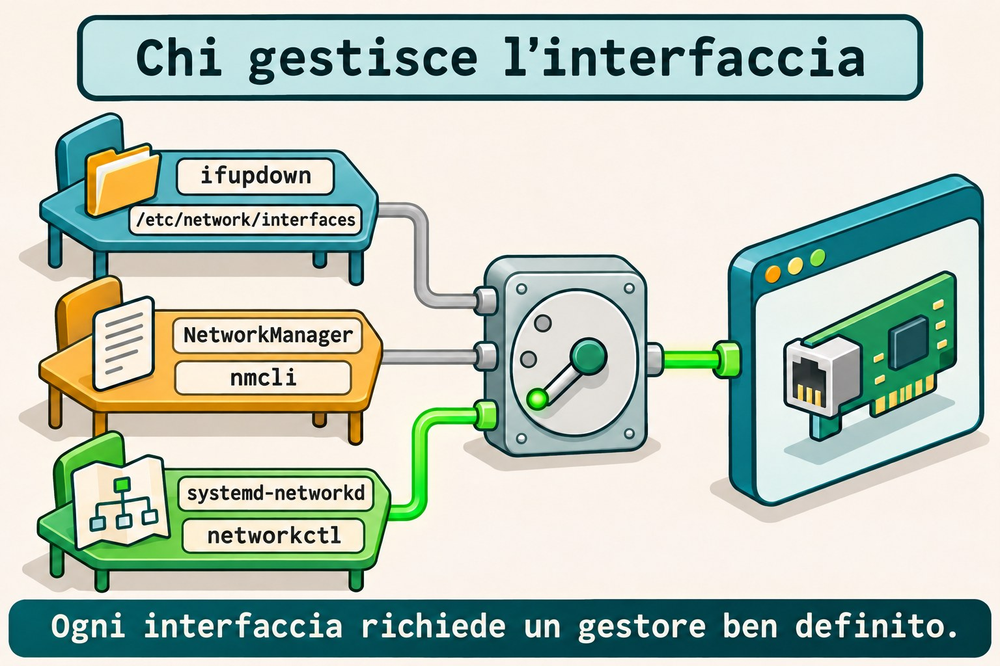
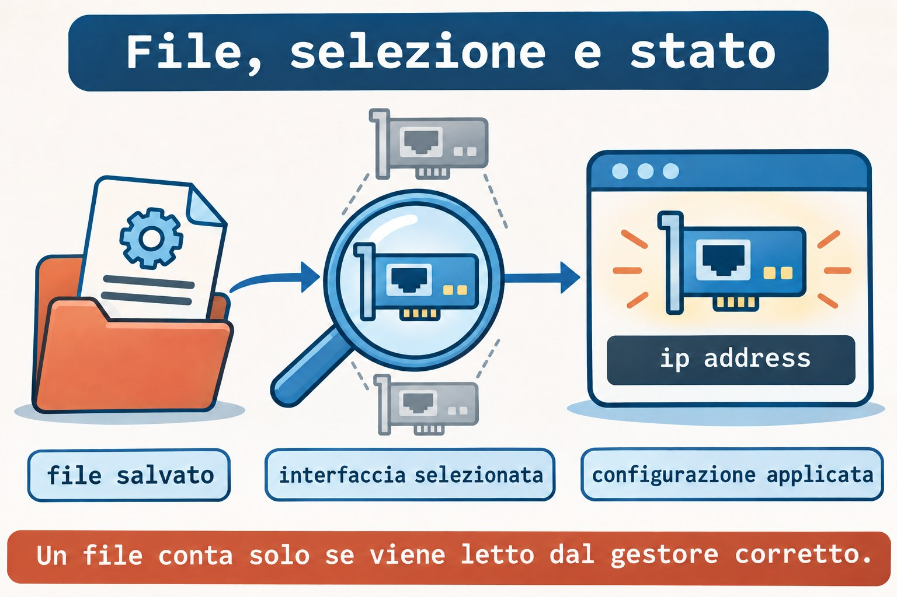
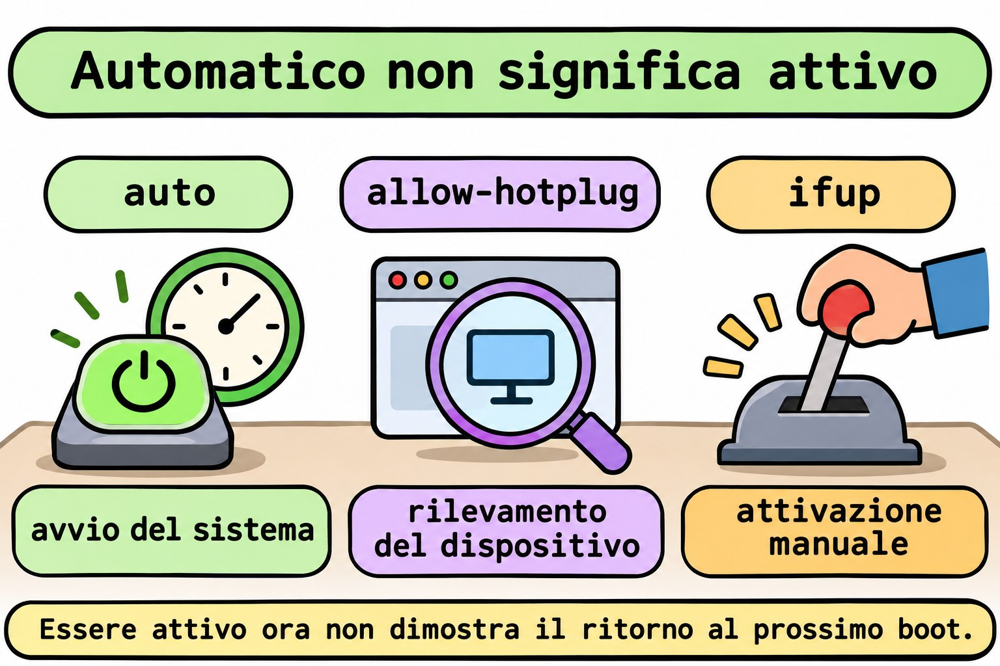

# Lezione 11.3 · Rete su Debian

Su Windows Server cerchi la configurazione che amministra davvero la scheda prima di modificare un indirizzo. Su Debian, questa domanda viene prima del nome del comando: chi gestisce questa interfaccia? Nella Lezione 11.2 hai lavorato con i profili di NetworkManager; ora leggerai e applicherai una configurazione di `ifupdown`, confronterai i due modelli e riconoscerai i file di `systemd-networkd`.

> **Il cuore di questa lezione:** scopri il responsabile dell'interfaccia, trova il file che legge e controlla lo stato applicato nel kernel. Un file corretto nel posto sbagliato non configura la rete. Il resto è approfondimento.

| Scheda |  |
| --- | --- |
| **Modulo** | M11 · Rete, lezione 3 di 5 |
| **Quando** | Settimana 16 |
| **Alla fine** | Identifichi il gestore, interpreti `interfaces`, attivi un'interfaccia interna e confronti con NetworkManager e networkd |
| **Prerequisiti** | Lezioni 11.1 e 11.2; SSH, `sudo`, noVNC; Debian con `ifupdown` e Rocky con NetworkManager |
| **Durata** | Circa 90 minuti, più 30 minuti per ripetere senza consultare |
| **Snapshot** | `m11a3-inicio` e `m11a3-fim` sulle VM 201 e 202 |

## 1 · Riscaldamento

Rispondi senza consultare. Le soluzioni sono alla fine.

1. Qual è la differenza tra profilo salvato e connessione attiva in NetworkManager?
2. Un indirizzo aggiunto con `ip address add` dimostra la persistenza dopo il reboot?
3. Prima di modificare la scheda usata da SSH, quale accesso o piano di ripristino deve essere disponibile?

## 2 · Perché conta

Modifichi un profilo di NetworkManager, ma Debian continua a usare un altro indirizzo. Il file sembra corretto, il comando esiste e la rete funziona. Il problema è che quell'interfaccia è sotto `ifupdown`; hai modificato una configurazione che non partecipa al percorso di attivazione.

| Domanda | Evidenza utile |
| --- | --- |
| Chi è installato? | Pacchetti e comandi disponibili |
| Chi è in esecuzione? | Unità e processi del gestore |
| Chi amministra questa interfaccia? | Configurazione, selezione e stato del dispositivo |
| Quale indirizzo è stato applicato? | `ip address` |
| Cosa torna al boot? | Configurazione persistente e test di reboot |

Il nome della distribuzione non risponde da solo alle cinque domande. Un'installazione minima e un'installazione con ambiente grafico possono usare modelli diversi.

## 3 · Modello mentale

Pensa a tre squadre che possono ricevere la scheda di una stessa installazione. Ogni squadra legge un linguaggio proprio. Devi scegliere chi esegue la scheda e impedire che un'altra squadra cerchi di configurare contemporaneamente la stessa interfaccia.

```text
ifupdown            → interfaces → ifup       → interfaccia → ip address
NetworkManager      → profilo    → nmcli      → interfaccia → ip address
systemd-networkd    → .network   → networkctl → interfaccia → ip address
```

Il kernel mantiene lo stato attuale della rete. I gestori organizzano come viene creato e mantenuto quello stato. Avere due servizi installati non costituisce automaticamente un conflitto; il conflitto nasce quando le responsabilità sulla stessa interfaccia si sovrappongono.



*Ogni interfaccia richiede un gestore ben definito.*

### Ponte Windows

| Windows Server | Debian e Rocky | Cosa confronti |
| --- | --- | --- |
| Scoprire l'origine della configurazione | Identificare il gestore dell'interfaccia | Chi applica la configurazione |
| Configurazione statica della scheda | `iface ... inet static` o profilo manuale | Indirizzo e prefisso persistenti |
| Configurazione ottenuta automaticamente | Metodo `dhcp` o `auto`, secondo lo strumento | Richiedere i dati al meccanismo corretto |
| Consultare l'indirizzo attuale | `ip -br address` | Stato effettivo, indipendente dal gestore |
| Controllare dopo il riavvio | Reboot e nuova consultazione | Persistenza dimostrata |

## 4 · L'essenziale

### ifupdown: file e azione

`ifupdown` legge `/etc/network/interfaces` e i file inclusi da esso. `ifup` configura un'interfaccia; `ifdown` rimuove la configurazione; `ifquery` interpreta le definizioni e consulta lo stato registrato dallo strumento.

```bash
sudo ifquery --list
sudo ifquery m11dummy1
```

Il primo comando elenca le interfacce definite. Il secondo trova `m11dummy1` soltanto dopo che avrai installato la configurazione del lab. Una definizione letta da `ifquery` non dimostra un indirizzo applicato né la comunicazione.

### Le righe che devi riconoscere

| Frammento | Significato |
| --- | --- |
| `auto m11dummy1` | Include l'interfaccia nell'attivazione con `ifup -a`, usata al boot |
| `allow-hotplug enp6s18` | Consente l'attivazione associata al rilevamento del dispositivo |
| `iface m11dummy1 inet static` | Definisce IPv4 statico |
| `iface m11dummy1 inet6 static` | Definisce IPv6 statico |
| `address 198.51.100.10/24` | Indirizzo IPv4 e prefisso |
| `gateway ...` | Definisce il prossimo salto predefinito di quella famiglia |
| `source ...` | Include altri file di configurazione |

`allow-hotplug` segue il rilevamento del dispositivo, non il collegamento di un cavo Ethernet. `auto` non significa DHCP: sceglie quando attivare; il metodo nella riga `iface` sceglie come configurare.

### La directory partecipa soltanto se è inclusa

Un file in `/etc/network/interfaces.d/` deve essere raggiunto da una direttiva del file principale. Con `source /etc/network/interfaces.d/*`, il pattern seleziona i file di quella directory. Con `source-directory`, esistono regole specifiche per i nomi accettati, che includono soltanto lettere, numeri, trattino e underscore.

Nel lab il file si chiama `m11a3`, senza estensione, e ne confermi la lettura con `ifquery`. Una bozza in `~/m11a3` non partecipa alla configurazione predefinita.

Quando cerchi nelle directory protette, lascia la selezione dei file al comando eseguito sotto `sudo`, per esempio `sudo grep -r --include='*.network' ... DIRETORIO`. Un glob espanso dalla shell di `student` viene elaborato prima di `sudo`.

### networking.service non è un demone di indirizzamento

Con `ifupdown`, `networking.service` esegue le operazioni di configurazione e può risultare `active (exited)`. Questo indica che l'unità ha terminato la propria azione e mantiene lo stato attivo. Da solo non è un motivo per riavviare la rete.

Leggi la configurazione, il registro di `ifupdown` e lo stato nel kernel. Evita `ifdown -a` e il riavvio di `networking` per correggere una sola interfaccia: queste azioni hanno un raggio d'azione più ampio del guasto indagato.

### NetworkManager: altra origine, stessa verifica

Su Rocky confronti il profilo salvato con la connessione attiva, come nella 11.2. Su Debian, il plugin `ifupdown` di NetworkManager normalmente non gestisce le interfacce dichiarate in `interfaces` quando è configurato `managed=false`.

Questa regola dipende dalla configurazione caricata; non presumerla dal solo pacchetto installato. In questa lezione, il Debian del lab mantiene NetworkManager e networkd inattivi, mentre Rocky mantiene NetworkManager come responsabile.

### systemd-networkd: selezionare prima di applicare

Un file `.network` ha una sezione `[Match]` per selezionare le interfacce e una sezione `[Network]` per la loro configurazione. Un file `.netdev` descrive la creazione di un dispositivo virtuale; `.network` non è il file che crea un'interfaccia `dummy`.

I file vengono considerati in ordine alfanumerico. Viene usato il primo `.network` che corrisponde all'interfaccia; i successivi che corrispondono non vengono sommati. I file con lo stesso nome seguono la priorità delle directory, con `/etc` sopra `/run` e le directory di sistema.

`networkctl reload` rilegge i file e può riconfigurare le interfacce interessate. `networkctl reconfigure INTERFACE` richiede la riconfigurazione di un'interfaccia, senza rileggere da solo i file modificati. Nessuno dei due viene usato per tentativi in questa lezione: scrivi soltanto un esempio fuori dalle directory del servizio.



*Un file conta solo se viene letto dal gestore corretto.*

### Rocky × Debian

| Voce | Rocky 9, VM 201 | Debian 13, VM 202 |
| --- | --- | --- |
| Accesso e IP reale | `ssh rocky-lab`, `10.1.0.51` | `ssh debian-lab`, `10.1.0.52` |
| Responsabile previsto nel lab | NetworkManager attivo | `ifupdown`, con `networking.service` |
| Configurazione applicata | Profilo `m11a3-interno` | `/etc/network/interfaces.d/m11a3` |
| Applicare soltanto la risorsa del lab | `nmcli connection up m11a3-interno` | `ifup m11dummy1` |
| Consultare la definizione | `nmcli connection show m11a3-interno` | `ifquery m11dummy1` |
| Controllare l'indirizzo | `ip -br address show dev m11dummy1` | Stesso comando |
| Pacchetto specifico | `NetworkManager` | `ifupdown` |

## 5 · Lab guidato

Creerai l'interfaccia interna `m11dummy1` su entrambe le VM, con IPv4 `198.51.100.10/24` e IPv6 `2001:db8:13::10/64`. Sono indirizzi di documentazione, usati soltanto all'interno di ogni VM. Non ci saranno bridge, server DHCP, nuovi gateway né modifiche al DNS.

**Prima di qualsiasi modifica:** apri noVNC per entrambe le VM e verifica l'accesso come `student` con `sudo`. La scheda di SSH rimane intatta. Non eseguire questi passi sul nodo Proxmox: i comandi di rete del lab sono per le VM 201 e 202.

**Passo 0 · Salvare il punto di ripristino.** Sul nodo Proxmox di ogni VM:

**Ipotesi:** lo snapshot sostituisce una verifica del ripristino tramite console?

```bash
qm snapshot 201 m11a3-inicio
qm snapshot 202 m11a3-inicio
qm listsnapshot 201
qm listsnapshot 202
```

**Output atteso:** `m11a3-inicio` compare in entrambi gli elenchi.

**Verifica:** controlla gli snapshot e l'accesso noVNC prima di continuare.

**Passo 1 · Identificare il responsabile.** All'interno di entrambe le VM:

**Ipotesi:** trovare l'eseguibile `nmcli` dimostra che amministra la scheda?

```bash
cat /etc/os-release
systemctl is-active NetworkManager.service
systemctl is-active networking.service
systemctl is-active systemd-networkd.service
ip -br address
ip -4 route
```

**Output atteso:** Rocky con NetworkManager attivo; Debian con `networking.service` attivo e NetworkManager e networkd inattivi. Nella consultazione possono comparire anche unità assenti.

**Verifica:** su Debian controlla `systemctl status networking.service --no-pager`; `active (exited)` è normale in questo modello. Se l'inventario identifica un altro responsabile, ferma l'applicazione del lab e registra la differenza; non migrare la scheda per forzare il percorso.

**Passo 2 · Leggere l'origine della configurazione.** Su Debian:

**Ipotesi:** un file dentro `interfaces.d` viene letto anche senza un'inclusione nel principale?

```bash
dpkg-query -W ifupdown
command -v ifup ifdown ifquery
sudo cat /etc/network/interfaces
sudo grep -r -n -E '^[[:space:]]*(auto|allow-hotplug|iface|source)' \
  /etc/network/interfaces.d/
sudo ifquery --list
```

**Output atteso:** pacchetto e comandi presenti; il principale include `interfaces.d` tramite `source` o `source-directory`. `grep` può terminare senza corrispondenze se la directory è vuota.

**Verifica:** annota la definizione della scheda reale e l'inclusione della directory. Se `ifupdown` non è installato o la directory non è inclusa, non installare un altro gestore e non modificare il principale alla cieca; risolvi questo prerequisito tramite console prima del lab.

Su Rocky usa `nmcli device status` e `nmcli connection show --active` per registrare chi gestisce l'interfaccia reale. Non eseguire `nmcli` su Debian con il servizio fermo.

**Passo 3 · Riservare le risorse dell'esercizio.** Su entrambe le VM:

**Ipotesi:** indirizzi uguali su due interfacce interne isolate creano un conflitto sulla rete fisica?

```bash
mkdir -m 0700 "$HOME/m11a3"
ip -br address | tee "$HOME/m11a3/enderecos-inicio.txt"
ip -4 route | tee "$HOME/m11a3/rotas-inicio.txt"
ip link show m11dummy1
```

**Output atteso:** cartella creata, inventario registrato e dispositivo ancora inesistente.

**Verifica:** fermati se la cartella o il dispositivo esiste già. Su Rocky controlla anche che non esistano i profili `m11a3-interno` e `m11a3-rascunho`; su Debian conferma con `sudo test ! -e /etc/network/interfaces.d/m11a3` che il file sia libero.

**Passo 4 · Preparare la definizione di Debian.** Salva la bozza soltanto su `debian-lab`:

**Ipotesi:** la riga `auto` sceglie il metodo statico o il momento dell'attivazione?

```bash
cat > "$HOME/m11a3/interfaces" <<'EOF'
auto m11dummy1
iface m11dummy1 inet static
    address 198.51.100.10/24
    pre-up test -d /sys/class/net/m11dummy1 || ip link add m11dummy1 type dummy
iface m11dummy1 inet6 static
    address 2001:db8:13::10/64
EOF
ifquery --interfaces="$HOME/m11a3/interfaces" m11dummy1
sudo ifup --no-act --interfaces="$HOME/m11a3/interfaces" m11dummy1
```

**Output atteso:** la definizione viene interpretata; la simulazione mostra le azioni previste senza creare l'interfaccia.

**Verifica:** `ip link show m11dummy1` indica ancora un dispositivo inesistente. `pre-up` creerà l'interfaccia interna prima degli indirizzi; il controllo evita di ricrearla se esiste già al momento dell'attivazione.

**Passo 5 · Installare e applicare.** Su Debian:

**Ipotesi:** leggere il file e riuscire ad attivare un'interfaccia sono la stessa evidenza?

```bash
sudo install -m 0644 -o root -g root "$HOME/m11a3/interfaces" /etc/network/interfaces.d/m11a3
sudo ifquery m11dummy1
sudo ifup m11dummy1
```

**Output atteso:** la consultazione predefinita trova la definizione installata; l'attivazione crea l'interfaccia e applica entrambi gli indirizzi. Se `ifquery` fallisce, fermati prima di eseguire `ifup` e indaga sull'inclusione.

Su Rocky applica la configurazione equivalente con il gestore già attivo:

```bash
sudo nmcli connection add type dummy ifname m11dummy1 \
  con-name m11a3-interno connection.autoconnect yes \
  ipv4.method manual ipv4.addresses 198.51.100.10/24 ipv4.never-default yes \
  ipv6.method manual ipv6.addresses 2001:db8:13::10/64 ipv6.never-default yes
sudo nmcli connection up m11a3-interno
```

**Verifica:** su entrambe le VM, `ip -br address show dev m11dummy1` deve mostrare gli stessi indirizzi interni. Il formato persistente è diverso, ma il kernel riceve una configurazione equivalente.

**Passo 6 · Confrontare definizione, registro e kernel.** Su entrambe le VM:

**Ipotesi:** il registro di uno strumento sostituisce la consultazione dell'indirizzo reale?

```bash
ip -br address show dev m11dummy1
ip -4 route show dev m11dummy1
ip -6 route show dev m11dummy1
ip -4 route show default
ping -4 -c 2 -W 2 198.51.100.10
ping -6 -c 2 -W 2 2001:db8:13::10
```

**Output atteso:** indirizzi e rotte interne, risposte locali e la rotta predefinita originale.

**Verifica:** su Debian confronta `sudo ifquery m11dummy1` e `sudo ifquery --state m11dummy1`; su Rocky confronta il profilo salvato e `nmcli connection show --active`. Il registro di attivazione non misura la risposta di un'applicazione.

**Passo 7 · Riconoscere networkd senza cambiare responsabile.** Su entrambe le VM salva soltanto un esempio nella directory personale:

**Ipotesi:** un `.network` crea da solo un'interfaccia `dummy` inesistente?

```bash
cat > "$HOME/m11a3/30-m11dummy1.netdev" <<'EOF'
[NetDev]
Name=m11dummy1
Kind=dummy
EOF
cat > "$HOME/m11a3/30-m11dummy1.network" <<'EOF'
[Match]
Name=m11dummy1
[Network]
Address=198.51.100.10/24
Address=2001:db8:13::10/64
IPv6AcceptRA=no
EOF
cat "$HOME/m11a3/30-m11dummy1.network"
```

**Output atteso:** due file di studio; la lettura mostra la selezione per nome e due indirizzi.

**Verifica:** i file rimangono in `~/m11a3`, non in `/etc/systemd/network/`. Non abilitare networkd, non eseguire `networkctl reload` e non copiare l'esempio nella directory del servizio. Confronta intenzione e sintassi, senza contendere l'interfaccia.

### Decidi 1

Debian mostra `networking.service` come `active (exited)` e l'interfaccia ha l'indirizzo corretto. Cosa concludi?

A) La rete è necessariamente ferma. B) L'unità può aver completato la configurazione; controlli l'interfaccia e le evidenze della segnalazione. C) Devi installare NetworkManager.

| Se hai scelto | Risultato | Perché |
| --- | --- | --- |
| A | Errato | L'unità non deve mantenere un demone per lasciare l'indirizzo configurato |
| B | Corretto | Stato dell'unità e stato dell'interfaccia rispondono a domande diverse |
| C | Ingiustificato | Installare un altro gestore non diagnostica il guasto |

### Decidi 2

Devi correggere soltanto l'interfaccia interna. Quale raggio d'azione corrisponde all'obiettivo?

A) `ifdown -a`. B) Riavviare tutti i servizi di rete. C) Consultare la definizione e intervenire soltanto su `m11dummy1`.

| Se hai scelto | Risultato | Perché |
| --- | --- | --- |
| A | Troppo ampio | Può disattivare altre interfacce configurate |
| B | Troppo ampio | Coinvolge responsabili e interfacce estranei al guasto |
| C | Corretto | L'azione rimane limitata alla risorsa indagata |

## 6 · Rompi e ripara

Esegui i tre guasti sulle risorse interne. I difetti riguarderanno la selezione automatica, l'origine modificata e la validazione. Non eseguire una configurazione non valida sull'interfaccia reale.

### Guasto 1 · Attivo ora, assente dalla selezione automatica

**Ipotesi:** rimuovere `auto` da un file cancella immediatamente un indirizzo dal kernel?

Su Debian:

```bash
sudo sed -i '/^auto m11dummy1$/d' /etc/network/interfaces.d/m11a3
sudo ifquery --list --allow=auto
ip -br address show dev m11dummy1
```

Su Rocky:

```bash
sudo nmcli connection modify m11a3-interno connection.autoconnect no
nmcli -g connection.autoconnect connection show m11a3-interno
ip -br address show dev m11dummy1
```

**Sintomo:** gli indirizzi rimangono applicati; su Debian l'interfaccia è uscita dall'elenco `auto`; su Rocky l'autoconnessione è diventata `no`.

**Indagine:** confronta la selezione per il boot con l'indirizzo attuale. Non riavviare la VM finché la selezione è guasta.

**Causa:** hai rimosso l'attivazione automatica senza eliminare la configurazione già in uso.

**Riparazione:** su Debian reinstalla la bozza originale con `install` del Passo 5. Su Rocky esegui `sudo nmcli connection modify m11a3-interno connection.autoconnect yes`.

**Verifica:** `sudo ifquery --list --allow=auto` torna a includere `m11dummy1` su Debian; la proprietà torna a `yes` su Rocky.

**Prevenzione:** controlla il meccanismo di attivazione automatica oltre all'indirizzo attuale.

### Guasto 2 · Hai modificato l'origine sbagliata

**Ipotesi:** una bozza con un altro indirizzo sostituisce da sola la configurazione in uso?

Su Debian crea una copia fuori dalla catena di inclusione:

```bash
cp "$HOME/m11a3/interfaces" "$HOME/m11a3/rascunho"
sed -i 's/198.51.100.10/198.51.100.20/' "$HOME/m11a3/rascunho"
ifquery --interfaces="$HOME/m11a3/rascunho" m11dummy1
sudo ifquery m11dummy1
```

Su Rocky crea un profilo diverso e mantienilo inattivo:

```bash
sudo nmcli connection clone m11a3-interno m11a3-rascunho
sudo nmcli connection modify m11a3-rascunho connection.autoconnect no ipv4.addresses 198.51.100.20/24
nmcli -g ipv4.addresses connection show m11a3-rascunho
nmcli -g ipv4.addresses connection show m11a3-interno
```

**Sintomo:** la bozza ha `.20`; l'origine usata dal lab continua ad avere `.10`.

**Indagine:** su Debian confronta la consultazione con `--interfaces` e quella predefinita. Su Rocky confronta il nome del profilo modificato con quello attivo.

**Causa:** hai modificato un file non incluso o un profilo che non è applicato.

**Riparazione:** scarta la bozza con `rm -- "$HOME/m11a3/rascunho"` su Debian e `sudo nmcli connection delete m11a3-rascunho` su Rocky. Non attivare le bozze.

**Verifica:** `ip -4 address show dev m11dummy1` continua a mostrare `.10` su entrambe le VM.

**Prevenzione:** identifica l'origine effettivamente letta prima di modificarla.

### Guasto 3 · Metodo non valido, validazione prima dell'applicazione

**Ipotesi:** uno strumento deve applicare un metodo che non riconosce?

Su Debian danneggia soltanto una copia:

```bash
cp "$HOME/m11a3/interfaces" "$HOME/m11a3/invalido"
sed -i 's/inet static/inet statci/' "$HOME/m11a3/invalido"
ifquery --interfaces="$HOME/m11a3/invalido" m11dummy1
```

Su Rocky:

```bash
sudo nmcli connection modify m11a3-interno ipv4.method statci
```

**Sintomo:** gli strumenti rifiutano il metodo sconosciuto. Non aspettarti un testo identico sui due sistemi: l'evidenza è il rifiuto prima dell'applicazione.

**Indagine:** leggi la riga o la proprietà indicata e confronta `statci` con il valore accettato da ogni strumento.

**Causa:** `ifupdown` usa `static` in questa definizione; NetworkManager usa `manual` nella proprietà corrispondente. `statci` non è valido per nessuno dei due.

**Riparazione:** su Debian correggi la copia con `sed -i 's/inet statci/inet static/' "$HOME/m11a3/invalido"` e ripeti la consultazione. Su Rocky controlla che `nmcli -g ipv4.method connection show m11a3-interno` rimanga `manual`.

**Verifica:** la definizione corretta viene interpretata e `ip -br address show dev m11dummy1` continua a mostrare gli indirizzi originali su entrambe le VM.

**Prevenzione:** valida la definizione prima di applicarla; non tradurre i valori tra strumenti diversi per somiglianza del nome.



*Essere attivo ora non dimostra il ritorno al prossimo boot.*

### Pulizia

**Ipotesi:** rimuovere gli esempi personali richiede di riavviare il gestore della scheda reale?

Su Debian elimina la copia non valida che hai già corretto:

```bash
rm -- "$HOME/m11a3/invalido"
sudo ifquery --list --allow=auto
```

**Output atteso:** file di test rimosso e interfaccia interna di nuovo selezionata per il boot.

**Verifica:** mantieni la configurazione interna su entrambe le VM fino al reboot di verifica. I file `.network` e `.netdev` rimangono soltanto come studio nella directory personale.

## 7 · Trappole

| Errore comune | Cosa fare | Perché |
| --- | --- | --- |
| Scegliere il comando solo dalla distribuzione | Identificare il responsabile reale | Una distribuzione ammette più modelli |
| Interpretare `active (exited)` come un guasto | Controllare il tipo di unità e l'interfaccia | La configurazione può essersi conclusa normalmente |
| Confondere `auto` con DHCP | Separare momento di attivazione e metodo | `auto` attiva anche configurazioni statiche |
| Leggere `allow-hotplug` come cavo collegato | Pensare al rilevamento del dispositivo | L'evento non è la presenza di segnale nel cavo |
| Creare un file senza verificare l'inclusione | Controllare con `ifquery` predefinito | La directory non viene letta per il solo fatto di esistere |
| Usare `ifdown -a` per un guasto locale | Indicare l'interfaccia esatta | L'azione globale può interrompere SSH |
| Installare `.network` con selezione ampia | Controllare `[Match]` e l'ordine | Decide il primo file corrispondente |
| Espandere un glob protetto prima di sudo | Selezionare dentro il comando privilegiato | La shell dell'utente può non riuscire a elencare la directory |

## 8 · Quiz

Rispondi senza consultare il lab e indica l'evidenza di ogni conclusione.

1. Cosa distingue `auto` da `iface ... inet static`?
2. Perché un file in `interfaces.d` può non essere usato?
3. Cosa mostra `ifquery` che `ip address` non mostra, e viceversa?
4. `allow-hotplug` rileva necessariamente il collegamento del cavo Ethernet?
5. Due `.network` corrispondono alla stessa interfaccia. Le loro configurazioni vengono sommate?
6. Perché non hai avviato networkd per sperimentare i file personali?

## 9 · Promemoria

| Voglio... | Comando |
| --- | --- |
| Identificare il servizio previsto | `systemctl is-active networking.service NetworkManager.service systemd-networkd.service` |
| Vedere il file principale | `sudo cat /etc/network/interfaces` |
| Elencare le definizioni di ifupdown | `sudo ifquery --list` |
| Vedere la selezione automatica | `sudo ifquery --list --allow=auto` |
| Leggere una definizione specifica | `sudo ifquery m11dummy1` |
| Leggere un file di studio | `ifquery --interfaces="$HOME/m11a3/interfaces" m11dummy1` |
| Simulare senza applicare | `sudo ifup --no-act --interfaces="$HOME/m11a3/interfaces" m11dummy1` |
| Applicare soltanto la risorsa del lab | `sudo ifup m11dummy1` |
| Vedere il registro dello strumento | `sudo ifquery --state m11dummy1` |
| Controllare il kernel | `ip -br address show dev m11dummy1` |

**Flashcard:** responsabile → *chi applica*; file → *origine della configurazione*; `auto` → *selezione per ifup -a*; `allow-hotplug` → *rilevamento del dispositivo*; `ifquery` → *definizione e registro*; `ip` → *stato nel kernel*.

Ripassa a D+1, D+3, D+7 e D+21. Spiega perché modificare il file sbagliato può non produrre un messaggio di errore e comunque non risolvere la segnalazione.

## 10 · Checklist e chiusura

- [ ] Identifico il responsabile di ogni interfaccia prima di modificarla
- [ ] Leggo l'inclusione dei file in ifupdown
- [ ] Distinguo selezione automatica, metodo e stato applicato
- [ ] Ho confrontato la stessa intenzione su Debian e Rocky
- [ ] Riconosco `.netdev`, `.network` e la selezione tramite `[Match]`
- [ ] Ho eseguito i tre guasti senza modificare la scheda di SSH
- [ ] Ho ripristinato la selezione automatica prima del reboot

**Ultimo esercizio:** spiega, senza consultare, la catena tra file, responsabile, attivazione e indirizzo. Mostra dove ogni guasto ha interrotto quella catena.

**Reboot di verifica:** controlla `auto m11dummy1` su Debian e autoconnessione `yes` su Rocky. Su ogni VM esegui `sudo systemctl reboot`, segui l'avvio tramite noVNC e riconnettiti tramite l'alias.

```bash
ip -br address show dev m11dummy1
ip -4 route show default
```

**Output atteso:** gli indirizzi interni sono tornati e la rotta predefinita originale rimane. Su Debian, la creazione dell'interfaccia è stata eseguita dall'azione `pre-up` della definizione.

**Verifica:** controlla IPv4 e IPv6, consulta la definizione del rispettivo gestore e confronta la scheda reale con l'inventario iniziale.

**Ripristino dello stato iniziale:** su Debian disattiva l'interfaccia prima di rimuoverne la definizione:

```bash
sudo ifdown m11dummy1
sudo rm -- /etc/network/interfaces.d/m11a3
sudo ip link delete m11dummy1
```

Su Rocky:

```bash
sudo nmcli connection delete m11a3-interno
ip link show m11dummy1
```

Se il dispositivo interno esiste ancora su Rocky dopo aver eliminato il profilo, rimuovi soltanto quello con `sudo ip link delete m11dummy1`. Su entrambe le VM controlla `ip -br address` e `ip -4 route`; conserva `~/m11a3` come registro ed esempi, senza copiare i suoi file nelle directory dei servizi.

**Snapshot finale:** sul nodo Proxmox, dopo il ripristino:

```bash
qm snapshot 201 m11a3-fim
qm snapshot 202 m11a3-fim
```

## 11 · Nella vita reale

**Missione, sola lettura.** Su un server che amministri o che sei autorizzato a osservare:

```bash
systemctl is-active networking.service NetworkManager.service systemd-networkd.service
ip -br address
ip -4 route
ip -6 route
```

Se `ifupdown` è installato, consulta le definizioni con `sudo ifquery --list`. Usa le consultazioni di NetworkManager o networkd soltanto se il rispettivo servizio è già attivo. Non avviare servizi, non ricaricare file e non riattivare interfacce in questa missione.

1. Chi amministra ogni interfaccia di servizio? Quali evidenze lo mostrano?
2. Quale file o profilo partecipa all'attivazione dell'interfaccia scelta?
3. Esiste una bozza o un vecchio file che qualcuno potrebbe confondere con l'origine in uso?
4. La configurazione ha una registrazione del test dopo reboot o soltanto una consultazione dello stato attuale?

## 12 · Approfondire quando vuoi

- [`man interfaces`](https://manpages.debian.org/trixie/ifupdown/interfaces.5.en.html): definizioni, inclusioni, `auto`, `allow-hotplug` e azioni ausiliarie.
- [`man ifup`](https://manpages.debian.org/trixie/ifupdown/ifup.8.en.html): applicazione, rimozione, simulazione e consultazione dello stato.
- [`man ifquery`](https://manpages.debian.org/trixie/ifupdown/ifquery.8.en.html): lettura delle definizioni e selezione per classe.
- [`man systemd.network`](https://manpages.debian.org/trixie/systemd/systemd.network.5.en.html): selezione e ordine dei file `.network`.
- [`man networkctl`](https://manpages.debian.org/trixie/systemd/networkctl.1.en.html): consultazioni e differenza tra ricaricare e riconfigurare.
- [NetworkManager su Debian](https://wiki.debian.org/NetworkManager): integrazione con `interfaces` e interfacce non gestite.

**DeepTutor** (http://10.1.0.149:3782, KB "Curso Linux Sysadmin"):

- `!explica ifupdown, NetworkManager e networkd como responsáveis diferentes por uma interface`
- `!feynman arquivo correto no lugar errado: critique minha explicação separando inclusão, seleção e aplicação`
- `!quiz Aula 11.3, 6 perguntas sobre interfaces, auto, allow-hotplug e comparação de gerenciadores, uma por vez`

## Soluzioni commentate

### Riscaldamento

1. Il profilo conserva le proprietà; la connessione attiva rappresenta la loro applicazione al dispositivo. Consulta entrambi e controlla il kernel.
2. No. L'aggiunta modifica lo stato attuale; il ritorno dipende dalla configurazione persistente e dal meccanismo che la applica.
3. Console noVNC funzionante o un piano di ripristino collaudato. SSH dipende dall'interfaccia e dal percorso che intendi modificare.

### Quiz

1. `auto` seleziona l'attivazione con `ifup -a`; `inet static` definisce il metodo IPv4. Momento e metodo sono informazioni diverse.
2. Perché il principale deve includerlo e il nome deve essere accettato dalla modalità di inclusione. La consultazione predefinita di `ifquery` conferma la lettura.
3. `ifquery` interpreta le definizioni e consulta il registro di ifupdown; `ip address` mostra gli indirizzi nel kernel. Nessuno dei due, da solo, dimostra un'operazione dell'applicazione.
4. No. Consente l'attivazione associata al rilevamento del dispositivo; non equivale a rilevare segnale nel cavo.
5. No. Viene usato il primo file corrispondente in ordine alfanumerico. Per i file con lo stesso nome, considera la priorità delle directory.
6. Perché l'interfaccia ha già un responsabile. I file servivano a confrontare la sintassi; attivare un altro gestore richiederebbe una migrazione pianificata e la verifica del raggio d'azione.

<!-- navegacao -->
[← Lezione 11.2 · NetworkManager e nmcli](11.2-networkmanager-e-nmcli.md) · [Indice delle lezioni](../01-aulas.md) · [Lezione 11.4 · Nomi e risoluzione →](11.4-nomes-e-resolucao.md)
