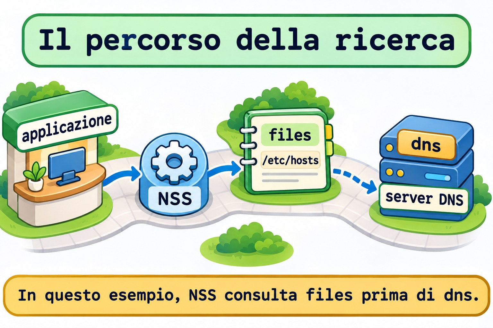

# Lezione 11.4 · Nomi e risoluzione

Su Windows Server, nome del computer, file hosts locale e server DNS sono elementi diversi. Su Linux, la stessa distinzione evita modifiche nel posto sbagliato. Dopo aver identificato il gestore dell'interfaccia nella 11.3, scoprirai come un programma trova l'IP di un nome, cambierai l'hostname nel lab e verificherai chi mantiene la configurazione di risoluzione.

> **Il cuore di questa lezione:** l'hostname identifica la macchina; la risoluzione trasforma un nome in indirizzo; NSS sceglie le fonti per i programmi che usano questo meccanismo. Risolvere un nome non dimostra che l'applicazione abbia risposto. Il resto è approfondimento.

| Scheda |  |
| --- | --- |
| **Modulo** | M11 · Rete, lezione 4 di 5 |
| **Quando** | Settimana 17 |
| **Alla fine** | Distingui hostname e risoluzione, consulti NSS con `getent` e identifichi l'origine di `resolv.conf` |
| **Prerequisiti** | Lezioni da 11.1 a 11.3; SSH, `sudo`, noVNC, `python3` e `curl` su entrambe le VM |
| **Durata** | Circa 90 minuti, più 30 minuti per ripetere senza consultare |
| **Snapshot** | `m11a4-inicio` e `m11a4-fim` sulle VM 201 e 202 |

## 1 · Riscaldamento

Rispondi senza consultare. Le soluzioni sono alla fine.

1. Perché un file corretto può non partecipare alla configurazione di un'interfaccia?
2. Quale comando mostra la decisione di instradamento per un IP senza inviare un pacchetto di test?
3. Risolvere un IP o ricevere una risposta ICMP dimostra che HTTP funziona?

## 2 · Perché conta

La segnalazione dice che l'applicazione si apre tramite IP, ma non tramite nome. Cambi il gateway e riavvii la rete. Nulla cambia: il nome era associato a un altro IP in `/etc/hosts`. Il percorso di rete funzionava; la prima ipotesi avrebbe dovuto riguardare la risoluzione usata dal client.

| Domanda | Evidenza |
| --- | --- |
| Come si identifica la macchina? | `hostnamectl --static` |
| Quale IP ottiene il sistema per un nome? | `getent ahostsv4 NOME` |
| Il file locale contiene la voce? | Consultazione di `files` e lettura di `/etc/hosts` |
| Quali fonti partecipano? | Riga `hosts:` di `/etc/nsswitch.conf` |
| Quale risposta ha ricevuto l'applicazione? | Client del protocollo, come `curl` |

Un risultato di risoluzione è una fase della diagnosi. Confronta l'indirizzo restituito con quello su cui il servizio risponde davvero.

## 3 · Modello mentale

Pensa a un edificio con una targa identificativa, un'agenda locale e un centro informazioni. La targa è l'hostname. L'agenda è `/etc/hosts`. Il centro rappresenta il DNS. L'addetto che decide dove cercare rappresenta NSS.

```text
programma → NSS → fonti configurate → indirizzo → connessione → applicazione
                 files: /etc/hosts
                 dns: query DNS
```

Cambiare la targa dell'edificio non invia automaticamente un aggiornamento al centro informazioni. Alcune reti hanno meccanismi propri di aggiornamento dinamico; `hostnamectl` non è, da solo, uno strumento per pubblicare record DNS.


*Cambiare hostname non pubblica un record nel DNS.*

### Ponte Windows

| Windows Server | Linux | Concetto che riutilizzi |
| --- | --- | --- |
| Nome del computer | `hostnamectl` | Identità locale del sistema |
| File hosts locale | `/etc/hosts` | Associazione locale tra nome e IP |
| Configurazione del client DNS | Origine di `/etc/resolv.conf` e gestore | Da dove il client ottiene i propri server |
| Consultare la risoluzione del sistema | `getent` | Chiedere tramite il percorso usato dai programmi integrati con il sistema |
| Testare l'applicazione dopo il nome | Client del protocollo | Nome risolto e servizio funzionante sono evidenze distinte |

## 4 · L'essenziale

### Hostname non significa record DNS

`hostnamectl --static` consulta l'hostname statico. È persistente, normalmente memorizzato in `/etc/hostname`. L'hostname transitorio funziona come alternativa ricevuta dalla configurazione di rete; il nome descrittivo, chiamato pretty hostname, serve alla presentazione.

Nel lab userai `hostnamectl --static set-hostname` per modificare soltanto l'identità statica. Il nome mostrato in un prompt già aperto può rimanere quello precedente; consulta lo strumento e il file invece di considerare il prompt una verifica.

### hosts: IP, nome principale e alias

Una voce di `/etc/hosts` inizia con l'indirizzo, seguito dal nome principale e dagli alias. Nomi senza dominio e nomi completi sono equivalenti soltanto quando la configurazione usata dalla consultazione stabilisce questa relazione.

```text
127.0.0.2 app.m11.test app-m11
```

Questa riga crea una mappa locale per due nomi. Non crea un server DNS, non configura un IP sulla scheda Ethernet e non pubblica nulla per altre macchine. Su Linux, `127.0.0.0/8` è l'intervallo di loopback; il servizio di questo lab rimarrà soltanto lì.

### NSS: ordine e condizioni contano

`/etc/nsswitch.conf` definisce le fonti di consultazione per database come utenti, gruppi e host. Il frammento seguente è una riga di esempio, non un'istruzione per sostituire la tua configurazione:

```text
hosts: files dns
```

In questo esempio, la consultazione tenta la tabella locale prima del DNS. Altre installazioni usano fonti come `myhostname` e `resolve`, oltre a condizioni tra parentesi quadre che cambiano quando la ricerca continua o termina. Leggi l'intera riga.

Su Rocky, la configurazione NSS può essere mantenuta da `authselect`. Non riscrivere `nsswitch.conf` per adattarlo al lab. Qui leggi soltanto la politica e confronti le consultazioni.



*In questo esempio, NSS consulta files prima di dns.*

### getent: chiedere al sistema e isolare una fonte

| Consultazione | Cosa osservi |
| --- | --- |
| `getent ahostsv4 NOME` | Risoluzione IPv4 tramite il meccanismo NSS |
| `getent -s files ahostsv4 NOME` | Soltanto la tabella hosts locale, per IPv4 |
| `getent -s files hosts NOME` | Voce della tabella locale, incluso l'esempio IPv6 |
| `getent -s dns ahostsv4 NOME` | Consultazione tramite la fonte DNS, senza usare la voce di files |

`ahostsv4` può mostrare lo stesso IP su righe per tipi di socket diversi. Non significa che tu abbia salvato più voci. Il codice `2` di `getent` indica che una chiave non è stata trovata.

I programmi possono anche mantenere una propria cache o usare un altro meccanismo di risoluzione. Il lab usa client nuovi a ogni test per confrontare le fonti senza dipendere da un'applicazione rimasta aperta.

### resolv.conf: contenuto e responsabile

Il client DNS tradizionale legge `/etc/resolv.conf`. `nameserver` indica un server; `search` definisce i suffissi di ricerca per i nomi relativi; `options` regola il comportamento del resolver. Un suffisso di ricerca non crea una voce in `/etc/hosts`.

Il file può essere regolare oppure un link simbolico verso contenuto generato. NetworkManager, DHCP e strumenti di integrazione come `resolvconf` possono partecipare alla sua manutenzione. Con `systemd-resolved`, `127.0.0.53` rappresenta normalmente un resolver locale, non necessariamente il DNS finale della rete.

Se NSS usa la fonte `resolve`, parte della risoluzione comunica direttamente con `systemd-resolved`. Per questo la riga NSS, il file e il servizio attivo vanno letti insieme. Non installare né avviare resolved soltanto perché ne hai visto un esempio.


*Verifica la provenienza prima di modificare resolv.conf.*

### Rocky × Debian

| Voce | Rocky 9, VM 201 | Debian 13, VM 202 |
| --- | --- | --- |
| Accesso | `ssh rocky-lab` | `ssh debian-lab` |
| IP della scheda del corso | `10.1.0.51` | `10.1.0.52` |
| Hostname temporaneo di questo esercizio | `rocky-nomes` | `debian-nomes` |
| Mappa locale e politica NSS | `/etc/hosts` e `/etc/nsswitch.conf` | Stessi percorsi |
| Origine del DNS | Controlla NetworkManager e la configurazione caricata | Controlla il gestore identificato nella 11.3 |
| Strumento di consultazione | `getent`, fornito da `glibc-common` | `getent`, fornito da `libc-bin` |
| Indirizzo del servizio locale | `127.0.0.2:18084` | Stesso indirizzo all'interno della VM stessa |

## 5 · Lab guidato

Esegui l'intera sequenza su Rocky e poi su Debian, come `student`. Apri due sessioni per VM: A per il server HTTP e B per le consultazioni. Le modifiche riguarderanno l'hostname statico e un blocco contrassegnato di `/etc/hosts`. Non modificare DNS, indirizzo della scheda, gateway o politica NSS.

**Prima di modificare:** controlla l'accesso tramite noVNC e la sessione SSH tramite alias. Cambiare il nome locale non modifica l'IP né la chiave SSH della VM. Non svolgere l'esercizio sul nodo Proxmox.

**Passo 0 · Salvare il punto di ripristino.** Sul nodo Proxmox di ogni VM:

**Ipotesi:** lo snapshot registra perché hai modificato una voce oppure quel ragionamento deve stare nel diario?

```bash
qm snapshot 201 m11a4-inicio
qm snapshot 202 m11a4-inicio
qm listsnapshot 201
qm listsnapshot 202
```

**Output atteso:** `m11a4-inicio` compare in entrambi gli elenchi.

**Verifica:** controlla gli snapshot prima di passare alle VM.

**Passo 1 · Registrare l'identità e le fonti.** Nella finestra B:

**Ipotesi:** il nome visto nel prompt mostra quale server DNS è configurato?

```bash
mkdir -m 0700 "$HOME/m11a4"
hostnamectl --static | tee "$HOME/m11a4/hostname.inicio"
ip -br address | tee "$HOME/m11a4/enderecos.inicio"
grep -n '^hosts:' /etc/nsswitch.conf
ls -l /etc/resolv.conf
readlink -f /etc/resolv.conf
cat /etc/resolv.conf
command -v getent python3 curl timeout
```

**Output atteso:** hostname statico attuale, indirizzi reali, riga NSS e configurazione locale di risoluzione.

**Verifica:** fermati se la cartella esiste già o l'hostname statico è vuoto. Per il percorso predefinito atteso in questo lab, `files` deve partecipare prima di fonti e condizioni che terminino la ricerca; registra una politica diversa prima di provare ad applicare il percorso.

**Passo 2 · Proteggere il file e riservare i nomi.**

**Ipotesi:** copiare `hosts` in un backup cambia già la risoluzione usata dai programmi?

```bash
sudo cp -a -- /etc/hosts "$HOME/m11a4/hosts.inicio"
sudo grep -n -E 'm11a4|app\.m11\.test|app-m11|app6\.m11\.test|rocky-nomes|debian-nomes' /etc/hosts
ss -ltn 'sport = :18084'
```

**Output atteso:** backup creato, nessuna corrispondenza per i nomi riservati e soltanto l'intestazione del filtro dei socket.

**Verifica:** se un nome o la porta è già in uso, fermati e identifica la risorsa. Non rimuovere voci esistenti per liberare l'esercizio.

**Passo 3 · Creare la mappa locale prima di cambiare hostname.** Su Rocky esegui soltanto:

**Ipotesi:** preparare una voce locale fa sì che anche un'altra macchina conosca quel nome?

```bash
NOVO_HOST=rocky-nomes
```

Su Debian esegui soltanto:

```bash
NOVO_HOST=debian-nomes
```

Poi, nella finestra B della VM in esame:

```bash
printf '# BEGIN m11a4\n127.0.1.1 %s\n127.0.0.2 app.m11.test app-m11\n::1 app6.m11.test\n# END m11a4\n' "$NOVO_HOST" | sudo tee -a /etc/hosts
getent -s files ahostsv4 "$NOVO_HOST"
getent -s files ahostsv4 app.m11.test
getent -s files hosts app6.m11.test
```

**Output atteso:** il nuovo nome locale restituisce `127.0.1.1`; l'applicazione restituisce `127.0.0.2`; l'esempio IPv6 restituisce `::1`.

**Verifica:** controlla i tre indirizzi. La voce del nuovo hostname è stata preparata per mantenere la risoluzione locale durante la modifica; l'hostname originale rimane nel file quando era già presente.

**Passo 4 · Modificare l'identità statica.**

**Ipotesi:** `hostnamectl` modificherà la voce dell'applicazione o pubblicherà un record nel DNS?

```bash
sudo hostnamectl --static set-hostname "$NOVO_HOST"
hostnamectl --static
cat /etc/hostname
getent -s files ahostsv4 app.m11.test
```

**Output atteso:** strumento e file mostrano il nuovo hostname; l'applicazione rimane associata a `127.0.0.2`.

**Verifica:** non usare il vecchio prompt come criterio. Il nome della VM in Proxmox e l'alias SSH di Windows non sono stati rinominati da questo comando.

**Passo 5 · Confrontare il percorso predefinito e la tabella locale.**

**Ipotesi:** ottenere lo stesso IP in due consultazioni dimostra che entrambe sono passate dal DNS?

```bash
getent ahostsv4 app.m11.test
getent -s files ahostsv4 app.m11.test
getent -s files ahostsv4 app-m11
grep -n '^hosts:' /etc/nsswitch.conf
```

**Output atteso:** i nomi dell'applicazione restituiscono `127.0.0.2`; le righe per tipo di socket possono ripetere l'IP.

**Verifica:** la consultazione forzata a `files` ha trovato la mappa locale. Il risultato predefinito va interpretato insieme all'ordine e alle condizioni di NSS, non chiamato automaticamente risposta DNS.

**Passo 6 · Richiedere una risposta dell'applicazione.** Nella finestra B:

**Ipotesi:** un nome con IP corretto basta per affermare che esiste HTTP su quella porta?

```bash
mkdir -m 0700 "$HOME/m11a4/www"
printf 'NAMES ok\n' > "$HOME/m11a4/www/index.html"
```

Nella finestra A della stessa VM, mantieni il server in primo piano:

```bash
python3 -m http.server 18084 --bind 127.0.0.2 --directory "$HOME/m11a4/www"
```

Nella B:

```bash
curl --noproxy '*' --connect-timeout 2 --max-time 4 -4 -fsS http://app.m11.test:18084/
curl --noproxy '*' --connect-timeout 2 --max-time 4 -4 -fsS http://127.0.0.2:18084/
ss -ltn 'sport = :18084'
```

**Output atteso:** entrambe le richieste restituiscono `NAMES ok`; il socket risponde su `127.0.0.2:18084`.

**Verifica:** la richiesta tramite nome ha attraversato risoluzione e HTTP; la richiesta tramite IP consente il confronto senza risolvere il nome. Nessuna delle due dimostra l'accesso remoto al servizio di loopback.

**Passo 7 · Scoprire l'origine del DNS senza modificarlo.**

**Ipotesi:** `127.0.0.53` in `resolv.conf` identifica necessariamente il server finale della rete?

```bash
ls -l /etc/resolv.conf
readlink -f /etc/resolv.conf
grep -n -E '^[[:space:]]*(nameserver|search|domain|options)' /etc/resolv.conf
systemctl is-active NetworkManager.service
systemctl is-active systemd-resolved.service
```

**Output atteso:** tipo del file, percorso risolto, direttive presenti e stato dei servizi. Un servizio assente non rende il file non valido.

**Verifica:** se NetworkManager è già attivo, consulta `nmcli -f GENERAL.DEVICE,IP4.DNS,IP6.DNS device show`. Se resolved è già attivo, consulta `resolvectl status`. Non avviare un servizio fermo per completare l'esempio.

### Decidi 1

`getent` restituisce un vecchio IP, ma l'applicazione risponde tramite l'IP corretto. Quale test riduce il dubbio?

A) Cambiare il gateway. B) Confrontare la fonte `files`, la riga NSS e l'indirizzo restituito. C) Disattivare il firewall.

| Se hai scelto | Risultato | Perché |
| --- | --- | --- |
| A | Senza evidenze | L'accesso tramite l'IP corretto ha già funzionato |
| B | Corretto | Indaghi sulla fase che ha fornito un'altra destinazione |
| C | Senza evidenze | Non spiega l'IP diverso restituito per il nome |

### Decidi 2

Hai visto che `resolv.conf` è un link verso contenuto generato. Quale azione è adatta a una modifica persistente?

A) Identificare il responsabile e modificare la sua configurazione. B) Eliminare il link e inserire un DNS qualsiasi. C) Rendere il file immutabile.

| Se hai scelto | Risultato | Perché |
| --- | --- | --- |
| A | Corretto | L'origine deve mantenere la configurazione desiderata |
| B | Rischioso | Interrompi l'integrazione senza intervenire sulla sua origine |
| C | Inadeguato | Nasconde il conflitto di manutenzione invece di risolverlo |

## 6 · Rompi e ripara

Esegui i tre guasti su entrambe le VM, mantenendo in funzione il server della finestra A. Modifica soltanto la voce riservata del blocco `m11a4`.

### Guasto 1 · Il nome non esiste più nella tabella locale

**Ipotesi:** rimuovere l'associazione di un nome termina il processo che risponde tramite IP?

```bash
sudo sed -i 's/^127\.0\.0\.2 app\.m11\.test app-m11$/127.0.0.2 app-errado.m11.test app-m11/' /etc/hosts
getent -s files ahostsv4 app.m11.test
echo $?
curl --noproxy '*' --connect-timeout 2 --max-time 4 -4 -fsS http://127.0.0.2:18084/
```

**Sintomo:** la consultazione forzata a `files` non mostra voci e termina con codice `2`; HTTP tramite IP continua a restituire `NAMES ok`.

**Indagine:** controlla la grafia nel blocco del lab. Il processo rimane attivo; l'associazione del nome richiesto è stata sostituita.

**Causa:** il nome consultato e il nome registrato non coincidono.

**Riparazione:** ripristina soltanto la riga riservata:

```bash
sudo sed -i 's/^127\.0\.0\.2 app-errado\.m11\.test app-m11$/127.0.0.2 app.m11.test app-m11/' /etc/hosts
getent -s files ahostsv4 app.m11.test
```

**Verifica:** la consultazione torna a mostrare `127.0.0.2`; la richiesta HTTP tramite nome torna a rispondere.

**Prevenzione:** confronta nome completo e alias prima di modificare rete o servizio.

### Guasto 2 · Il nome esiste, ma punta a un'altra destinazione

**Ipotesi:** una risoluzione riuscita dimostra che l'indirizzo è corretto per l'applicazione?

```bash
sudo sed -i 's/^127\.0\.0\.2 app\.m11\.test app-m11$/127.0.0.3 app.m11.test app-m11/' /etc/hosts
getent ahostsv4 app.m11.test
ss -ltn 'sport = :18084'
curl --noproxy '*' --connect-timeout 2 --max-time 4 -4 -fsS http://app.m11.test:18084/
```

**Sintomo:** la risoluzione restituisce `127.0.0.3`, ma il servizio risponde su `127.0.0.2`; il client non riesce a connettersi alla destinazione richiesta.

**Indagine:** confronta l'IP restituito da `getent` con il bind mostrato da `ss`. Il nome è stato trovato; l'associazione è sbagliata.

**Causa:** la tabella locale ha indirizzato il client verso un altro indirizzo di loopback.

**Riparazione:** torna all'indirizzo del servizio:

```bash
sudo sed -i 's/^127\.0\.0\.3 app\.m11\.test app-m11$/127.0.0.2 app.m11.test app-m11/' /etc/hosts
curl --noproxy '*' --connect-timeout 2 --max-time 4 -4 -fsS http://app.m11.test:18084/
```

**Verifica:** il risultato torna a essere `NAMES ok` senza riavviare il server HTTP.

**Prevenzione:** valida l'indirizzo restituito, non soltanto il successo della consultazione.

### Guasto 3 · Il test ha ignorato la fonte che hai modificato

**Ipotesi:** forzare la fonte DNS permette di verificare una modifica fatta soltanto in `/etc/hosts`?

```bash
getent -s files ahostsv4 app.m11.test
timeout 5 getent -s dns ahostsv4 app.m11.test
getent ahostsv4 app.m11.test
```

**Sintomo:** la consultazione di `files` trova `127.0.0.2`; il test forzato a `dns` non usa questa voce locale. Il limite di cinque secondi evita di aspettare indefinitamente il DNS configurato.

**Indagine:** identifica quale fonte ha consultato ogni comando. La lezione non ha creato record sul server DNS; la risposta di quella fonte dipende dalla configurazione DNS della rete.

**Causa:** hai scelto un test che ignora la fonte modificata. Questo non dimostra un difetto in `/etc/hosts`.

**Riparazione:** usa la consultazione predefinita per osservare il percorso NSS e quella di `files` per isolare la mappa locale. Non pubblicare né modificare DNS per far sembrare uguali i risultati.

**Verifica:** `getent -s files ahostsv4 app.m11.test` e HTTP tramite nome continuano a funzionare.

**Prevenzione:** registra se il test consulta il sistema, una fonte specifica oppure l'applicazione stessa.

### Pulizia

**Ipotesi:** arrestare HTTP rimuove automaticamente le voci che hai aggiunto in `/etc/hosts`?

Nella finestra A premi `Ctrl+C`. Nella B:

```bash
ss -ltn 'sport = :18084'
getent -s files ahostsv4 app.m11.test
hostnamectl --static
```

**Output atteso:** nessun servizio in ascolto sulla porta; la mappa locale e l'hostname temporaneo esistono ancora.

**Verifica:** mantienili fino al reboot di verifica. La rimozione finale avviene dopo aver dimostrato la persistenza.

## 7 · Trappole

| Errore comune | Cosa fare | Perché |
| --- | --- | --- |
| Chiamare DNS ogni risoluzione | Identificare le fonti NSS | Il risultato può provenire da hosts |
| Cambiare hostname aspettandosi una pubblicazione | Separare identità e record DNS | Sono configurazioni distinte |
| Fidarsi del vecchio prompt | Consultare hostnamectl e il file | La sessione può mantenere la presentazione precedente |
| Trovare il nome e fermare la diagnosi | Confrontare indirizzo e servizio | Anche un IP sbagliato può essere restituito con successo |
| Interpretare le righe di ahostsv4 come duplicati | Leggere tipo di socket e indirizzo | L'output distingue usi dello stesso risultato |
| Modificare resolv.conf senza identificarne l'origine | Controllare link, file e responsabile | Il contenuto può essere generato nuovamente |
| Sostituire NSS mantenuto da authselect | Identificare l'origine della politica | Potresti annullare l'integrazione del sistema |
| Usare la consultazione di una fonte come test di tutte | Dichiarare l'ambito del test | files, DNS e HTTP non sono la stessa evidenza |

## 8 · Quiz

Rispondi senza consultare e indica un comando che sostenga la tua conclusione.

1. Cosa cambia con `hostnamectl --static set-hostname` e cosa non pubblica da solo?
2. Quali nomi associa all'indirizzo la voce `127.0.0.2 app.m11.test app-m11`?
3. Perché `getent -s files` e `getent -s dns` possono dare risultati diversi?
4. Cosa controlli prima di modificare `/etc/resolv.conf`?
5. Un nome ha restituito un IP. Cosa manca ancora per verificare HTTP?
6. Qual è la differenza tra `nameserver` e `search` nel client DNS?

## 9 · Promemoria

| Voglio... | Comando |
| --- | --- |
| Leggere l'hostname statico | `hostnamectl --static` |
| Verificarne la persistenza | `cat /etc/hostname` |
| Leggere l'ordine di hosts | `grep -n '^hosts:' /etc/nsswitch.conf` |
| Consultare IPv4 tramite NSS | `getent ahostsv4 app.m11.test` |
| Isolare la tabella locale | `getent -s files ahostsv4 app.m11.test` |
| Leggere l'esempio IPv6 locale | `getent -s files hosts app6.m11.test` |
| Vedere il tipo del file di risoluzione | `ls -l /etc/resolv.conf` |
| Seguirne il percorso | `readlink -f /etc/resolv.conf` |
| Consultare resolved già attivo | `resolvectl status` |
| Richiedere la risposta HTTP | `curl --noproxy '*' -4 -fsS http://app.m11.test:18084/` |

**Flashcard:** hostname → *identità locale*; hosts → *mappa locale*; NSS → *fonti e condizioni*; getent → *consultazione del sistema*; DNS → *consultazione del server*; HTTP → *operazione dell'applicazione*.

Ripassa a D+1, D+3, D+7 e D+21. Spiega perché correggere un nome non richiede automaticamente di riavviare la rete.

## 10 · Checklist e chiusura

- [ ] Distinguo identità locale, risoluzione e risposta dell'applicazione
- [ ] Leggo nome principale e alias in hosts
- [ ] Identifico fonti e condizioni nella riga NSS
- [ ] Ho confrontato consultazioni predefinite e per fonte su entrambe le distribuzioni
- [ ] Identifico chi mantiene resolv.conf prima di pensare a modificarlo
- [ ] Ho corretto i guasti senza modificare DNS o la scheda di SSH
- [ ] Ho arrestato il server HTTP prima del reboot

**Ultimo esercizio:** spiega perché l'accesso tramite IP ha continuato a funzionare nel primo guasto e perché il secondo ha risolto il nome senza raggiungere il servizio corretto.

**Reboot di verifica:** controlla il nome temporaneo e il blocco locale corretti. Su ogni VM esegui `sudo systemctl reboot`, segui l'avvio tramite noVNC e riconnettiti usando l'alias originale.

```bash
hostnamectl --static
getent -s files ahostsv4 app.m11.test
ss -ltn 'sport = :18084'
```

**Output atteso:** l'hostname temporaneo e la voce locale sono persistiti; il server HTTP non è tornato, perché era un processo in primo piano.

**Verifica:** confronta la scheda reale con `~/m11a4/enderecos.inicio`. Hai dimostrato due configurazioni persistenti, non la pubblicazione di un record DNS.

**Ripristino dello stato iniziale:** ripristina prima l'hostname originale, poi rimuovi soltanto il blocco della lezione:

```bash
HOST_ORIGINAL=$(cat "$HOME/m11a4/hostname.inicio")
sudo hostnamectl --static set-hostname "$HOST_ORIGINAL"
sudo sed -i '/^# BEGIN m11a4$/,/^# END m11a4$/d' /etc/hosts
hostnamectl --static
sudo diff -u "$HOME/m11a4/hosts.inicio" /etc/hosts
ip -br address
```

**Verifica:** l'hostname originale è tornato. Senza altre modifiche durante il lab, `diff` non mostra differenze; se ne mostra, leggile prima di ripristinare un intero file. I registri in `~/m11a4` rimangono come diario dell'esercizio.

**Snapshot finale:** sul nodo Proxmox di ogni VM:

```bash
qm snapshot 201 m11a4-fim
qm snapshot 202 m11a4-fim
```

## 11 · Nella vita reale

**Missione, sola lettura.** Su un server che amministri o che sei autorizzato a osservare:

```bash
hostnamectl --static
grep -n '^hosts:' /etc/nsswitch.conf
ls -l /etc/resolv.conf
readlink -f /etc/resolv.conf
cat /etc/resolv.conf
```

1. L'hostname è statico? Esiste un nome DNS noto per questo servizio e chi lo mantiene?
2. La configurazione usa un file regolare, un link o un resolver locale?
3. Quali fonti possono rispondere prima del DNS nella politica NSS?
4. Ci sono vecchie voci locali che spiegherebbero una destinazione diversa da quella attesa?

Non avviare resolved, non modificare NSS e non pubblicare record in questa missione. Conserva nel diario soltanto informazioni autorizzate.

## 12 · Approfondire quando vuoi

- [`man hostnamectl`](https://manpages.debian.org/trixie/systemd/hostnamectl.1.en.html): tipi di hostname e selezione del nome statico.
- [`man hosts`](https://manpages.debian.org/trixie/manpages/hosts.5.en.html): nome principale, alias e indirizzi.
- [`man nsswitch.conf`](https://manpages.debian.org/trixie/manpages/nsswitch.conf.5.en.html): fonti e condizioni di continuazione.
- [`man getent`](https://manpages.debian.org/trixie/manpages/getent.1.en.html): database, fonte specifica e codici di uscita.
- [`man resolv.conf`](https://manpages.debian.org/trixie/manpages/resolv.conf.5.en.html): server, ricerca e opzioni del client.
- [`man systemd-resolved`](https://manpages.debian.org/trixie/systemd-resolved/systemd-resolved.8.en.html): integrazione con NSS e modalità di gestione di resolv.conf.

**DeepTutor** (http://10.1.0.149:3782, KB "Curso Linux Sysadmin"):

- `!explica hostname, hosts, NSS e DNS com a metáfora da placa, agenda e central de informações`
- `!feynman abre pelo IP e falha pelo nome: critique minha investigação separando resolução e aplicação`
- `!quiz Aula 11.4, 6 perguntas sobre hostnamectl, hosts, getent, NSS e resolv.conf, uma por vez`

## Soluzioni commentate

### Riscaldamento

1. Perché il gestore può non leggere quel file oppure la sua selezione può non raggiungere l'interfaccia. Identifica origine e responsabile.
2. `ip route get IP`. Consulta la decisione locale, senza trasmettere un pacchetto di test alla destinazione.
3. No. L'applicazione deve essere consultata con il protocollo e la porta previsti.

### Quiz

1. Modifica l'hostname statico persistente; non pubblica da solo un record nel server DNS. Controlla lo strumento e `/etc/hostname`.
2. `app.m11.test` come nome principale e `app-m11` come alias. Entrambi puntano localmente a `127.0.0.2`.
3. Perché una consultazione legge la tabella locale e l'altra usa la fonte DNS. Il dato modificato può esistere soltanto in una delle due.
4. Tipo del file, destinazione del link quando presente e responsabile che genera il contenuto. Leggi anche l'integrazione con NSS e i servizi già attivi.
5. Controllare l'indirizzo restituito, la porta, il bind e una risposta HTTP con il contenuto atteso. La consultazione dei nomi non testa questa operazione.
6. `nameserver` indica dove consultare DNS; `search` indica i suffissi di ricerca per i nomi relativi. Nessuno dei due crea una voce locale in hosts.

<!-- navegacao -->
[← Lezione 11.3 · Rete su Debian](11.3-rede-no-debian.md) · [Indice delle lezioni](../01-aulas.md) · [Lezione 11.5 · Diagnosi di rete →](11.5-diagnostico-de-rede.md)
