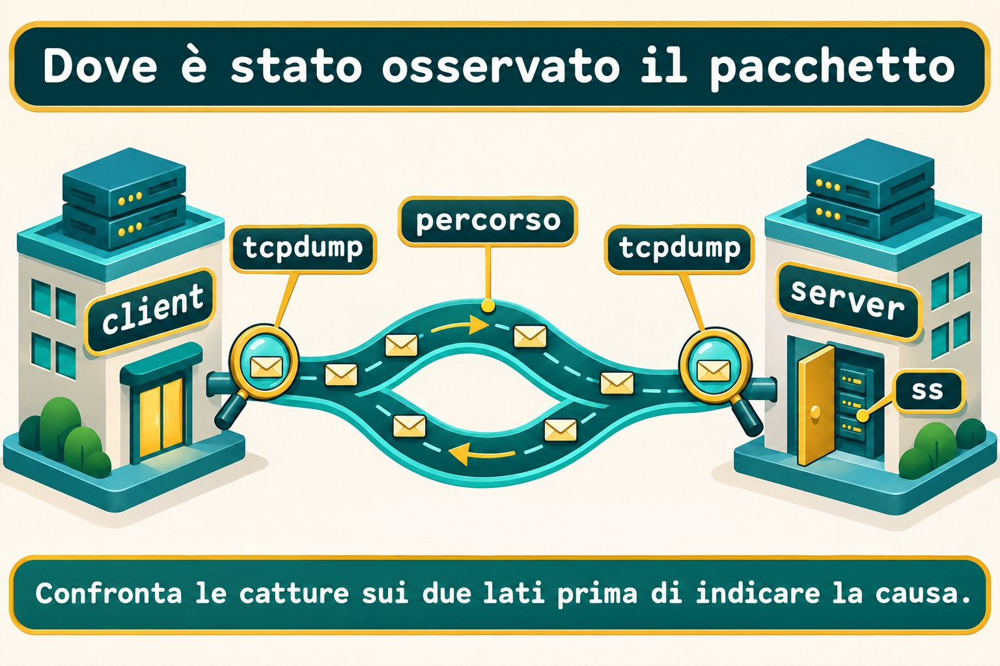

# Lezione 11.5 · Diagnosi di rete

Su Windows Server separi risoluzione, percorso e porta prima di attribuire il problema a tutta la rete. Su Linux farai lo stesso con strumenti piccoli ed evidenze complementari. Questa lezione chiude il modulo: osservi una connessione, introduci guasti controllati e verifichi una configurazione persistente con IPv4 e IPv6.

> **Il cuore di questa lezione:** verifica separatamente nome, percorso, porta e applicazione. Cattura nei punti giusti e limita la conclusione a ciò che hai osservato. Il resto è approfondimento.

| Scheda |  |
| --- | --- |
| **Modulo** | M11 · Rete, lezione 5 di 5 |
| **Quando** | Settimana 17 |
| **Alla fine** | Distingui un errore di risoluzione, un rifiuto TCP e l'assenza di risposta; registri le evidenze prima di intervenire |
| **Prerequisiti** | Lezioni dalla 11.1 alla 11.4; utente `student`, `sudo`, SSH e noVNC sulle due VM |
| **Durata** | Circa 90 minuti, più una sessione per la sfida |
| **Snapshot** | `m11a5-inicio` e `m11a5-fim` sulle VM 201 e 202 |

## 1 · Riscaldamento

Rispondi senza consultare il materiale. Le risposte commentate sono in fondo.

1. Qual è la differenza tra indirizzo configurato, profilo salvato e percorso scelto?
2. Perché `getent` e `dig` possono rispondere in modo diverso per lo stesso nome?
3. Perché cambiare IP dalla stessa sessione SSH richiede una console o un piano di ripristino?

## 2 · Perché conta

L'applicazione non si apre. Il ping risponde e qualcuno conclude che il problema sia nel browser. Controlli il socket: il processo ascolta solo sul loopback. L'indirizzo della VM risponde, ma quella porta non serve l'interfaccia di rete.

Il rapporto deve indicare destinazione, famiglia IP, porta e orario del test. “La rete funziona” non descrive ciò che è stato verificato.

| Osservazione | Conclusione utile |
| --- | --- |
| Il nome restituisce l'IP previsto | La risoluzione usata in questo test ha risposto |
| La connessione TCP si apre | L'apertura TCP ha funzionato su quella porta |
| HTTP restituisce il contenuto previsto | L'applicazione ha risposto alla richiesta verificata |

## 3 · Modello mentale

Pensa all'edificio del corso. Il catalogo indica l'indirizzo; la pianta mostra il percorso; la portineria riceve la connessione; il reparto interno offre il servizio. Trovare la strada non significa ricevere il servizio dal reparto.

```text
nome -> indirizzo -> percorso -> porta TCP -> risposta dell'applicazione
          |          |          |                 |
       getent    ip route      nc               curl
DNS: dig                         sockets: ss
                    osservazione dei pacchetti: tcpdump
```


*Un test riuscito non dimostra il livello successivo.*

### Ponte Windows

| Windows Server | Linux | Domanda |
| --- | --- | --- |
| `Resolve-DnsName` | `dig` | Che cosa ha risposto il server DNS? |
| `Test-NetConnection` | `nc` e `ip route get` | Porta TCP e percorso scelto |
| `Get-NetTCPConnection` | `ss` | Chi ascolta e su quale indirizzo? |
| Cattura dei pacchetti | `tcpdump` | Che cosa è passato in questo punto? |

## 4 · L'essenziale

### Nome, famiglia e percorso

Parti dalla destinazione esatta. Forza IPv4 o IPv6 quando l'ipotesi riguarda una famiglia. Un indirizzo IPv6 locale funzionante non dimostra l'esistenza di un percorso IPv6 verso Internet.

```bash
getent ahostsv4 debian-lab
ip -4 route get 10.1.0.52
ip -6 route get ::1
```

Il primo comando usa NSS. Il secondo consulta la decisione di inoltro del kernel e non invia una sonda. Controlla destinazione, sorgente scelta e interfaccia.

### ICMP e percorso

`ping` verifica le risposte ICMP. `tracepath` usa sonde UDP e risposte dal percorso per mostrare i salti e le informazioni sulla MTU. Un salto silenzioso da solo non identifica dove si sia fermato il traffico dell'applicazione.

```bash
ping -4 -n -c 3 -W 1 10.1.0.52
tracepath -4 -n -m 5 10.1.0.52
```

### La porta non è l'applicazione

`nc -vz` prova a stabilire TCP senza inviare una richiesta applicativa. Un socket in ascolto compare in `ss -lntp`; l'opzione dei processi richiede privilegi per mostrare i processi di altri utenti.

Un rifiuto TCP indica un rifiuto attivo, normalmente un RST. Il timeout indica che il test non ha ricevuto la risposta necessaria entro il limite. L'origine precisa del rifiuto o del silenzio richiede altre evidenze.


*Il silenzio da solo non localizza il guasto.*

### DNS senza scorciatoie nell'interpretazione

`dig` interroga DNS; non usa `/etc/hosts` come fonte dei nomi. Leggi lo stato, il server interrogato e la risposta. `NOERROR` con risposta vuota è diverso da `NXDOMAIN`; nessuna delle due risposte equivale all'assenza di comunicazione con il server.

```bash
dig -r +time=2 +tries=1 . NS
```

Il punto rappresenta la radice DNS. Il comando usa i server configurati; `-r` ignora le impostazioni personali di `dig`. Non nascondere lo stato con una ricerca che mostri soltanto la risposta breve.

### La cattura è un punto di osservazione

Scegli interfaccia, filtro e durata. `-nn` evita la risoluzione di nomi e porte; `-p` evita la modalità promiscua. Una cattura sul client mostra ciò che è stato osservato lì, non ciò che il server ha ricevuto.



*Confronta le catture sui due lati prima di indicare la causa.*

### Rocky × Debian

| Voce | Rocky 9 | Debian 13 |
| --- | --- | --- |
| `nc` di questa lezione | Pacchetto `nmap-ncat` | Pacchetto `netcat-openbsd` |
| `dig` | `bind-utils` | `bind9-dnsutils` |
| `tracepath` | `iputils` | `iputils-tracepath` |
| Cattura | `tcpdump` | `tcpdump` |
| Gestore | NetworkManager | Quello identificato nella 11.3 |

## 5 · Lab guidato

Esegui i test locali su entrambe le VM. Usa tre terminali identificati: A per il server temporaneo, B per i test e C per la cattura. Il servizio HTTP resta sul loopback e non richiede di aprire il firewall.

### Passo 1 · Preparare e proteggere

**Ipotesi:** lo snapshot installa gli strumenti o registra soltanto lo stato attuale della VM?

Sull'host Proxmox, mai dentro le VM:

```bash
qm snapshot 201 m11a5-inicio
qm snapshot 202 m11a5-inicio
```

Su Rocky installa gli strumenti. Su Debian usa il secondo blocco.

```bash
sudo dnf install -y iputils iproute bind-utils nmap-ncat tcpdump python3 curl
```

```bash
sudo apt update
sudo apt install -y iputils-ping iputils-tracepath iproute2 bind9-dnsutils netcat-openbsd tcpdump python3 curl
```

**Output atteso:** snapshot creati e pacchetti installati senza errori.

**Verifica:** sull'host controlla `qm listsnapshot 201` e `qm listsnapshot 202`. Sulle VM controlla `command -v ping tracepath ss dig nc tcpdump python3 curl`.

### Passo 2 · Registrare la situazione iniziale

**Ipotesi:** vedere un percorso nella tabella dimostra che l'altra estremità ha risposto?

Nel terminale B scegli l'IP dell'altra VM: su Rocky usa il primo valore; su Debian il secondo. Esegui una sola assegnazione.

```bash
ALVO=10.1.0.52
```

```bash
ALVO=10.1.0.51
```

Prima di creare la cartella controlla che non esista. Se esiste, conserva altrove i vecchi registri e scegli una sessione pulita.

```bash
test ! -e "$HOME/m11a5"
mkdir -m 700 "$HOME/m11a5"
ip -br address | tee "$HOME/m11a5/address.inicio"
ip -4 route get "$ALVO"
sudo ss -lntp 'sport = :18085'
sudo ss -lnup 'sport = :53'
```

**Output atteso:** percorso verso l'altra VM e nessun ascolto TCP sulla porta `18085`. Annota se esiste DNS locale sulla porta `53`; il test DNS guasto richiede che `127.0.0.2:53` sia libero.

**Verifica:** se compare un ascolto su `18085`, interrompi questa preparazione e scegli un lab senza quel servizio. Anche un ascolto UDP su `0.0.0.0:53` occupa l'indirizzo riservato al guasto.

### Passo 3 · Confrontare TCP e HTTP

**Ipotesi:** una connessione TCP che si apre ha già letto il file dell'applicazione?

Nel terminale A di ogni VM crea il contenuto e lascia il processo in primo piano.

```bash
mkdir "$HOME/m11a5/www"
printf 'NETWORK ok\n' > "$HOME/m11a5/www/index.html"
python3 -m http.server 18085 --bind 127.0.0.1 --directory "$HOME/m11a5/www"
```

Nel terminale B:

```bash
sudo ss -lntp 'sport = :18085'
nc -4 -vz -w 2 127.0.0.1 18085
curl --noproxy '*' -4 --connect-timeout 2 --max-time 4 -fsS http://127.0.0.1:18085/
```

**Output atteso:** ascolto su `127.0.0.1:18085`, connessione TCP accettata e contenuto `NETWORK ok` via HTTP. I messaggi di `nc` differiscono tra le distribuzioni.

**Verifica:** confronta il log del terminale A. Il test `nc` apre TCP; il test `curl` invia una richiesta HTTP e legge la risposta.

### Decidi 1

Il ping risponde, ma il servizio non si apre. Quale test separa meglio porta e applicazione?

| Opzione | Azione |
| --- | --- |
| A | Ripetere il ping altre cento volte |
| B | Verificare la porta con `nc` e poi il protocollo con `curl` |
| C | Cambiare subito il gateway |

Scegli B. L'obiettivo è ottenere una nuova evidenza senza cambiare la rete prima di localizzare il guasto.

### Passo 4 · Osservare l'altra VM

**Ipotesi:** se ICMP non riceve risposta, la porta SSH sarà necessariamente indisponibile?

Nel terminale B mantieni `ALVO` impostato sull'altra VM.

```bash
ping -4 -n -c 3 -W 1 "$ALVO"
timeout 12 tracepath -4 -n -m 5 "$ALVO"
nc -4 -vz -w 2 "$ALVO" 22
```

**Output atteso:** nel lab con SSH operativo la porta `22` accetta la connessione. Registra il risultato reale di ICMP e dei salti; non inventare tempi e non interpretare un salto silenzioso come prova di blocco. Dalla Debian verso la Rocky, `tracepath` può segnare `!H`: il firewalld della Rocky rifiuta le sonde UDP, ma la destinazione è stata raggiunta.

**Verifica:** apri una nuova sessione `ssh rocky-lab` o `ssh debian-lab` da Windows. Il test TCP non ha verificato autenticazione ed esecuzione dei comandi.

### Passo 5 · Leggere una risposta DNS

**Ipotesi:** una risposta DNS negativa e un server che non risponde sono lo stesso incidente?

```bash
cat /etc/resolv.conf
dig -r +time=2 +tries=1 . NS
getent ahostsv4 localhost
```

**Output atteso:** la ricerca DNS mostra il server e il risultato reale della rete del lab. La ricerca locale trova IPv4 di loopback tramite NSS. Se DNS fallisce già, registra il guasto come condizione iniziale prima di introdurne un altro.

**Verifica:** individua nel risultato di `dig` lo stato e il server. Scrivi se hai ricevuto una risposta DNS oppure un errore di comunicazione, senza confondere i due casi.

### Passo 6 · Catturare una piccola transazione

**Ipotesi:** il filtro per la porta HTTP catturerà tutte le sessioni SSH della VM?

Nel terminale C avvia la cattura. Nel B esegui il `curl` del passo 3 mentre è attiva. La cattura esce dall'output standard; la shell di `student` apre il file privato, evitando di dipendere dai permessi dell'utente a cui il programma di cattura riduce i privilegi.

```bash
sudo timeout 15 tcpdump -i lo -nn -p -s 96 -c 20 -w - 'tcp port 18085' > "$HOME/m11a5/http.pcap"
```

Poi, nel B:

```bash
sudo tcpdump -nn -r "$HOME/m11a5/http.pcap"
```

**Output atteso:** pacchetti TCP locali con la porta `18085`. La cattura termina per limite di pacchetti o di tempo; `timeout` restituisce `124` quando interrompe allo scadere del limite.

**Verifica:** trova l'inizio con SYN e SYN/ACK, normalmente indicato da `[S]` e `[S.]`. Il limite di `96` byte serve per questa intestazione locale; non è una cattura integrale del contenuto HTTP.

### Decidi 2

Nella rete tra le VM hai visto uscire SYN dal client, ma non hai osservato una risposta. Che cosa fai?

| Opzione | Azione |
| --- | --- |
| A | Dichiarare che il firewall del server ha bloccato |
| B | Confrontare cattura sulla destinazione e socket in ascolto |
| C | Disattivare la protezione dell'host |

Scegli B. Per ripetere il test SSH, cattura per pochi secondi su ogni VM con il filtro `host 10.1.0.51 and host 10.1.0.52 and tcp port 22`, usando l'interfaccia mostrata da `ip route get`. Cattura soltanto nel tuo lab.

## 6 · Rompi e ripara

### Guasto 1 · Porta senza ascolto

Nel terminale A termina soltanto il server temporaneo con Ctrl+C.

**Sintomo:** `nc` e HTTP falliscono sullo stesso indirizzo che prima funzionava.

**Indagine:** confronta ICMP, socket e tentativo TCP nel terminale B.

```bash
ping -4 -n -c 1 127.0.0.1
sudo ss -lntp 'sport = :18085'
nc -4 -vz -w 2 127.0.0.1 18085
```

**Causa:** l'IP locale funziona, ma il processo ha smesso di ascoltare. Sul loopback normale di questo lab, la porta chiusa riceve un rifiuto immediato.

**Riparazione:** nel terminale A esegui di nuovo il server HTTP del passo 3.

**Verifica:** ripeti il `curl` locale e ottieni `NETWORK ok`.

**Prevenzione:** monitora porta e protocollo previsto, oltre alla presenza dell'host.

### Guasto 2 · Famiglia sbagliata

Mantieni il server attivo soltanto su IPv4 e prova IPv6.

**Sintomo:** IPv4 restituisce la pagina, ma il tentativo verso `::1` fallisce.

**Indagine:** controlla l'indirizzo esatto del socket.

```bash
ping -6 -n -c 1 ::1
sudo ss -lntp 'sport = :18085'
nc -6 -vz -w 2 ::1 18085
```

**Causa:** il server è stato associato a `127.0.0.1`; questo non crea un ascolto su `::1`.

**Riparazione:** termina il server con Ctrl+C nel terminale A e avvia l'ascolto IPv6 locale.

```bash
python3 -m http.server 18085 --bind ::1 --directory "$HOME/m11a5/www"
```

**Verifica:** nel terminale B esegui i due test seguenti.

```bash
nc -6 -vz -w 2 ::1 18085
curl --noproxy '*' -6 --connect-timeout 2 --max-time 4 -fsS 'http://[::1]:18085/'
```

**Prevenzione:** annota famiglia, indirizzo di ascolto e porta come parte della configurazione del servizio.

### Guasto 3 · Interrogare il DNS sbagliato

**Sintomo:** la ricerca esplicita seguente fallisce, mentre la ricerca DNS del passo 5 aveva risposto. Esegui questo confronto soltanto dopo aver ottenuto la risposta normale di riferimento. Questo guasto riguarda soltanto il comando, senza modificare la configurazione globale.

**Indagine:** conferma l'assenza di ascolto su `127.0.0.2:53`, poi confronta le ricerche.

```bash
dig -r @127.0.0.2 +time=1 +tries=1 . NS
dig -r +time=2 +tries=1 . NS
```

**Causa:** la prima ricerca ha scelto un indirizzo senza server DNS. La seconda è tornata alla configurazione normale. Il messaggio esatto dell'errore varia tra le versioni: il `dig` della Rocky segnala tempo scaduto, mentre quello della Debian segnala un rifiuto. Leggi lo stato del comando, non solo la frase.

**Riparazione:** rimuovi dal comando il server esplicito errato. Non modificare `/etc/hosts` per nascondere il guasto.

**Verifica:** la ricerca normale deve tornare al risultato di riferimento annotato nel passo 5.

**Prevenzione:** registra il server effettivamente interrogato insieme alla risposta DNS.

### Pulizia

Termina il server temporaneo con Ctrl+C nel terminale A. Le catture terminano già per tempo o conteggio; conserva la cartella privata come registro. Nel lab guidato non è stato modificato alcun file globale di rete.

```bash
sudo ss -lntp 'sport = :18085'
ip -br address
```

Confronta gli indirizzi con `address.inicio`. La sfida seguente crea e rimuove soltanto un'interfaccia di esercizio, senza cambiare l'indirizzo usato da SSH.

## 7 · Trappole

| Errore comune | Che cosa fare | Perché |
| --- | --- | --- |
| Il ping risponde, l'applicazione funziona | Verificare TCP e il protocollo | ICMP non verifica HTTP |
| Un salto non risponde, il guasto è lì | Confrontare il traffico reale sui due lati | Sonde e applicazione usano traffici diversi |
| Catturare tutto senza limiti | Limitare interfaccia, filtro e durata | Riduce l'esposizione e facilita l'analisi |
| Usare `dig` aspettandosi che legga hosts | Confrontare separatamente DNS e NSS | Le fonti consultate sono diverse |
| Usare un glob protetto prima di `sudo` | Lasciare al programma privilegiato la selezione dei file | La shell normale espande prima il glob |

## 8 · Quiz

1. Un `nc` TCP accettato dimostra che l'accesso SSH è stato autorizzato?
2. Quale test mostra una decisione di percorso senza inviare una sonda?
3. Come distingui una risposta DNS negativa dall'assenza di una risposta DNS?
4. Un SYN osservato soltanto sul client dimostra che il server lo abbia ricevuto?
5. Un ascolto su `127.0.0.1` serve automaticamente `::1`?
6. Perché verificare la configurazione dopo il reboot?

## 9 · Promemoria

| Operazione | Comando |
| --- | --- |
| Consultare la risoluzione NSS | `getent ahostsv4 localhost` |
| Interrogare DNS | `dig -r +time=2 +tries=1 . NS` |
| Decisione IPv4 | `ip -4 route get 10.1.0.52` |
| Ascolto TCP e processo | `sudo ss -lntp` |
| Tentativo TCP | `nc -4 -vz -w 2 10.1.0.52 22` |
| Leggere la cattura senza risolvere nomi | `sudo tcpdump -nn -r "$HOME/m11a5/http.pcap"` |

**Flashcard:** crea quattro schede su risoluzione, percorso, TCP e applicazione. Ripassa a D+1, D+3, D+7 e D+21.

## 10 · Checklist e chiusura

- [ ] Ho eseguito il lab guidato sulle due distribuzioni.
- [ ] Ho separato le evidenze di ICMP, TCP, DNS e HTTP.
- [ ] Ho spiegato i tre guasti senza disattivare protezioni.
- [ ] Ho completato la sfida, ripristinato DNS e rimosso il profilo di esercizio.

**Ultimo esercizio:** scrivi un rapporto con sintomo, ipotesi, test, risultato e conclusione. Individua un'affermazione che le tue evidenze non consentono ancora di fare.

**Reboot di verifica:** esegui prima la verifica di persistenza della sfida. Dopo averla pulita, riavvia entrambe le VM e conferma SSH, indirizzi originali, DNS normale e assenza del server temporaneo e dell'interfaccia di esercizio.

```bash
sudo systemctl reboot
```

Dopo aver completato la sfida e la pulizia, crea gli snapshot finali sull'host Proxmox.

```bash
qm snapshot 201 m11a5-fim
qm snapshot 202 m11a5-fim
```

## 11 · Nella vita reale

Su un server che amministri o che sei autorizzato a ispezionare, svolgi una missione di sola lettura. Osserva indirizzi, percorsi e socket con `ip -br address`, `ip route` e `sudo ss -lntp`. Non installare strumenti, non modificare profili e non catturare traffico degli utenti in questa missione.

Quale servizio ascolta soltanto sul loopback? Quale ascolta su un indirizzo di rete? Quale evidenza aggiuntiva servirebbe per confermare il funzionamento di un'applicazione per un client remoto?

## 12 · Approfondire quando vuoi

- [ping(8)](https://man7.org/linux/man-pages/man8/ping.8.html) e [tracepath(8)](https://man7.org/linux/man-pages/man8/tracepath.8.html): sonde e interpretazione.
- [ss(8)](https://man7.org/linux/man-pages/man8/ss.8.html) e [nc(1)](https://manpages.debian.org/trixie/netcat-openbsd/nc.1.en.html): socket e tentativi TCP.
- [Ncat](https://nmap.org/ncat/guide/ncat-usage.html), [dig(1)](https://manpages.debian.org/trixie/bind9-dnsutils/dig.1.en.html) e [tcpdump(8)](https://manpages.debian.org/trixie/tcpdump/tcpdump.8.en.html): varianti e opzioni del lab.
- [nmcli](https://networkmanager.pages.freedesktop.org/NetworkManager/NetworkManager/nmcli.html) e [proprietà IPv4](https://networkmanager.pages.freedesktop.org/NetworkManager/NetworkManager/settings-ipv4.html): persistenza e priorità DNS della sfida.

**DeepTutor** (http://10.1.0.149:3782, KB "Curso Linux Sysadmin"):

- `!explica Compare ping, nc, curl e tcpdump e limite a conclusão de cada teste.`
- `!feynman Vou explicar por que SYN sem resposta não identifica sozinho a causa. Critique minha explicação.`
- `!quiz Crie seis incidentes de resolução, rota, porta e aplicação sem sugerir desligar proteções.`

## Sfida del M11 · Indirizzo persistente, DNS ripristinato

Sulla VM 201 realizza IPv4 e IPv6 statici che sopravvivano al reboot. Usa un'interfaccia dummy dedicata, senza cambiare l'interfaccia di accesso né annunciare DHCP in rete. Questa scelta verifica la persistenza locale; non dimostra connettività IPv6 esterna.

Svolgi la fase DNS dal noVNC. Modifica temporaneamente il resolver usato dalla VM. La ricerca DNS iniziale deve funzionare e `127.0.0.2:53` deve essere libero, come nel passo 2.

### Preparazione e criteri

Questo percorso usa Rocky standard con NetworkManager che gestisce direttamente `/etc/resolv.conf`, senza un intermediario DNS locale. Controlla `ls -l /etc/resolv.conf`, `sudo NetworkManager --print-config` e l'intestazione del file prima di procedere. Se l'origine è diversa, adatta il percorso con il responsabile del lab prima di applicare il guasto globale.

Conferma che non esistano il profilo `m11final` e l'interfaccia `m11dummy5`. Se esistono, non riutilizzare il lavoro precedente senza rivederlo. I prefissi di documentazione seguenti restano soltanto su questa interfaccia locale.

```bash
nmcli connection show
ip link show
dig -r +time=2 +tries=1 . NS
sudo nmcli connection add type dummy ifname m11dummy5 con-name m11final connection.autoconnect yes ipv4.method manual ipv4.addresses 192.0.2.15/24 ipv4.never-default yes ipv6.method manual ipv6.addresses 2001:db8:15::15/64 ipv6.never-default yes
sudo nmcli connection up m11final
ip -br address show dev m11dummy5
```

Attendi che IPv6 non sia più `tentative` in `ip -6 address show dev m11dummy5`. Riavvia la VM 201 e conferma profilo attivo, indirizzi presenti e i due test locali:

```bash
nmcli connection show --active
ip -br address show dev m11dummy5
ping -4 -n -c 1 192.0.2.15
ping -6 -n -c 1 2001:db8:15::15
```

### Guasto DNS e ripristino

Registra prima la ricerca DNS normale. Poi, nel noVNC, configura nel profilo di esercizio un DNS errato con priorità negativa. In questo gestore la priorità negativa più bassa esclude dalla selezione DNS i server dei profili con priorità maggiore.

```bash
sudo nmcli connection modify m11final ipv4.dns 127.0.0.2 ipv4.dns-priority -100
sudo nmcli connection up m11final
cat /etc/resolv.conf
dig -r +time=1 +tries=1 . NS
ping -4 -n -c 1 192.0.2.15
```

Prima di concludere, controlla che l'unico server selezionato nel file sia `127.0.0.2`. DNS deve fallire mentre l'IP locale continua a funzionare. Se esiste un altro server, non attribuire alcun successo o errore a questo guasto: rivedi origine e priorità.

Rimuovi soltanto le proprietà che hai aggiunto al nuovo profilo e verifica il ritorno alla risposta DNS iniziale. Non modificare a mano il file generato.

```bash
sudo nmcli connection modify m11final ipv4.dns '' ipv4.dns-priority 0
sudo nmcli connection up m11final
cat /etc/resolv.conf
dig -r +time=2 +tries=1 . NS
```

Consegna il confronto prima e dopo il reboot, il guasto DNS, il ripristino e una spiegazione del motivo per cui ICMP locale continuava a funzionare. Mostrare il profilo salvato non basta.

### Pulizia della sfida

Dopo aver conservato le evidenze, rimuovi il profilo e l'interfaccia creati. Conferma il ripristino DNS prima di uscire dalla console.

```bash
sudo nmcli connection down m11final
sudo nmcli connection delete m11final
sudo ip link delete m11dummy5
dig -r +time=2 +tries=1 . NS
ip -br address
```

Se l'interfaccia non esiste più dopo la disattivazione del profilo, il comando di eliminazione lo segnala; conferma l'assenza con `ip link show`. Gli indirizzi dell'interfaccia SSH devono restare uguali a quelli iniziali.

## Soluzioni commentate

### Riscaldamento

1. L'indirizzo appartiene allo stato attivo; il profilo conserva l'intenzione persistente; il percorso decide l'uscita verso una destinazione. Controlla tutti e tre.
2. `getent` usa NSS; `dig` interroga DNS. Un nome locale in hosts non deve necessariamente esistere nel DNS.
3. La sessione dipende dall'indirizzo e dal percorso che stai modificando. Il noVNC consente di intervenire senza dipendere da quell'SSH.

### Quiz

1. No. L'apertura TCP precede l'autenticazione del servizio.
2. `ip route get` consulta la decisione del kernel per la destinazione indicata.
3. La risposta negativa contiene uno stato DNS; l'assenza di risposta compare come errore di comunicazione o timeout. Leggi anche il server interrogato.
4. No. Confronta la cattura della destinazione e considera il percorso di ritorno prima di indicare una causa.
5. No. IPv4 e IPv6 sono famiglie distinte; controlla l'ascolto effettivo.
6. Lo stato attivo potrebbe essere stato creato senza persistenza. Il reboot verifica se il gestore ricostruisce la configurazione salvata.

### Suggerimenti per la sfida

Separa intenzione, stato e comportamento: profilo salvato, indirizzo attivo dopo il reboot e test di risposta locale. Per DNS confronta il file generato con la proprietà ricevuta dal gestore. La correzione deve avvenire all'origine della configurazione.

Il prossimo modulo usa queste evidenze per approfondire SSH e protezione dell'host. Conserva il rapporto: vale più di un elenco di comandi senza contesto.

<!-- navegacao -->
[← Lezione 11.4 · Nomi e risoluzione](11.4-nomes-e-resolucao.md) · [Indice delle lezioni](../01-aulas.md) · [Lezione 12.1 · SSH in dettaglio →](12.1-ssh-a-fundo.md)
