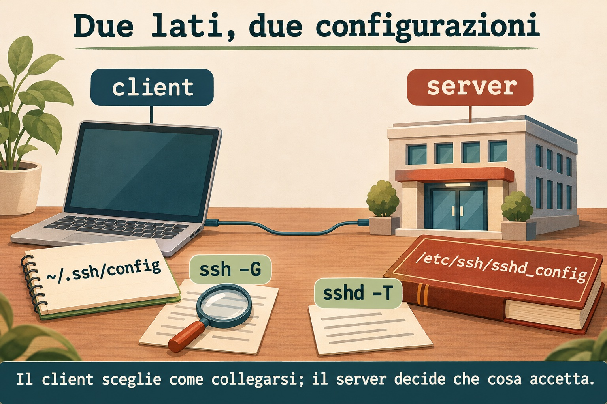
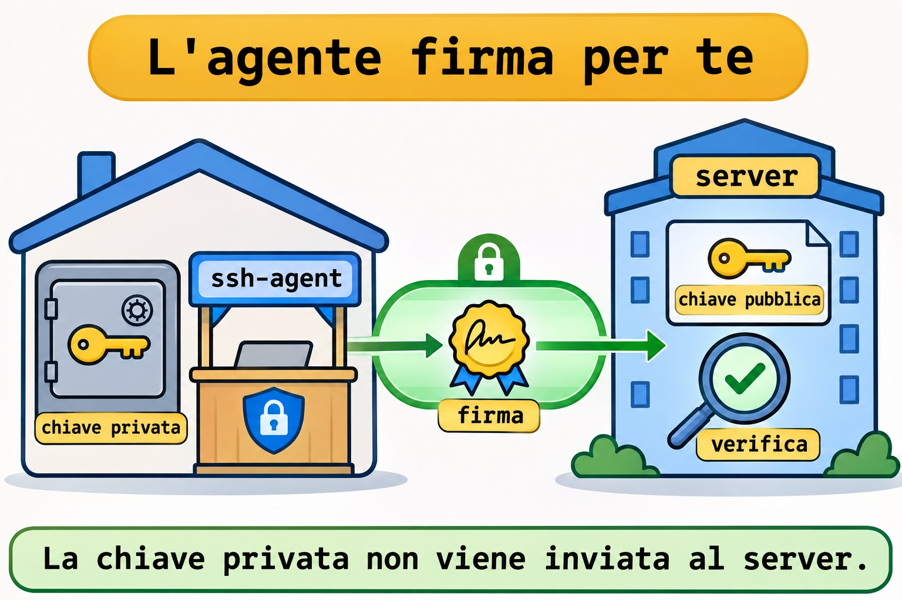
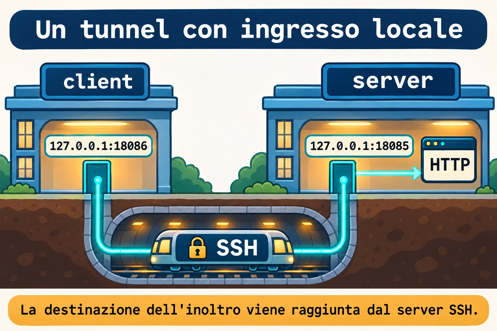

# Lezione 12.1 · SSH in dettaglio

Su Windows Server sai già distinguere identità, credenziale e destinazione. In SSH questa distinzione compare nella chiave dell'utente, nella chiave dell'host e nella configurazione del client. Dopo la diagnosi di rete del M11 organizzerai connessioni, userai un agente e aprirai un tunnel accessibile soltanto localmente.

> **Il cuore di questa lezione:** il client decide come arrivare; il server decide che cosa permette; la chiave dell'host identifica la destinazione. Valida la configurazione prima di applicarla e conserva una sessione di ripristino. Il resto è approfondimento.

| Scheda |  |
| --- | --- |
| **Modulo** | M12 · Sicurezza dell'host, lezione 1 di 5 |
| **Quando** | Settimana 17 |
| **Alla fine** | Verifichi le identità, organizzi il client, usi agente e tunnel locale e validi le regole del server senza perdere accesso |
| **Prerequisiti** | Lezioni 0.2 e 11.5; `student`, SSH con chiave sulle due VM, `sudo`, `python3`, `curl` e noVNC |
| **Durata** | Circa 90 minuti |
| **Snapshot** | `m12a1-inicio` e `m12a1-fim` sulle VM 201 e 202 |

## 1 · Riscaldamento

Rispondi senza consultare il materiale. Le soluzioni sono in fondo.

1. Collegarsi alla porta `22` con `nc` dimostra che la tua chiave è stata accettata?
2. Perché un ascolto su `127.0.0.1` non serve direttamente un'altra macchina?
3. Qual è la differenza tra una configurazione salvata e il comportamento effettivo?

## 2 · Perché conta

Ricevi un avviso di chiave dell'host cambiata. Eliminare la voce e riprovare fa sparire il messaggio, ma non spiega chi ci sia dall'altra parte. Il metodo professionale consiste nel verificare l'impronta dalla console attendibile prima di accettare la nuova identità.

Un'altra segnalazione riguarda una pagina interna che non si apre. Il servizio ascolta soltanto sul loopback del server. Un inoltro locale permette di raggiungere quella porta tramite SSH senza pubblicare HTTP sulla rete.

| Elemento | Domanda |
| --- | --- |
| Chiave dell'host | Sto parlando con il server previsto? |
| Chiave dell'utente | Questo utente controlla la credenziale autorizzata? |
| Regola del server | Questa operazione è consentita per questa connessione? |

## 3 · Modello mentale

Il client conserva un'agenda degli edifici. Il server mantiene la propria portineria e un elenco di chiavi pubbliche autorizzate. L'agente è uno sportello locale che esegue firme con una chiave caricata; non consegna la chiave privata all'edificio.

```text
client: destinazione + identità -> canale SSH -> server: regole + autorizzazione
           |                                      |
      ~/.ssh/config                       /etc/ssh/sshd_config
           |                                      |
        ssh -G                                 sshd -T
```



*Il client sceglie come collegarsi; il server decide che cosa accetta.*

### Ponte Windows

| Concetto | Windows con OpenSSH | Linux |
| --- | --- | --- |
| Configurazione dell'utente | `$HOME\.ssh\config` | `~/.ssh/config` |
| Agente | Servizio `ssh-agent` | Processo e socket dell'agente |
| Caricare una chiave | `ssh-add` | `ssh-add` |
| Ispezionare la destinazione | `ssh -G` | `ssh -G` |

Su Windows l'agente è un servizio: la preparazione può richiedere PowerShell elevata. Il lab dell'agente seguente si svolge su Linux e usa un processo temporaneo, senza modificare il servizio Windows.

## 4 · L'essenziale

### Due chiavi con funzioni diverse

La chiave pubblica dell'utente entra in `authorized_keys` sul server. La privata resta protetta sul client. Le chiavi dell'host identificano il server; la pubblica corrispondente viene registrata in `known_hosts` sul client dopo la verifica.

Usa una passphrase per la chiave privata. L'agente riduce la ripetizione della digitazione, ma una sessione locale compromessa può comunque usare le operazioni di firma offerte dall'agente.



*La chiave privata non viene inviata al server.*

### Configurazione del client

`ssh -G` mostra la configurazione calcolata senza aprire la connessione. In generale prevale il primo valore trovato per un'opzione; metti le destinazioni specifiche prima delle regole generali. `-F` permette di verificare un'agenda separata senza modificare quella esistente.

`IdentitiesOnly yes` limita le identità offerte a quelle configurate. Non usare `StrictHostKeyChecking no` come soluzione per un'identità sconosciuta del server.

### Tunnel locale e salto

In `-L 127.0.0.1:18086:127.0.0.1:18085`, il primo indirizzo è l'ingresso sul client. Il secondo è la destinazione raggiunta dal server SSH. I due loopback appartengono a lati diversi della connessione.

`-N` evita il comando remoto. `ExitOnForwardFailure yes` rileva un errore nella creazione dell'ascolto locale, ma non dimostra che il servizio di destinazione stia funzionando.



*La destinazione dell'inoltro viene raggiunta dal server SSH.*

`ProxyJump` usa un server intermedio per trasportare la connessione fino alla destinazione. L'autenticazione della destinazione resta sul client; non serve copiare la chiave privata sull'intermedio né inoltrare l'agente.

### Server sicuro, modifica verificabile

`sshd -t` verifica sintassi e condizioni della configurazione; `sshd -T` mostra i valori effettivi. Con `-C` fornisci i dati di una connessione per valutare le regole `Match`. Nessuno di questi test sostituisce una nuova connessione reale.

Prima di applicare regole: prepara noVNC, conserva la sessione attuale, valida, ricarica e verifica una seconda sessione con la chiave. Solo dopo chiudi la prima. In questa lezione validi una configurazione candidata fuori da `/etc`; non ricarichi il servizio attivo.

### Rocky × Debian

| Voce | Rocky 9 | Debian 13 |
| --- | --- | --- |
| Client | `openssh-clients` | `openssh-client` |
| Server | `openssh-server` | `openssh-server` |
| Unità di servizio | `sshd.service` | `ssh.service` |
| Validatore | `/usr/sbin/sshd` | `/usr/sbin/sshd` |
| Politica aggiuntiva | SELinux e politica crittografica | Configurazione e politiche locali |

## 5 · Lab guidato

Ripeti i test locali sulle due VM come `student`. Crei una chiave dedicata all'esercizio e usi SSH da ogni VM verso se stessa. Questo isola l'apprendimento senza sostituire la chiave che consente già l'accesso da Windows.

### Passo 1 · Proteggere e controllare

**Ipotesi:** uno snapshot sostituisce la verifica della chiave dell'host?

Sull'host Proxmox:

```bash
qm snapshot 201 m12a1-inicio
qm snapshot 202 m12a1-inicio
```

Nel terminale B di ogni VM conferma utente e prerequisiti. La cartella di esercizio deve essere assente prima di crearne una nuova.

```bash
id -un
command -v ssh ssh-keygen ssh-agent ssh-add python3 curl
test ! -e "$HOME/m12a1"
mkdir -m 700 "$HOME/m12a1"
sudo ss -lntp 'sport = :22'
sudo ss -lntp 'sport = :18085 or sport = :18086'
```

**Output atteso:** utente `student`, strumenti trovati, SSH in ascolto e porte `18085` e `18086` libere. Se una verifica fallisce, correggi la preparazione prima di proseguire.

**Verifica:** mantieni aperta la sessione da Windows e conferma che la console noVNC della VM sia disponibile.

### Passo 2 · Creare identità e agenda di esercizio

**Ipotesi:** il server deve ricevere la chiave privata per autorizzare quella pubblica?

Crea la chiave con una passphrase. Non lasciare vuoto il campo. I percorsi seguenti sono dedicati a questa lezione.

```bash
ssh-keygen -t ed25519 -f "$HOME/m12a1/id_ed25519" -C m12a1-lab
chmod 700 "$HOME/.ssh"
cp -a "$HOME/.ssh/authorized_keys" "$HOME/m12a1/authorized_keys.inicio"
printf '\n' >> "$HOME/.ssh/authorized_keys"
cat "$HOME/m12a1/id_ed25519.pub" >> "$HOME/.ssh/authorized_keys"
chmod 600 "$HOME/.ssh/authorized_keys"
cat > "$HOME/m12a1/config" <<'EOF'
Host m12-local
    HostName 127.0.0.1
    User student
    Port 22
    IdentityFile ~/m12a1/id_ed25519
    IdentitiesOnly yes
    UserKnownHostsFile ~/m12a1/known_hosts
    HostKeyAlgorithms ssh-ed25519
    ForwardAgent no
    ExitOnForwardFailure yes
    ServerAliveInterval 30
    ServerAliveCountMax 3
EOF
chmod 600 "$HOME/m12a1/config"
ssh -F "$HOME/m12a1/config" -G m12-local | grep -E '^(hostname|user|port|identityfile|forwardagent) '
```

**Output atteso:** coppia di chiavi creata, soltanto la pubblica aggiunta all'autorizzazione e configurazione calcolata che punta al loopback. Il file `authorized_keys` esisteva già grazie all'accesso con chiave della lezione 0.2.

**Verifica:** `ssh -G` non ha aperto una sessione né confermato l'accettazione della chiave. Controlla utente, destinazione e file d'identità prima del tentativo reale.

### Passo 3 · Verificare l'host e autenticarsi

**Ipotesi:** l'impronta richiesta al primo accesso appartiene alla tua chiave utente oppure al server?

Dalla console attendibile della VM leggi l'impronta della chiave pubblica dell'host. Nel terminale B apri l'accesso di esercizio e confrontala prima di accettare.

```bash
sudo ssh-keygen -lf /etc/ssh/ssh_host_ed25519_key.pub
ssh -F "$HOME/m12a1/config" m12-local 'id -un; hostname'
```

**Output atteso:** il primo accesso usa l'agenda separata, chiede conferma dell'identità non ancora registrata e richiede la passphrase della chiave. Il comando remoto mostra `student` e l'hostname della stessa VM.

**Verifica:** l'impronta mostrata durante l'accesso deve coincidere con quella ottenuta dalla console. Se non coincide, fermati e indaga.

### Decidi 1

SSH avvisa che la chiave dell'host è cambiata. Che cosa fai per prima cosa?

| Opzione | Azione |
| --- | --- |
| A | Eliminare tutte le voci di `known_hosts` |
| B | Verificare l'identità dalla console attendibile |
| C | Disattivare la verifica dell'host |

Scegli B. Una reinstallazione può spiegare il cambiamento, ma la conferma deve provenire da una fonte indipendente dalla connessione in dubbio.

### Passo 4 · Usare un agente temporaneo

**Ipotesi:** caricare la chiave nell'agente elimina il file privato dal disco?

Nel terminale B apri una shell figlia sotto un agente dedicato. I comandi seguenti vengono eseguiti al suo interno.

```bash
ssh-agent bash
ssh-add -t 600 "$HOME/m12a1/id_ed25519"
ssh-add -l
ssh -F "$HOME/m12a1/config" -o BatchMode=yes m12-local 'id -un'
```

**Output atteso:** un'identità caricata per un massimo di dieci minuti e accesso senza una nuova richiesta della passphrase. L'agente può firmare usando la chiave in memoria; il file privato continua a esistere.

**Verifica:** il comando con `BatchMode=yes` non può ricorrere a una richiesta interattiva. Se fallisce dopo dieci minuti, ricarica soltanto la chiave di esercizio con `ssh-add`.

### Passo 5 · Aprire un inoltro locale

**Ipotesi:** aprire il tunnel pubblica HTTP su tutte le interfacce del client?

Nel terminale A della stessa VM avvia HTTP soltanto sul loopback.

```bash
mkdir "$HOME/m12a1/www"
printf 'SSH TUNNEL ok\n' > "$HOME/m12a1/www/index.html"
python3 -m http.server 18085 --bind 127.0.0.1 --directory "$HOME/m12a1/www"
```

Nel terminale B, dentro la shell dell'agente, lascia il tunnel in primo piano. Nel C esegui i test del secondo blocco.

```bash
ssh -F "$HOME/m12a1/config" -N -L 127.0.0.1:18086:127.0.0.1:18085 m12-local
```

```bash
ss -lnt 'sport = :18086'
curl --noproxy '*' --connect-timeout 2 --max-time 4 -fsS http://127.0.0.1:18086/
```

**Output atteso:** ingresso su `127.0.0.1:18086` e risposta `SSH TUNNEL ok`. SSH trasporta la connessione fino alla porta HTTP sul lato server.

**Verifica:** `ss` deve mostrare loopback, non `0.0.0.0` né `[::]`. In questo esercizio i due lati sono sulla stessa VM, ma restano ruoli diversi; nell'uso remoto l'ultimo loopback appartiene alla VM di destinazione.

### Decidi 2

Il tunnel si è aperto, ma HTTP fallisce. Che cosa controlli prima di attribuire il problema alla crittografia?

| Opzione | Azione |
| --- | --- |
| A | L'indirizzo e la porta del servizio sul lato server |
| B | Eliminare la chiave privata |
| C | Aprire HTTP a tutta la rete |

Scegli A. L'ascolto locale può esistere mentre la destinazione dell'inoltro è errata oppure senza servizio.

### Passo 6 · Salto e configurazione candidata

**Ipotesi:** passare da un intermedio richiede di lasciarvi la chiave privata?

Dal terminale Windows già preparato nella 0.2 esegui il salto attraverso Rocky fino a Debian. Gli alias esistenti conservano utente e file della chiave di ogni destinazione. Il client locale deve potersi autenticare sulle due VM con le chiavi esistenti. Verifica ogni nuova identità dalla console.

```bash
ssh -o ForwardAgent=no -J rocky-lab debian-lab hostname
```

Sulle due VM ispeziona le regole attuali senza modificarle e scrivi una candidata separata. Questa porta candidata non verrà aperta.

```bash
sudo /usr/sbin/sshd -t
sudo /usr/sbin/sshd -T -C user=student,host=localhost,addr=127.0.0.1 | grep -E '^(permitrootlogin|pubkeyauthentication|passwordauthentication|kbdinteractiveauthentication|allowtcpforwarding|allowagentforwarding) '
cat > "$HOME/m12a1/sshd.candidate" <<'EOF'
Port 22285
ListenAddress 127.0.0.1
HostKey /etc/ssh/ssh_host_ed25519_key
PidFile /run/sshd-m12a1.pid
AuthorizedKeysFile .ssh/authorized_keys
PermitRootLogin no
PubkeyAuthentication yes
PasswordAuthentication no
KbdInteractiveAuthentication no
UsePAM yes
AllowAgentForwarding no
AllowTcpForwarding local
X11Forwarding no
EOF
sudo /usr/sbin/sshd -t -f "$HOME/m12a1/sshd.candidate"
sudo /usr/sbin/sshd -T -f "$HOME/m12a1/sshd.candidate" -C user=student,host=localhost,addr=127.0.0.1 | grep -E '^(permitrootlogin|pubkeyauthentication|passwordauthentication|kbdinteractiveauthentication|allowtcpforwarding|allowagentforwarding) '
```

**Output atteso:** il salto restituisce l'hostname di Debian. La candidata supera il controllo di sintassi e mostra accesso root e autenticazioni interattive disattivati, chiave pubblica attiva, inoltro dell'agente disattivato e inoltro TCP locale consentito.

**Verifica:** la candidata non contiene `Include`, quindi in questo test non eredita i file attivi. Nessuna di queste opzioni è stata applicata al servizio: la porta `22` e l'accesso normale devono continuare a funzionare.

## 6 · Rompi e ripara

### Guasto 1 · Destinazione client errata

**Sintomo:** il tentativo seguente fallisce, ma la sessione già aperta continua a funzionare.

**Indagine:** confronta la porta calcolata con quella in ascolto.

```bash
ssh -F "$HOME/m12a1/config" -p 22286 -G m12-local | grep '^port '
ssh -F "$HOME/m12a1/config" -p 22286 -o ConnectTimeout=3 m12-local hostname
sudo ss -lntp 'sport = :22 or sport = :22286'
```

**Causa:** l'opzione sulla riga di comando ha sostituito la porta dell'agenda. L'errore avviene prima dell'autenticazione.

**Riparazione:** rimuovi `-p 22286` dal tentativo e usa l'agenda validata.

**Verifica:** `ssh -F "$HOME/m12a1/config" m12-local hostname` torna a rispondere.

**Prevenzione:** consulta `ssh -G` prima di cambiare il server per compensare un errore del client.

### Guasto 2 · Tunnel aperto, destinazione chiusa

Termina il tunnel nel terminale B con Ctrl+C. Conferma che `18087` non sia in ascolto e usa quella porta errata come destinazione.

**Sintomo:** l'ingresso locale esiste, ma HTTP non restituisce il contenuto.

**Indagine:** nel terminale B apri il tunnel seguente; nel C ripeti il `curl` dell'ingresso.

```bash
ss -lnt 'sport = :18087'
ssh -F "$HOME/m12a1/config" -N -L 127.0.0.1:18086:127.0.0.1:18087 m12-local
```

**Causa:** l'ingresso è stato creato, ma il server SSH non trova un servizio nella destinazione scelta. Il terminale del tunnel segnala l'errore di apertura del canale.

**Riparazione:** termina questo tunnel e riapri il comando del passo 5 con destinazione `18085`.

**Verifica:** lo stesso `curl` torna a mostrare `SSH TUNNEL ok`.

**Prevenzione:** registra i due lati dell'inoltro; verificare l'ascolto locale non verifica l'applicazione remota.

### Guasto 3 · Regola non valida prima di applicare

**Sintomo:** la candidata non supera più la validazione, ma SSH attivo resta disponibile.

**Indagine:** aggiungi una direttiva inesistente soltanto alla copia di esercizio.

```bash
printf '\nInvalidOption yes\n' >> "$HOME/m12a1/sshd.candidate"
sudo /usr/sbin/sshd -t -f "$HOME/m12a1/sshd.candidate"
```

**Causa:** la direttiva non esiste. Il validatore indica il file e la riga problematica senza dover riavviare il servizio.

**Riparazione:** rimuovi soltanto la riga introdotta nella candidata.

```bash
sed -i '/^InvalidOption yes$/d' "$HOME/m12a1/sshd.candidate"
sudo /usr/sbin/sshd -t -f "$HOME/m12a1/sshd.candidate"
```

**Verifica:** la candidata supera di nuovo il controllo; apri una nuova sessione normale da Windows per verificare che il servizio reale resti accessibile.

**Prevenzione:** valida sintassi e valori effettivi prima di ricaricare. Dopo l'applicazione verifica una seconda sessione prima di chiudere la prima.

### Pulizia

Termina il tunnel con Ctrl+C nel terminale B e HTTP con Ctrl+C nel terminale A. Nel B rimuovi soltanto la chiave di esercizio dall'agente ed esci dalla shell figlia. Non usare l'opzione che rimuove tutte le identità da un agente condiviso.

```bash
ssh-add -d "$HOME/m12a1/id_ed25519"
exit
```

Ora nella shell originale rimuovi soltanto la riga della pubblica aggiunta. Il filtro conserva le altre chiavi; un output vuoto del filtro non autorizza a ripristinare alla cieca l'intero backup. Il separatore vuoto aggiunto nella preparazione può restare.

```bash
grep -vxF -f "$HOME/m12a1/id_ed25519.pub" "$HOME/.ssh/authorized_keys" > "$HOME/m12a1/authorized_keys.clean"
diff -u "$HOME/.ssh/authorized_keys" "$HOME/m12a1/authorized_keys.clean"
```

Controlla nel `diff` che sia stata rimossa soltanto la riga `m12a1-lab`. Solo dopo questa verifica scrivi il risultato.

```bash
cat "$HOME/m12a1/authorized_keys.clean" > "$HOME/.ssh/authorized_keys"
chmod 600 "$HOME/.ssh/authorized_keys"
sudo ss -lntp 'sport = :18085 or sport = :18086'
```

Conserva i file di esercizio nella cartella privata; la chiave non è più autorizzata. Non modificare la chiave Windows né l'autorizzazione originale.

## 7 · Trappole

| Errore comune | Che cosa fare | Perché |
| --- | --- | --- |
| Copiare la privata sull'intermedio | Usare `ProxyJump` | Il client si autentica sulla destinazione |
| Aprire il tunnel su tutte le interfacce | Associare l'ingresso a `127.0.0.1` | Mantiene locale l'ingresso |
| Confondere `ssh_config` con `sshd_config` | Identificare client e server | Ogni lato decide cose diverse |
| Disattivare la password prima di verificare la chiave | Validare una nuova sessione e conservare la console | Evita di perdere accesso |
| Rimuovere tutta la fiducia del client | Verificare l'identità e correggere la voce specifica | Conserva le altre destinazioni |

## 8 · Quiz

1. Quale chiave identifica il server e dove viene registrata la fiducia del client?
2. `ssh -G` dimostra l'autenticazione?
3. Che cosa limita `IdentitiesOnly yes`?
4. In un tunnel locale, a quale macchina appartiene l'ultimo `127.0.0.1`?
5. Perché il salto non richiede di inoltrare l'agente?
6. Quale sequenza evita di perdere accesso quando si rafforza il server?

## 9 · Promemoria

| Operazione | Comando |
| --- | --- |
| Configurazione calcolata del client | `ssh -G rocky-lab` |
| Impronte delle identità dell'agente | `ssh-add -l` |
| Sintassi del server attivo | `sudo /usr/sbin/sshd -t` |
| Valori effettivi per una connessione | `sudo /usr/sbin/sshd -T -C user=student,host=localhost,addr=127.0.0.1` |
| Analizzare un tentativo | `ssh -vv rocky-lab` |

**Flashcard:** crea schede su chiave dell'host, chiave dell'utente, agente, precedenza del client e lati del tunnel. Ripassa a D+1, D+3, D+7 e D+21.

## 10 · Checklist e chiusura

- [ ] Ho ripetuto chiave, agente e tunnel sulle due VM.
- [ ] Ho verificato l'impronta da una fonte attendibile.
- [ ] Ho validato la candidata senza applicare regole al server attivo.
- [ ] Ho rimosso l'autorizzazione di esercizio e conservato la chiave originale.
- [ ] Ho terminato HTTP, tunnel e agente temporaneo.

**Ultimo esercizio:** disegna il tunnel, identifica i due loopback e spiega quale configurazione controlla ogni lato.

**Reboot di verifica:** riavvia una VM alla volta e apri una nuova sessione da Windows usando la chiave originale. Conferma che le porte di esercizio non siano tornate; il servizio SSH normale deve restare disponibile.

```bash
sudo systemctl reboot
```

Sull'host Proxmox, dopo aver verificato le due VM:

```bash
qm snapshot 201 m12a1-fim
qm snapshot 202 m12a1-fim
```

## 11 · Nella vita reale

Su un host che amministri o che sei autorizzato a ispezionare, esegui soltanto letture. Osserva la configurazione calcolata di una destinazione già autorizzata con `ssh -G` e, sul server, leggi `sudo /usr/sbin/sshd -T`. Non modificare permessi, chiavi, autorizzazioni o servizio in questa missione.

Quale identità offre il client? Quale verifica dell'host è attiva? Il server consente l'inoltro dell'agente? Il rapporto deve citare la configurazione osservata, senza pubblicare chiavi private né dati interni.

## 12 · Approfondire quando vuoi

- [ssh(1)](https://man.openbsd.org/ssh) e [ssh_config(5)](https://man.openbsd.org/ssh_config): client, salto e inoltri.
- [ssh-agent(1)](https://man.openbsd.org/ssh-agent) e [ssh-add(1)](https://man.openbsd.org/ssh-add): agente e identità caricate.
- [sshd(8)](https://man.openbsd.org/sshd) e [sshd_config(5)](https://man.openbsd.org/sshd_config): validazione e regole effettive.
- [Agente e chiavi su Windows](https://learn.microsoft.com/en-us/windows-server/administration/openssh/openssh_keymanagement): differenze del servizio locale.

Consulta anche `man ssh`, `man ssh_config` e `man sshd_config` sulle VM: la documentazione installata corrisponde alla versione disponibile su ciascuna.

**DeepTutor** (http://10.1.0.149:3782, KB "Curso Linux Sysadmin"):

- `!explica Separe chave do host, chave do usuário e ssh-agent com uma analogia de portaria.`
- `!feynman Vou explicar de qual lado ficam os dois endereços de um túnel local. Critique minha explicação.`
- `!quiz Crie seis situações de SSH que exijam distinguir cliente, servidor, identidade e encaminhamento.`

## Soluzioni commentate

### Riscaldamento

1. No. Aprire TCP verifica soltanto la connessione; l'autenticazione SSH avviene dopo.
2. Loopback appartiene alla stessa macchina. Un'altra macchina non raggiunge direttamente quell'ascolto tramite l'interfaccia di rete.
3. Un file salvato può non essere caricato oppure perdere precedenza. Confronta il valore calcolato e un tentativo reale.

### Quiz

1. La chiave dell'host identifica il server; la sua pubblica viene associata alla destinazione in `known_hosts` dopo la verifica.
2. No. Calcola le opzioni del client senza collegarsi.
3. Limita le identità offerte a quelle esplicitamente configurate; non autorizza la chiave sul server.
4. Al lato server SSH, che apre la connessione verso la destinazione dell'inoltro.
5. Il client locale resta responsabile dell'autenticazione sulla destinazione, usando il canale trasportato dall'intermedio.
6. Console e sessione conservata, validazione di sintassi e valori, applicazione controllata e verifica di una seconda sessione con la chiave.

<!-- navegacao -->
[← Lezione 11.5 · Diagnosi di rete](11.5-diagnostico-de-rede.md) · [Indice delle lezioni](../01-aulas.md) · [Lezione 12.2 · Firewall →](12.2-firewall.md)
