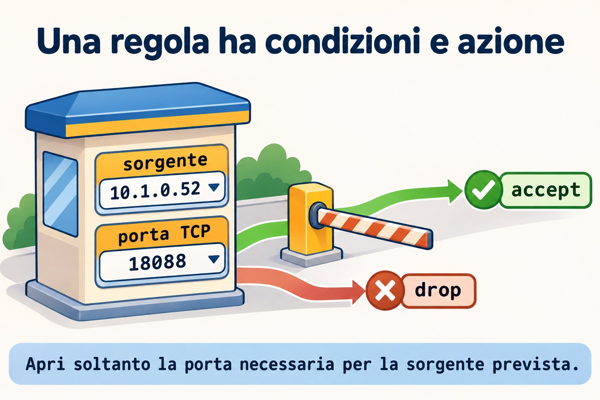
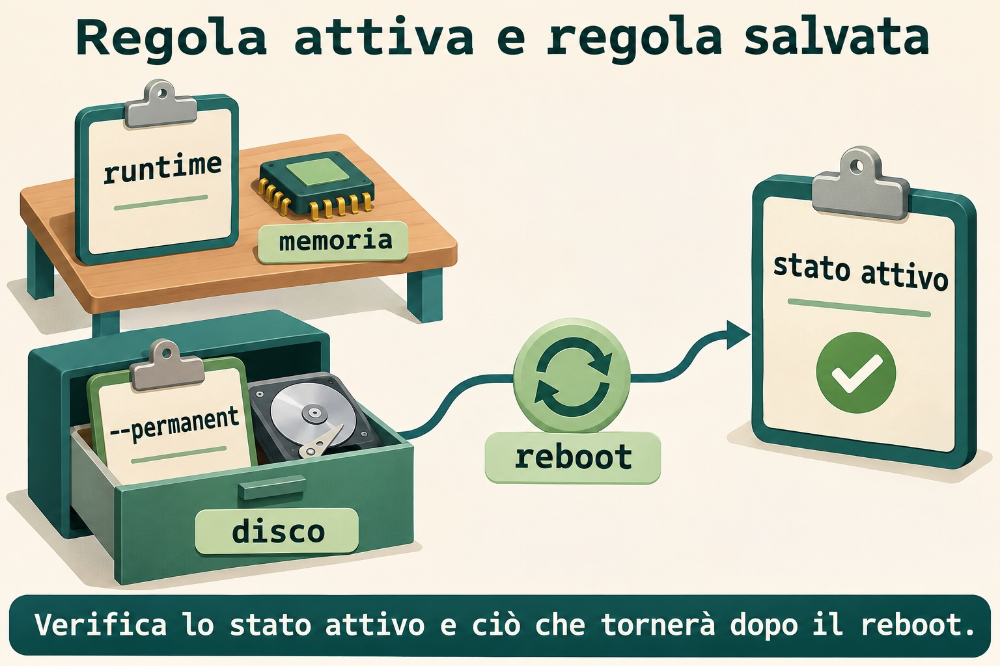
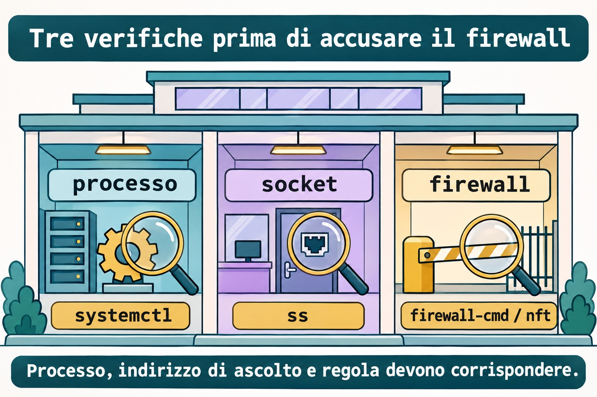

# Lezione 12.2 · Firewall

Su Windows Server separi profilo di rete, regola di ingresso e servizio in ascolto. Su Linux questa distinzione resta valida. Dopo aver protetto l'accesso SSH nella 12.1, aprirai una porta soltanto per l'altra VM, osserverai il blocco e verificherai ciò che resta dopo il reboot.

> **Il cuore di questa lezione:** identifica la zona o catena corretta, limita sorgente e porta, verifica regole attive e persistenti ed esegui il test da un altro host. Il resto è approfondimento.

| Scheda |  |
| --- | --- |
| **Modulo** | M12 · Sicurezza dell'host, lezione 2 di 5 |
| **Quando** | Settimana 17 |
| **Alla fine** | Filtri una porta HTTP con firewalld e nftables senza modificare la regola SSH |
| **Prerequisiti** | Lezioni 11.5 e 12.1; `student`, `sudo`, SSH funzionante e noVNC sulle VM 201 e 202 |
| **Durata** | Circa 90 minuti, più la ripetizione senza consultare il materiale |
| **Snapshot** | `m12a2-inicio` e `m12a2-fim` su entrambe le VM |

## 1 · Riscaldamento

Rispondi senza consultare il materiale. Le soluzioni sono in fondo.

1. Qual è la differenza tra una porta TCP raggiungibile e un'applicazione che risponde correttamente?
2. Perché mantieni una sessione aperta quando modifichi la configurazione SSH?
3. Quale comando identifica il processo e l'indirizzo di un ascolto TCP?

## 2 · Perché conta

Un servizio funziona all'interno del server, ma l'altro host non riceve risposta. Trovi una porta aperta in una zona che non gestisce quel traffico. La regola esiste, ma è nel posto sbagliato.

La segnalazione si chiude soltanto quando il client previsto accede alla porta prevista e la configurazione resta corretta dopo il riavvio. Disattivare la protezione dell'host cancellerebbe l'indizio e amplierebbe l'accesso.

## 3 · Modello mentale

Il firewall è la portineria dell'edificio. La regola confronta il badge della sorgente e la porta di destinazione prima di decidere. Nella stanza interna deve comunque esserci qualcuno: un permesso nel firewall non crea un socket.

```text
sorgente -> condizioni della regola -> azione -> servizio in ascolto
             sorgente + porta     accept / drop
```



*Apri soltanto la porta necessaria per la sorgente prevista.*

### Ponte Windows

| Windows Server | Linux | Idea comune |
| --- | --- | --- |
| Profilo di rete | Zona di firewalld | Scegliere dove vale la politica |
| Regola di ingresso | Regola nel percorso di ingresso | Confrontare sorgente, protocollo e porta |
| Configurazione salvata | Configurazione permanente | Ricostruire la politica al boot |
| Servizio in ascolto | Socket visto da `ss` | Avere un'applicazione che risponde |

## 4 · L'essenziale

### firewalld: zona, servizio e porta

Su Rocky usa `firewall-cmd` per comunicare con firewalld. Una zona raccoglie la politica applicata a interfacce o sorgenti. Controlla le zone attive prima di aggiungere una regola.

```bash
sudo firewall-cmd --get-active-zones
sudo firewall-cmd --get-default-zone
sudo firewall-cmd --info-service=ssh
```

Un servizio di firewalld è una definizione di porte e protocolli, come `ssh` o `http`. È diverso dall'unità di systemd. La definizione `http` normalmente comprende TCP `80`; il processo del lab userà TCP `18088`.

### Attivo e permanente

Senza `--permanent`, il comando modifica la configurazione attiva. Con questa opzione modifica ciò che è salvato. All'avvio del servizio la configurazione permanente viene caricata nello stato attivo.

In questo lab modifichi esplicitamente ogni regola in entrambi gli stati. Non copi globalmente lo stato attivo e non ricarichi politiche estranee per salvare una regola di esercizio.



*Verifica lo stato attivo e ciò che tornerà dopo il reboot.*

### nftables: tabella, catena e regola

Su Debian in questo lab usi `nft` in una tabella dedicata. La catena di ingresso confronta i pacchetti destinati all'host. L'ordine conta: prima permette la sorgente prevista per la porta di esercizio; poi scarta le altre sorgenti per quella stessa porta.

La politica della catena sarà `accept` per gli altri pacchetti. Non sostituisce la protezione già presente. Un'accettazione in questa catena può ancora incontrare un rifiuto in un'altra catena successiva.

### Validazione e osservazione

`nft -c -f` verifica il file senza applicare la modifica. `nft -f` applica il gruppo di istruzioni. Un contatore aiuta a mostrare quale regola ha ricevuto pacchetti. Un contatore fermo richiede di controllare interfaccia, indirizzo, famiglia e sorgente del test.



*Processo, indirizzo di ascolto e regola devono corrispondere.*

### Rocky × Debian

| Voce | Rocky 9 | Debian 13 |
| --- | --- | --- |
| Gestore del lab | firewalld già attivo | `nft` senza firewalld attivo |
| Ambito della modifica | Due rich rule nella zona corretta | Tabella `inet m12a2` |
| Persistenza | Regole permanenti di firewalld | Unità dedicata che carica soltanto la tabella del lab |
| Verifica | Consultare attivo e permanente | Validare il file, elencare la tabella ed eseguire il test |

## 5 · Lab guidato

Mantieni disponibile noVNC e una sessione SSH già aperta su entrambe le VM. Le regole di questa lezione selezionano soltanto TCP `18088`; la porta del tuo SSH non rientra nel filtro. Lavora con terminali separati per server HTTP e client.

### Passo 1 · Proteggere e identificare

**Ipotesi:** una regola che seleziona soltanto TCP `18088` dovrebbe decidere l'accesso SSH su TCP `22`?

Sull'host Proxmox crea gli snapshot prima del lab.

```bash
qm snapshot 201 m12a2-inicio
qm snapshot 202 m12a2-inicio
```

Su Rocky controlla il servizio. Su Debian controlla le regole esistenti. Se Debian usa firewalld, non aggiungere un secondo gestore: torna alla base di questo lab prima di continuare.

```bash
sudo firewall-cmd --state
sudo firewall-cmd --get-active-zones
```

```bash
systemctl is-active firewalld
sudo nft list ruleset
```

**Output atteso:** firewalld attivo su Rocky; su Debian `nft` disponibile e nessuna tabella `inet m12a2`. Non procedere se regole esistenti bloccano già la porta di esercizio e non sai chi le gestisce.

**Verifica:** conferma una nuova sessione SSH da Windows e noVNC funzionante. Servono `python3` e `curl` su entrambe le VM; installa i pacchetti mancanti con il procedimento del M6 prima di continuare.

### Passo 2 · Preparare il servizio di riferimento

**Ipotesi:** il test eseguito sul server stesso attraversa necessariamente la stessa zona di un client remoto?

Su entrambe le VM conferma che la cartella del lab non esista e che la porta sia libera prima di crearle. Se esiste un lavoro precedente, rivedilo invece di sovrascriverlo.

```bash
test ! -e "$HOME/m12a2"
sudo ss -lntp 'sport = :18088'
mkdir -m 700 "$HOME/m12a2"
mkdir "$HOME/m12a2/www"
printf 'FIREWALL ok\n' > "$HOME/m12a2/www/index.html"
ip -br address > "$HOME/m12a2/address.inicio"
```

Su Rocky esegui soltanto la prima assegnazione. Su Debian soltanto la seconda.

```bash
HOST_IP=10.1.0.51
```

```bash
HOST_IP=10.1.0.52
```

Poi, su ogni VM:

```bash
printf '%s\n' "$HOST_IP" > "$HOME/m12a2/ip"
python3 -m http.server 18088 --bind "$HOST_IP" --directory "$HOME/m12a2/www"
```

**Output atteso:** server HTTP in primo piano, associato all'IP della VM e alla porta `18088`.

**Verifica:** in un altro terminale della stessa VM controlla `sudo ss -lntp 'sport = :18088'`. Esegui il test remoto tra le VM con `curl --noproxy '*' --connect-timeout 2 --max-time 4 http://10.1.0.51:18088/` e sostituisci la destinazione con `10.1.0.52` nel senso opposto. Annota la situazione iniziale.

### Passo 3 · Filtrare su Rocky

**Ipotesi:** consentire la sorgente prevista prima di scartare le altre permette un client senza aprire la porta a tutti?

Su Rocky leggi le zone attive. Inserisci la zona che riceve il traffico della VM 202; controlla le associazioni di sorgente e interfaccia. Non copiare un nome di zona senza verificarlo.

```bash
sudo firewall-cmd --get-active-zones
read -r -p 'ZONE: ' ZONE
sudo firewall-cmd --zone="$ZONE" --list-all
printf '%s\n' "$ZONE" > "$HOME/m12a2/zone"
ALLOW='rule priority="-20" family="ipv4" source address="10.1.0.52/32" port port="18088" protocol="tcp" accept'
DROP='rule priority="-10" family="ipv4" port port="18088" protocol="tcp" drop'
printf '%s\n' "$ALLOW" > "$HOME/m12a2/allow"
printf '%s\n' "$DROP" > "$HOME/m12a2/drop"
```

Conferma con `--list-rich-rules` che queste due regole esatte non esistessero. Le priorità negative eseguono questi confronti prima dei permessi comuni della zona. La sorgente consentita viene esaminata prima dello scarto.

```bash
sudo firewall-cmd --zone="$ZONE" --add-rich-rule="$DROP"
```

Su Debian prova il `curl` verso Rocky: deve raggiungere il limite di tempo. Poi, su Rocky:

```bash
sudo firewall-cmd --zone="$ZONE" --add-rich-rule="$ALLOW"
sudo firewall-cmd --zone="$ZONE" --list-rich-rules
```

**Output atteso:** da Debian la pagina di Rocky torna a restituire `FIREWALL ok`. La modifica riguarda soltanto la configurazione attiva.

**Verifica:** ripeti il test remoto e apri una nuova sessione SSH. La regola di scarto esiste ancora, ma la sorgente consentita incontra prima l'accettazione.

### Decidi 1

Il processo usa `18088`, ma qualcuno ha aperto il servizio `http`. Qual è la prossima azione?

| Opzione | Azione |
| --- | --- |
| A | Disattivare il firewall |
| B | Controllare la definizione del servizio e usare la porta reale con sorgente limitata |
| C | Aprire tutte le porte alte |

Scegli B. Nome del servizio e porta effettiva devono corrispondere al processo.

### Passo 4 · Filtrare su Debian

**Ipotesi:** una tabella dedicata può selezionare soltanto la porta di esercizio e lasciare che gli altri pacchetti proseguano verso la politica esistente?

Su Debian conserva l'insieme iniziale come evidenza. Il file non verrà usato per sostituire l'intero insieme.

```bash
sudo nft list ruleset > "$HOME/m12a2/ruleset.inicio"
cat > "$HOME/m12a2/m12a2.nft" <<'EOF'
table inet m12a2 {}
flush table inet m12a2
table inet m12a2 {
    chain input {
        type filter hook input priority -10; policy accept;
        ip saddr 10.1.0.51 ip daddr 10.1.0.52 tcp dport 18088 counter accept
        ip daddr 10.1.0.52 tcp dport 18088 counter drop
    }
}
EOF
sudo nft -c -f "$HOME/m12a2/m12a2.nft"
sudo nft -f "$HOME/m12a2/m12a2.nft"
sudo nft list table inet m12a2
```

La prima dichiarazione garantisce la tabella. Lo svuotamento seguente riguarda soltanto questa tabella di esercizio, per riapplicare il file senza duplicare regole. Le regole selezionano l'IPv4 di Debian; il loopback resta fuori da questo scarto.

**Output atteso:** validazione senza errori e tabella con due regole. Da Rocky, l'HTTP di Debian restituisce `FIREWALL ok` e il contatore della regola di accettazione aumenta.

**Verifica:** conferma i contatori con un nuovo elenco e mantieni funzionante una nuova sessione SSH. Un blocco di un'altra politica resta valido: questa tabella non lo annulla.

### Passo 5 · Salvare senza sostituire altre politiche

**Ipotesi:** scrivere la regola sul disco dimostra che il kernel la stia già usando?

Su Rocky salva esattamente le due regole verificate.

```bash
sudo firewall-cmd --permanent --zone="$ZONE" --add-rich-rule="$DROP"
sudo firewall-cmd --permanent --zone="$ZONE" --add-rich-rule="$ALLOW"
sudo firewall-cmd --check-config
sudo firewall-cmd --permanent --zone="$ZONE" --list-rich-rules
```

Su Debian conferma che i due file globali seguenti non esistano ancora. Se esistono, interrompi questa installazione e rivedine l'origine. Non sostituire i file di un altro esercizio.

```bash
sudo test ! -e /etc/nftables.d/m12a2.nft
sudo test ! -e /etc/systemd/system/m12a2-firewall.service
sudo install -d -m 0755 /etc/nftables.d
sudo install -m 0644 "$HOME/m12a2/m12a2.nft" /etc/nftables.d/m12a2.nft
cat > "$HOME/m12a2/m12a2-firewall.service" <<'EOF'
[Unit]
Description=Course M12A2 firewall table
DefaultDependencies=no
Wants=network-pre.target
Before=network-pre.target shutdown.target
After=local-fs.target nftables.service
Conflicts=shutdown.target

[Service]
Type=oneshot
RemainAfterExit=yes
ExecStart=/usr/sbin/nft -f /etc/nftables.d/m12a2.nft
ExecStop=/usr/sbin/nft delete table inet m12a2

[Install]
WantedBy=multi-user.target
EOF
sudo nft -c -f /etc/nftables.d/m12a2.nft
sudo install -m 0644 "$HOME/m12a2/m12a2-firewall.service" /etc/systemd/system/m12a2-firewall.service
sudo systemd-analyze verify /etc/systemd/system/m12a2-firewall.service
sudo systemctl daemon-reload
sudo systemctl enable --now m12a2-firewall.service
```

**Output atteso:** regole permanenti su Rocky e unità di esercizio attiva su Debian. Carica soltanto il file della tabella dedicata; `/etc/nftables.conf` resta intatto.

**Verifica:** su Debian consulta `systemctl status m12a2-firewall.service` e `sudo nft list table inet m12a2`. Su Rocky confronta l'elenco attivo con quello permanente.

### Decidi 2

Vuoi correggere soltanto la tabella di esercizio su Debian. Che cosa conserva le politiche che non ti appartengono?

| Opzione | Azione |
| --- | --- |
| A | Eliminare l'insieme globale delle regole |
| B | Riapplicare soltanto il file validato della tabella `m12a2` |
| C | Sostituire la configurazione di tutti i servizi |

Scegli B. L'ambito della modifica deve essere piccolo quanto il problema.

### Passo 6 · Verificare dopo il reboot

**Ipotesi:** il server Python avviato nel terminale riparte da solo soltanto perché le regole sono state salvate?

Riavvia entrambe le VM, una alla volta. Usa noVNC per controllare eventuali errori prima di tentare un'altra modifica.

```bash
sudo systemctl reboot
```

Su Rocky recupera le variabili dai registri locali; su Debian controlla l'unità.

```bash
ZONE=$(cat "$HOME/m12a2/zone")
ALLOW=$(cat "$HOME/m12a2/allow")
DROP=$(cat "$HOME/m12a2/drop")
sudo firewall-cmd --zone="$ZONE" --query-rich-rule="$ALLOW"
sudo firewall-cmd --permanent --zone="$ZONE" --query-rich-rule="$ALLOW"
```

```bash
systemctl is-active m12a2-firewall.service
sudo nft list table inet m12a2
```

Su ogni VM avvia di nuovo il server temporaneo in un terminale dedicato.

```bash
HOST_IP=$(cat "$HOME/m12a2/ip")
python3 -m http.server 18088 --bind "$HOST_IP" --directory "$HOME/m12a2/www"
```

**Output atteso:** le regole ritornano; HTTP torna disponibile soltanto dopo l'avvio del processo. Il client autorizzato continua a ricevere `FIREWALL ok`.

**Verifica:** verifica HTTP nei due sensi tra le VM, una nuova sessione SSH e gli indirizzi originali. Conserva le evidenze prima dei guasti.

## 6 · Rompi e ripara

### Guasto 1 · Salvato non significa attivo

Su Rocky rimuovi soltanto l'accettazione attiva; mantieni la copia permanente e lo scarto.

```bash
sudo firewall-cmd --zone="$ZONE" --remove-rich-rule="$ALLOW"
```

**Sintomo:** da Debian l'HTTP di Rocky raggiunge il limite di tempo.

**Indagine:** confronta le ricerche della stessa regola nei due stati.

```bash
sudo firewall-cmd --zone="$ZONE" --query-rich-rule="$ALLOW"
sudo firewall-cmd --permanent --zone="$ZONE" --query-rich-rule="$ALLOW"
sudo ss -lntp 'sport = :18088'
```

**Causa:** l'accettazione è salvata, ma è stata rimossa dallo stato attivo. Il processo ascolta ancora e la regola di scarto resta attiva.

**Riparazione:** applica nuovamente l'accettazione attiva.

```bash
sudo firewall-cmd --zone="$ZONE" --add-rich-rule="$ALLOW"
```

**Verifica:** il client autorizzato riceve di nuovo la pagina.

**Prevenzione:** registra separatamente attivo e permanente, anche nella revisione delle modifiche.

### Guasto 2 · Sorgente errata

Su Debian conserva la configurazione valida prima di cambiare la sorgente consentita.

```bash
cp "$HOME/m12a2/m12a2.nft" "$HOME/m12a2/m12a2.valid.nft"
sed -i 's/10\.1\.0\.51/10.1.0.99/' "$HOME/m12a2/m12a2.nft"
sudo nft -c -f "$HOME/m12a2/m12a2.nft"
sudo nft -f "$HOME/m12a2/m12a2.nft"
```

**Sintomo:** da Rocky la pagina di Debian smette di rispondere.

**Indagine:** esegui un tentativo remoto e leggi i contatori su Debian.

```bash
sudo nft list table inet m12a2
```

**Causa:** la regola è sintatticamente valida, ma descrive un'altra sorgente. Il traffico della VM 201 incontra la regola di scarto.

**Riparazione:** ripristina il file locale valido e riapplica soltanto la tabella di esercizio.

```bash
cp "$HOME/m12a2/m12a2.valid.nft" "$HOME/m12a2/m12a2.nft"
sudo nft -c -f "$HOME/m12a2/m12a2.nft"
sudo nft -f "$HOME/m12a2/m12a2.nft"
```

**Verifica:** un nuovo tentativo da Rocky riceve `FIREWALL ok` e aumenta il contatore di accettazione.

**Prevenzione:** verifica sia la sintassi sia il significato di sorgente, protocollo e porta.

### Guasto 3 · Processo sull'indirizzo sbagliato

Su Debian arresta il server temporaneo con Ctrl+C e riavvialo soltanto sul loopback.

```bash
python3 -m http.server 18088 --bind 127.0.0.1 --directory "$HOME/m12a2/www"
```

**Sintomo:** la pagina si apre dal loopback su Debian, ma il client Rocky fallisce.

**Indagine:** controlla l'indirizzo di ascolto e la regola prima di ampliare qualsiasi permesso.

```bash
sudo ss -lntp 'sport = :18088'
sudo nft list table inet m12a2
curl --noproxy '*' --max-time 4 http://127.0.0.1:18088/
```

**Causa:** il processo non serve più l'IP di rete. L'accettazione del firewall non fa ascoltare il processo su un altro indirizzo.

**Riparazione:** arresta l'istanza di loopback con Ctrl+C e usa di nuovo il comando del passo 6 con l'IP registrato.

**Verifica:** Rocky torna a ricevere il contenuto tramite l'IP di Debian.

**Prevenzione:** controlla processo, socket e firewall come tre evidenze diverse.

### Pulizia

Arresta soltanto i due server Python con Ctrl+C nei terminali in cui sono in esecuzione. Su Rocky rimuovi le due regole del lab in entrambi gli stati. Non arrestare firewalld.

```bash
sudo firewall-cmd --zone="$ZONE" --remove-rich-rule="$ALLOW"
sudo firewall-cmd --zone="$ZONE" --remove-rich-rule="$DROP"
sudo firewall-cmd --permanent --zone="$ZONE" --remove-rich-rule="$ALLOW"
sudo firewall-cmd --permanent --zone="$ZONE" --remove-rich-rule="$DROP"
```

Su Debian disattiva l'unità dedicata. L'arresto rimuove soltanto `inet m12a2`. Poi rimuovi i due file creati da questa lezione.

```bash
sudo systemctl disable --now m12a2-firewall.service
sudo rm -- /etc/systemd/system/m12a2-firewall.service /etc/nftables.d/m12a2.nft
sudo systemctl daemon-reload
sudo nft list ruleset
```

Conserva i registri nella cartella privata. Verifica che non resti alcun ascolto su `18088`, che gli indirizzi originali siano ancora presenti e che una nuova sessione SSH funzioni. Nessuna operazione di pulizia rimuove le regole di altri servizi.

## 7 · Trappole

| Errore comune | Che cosa fare | Perché |
| --- | --- | --- |
| Verificare soltanto dal server | Verificare dall'altra VM | Il percorso locale è diverso da quello remoto |
| Aprire `http` per una porta diversa | Leggere definizione e socket | Il nome del servizio non indovina la porta |
| Salvare senza controllare l'attivo | Consultare entrambi gli stati | Disco e memoria sono distinti |
| Eliminare l'intero insieme nftables | Modificare soltanto la tabella dedicata | Le altre politiche restano necessarie |
| Usare firewalld e nft come proprietari della stessa politica | Identificare il gestore | Evita due fonti di configurazione |

## 8 · Quiz

1. Qual è la differenza tra servizio di firewalld e unità di systemd?
2. Aggiungere una regola permanente modifica automaticamente quella attiva?
3. Perché l'accettazione della sorgente precede lo scarto della porta in questo lab?
4. Che cosa verifica `nft -c -f` e che cosa richiede ancora un test?
5. Una regola di accettazione può correggere un processo che ascolta soltanto sul loopback?
6. Perché non ripristinare ciecamente l'intero insieme registrato all'inizio?

## 9 · Promemoria

| Operazione | Comando |
| --- | --- |
| Zone attive | `sudo firewall-cmd --get-active-zones` |
| Definizione del servizio | `sudo firewall-cmd --info-service=http` |
| Regole attive della zona | `sudo firewall-cmd --zone="$ZONE" --list-rich-rules` |
| Regole permanenti | `sudo firewall-cmd --permanent --zone="$ZONE" --list-rich-rules` |
| Validare il file del lab | `sudo nft -c -f "$HOME/m12a2/m12a2.nft"` |
| Contatori del lab | `sudo nft list table inet m12a2` |

**Flashcard:** crea cinque schede su zona, sorgente, porta, stato attivo e persistenza. Ripassa a D+1, D+3, D+7 e D+21.

## 10 · Checklist e chiusura

- [ ] So quale zona riceve il traffico su Rocky.
- [ ] Ho verificato HTTP da remoto in entrambi i sensi.
- [ ] Ho controllato le regole dopo il reboot senza confondere processo e firewall.
- [ ] Ho corretto i tre guasti e rimosso soltanto le mie regole.

**Ultimo esercizio:** spiega perché una sintassi valida con sorgente errata resta una politica sbagliata. Includi il test che lo ha rivelato.

**Reboot di verifica:** dopo la pulizia riavvia entrambe le VM, una alla volta. Conferma SSH, assenza del servizio temporaneo e assenza della tabella di esercizio. Su Rocky le due regole del lab non devono tornare.

Sull'host Proxmox crea gli snapshot finali soltanto dopo questa verifica.

```bash
qm snapshot 201 m12a2-fim
qm snapshot 202 m12a2-fim
```

## 11 · Nella vita reale

Su un host che amministri o che sei autorizzato a ispezionare, esegui soltanto operazioni di lettura. Identifica il gestore e osserva le regole con i comandi di elenco di questa lezione. Non installare pacchetti e non modificare zone, regole o servizi.

Quale regola è più ampia del necessario? Quale porta in ascolto non ha uno scopo documentato? Dove viene mantenuta la politica persistente? Registra le domande per il responsabile prima di proporre modifiche.

## 12 · Approfondire quando vuoi

- [firewall-cmd](https://firewalld.org/documentation/man-pages/firewall-cmd.html): ricerche, servizi e regole.
- [Runtime versus Permanent](https://firewalld.org/documentation/configuration/runtime-versus-permanent.html): distinzione degli stati.
- [Rich Language](https://firewalld.org/documentation/man-pages/firewalld.richlanguage.html): condizioni e priorità.
- [nftables](https://www.netfilter.org/projects/nftables/manpage.html) e [catene](https://wiki.nftables.org/wiki-nftables/index.php/Configuring_chains): gruppi di istruzioni, validazione, priorità e verdetti.
- [systemd.service](https://manpages.debian.org/trixie/systemd/systemd.service.5.en.html): dipendenze predefinite e unità di avvio anticipato.

**DeepTutor** (http://10.1.0.149:3782, KB "Curso Linux Sysadmin"):

- `!explica Compare zona, serviço do firewalld, porta e unidade do systemd com a portaria de um prédio.`
- `!feynman Vou explicar por que uma regra salva pode não estar ativa. Aponte as lacunas.`
- `!quiz Crie seis casos de origem, porta e persistência sem sugerir desligar o firewall.`

## Soluzioni commentate

### Riscaldamento

1. TCP aperto dimostra l'apertura della connessione; la risposta dell'applicazione dipende dal protocollo e dal contenuto richiesto.
2. La vecchia sessione aiuta a correggere prima di dipendere dalla nuova configurazione. Il noVNC mantiene un accesso fuori dal percorso SSH.
3. `sudo ss -lntp` mostra ascolti TCP, indirizzi e processi quando hai i permessi.

### Quiz

1. Il primo descrive il traffico consentito; la seconda gestisce un processo o un'attività del sistema.
2. No. Devi controllare o modificare separatamente lo stato attivo.
3. Affinché la sorgente autorizzata venga accettata prima di raggiungere lo scarto della stessa porta.
4. Verifica se il gruppo di istruzioni può essere accettato senza applicare la modifica; sorgente reale, percorso, applicazione e persistenza richiedono test.
5. No. L'applicazione deve ascoltare sull'indirizzo usato dal client.
6. Potresti eliminare modifiche legittime o politiche di altri servizi. La pulizia della lezione ha un ambito dedicato e conosciuto.

<!-- navegacao -->
[← Lezione 12.1 · SSH in dettaglio](12.1-ssh-a-fundo.md) · [Indice delle lezioni](../01-aulas.md) · [Lezione 12.3 · SELinux: modalità e contesti →](12.3-selinux-modos-e-contextos.md)
