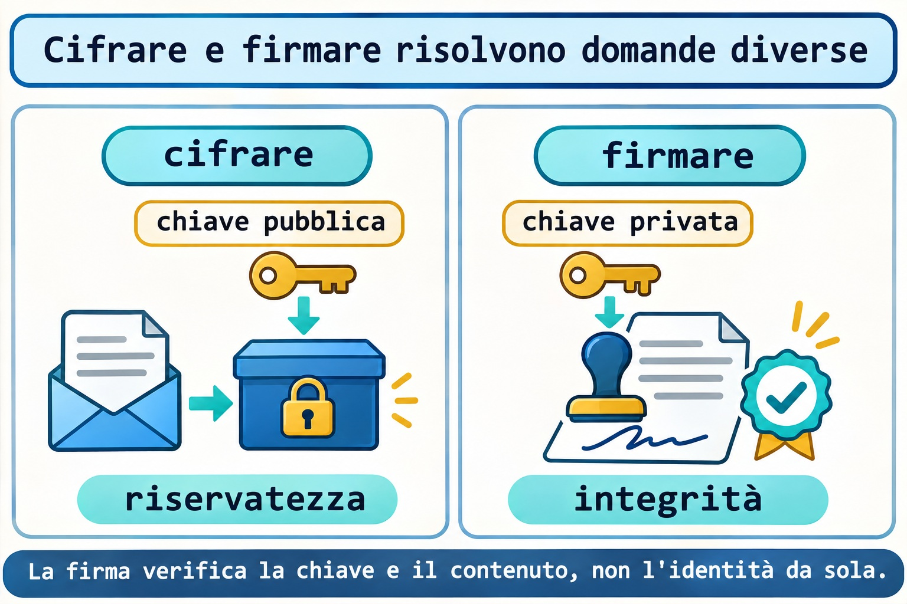

# Lezione 12.5 · Audit e crittografia

Su Windows Server colleghi già account, permessi, sessioni e servizi. Su Linux costruirai questo inventario senza rimuovere privilegi d'impulso. Poi cifrerai e firmerai un file con una chiave dedicata al lab. La sfida finale riunisce firewall, SELinux e servizio persistente.

> **Il cuore di questa lezione:** un privilegio richiede uno scopo; lo storico dipende dalla raccolta; cifrare protegge il contenuto e firmare permette di verificare contenuto e chiave. Il resto è approfondimento.

| Scheda |  |
| --- | --- |
| **Modulo** | M12 · Sicurezza dell'host, lezione 5 di 5 |
| **Quando** | Settimana 18 |
| **Alla fine** | Analizzi privilegi, distingui sessione attuale e storico e verifichi cifratura e firma |
| **Prerequisiti** | Lezioni dalla 12.1 alla 12.4, GnuPG e strumenti di audit; nginx e strumenti SELinux già usati nel modulo |
| **Durata** | Circa 90 minuti, più una sessione per la sfida |
| **Snapshot** | `m12a5-inicio` e `m12a5-fim` sulle VM 201 e 202 |

## 1 · Riscaldamento

1. Una porta aperta nel firewall crea un servizio in ascolto?
2. Qual è la differenza tra registrare un contesto con `semanage fcontext` e applicarlo con `restorecon`?
3. Perché la correzione di un AVC parte dall'operazione negata e non dall'autorizzazione di tutto?

## 2 · Perché conta

Una revisione trova un file con SUID, una porta senza scopo documentato e una firma valida. Sono tre domande diverse. SUID può essere legittimo; la porta richiede un responsabile; la firma corrisponde a una chiave, la cui identità deve essere verificata con un altro mezzo.

Fare audit significa trasformare queste osservazioni in decisioni motivate. Registri ciò che esiste, lo confronti con l'intenzione e modifichi soltanto ciò che hai compreso.

## 3 · Modello mentale

L'inventario è l'elenco delle chiavi e delle stanze dell'edificio. La cifratura è una scatola che soltanto la chiave del destinatario può aprire. La firma è un sigillo verificabile sul documento; il nome scritto sul sigillo non dimostra da solo l'identità di chi lo ha creato.

```text
inventario -> scopo -> decisione registrata
cifrare: contenuto leggibile -> contenuto protetto
firmare: contenuto + chiave privata -> firma verificabile
```


*Prima di rimuovere un privilegio, scopri chi ne ha bisogno.*

### Ponte Windows

| Windows Server | Linux | Domanda |
| --- | --- | --- |
| Token e permessi di esecuzione | Proprietario, modi, SUID e politica MAC | Chi ottiene quale accesso? |
| Sessioni e registri di accesso | `who`, storico e journal | Che cosa sta accadendo e che cosa è stato registrato? |
| Firma e cifratura | Operazioni OpenPGP di GnuPG | Voglio riservatezza, integrità o entrambe? |

## 4 · L'essenziale

### Il privilegio non è una diagnosi

Il bit SUID richiede un'indagine, non una rimozione automatica. Controlla tipo di file, proprietario, pacchetto e scopo. L'inventario di questa lezione cerca in `/usr` senza attraversare altri filesystem; non rimuove bit dai programmi della distribuzione.

### Sessione attuale e storico

`who` legge il registro delle sessioni attuali. Lo storico richiede che il meccanismo di raccolta fosse già funzionante. Un elenco vuoto non dimostra che nessuno sia entrato nella macchina.

Su Debian 13 il sostituto previsto del `last` tradizionale è `wtmpdb last`, con raccolta tramite `libpam-wtmpdb`. Installare oggi il raccoglitore non ricostruisce i registri precedenti. Su Rocky 9 usi `last`.

### Il limite ha un ambito

`ulimit` mostra o modifica i limiti della shell e dei processi che avvia. Non modifica tutti i servizi dell'host. L'esercizio modifica soltanto un limite soft dentro una subshell, che termina insieme al test.

### Due operazioni crittografiche

Cifri per la chiave pubblica del destinatario; la chiave privata corrispondente decifra. Firmi con la tua chiave privata; la chiave pubblica permette di verificare la firma. Una firma valida richiede comunque di verificare l'impronta della chiave tramite un canale affidabile.



*La firma verifica la chiave e il contenuto, non l'identità da sola.*

### Rocky × Debian

| Voce | Rocky 9 | Debian 13 |
| --- | --- | --- |
| Storico tradizionale del lab | `last` | `wtmpdb last` con raccolta configurata |
| Pacchetto GnuPG | `gnupg2` | `gnupg`, con pinentry disponibile |
| Controllare il pacchetto di un file | `rpm -qf` | `dpkg-query -S` |
| Protezione nella sfida | SELinux enforcing e firewalld | nftables e ispezione di AppArmor |

## 5 · Lab guidato

Ripeti il lab su entrambe le VM. Le chiavi restano in una directory nuova e privata; non usare la tua chiave personale e non inviare la chiave privata a un'altra macchina.

### Passo 1 · Proteggere e preparare

**Ipotesi:** creare un'altra directory GnuPG dovrebbe modificare le identità del tuo portachiavi personale?

Sull'host Proxmox:

```bash
qm snapshot 201 m12a5-inicio
qm snapshot 202 m12a5-inicio
```

Sulle VM controlla che la cartella sia assente prima di crearla. Se esiste, rivedi i registri precedenti invece di sovrascriverli.

```bash
test ! -e "$HOME/m12a5"
command -v gpg who ss python3 curl
mkdir -m 700 "$HOME/m12a5"
mkdir -m 700 "$HOME/m12a5/gnupg"
printf 'M12 audit record\n' > "$HOME/m12a5/registro.txt"
```

**Output atteso:** nuova directory privata e strumenti disponibili. Installa i pacchetti mancanti con il procedimento del M6 prima di continuare. Su Debian 13 minimale, `gpg` e `gpgconf` arrivano dal pacchetto `gnupg`; non configurare un raccoglitore storico fingendo che fosse già attivo.

**Verifica:** controlla `stat -c '%a %U %n' "$HOME/m12a5/gnupg"`. Il modo deve essere `700` e il proprietario `student`.

### Passo 2 · Inventariare senza correggere d'impulso

**Ipotesi:** trovare SUID identifica da solo un file dannoso?

```bash
sudo find /usr -xdev -type f -perm -4000 -printf '%m %u %p\n' > "$HOME/m12a5/suid.txt"
sudo ss -lntup > "$HOME/m12a5/sockets.txt"
who > "$HOME/m12a5/who.txt"
ulimit -Sn
ulimit -Hn
```

Scegli un percorso reale trovato e consulta il suo pacchetto: su Rocky `rpm -qf CAMINHO`; su Debian `dpkg-query -S CAMINHO`. Sostituisci l'argomento con il percorso osservato, senza rimuovere il bit.

**Output atteso:** inventario reale, senza un numero prestabilito di file o sessioni.

**Verifica:** per una porta in ascolto associa processo e scopo. Per un file SUID registra proprietario, pacchetto e motivo prima di proporre una modifica.

### Decidi 1

Hai trovato SUID in un programma installato dalla distribuzione. Che cosa fai prima?

| Opzione | Azione |
| --- | --- |
| A | Rimuovere SUID da tutto |
| B | Controllare pacchetto, proprietario e scopo |
| C | Eseguirlo come root per vedere che cosa succede |

Scegli B. L'inventario diventa una decisione quando comprendi l'uso del privilegio.

### Passo 3 · Leggere lo storico esistente

**Ipotesi:** installare uno strumento storico può recuperare sessioni che non sono mai state registrate?

Su Rocky usa il primo blocco. Su Debian 13 con la raccolta di `wtmpdb` configurata usa il secondo. Se la raccolta non esiste, registra questa assenza come risultato dell'inventario.

```bash
last -n 5
```

```bash
wtmpdb last -n 5
```

**Output atteso:** sessioni effettivamente registrate oppure l'indicazione che la base dati non è disponibile. Non inventare nomi, orari o accessi.

**Verifica:** confronta una sessione attuale con `who`. Scrivi quale fonte è stata consultata e quali limiti di copertura presenta.

### Passo 4 · Creare un'identità soltanto per il lab

**Ipotesi:** il nome scritto nell'identità della chiave dimostra chi sia il suo proprietario fuori dal lab?

```bash
export GPG_TTY=$(tty)
gpg --homedir "$HOME/m12a5/gnupg" --full-generate-key
gpg --homedir "$HOME/m12a5/gnupg" --list-keys --fingerprint
```

Nella generazione interattiva scegli RSA con sottochiave di cifratura, `3072` bit, validità di un giorno, nome fittizio `Lab M12` e indirizzo `lab-m12@example.invalid`. Digita una passphrase soltanto nella finestra interattiva. Non scriverla negli argomenti, nei file del corso o nel diario.

**Output atteso:** una nuova chiave in questa directory, con un'impronta propria. La chiave di ogni VM sarà diversa, anche con lo stesso nome fittizio.

**Verifica:** registra soltanto l'impronta pubblica. Un'identità creata nel lab non deve essere presentata come identità verificata di una persona reale.

### Passo 5 · Cifrare e recuperare

**Ipotesi:** quale parte della chiave permette di decifrare il file cifrato per questo destinatario?

```bash
gpg --homedir "$HOME/m12a5/gnupg" --recipient lab-m12@example.invalid --output "$HOME/m12a5/registro.gpg" --encrypt "$HOME/m12a5/registro.txt"
gpg --homedir "$HOME/m12a5/gnupg" --output "$HOME/m12a5/recuperado.txt" --decrypt "$HOME/m12a5/registro.gpg"
cmp "$HOME/m12a5/registro.txt" "$HOME/m12a5/recuperado.txt"
```

**Output atteso:** file cifrato, recupero tramite il portachiavi del lab e confronto senza differenze. La passphrase può essere nella cache dell'agente e non essere richiesta a ogni operazione.

**Verifica:** conferma il codice `0` di `cmp` immediatamente con `echo $?`. Il testo originale esiste ancora; cifrare non lo elimina.

### Passo 6 · Firmare e verificare

**Ipotesi:** una firma separata cifra il file originale?

```bash
gpg --homedir "$HOME/m12a5/gnupg" --armor --output "$HOME/m12a5/registro.txt.asc" --detach-sign "$HOME/m12a5/registro.txt"
gpg --homedir "$HOME/m12a5/gnupg" --verify "$HOME/m12a5/registro.txt.asc" "$HOME/m12a5/registro.txt"
```

**Output atteso:** verifica crittografica valida per la chiave e i byte originali. Il documento resta leggibile senza decifrarlo.

**Verifica:** confronta l'impronta usata nella firma con quella registrata nel passo 4. Identifica la chiave di esercizio, non dimostra un'identità esterna.

### Decidi 2

Vuoi impedire la lettura del contenuto e rilevare una modifica. Quale decisione soddisfa entrambe le esigenze?

| Opzione | Azione |
| --- | --- |
| A | Rinominare soltanto il file |
| B | Firmare soltanto e lasciare pubblico il contenuto |
| C | Cifrare per il destinatario e verificare una firma con chiave controllata |

Scegli C. Riservatezza e verifica dell'autenticità sono obiettivi diversi.

## 6 · Rompi e ripara

### Guasto 1 · SUID senza scopo

Crea soltanto un file di dati inerte, senza permesso di esecuzione. Conferma che la directory seguente non esistesse prima; se esiste, non riutilizzarla.

```bash
sudo test ! -e /srv/m12a5-audit
sudo install -d -m 0755 /srv/m12a5-audit
sudo install -m 4644 "$HOME/m12a5/registro.txt" /srv/m12a5-audit/inert.txt
```

**Sintomo:** l'inventario trova SUID in un file che non deve eseguire nulla.

**Indagine:** leggi modo, proprietario e tipo senza eseguire il file.

```bash
stat -c '%A %a %U %n' /srv/m12a5-audit/inert.txt
file /srv/m12a5-audit/inert.txt
```

**Causa:** il bit è stato aggiunto senza uno scopo. In questo file di dati senza esecuzione non crea un programma privilegiato.

**Riparazione:** rimuovi soltanto il bit non necessario dal file del lab.

```bash
sudo chmod u-s /srv/m12a5-audit/inert.txt
```

**Verifica:** il modo torna a `644`; nessun binario della distribuzione è stato modificato.

**Prevenzione:** registra lo scopo dei privilegi e confronta l'inventario con la situazione nota.

### Guasto 2 · Documento modificato

Modifica soltanto una copia, conservando originale e firma.

```bash
cp "$HOME/m12a5/registro.txt" "$HOME/m12a5/adulterado.txt"
printf 'changed\n' >> "$HOME/m12a5/adulterado.txt"
gpg --homedir "$HOME/m12a5/gnupg" --verify "$HOME/m12a5/registro.txt.asc" "$HOME/m12a5/adulterado.txt"
```

**Sintomo:** la verifica fallisce per la copia.

**Indagine:** confronta i byte e verifica l'originale con la stessa firma.

**Causa:** la firma è stata creata per un altro contenuto. Copiare il nome o il file della firma non autorizza nuovi byte.

**Riparazione:** usa l'originale conservato; non firmare nuovamente per nascondere la modifica.

**Verifica:** il comando del passo 6 resta valido sull'originale.

**Prevenzione:** distribuisci contenuto e firma identificati e verifica l'impronta del mittente tramite un altro canale.

### Guasto 3 · Limite del processo

Controlla che il limite hard dei file aperti sia almeno `32`. Il test seguente apre al massimo `64` descrittori in un processo figlio e li chiude alla fine.

```bash
(
ulimit -Sn 32
python3 - <<'PY'
import os
from contextlib import ExitStack
with ExitStack() as stack:
    try:
        for _ in range(64):
            stack.enter_context(open(os.devnull))
    except OSError as exc:
        print("errno=", exc.errno)
PY
)
```

**Sintomo:** il processo figlio raggiunge il limite dei descrittori e segnala l'errore `24`.

**Indagine:** confronta `ulimit -Sn` fuori dalla subshell con il valore imposto al suo interno.

**Causa:** il limite appartiene al processo e alla sua eredità, non a tutti i servizi della VM.

**Riparazione:** termina il test; la subshell è già terminata e non ha modificato la shell principale.

**Verifica:** il limite del terminale principale resta uguale a quello annotato nel passo 2.

**Prevenzione:** analizza il limite del processo interessato prima di modificare una configurazione globale.

### Pulizia

Rimuovi soltanto il file inerte e la sua directory ora vuota. Conserva i registri privati e i file crittografici per la verifica dopo il reboot. Non esportare la chiave privata.

```bash
sudo rm -- /srv/m12a5-audit/inert.txt
sudo rmdir /srv/m12a5-audit
gpgconf --homedir "$HOME/m12a5/gnupg" --kill gpg-agent
```

## 7 · Trappole

| Errore comune | Che cosa fare | Perché |
| --- | --- | --- |
| Rimuovere SUID in massa | Collegare pacchetto e scopo | Può interrompere un accesso legittimo |
| Storico vuoto significa nessun accesso | Controllare raccolta e copertura | Dati assenti non dimostrano assenza di uso |
| Firma valida dimostra un nome reale | Verificare l'impronta tramite un altro canale | L'identità scritta può essere autocreata |
| Cifrare elimina l'originale | Controllare i file esistenti | Il testo leggibile resta sul disco |

## 8 · Quiz

1. Perché un file SUID richiede un'indagine prima di una modifica?
2. Qual è la differenza tra `who` e lo storico delle sessioni?
3. Quale sostituto di `last` è previsto su Debian 13 e che cosa non recupera?
4. Quale chiave cifra per il destinatario e quale decifra?
5. Perché una firma separata lascia leggibile il contenuto?
6. Modificare `ulimit` nel tuo terminale modifica il limite di un servizio già avviato?

## 9 · Promemoria

| Operazione | Comando |
| --- | --- |
| Sessioni attuali | `who` |
| Storico Rocky | `last -n 5` |
| Storico Debian | `wtmpdb last -n 5` |
| Limite soft della shell | `ulimit -Sn` |
| Impronta del lab | `gpg --homedir "$HOME/m12a5/gnupg" --list-keys --fingerprint` |

**Flashcard:** crea cinque schede su privilegio, storico, limite, cifratura e firma. Ripassa a D+1, D+3, D+7 e D+21.

## 10 · Checklist e chiusura

- [ ] Ho fatto l'inventario su entrambe le VM senza rimuovere privilegi della distribuzione.
- [ ] Ho cifrato, recuperato, firmato e rilevato la modifica di una copia.
- [ ] Ho spiegato l'ambito dello storico e del limite del processo.
- [ ] Ho completato la sfida seguente e la pulizia mirata.

**Ultimo esercizio:** scrivi un rapporto con tre risultati, fonte dell'evidenza, scopo e decisione. Separa osservazione e ipotesi.

**Reboot di verifica:** verifica prima la persistenza richiesta dalla sfida. Dopo averla pulita, riavvia entrambe le VM e conferma accesso, politica originale e firma del file originale. La passphrase del lab deve essere richiesta quando necessaria.

Sull'host Proxmox gli snapshot finali vengono creati soltanto dopo la sfida e la pulizia.

```bash
qm snapshot 201 m12a5-fim
qm snapshot 202 m12a5-fim
```

## 11 · Nella vita reale

Su un host che amministri o che sei autorizzato a ispezionare, esegui soltanto operazioni di lettura: porte, sessioni attuali e limiti del processo di un servizio. Non eseguire un file sospetto, non rimuovere bit e non configurare un nuovo raccoglitore in questa missione.

Quale privilegio ha una giustificazione documentata? Quale storico esiste realmente? Quale impronta dovresti confermare prima di fidarti di un documento firmato?

## 12 · Approfondire quando vuoi

- [Debian 13: registri di accesso](https://www.debian.org/releases/trixie/release-notes/issues.html) e [wtmpdb](https://manpages.debian.org/trixie/wtmpdb/wtmpdb.8.en.html).
- [GnuPG: gestione delle chiavi](https://gnupg.org/documentation/manuals/gnupg/OpenPGP-Key-Management.html) e [operazioni](https://gnupg.org/documentation/manuals/gnupg/Operational-GPG-Commands.html).
- [nginx: parametri](https://nginx.org/en/docs/switches.html), [systemd.service](https://manpages.debian.org/trixie/systemd/systemd.service.5.en.html) e [nftables](https://www.netfilter.org/projects/nftables/manpage.html).
- [SELinux su RHEL 9](https://docs.redhat.com/en/documentation/red_hat_enterprise_linux/9/html/using_selinux/index) e [firewalld](https://firewalld.org/documentation/man-pages/firewall-cmd.html).

**DeepTutor** (http://10.1.0.149:3782, KB "Curso Linux Sysadmin"):

- `!explica Compare inventário de privilégios, sigilo e assinatura sem misturar suas finalidades.`
- `!feynman Vou explicar por que uma assinatura válida não comprova sozinha uma identidade real. Critique.`
- `!quiz Crie seis situações de auditoria, histórico e criptografia com os limites de cada evidência.`

## Sfida del M12 · Servizio protetto dal client al file

Realizza nginx persistente su TCP `18095`, con contenuto dedicato in `/srv/m12a5-web`. Su Rocky SELinux deve restare `Enforcing` e firewalld attivo. Su Debian usa una tabella nftables dedicata. Esegui il test dall'altra VM e dopo il reboot.


*Esegui il test da un altro host e ricontrolla tutto dopo il reboot.*

### Preparazione della sfida

Usa noVNC e una sessione SSH aperta. Le lezioni precedenti devono essere state pulite; i pacchetti nginx e SELinux restano installati. Non riutilizzare le vecchie unità. Verifica che `nginx.service` originale sia inattivo e disabilitato e non modificarlo.

Prima di creare, controlla l'assenza di `/srv/m12a5-web`, `/etc/nginx/m12a5.conf`, `/etc/systemd/system/m12a5-nginx.service`, `/etc/nftables.d/m12a5.nft`, `/etc/systemd/system/m12a5-firewall.service`, `/run/nginx-m12a5` e dei log `m12a5-access.log` e `m12a5-error.log` in `/var/log/nginx`. Verifica che la porta `18095` non abbia ascolti né un'associazione locale precedente in SELinux, anche negli intervalli di porte.

Su Rocky leggi `sudo semanage fcontext -l -C` prima di registrare i due modelli seguenti. Se esistono già, interrompi e rivedine l'origine. Su Debian controlla `sudo nft list ruleset`: la tabella `inet m12a5` non deve esistere e altre politiche non devono bloccare la porta senza che tu ne comprenda l'origine.

### Istanza nginx dedicata

Su Rocky imposta `WEB_USER=nginx`; su Debian `WEB_USER=www-data`. Poi, su entrambe le VM, crea contenuto e configurazione dedicati.

```bash
sudo install -d -m 0755 /srv/m12a5-web
printf 'M12 PROTECTED ok\n' | sudo tee /srv/m12a5-web/index.html > /dev/null
sudo chmod 0644 /srv/m12a5-web/index.html
cat > "$HOME/m12a5/m12a5.conf" <<EOF
user $WEB_USER;
worker_processes 1;
pid /run/nginx-m12a5/nginx.pid;
error_log /var/log/nginx/m12a5-error.log;
events { worker_connections 32; }
http {
    access_log /var/log/nginx/m12a5-access.log;
    server {
        listen 18095;
        root /srv/m12a5-web; index index.html;
        location / { try_files \$uri \$uri/ =404; }
    }
}
EOF
sudo install -m 0644 "$HOME/m12a5/m12a5.conf" /etc/nginx/m12a5.conf
```

Crea l'unità seguente nella cartella privata e installala nel percorso già verificato. Non carica la configurazione nginx originale.

```bash
cat > "$HOME/m12a5/m12a5-nginx.service" <<'EOF'
[Unit]
Description=Course M12A5 nginx
After=network.target firewalld.service m12a5-firewall.service
[Service]
Type=simple
RuntimeDirectory=nginx-m12a5
ExecStartPre=/usr/sbin/nginx -t -c /etc/nginx/m12a5.conf
ExecStart=/usr/sbin/nginx -c /etc/nginx/m12a5.conf -g "daemon off;"
[Install]
WantedBy=multi-user.target
EOF
sudo install -m 0644 "$HOME/m12a5/m12a5-nginx.service" /etc/systemd/system/m12a5-nginx.service
```

### Autorizzazioni SELinux su Rocky

Registra i tipi soltanto su Rocky. Il modello di runtime deve essere applicato a ogni creazione della directory al boot. Aggiungi la preparazione del contesto all'unità dedicata senza modificare l'unità originale.

```bash
getenforce
sudo semanage fcontext -a -t httpd_sys_content_t '/srv/m12a5-web(/.*)?'
sudo semanage fcontext -a -t httpd_var_run_t '/var/run/nginx-m12a5(/.*)?'
sudo restorecon -RFv /srv/m12a5-web /etc/nginx/m12a5.conf
sudo semanage port -a -t http_port_t -p tcp 18095
sudo sed -i '/^ExecStartPre=/i ExecStartPre=/usr/sbin/restorecon -RF /run/nginx-m12a5' /etc/systemd/system/m12a5-nginx.service
```

Su Debian osserva `aa-status` e il confinamento effettivo di nginx; non inventare SELinux enforcing e non disattivare AppArmor. Se un profilo esistente impedisce i percorsi dedicati, adatta il lab con la politica responsabile prima di procedere.

### Firewall con ambito limitato

Su Rocky identifica la zona effettiva come nella 12.2. Conserva zona e regole in file privati per rimuoverle esattamente in seguito. Le due regole seguenti sono nuove e non devono esistere prima della sfida.

```bash
read -r -p 'ZONE: ' ZONE
ALLOW='rule priority="-20" family="ipv4" source address="10.1.0.52/32" port port="18095" protocol="tcp" accept'
DROP='rule priority="-10" family="ipv4" port port="18095" protocol="tcp" drop'
printf '%s\n' "$ZONE" > "$HOME/m12a5/zone"
printf '%s\n' "$ALLOW" > "$HOME/m12a5/allow"
printf '%s\n' "$DROP" > "$HOME/m12a5/drop"
sudo firewall-cmd --zone="$ZONE" --add-rich-rule="$DROP"
sudo firewall-cmd --zone="$ZONE" --add-rich-rule="$ALLOW"
sudo firewall-cmd --permanent --zone="$ZONE" --add-rich-rule="$DROP"
sudo firewall-cmd --permanent --zone="$ZONE" --add-rich-rule="$ALLOW"
```

Su Debian crea il file seguente e installalo nel percorso dedicato. La tabella permette la sorgente Rocky e scarta le altre sorgenti soltanto per IPv4 `10.1.0.52`, TCP `18095`. Non modifica altre tabelle.

```bash
cat > "$HOME/m12a5/m12a5.nft" <<'EOF'
table inet m12a5 {}
flush table inet m12a5
table inet m12a5 {
    chain input {
        type filter hook input priority -10; policy accept;
        ip saddr 10.1.0.51 ip daddr 10.1.0.52 tcp dport 18095 counter accept
        ip daddr 10.1.0.52 tcp dport 18095 counter drop
    }
}
EOF
sudo install -d -m 0755 /etc/nftables.d
sudo install -m 0644 "$HOME/m12a5/m12a5.nft" /etc/nftables.d/m12a5.nft
sudo nft -c -f /etc/nftables.d/m12a5.nft
```

Su Debian crea l'unità dedicata e abilita soltanto questa. L'ordine di boot conserva il caricamento delle altre politiche prima della tabella della sfida.

```bash
cat > "$HOME/m12a5/m12a5-firewall.service" <<'EOF'
[Unit]
Description=Course M12A5 firewall table
DefaultDependencies=no
Wants=network-pre.target
Before=network-pre.target shutdown.target
After=local-fs.target nftables.service
Conflicts=shutdown.target
[Service]
Type=oneshot
RemainAfterExit=yes
ExecStart=/usr/sbin/nft -f /etc/nftables.d/m12a5.nft
ExecStop=/usr/sbin/nft delete table inet m12a5
[Install]
WantedBy=multi-user.target
EOF
sudo install -m 0644 "$HOME/m12a5/m12a5-firewall.service" /etc/systemd/system/m12a5-firewall.service
sudo systemd-analyze verify /etc/systemd/system/m12a5-firewall.service
sudo systemctl daemon-reload
sudo systemctl enable --now m12a5-firewall.service
```

### Evidenze per concludere

Su entrambe le VM valida l'unità nginx, ricarica il catalogo delle unità e abilita l'istanza dedicata. Su Debian l'unità del firewall deve essere già stata abilitata.

```bash
sudo systemd-analyze verify /etc/systemd/system/m12a5-nginx.service
sudo systemctl daemon-reload
sudo systemctl enable --now m12a5-nginx.service
sudo ss -lntp 'sport = :18095'
```

Verifica `http://10.1.0.51:18095/` da Debian e `http://10.1.0.52:18095/` da Rocky con `curl --noproxy '*' --connect-timeout 2 --max-time 4`. Il contenuto previsto è `M12 PROTECTED ok`. Su Rocky registra anche `getenforce`, `ps -eZ`, `ls -Zd /srv/m12a5-web` e l'associazione della porta.

Riavvia una VM alla volta e ripeti tutto. Nginx su Rocky deve essere nel dominio `httpd_t`, SELinux in `Enforcing` e firewalld attivo. Se l'unità si avvia senza il dominio previsto, la sfida non ha ancora dimostrato la protezione richiesta.

### Pulizia della sfida

Arresta e disabilita l'istanza dedicata su entrambe le VM. Su Debian arresta e disabilita anche `m12a5-firewall.service`; il suo arresto rimuove soltanto la tabella della sfida.

```bash
sudo systemctl disable --now m12a5-nginx.service
```

Su Rocky rimuovi soltanto le due regole registrate, in entrambi gli stati.

```bash
ZONE=$(cat "$HOME/m12a5/zone")
ALLOW=$(cat "$HOME/m12a5/allow")
DROP=$(cat "$HOME/m12a5/drop")
sudo firewall-cmd --zone="$ZONE" --remove-rich-rule="$ALLOW"
sudo firewall-cmd --zone="$ZONE" --remove-rich-rule="$DROP"
sudo firewall-cmd --permanent --zone="$ZONE" --remove-rich-rule="$ALLOW"
sudo firewall-cmd --permanent --zone="$ZONE" --remove-rich-rule="$DROP"
```

Su Rocky rimuovi soltanto le tre autorizzazioni locali create dalla sfida.

```bash
sudo semanage port -d -p tcp 18095
sudo semanage fcontext -d '/srv/m12a5-web(/.*)?'
sudo semanage fcontext -d '/var/run/nginx-m12a5(/.*)?'
sudo restorecon -RFv /srv/m12a5-web
```

Su Debian rimuovi l'unità del firewall e il file dedicato dopo aver arrestato l'unità.

```bash
sudo systemctl disable --now m12a5-firewall.service
sudo rm -- /etc/systemd/system/m12a5-firewall.service /etc/nftables.d/m12a5.nft
```

Su entrambe le VM rimuovi i file dedicati seguenti e la directory ora vuota. Non rimuovere i file originali di nginx.

```bash
sudo rm -- /etc/systemd/system/m12a5-nginx.service /etc/nginx/m12a5.conf /srv/m12a5-web/index.html
sudo rmdir /srv/m12a5-web
sudo systemctl daemon-reload
```

Conserva i log dedicati come evidenza e conferma che nessuna unità della sfida ritorni dopo il reboot. Conferma SSH, nginx originale nello stato iniziale e politica originale conservata prima dello snapshot finale.

## Soluzioni commentate

### Riscaldamento

1. No. Il processo deve esistere e ascoltare sull'indirizzo usato dal client.
2. Il primo registra l'associazione persistente; il secondo applica il contesto ai file esistenti.
3. Il rifiuto identifica l'operazione e la destinazione; autorizzare tutto nasconderebbe una configurazione errata.

### Quiz

1. Il privilegio può essere necessario al programma; confrontalo con pacchetto e scopo.
2. `who` descrive le sessioni attuali registrate; lo storico dipende dalla raccolta precedente.
3. `wtmpdb last`, con raccolta appropriata; non recupera registri mai esistiti.
4. Cifri con la pubblica del destinatario; decifri con la privata corrispondente.
5. Aggiunge una firma separata; non trasforma il documento in contenuto cifrato.
6. No. Il limite della shell riguarda lei e i nuovi discendenti, non un servizio indipendente già avviato.

### Suggerimenti per la sfida

Esegui una verifica per livello: processo attivo, socket, tipo del file, tipo della porta e sorgente autorizzata. Usa i log dell'istanza dedicata e l'AVC prima di modificare un'autorizzazione. Il reboot deve ricostruire servizio e politica senza il tuo intervento.

<!-- navegacao -->
[← Lezione 12.4 · SELinux: porte e booleani](12.4-selinux-portas-e-booleanos.md) · [Indice delle lezioni](../01-aulas.md) · [Piano del corso: dal M13 in poi →](../00-plano-do-curso.md)
