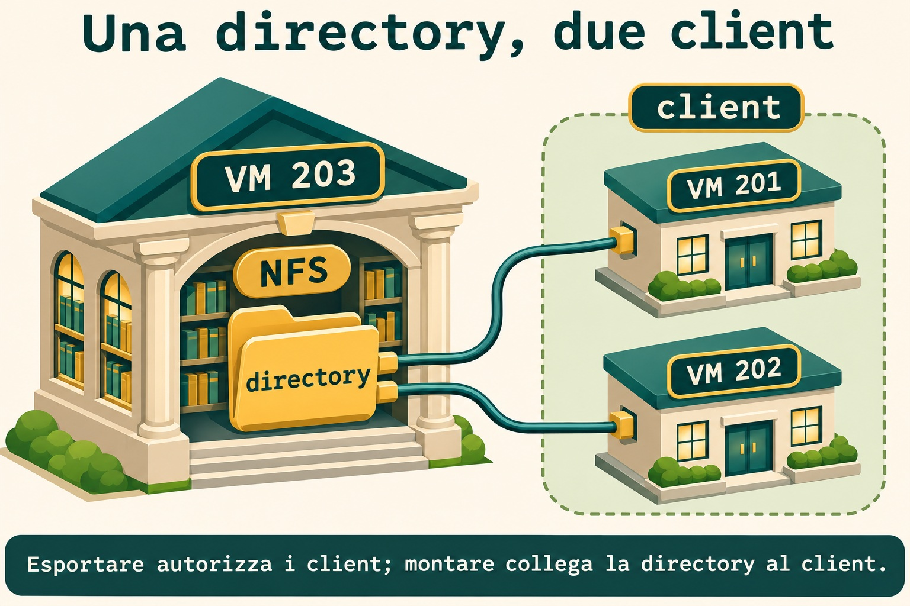
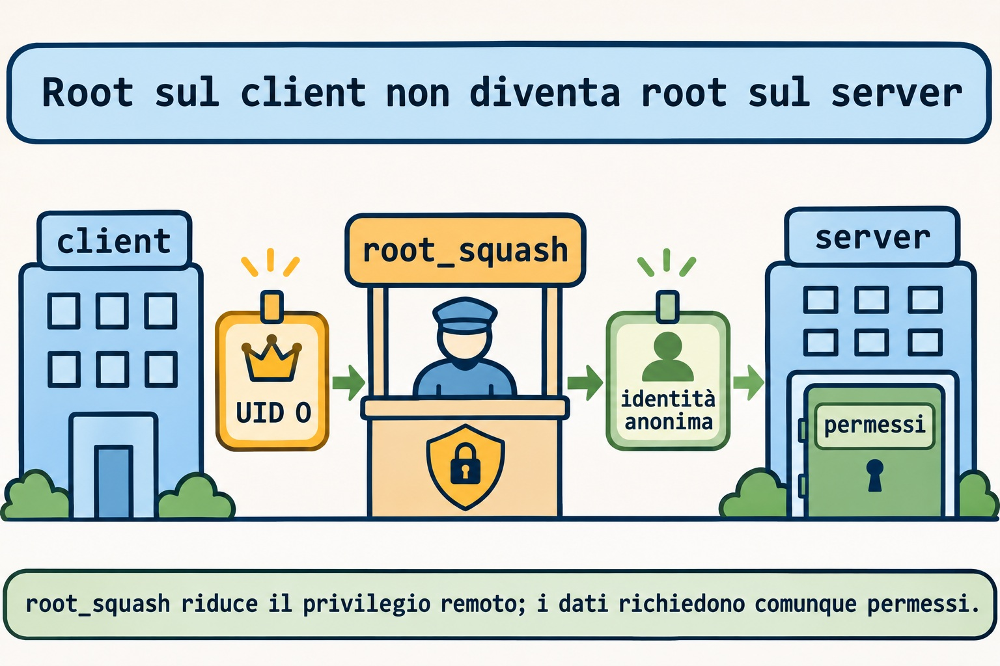

# Lezione 13.1 · Server NFS

Su Windows Server condividere una cartella coinvolge servizio, client autorizzato e permessi dei file. Con NFS separi le stesse domande. Questa lezione aggiunge la VM 203 al laboratorio, pubblica una directory soltanto per le due VM del corso e mantiene SELinux e firewall attivi.

> **Il cuore di questa lezione:** l'esportazione definisce quali client e operazioni il server consente; il firewall limita l'accesso di rete; i permessi dei file restano validi. Il resto è approfondimento.

| Scheda |  |
| --- | --- |
| **Modulo** | M13 · Archiviazione in rete, lezione 1 di 3 |
| **Quando** | Settimana 18 |
| **Alla fine** | Prepari la VM 203 ed esporti contenuti NFS in lettura alle VM 201 e 202 |
| **Prerequisiti** | M0–M12; noVNC, backup del corso, IP riservato fuori dal pool DHCP e storage del laboratorio |
| **Durata** | Circa 90 minuti, più l'installazione della nuova VM |
| **Snapshot** | `m13a1-inicio` e `m13a1-fim` sulle VM 201, 202 e 203 |

## 1 · Riscaldamento

Rispondi senza consultare il materiale. Le soluzioni sono in fondo.

1. Consentire una porta nel firewall crea il servizio che vi risponde?
2. Proprietario, permessi e contesto SELinux rispondono alla stessa domanda?
3. Perché controlli un VMID nel cluster prima di creare una VM?

## 2 · Perché conta

Vuoi fornire gli stessi contenuti a due server. Copiare i file su ogni host crea versioni diverse e richiede sincronizzazione. Una condivisione permette di lavorare con un'origine centrale, ma aggiunge una dipendenza dalla rete e dal file server.

L'obiettivo non è rendere qualsiasi directory accessibile a qualsiasi macchina. Pubblicherai un albero dedicato, in lettura, per due indirizzi noti e verificherai separatamente ogni livello.

## 3 · Modello mentale

Il server è la biblioteca dell'edificio. L'esportazione è l'elenco dei lettori autorizzati. Montare significa inserire un accesso a quella biblioteca nell'albero del client; non significa copiare i libri su un altro disco.

```text
VM 203: directory -> esportazione -> NFS -> VM 201 e VM 202
          |             |          |              |
file           client     2049/tcp       mount
```



*Esportare autorizza i client; montare collega la directory al client.*

### Ponte Windows

| Riferimento Windows | In questo lab Linux |
| --- | --- |
| Cartella condivisa | Directory esportata tramite NFS |
| Client autorizzato | IP esatto nell'esportazione e nel firewall |
| Percorso di accesso remoto | Server e percorso dell'esportazione |
| Permessi del file | UID, GID, permessi e politica attiva |

## 4 · L'essenziale

### Esportare non significa montare

Il server mantiene l'elenco in `/etc/exports` e nei file che terminano con `.exports` dentro `/etc/exports.d/`. `exportfs` applica e mostra le esportazioni. Un file salvato deve essere caricato per partecipare allo stato attivo.

In questa lezione usa NFS `4.2`. I client successivi sceglieranno esplicitamente questa versione. Il traffico principale raggiunge TCP `2049`; questo non rende le vecchie ricerche di `showmount` una prova adeguata per ogni server NFSv4.

### Opzioni con uno scopo

| Opzione | Funzione nel lab |
| --- | --- |
| `ro` | Esportare in lettura |
| `sync` | Confermare le scritture secondo le garanzie del server |
| `root_squash` | Ridurre l'identità remota con UID zero |
| `no_subtree_check` | Evitare la verifica aggiuntiva del sottoalbero esportato |

Non mettere spazi tra il client e le parentesi delle sue opzioni. In questo modulo il server si fida degli identificatori numerici inviati dai client con `AUTH_SYS`; usa soltanto la rete autorizzata del lab, senza pubblicare NFS su Internet.


*Rete, esportazione e permessi devono concordare.*

### Root remoto ha un limite

`root_squash` non trasforma tutti gli utenti in anonimi. Gestisce l'identità privilegiata remota. Non sostituisce il controllo di UID e GID degli utenti normali, che farai nelle prossime lezioni.



*root_squash riduce il privilegio remoto; i dati richiedono comunque permessi.*

### Rocky × Debian

| Voce | Rocky 9 | Debian 13 |
| --- | --- | --- |
| Server di questa lezione | VM 203, `nfs-utils` | Ruolo client sulla VM 202 |
| Unità server | `nfs-server.service` | Se fosse server: `nfs-kernel-server.service` |
| Pacchetto client | `nfs-utils` | `nfs-common` |
| Politica aggiuntiva | SELinux enforcing | AppArmor secondo i profili attivi |

Il piano introduce un solo server NFS, Rocky sulla VM 203. Le VM 201 e 202 ripetono il ruolo client; non creare un secondo server e non usare una VM fuori dalla tabella del corso.

## 5 · Lab guidato

### Passo 1 · Creare la VM 203 con identità propria

**Ipotesi:** un ID libero sul nodo attuale basta a garantire che sia libero nel cluster?

Sull'host Proxmox controlla ID, storage e ISO reale prima della creazione. Se `203` è già in uso, interrompi la creazione e rivedi l'inventario; non rimuovere la VM trovata.

```bash
qm list
pvesh get /cluster/resources --type vm
pvesm status
```

Riapplica la procedura di creazione e installazione della lezione 0.1 usando questi valori. Seleziona l'ISO Rocky 9 presente nello storage; non inventare l'identificatore del volume.

| Campo | Valore della nuova VM |
| --- | --- |
| VMID e nome | `203`, `srv-lab` |
| CPU, memoria e disco | `x86-64-v2-AES`, 2 vCPU, 2 GB, 20 GB |
| Macchina e firmware | q35 e UEFI OVMF |
| Storage e interfaccia | `vm-hdd`, virtio su `vmbr0` |
| Sistema e accesso | Rocky 9, `student`, `sudo`, SSH con chiave e guest agent |
| Rete | IPv4 riservato fuori dal pool DHCP, prefisso, gateway e DNS confermati nel piano di rete |

Esegui una nuova installazione tramite noVNC. Non clonare l'identità di una VM esistente. Registra l'indirizzo riservato come `IP_SRV`, senza presumere che il numero successivo sia disponibile; l'assenza di risposta al ping non dimostra una riserva. Prepara l'alias SSH `srv-lab` su Windows come nella 0.2.

**Output atteso:** VM 203 con hostname e chiavi host propri, indirizzo riservato persistente e accesso con chiave.

**Verifica:** sulla 203 controlla `hostnamectl --static`, `ip -br address`, `sudo systemctl is-active qemu-guest-agent` e una nuova sessione `ssh srv-lab` da Windows. Riavvia la VM e conferma lo stesso indirizzo prima di esportare i file.

### Passo 2 · Registrare la base e installare NFS

**Ipotesi:** uno snapshot precedente alla creazione del servizio permette di tornare indietro senza cancellare le VM client?

Sull'host Proxmox, dopo aver installato e controllato la nuova VM:

```bash
qm snapshot 201 m13a1-inicio
qm snapshot 202 m13a1-inicio
qm snapshot 203 m13a1-inicio
```

Sulla 203 crea i registri e annota l'IP reale. La cartella deve essere assente.

```bash
test ! -e "$HOME/m13"
mkdir -m 700 "$HOME/m13"
read -r -p 'IP_SRV: ' IP_SRV
printf '%s\n' "$IP_SRV" > "$HOME/m13/ip-servidor"
ip -br address
sudo dnf install -y nfs-utils policycoreutils-python-utils
getenforce
sudo firewall-cmd --state
sudo exportfs -v
```

**Output atteso:** indirizzo digitato presente sull'interfaccia, SELinux enforcing, firewalld attivo e nessuna esportazione di un altro esercizio. Se la base è diversa, correggi la preparazione prima di procedere.

**Verifica:** NFS verrà installato soltanto sul server 203 in questa lezione. I pacchetti client entrano nella 13.2. Conserva lo stato iniziale di SSH e firewalld.

### Passo 3 · Preparare la directory di lettura

**Ipotesi:** un'esportazione in lettura richiede che il file sia scrivibile da tutti?

Sulla 203 controlla i nomi riservati prima di creare qualsiasi file.

```bash
sudo test ! -e /srv/m13-share
sudo test ! -e /etc/exports.d/m13-share.exports
sudo install -d -m 0755 /srv/m13-share
printf 'NFS COURSE ok\n' | sudo tee /srv/m13-share/leia.txt > /dev/null
sudo chmod 0644 /srv/m13-share/leia.txt
sudo semanage fcontext -l -C | grep -F '/srv/m13-share'
```

Se esiste già una regola locale per questo albero, fermati e rivedine l'origine prima di sostituirla. Registra un tipo di contenuto pubblico per la condivisione in lettura.

```bash
sudo semanage fcontext -a -t public_content_t '/srv/m13-share(/.*)?'
sudo restorecon -Rv /srv/m13-share
ls -ldZ /srv/m13-share
ls -lZ /srv/m13-share/leia.txt
getsebool nfs_export_all_ro nfs_export_all_rw
```

**Output atteso:** albero attraversabile, file leggibile e regola di contesto applicata. Leggi i booleani esistenti senza impostare l'host permissive e senza ampliare la politica per tentativi.

**Verifica:** `matchpathcon -V /srv/m13-share/leia.txt` deve corrispondere alla regola registrata. Se una politica locale più restrittiva nega poi l'accesso, indaga il registro e la politica specifica, come nel M12.

### Decidi 1

Vuoi consentire soltanto i due client del corso. Quale destinazione descrive questa intenzione?

| Opzione | Azione |
| --- | --- |
| A | Esportare verso qualsiasi host |
| B | Usare gli IP esatti delle VM 201 e 202 |
| C | Rendere la directory scrivibile da tutti |

Scegli B. L'elenco dei client e i permessi dei file sono controlli diversi.

### Passo 4 · Registrare e caricare l'esportazione

**Ipotesi:** salvare il file di esportazione aggiorna già la tabella usata dal server?

Sulla 203:

```bash
sudo install -d -m 0755 /etc/exports.d
sudo tee /etc/exports.d/m13-share.exports > /dev/null <<'EOF'
/srv/m13-share 10.1.0.51(ro,sync,root_squash,no_subtree_check) 10.1.0.52(ro,sync,root_squash,no_subtree_check)
EOF
sudo chmod 0644 /etc/exports.d/m13-share.exports
sudo systemctl enable --now nfs-server.service
sudo exportfs -rav
sudo exportfs -v
sudo ss -lnt 'sport = :2049'
```

**Output atteso:** esportazione verso i due IP con lettura, `root_squash` e servizio su TCP `2049`. La rappresentazione delle opzioni in `exportfs -v` può includere altri valori predefiniti.

**Verifica:** controlla separatamente il percorso e ogni client. Uno spazio prima delle parentesi cambierebbe il significato; non correggere un errore sintattico aprendo l'accesso a tutti.

### Passo 5 · Autorizzare la rete necessaria

**Ipotesi:** consentire TCP `2049` per due IP modifica la regola SSH?

Sulla 203 identifica la zona effettiva dell'interfaccia e delle sorgenti del lab. La base deve bloccare TCP `2049` senza un'autorizzazione e non deve avere il servizio NFS o una porta equivalente aperti in modo ampio. Le regole esatte seguenti non devono esistere prima di questa lezione.

```bash
sudo firewall-cmd --get-active-zones
read -r -p 'ZONE: ' ZONE
sudo firewall-cmd --zone="$ZONE" --list-all
RULE201='rule family="ipv4" source address="10.1.0.51/32" port port="2049" protocol="tcp" accept'
RULE202='rule family="ipv4" source address="10.1.0.52/32" port port="2049" protocol="tcp" accept'
printf '%s\n' "$ZONE" > "$HOME/m13/zone"
printf '%s\n' "$RULE201" > "$HOME/m13/rule201"
printf '%s\n' "$RULE202" > "$HOME/m13/rule202"
sudo firewall-cmd --zone="$ZONE" --add-rich-rule="$RULE201"
sudo firewall-cmd --zone="$ZONE" --add-rich-rule="$RULE202"
sudo firewall-cmd --permanent --zone="$ZONE" --add-rich-rule="$RULE201"
sudo firewall-cmd --permanent --zone="$ZONE" --add-rich-rule="$RULE202"
sudo firewall-cmd --check-config
```

**Output atteso:** le due regole esistono nello stato attivo e permanente. Non è stata modificata l'autorizzazione SSH né aperto NFS a un'intera rete.

**Verifica:** dalle VM 201 e 202 inserisci `IP_SRV` confermato e prova `timeout 2 bash -c "</dev/tcp/$IP_SRV/2049" && echo ok`. Questo verifica TCP; la lettura NFS sarà verificata nella 13.2.

### Decidi 2

La porta risponde, ma un client segnala accesso negato al mount. Qual è l'evidenza successiva?

| Opzione | Azione |
| --- | --- |
| A | Controllare esportazione attiva, sorgente reale e percorso richiesto |
| B | Rimuovere `root_squash` |
| C | Disattivare SELinux |

Scegli A. TCP e autorizzazione dell'esportazione rispondono a domande diverse.

### Passo 6 · Verificare il server dopo il reboot

**Ipotesi:** un servizio abilitato senza esportazione valida fornisce automaticamente la directory corretta?

Sulla 203 riavvia e torna tramite SSH o noVNC.

```bash
sudo systemctl reboot
```

Dopo il riavvio:

```bash
systemctl is-active nfs-server.service
sudo exportfs -v
getenforce
matchpathcon -V /srv/m13-share/leia.txt
ZONE=$(cat "$HOME/m13/zone")
RULE201=$(cat "$HOME/m13/rule201")
RULE202=$(cat "$HOME/m13/rule202")
sudo firewall-cmd --zone="$ZONE" --query-rich-rule="$RULE201"
sudo firewall-cmd --permanent --zone="$ZONE" --query-rich-rule="$RULE202"
```

**Output atteso:** servizio attivo, esportazione corretta, enforcing e regole persistenti.

**Verifica:** verifica nuovamente TCP da ogni client e una sessione SSH da Windows. Il mount e l'identità numerica entrano nella prossima lezione.

## 6 · Rompi e ripara

### Guasto 1 · File salvato con nome ignorato

Sulla 203 cambia soltanto il suffisso del file dedicato.

```bash
sudo mv /etc/exports.d/m13-share.exports /etc/exports.d/m13-share.disabled
sudo exportfs -ra
```

**Sintomo:** il servizio resta attivo, ma l'esportazione di esercizio scompare dalla tabella.

**Indagine:** confronta i file e la tabella caricata.

```bash
sudo ls -l /etc/exports.d/
sudo exportfs -v
```

**Causa:** il file non termina più con `.exports` e non partecipa al caricamento normale.

**Riparazione:** ripristina il nome esatto e ricarica l'esportazione.

```bash
sudo mv /etc/exports.d/m13-share.disabled /etc/exports.d/m13-share.exports
sudo exportfs -ra
```

**Verifica:** `exportfs -v` torna a elencare i due client.

**Prevenzione:** controlla file, caricamento e risultato attivo come tre evidenze distinte.

### Guasto 2 · Client autorizzato errato

Sulla 203 conserva il file valido e cambia soltanto il client di esercizio.

```bash
sudo cp -a /etc/exports.d/m13-share.exports /etc/exports.d/m13-share.backup
sudo sed -i 's/10\.1\.0\.52/10.1.0.99/' /etc/exports.d/m13-share.exports
sudo exportfs -ra
sudo exportfs -v
```

**Sintomo:** TCP `2049` resta raggiungibile dalla VM 202, ma questa non è più nell'esportazione attiva.

**Indagine:** confronta la sorgente reale della 202 con l'elenco dei client dell'esportazione.

**Causa:** l'elenco autorizza ora un altro indirizzo; la regola del firewall non corregge quell'elenco.

**Riparazione:** ripristina la copia valida e riapplica.

```bash
sudo cp -a /etc/exports.d/m13-share.backup /etc/exports.d/m13-share.exports
sudo exportfs -ra
```

**Verifica:** la 202 torna nella tabella. Non lasciare l'esportazione di test puntata all'indirizzo errato.

**Prevenzione:** registra client autorizzato e percorso esportato insieme alla regola di rete.

### Guasto 3 · Regola salvata, consenso attivo rimosso

Sulla 203 rimuovi soltanto il consenso attivo della VM 201.

```bash
sudo firewall-cmd --zone="$ZONE" --remove-rich-rule="$RULE201"
```

**Sintomo:** nella zona del lab che blocca per impostazione predefinita, la 201 non apre più TCP `2049`, mentre la 202 continua a funzionare.

**Indagine:** confronta attivo e permanente e controlla che la zona non abbia un'autorizzazione più ampia per quella porta.

```bash
sudo firewall-cmd --zone="$ZONE" --list-all
sudo firewall-cmd --zone="$ZONE" --query-rich-rule="$RULE201"
sudo firewall-cmd --permanent --zone="$ZONE" --query-rich-rule="$RULE201"
```

**Causa:** la regola è stata rimossa soltanto dalla memoria. Il file permanente resta corretto. Un'autorizzazione ampia preesistente nasconderebbe questo guasto e deve essere identificata nella preparazione, senza cancellare regole altrui.

**Riparazione:** ripristina soltanto il consenso attivo.

```bash
sudo firewall-cmd --zone="$ZONE" --add-rich-rule="$RULE201"
```

**Verifica:** ripeti il test TCP dai due client.

**Prevenzione:** confronta la politica effettiva e quella persistente prima di concludere la modifica.

### Pulizia e continuità

Rimuovi soltanto la copia del guasto. Server, contenuto, regola SELinux e le due autorizzazioni restano come base per le lezioni 13.2 e 13.3. Questa conservazione è intenzionale, non è un servizio dimenticato.

```bash
sudo rm -f /etc/exports.d/m13-share.backup
sudo exportfs -v
sudo systemctl is-enabled nfs-server.service
```

Non rimuovere la VM 203 e non ripristinare i client allo snapshot per “pulire”. Le prossime lezioni registrano la stessa base e rimuovono soltanto i propri test.

## 7 · Trappole

| Errore comune | Che cosa fare | Perché |
| --- | --- | --- |
| Autorizzare qualsiasi client | Usare gli IP esatti del lab | Limita la superficie pubblicata |
| Spazio prima delle opzioni | Tenere uniti client e parentesi | La sintassi cambia il significato |
| Usare `no_root_squash` per un errore di proprietario | Controllare UID, GID e permessi | Root remoto non deve ottenere privilegi globali |
| Confondere porta aperta ed esportazione valida | Controllare `exportfs -v` | TCP non valida il percorso NFS |

## 8 · Quiz

1. Esportare una directory la monta sul client?
2. Qual è l'ambito di `root_squash`?
3. Perché `IP_SRV` non va scelto soltanto perché un ping non risponde?
4. Quale comando mostra le esportazioni attive?
5. Aprire TCP `2049` alla 202 corregge un IP errato in exports?
6. Quali stati devono sopravvivere al reboot del server?

## 9 · Promemoria

| Operazione | Comando |
| --- | --- |
| Esportazioni attive | `sudo exportfs -v` |
| Riapplicare i file | `sudo exportfs -ra` |
| Servizio NFS di Rocky | `systemctl status nfs-server.service` |
| Ascolto principale | `sudo ss -lnt 'sport = :2049'` |
| Contesto previsto | `matchpathcon -V /srv/m13-share/leia.txt` |

**Flashcard:** crea schede per esportazione, mount, client, `ro`, `root_squash` e stato attivo. Ripassa a D+1, D+3, D+7 e D+21.

## 10 · Checklist e chiusura

- [ ] Ho creato soltanto la VM 203 e riservato formalmente il suo indirizzo.
- [ ] Ho mantenuto firewall e SELinux attivi.
- [ ] Ho esportato soltanto l'albero di esercizio ai due client.
- [ ] Ho lasciato il server pronto per la 13.2 e rimosso i guasti introdotti.

**Ultimo esercizio:** spiega perché regola di rete, esportazione e permessi del file non siano intercambiabili. Usa il risultato di un guasto.

**Reboot di verifica:** dopo aver corretto i guasti riavvia la 203 e controlla servizio, esportazione, contesto e regole come nel passo 6. Apri anche una nuova sessione SSH verso ogni VM.

Sull'host Proxmox, dopo la verifica:

```bash
qm snapshot 201 m13a1-fim
qm snapshot 202 m13a1-fim
qm snapshot 203 m13a1-fim
```

## 11 · Nella vita reale

Su un server che amministri o che sei autorizzato a ispezionare, esegui soltanto letture. Leggi `exportfs -v`, stato del servizio e politica di rete applicabile. Non pubblicare una cartella, cambiare un booleano o modificare il firewall in questa missione.

Quale esportazione è più ampia del necessario? Quale client è una macchina nota? Dove sono documentati proprietario, UID, GID e scopo?

## 12 · Approfondire quando vuoi

- [exports(5)](https://manpages.debian.org/trixie/nfs-kernel-server/exports.5.en.html): client, opzioni e sintassi.
- [NFS su RHEL 9](https://docs.redhat.com/en/documentation/red_hat_enterprise_linux/9/html-single/configuring_and_using_network_file_services/index): servizio, versioni e rete.
- Sul server consulta `man exportfs`, `man nfsd_selinux` e `man exports`, quando disponibili.
- [firewall-cmd](https://firewalld.org/documentation/man-pages/firewall-cmd.html): regole attive e permanenti.

**DeepTutor** (http://10.1.0.149:3782, KB "Curso Linux Sysadmin"):

- `!explica Separe firewall, exportação NFS e permissão do arquivo com uma analogia de biblioteca.`
- `!feynman Vou explicar o alcance de root_squash sem confundir com identidade de usuários comuns. Critique minha explicação.`
- `!quiz Crie seis situações de cliente, caminho e persistência de exportações NFS.`

## Soluzioni commentate

### Riscaldamento

1. No. Il processo deve essere in ascolto e rispondere al protocollo.
2. No. Sono controlli diversi che si combinano nell'accesso.
3. L'ID può appartenere a un altro nodo; l'inventario del cluster evita di modificare una VM che non è tua.

### Quiz

1. No. Montare è un'azione del client.
2. Riduce l'identità privilegiata remota; non trasforma tutti gli utenti in uno solo.
3. Un host può non rispondere a ICMP e continuare a usare l'indirizzo. La riserva deriva dal piano di rete e dal controllo DHCP.
4. `sudo exportfs -v`.
5. No. L'autorizzazione dell'esportazione deve comunque descrivere il client reale.
6. Servizio, esportazione, permessi, contesti e regole permanenti che sostengono l'accesso.

<!-- navegacao -->
[← Lezione 12.5 · Audit e crittografia](12.5-auditoria-e-criptografia.md) · [Indice delle lezioni](../01-aulas.md) · [Piano del corso: dalla 13.2 in poi →](../00-plano-do-curso.md)
