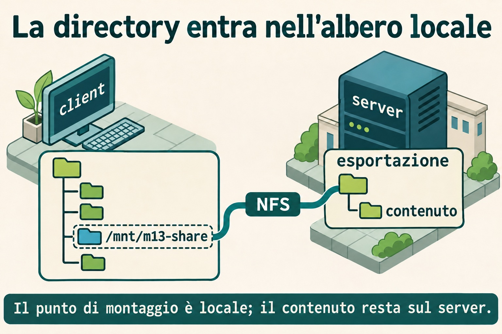
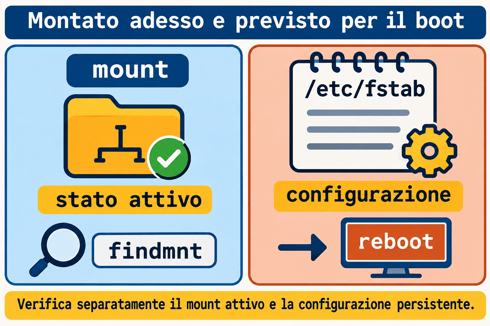
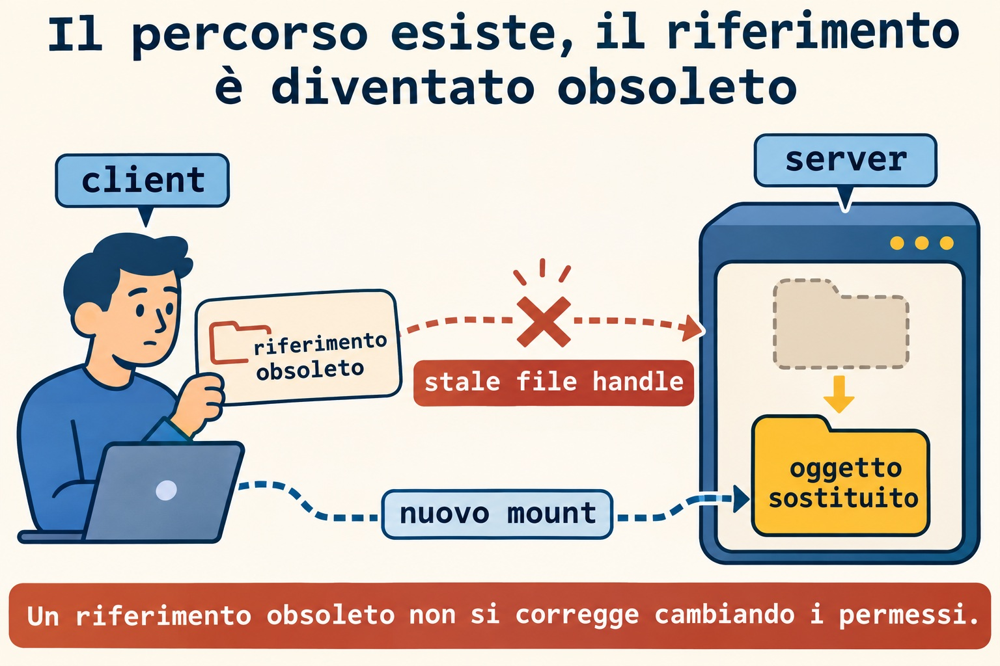

# Lezione 13.2 · Client NFS

Su Windows Server un percorso remoto e una lettera di unità rappresentano accessi diversi allo stesso contenuto. Su Linux il mount inserisce la directory remota nell'albero locale. Monterai l'esportazione della VM 203 sulle due famiglie, controllerai lo stato attivo e pianificherai la ricostruzione al boot.

> **Il cuore di questa lezione:** server, percorso remoto e punto locale devono corrispondere. Mount attivo e voce in fstab sono evidenze separate; riferimenti obsoleti richiedono di indagare l'oggetto remoto. Il resto è approfondimento.

| Scheda |  |
| --- | --- |
| **Modulo** | M13 · Archiviazione in rete, lezione 2 di 3 |
| **Quando** | Settimana 19 |
| **Alla fine** | Monti NFSv4.2 su Rocky e Debian, validi fstab e distingui indisponibilità, occupazione e riferimento obsoleto |
| **Prerequisiti** | 13.1 completata; esportazione della VM 203 attiva; `IP_SRV` registrato; `student`, `sudo`, SSH e noVNC |
| **Durata** | Circa 90 minuti |
| **Snapshot** | `m13a2-inicio` e `m13a2-fim` sulle VM 201, 202 e 203 |

## 1 · Riscaldamento

Rispondi senza consultare il materiale. Le soluzioni sono in fondo.

1. Esportare la cartella sul server la inserisce già nell'albero dei client?
2. Quali controlli vanno ancora verificati dopo aver aperto TCP `2049`?
3. Qual è la funzione di `root_squash`?

## 2 · Perché conta

Il server esporta la cartella, ma un client mostra file vecchi. L'operatore stava leggendo la directory locale perché il mount non era avvenuto. In un altro caso il mount funziona fino al reboot: mancava la configurazione persistente.

Prima di concludere che i dati siano scomparsi, conferma quale filesystem serve il percorso. Questa verifica evita di scrivere nella directory locale credendo che sia la condivisione remota.

## 3 · Modello mentale

Il punto di mount è la porta di accesso alla biblioteca sul client. Finché il ponte è collegato, vedi il contenuto del server attraverso quella porta. Il contenuto locale già presente resta nascosto, senza essere cancellato.

```text
VM 203:/srv/m13-share -> NFS -> client:/mnt/m13-share
           |                                  |
contenuto remoto                  punto locale
```



*Il punto di montaggio è locale; il contenuto resta sul server.*

### Ponte Windows

| Riferimento Windows | In questo lab Linux |
| --- | --- |
| Indirizzo del server e condivisione | `IP_SRV` e `/srv/m13-share` |
| Punto di accesso del client | `/mnt/m13-share` |
| Riconnettere al login o all'avvio | Configurazione persistente del sistema |
| Controllare la connessione reale | `findmnt` e lettura del file previsto |

## 4 · L'essenziale

### Tre parti dell'indirizzo

Nel comando di mount indichi server, percorso esportato e directory locale. Il nome locale non deve essere uguale a quello remoto. L'indirizzo riservato della 203 resta quello registrato nella 13.1; non scegliere un indirizzo a intuito.

### Opzioni che controllerai

| Opzione | Effetto in questo lab |
| --- | --- |
| `vers=4.2` | Sceglie la versione usata dal corso |
| `ro` | Monta il client in lettura |
| `hard` | Mantiene il tentativo delle operazioni quando il server non è disponibile |
| `nosuid,nodev` | Non usa bit speciali né dispositivi dei contenuti remoti come privilegio locale |
| `_netdev` | Segnala la dipendenza dalla rete per il mount persistente |

Un mount `hard` può lasciare le operazioni sui file in attesa di un server assente. Questo è diverso dal fallimento rapido di un tentativo iniziale di mount; non passare a `soft` soltanto per nascondere l'indisponibilità.

### Disco e stato attivo

Una riga in `/etc/fstab` descrive come montare; `findmnt` mostra ciò che è montato. `findmnt --verify` controlla la tabella; un mount reale e una lettura verificano il comportamento. Non usare `mount -a` come primo test di una modifica isolata.



*Verifica separatamente il mount attivo e la configurazione persistente.*

### Un riferimento obsoleto non è un permesso

`stale file handle` indica che un riferimento conservato dal client non identifica più un oggetto valido sul server. Ricostruire o sostituire l'oggetto remoto può invalidare quel riferimento. Rinominare una directory non produce necessariamente questo errore.

Indaga che cosa sia cambiato sul server, identifica i processi che usano il mount e interrompi l'uso prima di smontare e montare di nuovo. Non cancellare un albero condiviso per provare a riprodurre il messaggio e non forzare normalmente un mount in uso.



*Un riferimento obsoleto non si corregge cambiando i permessi.*

### Rocky × Debian

| Voce | Rocky 9 | Debian 13 |
| --- | --- | --- |
| Pacchetto client | `nfs-utils` | `nfs-common` |
| Diagnosi del mount | `findmnt`, `nfsstat -m` | `findmnt`, `nfsstat -m` |
| Persistenza | `/etc/fstab` interpretato da systemd | Lo stesso meccanismo |
| Contenuto servito | VM 203, Rocky 9 | La stessa VM 203 |

## 5 · Lab guidato

Esegui gli stessi passi sulle VM 201 e 202. La VM 203 mantiene l'esportazione creata nella 13.1; non modificare il server durante i mount dei client.

### Passo 1 · Proteggere e registrare la destinazione

**Ipotesi:** conoscere il punto locale dimostra quale server stia fornendo i file?

Sull'host Proxmox:

```bash
qm snapshot 201 m13a2-inicio
qm snapshot 202 m13a2-inicio
qm snapshot 203 m13a2-inicio
```

Su entrambi i client registra l'IP riservato confermato nella 13.1. La cartella `m13` non è ancora stata creata su questi client.

```bash
test ! -e "$HOME/m13"
mkdir -m 700 "$HOME/m13"
read -r -p 'IP_SRV: ' IP_SRV
printf '%s\n' "$IP_SRV" > "$HOME/m13/ip-servidor"
sudo test ! -e /mnt/m13-share
grep -nF '/mnt/m13-share' /etc/fstab
ip -4 route get "$IP_SRV"
timeout 2 bash -c "</dev/tcp/$IP_SRV/2049" && echo "TCP 2049 ok"
```

**Output atteso:** destinazione corretta, percorso e TCP disponibili, punto locale e riferimento in fstab assenti. Una ricerca vuota di `grep` è la condizione prevista.

**Verifica:** sulla 203 `sudo exportfs -v` continua a elencare `/srv/m13-share` e gli IP delle due VM. Se la base fallisce, correggi la 13.1 prima di continuare.

### Passo 2 · Installare e creare un punto locale vuoto

**Ipotesi:** creare la directory locale porta già qualche file dal server?

Su Rocky:

```bash
sudo dnf install -y nfs-utils
```

Su Debian:

```bash
sudo apt update
sudo apt install -y nfs-common
```

Su entrambi i client:

```bash
sudo install -d -m 0755 /mnt/m13-share
findmnt --mountpoint /mnt/m13-share
sudo ls -la /mnt/m13-share
sudo cp -a /etc/fstab "$HOME/m13/fstab.inicio"
```

**Output atteso:** directory vuota e ancora priva di mount. Il backup di fstab conserva il riferimento precedente senza sostituire la configurazione attiva.

**Verifica:** conferma che non vi sia contenuto locale da conservare sotto il punto scelto. Non montare mai sopra un albero di lavoro senza inventariarlo.

### Passo 3 · Montare e verificare l'origine

**Ipotesi:** il solo testo previsto dimostra che il file provenga dalla 203?

Su entrambi i client:

```bash
sudo mount -t nfs -o vers=4.2,ro,hard,nosuid,nodev "$IP_SRV:/srv/m13-share" /mnt/m13-share
findmnt --mountpoint /mnt/m13-share -o SOURCE,TARGET,FSTYPE,OPTIONS
/usr/sbin/nfsstat -m
cat /mnt/m13-share/leia.txt
stat -c '%u:%g %a %n' /mnt/m13-share/leia.txt
```

**Output atteso:** origine con `IP_SRV` corretto, NFSv4.2, lettura e contenuto `NFS COURSE ok`. La rappresentazione delle opzioni può contenere altri valori negoziati.

**Verifica:** confronta UID, GID e permessi numerici con il file sulla 203. Il nome mostrato dal client può dipendere dal suo archivio locale; NFS non elimina numeri e permessi.

### Decidi 1

Il file previsto è apparso, ma `findmnt` non mostra NFS in quel punto. Quale ipotesi viene prima?

| Opzione | Azione |
| --- | --- |
| A | Il server ha necessariamente perso dati |
| B | Potresti leggere contenuti locali |
| C | Occorre consentire la scrittura a tutti |

Scegli B. Controlla il filesystem che serve il percorso prima di interpretarne il contenuto.

### Passo 4 · Distinguere lettura e scrittura

**Ipotesi:** root sul client può scrivere ignorando l'opzione di sola lettura del mount?

Su entrambi i client prova a creare soltanto un nuovo file con un nome di esercizio.

```bash
sudo touch /mnt/m13-share/nao-deve-existir
findmnt --mountpoint /mnt/m13-share -o SOURCE,OPTIONS
```

**Output atteso:** la creazione viene rifiutata. Questo mount client usa `ro` e anche l'esportazione server è di sola lettura. Non è una dimostrazione isolata di `root_squash`.

**Verifica:** sulla 203 conferma che `/srv/m13-share/nao-deve-existir` non sia stato creato. Non convertire l'esportazione in scrittura soltanto per far riuscire questo test.

### Passo 5 · Registrare il mount persistente

**Ipotesi:** un fstab corretto modifica il mount già attivo senza altre azioni?

Su entrambi i client conferma di nuovo che il marcatore e il punto non compaiano in fstab. Soltanto dopo aggiungi il blocco dedicato.

```bash
grep -nE 'm13a2|/mnt/m13-share' /etc/fstab
printf '\n# BEGIN m13a2\n%s:/srv/m13-share /mnt/m13-share nfs ro,vers=4.2,hard,nosuid,nodev,_netdev,nofail,x-systemd.mount-timeout=15s 0 0\n# END m13a2\n' "$IP_SRV" | sudo tee -a /etc/fstab > /dev/null
sudo findmnt --verify --verbose
sudo systemctl daemon-reload
cd "$HOME"
sudo umount /mnt/m13-share
sudo mount /mnt/m13-share
findmnt --mountpoint /mnt/m13-share -o SOURCE,OPTIONS
cat /mnt/m13-share/leia.txt
```

`nofail` consente che l'assenza di questo mount di esercizio non impedisca il boot; non rende disponibile localmente un file remoto. Il limite di systemd vale per il lavoro di mount, non per ogni operazione successiva di un mount `hard`.

**Output atteso:** validazione della tabella senza errori nella nuova voce e nuovo mount tramite il punto locale usando fstab.

**Verifica:** controlla che origine e versione siano uguali al mount manuale. Se la validazione indica un errore, correggilo prima del reboot; non sostituire tutto fstab con il backup senza rivedere le differenze.

### Decidi 2

Il mount risulta occupato quando provi a smontare. Qual è l'azione iniziale?

| Opzione | Azione |
| --- | --- |
| A | Riavviare il file server |
| B | Forzare comunque lo smontaggio |
| C | Identificare shell e processi che usano il punto |

Scegli C. Directory attuale, file aperto e processo attivo sono motivi per coordinare la cessazione dell'uso.

### Passo 6 · Verificare dopo il reboot

**Ipotesi:** un mount manuale riuscito dimostra che il sistema lo ricostruirà al boot?

Riavvia i client uno alla volta; la 203 deve essere accesa e disponibile.

```bash
sudo systemctl reboot
```

Dopo essere tornato su ogni client:

```bash
findmnt --mountpoint /mnt/m13-share -o SOURCE,TARGET,FSTYPE,OPTIONS
cat /mnt/m13-share/leia.txt
MOUNT_UNIT=$(systemd-escape --path --suffix=mount /mnt/m13-share)
systemctl status "$MOUNT_UNIT" --no-pager
```

**Output atteso:** origine NFS presente e contenuto `NFS COURSE ok`. L'unità di mount corrisponde al percorso con escape di systemd.

**Verifica:** per ottenere il nome senza indovinare gli escape, usa `systemd-escape --path --suffix=mount /mnt/m13-share` e consulta l'unità restituita.

## 6 · Rompi e ripara

### Guasto 1 · Percorso remoto errato

Sui client esci dal punto e smonta prima di provare il percorso errato.

```bash
cd "$HOME"
sudo umount /mnt/m13-share
IP_SRV=$(cat "$HOME/m13/ip-servidor")
sudo mount -t nfs -o vers=4.2,ro "$IP_SRV:/srv/m13-inexistente" /mnt/m13-share
```

**Sintomo:** il tentativo di mount fallisce anche con TCP `2049` disponibile.

**Indagine:** confronta il percorso richiesto con `exportfs -v` sulla 203.

**Causa:** il client ha richiesto un albero che non corrisponde all'esportazione prevista. Il messaggio esatto può variare tra errori di percorso e accesso.

**Riparazione:** monta tramite il punto di fstab già validato.

```bash
sudo mount /mnt/m13-share
```

**Verifica:** l'origine corretta e `NFS COURSE ok` tornano a comparire.

**Prevenzione:** registra server, esportazione e punto locale come campi distinti.

### Guasto 2 · Shell che tiene occupato il mount

In un terminale A di ogni client entra nel mount. In un altro terminale B prova a smontare.

```bash
cd /mnt/m13-share
pwd
```

```bash
sudo umount /mnt/m13-share
```

**Sintomo:** lo smontaggio indica che il punto è occupato.

**Indagine:** nel terminale A `pwd` mostra la directory che mantiene il riferimento. Se disponibile, `sudo fuser -vm /mnt/m13-share` aiuta a identificare altri processi che lo usano.

**Causa:** la directory attuale della shell è dentro il mount. Non è un rifiuto dell'esportazione.

**Riparazione:** nel terminale A torna con `cd "$HOME"`; poi ripeti lo smontaggio nel B e monta di nuovo per il guasto successivo.

**Verifica:** lo smontaggio senza forzature funziona dopo aver cessato l'uso.

**Prevenzione:** coordina i processi che usano il mount prima di manutenzione o sostituzione di un'esportazione.

### Guasto 3 · Opzione non valida in una candidata

Senza modificare fstab attivo, esci dal punto, smonta e scrivi una candidata con una versione NFS inesistente.

```bash
cd "$HOME"
sudo umount /mnt/m13-share
printf '%s:/srv/m13-share /mnt/m13-share nfs ro,vers=99,hard,nosuid,nodev,_netdev 0 0\n' "$IP_SRV" > "$HOME/m13/fstab.errado"
sudo mount --verbose --fstab "$HOME/m13/fstab.errado" /mnt/m13-share
```

**Sintomo:** il tentativo fallisce perché la versione richiesta non è una versione NFS valida. Il file attivo del sistema non è cambiato.

**Indagine:** leggi la candidata e il messaggio dell'ausiliario NFS. Una validazione strutturale di fstab non dimostra che tutte le opzioni del protocollo siano valide.

**Causa:** l'opzione richiede una versione inesistente. Modificare il file candidato non ha modificato fstab e il tentativo non valido non ha creato il mount.

**Riparazione:** genera una candidata corretta come riferimento senza sostituire fstab reale.

```bash
sed 's/vers=99/vers=4.2/' "$HOME/m13/fstab.errado" > "$HOME/m13/fstab.correto"
cat "$HOME/m13/fstab.correto"
sudo mount --fstab "$HOME/m13/fstab.correto" /mnt/m13-share
findmnt --mountpoint /mnt/m13-share -o SOURCE,OPTIONS
```

**Verifica:** il mount reale torna a usare `4.2`; fstab originale mantiene la propria voce validata.

**Prevenzione:** controlla sintassi, opzioni del protocollo, applicazione reale e risultato dopo reboot.

### Pulizia

Sui client libera i processi che usano il mount e smonta prima di rimuovere il blocco dedicato da fstab. Controlla il `diff`; devono scomparire soltanto le righe di esercizio.

```bash
cd "$HOME"
sudo umount /mnt/m13-share
sudo cp -a /etc/fstab "$HOME/m13/fstab.antes-limpeza"
sudo sed -i '/^# BEGIN m13a2$/,/^# END m13a2$/d' /etc/fstab
sudo diff -u "$HOME/m13/fstab.antes-limpeza" /etc/fstab
sudo findmnt --verify --verbose
sudo systemctl daemon-reload
sudo rmdir /mnt/m13-share
```

L'esportazione della VM 203 resta attiva. Conserva `ip-servidor` e i registri privati per la 13.3. Non rimuovere contenuti remoti come parte della pulizia del client.

## 7 · Trappole

| Errore comune | Che cosa fare | Perché |
| --- | --- | --- |
| Leggere senza controllare il mount | Usare `findmnt` sul punto | La directory può essere locale |
| Provare qualsiasi modifica con `mount -a` | Verificare soltanto il punto di esercizio | Evita di attivare altre voci |
| Risolvere l'indisponibilità con `soft` | Indagare server e percorso | Le opzioni cambiano le garanzie di I/O |
| Trattare un riferimento obsoleto come permessi errati | Indagare oggetto remoto e processi che lo usano | L'identificatore non rappresenta più l'oggetto |

## 8 · Quiz

1. Che cosa succede ai file locali nascosti dal mount?
2. `nofail` garantisce che il contenuto remoto sia disponibile?
3. Quale strumento mostra l'origine effettiva di un punto?
4. Perché `_netdev` non significa “il server ha già risposto”?
5. Quale causa di smontaggio occupato hai riprodotto?
6. Perché non generare `stale file handle` cancellando la condivisione?

## 9 · Promemoria

| Operazione | Comando |
| --- | --- |
| Origine e opzioni | `findmnt --mountpoint /mnt/m13-share -o SOURCE,OPTIONS` |
| Opzioni NFS negoziate | `nfsstat -m` |
| Validare la tabella | `sudo findmnt --verify --verbose` |
| Montare il punto di fstab | `sudo mount /mnt/m13-share` |
| Smontare dopo aver cessato l'uso | `sudo umount /mnt/m13-share` |

**Flashcard:** crea schede per origine, punto locale, fstab, `hard`, `_netdev` e riferimento obsoleto. Ripassa a D+1, D+3, D+7 e D+21.

## 10 · Checklist e chiusura

- [ ] Ho montato e letto i contenuti sulle due famiglie.
- [ ] Ho controllato origine, opzioni e identificatori numerici.
- [ ] Ho verificato la persistenza prima di rimuovere il blocco da fstab.
- [ ] Non ho modificato dati remoti per simulare un riferimento obsoleto.

**Ultimo esercizio:** spiega la differenza tra punto locale, percorso remoto e riferimento all'oggetto. Aggiungi un'evidenza che il mount provenisse realmente dalla 203.

**Reboot di verifica:** dopo la pulizia riavvia 201 e 202 e conferma l'assenza del mount e della voce di esercizio. La 203 resta pronta per autofs.

Sull'host Proxmox, dopo la verifica:

```bash
qm snapshot 201 m13a2-fim
qm snapshot 202 m13a2-fim
qm snapshot 203 m13a2-fim
```

## 11 · Nella vita reale

Su un host che amministri o che sei autorizzato a ispezionare, esegui soltanto letture. Osserva `findmnt -t nfs,nfs4`, `nfsstat -m` e le voci NFS in fstab. Non montare, smontare o modificare opzioni in questa missione.

Quale server sostiene ogni percorso? Che cosa succede se non risponde? Chi mantiene la configurazione persistente e chi usa i file?

## 12 · Approfondire quando vuoi

- [nfs(5)](https://manpages.debian.org/trixie/nfs-common/nfs.5.en.html): opzioni e comportamento delle operazioni.
- [mount(8)](https://man7.org/linux/man-pages/man8/mount.8.html), [umount(8)](https://man7.org/linux/man-pages/man8/umount.8.html) e [findmnt(8)](https://man7.org/linux/man-pages/man8/findmnt.8.html): mount e osservazione.
- [systemd.mount](https://manpages.debian.org/trixie/systemd/systemd.mount.5.en.html): dipendenze di rete e limiti del lavoro di mount.
- [NFS su RHEL 9](https://docs.redhat.com/en/documentation/red_hat_enterprise_linux/9/html-single/configuring_and_using_network_file_services/index): client e diagnosi.

**DeepTutor** (http://10.1.0.149:3782, KB "Curso Linux Sysadmin"):

- `!explica Separe servidor, caminho exportado e ponto local em uma montagem NFS.`
- `!feynman Vou explicar por que um arquivo local pode reaparecer depois de desmontar NFS. Critique minha explicação.`
- `!quiz Crie seis casos de fstab, montagem ocupada e referência NFS obsoleta sem sugerir apagar dados.`

## Soluzioni commentate

### Riscaldamento

1. No. Il client deve montare oppure usare un meccanismo che monti su richiesta.
2. Percorso esportato, client autorizzato, identità e permessi dei contenuti.
3. Riduce l'identità privilegiata remota senza unire tutti gli utenti in una sola identità.

### Quiz

1. Restano sul disco locale e ricompaiono dopo lo smontaggio.
2. No. Consente che quell'assenza non sia fatale al boot, ma il dato remoto resta indisponibile.
3. `findmnt`, usando il punto di mount corretto.
4. Classifica la dipendenza dalla rete; il server deve comunque essere raggiungibile e rispondere.
5. Una shell con directory attuale dentro il mount.
6. Può distruggere dati e influire sui processi che li usano senza produrre lo stesso errore in modo controllato.

<!-- navegacao -->
[← Lezione 13.1 · Server NFS](13.1-servidor-nfs.md) · [Indice delle lezioni](../01-aulas.md) · [Piano del corso: dalla 13.3 in poi →](../00-plano-do-curso.md)
