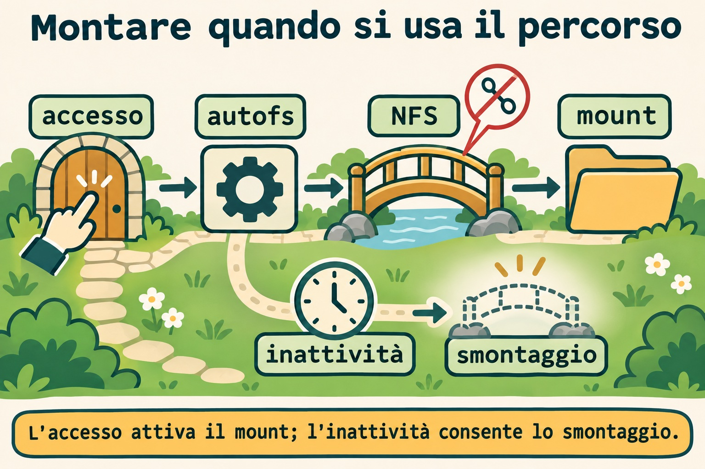
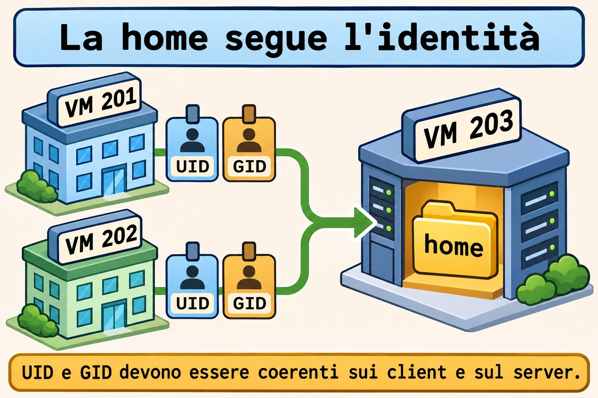

# Lezione 13.3 · autofs

Su Windows Server conosci percorsi di rete usati quando un utente apre una cartella. Su Linux autofs può collegare l'esportazione quando qualcuno accede a un percorso e liberarla dopo un periodo senza uso. Distinguerai mappa principale, mappa indiretta e identità numerica prima di montare home su richiesta.

> **Il cuore di questa lezione:** la mappa descrive la destinazione; l'accesso attiva il mount; l'identità dell'utente deve comunque corrispondere ai dati sul server. Il resto è approfondimento.

| Scheda |  |
| --- | --- |
| **Modulo** | M13 · Archiviazione in rete, lezione 3 di 3 |
| **Quando** | Settimana 19 |
| **Alla fine** | Configuri una mappa indiretta, diagnostichi l'accesso su richiesta e monti una home NFS sulle due famiglie |
| **Prerequisiti** | 13.1 e 13.2; VM 203 con esportazione attiva; client senza il mount fstab dell'esercizio precedente; `IP_SRV` registrato |
| **Durata** | Circa 90 minuti, più la sessione della sfida |
| **Snapshot** | `m13a3-inicio` e `m13a3-fim` sulle VM 201, 202 e 203 |

## 1 · Riscaldamento

Rispondi senza consultare il materiale. Le soluzioni sono in fondo.

1. Qual è la differenza tra percorso remoto e punto di mount locale?
2. Perché una directory attuale può impedire lo smontaggio?
3. Lo stesso nome utente su due macchine dimostra che gli UID siano uguali?

## 2 · Perché conta

Una flotta ha decine di directory remote, ma ogni macchina ne usa poche per volta. Montare tutto al boot aumenta dipendenze inutili. Autofs permette di rinviare il mount fino a quando il percorso viene realmente usato.

Questo non elimina la dipendenza dal server quando qualcuno ha bisogno dei dati. Devi sapere se il guasto dipenda dalla mappa, dal percorso NFS, dalla rete o dall'identità che prova ad accedere alla home.

## 3 · Modello mentale

La mappa principale indica quale sportello serve quell'ala dell'edificio. La mappa indiretta collega ogni chiave a una biblioteca remota. Accedere alla porta della chiave fa costruire il ponte ad autofs; finché qualcuno lo usa, non va rimosso.

```text
mappa principale -> punto base -> mappa indiretta -> chiave -> destinazione NFS
accesso -> mount
```



*L'accesso attiva il mount; l'inattività consente lo smontaggio.*

### Ponte Windows

| Riferimento Windows | In questo lab Linux |
| --- | --- |
| Percorso remoto usato quando necessario | Accesso a una chiave autofs |
| Mappatura della cartella utente | Home registrata che punta all'albero autofs |
| Identità centrale coerente | UID e GID coerenti in questo lab locale |
| Connessione di rete ancora necessaria | NFS deve rispondere quando si usa il percorso |

## 4 · L'essenziale

### Mappa principale e indiretta

Una voce principale indica la directory base e il file della mappa. Nella mappa indiretta la chiave è un componente sotto quella base. In questo lab `/mnt/m13-auto/share` usa la chiave `share` sotto `/mnt/m13-auto`.


*La mappa principale indica la mappa; la chiave sceglie l'esportazione.*

### L'inattività non è un conto alla rovescia per espellere

Il timeout permette di provare a far scadere un mount inutilizzato. Un file aperto o una shell al suo interno può mantenerlo occupato. L'istante di scadenza dipende anche dal controllo del demone; non promettere che avvenga esattamente al secondo configurato.

Elencare i contenuti del percorso stesso provoca un accesso. Per osservare senza attivarlo, elenca i filesystem NFS montati con `findmnt -rn -t nfs,nfs4 -o TARGET,SOURCE`.

### Home remota e identità

L'archivio utenti indica la home; autofs fornisce l'albero quando viene usato. Il server continua a controllare numeri e permessi. Lo stesso nome con UID diverso non è un'identità coerente.



*UID e GID devono essere coerenti sui client e sul server.*

### Rocky × Debian

| Voce | Rocky 9 | Debian 13 |
| --- | --- | --- |
| Pacchetti | `autofs`, `nfs-utils` | `autofs`, `nfs-common` |
| Unità | `autofs.service` | `autofs.service` |
| Mappe dedicate | `/etc/auto.master.d/m13.autofs`, `/etc/auto.m13` | Gli stessi percorsi, dopo aver verificato l'include principale |
| Home NFS | Controllare `use_nfs_home_dirs` nella sfida | Osservare la politica AppArmor reale, senza usare comandi SELinux |

## 5 · Lab guidato

### Passo 1 · Proteggere e controllare la base

**Ipotesi:** autofs riesce a correggere da solo un'esportazione NFS già irraggiungibile?

Sull'host Proxmox:

```bash
qm snapshot 201 m13a3-inicio
qm snapshot 202 m13a3-inicio
qm snapshot 203 m13a3-inicio
```

Sui client conferma la preparazione lasciata nella 13.2. Se autofs è già attivo o abilitato con mappe estranee, non riavviarlo per questa lezione; prepara una base di lab senza quei processi.

```bash
IP_SRV=$(cat "$HOME/m13/ip-servidor")
systemctl is-active autofs.service
systemctl is-enabled autofs.service
sudo test ! -e /etc/auto.master.d/m13.autofs
sudo test ! -e /etc/auto.m13
sudo test ! -e /mnt/m13-auto
findmnt -rn -t nfs,nfs4 -o TARGET,SOURCE
timeout 2 bash -c "</dev/tcp/$IP_SRV/2049" && echo "TCP 2049 ok"
```

**Output atteso:** server raggiungibile, nomi di esercizio liberi e nessun mount fstab della 13.2. Autofs è assente oppure inattivo e disabilitato.

**Verifica:** sulla 203 conferma il file `leia.txt` e l'esportazione attiva. Non usare autofs per nascondere un guasto della base NFS.

### Passo 2 · Installare e ispezionare la mappa principale

**Ipotesi:** creare un file di mappa in una qualsiasi directory fa sì che il demone lo usi automaticamente?

Su Rocky client 201:

```bash
sudo dnf install -y autofs nfs-utils
```

Su Debian client 202:

```bash
sudo apt update
sudo apt install -y autofs nfs-common
```

Su entrambi i client:

```bash
sudo systemctl stop autofs.service
grep -n 'auto.master.d' /etc/auto.master
sudo automount -m
```

**Output atteso:** la mappa principale include `/etc/auto.master.d` tramite il meccanismo `+dir:` della base del corso. Il file che termina con `.autofs` verrà letto in quella directory.

**Verifica:** se l'include è assente, fermati e indaga la mappa principale effettivamente configurata prima di procedere. Non aggiungere mappe che nessuno sta caricando.

### Passo 3 · Creare la chiave di lettura

**Ipotesi:** la chiave `share` deve essere il nome della directory remota?

Su entrambi i client configura soltanto i file dedicati.

```bash
sudo install -d -m 0755 /etc/auto.master.d
printf '/mnt/m13-auto /etc/auto.m13 --timeout=30\n' | sudo tee /etc/auto.master.d/m13.autofs > /dev/null
printf 'share -fstype=nfs,vers=4.2,ro,hard,nosuid,nodev %s:/srv/m13-share\n' "$IP_SRV" | sudo tee /etc/auto.m13 > /dev/null
sudo chmod 0644 /etc/auto.master.d/m13.autofs /etc/auto.m13
sudo automount -m
sudo systemctl enable --now autofs.service
findmnt -rn -t nfs,nfs4 -o TARGET,SOURCE
cat /mnt/m13-auto/share/leia.txt
findmnt -rn -t nfs,nfs4 -o TARGET,SOURCE
```

**Output atteso:** la mappa elenca chiave e destinazione previste. Il primo accesso restituisce `NFS COURSE ok` e crea il mount NFS corrispondente.

**Verifica:** osserva l'origine in `findmnt`, non soltanto l'esistenza della directory base autofs. Un punto autofs non è ancora il mount NFS di una chiave.

### Decidi 1

La base esiste, ma la chiave non restituisce contenuti. Qual è il controllo successivo?

| Opzione | Azione |
| --- | --- |
| A | Rendere tutto l'albero scrivibile da tutti |
| B | Cancellare l'esportazione sul server |
| C | Controllare mappa caricata, chiave e destinazione |

Scegli C. La chiave collega il percorso usato alla destinazione remota.

### Passo 4 · Osservare la scadenza senza accedere alla chiave

**Ipotesi:** elencare ripetutamente la cartella è un'osservazione senza effetto sulla sua inattività?

Su entrambi i client esci dall'albero e chiudi i processi che lo usano. Attendi almeno un ciclo di inattività e controllo; non consultare i contenuti durante l'attesa.

```bash
cd "$HOME"
findmnt -rn -t nfs,nfs4 -o TARGET,SOURCE
```

**Output atteso:** dopo essere rimasto davvero inutilizzato ed essere stato elaborato dal demone, il mount NFS della chiave scompare; il punto base autofs resta.

**Verifica:** ripeti l'elenco dei filesystem montati. Poi accedi di nuovo al file e osserva la ricostruzione del mount.

### Passo 5 · Diagnosticare tramite i registri corretti

**Ipotesi:** un rifiuto di lettura richiede necessariamente di cambiare la mappa principale?

Su entrambi i client:

```bash
sudo automount -m
sudo journalctl -u autofs.service -n 20 --no-pager
findmnt -rn -t nfs,nfs4 -o TARGET,SOURCE
stat -c '%u:%g %a %n' /mnt/m13-auto/share/leia.txt
```

**Output atteso:** chiave caricata, destinazione corretta e identità numerica del file. Il comando `stat` è un accesso e può montare di nuovo la chiave.

**Verifica:** confronta errore di mappa, errore di mount e rifiuto di accesso a un file già montato. Ogni fase ha evidenze diverse.

### Decidi 2

Il nome utente coincide, ma vede un proprietario diverso quando accede a una home. Che cosa controlli?

| Opzione | Azione |
| --- | --- |
| A | UID, GID e permessi su client e server |
| B | Eliminare l'utente dall'altra macchina |
| C | Rimuovere `root_squash` da tutte le esportazioni |

Scegli A. Il nome leggibile non sostituisce l'identità numerica usata in questo NFS.

### Passo 6 · Verificare il primo utilizzo dopo il boot

**Ipotesi:** autofs attivo al boot significa che tutte le sue chiavi siano già montate?

Riavvia i client uno alla volta. La 203 resta accesa.

```bash
sudo systemctl reboot
```

Dopo il riavvio:

```bash
systemctl is-active autofs.service
findmnt -rn -t nfs,nfs4 -o TARGET,SOURCE
cat /mnt/m13-auto/share/leia.txt
findmnt -rn -t nfs,nfs4 -o TARGET,SOURCE
```

**Output atteso:** demone attivo e mount creato al primo accesso, restituendo il contenuto previsto.

**Verifica:** distingui il ritorno del servizio, il caricamento della mappa e la creazione del mount. Non usare soltanto `systemctl is-active` come verifica dei dati.

## 6 · Rompi e ripara

### Guasto 1 · Chiave diversa dal percorso usato

Sui client esci dall'albero, ferma soltanto autofs di esercizio e cambia la chiave dedicata.

```bash
cd "$HOME"
sudo systemctl stop autofs.service
sudo cp -a /etc/auto.m13 "$HOME/m13/auto.m13.valido"
sudo sed -i 's/^share /share-errado /' /etc/auto.m13
sudo systemctl start autofs.service
cat /mnt/m13-auto/share/leia.txt
```

**Sintomo:** il vecchio percorso smette di restituire il file.

**Indagine:** confronta la chiave usata con `sudo automount -m` e il file della mappa.

**Causa:** la chiave ha ora un altro nome; il vecchio percorso non corrisponde a una voce.

**Riparazione:** ferma il servizio, ripristina la mappa dedicata e avvia di nuovo.

```bash
sudo systemctl stop autofs.service
sudo cp -a "$HOME/m13/auto.m13.valido" /etc/auto.m13
sudo systemctl start autofs.service
```

**Verifica:** l'accesso alla chiave originale torna a restituire `NFS COURSE ok`.

**Prevenzione:** registra separatamente punto base, chiave e percorso remoto.

### Guasto 2 · Destinazione remota errata

Sui client mantieni la chiave, ma cambia la destinazione nella mappa dedicata.

```bash
cd "$HOME"
sudo systemctl stop autofs.service
sudo sed -i 's|:/srv/m13-share|:/srv/m13-inexistente|' /etc/auto.m13
sudo systemctl start autofs.service
cat /mnt/m13-auto/share/leia.txt
```

**Sintomo:** la chiave esiste nella mappa, ma il mount non serve il percorso richiesto.

**Indagine:** leggi la mappa, il journal di autofs e l'esportazione attiva sulla 203.

**Causa:** la destinazione non corrisponde all'esportazione pubblicata. La mappa principale resta corretta.

**Riparazione:** ripristina la mappa valida senza modificare l'elenco dei client sul server.

```bash
sudo systemctl stop autofs.service
sudo cp -a "$HOME/m13/auto.m13.valido" /etc/auto.m13
sudo systemctl start autofs.service
```

**Verifica:** l'origine corretta ricompare al primo accesso.

**Prevenzione:** conferma server e percorso prima di ampliare qualsiasi permesso.

### Guasto 3 · L'uso mantiene occupato il mount

In un terminale A mantieni la shell dentro la chiave; nel B osserva i filesystem montati dopo il periodo di inattività.

```bash
cd /mnt/m13-auto/share
pwd
```

**Sintomo:** il mount resta presente anche dopo il timeout configurato.

**Indagine:** identifica la directory attuale della shell nel terminale A. Evita nuovi accessi alla chiave dal B durante l'osservazione.

**Causa:** il mount non è inutilizzato. Il timeout non autorizza a espellere un processo attivo.

**Riparazione:** nel terminale A torna con `cd "$HOME"` e lascia l'albero davvero inutilizzato.

**Verifica:** dopo che il demone ha elaborato la scadenza, il mount NFS scompare e la base autofs resta.

**Prevenzione:** distingui l'assenza di nuove richieste dall'assenza di riferimenti aperti.

### Pulizia e preparazione della sfida

Prima della sfida esci dall'albero sui client e rimuovi la chiave di lettura di esercizio. Il server e l'esportazione della 13.1 restano disponibili.

```bash
cd "$HOME"
sudo systemctl disable --now autofs.service
sudo rm -f /etc/auto.master.d/m13.autofs /etc/auto.m13
findmnt -rn -t nfs,nfs4 -o TARGET,SOURCE
```

Se un mount resta occupato, identifica il processo che lo usa e interrompine l'uso prima di continuare. Non forzare la rimozione dell'albero.

## 7 · Trappole

| Errore comune | Che cosa fare | Perché |
| --- | --- | --- |
| Cambiare la mappa senza sapere chi la carichi | Ispezionare mappa principale e `automount -m` | Un file isolato può non partecipare |
| Attendere la scadenza mentre si usa la cartella | Uscire dall'albero e osservare senza accedere | L'uso mantiene il riferimento |
| Mappare sopra `/home` esistente | Usare un nuovo sottoalbero vuoto | Non nasconde home già esistenti |
| Fidarsi soltanto del nome utente | Controllare UID e GID | L'identità numerica determina l'accesso in questo lab |

## 8 · Quiz

1. Qual è la funzione della mappa principale?
2. Che cosa rappresenta la chiave di una mappa indiretta nel percorso?
3. Perché `ls` sulla chiave può cambiare il risultato dell'osservazione?
4. Il timeout obbliga a smontare un albero in uso?
5. Perché usare un nuovo sottoalbero per le home di esercizio?
6. Autofs sostituisce la coerenza di UID e GID?

## 9 · Promemoria

| Operazione | Comando |
| --- | --- |
| Mappe interpretate | `sudo automount -m` |
| Registro del demone | `sudo journalctl -u autofs.service -n 20 --no-pager` |
| Mount NFS senza leggere i contenuti | `findmnt -rn -t nfs,nfs4 -o TARGET,SOURCE` |
| Identità dell'utente di esercizio | `id m13ana` |
| Registrazione della home | `getent passwd m13ana` |

**Flashcard:** crea schede per mappa principale, chiave, accesso, scadenza, UID e home. Ripassa a D+1, D+3, D+7 e D+21.

## 10 · Checklist e chiusura

- [ ] Ho usato soltanto mappe dedicate e nuovi punti locali.
- [ ] Ho osservato creazione e scadenza senza confondere base autofs e mount NFS.
- [ ] Ho completato la sfida sulle VM 201 e 202 con dati sulla 203.
- [ ] Ho pulito account, mappe e proprietà di esercizio secondo il percorso finale.

**Ultimo esercizio:** descrivi il percorso completo tra la registrazione di `m13ana`, la chiave della mappa e il file sulla 203. Indica dove UID e GID partecipino alla decisione.

**Reboot di verifica:** nella sfida verifica il primo accesso alla home dopo il reboot dei client. Dopo la pulizia controlla che mappe e account dedicati non ritornino.

Soltanto dopo aver terminato la sfida e la pulizia, sull'host Proxmox:

```bash
qm snapshot 201 m13a3-fim
qm snapshot 202 m13a3-fim
qm snapshot 203 m13a3-fim
```

## 11 · Nella vita reale

Su un host che amministri o che sei autorizzato a ispezionare, leggi mappe e stato del servizio. Evita di accedere a una chiave soltanto per osservarla, perché può attivare un mount. Non riavviare il demone e non modificare mappe in questa missione.

Chi mantiene le identità? Dove si trova l'origine dei dati? Quale processo dipende da un mount che potrebbe non scadere finché è in uso?

## 12 · Approfondire quando vuoi

- [auto.master(5)](https://manpages.debian.org/trixie/autofs/auto.master.5.en.html) e [autofs(5)](https://manpages.debian.org/trixie/autofs/autofs.5.en.html): mappe e chiavi.
- [autofs(8)](https://manpages.debian.org/trixie/autofs/autofs.8.en.html): servizio e comportamento.
- [exports(5)](https://manpages.debian.org/trixie/nfs-kernel-server/exports.5.en.html) e [nfs(5)](https://manpages.debian.org/trixie/nfs-common/nfs.5.en.html): identità e accesso NFS.
- Su Rocky consulta `man nfsd_selinux` e `man useradd` prima della sfida.

**DeepTutor** (http://10.1.0.149:3782, KB "Curso Linux Sysadmin"):

- `!explica Separe mapa mestre, chave indireta e destino NFS com uma analogia de portaria.`
- `!feynman Vou explicar por que autofs não resolve um UID diferente no servidor. Critique minha explicação.`
- `!quiz Crie seis casos de acesso sob demanda, expiração e home NFS.`

## Sfida del M13 · Una home, due client

Crea l'account fittizio `m13ana` con UID e GID `2301` sulle tre VM. Il numero può essere usato soltanto se è libero su tutte. I client puntano la home a `/home/m13-net/m13ana`, un nuovo sottoalbero; non montare sopra `/home` esistente.

### Preparare identità e contenuti

Sulle tre VM controlla nome, UID e GID prima di creare. L'assenza di risultati è il prerequisito.

```bash
getent passwd m13ana
getent passwd 2301
getent group m13ana
getent group 2301
sudo groupadd -g 2301 m13ana
```

Sulla 203 crea un account senza login interattivo e l'albero remoto dedicato.

```bash
sudo useradd -M -u 2301 -g 2301 -s /sbin/nologin m13ana
sudo test ! -e /srv/m13-homes
sudo test ! -e /etc/exports.d/m13-homes.exports
sudo install -d -m 0755 /srv/m13-homes
sudo install -d -o 2301 -g 2301 -m 0700 /srv/m13-homes/m13ana
printf 'HOME NFS ok\n' | sudo tee /srv/m13-homes/m13ana/home.txt > /dev/null
sudo chown 2301:2301 /srv/m13-homes/m13ana/home.txt
sudo chmod 0600 /srv/m13-homes/m13ana/home.txt
sudo semanage fcontext -a -t public_content_rw_t '/srv/m13-homes(/.*)?'
sudo restorecon -Rv /srv/m13-homes
getsebool nfsd_anon_write | awk '{print $3}' > "$HOME/m13/nfsd_anon_write.inicio"
sudo setsebool -P nfsd_anon_write on
sudo tee /etc/exports.d/m13-homes.exports > /dev/null <<'EOF'
/srv/m13-homes 10.1.0.51(rw,sync,root_squash,no_subtree_check) 10.1.0.52(rw,sync,root_squash,no_subtree_check)
EOF
sudo exportfs -ra
sudo exportfs -v
```

Il booleano precedente consente la scrittura NFS su contenuti etichettati per la condivisione pubblica scrivibile; questo non cambia i permessi `0700` e `0600` che proteggono la home. Il server è la VM nuova e dedicata del corso; ripristina il valore registrato nella pulizia.

### Collegare le home su richiesta

Sulle VM 201 e 202 conferma che `/home/m13-net`, la mappa e il file principale dedicati non esistano ancora. Crea l'account senza creare una home locale.

```bash
sudo test ! -e /home/m13-net
sudo test ! -e /etc/auto.m13homes
sudo test ! -e /etc/auto.master.d/m13homes.autofs
sudo useradd -M -u 2301 -g 2301 -d /home/m13-net/m13ana -s /bin/bash m13ana
IP_SRV=$(cat "$HOME/m13/ip-servidor")
printf '/home/m13-net /etc/auto.m13homes --timeout=30\n' | sudo tee /etc/auto.master.d/m13homes.autofs > /dev/null
printf 'm13ana -fstype=nfs,vers=4.2,rw,hard,nosuid,nodev %s:/srv/m13-homes/m13ana\n' "$IP_SRV" | sudo tee /etc/auto.m13homes > /dev/null
```

Soltanto su Rocky client 201 registra lo stato del booleano delle home prima di autorizzarne l'uso.

```bash
getsebool use_nfs_home_dirs | awk '{print $3}' > "$HOME/m13/use_nfs_home_dirs.inicio"
sudo setsebool -P use_nfs_home_dirs on
```

Su entrambi i client:

```bash
sudo automount -m
sudo systemctl enable --now autofs.service
id m13ana
getent passwd m13ana
sudo -iu m13ana sh -c 'pwd; id; cat home.txt; printf "CLIENT wrote\n" >> registro.txt'
findmnt -rn -t nfs,nfs4 -o TARGET,SOURCE
```

Non impostare una password e non abilitare il login SSH per l'account di esercizio. Il test con `sudo -iu` usa l'identità locale già controllata e verifica la home senza aggiungere un servizio di autenticazione di rete.

Riavvia un client alla volta e ripeti il primo accesso come `m13ana`. Lo stesso `registro.txt` deve contenere le due scritture, con proprietario numerico `2301:2301` sul server. Conserva questa evidenza prima di pulire.

### Pulizia della sfida

Sui client esci dalla home e conferma che non esistano processi dell'account di esercizio. Se esistono, interrompine l'uso prima di continuare. Rimuovi soltanto mappe e account creati.

```bash
pgrep -u 2301
sudo systemctl disable --now autofs.service
sudo rm -f /etc/auto.master.d/m13homes.autofs /etc/auto.m13homes
sudo userdel m13ana
getent group m13ana >/dev/null && sudo groupdel m13ana
findmnt -rn -t nfs,nfs4 -o TARGET,SOURCE
```

Sulla 201 ripristina soltanto il booleano registrato. Sulla 203 rimuovi l'esportazione dedicata, ripristina il suo booleano, elimina la regola locale e i file noti. Usa `rmdir` per rifiutare l'eliminazione di un albero che contenga ancora dati inattesi.

```bash
sudo setsebool -P use_nfs_home_dirs "$(cat "$HOME/m13/use_nfs_home_dirs.inicio")"
```

```bash
sudo rm -f /etc/exports.d/m13-homes.exports
sudo exportfs -ra
sudo setsebool -P nfsd_anon_write "$(cat "$HOME/m13/nfsd_anon_write.inicio")"
sudo semanage fcontext -d '/srv/m13-homes(/.*)?'
sudo restorecon -Rv /srv/m13-homes
sudo rm -f /srv/m13-homes/m13ana/home.txt /srv/m13-homes/m13ana/registro.txt
sudo rmdir /srv/m13-homes/m13ana /srv/m13-homes
sudo userdel m13ana
getent group m13ana >/dev/null && sudo groupdel m13ana
```

La 203 resta server NFS con l'esportazione di lettura della 13.1, documentata per il corso. I client restano senza mappe di esercizio. I pacchetti restano installati, ma autofs torna allo stato inattivo e disabilitato registrato nella preparazione.

## Soluzioni commentate

### Riscaldamento

1. Uno si trova sul server e l'altro è l'ingresso nell'albero del client.
2. Mantiene un riferimento attivo al filesystem montato.
3. No. Occorre controllare gli identificatori numerici.

### Quiz

1. Collegare il punto base alla mappa che fornisce le sue chiavi.
2. Il componente del percorso sotto il punto base.
3. Perché l'accesso può montare o rinnovare l'uso della chiave.
4. No. Il demone deve poter liberare il mount senza processi attivi che lo usino.
5. Per non nascondere home e dati già esistenti.
6. No. Monta la destinazione; identità e permessi determinano comunque l'accesso.

### Suggerimenti per la sfida

Se l'account esiste ma la home fallisce, segui registrazione, mappa, mount e permessi in questo ordine di indagine. Confronta i numeri sulle tre VM e l'origine effettiva prima di cambiare il server. Non compensare mai un UID errato rimuovendo `root_squash`.

<!-- navegacao -->
[← Lezione 13.2 · Client NFS](13.2-cliente-nfs.md) · [Indice delle lezioni](../01-aulas.md) · [Piano del corso: dal M14 in poi →](../00-plano-do-curso.md)
