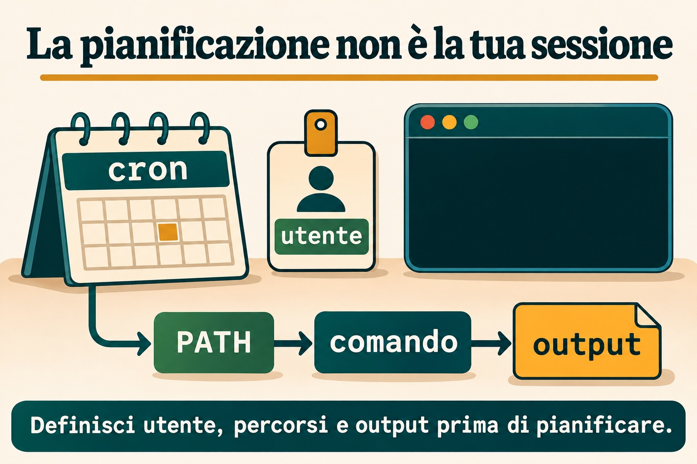
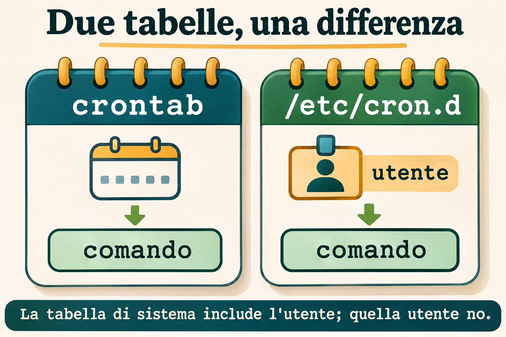

# Lezione 14.1 · cron e at

Nell'Utilità di pianificazione di Windows controlli account, azione e risultato. Su Linux la stessa disciplina evita lavori che funzionano nel terminale e falliscono da soli. Creerai pianificazioni dedicate, conserverai quelle esistenti e distinguerai ripetizione ed esecuzione unica.

> **Il cuore di questa lezione:** una pianificazione richiede utente, ambiente, comando ed evidenza dell'esecuzione. cron ripete; at esegue una volta. Il resto è approfondimento.

| Scheda |  |
| --- | --- |
| **Modulo** | M14 · Pianificazione, log e ora, lezione 1 di 5 |
| **Quando** | Settimana 19 |
| **Alla fine** | Installi pianificazioni senza cancellare lavori altrui e verifichi l'esecuzione dal risultato |
| **Prerequisiti** | M13 completato; `student`, `sudo`, noVNC e SSH sulle VM 201 e 202 |
| **Durata** | Circa 90 minuti |
| **Snapshot** | `m14a1-inicio` e `m14a1-fim` sulle due VM |

## 1 · Riscaldamento

Rispondi prima di consultare i comandi.

1. Perché un permesso DAC corretto non garantisce ogni operazione di un processo confinato?
2. Qual è la differenza tra abilitare e avviare un servizio?
3. Come distingui una configurazione salvata da un'esecuzione realmente avvenuta?

## 2 · Perché conta

Il rapporto giornaliero non è comparso. Il comando funziona quando entri tramite SSH, ma dipende dalla directory corrente e da una variabile della sessione. Il pianificatore non ha aperto il tuo terminale interattivo. La diagnosi parte dall'ambiente e dall'utente, non dal riavvio della macchina.

Una pianificazione può anche essere corretta con il servizio fermo. Registra tre evidenze: voce installata, pianificatore attivo e file o log prodotto dal lavoro.

## 3 · Modello mentale

Pensa alla portineria: l'elenco degli orari fa chiamare qualcuno, ma il badge definisce chi esegue. La scheda del lavoro deve contenere il percorso completo, senza dipendere da ciò che era aperto sulla scrivania di un'altra persona.

```text
pianificazione -> pianificatore attivo -> utente -> comando -> evidenza
cron: ripetizione                     at: una occasione
```



*Definisci utente, percorsi e output prima di pianificare.*

### Ponte Windows

| Windows | Linux |
| --- | --- |
| Trigger ricorrente | cron |
| Eseguire una volta | at |
| Account dell'attività | Proprietario della crontab o campo utente di sistema |
| Cronologia e risultato | Output acquisito, journal e file prodotto |

## 4 · L'essenziale

### Cinque campi di tempo

L'ordine è minuto, ora, giorno del mese, mese e giorno della settimana. Poi viene il comando. Usa uno script per logica e formattazione; una riga di pianificazione lunga è difficile da rivedere.

```text
* * * * * comando
```

L'asterisco in tutti i campi significa ogni minuto. Giorno del mese e giorno della settimana hanno un'interazione importante: quando entrambi sono limitati, cron tradizionale esegue quando corrisponde uno dei due.

### Utente e sistema

`crontab -e` modifica la tabella dell'utente stesso. I file in `/etc/cron.d` aggiungono un campo utente tra calendario e comando. Non inserire quel campo nella tabella utente.



*La tabella di sistema include l'utente; quella utente no.*

### Ambiente e output

Definisci percorsi assoluti. Acquisisci output ed errori. Il carattere `%` ha un trattamento speciale in una riga cron; lascia le formattazioni della data dentro lo script per evitare il problema.

### Esecuzione unica e accesso

`at` conserva un lavoro per un istante futuro. `atq` mostra la coda; `atrm` rimuove un identificatore specifico. I file `cron.allow`, `cron.deny`, `at.allow` e `at.deny` controllano chi può usare questi strumenti secondo l'implementazione.

Limitare lo strumento non elimina automaticamente lavori già installati. In questa lezione osservi i controlli esistenti; non modifichi elenchi condivisi per introdurre un guasto.


*cron ripete; at conserva un lavoro per un'occasione.*

### Rocky × Debian

| Voce | Rocky 9 | Debian 13 |
| --- | --- | --- |
| Pacchetto cron tradizionale | `cronie` | `cron` |
| Unità | `crond.service` | `cron.service` |
| Esecuzione unica | Pacchetto `at`, unità `atd.service` | Pacchetto `at`, unità `atd.service` |
| Alternativa installata | Identifica il gestore attuale | Non sostituire `systemd-cron` senza pianificare |

## 5 · Lab guidato

Esegui tutto sulle due VM. Conferma che la home di `student` sia `/home/student`, che l'utente possa usare `crontab` e `at` e che non ci siano altre modifiche simultanee alle sue pianificazioni durante l'esercizio.

### Passo 1 · Preparare la protezione

**Ipotesi:** installare cron dimostra che un lavoro sia stato eseguito?

Sull'host Proxmox:

```bash
qm snapshot 201 m14a1-inicio
qm snapshot 202 m14a1-inicio
```

Su Rocky usa il primo blocco. Su Debian conferma prima che il lab usi cron tradizionale e usa il secondo.

```bash
sudo dnf install -y cronie at
sudo systemctl enable --now crond atd
```

```bash
sudo apt install -y cron at
sudo systemctl enable --now cron atd
```

**Output atteso:** servizi attivi. I pianificatori installati restano disponibili come strumenti del corso; la pulizia rimuoverà soltanto i lavori di esercizio.

**Verifica:** controlla l'unità corretta con `systemctl is-active` e la home con `getent passwd student`. Se esiste un altro gestore delle pianificazioni, fermati e correggi la preparazione.

### Passo 2 · Verificare il lavoro fuori dalla pianificazione

**Ipotesi:** come dimostri che il lavoro venga eseguito come `student`?

Conferma l'assenza dei percorsi prima di crearli.

```bash
test ! -e "$HOME/m14a1"
sudo test ! -e /usr/local/libexec/m14a1-tick
sudo test ! -e /etc/cron.d/m14a1
mkdir -m 700 "$HOME/m14a1"
sudo install -d /usr/local/libexec
sudo tee /usr/local/libexec/m14a1-tick > /dev/null <<'EOF'
#!/bin/sh
/usr/bin/date -Is
/usr/bin/id -un
EOF
sudo chmod 755 /usr/local/libexec/m14a1-tick
/usr/local/libexec/m14a1-tick
```

**Output atteso:** data reale della VM e utente `student`. Non c'è una data inventata da copiare.

**Verifica:** esegui lo stesso percorso assoluto che verrà usato dalla pianificazione.

### Passo 3 · Installare una voce dell'utente

**Ipotesi:** installare una tabella con una sola riga cancella le righe precedenti?

Salva la tabella attuale. Se non esiste una tabella, `crontab -l` lo segnala e restituisce un errore; il file di riferimento resta vuoto. Un rifiuto di permesso è un'altra situazione e va risolto prima.

```bash
crontab -l > "$HOME/m14a1/crontab.inicio"
cp "$HOME/m14a1/crontab.inicio" "$HOME/m14a1/crontab.candidate"
cat >> "$HOME/m14a1/crontab.candidate" <<'EOF'

# BEGIN m14a1
* * * * * /usr/local/libexec/m14a1-tick >> /home/student/m14a1/user.log 2>&1
# END m14a1
EOF
diff -u "$HOME/m14a1/crontab.inicio" "$HOME/m14a1/crontab.candidate"
```

Controlla che sia stato aggiunto soltanto il blocco di esercizio. Poi installa la candidata:

```bash
crontab "$HOME/m14a1/crontab.candidate"
crontab -l
```

**Output atteso:** tabella precedente conservata e nuovo blocco presente. Dopo un cambio di minuto con il servizio attivo, `user.log` riceve il risultato.

**Verifica:** leggi `tail "$HOME/m14a1/user.log"`; l'esistenza della voce da sola non dimostra l'esecuzione.

### Decidi 1

| Opzione | Per aggiungere un'attività senza perdere le altre |
| --- | --- |
| A | Installare una tabella che contiene soltanto la nuova attività |
| B | Rivedere una candidata con le voci precedenti e il nuovo blocco |
| C | Eliminare prima tutta la tabella |

Scegli B. L'installazione sostituisce la tabella; la candidata deve contenere ciò che vuoi conservare.

### Passo 4 · Creare la pianificazione di sistema dedicata

**Ipotesi:** dove compare l'utente in questa variante?

```bash
sudo tee /etc/cron.d/m14a1 > /dev/null <<'EOF'
SHELL=/bin/sh
PATH=/usr/bin:/bin
* * * * * student /usr/local/libexec/m14a1-tick >> /home/student/m14a1/system.log 2>&1
EOF
sudo chmod 644 /etc/cron.d/m14a1
sudo chown root:root /etc/cron.d/m14a1
```

**Output atteso:** dopo un cambio di minuto, `system.log` mostra il risultato eseguito come `student`. Non serve riavviare cron per ogni file corretto aggiunto.

**Verifica:** confronta i due log e individua il campo aggiuntivo nel file di sistema.

### Passo 5 · Eseguire una volta con at

**Ipotesi:** chiudere il terminale rimuove un lavoro già accettato da at?

```bash
printf '/usr/local/libexec/m14a1-tick >> /home/student/m14a1/once.log 2>&1\n' > "$HOME/m14a1/once.job"
LC_ALL=C at -f "$HOME/m14a1/once.job" now + 2 minutes 2> "$HOME/m14a1/at.receipt"
cat "$HOME/m14a1/at.receipt"
atq
```

**Output atteso:** ricevuta con l'identificatore reale e lavoro in coda. Dopo l'orario esce dalla coda e produce `once.log`.

**Verifica:** confronta ricevuta, coda e file prodotto. L'accettazione in coda non conferma il successo del comando.

### Decidi 2

| Opzione | Il lavoro è stato accettato, ma manca il risultato |
| --- | --- |
| A | Cambiare i permessi per permettere a tutti di scrivere |
| B | Reinviare varie copie senza controllare |
| C | Controllare orario, coda, servizio e output del lavoro |

Scegli C. L'evidenza di consegna al pianificatore e quella dell'esecuzione sono diverse.

### Passo 6 · Verificare accesso e persistenza

**Ipotesi:** vietare l'uso di uno strumento ne elimina i lavori esistenti?

Osserva i controlli già esistenti senza modificarli. Un percorso assente è un'informazione sulla configurazione.

```bash
sudo ls -l /etc/cron.allow /etc/cron.deny /etc/at.allow /etc/at.deny
crontab -l
atq
sudo systemctl reboot
```

**Output atteso:** dopo il reboot cron attivo continua a usare le voci installate. Il lavoro at già completato non ricompare come ricorrente.

**Verifica:** leggi le nuove date nei due log. Non modificare l'orologio per accelerare il test.

## 6 · Rompi e ripara

### Guasto 1 · Lavoro senza esecuzione consentita

**Sintomo:** passa il minuto, ma l'attività registra un errore invece dell'output normale.

**Indagine:** rimuovi l'esecuzione soltanto dallo script dedicato e prova manualmente lo stesso percorso.

```bash
sudo chmod 644 /usr/local/libexec/m14a1-tick
/usr/local/libexec/m14a1-tick
tail "$HOME/m14a1/user.log"
```

**Causa:** la pianificazione richiama un eseguibile senza permesso di esecuzione.

**Riparazione:** ripristina `sudo chmod 755 /usr/local/libexec/m14a1-tick`.

**Verifica:** esegui manualmente e controlla il prossimo output pianificato.

**Prevenzione:** verifica con lo stesso utente e tramite lo stesso percorso della pianificazione.

### Guasto 2 · Campo utente assente

**Sintomo:** la tabella utente funziona, ma il file di sistema smette di generare nuovi risultati.

**Indagine:** salva il file dedicato e rimuovine soltanto il campo obbligatorio.

```bash
sudo cp -a /etc/cron.d/m14a1 "$HOME/m14a1/cron.d.good"
sudo sed -i 's/\* student /\* /' /etc/cron.d/m14a1
sudo cat /etc/cron.d/m14a1
```

**Causa:** cron interpreta la posizione dell'utente secondo il formato di sistema, non quello della crontab personale.

**Riparazione:** ripristina soltanto il file dedicato con `sudo cp -a "$HOME/m14a1/cron.d.good" /etc/cron.d/m14a1`.

**Verifica:** dopo il prossimo cambio di minuto `system.log` torna a crescere.

**Prevenzione:** controlla il formato della destinazione prima di incollare una riga pianificata.

### Guasto 3 · Lavoro annullato prima dell'orario

**Sintomo:** un nuovo lavoro at non produce il risultato perché lo hai rimosso dalla coda.

**Indagine:** invia di nuovo `once.job`, annota l'identificatore della nuova ricevuta e controlla il contenuto con `at -c` prima di rimuoverlo. Non usare un numero di esempio.

```bash
at -f "$HOME/m14a1/once.job" now + 5 minutes
atq
read -r -p 'Own job ID: ' ATJOB
at -c "$ATJOB"
```

Conferma che sia il lavoro di `student` appena creato e soltanto dopo esegui `atrm "$ATJOB"`.

**Causa:** l'assenza di risultato corrisponde all'annullamento, non a un guasto del servizio.

**Riparazione:** se il lavoro serve ancora, invia una sola nuova copia.

**Verifica:** controlla il nuovo identificatore e il risultato dopo l'orario.

**Prevenzione:** registra identificatore, orario e stato senza eliminare tutta la coda.

### Pulizia

Rimuovi soltanto il blocco marcato dalla tabella attuale. Rivedi il diff prima di installare la tabella pulita; le altre voci devono restare.

```bash
crontab -l > "$HOME/m14a1/crontab.atual"
sed '/^# BEGIN m14a1$/,/^# END m14a1$/d' "$HOME/m14a1/crontab.atual" > "$HOME/m14a1/crontab.clean"
diff -u "$HOME/m14a1/crontab.atual" "$HOME/m14a1/crontab.clean"
```

Dopo aver verificato la rimozione esclusiva del blocco:

```bash
crontab "$HOME/m14a1/crontab.clean"
sudo rm -f /etc/cron.d/m14a1 /usr/local/libexec/m14a1-tick
atq
```

Annulla soltanto lavori di esercizio ancora in attesa, tramite l'identificatore verificato. Conserva i registri; una tabella vuota rimasta non esegue lavori.

## 7 · Trappole

| Errore | Che cosa fare | Motivo |
| --- | --- | --- |
| Dipendere dalla sessione interattiva | Percorsi assoluti e ambiente esplicito | cron non ha aperto il tuo terminale |
| Eliminare la tabella per aggiungere un'attività | Candidata rivista che conserva le voci | Installare sostituisce la tabella |
| Confondere i due formati | Campo utente soltanto nel formato di sistema | L'interpretazione cambia |
| Accettazione significa successo | Controllare l'output del lavoro | Coda e risultato sono evidenze distinte |

## 8 · Quiz

1. Quali sono i cinque campi temporali?
2. Dove compare l'utente in `/etc/cron.d`?
3. Perché usare percorsi assoluti?
4. Che cosa dimostra `atq`?
5. Rimuovere l'accesso allo strumento elimina i lavori esistenti?
6. Che cosa va conservato quando pulisci una pianificazione?

## 9 · Promemoria

| Operazione | Comando |
| --- | --- |
| Elencare la tabella personale | `crontab -l` |
| Modificare la tabella personale | `crontab -e` |
| Elencare la coda singola | `atq` |
| Ispezionare il lavoro scelto | `at -c "$ATJOB"` |

**Flashcard:** crea cinque schede su formato, utente, ambiente, coda ed evidenza. Ripassa a D+1, D+3, D+7 e D+21.

## 10 · Checklist e chiusura

- [ ] Ho eseguito lo stesso lavoro manualmente e pianificato.
- [ ] Ho conservato le altre voci e gli identificatori della coda.
- [ ] Ho spiegato le tre cause con evidenze.

**Ultimo esercizio:** descrivi un rapporto che non dipende da una variabile della sessione e mostra come ne dimostreresti l'esecuzione.

**Reboot di verifica:** dopo la pulizia riavvia le due VM e conferma che i registri di esercizio non ricevano nuove righe e che le altre pianificazioni restino installate.

```bash
sudo systemctl reboot
```

Sull'host Proxmox:

```bash
qm snapshot 201 m14a1-fim
qm snapshot 202 m14a1-fim
```

## 11 · Nella vita reale

Su un host autorizzato fai soltanto inventario con `crontab -l`, `atq` e la lettura dei file pianificati consentiti al tuo ruolo. Non modificare, reinviare né annullare lavori in questa missione. Individua proprietario, comando, destinazione dell'output ed evidenza dell'ultima esecuzione.

## 12 · Approfondire quando vuoi

- [crontab(5), Debian](https://manpages.debian.org/trixie/cron/crontab.5.en.html) e [crontab(5), cronie](https://man7.org/linux/man-pages/man5/crontab.5.html): formato e ambiente.
- [crontab(1)](https://manpages.debian.org/trixie/cron/crontab.1.en.html) e [at(1)](https://manpages.debian.org/trixie/at/at.1.en.html): installazione e coda.

**DeepTutor** (http://10.1.0.149:3782, KB "Curso Linux Sysadmin"):

- `!explica Compare crontab de usuário, /etc/cron.d e at com foco em usuário e ambiente.`
- `!feynman Vou explicar por que um comando funciona no SSH e falha no cron. Critique minha explicação.`
- `!quiz Crie seis incidentes de agendamento sem propor apagar agendas existentes.`

## Soluzioni commentate

### Riscaldamento

1. DAC e la politica MAC devono consentire l'operazione.
2. Abilitare partecipa al boot; avviare cambia lo stato attuale.
3. Confronta configurazione, stato del servizio e risultato prodotto.

### Quiz

1. Minuto, ora, giorno del mese, mese e giorno della settimana.
2. Dopo i cinque campi e prima del comando.
3. L'ambiente non è la tua sessione interattiva.
4. Lavori ancora in coda, non il successo dei lavori completati.
5. No; controllo dell'uso dello strumento e lavori installati sono cose diverse.
6. Tutte le voci e i lavori che non appartengono all'esercizio.

<!-- navegacao -->
[← Lezione 13.3 · autofs](13.3-autofs.md) · [Indice delle lezioni](../01-aulas.md) · [Piano del corso: dalla 14.2 in poi →](../00-plano-do-curso.md)
