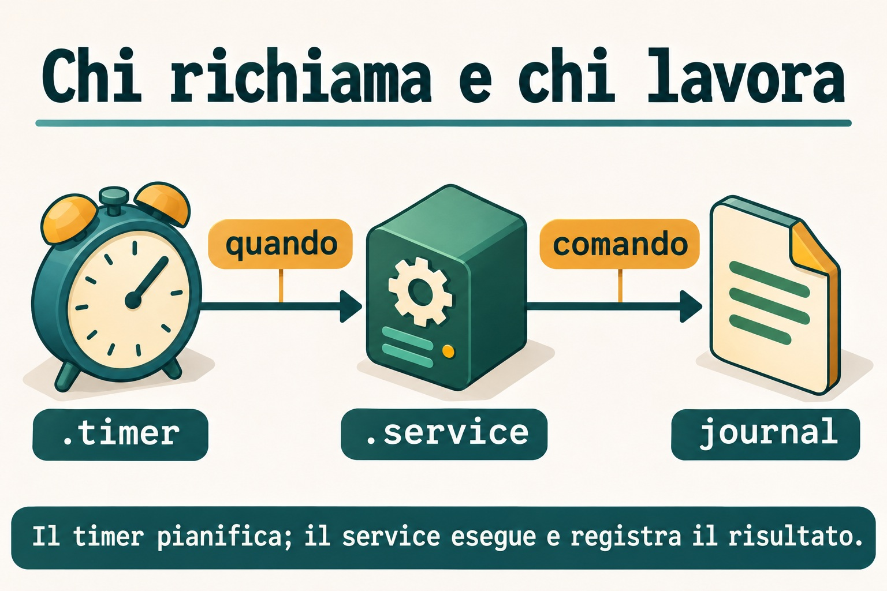
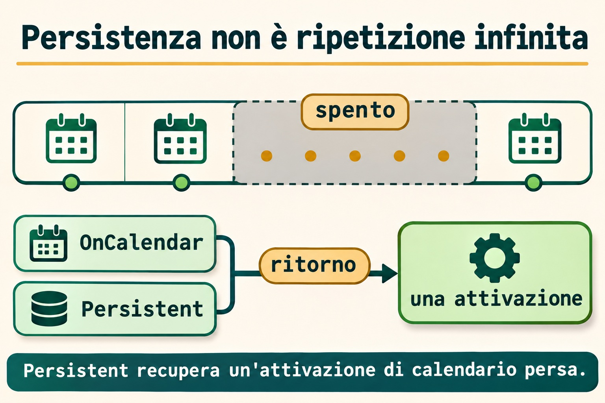

# Lezione 14.2 · Timer di systemd

Dopo aver separato pianificazione e comando con cron, renderai esplicita questa distinzione in due file. Il timer decide quando attivare; il servizio descrive lavoro, utente e risultato. Recupererai anche un'attivazione di calendario persa senza modificare l'orologio della VM.

> **Il cuore di questa lezione:** valida i file, controlla il timer e leggi il risultato del servizio. Persistent non esegue una copia per ogni minuto perso. Il resto è approfondimento.

| Scheda |  |
| --- | --- |
| **Modulo** | M14 · Pianificazione, log e ora, lezione 2 di 5 |
| **Quando** | Settimana 19 |
| **Alla fine** | Crei una coppia di unità, verifichi i guasti e dimostri la persistenza |
| **Prerequisiti** | Lezione 14.1; servizi systemd, journal, `student` e `sudo` |
| **Durata** | Circa 90 minuti |
| **Snapshot** | `m14a2-inicio` e `m14a2-fim` sulle VM 201 e 202 |

## 1 · Riscaldamento

Rispondi prima di aprire il percorso.

1. Perché la voce installata non dimostra il successo del lavoro?
2. Qual è la differenza tra avviare e abilitare?
3. Dove hai registrato output ed errori nella lezione precedente?

## 2 · Perché conta

Un backup non è partito perché la VM era spenta all'orario previsto. Al ritorno devi recuperare l'attivazione e sapere se il comando sia terminato correttamente. Un timer di calendario persistente conserva il momento dell'attivazione; il servizio registra il risultato nel journal.

Il progetto del lavoro deve ancora gestire ripetizione e durata. Persistent non trasforma un comando insicuro in un backup ripristinabile.

## 3 · Modello mentale

L'orologio richiama la squadra; la scheda della squadra descrive il servizio. La portineria registra la chiamata e la squadra registra il risultato. Abilitare soltanto il servizio non installa una pianificazione ricorrente.

```text
m14a2.timer -> m14a2.service -> comando -> journal
quando         chi e come          risultato
```



*Il timer pianifica; il service esegue e registra il risultato.*

### Ponte Windows

| Concetto | systemd |
| --- | --- |
| Trigger | `.timer` |
| Azione e account | `.service`, `ExecStart`, `User` |
| Risultato dell'esecuzione | Proprietà del servizio e journal |
| Recuperare un orario perso | `Persistent=true` con `OnCalendar` |

## 4 · L'essenziale

### Calendario e tempo relativo

`OnCalendar` descrive il calendario civile. Espressioni come `OnBootSec` e `OnUnitActiveSec` misurano intervalli relativi. Il recupero con Persistent di questa lezione si applica al calendario, non a qualsiasi intervallo.

```bash
systemd-analyze calendar '*-*-* *:*:00'
systemd-analyze calendar 'daily'
```

La prima espressione scatta a ogni minuto civile; la seconda è giornaliera. Usa lo strumento per controllare l'interpretazione e il prossimo orario calcolato nel fuso reale della macchina.

### Persistent e durata

Con Persistent il timer conserva l'ultima attivazione su disco. Quando torna attivo recupera un'attivazione che sarebbe avvenuta mentre era inattivo. Non crea una coda con un'esecuzione per ogni minuto perso.



*Persistent recupera un'attivazione di calendario persa.*

Un servizio ancora attivo non riceve un'altra istanza identica a ogni scatto. Per un lavoro breve `Type=oneshot` e un comando che termina rendono facile osservare il risultato.

### Precisione e ambiente

`AccuracySec` permette una finestra di raggruppamento; `RandomizedDelaySec` aggiunge un ritardo casuale quando configurato. La pianificazione non promette precisione in tempo reale. Nel lab la finestra è breve per facilitare l'osservazione.

`ExecStart` non è una riga completa di shell. Metti la logica in uno script con interprete esplicito, percorsi assoluti e gestione degli errori.


*File valido, timer attivo ed esecuzione sono evidenze diverse.*

### Rocky × Debian

| Voce | Rocky 9 | Debian 13 |
| --- | --- | --- |
| Unità dedicate | `/etc/systemd/system` | `/etc/systemd/system` |
| Servizio di esercizio | `m14a2.service` | `m14a2.service` |
| Stato persistente | `StateDirectory` | `StateDirectory` |
| Funzioni nuove | Consulta la man page installata | Consulta la man page installata |

## 5 · Lab guidato

Esegui lo stesso sulle due VM. Nomi e directory di questa lezione devono essere liberi. Non verrà modificato alcun timer esistente.

### Passo 1 · Proteggere e osservare

**Ipotesi:** abilitare un file senza validarne il contenuto dimostra un'esecuzione?

Sull'host Proxmox:

```bash
qm snapshot 201 m14a2-inicio
qm snapshot 202 m14a2-inicio
```

Sulle VM:

```bash
systemctl list-timers --all
test ! -e "$HOME/m14a2"
sudo test ! -e /etc/systemd/system/m14a2.service
sudo test ! -e /etc/systemd/system/m14a2.timer
sudo test ! -e /var/lib/m14a2
mkdir -m 700 "$HOME/m14a2"
```

**Output atteso:** inventario esistente e nomi di esercizio assenti.

**Verifica:** se i nomi esistono già, fermati per non riutilizzare o eliminare lavoro precedente senza revisione.

### Passo 2 · Creare un lavoro osservabile

**Ipotesi:** chi deve poter scrivere lo stato del lavoro?

```bash
sudo test ! -e /usr/local/libexec/m14a2-run
sudo install -d /usr/local/libexec
sudo tee /usr/local/libexec/m14a2-run > /dev/null <<'EOF'
#!/bin/sh
set -eu
if [ -e /var/lib/m14a2/fail ]; then
    printf 'M14A2 controlled failure\n' >&2
    exit 7
fi
/usr/bin/date -Is > /var/lib/m14a2/last.txt
printf 'M14A2 completed\n'
EOF
sudo chmod 755 /usr/local/libexec/m14a2-run
```

Su Rocky applica il contesto previsto allo script con `sudo restorecon /usr/local/libexec/m14a2-run`.

**Output atteso:** script di proprietà root, senza eseguirlo ancora fuori dalla directory di stato che l'unità creerà.

**Verifica:** leggi lo script e individua successo, errore controllato e file di stato.

### Passo 3 · Creare e verificare il servizio

**Ipotesi:** un oneshot riuscito deve continuare a comparire come processo attivo?

```bash
sudo tee /etc/systemd/system/m14a2.service > /dev/null <<'EOF'
[Unit]
Description=M14A2 scheduled work
[Service]
Type=oneshot
User=student
Group=student
StateDirectory=m14a2
StateDirectoryMode=0700
ExecStart=/usr/local/libexec/m14a2-run
EOF
sudo systemd-analyze verify /etc/systemd/system/m14a2.service
sudo systemctl daemon-reload
sudo systemctl start m14a2.service
systemctl show m14a2.service -p Result -p ExecMainStatus
sudo journalctl -u m14a2.service -n 10 --no-pager
cat /var/lib/m14a2/last.txt
```

**Output atteso:** il comando termina con successo, risultato di uscita zero e data reale nello stato. Il servizio oneshot può restare inattivo dopo il completamento.

**Verifica:** journal e `last.txt` sono evidenze del lavoro, non soltanto della lettura del file unità.

### Decidi 1

| Opzione | Il servizio oneshot è terminato senza errore |
| --- | --- |
| A | Riavviare continuamente perché è inattivo |
| B | Passare a un daemon che non termina mai |
| C | Controllare risultato e output prima di diagnosticare un guasto |

Scegli C. Inattivo dopo un lavoro completato non significa fallito.

### Passo 4 · Installare la pianificazione

**Ipotesi:** quale file va abilitato per la ricorrenza?

```bash
sudo tee /etc/systemd/system/m14a2.timer > /dev/null <<'EOF'
[Unit]
Description=M14A2 calendar
[Timer]
OnCalendar=*-*-* *:*:00
AccuracySec=1s
RandomizedDelaySec=0
Persistent=true
Unit=m14a2.service
[Install]
WantedBy=timers.target
EOF
sudo systemd-analyze verify /etc/systemd/system/m14a2.service /etc/systemd/system/m14a2.timer
sudo systemctl daemon-reload
sudo systemctl enable --now m14a2.timer
systemctl list-timers --all m14a2.timer
```

**Output atteso:** timer attivo con il prossimo orario calcolato. Dopo l'attivazione la data del file cambia e il journal riceve un'esecuzione.

**Verifica:** confronta prossimo orario, ultima attivazione e risultato del servizio.

### Passo 5 · Recuperare un'attivazione persa

**Ipotesi:** tre minuti persi creeranno tre servizi in coda?

Dopo almeno un'attivazione normale ferma soltanto il timer dedicato. Attendi il passaggio di due minuti di calendario senza modificare l'orologio.

```bash
sudo systemctl stop m14a2.timer
date -Is
```

Dopo quell'intervallo avvia di nuovo:

```bash
sudo systemctl start m14a2.timer
sudo journalctl -u m14a2.service --since '-5 minutes' --no-pager
systemctl list-timers --all m14a2.timer
```

**Output atteso:** un'attivazione di recupero e poi la pianificazione normale. Un nuovo minuto civile può aggiungere un'altra attivazione regolare, che non è una copia recuperata.

**Verifica:** collega gli orari nel journal all'intervallo in cui il timer è rimasto fermo.

### Decidi 2

| Opzione | Verificare il recupero senza influire sull'orologio |
| --- | --- |
| A | Fermare soltanto il timer dedicato e attendere l'avanzamento del calendario |
| B | Fermare tutti i timer dell'host |
| C | Modificare l'ora globale della VM |

Scegli A. Il guasto resta limitato all'oggetto di esercizio.

### Passo 6 · Verificare dopo il reboot

**Ipotesi:** che cosa deve sopravvivere perché il lavoro venga richiamato?

```bash
sudo systemctl reboot
```

Dopo esserti ricollegato:

```bash
systemctl is-enabled m14a2.timer
systemctl list-timers --all m14a2.timer
sudo journalctl -b -u m14a2.service --no-pager
cat /var/lib/m14a2/last.txt
```

**Output atteso:** timer abilitato e pianificazione attiva. Il lavoro torna a produrre evidenze quando viene attivato, incluso il recupero di calendario se necessario.

**Verifica:** distingui una data vecchia conservata su disco da una nuova esecuzione registrata in questo boot.

## 6 · Rompi e ripara

### Guasto 1 · Comando inesistente

**Sintomo:** il servizio non riesce a eseguire l'azione configurata.

**Indagine:** modifica soltanto l'unità dedicata e valida prima di avviare.

```bash
sudo cp -a /etc/systemd/system/m14a2.service "$HOME/m14a2/service.good"
sudo sed -i 's@ExecStart=/usr/local/libexec/m14a2-run@ExecStart=/usr/local/libexec/m14a2-missing@' /etc/systemd/system/m14a2.service
sudo systemd-analyze verify /etc/systemd/system/m14a2.service
```

**Causa:** il percorso dell'azione non esiste. Il calendario non corregge l'eseguibile.

**Riparazione:** ripristina soltanto quell'unità e ricarica il gestore.

```bash
sudo cp -a "$HOME/m14a2/service.good" /etc/systemd/system/m14a2.service
sudo systemctl daemon-reload
sudo systemctl start m14a2.service
```

**Verifica:** controlla risultato e journal del nuovo tentativo.

**Prevenzione:** valida la coppia e verifica il servizio prima di abilitare il timer.

### Guasto 2 · Errore del lavoro, timer attivo

**Sintomo:** il timer resta attivo, ma il servizio restituisce un errore.

**Indagine:** introduci la condizione che lo script tratta come errore.

```bash
touch /var/lib/m14a2/fail
sudo systemctl start m14a2.service
systemctl show m14a2.service -p Result -p ExecMainStatus
sudo journalctl -u m14a2.service -n 12 --no-pager
```

**Causa:** il codice di uscita `7` appartiene al lavoro; il pianificatore ha svolto la propria parte richiamandolo.

**Riparazione:** rimuovi il segnale dedicato ed esegui di nuovo.

```bash
rm -f /var/lib/m14a2/fail
sudo systemctl start m14a2.service
```

**Verifica:** il risultato torna a essere positivo.

**Prevenzione:** monitora il risultato del servizio, non soltanto se il timer è attivo.

### Guasto 3 · Pianificazione disabilitata

**Sintomo:** il lavoro funziona manualmente, ma non torna al boot tramite la pianificazione.

**Indagine:** disabilita soltanto il timer dedicato e confronta gli stati.

```bash
sudo systemctl disable --now m14a2.timer
systemctl is-enabled m14a2.timer
sudo systemctl start m14a2.service
```

**Causa:** l'azione resta valida, ma la pianificazione non è abilitata per il boot.

**Riparazione:** esegui `sudo systemctl enable --now m14a2.timer`.

**Verifica:** controlla di nuovo abilitazione e prossimo orario.

**Prevenzione:** registra file, stato attivo e abilitazione come evidenze separate.

### Pulizia

Conserva i registri e rimuovi soltanto le unità e lo stato dell'esercizio. La pulizia del timer cancella il suo riferimento persistente, non quello di altri timer.

```bash
sudo journalctl -u m14a2.service --no-pager > "$HOME/m14a2/journal.txt"
sudo systemctl disable --now m14a2.timer
sudo systemctl stop m14a2.service
sudo systemctl clean --what=state m14a2.timer
sudo systemctl clean --what=state m14a2.service
sudo systemctl reset-failed m14a2.service
sudo rm -f /etc/systemd/system/m14a2.timer /etc/systemd/system/m14a2.service /usr/local/libexec/m14a2-run
sudo systemctl daemon-reload
systemctl list-timers --all
```

## 7 · Trappole

| Errore | Che cosa fare | Motivo |
| --- | --- | --- |
| Abilitare soltanto il servizio | Abilitare il timer | La ricorrenza è nella pianificazione |
| Timer attivo significa successo | Leggere il risultato del servizio | Il comando può fallire |
| Aspettarsi una coda di tutti gli orari persi | Comprendere un'attivazione di recupero | Persistent non riproduce tutto il passato |
| Incollare una pipe direttamente in `ExecStart` | Usare uno script | Non è una shell implicita |

## 8 · Quiz

1. Quale unità contiene il calendario?
2. Che cosa recupera Persistent?
3. Un oneshot completato deve restare attivo?
4. Chi definisce l'utente del lavoro?
5. Che cosa verifichi dopo aver modificato i file?
6. Come dimostri una nuova esecuzione dopo il boot?

## 9 · Promemoria

| Operazione | Comando |
| --- | --- |
| Vedere la pianificazione | `systemctl list-timers --all m14a2.timer` |
| Interpretare il calendario | `systemd-analyze calendar daily` |
| Vedere il risultato | `systemctl show m14a2.service -p Result -p ExecMainStatus` |
| Leggere l'esecuzione | `sudo journalctl -u m14a2.service` |

**Flashcard:** crea cinque schede su calendario, azione, Persistent, stato attivo e risultato. Ripassa a D+1, D+3, D+7 e D+21.

## 10 · Checklist e chiusura

- [ ] Ho validato i due file prima di attivarli.
- [ ] Ho osservato lavoro manuale, ricorrente e recupero.
- [ ] Ho rimosso soltanto gli oggetti di esercizio.

**Ultimo esercizio:** spiega perché il monitoraggio deve leggere il risultato del servizio e non soltanto elencare i timer.

**Reboot di verifica:** dopo la pulizia riavvia le due VM e conferma l'assenza della pianificazione dedicata e la conservazione delle altre.

```bash
sudo systemctl reboot
```

Sull'host Proxmox:

```bash
qm snapshot 201 m14a2-fim
qm snapshot 202 m14a2-fim
```

## 11 · Nella vita reale

Su un host autorizzato leggi `systemctl list-timers --all`, l'unità di un lavoro noto e il suo journal. Non avviare, fermare né modificare nulla in questa missione. Individua utente, prossima attivazione, ultimo tentativo e risultato; registra una differenza tra pianificazione attiva e attività riuscita.

## 12 · Approfondire quando vuoi

- [systemd.timer(5)](https://manpages.debian.org/trixie/systemd/systemd.timer.5.en.html) e [systemd.time(7)](https://manpages.debian.org/trixie/systemd/systemd.time.7.en.html): calendario e persistenza.
- [systemd.service(5)](https://manpages.debian.org/trixie/systemd/systemd.service.5.en.html) e [systemd.exec(5)](https://manpages.debian.org/trixie/systemd/systemd.exec.5.en.html): esecuzione e directory di stato.

**DeepTutor** (http://10.1.0.149:3782, KB "Curso Linux Sysadmin"):

- `!explica Separe timer, service, Persistent e resultado de execução.`
- `!feynman Vou explicar por que Persistent não recupera uma cópia de cada minuto perdido. Critique minha explicação.`
- `!quiz Crie seis incidentes de timers preservando as outras units do host.`

## Soluzioni commentate

### Riscaldamento

1. Installazione ed esecuzione sono fasi diverse; il comando può fallire.
2. Avviare cambia lo stato attuale; abilitare partecipa al boot.
3. In file separati con output ed errori reindirizzati.

### Quiz

1. L'unità `.timer`.
2. Un'attivazione di calendario che sarebbe avvenuta durante l'inattività.
3. No; può tornare inattivo dopo aver terminato correttamente.
4. `User` nell'unità di servizio di questo lab.
5. Sintassi, ricarica del gestore, stato della pianificazione ed esecuzione reale.
6. Confronta il journal del boot attuale e la nuova data prodotta.

<!-- navegacao -->
[← Lezione 14.1 · cron e at](14.1-cron-e-at.md) · [Indice delle lezioni](../01-aulas.md) · [Piano del corso: dalla 14.3 in poi →](../00-plano-do-curso.md)
