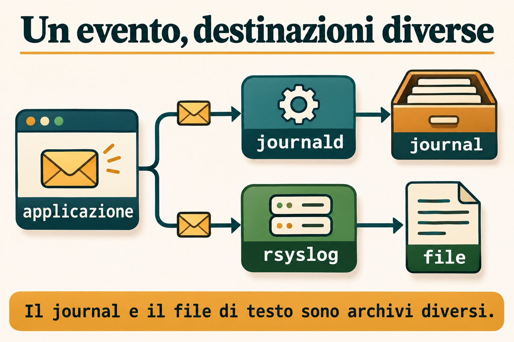
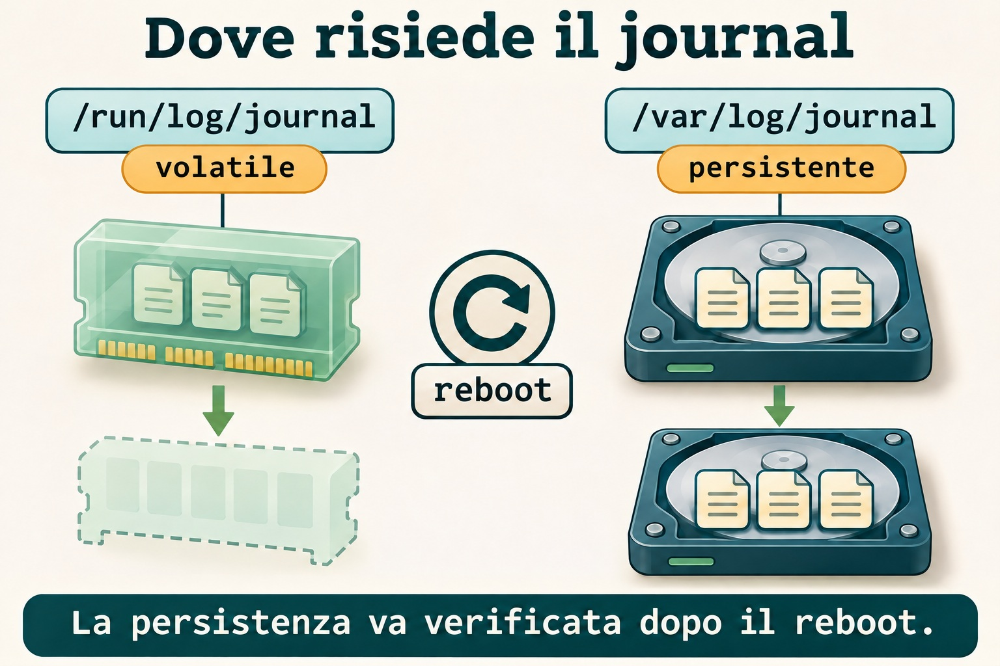
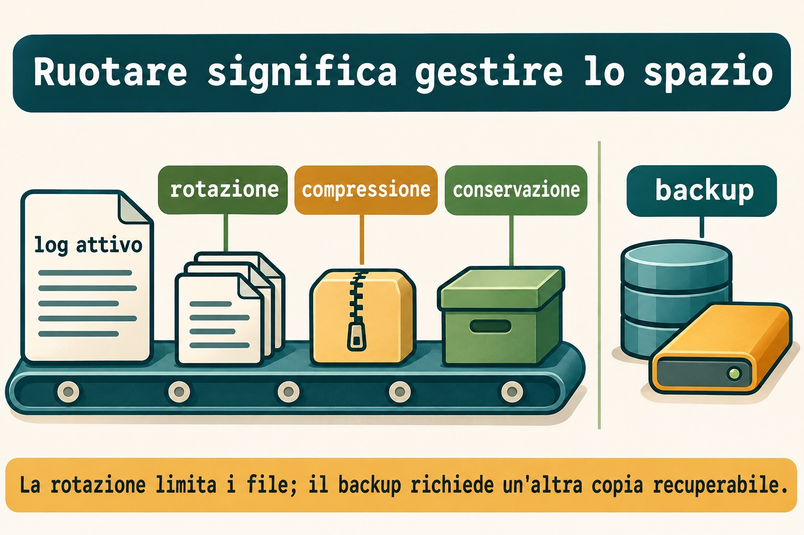

# Lezione 14.3 · journald e rsyslog

Il lavoro pianificato è fallito e ha lasciato un messaggio. Ora devi trovarlo, sapere se sopravvivrà al reboot e controllare la crescita del file di testo. Journal, inoltro e rotazione hanno funzioni distinte. Verificherai ciascuna senza cancellare registri reali.

> **Il cuore di questa lezione:** cerca l'evento nella fonte giusta, conferma la persistenza e verifica la rotazione soltanto sul file dedicato. Il resto è approfondimento.

| Scheda |  |
| --- | --- |
| **Modulo** | M14 · Pianificazione, log e ora, lezione 3 di 5 |
| **Quando** | Settimana 20 |
| **Alla fine** | Filtri eventi, dimostri un journal persistente e ruoti un log dedicato con stato separato |
| **Prerequisiti** | Lezione 14.2, `sudo`, SSH e snapshot sulle VM del corso |
| **Durata** | Circa 90 minuti |
| **Snapshot** | `m14a3-inicio` e `m14a3-fim` sulle VM 201 e 202 |

## 1 · Riscaldamento

Rispondi prima di cercare i file.

1. Dove ha lasciato il risultato il servizio oneshot nella 14.2?
2. Qual è la differenza tra processo attivo e attività completata correttamente?
3. Perché un file grande non va cancellato senza identificarne il produttore?

## 2 · Perché conta

Un incidente è avvenuto prima del reboot, ma cerchi soltanto con `journalctl -b`. Quel filtro mostra il boot attuale. Su un'altra macchina il journal era volatile e i dati precedenti non esistono più. La stessa schermata vuota può avere cause diverse.

Un'altra segnalazione riguarda il disco pieno. Eliminare un file aperto non garantisce di liberarne lo spazio. Scopri prima chi scrive; poi applica la rotazione corretta, con riapertura da parte del produttore.

## 3 · Modello mentale

Il journal è un archivio di registri strutturati della portineria. rsyslog può ricevere messaggi e distribuirli in file di testo. logrotate organizza i volumi di quei file, ma non produce una copia esterna di ripristino.

```text
evento -> journald -> journal
ingresso rsyslog -> file -> logrotate
```



*Il journal e il file di testo sono archivi diversi.*

### Ponte Windows

| Concetto | Linux |
| --- | --- |
| Visualizzatore e filtri degli eventi | `journalctl` |
| Origine di un evento | Unità, identificatore e campi del journal |
| File testuale dell'applicazione | Output dedicato o azione rsyslog |
| Politica di dimensione e conservazione | Configurazione dell'archiviazione e logrotate |

## 4 · L'essenziale

### I filtri fanno parte della domanda

`-b` seleziona il boot, `-u` l'unità, `-t` l'identificatore e `-p` la priorità. Un filtro di priorità include quelle più gravi fino al livello scelto; non significa soltanto quel livello.

```bash
sudo journalctl --list-boots
sudo journalctl -b -p warning --no-pager
sudo journalctl -t m14a3 --since '-10 minutes' --no-pager
```

Una ricerca vuota dimostra soltanto che nessun registro visibile corrispondeva ai filtri in quell'archivio. Controlla intervallo, boot, priorità e accesso prima di concludere che l'evento non sia esistito.

### Persistenza

Con archiviazione volatile il journal usa `/run/log/journal`. Con persistenza usa `/var/log/journal`. `Storage=auto` dipende dall'esistenza della struttura persistente; `Storage=persistent` richiede esplicitamente quell'archivio.



*La persistenza va verificata dopo il reboot.*

### rsyslog e il suo produttore

Una regola di output agisce soltanto sui messaggi arrivati a rsyslog. Controlla l'ingresso configurato. Non caricare un'altra copia di un modulo di ingresso soltanto perché un file di output è rimasto vuoto.

### Rotazione e riapertura

Rinominare il file attivo non cambia automaticamente il descrittore aperto dal produttore. La procedura deve creare il nuovo file e farlo riaprire al produttore. Il lab usa una regola dedicata, conservazione breve e stato separato per non forzare la rotazione dei log reali.



*La rotazione limita i file; il backup richiede un'altra copia recuperabile.*

### Rocky × Debian

| Voce | Rocky 9 | Debian 13 |
| --- | --- | --- |
| Journal | systemd-journald | systemd-journald |
| rsyslog | Può essere già installato | Può non essere installato |
| Log testuali comuni | `/var/log/messages`, `/var/log/secure` | Dipendono da rsyslog e dalle regole installate |
| Rotazione | Controlla la pianificazione installata | Controlla la pianificazione installata |

## 5 · Lab guidato

In questa lezione la persistenza del journal verrà mantenuta come configurazione finale del laboratorio. I registri precedenti non verranno cancellati. La pulizia rimuove soltanto inoltro e rotazione dei file di esercizio.

### Passo 1 · Proteggere e inventariare

**Ipotesi:** un'installazione Debian senza syslog testuale è necessariamente priva di registri?

Sull'host Proxmox:

```bash
qm snapshot 201 m14a3-inicio
qm snapshot 202 m14a3-inicio
```

Sulle due VM conferma i percorsi assenti e conserva la configurazione effettiva prima di modificare.

```bash
test ! -e "$HOME/m14a3"
mkdir -m 700 "$HOME/m14a3"
systemd-analyze cat-config systemd/journald.conf > "$HOME/m14a3/journald.inicio"
sudo test ! -e /etc/systemd/journald.conf.d/60-m14a3.conf
sudo test ! -e /etc/rsyslog.d/30-m14a3.conf
sudo test ! -e /etc/logrotate.d/m14a3
sudo test ! -e /var/log/m14a3
sudo test ! -e /var/lib/logrotate/m14a3.status
sudo journalctl --disk-usage
```

**Output atteso:** percorsi di esercizio liberi e inventario reale dell'archivio.

**Verifica:** conserva file e regole esistenti; se una configurazione successiva sostituisce la nuova opzione, indaga la precedenza invece di sovrascriverla.

### Passo 2 · Marcare e filtrare eventi

**Ipotesi:** un evento informativo compare in una ricerca che richiede warning e livelli più gravi?

```bash
logger -t m14a3 -p user.info 'M14A3 informational event'
logger -t m14a3 -p user.warning 'M14A3 warning event'
sudo journalctl -b -t m14a3 --since '-5 minutes' --no-pager
sudo journalctl -b -t m14a3 -p warning --since '-5 minutes' --no-pager
```

**Output atteso:** la prima ricerca mostra i due eventi; la seconda seleziona il warning, oltre a qualsiasi evento più grave con lo stesso identificatore.

**Verifica:** controlla testo e orario reali. Non usare l'identificatore di un altro servizio per simulare evidenze.

### Passo 3 · Rendere persistente il journal

**Ipotesi:** salvare l'opzione dimostra già che l'evento sopravvivrà al boot?

```bash
sudo install -d /etc/systemd/journald.conf.d
sudo tee /etc/systemd/journald.conf.d/60-m14a3.conf > /dev/null <<'EOF'
[Journal]
Storage=persistent
EOF
sudo mkdir -p /var/log/journal
sudo systemd-tmpfiles --create --prefix /var/log/journal
sudo systemctl restart systemd-journald
sudo journalctl --flush
systemd-analyze cat-config systemd/journald.conf
logger -t m14a3 'M14A3 before reboot'
sudo systemctl reboot
```

Dopo esserti ricollegato:

```bash
sudo journalctl --list-boots
sudo journalctl -b -1 -t m14a3 --no-pager
```

**Output atteso:** il messaggio precedente compare nel boot precedente. L'opzione finale effettiva deve essere persistente.

**Verifica:** non cancellare directory del journal per verificare o pulire. I dati reali appartengono alla storia dell'host.

### Decidi 1

| Opzione | La ricerca del boot attuale è vuota |
| --- | --- |
| A | Cancellare il journal e ripetere |
| B | Concludere che l'evento non sia mai esistito |
| C | Controllare boot, intervallo, priorità e accesso |

Scegli C. La ricerca può avere escluso proprio l'evento.

### Passo 4 · Creare un output testuale dedicato

**Ipotesi:** una regola di output agisce su eventi che non sono arrivati a rsyslog?

Su Rocky installa `sudo dnf install -y rsyslog logrotate`; su Debian `sudo apt install -y rsyslog logrotate`. Mantieni rsyslog standard del lab come gestore della raccolta testuale, senza un altro raccoglitore concorrente.

```bash
sudo systemctl enable --now rsyslog
ps -o user= -C rsyslogd
```

Annota l'utente reale del processo e imposta le variabili seguenti con quel valore, senza presumere che si chiami `syslog`.

```bash
read -r -p 'rsyslog process user: ' LOGUSER
id "$LOGUSER"
LOGGROUP=$(id -gn "$LOGUSER")
sudo install -d -m 755 -o "$LOGUSER" -g "$LOGGROUP" /var/log/m14a3
sudo install -m 640 -o "$LOGUSER" -g "$LOGGROUP" /dev/null /var/log/m14a3/events.log
sudo tee /etc/rsyslog.d/30-m14a3.conf > /dev/null <<'EOF'
if $programname == 'm14a3' then {
    action(type="omfile" file="/var/log/m14a3/events.log")
}
EOF
sudo rsyslogd -N1
sudo systemctl restart rsyslog
logger -t m14a3 'M14A3 text route'
sudo tail /var/log/m14a3/events.log
```

Su Rocky conferma i contesti con `sudo restorecon -R /var/log/m14a3` prima di verificare la scrittura.

**Output atteso:** la validazione passa e il messaggio arriva al file. Le altre destinazioni esistenti non sono state interrotte con una regola di arresto.

**Verifica:** se il messaggio esiste nel journal ma non nel testo, controlla l'ingresso rsyslog installato e i suoi messaggi di errore. Non inventare una consegna né duplicare i moduli di ingresso.

### Passo 5 · Ruotare soltanto il file di esercizio

**Ipotesi:** dopo la rinomina, chi deve riaprire il nome attivo?

Mantieni `LOGUSER` e `LOGGROUP` impostati per il processo verificato.

```bash
sudo tee /etc/logrotate.d/m14a3 > /dev/null <<EOF
/var/log/m14a3/events.log {
    size 1
    rotate 2
    missingok
    notifempty
    compress
    delaycompress
    create 0640 $LOGUSER $LOGGROUP
    sharedscripts
    postrotate
        /usr/bin/systemctl kill -s HUP rsyslog.service
    endscript
}
EOF
sudo logrotate -d -s /var/lib/logrotate/m14a3.status /etc/logrotate.d/m14a3
sudo logrotate -f -s /var/lib/logrotate/m14a3.status /etc/logrotate.d/m14a3
logger -t m14a3 'M14A3 after rotation'
sudo ls -l /var/log/m14a3
sudo tail /var/log/m14a3/events.log
```

**Output atteso:** il file precedente diventa `.1`, un nuovo file attivo riceve il messaggio e la compressione è rinviata per consentire l'osservazione. La regola ruota soltanto quel file.

**Verifica:** stato separato e argomento di file singolo evitano di forzare le regole degli altri servizi.

### Decidi 2

| Opzione | Verificare la rotazione nel laboratorio |
| --- | --- |
| A | Usare una regola dedicata e un file di stato separato |
| B | Cancellare il file attivo |
| C | Forzare tutta la configurazione globale |

Scegli A. L'esercizio non deve modificare la conservazione degli altri log.

### Passo 6 · Verificare la raccolta dopo il reboot

**Ipotesi:** un file conservato dimostra che il raccoglitore sia tornato?

```bash
sudo systemctl reboot
```

Dopo esserti ricollegato:

```bash
systemctl is-active rsyslog
logger -t m14a3 'M14A3 current boot'
sudo journalctl -b -t m14a3 --no-pager
sudo tail /var/log/m14a3/events.log
```

**Output atteso:** nuovo evento nel boot attuale e nel file testuale tramite il percorso configurato.

**Verifica:** distingui il contenuto precedente conservato da un messaggio realmente nuovo.

## 6 · Rompi e ripara

### Guasto 1 · Filtro che esclude il messaggio

**Sintomo:** il messaggio informativo non compare nella ricerca di warning.

**Indagine:** invia un evento informativo e confronta ricerche con e senza priorità.

```bash
logger -t m14a3 -p user.info 'M14A3 filter test'
sudo journalctl -b -t m14a3 -p warning --since '-2 minutes' --no-pager
sudo journalctl -b -t m14a3 --since '-2 minutes' --no-pager
```

**Causa:** la selezione ha escluso il livello informativo.

**Riparazione:** usa il filtro corrispondente alla domanda senza modificare l'archivio.

**Verifica:** la seconda ricerca mostra l'evento.

**Prevenzione:** annota i filtri insieme alla conclusione.

### Guasto 2 · Identificatore diverso

**Sintomo:** l'evento arriva al journal, ma non alla regola del file dedicato.

**Indagine:** invia con un identificatore diverso dal filtro.

```bash
logger -t m14a3-other 'M14A3 different tag'
sudo journalctl -b -t m14a3-other --no-pager
sudo tail /var/log/m14a3/events.log
```

**Causa:** la regola accetta `m14a3`, non `m14a3-other`.

**Riparazione:** invia l'identificatore previsto invece di ampliare il filtro a tutto.

**Verifica:** `logger -t m14a3 'M14A3 corrected tag'` torna alla destinazione dedicata.

**Prevenzione:** controlla i campi usati dalla regola, non soltanto il testo del messaggio.

### Guasto 3 · File precedente ancora aperto

**Sintomo:** dopo una rotazione senza riapertura il messaggio continua verso il file rinominato.

**Indagine:** rimuovi soltanto il comando di riapertura dalla regola dedicata e forza una rotazione di quel file.

```bash
sudo cp -a /etc/logrotate.d/m14a3 "$HOME/m14a3/logrotate.good"
sudo sed -i '\@/usr/bin/systemctl kill -s HUP rsyslog.service@d' /etc/logrotate.d/m14a3
sudo logrotate -f -s /var/lib/logrotate/m14a3.status /etc/logrotate.d/m14a3
logger -t m14a3 'M14A3 old descriptor'
sudo tail /var/log/m14a3/events.log.1
```

**Causa:** il produttore ha mantenuto aperto il descrittore precedente.

**Riparazione:** ripristina la regola dedicata e richiedi la riapertura.

```bash
sudo cp -a "$HOME/m14a3/logrotate.good" /etc/logrotate.d/m14a3
sudo systemctl kill -s HUP rsyslog.service
logger -t m14a3 'M14A3 reopened'
```

**Verifica:** l'ultimo messaggio entra nel nome attivo.

**Prevenzione:** includi la riapertura appropriata al produttore nella procedura di rotazione.

### Pulizia

Conserva il risultato e rimuovi soltanto regole e file di esercizio. La persistenza del journal resta intenzionalmente configurata.

```bash
sudo journalctl -t m14a3 --no-pager > "$HOME/m14a3/journal.txt"
sudo rm -f /etc/rsyslog.d/30-m14a3.conf /etc/logrotate.d/m14a3
sudo rsyslogd -N1
sudo systemctl restart rsyslog
sudo rm -f /var/log/m14a3/events.log /var/log/m14a3/events.log.1 /var/log/m14a3/events.log.2.gz /var/lib/logrotate/m14a3.status
sudo rmdir /var/log/m14a3
```

Se decidi di ripristinare l'opzione di archiviazione, rimuovi soltanto `/etc/systemd/journald.conf.d/60-m14a3.conf` e riavvia journald. Conserva i dati: con `Storage=auto` la directory esistente può ancora mantenere la persistenza. Non cancellare journal per ottenere uno stato visivamente vuoto.

## 7 · Trappole

| Errore | Che cosa fare | Motivo |
| --- | --- | --- |
| Ricerca vuota significa assenza dell'evento | Rivedere filtri e archivio | La domanda può escludere il registro |
| Ogni journal è testuale | Identificare l'archivio | Il journal è strutturato |
| Rotazione significa backup | Verificare una copia separata ripristinabile | La conservazione locale non protegge dalla perdita dell'host |

## 8 · Quiz

1. Che cosa seleziona `-b -1`?
2. Il filtro warning include livelli più gravi?
3. Come dimostri la persistenza?
4. Perché la regola rsyslog può non ricevere un evento?
5. Perché riaprire dopo la rotazione?
6. Perché usare uno stato separato nel test di logrotate?

## 9 · Promemoria

| Operazione | Comando |
| --- | --- |
| Elencare i boot | `sudo journalctl --list-boots` |
| Eventi dedicati | `sudo journalctl -t m14a3` |
| Validare rsyslog | `sudo rsyslogd -N1` |
| Simulare la rotazione | `sudo logrotate -d /etc/logrotate.d/m14a3` |

**Flashcard:** crea cinque schede su boot, priorità, persistenza, ingresso e riapertura. Ripassa a D+1, D+3, D+7 e D+21.

## 10 · Checklist e chiusura

- [ ] Ho trovato eventi con filtri spiegati.
- [ ] Ho dimostrato la persistenza dopo il reboot.
- [ ] Ho ruotato soltanto il file dedicato e conservato i journal reali.

**Ultimo esercizio:** descrivi come distinguere evento inesistente, filtro errato e archiviazione volatile.

**Reboot di verifica:** riavvia le due VM dopo la pulizia; conferma journal persistente e assenza della regola testuale di esercizio.

```bash
sudo systemctl reboot
```

Sull'host Proxmox:

```bash
qm snapshot 201 m14a3-fim
qm snapshot 202 m14a3-fim
```

## 11 · Nella vita reale

Su un host autorizzato leggi la configurazione del journal, il suo uso del disco e le regole di un log noto. Non forzare rotazioni, non riavviare la raccolta e non cancellare dati in questa missione. Indica chi produce, dove archivia e come il produttore riapre il file.

## 12 · Approfondire quando vuoi

- [journald.conf(5)](https://manpages.debian.org/trixie/systemd/journald.conf.5.en.html) e [journalctl(1)](https://manpages.debian.org/trixie/systemd/journalctl.1.en.html): archiviazione e ricerca.
- [Filtri rsyslog](https://www.rsyslog.com/doc/configuration/filters.html) e [logrotate(8)](https://manpages.debian.org/trixie/logrotate/logrotate.8.en.html): selezione e rotazione.

**DeepTutor** (http://10.1.0.149:3782, KB "Curso Linux Sysadmin"):

- `!explica Separe armazenamento do journal, encaminhamento rsyslog e rotação de arquivos.`
- `!feynman Vou explicar por que uma consulta vazia não comprova ausência do evento. Critique minha explicação.`
- `!quiz Crie seis incidentes de logs sem apagar registros reais.`

## Soluzioni commentate

### Riscaldamento

1. Nel journal dell'unità, oltre allo stato prodotto dal lavoro.
2. Un processo può essere attivo senza aver completato l'attività; un oneshot può terminare e restare inattivo.
3. Il produttore può mantenere il file aperto e continuare a occupare spazio.

### Quiz

1. Il boot precedente disponibile nell'archivio.
2. Sì; seleziona warning e livelli più gravi.
3. Registra un messaggio prima, riavvia e consulta il boot precedente.
4. Ingresso assente, filtro diverso oppure errore nell'azione, tra le evidenze da esaminare.
5. Il descrittore può continuare a puntare al file rinominato.
6. Per non modificare la cronologia di rotazione degli altri log.

<!-- navegacao -->
[← Lezione 14.2 · Timer di systemd](14.2-timers-do-systemd.md) · [Indice delle lezioni](../01-aulas.md) · [Piano del corso: dalla 14.4 in poi →](../00-plano-do-curso.md)
