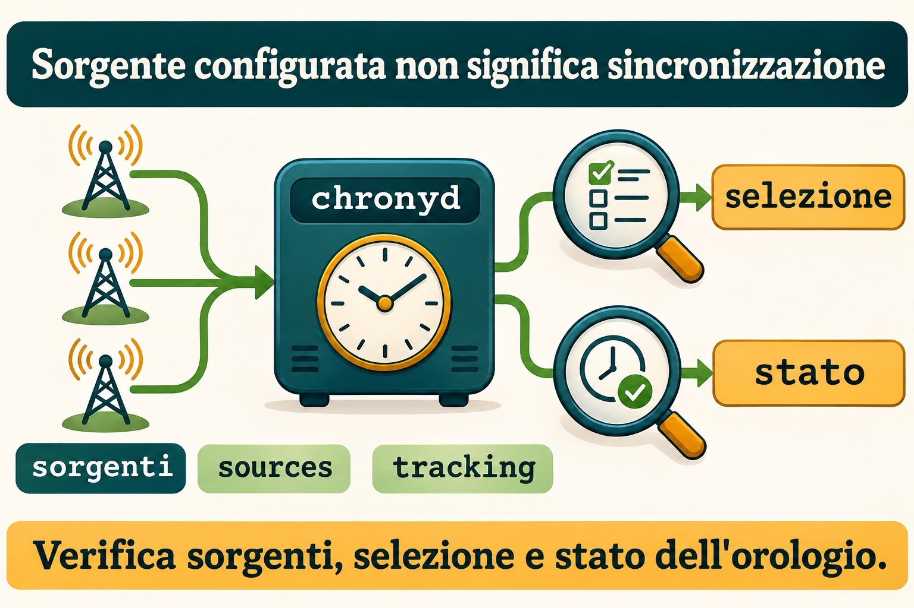

# Lezione 14.4 · L'ora corretta

Hai già usato gli orari per pianificare lavori e analizzare i log. Ora separerai l'istante dell'orologio, il fuso che lo visualizza e la sorgente che lo sincronizza. L'obiettivo è diagnosticare senza introdurre salti d'ora sul server.

> **Il cuore di questa lezione:** sorgente configurata, sorgente selezionata e orologio sincronizzato sono evidenze diverse. Nei test del fuso modifica soltanto la visualizzazione per processo. Il resto è approfondimento.

| Scheda |  |
| --- | --- |
| **Modulo** | M14 · Pianificazione, log e ora, lezione 4 di 5 |
| **Quando** | Settimana 20 |
| **Alla fine** | Interpreti chrony, confronti i fusi e misuri una sorgente senza regolare l'orologio |
| **Prerequisiti** | Lezione 14.3; VM dedicate al corso, `python3`, `student`, `sudo` e console |
| **Durata** | Circa 90 minuti |
| **Snapshot** | `m14a4-inicio` e `m14a4-fim` sulle VM 201 e 202 |

## 1 · Riscaldamento

Rispondi prima di consultare l'orologio.

1. Perché boot e intervallo fanno parte della ricerca nel journal?
2. Perché la configurazione salvata di un servizio non dimostra un comportamento corretto?
3. Perché cambiare l'ora può influire su un timer di calendario?

## 2 · Perché conta

Due host sembrano registrare lo stesso incidente in ordini opposti. Uno usa un altro fuso; l'altro ha perso la sincronizzazione. Confrontare soltanto l'ora stampata confonde visualizzazione e istante. Anche autenticazione, validità dei certificati e cronologia degli incidenti dipendono da un tempo coerente.

Non correggere uno scarto apparente digitando un'ora a memoria. Scopri prima il meccanismo attivo, le sue sorgenti e lo stato di sincronizzazione.

## 3 · Modello mentale

L'istante è il punto sulla linea temporale. Il fuso è la legenda dell'orologio sulla parete. La sorgente NTP aiuta il meccanismo a mantenere l'istante; cambiare legenda non corregge un meccanismo in ritardo.

```text
sorgente -> misurazioni -> selezione -> orologio -> visualizzazione nel fuso
```


*Cambiare la visualizzazione del fuso non cambia l'istante.*

### Ponte Windows

| Concetto | Linux |
| --- | --- |
| Servizio temporale | chronyd o il client effettivamente attivo |
| Sorgente configurata | Direttive `server` e `pool` |
| Stato e sorgenti | `chronyc tracking`, `chronyc sources` |
| Fuso del sistema | `timedatectl status` |

## 4 · L'essenziale

### Un gestore per l'orologio

Non mettere due client a disciplinare lo stesso orologio. chrony e systemd-timesyncd sono alternative di client, non servizi da abilitare insieme per migliorare la precisione. La migrazione richiede di registrare la configurazione e pianificare il cambio.

### Misurare, selezionare e sincronizzare

`chronyc sources -v` mostra sorgenti e indicatori di selezione. Il marcatore `*` identifica la sorgente selezionata. Una sorgente elencata non è necessariamente utilizzabile. `chronyc tracking` descrive come viene seguito l'orologio.

`Reach` è una cronologia di raggiungibilità rappresentata in ottale, non una percentuale. Leggi anche l'età dell'ultima risposta, lo stato della sorgente e lo stato leap del tracking. Non trasformare un solo numero in una diagnosi completa.



*Verifica sorgenti, selezione e stato dell'orologio.*

### Il fuso è visualizzazione

La variabile `TZ` applicata a un comando cambia la visualizzazione di quel processo. L'esempio del lab usa lo stesso timestamp numerico per tre visualizzazioni. Non modifica il fuso globale né l'ora del sistema.

### Misurazione senza correzione

`chronyd -Q` misura e indica lo scarto senza correggere l'orologio. `-q`, minuscola, regola una volta e ha un'altra finalità. In questo lab usa soltanto l'opzione maiuscola, con file isolato e tempo massimo.


*Confronta orologio e fuso prima di ordinare gli incidenti.*

### Rocky × Debian

| Voce | Rocky 9 | Debian 13 |
| --- | --- | --- |
| Pacchetto | `chrony` | `chrony` |
| Unità | `chronyd.service` | `chrony.service` |
| File principale | `/etc/chrony.conf` | `/etc/chrony/chrony.conf` |
| Installazione standard | Client chrony comune | Controlla se timesyncd è il client attuale |

## 5 · Lab guidato

La preparazione seguente installa chrony come unico client sulle VM del corso. Se esiste già un altro client o una sorgente personalizzata oltre a timesyncd standard, fermati per pianificare la migrazione. L'installazione può sostituire timesyncd; non applicare questo percorso a un server di produzione. La sincronizzazione normale può correggere uno scarto esistente, quindi esegui il cambio con snapshot, console e finestra definita.

### Passo 1 · Proteggere e identificare

**Ipotesi:** il nome dell'unità chrony è uguale nelle due distribuzioni?

Sull'host Proxmox:

```bash
qm snapshot 201 m14a4-inicio
qm snapshot 202 m14a4-inicio
```

Sulle VM:

```bash
test ! -e "$HOME/m14a4"
mkdir -m 700 "$HOME/m14a4"
timedatectl status | tee "$HOME/m14a4/timedatectl.inicio"
systemctl is-active chronyd chrony systemd-timesyncd | tee "$HOME/m14a4/clients.inicio"
readlink -f /etc/localtime | tee "$HOME/m14a4/timezone.inicio"
```

Conferma che questa sia la VM di laboratorio e che il cambio sia stato pianificato prima di eseguire l'installazione. Su Rocky:

```bash
sudo dnf install -y chrony
sudo systemctl enable --now chronyd
```

Su Debian, con soltanto timesyncd standard oppure chrony come client precedente:

```bash
if systemctl is-active --quiet systemd-timesyncd; then
    sudo systemctl disable --now systemd-timesyncd
fi
sudo apt install -y chrony
sudo systemctl enable --now chrony
```

Non configurare una sorgente inventata. Conserva le sorgenti autorizzate già esistenti; in una nuova installazione leggi la configurazione fornita dal pacchetto e verificane l'autorizzazione nell'ambiente prima di proseguire. Il client chrony resta come stato finale del corso.

```bash
test -x /usr/sbin/chronyd
command -v chronyc python3
systemctl is-active chronyd chrony systemd-timesyncd
```

**Output atteso:** client chrony attivo nell'unità della distribuzione e nessun secondo client attivo che regoli l'orologio. Nelle altre posizioni possono comparire unità inesistenti o inattive.

**Verifica:** se questa preparazione non è pronta, fermati prima dei test. Non usare `timedatectl set-ntp` senza sapere quale client selezionerà. `timedatectl set-timezone` sarebbe una modifica globale del fuso; questa lezione usa soltanto `TZ` per processo e non esegue quella modifica.

### Passo 2 · Leggere l'evidenza del client

**Ipotesi:** una sorgente configurata è già selezionata?

```bash
sudo chronyc -n sources -v | tee "$HOME/m14a4/sources.inicio"
sudo chronyc tracking | tee "$HOME/m14a4/tracking.inicio"
sudo chronyc activity
```

**Output atteso:** valori reali del client. Individua se esiste una sorgente selezionata e se il tracking indica sincronizzazione; se manca, registra la condizione invece di inventare un campione normale.

**Verifica:** collega indirizzo della sorgente, selezione e stato. Servizio attivo non significa orologio sincronizzato.

### Passo 3 · Confrontare lo stesso istante

**Ipotesi:** i tre comandi seguenti rappresenteranno tre istanti diversi?

```bash
STAMP=$(date +%s)
printf '%s\n' "$STAMP" > "$HOME/m14a4/epoch"
TZ=UTC date -d "@$STAMP" '+%Y-%m-%dT%H:%M:%S%z'
TZ=Europe/Rome date -d "@$STAMP" '+%Y-%m-%dT%H:%M:%S%z'
TZ=America/Sao_Paulo date -d "@$STAMP" '+%Y-%m-%dT%H:%M:%S%z'
readlink -f /etc/localtime
```

**Output atteso:** visualizzazioni con i propri offset per lo stesso timestamp. Il fuso globale resta uguale a quello iniziale.

**Verifica:** controlla l'offset, non soltanto le cifre dell'ora. Le regole stagionali dipendono dalla data dell'istante consultato.

### Decidi 1

| Opzione | Due orari stampati differiscono |
| --- | --- |
| A | Modificare subito l'orologio |
| B | Confrontare istante, offset e sorgente di sincronizzazione |
| C | Scegliere l'orario visivamente più vicino |

Scegli B. Una differenza di visualizzazione non dimostra uno scarto dell'orologio.

### Passo 4 · Scrivere una candidata isolata

**Ipotesi:** validare la sintassi interroga già la sorgente?

Scegli un IP NTP autorizzato dell'ambiente, ottenuto dall'inventario reale delle sorgenti. Non usare un indirizzo casuale né presumere che il gateway offra NTP.

```bash
read -r -p 'Authorized NTP IP: ' NTP_IP
python3 -c 'import ipaddress,sys; print(ipaddress.ip_address(sys.argv[1]))' "$NTP_IP"
```

Se la validazione dell'IP fallisce, fermati e correggi l'input prima di creare il file.

Sulla debian-lab, il profilo AppArmor di `chronyd` permette di leggere configurazioni solo dentro `/etc/chrony/`. Una candidata in `$HOME` dà `Permission denied`. Per questo le candidate stanno in una cartella definita da `C`. Se apri un nuovo terminale, definisci di nuovo `C`.

```bash
C="$HOME/m14a4"
if command -v apt >/dev/null; then
  # guardia: crea la cartella solo sulla debian-lab
  C=/etc/chrony/m14a4
  sudo install -d -o "$USER" -g "$USER" -m 755 "$C"
fi
echo "$C"
```

```bash
printf 'server %s iburst\nport 0\ncmdport 0\n' "$NTP_IP" > "$C/chrony.conf"
/usr/sbin/chronyd -p -f "$C/chrony.conf"
```

**Output atteso:** la candidata viene interpretata senza avviare una regolazione dell'orologio. Non ci sono driftfile, comandi di regolazione né file globali modificati.

**Verifica:** individua l'IP scelto e l'assenza di direttive che richiedano privilegi per questo test.

### Passo 5 · Misurare senza regolare

**Ipotesi:** che cosa rende questa esecuzione diversa da una regolazione singola dell'orologio?

Esegui come `student`, senza `sudo`. L'opzione è `-Q`, maiuscola.

```bash
/usr/sbin/chronyd -Q -t 15 -f "$C/chrony.conf"
```

**Output atteso:** lo strumento termina con una misurazione quando ottiene campioni utilizzabili, oppure termina per il limite temporale se non riesce. Questa esecuzione non esegue alcuna correzione dell'orologio.

**Verifica:** confronta la misurazione con lo stato del client attivo. La ricerca aggiuntiva non ha sostituito il daemon né reso persistente quella candidata.

### Decidi 2

| Opzione | La sorgente non ha risposto entro il limite |
| --- | --- |
| A | Verificare IP, servizio NTP e percorso UDP autorizzato |
| B | Trasformare l'host in server temporale senza sorgente |
| C | Cambiare l'ora manualmente |

Scegli A. L'assenza di un campione utilizzabile non fornisce un'ora corretta da digitare.

### Passo 6 · Correlare journal e boot

**Ipotesi:** visualizzare il journal in UTC elimina il fuso usato dal sistema?

```bash
logger -t m14a4 "M14A4 epoch=$STAMP"
sudo journalctl -t m14a4 --since '-5 minutes' -o short-iso --no-pager
sudo journalctl --utc -t m14a4 --since '-5 minutes' -o short-iso --no-pager
sudo systemctl reboot
```

Dopo esserti ricollegato:

```bash
timedatectl status
sudo chronyc tracking
sudo chronyc -n sources -v
readlink -f /etc/localtime
```

**Output atteso:** il client normale torna e il fuso resta uguale. Il journal può visualizzare lo stesso evento in UTC senza riscriverne l'istante.

**Verifica:** la candidata isolata non è stata installata nel daemon. Lo stato persistente verificato è quello del client chrony attivato nella preparazione.

## 6 · Rompi e ripara

### Guasto 1 · Nome del fuso non valido

**Sintomo:** il nome digitato non corrisponde a una zona installata.

**Indagine:** confronta il percorso errato con l'elenco disponibile.

```bash
test -e /usr/share/zoneinfo/Europ/Rome
timedatectl list-timezones | grep '^Europe/Rome$'
```

**Causa:** errore nell'identificatore. Una variabile `TZ` non valida può ricevere un'interpretazione alternativa; un output stampato non valida da solo il nome.

**Riparazione:** usa la zona esistente soltanto nel comando di visualizzazione.

```bash
TZ=Europe/Rome date -d "@$(cat "$HOME/m14a4/epoch")" -Is
```

**Verifica:** il fuso globale resta uguale a quello registrato.

**Prevenzione:** seleziona nomi dalla base installata.

### Guasto 2 · Candidata con direttiva inesistente

**Sintomo:** la candidata non supera più il lettore della configurazione.

**Indagine:** introduci la riga soltanto nella copia privata.

```bash
cp "$C/chrony.conf" "$C/chrony.good"
printf 'm14_invalid yes\n' >> "$C/chrony.conf"
/usr/sbin/chronyd -p -f "$C/chrony.conf"
```

**Causa:** la direttiva non viene riconosciuta. Il client attivo continua con la configurazione originale.

**Riparazione:** ripristina `cp "$C/chrony.good" "$C/chrony.conf"`.

**Verifica:** la lettura con `-p` torna a passare.

**Prevenzione:** valida prima di pianificare qualsiasi sostituzione della configurazione attiva.

### Guasto 3 · Sorgente senza server

**Sintomo:** una ricerca isolata non ottiene un campione utilizzabile.

**Indagine:** conferma che non esista un server NTP all'indirizzo di loopback riservato al guasto e crea un'altra candidata. Non toccare il client attivo.

```bash
sudo ss -lunp 'sport = :123'
printf 'server 127.0.0.2 iburst\nport 0\ncmdport 0\n' > "$C/chrony.bad-source"
/usr/sbin/chronyd -Q -t 5 -f "$C/chrony.bad-source"
```

**Causa:** quella destinazione non offre NTP nel lab. Non è un problema di visualizzazione del fuso.

**Riparazione:** torna alla candidata con la sorgente autorizzata e confermata.

**Verifica:** il client attivo resta consultabile con `chronyc tracking`.

**Prevenzione:** verifica disponibilità e autorizzazione della sorgente; non usare soltanto l'esistenza della riga nel file.

### Pulizia

Le esecuzioni `-Q` terminano da sole. Il client chrony installato resta intenzionalmente attivo; la configurazione candidata non ha mai sostituito la sua. Non è stata esportata globalmente alcuna variabile di fuso e non deve restare avviato un daemon concorrente. Conserva i file privati come evidenza.

```bash
readlink -f /etc/localtime
sudo chronyc tracking
sudo chronyc -n sources -v
```

Sulla debian-lab, rimuovi anche la cartella delle candidate: `sudo rm -rf /etc/chrony/m14a4`.

Confronta il fuso con `timezone.inicio`. La sincronizzazione resta sotto l'unico client installato e attivato nella preparazione di questa lezione.

## 7 · Trappole

| Errore | Che cosa fare | Motivo |
| --- | --- | --- |
| Ora visiva diversa significa orologio errato | Confrontare istante e offset | I fusi visualizzano lo stesso istante |
| Servizio attivo significa sincronizzato | Leggere sorgenti e tracking | Può mancare una sorgente utilizzabile |
| Confondere `-q` e `-Q` | Controllare l'opzione prima di eseguire | Una regola; l'altra misura |
| Abilitare due client | Pianificare un solo gestore | Evita regolazioni concorrenti |

## 8 · Quiz

1. Fuso e istante sono la stessa cosa?
2. Che cosa mostra `sources` oltre all'elenco delle sorgenti?
3. Reach è una percentuale?
4. Quale opzione di chronyd misura senza correggere?
5. Perché non installare silenziosamente un altro client?
6. Come confronti eventi di host con fusi diversi?

## 9 · Promemoria

| Operazione | Comando |
| --- | --- |
| Stato generale | `timedatectl status` |
| Sorgenti e selezione | `chronyc -n sources -v` |
| Monitoraggio | `chronyc tracking` |
| Journal in UTC | `sudo journalctl --utc -t m14a4` |

**Flashcard:** crea cinque schede su istante, fuso, selezione, tracking e misurazione senza regolazione. Ripassa a D+1, D+3, D+7 e D+21.

## 10 · Checklist e chiusura

- [ ] Ho identificato l'unico client attivo.
- [ ] Ho confrontato lo stesso istante in tre fusi senza modificare l'orologio.
- [ ] Ho verificato soltanto candidate isolate con misurazione senza regolazione.

**Ultimo esercizio:** scrivi come distinguere fuso errato, sorgente indisponibile e client ancora non sincronizzato.

**Reboot di verifica:** riavvia le due VM e controlla client, sorgenti e fuso conservati, senza usare una regolazione manuale per produrre una schermata prevista.

```bash
sudo systemctl reboot
```

Sull'host Proxmox:

```bash
qm snapshot 201 m14a4-fim
qm snapshot 202 m14a4-fim
```

## 11 · Nella vita reale

Su un host autorizzato leggi stato, sorgenti, fuso e visualizzazione UTC di un intervallo noto del journal. Non regolare l'ora, non cambiare client e non forzare un salto in questa missione. Registra ciò che dimostra sincronizzazione e ciò che dimostra soltanto visualizzazione.

## 12 · Approfondire quando vuoi

- [chronyd(8)](https://chrony-project.org/doc/4.6/chronyd.html), [chronyc(1)](https://chrony-project.org/doc/4.6/chronyc.html) e [chrony.conf(5)](https://chrony-project.org/doc/4.6/chrony.conf.html): client, sorgenti e misurazione.
- [timedatectl(1)](https://manpages.debian.org/trixie/systemd/timedatectl.1.en.html): ricerca e modifiche globali non usate in questo lab.

**DeepTutor** (http://10.1.0.149:3782, KB "Curso Linux Sysadmin"):

- `!explica Separe instante, fuso, fonte NTP e sincronização do relógio.`
- `!feynman Vou explicar por que um serviço de hora ativo pode não estar sincronizado. Critique minha explicação.`
- `!quiz Crie seis diagnósticos de hora sem alterar o relógio real do servidor.`

## Soluzioni commentate

### Riscaldamento

1. Delimitano l'insieme ricercato e possono escludere l'evento.
2. La sorgente può essere indisponibile anche con una configurazione valida.
3. La pianificazione civile dipende dagli orari calcolati dall'orologio e dal fuso.

### Quiz

1. No; uno è visualizzazione, l'altro è il punto sulla linea temporale.
2. Stato di selezione, raggiungibilità e informazioni dei campioni.
3. No; è una cronologia in ottale.
4. `-Q`, maiuscola.
5. L'installazione può sostituire il gestore attuale dell'orologio oppure competere con esso.
6. Normalizza la visualizzazione e controlla lo stato degli orologi, non soltanto il testo dell'ora.

<!-- navegacao -->
[← Lezione 14.3 · journald e rsyslog](14.3-journald-e-rsyslog.md) · [Indice delle lezioni](../01-aulas.md) · [Piano del corso: dalla 14.5 in poi →](../00-plano-do-curso.md)
