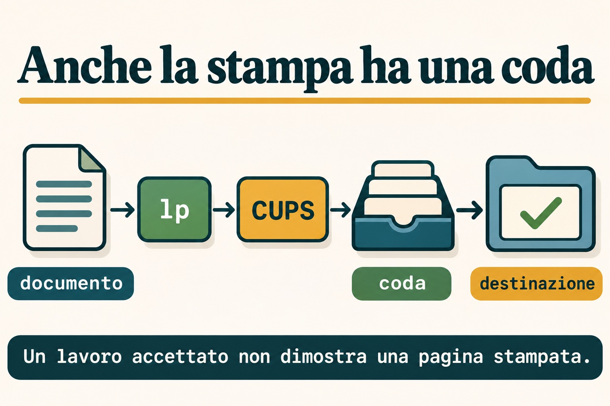
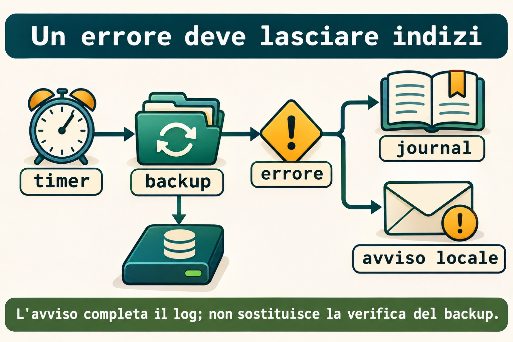

# Lezione 14.5 · E-mail locale e stampa

Accettare un messaggio o un documento non dimostra la consegna. Seguirai due code locali e chiuderai il modulo con un backup che registra il risultato e avvisa quando fallisce.

> **Il cuore di questa lezione:** verifica invio, coda e destinazione. L'avviso completa il log; il backup richiede una lettura di prova. Il resto è approfondimento.

| Scheda |  |
| --- | --- |
| **Modulo** | M14 · Pianificazione, log e ora, lezione 5 di 5 |
| **Quando** | Settimana 20 |
| **Alla fine** | Verifichi la consegna locale, gestisci una coda virtuale e integri un avviso di errore |
| **Prerequisiti** | Lezione 14.4; VM dedicate, `student`, `sudo` e console |
| **Durata** | Circa 120 minuti |
| **Snapshot** | `m14a5-inicio` e `m14a5-fim` sulle VM 201 e 202 |

## 1 · Riscaldamento

1. Quale evidenza dimostra un'esecuzione del timer, oltre al fatto che sia attivo?
2. Come consulti un errore per unità e boot nel journal?
3. Perché il fuso deve accompagnare l'ora di un'evidenza?

## 2 · Perché conta

Un programma può accettare l'invio e il destinatario restare senza messaggio. Separa invio, coda, trasporto e casella. Anche nella stampa ricevere il lavoro precede il completamento a destinazione.

Qui tutto rimane sulla stessa VM: posta locale e coda virtuale che scarta i byte. Non usare indirizzi esterni o dispositivi fisici. L'obiettivo è comprendere le evidenze senza creare un server pubblico.

## 3 · Modello mentale


*Verifica coda, consegna locale e casella del destinatario.*

`sendmail` è l'interfaccia compatibile di invio fornita qui da Postfix. Il nome non significa che sia installato il server Sendmail. La consegna locale termina nella casella di un utente della VM.



*Un lavoro accettato non dimostra una pagina stampata.*

CUPS riceve, mantiene la coda e attiva la destinazione. In questo laboratorio `file:///dev/null` scarta i dati. Completare in questa destinazione non dimostra un foglio stampato.

## 4 · L'essenziale

| Strumento | Domanda |
| --- | --- |
| `postconf -n` | Quale configurazione esplicita è salvata? |
| `postqueue -p` | Che cosa è ancora in coda? |
| `newaliases` | Il database degli alias è stato ricostruito? |
| `lpstat -t` | Quali code e stati esistono? |
| `lp` e `cancel` | Come invio e annullo il mio lavoro? |

Un alias reindirizza il nome locale senza creare account o casella. Una coda e-mail vuota può rappresentare consegna oppure errore già elaborato. Leggi anche casella e log.

### Decidi 1

L'invio ha restituito successo, ma non hai letto l'avviso. Tu: A) dichiari la consegna; B) controlli coda, log e casella; C) cambi server dell'ora.

## 5 · Lab guidato

Ripeti sulle VM 201 e 202 come `student`, con `/home/student`. Ogni prerequisito è un punto di arresto; se fallisce, non proseguire. L'esercizio richiede VM dedicate, senza MTA configurato, senza code esistenti e senza personalizzazioni di CUPS.

Sul nodo Proxmox:

```bash
qm snapshot 201 m14a5-inicio
qm snapshot 202 m14a5-inicio
```

### Passo 1 · Riservare i nomi e installare

**Ipotesi:** un pacchetto può avviare il servizio durante l'installazione?

Sì. Registra gli stati prima di mascherare temporaneamente le unità. Se un MTA è configurato oppure un'unità è già mascherata, fermati e usa un'altra VM predisposta.

```bash
id
getent passwd student
systemctl is-active postfix cups
systemctl is-enabled postfix cups cups.socket cups.path
ss -lnt '( sport = :25 or sport = :631 )'
test ! -e "$HOME/m14a5"
test ! -e /usr/local/libexec/m14a5-backup
test ! -e /usr/local/libexec/m14a5-alert
test ! -e /etc/systemd/system/m14a5-backup.service
test ! -e /etc/systemd/system/m14a5-alert.service
test ! -e /etc/systemd/system/m14a5-backup.timer
test ! -e /var/lib/m14a5
mkdir -m 700 "$HOME/m14a5"
systemctl list-unit-files 'postfix*' 'cups*' > "$HOME/m14a5/services.before"
sudo systemctl mask postfix.service cups.service cups.socket cups.path
```

Su Rocky:

```bash
sudo dnf install -y postfix s-nail cups cups-client cups-filters
```

Su Debian riserva la politica d'installazione temporanea seguente; se esiste già, fermati senza sostituirla. Impedisce l'avvio tramite gli script d'installazione, anche delle dipendenze. Risolvi eventuali errori d'installazione prima di rimuovere la politica creata qui.

```bash
test ! -e /usr/sbin/policy-rc.d
printf '#!/bin/sh\nexit 101\n' | sudo tee /usr/sbin/policy-rc.d >/dev/null
sudo chmod 755 /usr/sbin/policy-rc.d
printf 'postfix postfix/main_mailer_type select Local only\n' | sudo debconf-set-selections
sudo apt-get update
sudo apt-get install -y postfix bsd-mailx cups cups-client cups-filters
sudo rm -- /usr/sbin/policy-rc.d
```

**Output atteso:** strumenti installati e servizi riservati ancora fermi. Le dipendenze variano secondo la distribuzione.

**Verifica:** ricontrolla porte e stati. Se compare un listener di rete oppure un MTA precedente, fermati prima di configurare.

### Passo 2 · Definire l'ambito locale

**Ipotesi:** limitare il listener impedisce anche l'uscita verso destinazioni esterne?

No. Limita ricezione e trasporti in uscita. Questa configurazione sostituisce soltanto lo stato standard appena installato sulla VM dedicata. Non applicarla a un server esistente.

```bash
sudo cp -a /etc/postfix/main.cf "$HOME/m14a5/main.cf.before"
sudo postconf -e 'inet_interfaces = loopback-only'
sudo postconf -e 'inet_protocols = ipv4'
sudo postconf -e "myhostname = $(hostname -s).invalid"
sudo postconf -e 'myorigin = $myhostname'
sudo postconf -e 'mydestination = $myhostname, localhost.$mydomain, localhost'
sudo postconf -e 'mynetworks = 127.0.0.0/8'
sudo postconf -e 'relay_domains ='
sudo postconf -e 'smtpd_relay_restrictions = reject_unauth_destination'
sudo postconf -e 'default_transport = error:local delivery only'
sudo postconf -e 'relay_transport = error:local delivery only'
sudo postconf -e 'alias_maps = hash:/etc/aliases'
sudo postconf -e 'alias_database = hash:/etc/aliases'
sudo postfix check
sudo postconf -n
sudo systemctl unmask postfix.service
sudo systemctl enable --now postfix.service
ss -lnt '( sport = :25 )'
sudo postfix status
```

**Output atteso:** SMTP soltanto su `127.0.0.1:25`. Le destinazioni non locali incontrano il trasporto di errore. Non provare indirizzi esterni.

**Verifica:** listener, processi e configurazione reale. La struttura delle unità Postfix può variare fra distribuzioni; lo stato attivo non sostituisce questi controlli.

### Passo 3 · Seguire la consegna locale

**Ipotesi:** modificare gli alias aggiorna immediatamente la mappa indicizzata?

Riserva `m14notice`: le prime due ricerche devono mostrarne l'assenza. Se esiste già, fermati prima di aggiungere il blocco.

```bash
sudo grep -n '^m14notice:' /etc/aliases
sudo postalias -q m14notice hash:/etc/aliases
printf '\n# BEGIN m14a5\nm14notice: student\n# END m14a5\n' | sudo tee -a /etc/aliases >/dev/null
sudo newaliases
sudo postalias -q m14notice hash:/etc/aliases
printf 'To: m14notice\nSubject: m14a5-local\n\nm14a5 delivery check\n' | /usr/sbin/sendmail -i m14notice
sudo postqueue -p
SPOOL=$(sudo postconf -h mail_spool_directory)
MAILBOX="$SPOOL/student"
printf '%s\n' "$MAILBOX"
sudo journalctl --since '-5 minutes' --no-pager | grep -E 'postfix|m14a5'
mail -f "$MAILBOX"
```

Nel lettore `h` elenca le intestazioni, il numero seleziona il messaggio e `x` esce senza salvare modifiche alla casella. Leggi soltanto l'oggetto del laboratorio; non cancellare altri messaggi.

**Output atteso:** la ricerca dell'alias restituisce `student` e il messaggio arriva alla casella. La coda può svuotarsi rapidamente; identificatori e orari provengono dall'esecuzione reale.

**Verifica:** corpo e log della consegna tramite l'identificatore. Se il journal non riceve i log dell'MTA, controlla rsyslog e le sue destinazioni di posta esistenti, senza inventare un percorso universale.

### Passo 4 · Creare una stampante virtuale

**Ipotesi:** una coda può terminare senza produrre carta?

Sì. La nostra destinazione è un file speciale che scarta i byte. CUPS 2.x richiede un PPD per un dispositivo su file: non creare una coda senza driver con `-m raw`. Seleziona un modello PostScript realmente elencato. PPD è un meccanismo storico; con dispositivi moderni normalmente si usa IPP senza driver.

```bash
sudo systemctl unmask cups.service cups.socket cups.path
sudo systemctl start cups.service
sudo cupsctl --no-remote-admin --no-remote-any --no-share-printers
sudo cupsd -t
ss -lnt '( sport = :631 )'
lpstat -p
LC_ALL=C lpinfo -m | grep -i 'generic.*postscript'
read -r -p 'MODEL: ' MODEL
lpinfo -m | awk '{print $1}' | grep -Fx -- "$MODEL"
sudo lpadmin -p m14file -E -v file:///dev/null -m "$MODEL" -o printer-is-shared=false
lpstat -v m14file
lpstat -p m14file
```

Copia soltanto la prima colonna del modello selezionato. Se manca un modello oppure la verifica fallisce, fermati senza inventare un driver. Se `m14file` esiste già, fermati prima di crearlo. Non proseguire con un listener su `0.0.0.0:631` oppure `[::]:631`: correggi prima la configurazione locale dedicata.

**Output atteso:** coda dedicata con PPD e destinazione `file:///dev/null`. Questa destinazione speciale è consentita senza abilitare scritture arbitrarie su file.

**Verifica:** listener soltanto su loopback o socket locale e nessuna stampante fisica selezionata.

### Passo 5 · Trattenere, rilasciare e completare

**Ipotesi:** la ricevuta del client indica accettazione oppure completamento?

```bash
printf 'm14a5 virtual document\n' > "$HOME/m14a5/document.txt"
lp -d m14file -o raw -H hold "$HOME/m14a5/document.txt"
lpstat -W not-completed -o m14file
read -r -p 'JOB_ID: ' JOB_ID
lp -i "$JOB_ID" -H resume
lpstat -W completed -o m14file
```

Copia l'identificatore della tua ricevuta, compreso il nome della coda. `-o raw` in questo invio evita i filtri; la coda continua ad avere un PPD. Attendi il completamento e ripeti la ricerca se necessario.

**Output atteso:** inizialmente trattenuto, poi completato nella cronologia disponibile. La destinazione scarta i dati senza attivare dispositivi.

**Verifica:** crea un altro lavoro trattenuto, registra il nuovo identificatore e annulla soltanto quel lavoro con `cancel "$JOB_ID"`. Non riutilizzare l'identificatore precedente e non annullare code intere.

### Passo 6 · Verificare dopo il reboot

**Ipotesi:** alias e coda dipendono dal mantenimento della tua sessione aperta?

```bash
sudo systemctl enable postfix.service cups.service
sudo postfix check
sudo cupsd -t
sudo systemctl reboot
```

Riconnettiti tramite il percorso già verificato. Reinvia il messaggio locale del Passo 3 con un nuovo oggetto e controlla la casella senza confondere un vecchio messaggio con la consegna dopo il boot.

```bash
ss -lnt '( sport = :25 or sport = :631 )'
sudo postqueue -p
lpstat -t
sudo journalctl -b -u cups.service --no-pager
```

**Output atteso:** servizi locali disponibili, nuova consegna e coda conservata, senza esposizione di rete.

**Verifica:** registra le tre evidenze; il solo stato attivo non le sostituisce.

## 6 · Rompi e ripara

### Guasto 1 · File nuovo, mappa vecchia

**Sintomo:** il file contiene l'alias, ma la ricerca non lo trova.

**Indagine:** riserva un alias assente e aggiungi soltanto il blocco temporaneo, senza ricostruire. Se esiste già, fermati.

```bash
sudo grep -n '^m14stale:' /etc/aliases
sudo postalias -q m14stale hash:/etc/aliases
printf '\n# BEGIN m14stale\nm14stale: student\n# END m14stale\n' | sudo tee -a /etc/aliases >/dev/null
sudo grep '^m14stale:' /etc/aliases
sudo postalias -q m14stale hash:/etc/aliases
```

**Causa:** la mappa indicizzata rappresenta la versione precedente.

**Riparazione:** esegui `sudo newaliases` e ripeti la ricerca.

**Verifica:** restituisce `student`; rimuovi soltanto il blocco temporaneo e ricostruisci di nuovo.

```bash
sudo sed -i '/^# BEGIN m14stale$/,/^# END m14stale$/d' /etc/aliases
sudo newaliases
```

**Prevenzione:** controlla separatamente file, mappa e consegna.

### Guasto 2 · Coda disabilitata

**Sintomo:** il documento è stato accettato, ma non termina.

**Indagine:** disabilita soltanto la coda dedicata e invia una prova.

```bash
sudo cupsdisable m14file
lp -d m14file -o raw "$HOME/m14a5/document.txt"
lpstat -p m14file
lpstat -o m14file
```

**Causa:** accettare lavori ed elaborarli sono stati diversi.

**Riparazione:** esegui `sudo cupsenable m14file`.

**Verifica:** il tuo lavoro termina nella destinazione virtuale; altrimenti leggi il log di CUPS.

**Prevenzione:** controlla coda e lavoro prima di riavviare l'intero servizio.

### Guasto 3 · Destinazione inesistente

**Sintomo:** manca una ricevuta con identificatore del lavoro.

**Indagine:** verifica che il nome seguente non esista prima della prova.

```bash
lpstat -p
lp -d m14naoexiste "$HOME/m14a5/document.txt"
printf 'rc=%s\n' "$?"
```

**Causa:** il client non ha trovato la coda; l'errore precede la stampa.

**Riparazione:** seleziona esplicitamente `m14file`.

**Verifica:** l'invio corretto riceve un identificatore e appare nella cronologia.

**Prevenzione:** gli script non devono dipendere da una stampante predefinita sconosciuta.

## 7 · Trappole

- Un listener locale non impedisce da solo la consegna esterna.
- Una coda vuota non sostituisce la lettura della casella.
- Non inviare segreti nel corpo di un avviso.
- L'avviso sulla stessa VM dipende dal suo funzionamento; il monitoraggio esterno è un altro progetto.
- Non esporre l'amministrazione di CUPS per facilitare l'esercizio.

### Decidi 2

Il backup fallisce e l'avviso dipende dallo stesso server. Concludi: A) artefatto, log e avviso richiedono controlli propri.; B) l'assenza di avvisi dimostra il successo; C) l'avviso sostituisce la verifica

## 8 · Quiz

1. Che cosa dimostra l'accettazione da parte di `sendmail`?
2. Un alias crea account e casella?
3. Perché eseguire `newaliases`?
4. Una coda disabilitata può accettare lavori?
5. Che cosa è stato completato nella destinazione virtuale?
6. L'assenza di e-mail dimostra il successo del backup?

## 9 · Promemoria

**Flashcard:** invio → ingresso; coda → attesa; alias → reindirizzamento; casella → contenuto consegnato; CUPS → coda e destinazione; avviso → indizio aggiuntivo.

```text
submission -> queue -> local delivery -> mailbox
lp -> queue -> destination -> result
```

## 10 · Checklist e chiusura

### Sfida del modulo · Backup, log e avviso



*L'avviso completa il log; non sostituisce la verifica del backup.*

**Ultimo esercizio:** realizza l'integrazione senza file reali. Il timer giornaliero richiama un backup di prova; il suo fallimento deve produrre stato di errore, log e avviso locale. I nomi e i testi della macchina rimangono uguali nelle due lingue.

```bash
mkdir -m 700 "$HOME/m14a5/source"
printf 'm14a5 backup data\n' > "$HOME/m14a5/source/data.txt"
sudo install -d -m 755 /usr/local/libexec
sudo tee /usr/local/libexec/m14a5-backup >/dev/null <<'EOF'
#!/bin/sh
set -eu
if [ -e /var/lib/m14a5/fail ]; then
  echo 'm14a5 controlled failure' >&2
  exit 9
fi
tmp=$(mktemp /var/lib/m14a5/backup.XXXXXX)
trap 'rm -f -- "$tmp"' EXIT HUP INT TERM
tar -czf "$tmp" -C /home/student/m14a5 source
tar -tzf "$tmp" >/dev/null
mv -- "$tmp" /var/lib/m14a5/backup.tar.gz
echo 'm14a5 backup verified'
EOF
sudo tee /usr/local/libexec/m14a5-alert >/dev/null <<'EOF'
#!/bin/sh
set -eu
printf 'To: m14notice\nSubject: m14a5-backup-failed\n\nCheck journal: m14a5-backup.service\n' | /usr/sbin/sendmail -i m14notice
EOF
sudo chmod 755 /usr/local/libexec/m14a5-backup /usr/local/libexec/m14a5-alert
```

Su Rocky: `sudo restorecon /usr/local/libexec/m14a5-backup /usr/local/libexec/m14a5-alert`. I nomi delle unità e dello stato sono già stati riservati nel Passo 1. Se qualcuno li ha creati nel frattempo, fermati prima di scrivere.

```bash
sudo tee /etc/systemd/system/m14a5-backup.service >/dev/null <<'EOF'
[Unit]
Description=M14 local backup
OnFailure=m14a5-alert.service
[Service]
Type=oneshot
User=student
Group=student
StateDirectory=m14a5
StateDirectoryMode=0700
ExecStart=/usr/local/libexec/m14a5-backup
EOF
sudo tee /etc/systemd/system/m14a5-alert.service >/dev/null <<'EOF'
[Unit]
Description=M14 local failure notice
[Service]
Type=oneshot
User=student
Group=student
ExecStart=/usr/local/libexec/m14a5-alert
EOF
sudo tee /etc/systemd/system/m14a5-backup.timer >/dev/null <<'EOF'
[Unit]
Description=M14 daily backup
[Timer]
OnCalendar=daily
Persistent=true
Unit=m14a5-backup.service
[Install]
WantedBy=timers.target
EOF
sudo systemd-analyze verify /etc/systemd/system/m14a5-backup.service /etc/systemd/system/m14a5-alert.service /etc/systemd/system/m14a5-backup.timer
sudo systemctl daemon-reload
sudo systemctl start m14a5-backup.service
tar -tzf /var/lib/m14a5/backup.tar.gz
sudo systemctl enable --now m14a5-backup.timer
systemctl list-timers m14a5-backup.timer
```

Il file temporaneo sostituisce il backup finale soltanto dopo aver superato la lettura. Questo convalida il file di prova senza sostituire una prova completa di ripristino. Provoca l'errore controllato e osserva il fallimento atteso.

```bash
touch /var/lib/m14a5/fail
sudo systemctl start m14a5-backup.service
sudo journalctl -u m14a5-backup.service -u m14a5-alert.service --since '-5 minutes' --no-pager
sudo postqueue -p
rm -- /var/lib/m14a5/fail
sudo systemctl reset-failed m14a5-backup.service
sudo systemctl start m14a5-backup.service
systemctl show m14a5-backup.service -p Result -p ExecMainStatus
```

Leggi l'avviso nella casella come nel Passo 3. L'accettazione del programma d'invio non basta. Dopo aver rimosso l'errore, verifica una nuova lettura del backup e il risultato di successo.

**Reboot di verifica:** riavvia e controlla timer, listener e ultimo risultato. La persistenza recupera un'attivazione scaduta, non un'esecuzione per ogni giorno perso. Non regolare l'orologio per la prova.

### Pulizia e stato finale

Copia il backup di prova e rimuovi soltanto pianificazione e coda dedicate. Postfix locale e CUPS locale rimangono installati. Il journal persistente della 14.3 e chrony della 14.4 rimangono. Non ripristinare alla cieca configurazioni precedenti che potrebbero riaprire i listener.

```bash
sudo systemctl disable --now m14a5-backup.timer
sudo systemctl stop m14a5-backup.service m14a5-alert.service
if cp -- /var/lib/m14a5/backup.tar.gz "$HOME/m14a5/backup.tar.gz" &&
   cmp -- /var/lib/m14a5/backup.tar.gz "$HOME/m14a5/backup.tar.gz"; then
    sudo systemctl clean --what=state m14a5-backup.service m14a5-backup.timer
    sudo systemctl reset-failed m14a5-backup.service m14a5-alert.service
    sudo rm -- /etc/systemd/system/m14a5-backup.service /etc/systemd/system/m14a5-alert.service /etc/systemd/system/m14a5-backup.timer
    sudo rm -- /usr/local/libexec/m14a5-backup /usr/local/libexec/m14a5-alert
    sudo systemctl daemon-reload
    lpstat -o m14file
    sudo lpadmin -x m14file
    sudo sed -i '/^# BEGIN m14a5$/,/^# END m14a5$/d' /etc/aliases
    sudo newaliases
    sudo postfix check
    sudo cupsd -t
else
    printf 'Backup copy failed; state and configuration preserved.\n' >&2
fi
```

Prima di rimuovere la coda, verifica che tutti i suoi lavori siano tuoi: la rimozione annulla quei lavori. Se la copia o il confronto fallisce la pulizia non prosegue: correggi l'errore e ripeti prima dello snapshot finale. Conserva caselle, code di posta e log. La tua cartella mantiene documenti, backup ed evidenze per la revisione.

- [ ] Invio, coda e casella verificati sulle due VM.
- [ ] Listener soltanto locali e nessuna stampante fisica attivata.
- [ ] L'errore ha prodotto log e avviso; il recupero ha superato la lettura.
- [ ] La pulizia ha conservato lavori, caselle e log altrui.

Sul nodo, dopo la pulizia:

```bash
qm snapshot 201 m14a5-fim
qm snapshot 202 m14a5-fim
```

## 11 · Nella vita reale

Leggi configurazioni e code esistenti con autorizzazione. Un server reale può avere relay autenticato, regole e destinazioni esterne legittime. Il profilo isolato della lezione non deve sostituirli.

### Ponte Windows

Anche un lavoro bloccato nello spooler richiede di controllare coda, destinazione e risultato. La sequenza delle evidenze si trasferisce; i comandi di questa lezione sono Linux.

### Rocky × Debian

Pacchetti, struttura delle unità e directory della casella variano. Leggi il sistema reale e non trasformare differenze di pacchettizzazione in sostituzioni cieche della configurazione.

## 12 · Approfondire quando vuoi

- [Parametri di Postfix](https://www.postfix.org/postconf.5.html): listener, destinazioni e trasporti.
- [Aliases](https://manpages.debian.org/trixie/postfix/aliases.5.en.html) e [sendmail](https://manpages.debian.org/trixie/postfix/sendmail.1.en.html): mappa e invio su Debian.
- [CUPS: lpadmin](https://www.cups.org/doc/man-lpadmin.html), [lp](https://www.cups.org/doc/man-lp.html) e [dispositivi su file](https://www.cups.org/doc/man-cups-files.conf.html): coda, invio e limitazioni.
- [RHEL 9: CUPS](https://docs.redhat.com/en/documentation/red_hat_enterprise_linux/9/html/configuring_and_using_a_cups_printing_server/index): modelli e amministrazione.
- [systemd.unit](https://www.freedesktop.org/software/systemd/man/latest/systemd.unit.html) e [systemd.timer](https://www.freedesktop.org/software/systemd/man/latest/systemd.timer.html): errori e persistenza.

### DeepTutor

```text
!explica submissao, fila e entrega local com um exemplo
!feynman por que um trabalho aceito ainda pode falhar
!quiz timer, backup, journal e aviso local
```

## Soluzioni commentate

### Riscaldamento e decisioni

1. Risultato dell'unità, istante ed evidenza prodotta.
2. Filtra per unità e intervallo o boot pertinente.
3. La visualizzazione dipende dal fuso; l'istante può essere lo stesso.

**Decidi 1:** B; l'accettazione non dimostra la consegna nella casella.

**Decidi 2:** A; anche il meccanismo di avviso può fallire.

### Quiz

1. Accettazione dell'invio, non consegna né lettura.
2. No; reindirizza un nome.
3. Per ricostruire la mappa indicizzata configurata.
4. Sì; accettazione ed elaborazione sono stati separati.
5. I byte sono stati scartati, senza prova di carta.
6. No; controlla artefatto leggibile, risultato, log e consegna dell'avviso.

<!-- navegacao -->
[← Lezione 14.4 · L'ora corretta](14.4-hora-certa.md) · [Indice delle lezioni](../01-aulas.md) · [Piano del corso: dalla 15.1 in poi →](../00-plano-do-curso.md)
