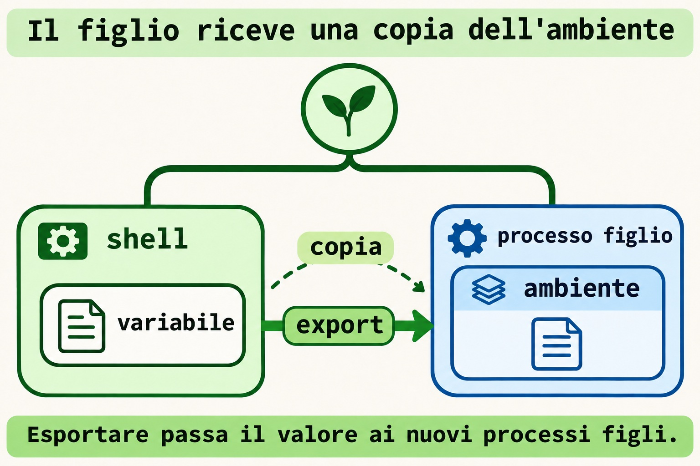

# Lezione 15.1 · Ambiente della shell

Su Windows distingui una variabile del processo dalle impostazioni persistenti dell'utente e della macchina. In Bash la stessa distinzione spiega perché un comando funzioni nel terminale ma fallisca in uno script. Verificherai variabili, ambiente, PATH, alias e funzioni in shell figlie, conservando i veri file di avvio.

> **Il cuore di questa lezione:** variabile della shell e ambiente non sono la stessa cosa; i nuovi processi ricevono una copia; PATH ha un ordine; il file di avvio dipende dal tipo di shell. Il resto è approfondimento.

| Scheda |  |
| --- | --- |
| **Modulo** | M15 · Shell e ambiente, lezione 1 di 5 |
| **Quando** | Settimana 20 |
| **Alla fine** | Spieghi l'eredità dell'ambiente e diagnostichi ricerca dei comandi e file di avvio |
| **Prerequisiti** | M1, M10 e M14; Bash e SSH sulle VM 201 e 202 |
| **Durata** | Circa 90 minuti |
| **Snapshot** | `m15a1-inicio` e `m15a1-fim` sulle due VM |

## 1 · Riscaldamento

Rispondi senza consultare il materiale e controlla le soluzioni in fondo.

1. Qual è la differenza tra una sessione e un processo avviato da essa?
2. Perché mettere uno script sul disco non garantisce che il suo nome venga trovato come comando?
3. Un timer di systemd riceve automaticamente gli alias del tuo terminale?

## 2 · Perché conta

Il rapporto viene eseguito quando sei collegato, ma fallisce nella pianificazione. Il terminale aveva una variabile e una funzione che il processo dello scheduler non ha ricevuto. Copiare tutta la configurazione interattiva nello script nasconderebbe soltanto la dipendenza.

La correzione inizia chiedendo quale processo abbia avviato il comando, quale ambiente abbia consegnato e quale file di avvio sia stato letto. Poi dichiari soltanto le dipendenze necessarie.

## 3 · Modello mentale

Pensa alla scheda che la portineria consegna a una squadra. Un appunto rimasto sul tavolo del portiere è una variabile locale. Esportare include l'appunto nella scheda in uscita. La squadra riceve una copia e non riscrive il tavolo del portiere quando modifica la propria scheda.

```text
shell padre: variabile locale + ambiente
                              |
                       nuovo processo
                              |
                       copia di ambiente
```



*Esportare passa il valore ai nuovi processi figli.*

### Ponte Windows

| Windows | Bash | Attenzione ad ambito |
| --- | --- | --- |
| Variabile del processo | Variabile o ambiente della shell | Il figlio riceve l'ambiente iniziale |
| Ordine di ricerca in PATH | Ordine delle directory in `PATH` | Il primo candidato conta |
| Profilo del terminale | File di avvio di Bash | Non sono configurazione universale dei servizi |

## 4 · L'essenziale

### Variabile, export ed eredità

Un'assegnazione crea o modifica una variabile della shell. `export` contrassegna il nome per l'ambiente dei nuovi comandi. Un processo già avviato non riceve retroattivamente le modifiche successive.

```bash
(
M15A1_COLOR=blue
export M15A1_COLOR
)
```

Queste righe sono esempi concettuali; i test seguenti restano in subshell per conservare il terminale principale. Non usare l'ambiente come deposito di password: può essere osservato da strumenti e processi con accesso appropriato.

### PATH è ordine, non catalogo

`PATH` contiene directory separate da due punti. `type -a` aiuta a distinguere alias, funzioni, builtin ed eseguibili trovati. Una directory inserita all'inizio può cambiare quale programma venga eseguito da un nome.

Evita un componente vuoto e la directory attuale nel PATH amministrativo. Per uno script conosciuto il percorso assoluto rende più chiara l'intenzione.


*Il primo eseguibile trovato determina il comando.*

### Alias e funzione

Un alias sostituisce testo durante la lettura di un comando interattivo. Una funzione esegue un insieme di comandi e può ricevere argomenti. Uno script deve dichiarare le proprie funzioni o caricare una libreria esplicita, invece di dipendere dall'alias del terminale.

### Avvio dipende dalla sessione

Una Bash di login legge `/etc/profile` e il primo file personale disponibile tra `~/.bash_profile`, `~/.bash_login` e `~/.profile`. Una Bash interattiva senza login legge `~/.bashrc`. I file della distribuzione possono concatenare altre letture.

Per script Bash non interattivi `BASH_ENV` può indicare un file da caricare. Non configurarlo globalmente soltanto per far funzionare uno script. I test usano un ambiente controllato e rimuovono questa variabile quando non fa parte dell'ipotesi.


*Verifica come è iniziata la sessione prima di modificarne l'avvio.*

### Rocky × Debian

| Voce | Rocky 9 | Debian 13 |
| --- | --- | --- |
| Bash usado no lab | `/bin/bash` | `/bin/bash` |
| File personale di login comune | `~/.bash_profile` | `~/.profile` |
| Configurazione condivisa | Controllare `/etc/profile` e `/etc/profile.d` | Controllare `/etc/profile` e `/etc/bash.bashrc` |
| Criterio di esercizio | Leggere file reali, modificare solo copie | Leggere file reali, modificare solo copie |

## 5 · Lab guidato

Esegui tutto come `student` su entrambe le VM. I file del lab restano in una nuova cartella. Non verrà aggiunto nulla ai veri file di avvio o a `/etc/profile.d`.

### Passo 1 · Proteggere e creare il banco

**Ipotesi:** chiudere una shell figlia rimuove i file che ha creato sul disco?

Sull'host Proxmox:

```bash
qm snapshot 201 m15a1-inicio
qm snapshot 202 m15a1-inicio
```

Sulle VM conferma l'assenza della cartella prima di crearla; se esiste, rivedi i registri precedenti.

```bash
test ! -e "$HOME/m15a1"
mkdir -m 700 "$HOME/m15a1"
printf '%s\n' "$PATH" > "$HOME/m15a1/path.inicio"
printf '%s\n' "$BASH_VERSION"
```

**Output atteso:** nuova cartella privata, PATH iniziale registrato e versione Bash disponibile.

**Verifica:** controlla proprietario e modo con `stat -c '%U %a %n' "$HOME/m15a1"`.

### Passo 2 · Osservare ciò che non è stato esportato

**Ipotesi:** la variabile locale comparirà nella nuova Bash soltanto perché esiste nel padre?

```bash
(
unset M15A1_COLOR
M15A1_COLOR=blue
printf 'parent=%s\n' "$M15A1_COLOR"
env -u BASH_ENV /bin/bash --noprofile --norc -c 'printf "child=%s\n" "${M15A1_COLOR-unset}"'
)
```

**Output atteso:** il padre stampa `blue`; il nuovo processo stampa `unset`. Le parentesi mantengono il test fuori dallo stato del terminale principale.

**Verifica:** spiega perché il comando figlio non abbia letto una variabile presente sul tavolo del padre.

### Passo 3 · Esportare una copia

**Ipotesi:** modificare la variabile nel figlio cambia il valore conservato dal padre?

```bash
(
export M15A1_COLOR=blue
env -u BASH_ENV /bin/bash --noprofile --norc -c 'printf "received=%s\n" "$M15A1_COLOR"; M15A1_COLOR=green; printf "child=%s\n" "$M15A1_COLOR"'
printf 'parent=%s\n' "$M15A1_COLOR"
)
```

**Output atteso:** il figlio riceve `blue`, modifica la propria copia in `green` e il padre conserva `blue`.

**Verifica:** collega il risultato all'eredità tra processi senza confondere la nuova Bash con un semplice comando builtin della stessa shell.

### Decidi 1

Un programma richiede un'opzione di ambiente soltanto per questa esecuzione. Quale scelta limita l'ambito?

| Opzione | Azione |
| --- | --- |
| A | Aggiungere l'opzione al profilo globale |
| B | Usare un'assegnazione soltanto per il comando, come `M15A1_COLOR=blue comando` |
| C | Copiare tutto l'ambiente di un'altra macchina |

Scegli B. Una dipendenza puntuale non richiede di modificare l'avvio di tutte le sessioni.

### Passo 4 · Cambiare l'ordine di ricerca

**Ipotesi:** due cartelle con un comando dello stesso nome possono produrre risultati diversi senza modificare il file eseguito?

```bash
mkdir "$HOME/m15a1/bin-a" "$HOME/m15a1/bin-b"
printf '#!/bin/bash\nprintf "A\\n"\n' > "$HOME/m15a1/bin-a/labstatus"
printf '#!/bin/bash\nprintf "B\\n"\n' > "$HOME/m15a1/bin-b/labstatus"
chmod 0700 "$HOME/m15a1/bin-a/labstatus" "$HOME/m15a1/bin-b/labstatus"
(
PATH="$HOME/m15a1/bin-a:$HOME/m15a1/bin-b:$PATH"
type -a labstatus
labstatus
PATH="$HOME/m15a1/bin-b:$HOME/m15a1/bin-a:$PATH"
hash -r
labstatus
)
```

**Output atteso:** prima `A`, poi `B`. `hash -r` elimina la memoria dei percorsi trovati da Bash senza modificare gli eseguibili.

**Verifica:** fuori dalle parentesi confronta PATH con il registro iniziale. La modifica dell'ordine apparteneva soltanto al banco figlio.

### Passo 5 · Caricare una copia di bashrc

**Ipotesi:** un alias creato in una shell interattiva di test comparirà in ogni script dell'utente?

```bash
cat > "$HOME/m15a1/bashrc.lab" <<'EOF'
M15A1_NOTE=interactive
alias labhi='printf "ALIAS ok\n"'
labpath() { printf '%s\n' "$PATH"; }
EOF
/bin/bash -n "$HOME/m15a1/bashrc.lab"
env -u BASH_ENV /bin/bash --noprofile --rcfile "$HOME/m15a1/bashrc.lab" -i
```

Nel nuovo prompt esegui soltanto i comandi seguenti e usa `exit` per tornare al terminale precedente.

```bash
type labhi labpath
labhi
labpath
printf '%s\n' "$M15A1_NOTE"
exit
```

**Output atteso:** alias, funzione e variabile esistono nella shell interattiva di test. Il vero file `~/.bashrc` non è stato modificato.

**Verifica:** dopo l'uscita `type labhi` nel terminale originale non deve trovare l'alias creato nella sessione figlia.

### Decidi 2

Uno script pianificato richiede una funzione. Dove metterla per rendere esplicita la dipendenza?

| Opzione | Azione |
| --- | --- |
| A | In qualsiasi file letto da un altro terminale |
| B | Soltanto nell'alias interattivo di chi amministra |
| C | Nello script o in una libreria controllata che carica |

Scegli C. Lo script deve dichiarare da dove provenga il comportamento che usa.

### Passo 6 · Confrontare avvio interattivo e script

**Ipotesi:** `--norc` significa che uno script ignori anche `BASH_ENV`?

```bash
printf 'export M15A1_NOTE=script_env\n' > "$HOME/m15a1/env.lab"
env -u BASH_ENV /bin/bash --noprofile --norc -c 'printf "%s\n" "${M15A1_NOTE-unset}"'
BASH_ENV="$HOME/m15a1/env.lab" /bin/bash --noprofile --norc -c 'printf "%s\n" "$M15A1_NOTE"'
for f in "$HOME/.bash_profile" "$HOME/.bash_login" "$HOME/.profile"; do
    if test -r "$f"; then printf 'readable=%s\n' "$f"; fi
done
```

**Output atteso:** il primo script non riceve la nota; il secondo legge `script_env` dal file esplicito. L'elenco finale mostra i candidati personali leggibili, non afferma che siano stati caricati tutti.

**Verifica:** ispeziona soltanto le concatenazioni pertinenti nei tuoi file reali. Non copiarne il contenuto completo in un rapporto pubblico e non modificare `/etc/profile.d`.

## 6 · Rompi e ripara

### Guasto 1 · Export assente

**Sintomo:** ripeti il passo 2: il figlio riceve `unset`, mentre il padre vede il colore.

**Indagine:** controlla l'assegnazione e se il nome sia stato contrassegnato con `export` prima di avviare il figlio.

**Causa:** una variabile locale non entra nell'ambiente soltanto perché è stata creata.

**Riparazione:** ripeti l'esperienza in una subshell con `export M15A1_COLOR=blue` prima di avviare la nuova Bash.

**Verifica:** il nuovo processo riceve `blue`; il terminale principale resta intatto.

**Prevenzione:** documenta quali variabili il programma si aspetta di ricevere senza dipendere da una sessione precedente.

### Guasto 2 · Comando scelto da PATH

**Sintomo:** il passo 4 stampa `B` quando ti aspettavi `A`.

**Indagine:** nella subshell di test usa `type -a labstatus` e leggi l'ordine delle due directory.

**Causa:** un'altra cartella compare prima nella ricerca. Il nome del comando resta uguale, ma il percorso scelto è cambiato.

**Riparazione:** riordina soltanto PATH del test oppure esegui direttamente `"$HOME/m15a1/bin-a/labstatus"`.

**Verifica:** il percorso assoluto stampa `A` indipendentemente dall'ordine di ricerca.

**Prevenzione:** controlla l'origine con `type` prima di diagnosticare il contenuto di un altro eseguibile.

### Guasto 3 · Errore nella copia di avvio

Crea un file errato separato senza sostituire o caricare i veri file di avvio.

```bash
printf 'if then\n' > "$HOME/m15a1/bashrc.broken"
/bin/bash -n "$HOME/m15a1/bashrc.broken"
```

**Sintomo:** la validazione segnala un errore di sintassi.

**Indagine:** confronta la copia errata con `bashrc.lab` e controlla che nessun file reale sia stato caricato.

**Causa:** la copia contiene una struttura incompleta. `bash -n` ha analizzato senza eseguire.

**Riparazione:** sostituisci soltanto la copia errata con la copia valida.

```bash
cp "$HOME/m15a1/bashrc.lab" "$HOME/m15a1/bashrc.broken"
/bin/bash -n "$HOME/m15a1/bashrc.broken"
```

**Verifica:** la validazione riesce; una nuova sessione interattiva controllata continua a caricare la copia corretta.

**Prevenzione:** valida la copia prima di qualsiasi caricamento e mantieni aperta la sessione funzionante quando in futuro modificherai file reali.

### Pulizia

Esci da ogni shell figlia ancora aperta. Nessuna variabile, alias o funzione del lab deve restare nel terminale principale. Conserva la cartella privata come evidenza; i file vengono caricati soltanto quando un comando li indica esplicitamente.

```bash
printf '%s\n' "$PATH"
type labhi
```

Confronta PATH con `path.inicio`. Una risposta di comando non trovato per l'alias di test è lo stato previsto dopo l'uscita dalla sessione figlia.

## 7 · Trappole

| Errore comune | Che cosa fare | Perché |
| --- | --- | --- |
| Esportare modifica processi vecchi | Avviare un nuovo processo per verificare | L'ambiente viene consegnato all'avvio |
| Il profilo utente configura ogni servizio | Dichiarare le dipendenze del servizio | Il servizio ha un altro processo padre |
| Mettere la cartella attuale in PATH | Usare percorsi deliberati | Evita di eseguire file inattesi |
| Usare un alias come libreria di script | Dichiarare la funzione nello script o libreria | Un alias interattivo non è un contratto del programma |

## 8 · Quiz

1. Una variabile richiede `export` per essere letta dalla stessa shell?
2. Un figlio può modificare l'ambiente del padre soltanto cambiando la propria copia?
3. Che cosa determina quale `labstatus` PATH trovi per primo?
4. Quale strumento distingue alias, funzione ed eseguibile?
5. Una Bash di login legge necessariamente tutti e tre i file personali di login?
6. Perché `--norc` non è un modo universale per neutralizzare l'ambiente di uno script?

## 9 · Promemoria

| Operazione | Comando |
| --- | --- |
| Mostrare una variabile senza eseguirne il contenuto | `printf '%s\n' "$PATH"` |
| Identificare tipo e candidati | `type -a labstatus` |
| Svuotare la cache dei percorsi | `hash -r` |
| Validare la copia di avvio | `/bin/bash -n "$HOME/m15a1/bashrc.lab"` |
| Script senza BASH_ENV ereditato | `env -u BASH_ENV /bin/bash --noprofile --norc -c 'printf "ok\n"'` |

**Flashcard:** crea cinque schede su variabile locale, export, PATH, alias e file di avvio. Ripassa a D+1, D+3, D+7 e D+21.

## 10 · Checklist e chiusura

- [ ] Ho eseguito i test sulle due VM usando processi figli.
- [ ] Ho distinto variabile locale e ambiente esportato.
- [ ] Ho identificato l'origine di un comando senza modificare il sistema.
- [ ] Nessun vero file di avvio è stato sovrascritto.

**Ultimo esercizio:** spiega perché un comando che funziona nel terminale possa fallire in un timer. Cita separatamente ambiente, PATH e funzioni.

**Reboot di verifica:** riavvia una VM alla volta. L'alias del lab non deve comparire automaticamente; la cartella privata esiste ancora. Valida nuovamente `bashrc.lab` e controlla il normale accesso SSH.

```bash
sudo systemctl reboot
```

Sull'host Proxmox, dopo aver controllato le due VM:

```bash
qm snapshot 201 m15a1-fim
qm snapshot 202 m15a1-fim
```

## 11 · Nella vita reale

Su un server che amministri o che sei autorizzato a osservare, identifica come venga avviato uno script e dove siano dichiarate le dipendenze. Esegui soltanto letture: non caricare file sconosciuti e non stampare variabili segrete nel rapporto.

Il programma dipende dal PATH personale? Esistono funzioni presenti soltanto in una sessione? L'ambiente del servizio è documentato? Registra domande e percorsi, non segreti.

## 12 · Approfondire quando vuoi

- [Bash: file di avvio](https://www.gnu.org/software/bash/manual/html_node/Bash-Startup-Files.html), [variabili](https://www.gnu.org/software/bash/manual/html_node/Bash-Variables.html) e [shell interattiva](https://www.gnu.org/software/bash/manual/html_node/Interactive-Shell-Behavior.html).
- [Manuale Bash](https://www.gnu.org/software/bash/manual/bash.html): `export`, `type`, `hash`, alias e funzioni. Usa anche `help export` e `help type` nella versione installata.

**DeepTutor** (http://10.1.0.149:3782, KB "Curso Linux Sysadmin"):

- `!explica Compare variável do shell, ambiente exportado e arquivo de início usando processos pai e filho.`
- `!feynman Vou explicar por que um timer não deve depender do alias do meu terminal. Aponte as lacunas.`
- `!quiz Crie seis casos de PATH e ambiente sem pedir para sobrescrever arquivos reais de início.`

## Soluzioni commentate

### Riscaldamento

1. La sessione organizza l'accesso; il processo figlio ha un proprio stato e riceve un ambiente iniziale.
2. Il nome deve essere trovato nella ricerca o indicato come percorso e il file deve poter essere eseguito.
3. No. Lo scheduler non eredita automaticamente gli alias di una sessione interattiva.

### Quiz

1. No. La stessa shell può leggere la propria variabile locale.
2. No. Modifica la propria copia, come ha mostrato il test del colore.
3. L'ordine delle directory, considerando anche il tipo di comando e la risoluzione mantenuta dalla shell.
4. `type`, con `-a` per mostrare i candidati.
5. No. Legge il primo candidato personale disponibile nell'ordine documentato, oltre al profilo globale.
6. Perché lo script riceve ancora il proprio ambiente e può leggere `BASH_ENV`; opzioni di avvio e ambiente sono livelli distinti.

<!-- navegacao -->
[← Lezione 14.5 · Posta locale e stampa](14.5-email-local-e-impressao.md) · [Indice delle lezioni](../01-aulas.md) · [Piano del corso: dalla 15.2 in poi →](../00-plano-do-curso.md)
