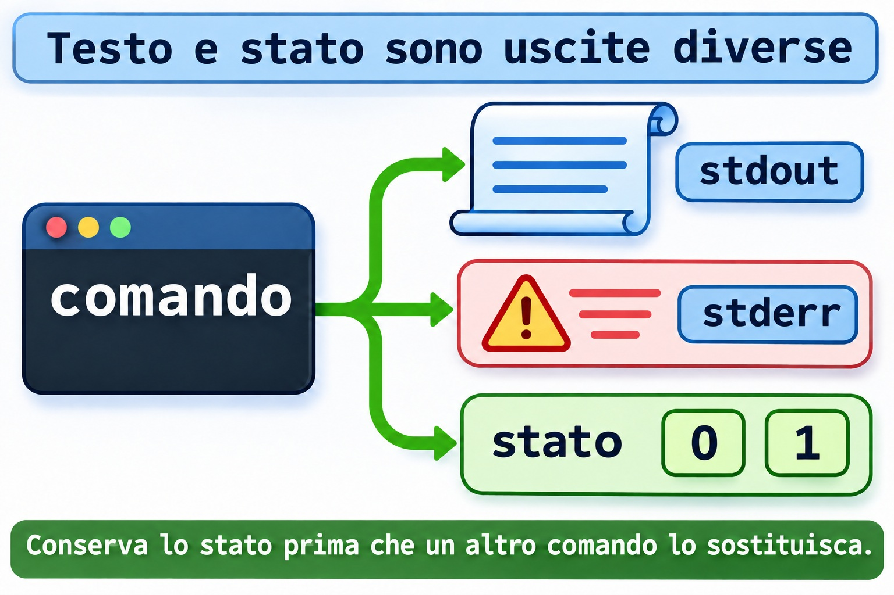

# Lezione 15.2 · Script robusti

Un'automazione affidabile deve dichiarare che cosa accetti, che cosa produca e come fallisca. Trasformerai un comando di lettura in uno script con argomenti validati, funzioni, decisioni e codici di uscita. Tutto resta in file privati del lab, sulle due VM.

> **Il cuore di questa lezione:** valida gli ingressi, proteggi gli argomenti con virgolette, conserva lo stato e gestisci esplicitamente gli errori. Le opzioni della shell aiutano, ma non sostituiscono il contratto. Il resto è approfondimento.

| Scheda |  |
| --- | --- |
| **Modulo** | M15 · Shell e ambiente, lezione 2 di 5 |
| **Quando** | Settimana 20 |
| **Alla fine** | Scrivi uno script di lettura con contratto di ingresso ed errore verificabile |
| **Prerequisiti** | Lezione 15.1, test, redirezioni e permessi di esecuzione |
| **Durata** | Circa 90 minuti |
| **Snapshot** | `m15a2-inicio` e `m15a2-fim` sulle VM 201 e 202 |

## 1 · Riscaldamento

1. Perché uno script non deve dipendere da un alias del terminale?
2. Che cosa accade a un percorso con spazi quando espandi una variabile senza virgolette?
3. Quale processo riceve una variabile esportata quando avvii un nuovo comando?

## 2 · Perché conta

Uno script riceve un percorso vuoto e continua a eseguire i comandi successivi. Un altro stampa “OK” dopo una lettura fallita. Il problema inizia prima dell'attività: non è stato definito che cosa significhi un'esecuzione riuscita.

In questa lezione lo script legge soltanto file. Richiederai comunque argomenti corretti e codici osservabili. L'abitudine sarà la stessa quando l'attività potrà modificare un server.

## 3 · Modello mentale

Uno script è un ordine di lavoro per la squadra dell'edificio. L'ingresso identifica attività e luogo. La funzione svolge un lavoro definito. L'uscita comunica il risultato; lo stato comunica se il contratto sia stato rispettato.

```text
argomenti -> validazione -> funzione -> risultato su stdout
                 |                     |
             errore su stderr      stato finale
```


*Un argomento ricevuto non è ancora un argomento accettato.*

### Ponte Windows

| Idea | Bash | Confronto utile |
| --- | --- | --- |
| Parametri del programma | `"$@"`, `$#` e posizioni | Separare valore e quantità |
| Risultato per un altro programma | stdout | Mantenere i dati leggibili da una macchina |
| Diagnostica | stderr | Non mescolare avviso e risultato |
| Risultato operativo | Codice di uscita | Il chiamante deve decidere tramite lo stato |

## 4 · L'essenziale

### Contratto prima di implementare

Lo script del lab accetta esattamente due argomenti non vuoti: modalità e percorso. `--count` conta i caratteri di fine riga; `--list` mostra il contenuto, compresa l'ultima riga senza newline. Uso errato restituisce `2`; file non valido o errore di elaborazione restituisce `3`.

Il contenuto va su stdout. I messaggi diagnostici vanno su stderr. Questi codici sono il contratto di questo script, non un significato universale di ogni programma Linux.

### Le virgolette conservano gli argomenti

`"$@"` conserva separatamente ogni argomento. `"$file"` conserva un percorso con spazi come un argomento. Un test della quantità deve precedere la lettura di posizioni che potrebbero non esistere.

### Lo stato deve essere conservato

`$?` appartiene al comando appena terminato. Un altro comando lo sostituisce. Usa la condizione di `if` o conserva immediatamente il numero, prima di stampare qualsiasi messaggio.



*Conserva lo stato prima che un altro comando lo sostituisca.*

### Funzioni e opzioni della shell

Una funzione riceve argomenti e restituisce uno stato con `return`. `exit` termina lo script. Nel lab le funzioni producono un risultato semplice e il corpo principale decide la terminazione.

`set -u` aiuta a rilevare variabili assenti. `pipefail` fa riflettere a una pipeline gli errori precedenti all'ultimo comando. `set -e` ha eccezioni legate al contesto; non verrà usato come sostituto della gestione esplicita.


*Definisci ingresso, risultato ed errore prima di riutilizzare.*

### Rocky × Debian

| Voce | Rocky 9 | Debian 13 |
| --- | --- | --- |
| Interpretador explícito | `/bin/bash` | `/bin/bash` |
| Script della lezione | Usa funzioni di Bash | Usa funzioni di Bash |
| Validação sem execução | `bash -n` | `bash -n` |
| Test di comportamento | Stessi casi di ingresso | Stessi casi di ingresso |

## 5 · Lab guidato

Usa `student` e una nuova cartella sulle due VM. Lo script legge soltanto i file forniti e non usa `sudo`.

### Passo 1 · Creare dati noti

**Ipotesi:** un percorso con spazi cambia la quantità degli argomenti quando viene passato correttamente?

Sull'host Proxmox:

```bash
qm snapshot 201 m15a2-inicio
qm snapshot 202 m15a2-inicio
```

Sulle due VM conferma che la cartella non esistesse prima di crearla.

```bash
test ! -e "$HOME/m15a2"
mkdir -m 700 "$HOME/m15a2"
printf 'alpha\nbeta\ngamma\n' > "$HOME/m15a2/with spaces.txt"
```

**Output atteso:** file privato con tre righe terminate da newline.

**Verifica:** usa `wc -l < "$HOME/m15a2/with spaces.txt"` e controlla `3`.

### Passo 2 · Scrivere il contratto nel codice

**Ipotesi:** quale test impedisce la lettura di `$2` quando è stato inviato un solo argomento?

```bash
cat > "$HOME/m15a2/resumir.sh" <<'EOF'
#!/bin/bash
set -u
set -o pipefail
usage() { printf 'usage: resumir.sh --count|--list FILE\n' >&2; }
list_lines() { cat -- "$1"; }
if [[ $# -ne 2 ]]; then
    usage
    exit 2
fi
for argument in "$@"; do
    if [[ -z $argument ]]; then usage; exit 2; fi
done
mode=$1
file=$2
case $mode in
    --count|--list) ;;
    *) usage; exit 2 ;;
esac
if [[ ! -f $file || ! -r $file ]]; then
    printf 'unreadable regular file: %s\n' "$file" >&2
    exit 3
fi
case $mode in
    --count)
        if ! wc -l < "$file"; then
            printf 'processing failed\n' >&2
            exit 3
        fi ;;
    --list)
        if ! list_lines "$file"; then
            printf 'processing failed\n' >&2
            exit 3
        fi ;;
esac
EOF
chmod 0700 "$HOME/m15a2/resumir.sh"
```

**Output atteso:** script con interprete, validazione prima dell'uso degli argomenti, funzione e scelta della modalità.

**Verifica:** la funzione non dipende da alias, file di avvio o variabile personale del terminale. Il test preliminare non rende atomica la lettura: un errore rilevato durante l'elaborazione restituisce anch'esso `3`, ma potrebbe avere già prodotto parte di stdout.

### Passo 3 · Validare senza eseguire

**Ipotesi:** una sintassi accettata dimostra che tutti gli ingressi siano corretti?

```bash
/bin/bash -n "$HOME/m15a2/resumir.sh"
printf 'syntax_status=%s\n' "$?"
```

**Output atteso:** `syntax_status=0`. Valida la struttura, non legge i file di test e non esegue i percorsi del programma.

**Verifica:** identifica i casi ancora da verificare: modalità valida, modalità errata, argomento assente e file inesistente.

### Decidi 1

Quale ingresso richiede un errore di uso prima di leggere il file?

| Opzione | Ingresso |
| --- | --- |
| A | `--count` e un percorso esistente |
| B | Soltanto `--count`, senza percorso |
| C | `--list` e un file leggibile |

Scegli B. La quantità degli argomenti fa parte del contratto.

### Passo 4 · Verificare successo ed errore

**Ipotesi:** modalità errata e file inesistente devono avere lo stesso codice in questo contratto?

```bash
"$HOME/m15a2/resumir.sh" --count "$HOME/m15a2/with spaces.txt"
printf 'status=%s\n' "$?"
"$HOME/m15a2/resumir.sh" --list "$HOME/m15a2/with spaces.txt"
printf 'status=%s\n' "$?"
"$HOME/m15a2/resumir.sh" --wrong "$HOME/m15a2/with spaces.txt"
printf 'status=%s\n' "$?"
"$HOME/m15a2/resumir.sh" --count "$HOME/m15a2/missing.txt"
printf 'status=%s\n' "$?"
```

**Output atteso:** i primi due casi restituiscono `0`; la modalità errata restituisce `2`; il percorso inesistente restituisce `3`.

**Verifica:** controlla separatamente il dato prodotto e lo stato. Il messaggio di errore non deve diventare una riga del risultato normale.

Ora confronta le modalità con un file senza newline finale. Il conteggio è `0`, ma l'elenco conserva `delta`. Il newline della diagnostica seguente appartiene al test, non al file.

```bash
printf 'delta' > "$HOME/m15a2/no-newline.txt"
for mode in --count --list; do
    "$HOME/m15a2/resumir.sh" "$mode" "$HOME/m15a2/no-newline.txt"
    rc=$?
    printf '\nstatus=%s\n' "$rc"
done
```

### Passo 5 · Catturare il risultato senza perdere lo stato

**Ipotesi:** stampare un messaggio prima di conservare `$?` mantiene lo stato originale?

```bash
if result=$("$HOME/m15a2/resumir.sh" --count "$HOME/m15a2/missing.txt" 2> "$HOME/m15a2/error.txt"); then
    printf 'result=%s\n' "$result"
else
    rc=$?
    printf 'failed_status=%s\n' "$rc"
fi
cat "$HOME/m15a2/error.txt"
(
set -o pipefail
false | true
printf 'pipeline_status=%s\n' "$?"
)
```

**Output atteso:** `failed_status=3` e diagnostica nel file di stderr. La pipeline della subshell restituisce `1` con `pipefail`, anche se il suo ultimo comando riesce.

**Verifica:** lo stato è stato conservato prima di `printf`. La subshell evita di modificare le opzioni del terminale principale.

### Decidi 2

Una funzione aiuta lo script, ma fallisce. Quale forma conserva la decisione nel chiamante?

| Opzione | Azione |
| --- | --- |
| A | La funzione restituisce uno stato e il chiamante lo controlla |
| B | Ignorare stderr perché esiste stdout |
| C | Stampare “OK” dopo qualsiasi errore |

Scegli A. Il risultato di una funzione deve fare parte del suo contratto.

### Passo 6 · Pulire un temporaneo alla terminazione

**Ipotesi:** un'uscita di errore eseguirà ancora una pulizia registrata per `EXIT`?

```bash
cat > "$HOME/m15a2/temporario.sh" <<'EOF'
#!/bin/bash
set -u
tmp=$(mktemp "${HOME}/m15a2/tmp.XXXXXX") || exit 4
cleanup() { rm -f -- "$tmp"; }
trap cleanup EXIT
printf 'temporary=%s\n' "$tmp"
exit 7
EOF
chmod 0700 "$HOME/m15a2/temporario.sh"
/bin/bash -n "$HOME/m15a2/temporario.sh"
"$HOME/m15a2/temporario.sh"
printf 'status=%s\n' "$?"
find "$HOME/m15a2" -maxdepth 1 -name 'tmp.*' -print
```

**Output atteso:** `status=7` e nessun temporaneo restante. Il nome è stato creato da `mktemp` nella cartella privata e la rimozione ha selezionato soltanto quel file.

**Verifica:** lo stato previsto non è scomparso a causa della pulizia. `EXIT` non garantisce la pulizia dopo una morte improvvisa che il processo non riesce a gestire.

## 6 · Rompi e ripara

### Guasto 1 · Percorso diviso

**Sintomo:** nella subshell seguente un file esistente diventa una chiamata con troppi argomenti.

```bash
(
file="$HOME/m15a2/with spaces.txt"
"$HOME/m15a2/resumir.sh" --count $file
printf 'status=%s\n' "$?"
)
```

**Indagine:** confronta la quantità ricevuta con la chiamata tra virgolette del passo 4.

**Causa:** l'espansione senza virgolette ha diviso il percorso in parole.

**Riparazione:** passa `"$file"` come un argomento.

**Verifica:** il conteggio torna a `3`, con stato `0`.

**Prevenzione:** proteggi le espansioni degli argomenti con virgolette e verifica percorsi con spazi.

### Guasto 2 · Successo dopo un errore

Crea una copia errata separata per osservare l'errore di controllo.

```bash
cat > "$HOME/m15a2/fragil.sh" <<'EOF'
#!/bin/bash
wc -l < "$1"
printf 'OK\n'
EOF
/bin/bash "$HOME/m15a2/fragil.sh" "$HOME/m15a2/missing.txt"
printf 'status=%s\n' "$?"
```

**Sintomo:** compare un errore di lettura, ma lo stato finale è `0`.

**Indagine:** identifica l'ultimo comando eseguito nella copia fragile.

**Causa:** `printf` è riuscito e ha sostituito l'errore precedente come stato dello script.

**Riparazione:** usa lo script validato e gestisci esplicitamente una lettura fallita.

**Verifica:** per il percorso inesistente lo script corretto restituisce `3`, non un messaggio di successo.

**Prevenzione:** verifica i casi di errore prima di automatizzare l'esecuzione.

### Guasto 3 · Sintassi modificata

**Sintomo:** una copia dello script non supera più l'analisi prima di essere eseguita.

**Indagine:** introduci il guasto soltanto in una copia rimuovendo il suo `esac`.

```bash
sed '/^esac$/d' "$HOME/m15a2/resumir.sh" > "$HOME/m15a2/broken.sh"
/bin/bash -n "$HOME/m15a2/broken.sh"
```

**Causa:** una struttura decisionale è rimasta incompleta.

**Riparazione:** ripristina soltanto la copia con il file validato.

```bash
cp "$HOME/m15a2/resumir.sh" "$HOME/m15a2/broken.sh"
/bin/bash -n "$HOME/m15a2/broken.sh"
```

**Verifica:** l'analisi torna a riuscire; poi ripeti un caso di successo e uno di errore.

**Prevenzione:** separa analisi sintattica e test del comportamento. Servono entrambi.

### Pulizia

Nessun file globale o servizio è stato modificato. Conserva script e risultati nella cartella privata; controlla che l'esperienza dei temporanei non abbia lasciato file. Non eliminare percorsi calcolati fuori da questa cartella.

## 7 · Trappole

| Errore comune | Che cosa fare | Perché |
| --- | --- | --- |
| Sintassi valida significa script corretto | Verificare ingressi reali ed errati | La sintassi non verifica l'intenzione |
| Una modalità “rigida” risolve ogni errore | Gestire gli errori dove avvengono | Le opzioni della shell hanno contesti ed eccezioni |
| Il messaggio di errore appartiene al risultato | Usare stderr | Un altro programma può leggere stdout come dato |
| Temporaneo con nome prevedibile | Creare con `mktemp` | Evita conflitto e riutilizzo improprio |

## 8 · Quiz

1. Perché controllare `$#` prima di leggere `$2`?
2. Che cosa conserva `"$@"`?
3. Qual è la differenza tra `return` ed `exit`?
4. Perché una pipeline può nascondere l'errore del primo comando?
5. `wc -l` conta i record senza newline finale come se fossero terminati?
6. Che cosa manca ancora dopo che `bash -n` ha restituito successo?

## 9 · Promemoria

| Operazione | Comando o struttura |
| --- | --- |
| Validare senza eseguire | `bash -n script.sh` |
| Conservare gli argomenti | `"$@"` |
| Leggere una riga senza interpretare barre | `IFS= read -r line` |
| Conservare subito lo stato | `rc=$?` |
| Diagnostica separata | `printf '%s\n' 'error' >&2` |

**Flashcard:** crea cinque schede su argomenti, virgolette, funzione, stato e pulizia. Ripassa a D+1, D+3, D+7 e D+21.

## 10 · Checklist e chiusura

- [ ] Ho eseguito gli stessi casi sulle due VM.
- [ ] Ho verificato un percorso con spazi e un file inesistente.
- [ ] Ho distinto stdout, stderr e stato.
- [ ] Non ho modificato opzioni permanenti o file globali della shell.

**Ultimo esercizio:** descrivi il contratto dello script senza leggere il codice. Poi controlla se i test coprano ogni requisito che hai scritto.

**Reboot di verifica:** riavvia una VM alla volta. Valida la sintassi dello script e ripeti il caso valido e il file inesistente. I risultati non devono dipendere da un alias o variabile del terminale precedente.

```bash
sudo systemctl reboot
```

Sull'host Proxmox, dopo la verifica:

```bash
qm snapshot 201 m15a2-fim
qm snapshot 202 m15a2-fim
```

## 11 · Nella vita reale

In uno script che sei autorizzato a esaminare, leggi soltanto contratto, validazioni e gestione dello stato. Non eseguire uno script amministrativo sconosciuto soltanto per osservare che cosa accada.

Quali ingressi sono stati verificati? Quale errore può essere nascosto da un comando successivo? La pulizia seleziona soltanto risorse create dallo stesso script? Registra l'evidenza senza copiare segreti.

## 12 · Approfondire quando vuoi

- [Bash: stato di uscita](https://www.gnu.org/software/bash/manual/html_node/Exit-Status.html), [opzioni set](https://www.gnu.org/software/bash/manual/html_node/The-Set-Builtin.html) e [builtin](https://www.gnu.org/software/bash/manual/html_node/Bourne-Shell-Builtins.html).
- [mktemp](https://www.gnu.org/software/coreutils/manual/html_node/mktemp-invocation.html) e [wc](https://www.gnu.org/software/coreutils/manual/html_node/wc-invocation.html): creazione di temporanei e definizione del conteggio.

**DeepTutor** (http://10.1.0.149:3782, KB "Curso Linux Sysadmin"):

- `!explica Mostre a diferença entre erro de uso, erro de leitura e resultado vazio num script Bash.`
- `!feynman Vou explicar por que printf depois de uma falha pode esconder o status. Aponte as lacunas.`
- `!quiz Crie seis casos de argumentos, aspas e códigos de saída para um script somente de leitura.`

## Soluzioni commentate

### Riscaldamento

1. L'alias è configurazione della sessione interattiva, non una dipendenza dichiarata dello script.
2. La shell può dividere il valore in più argomenti ed espandere anche i modelli.
3. Il nuovo processo riceve una copia dell'ambiente esportato alla sua creazione.

### Quiz

1. Per rifiutare una quantità errata prima di accedere a una posizione assente.
2. Ogni argomento originale, compresi gli spazi al suo interno.
3. `return` restituisce controllo e stato dalla funzione; `exit` termina lo script.
4. Senza `pipefail`, lo stato normalmente deriva dall'ultimo comando della pipeline.
5. No. Conta i caratteri newline; occorre definire formato di ingresso e metrica desiderata.
6. Verificare ingressi, risultati, errori e ambiente di esecuzione reale.

<!-- navegacao -->
[← Lezione 15.1 · Ambiente della shell](15.1-ambiente-do-shell.md) · [Indice delle lezioni](../01-aulas.md) · [Piano del corso: dalla 15.3 in poi →](../00-plano-do-curso.md)
