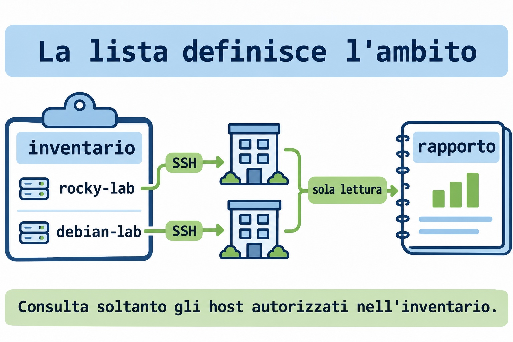
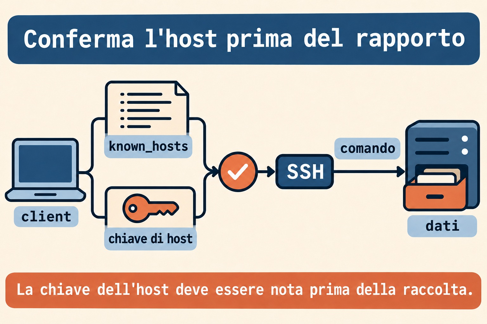
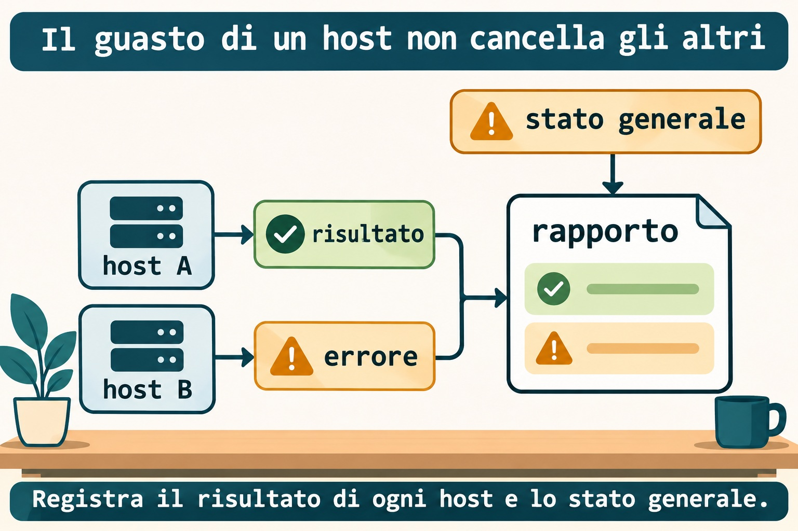

# Lezione 15.3 · Script di amministrazione

Su Windows anche una ricerca remota deve separare inventario, autenticazione e risultato di ogni host. Costruirai un raccoglitore Bash che usa SSH soltanto in lettura sulle due VM del corso. Un errore verrà registrato senza cancellare i risultati dell'altra macchina.

> **Il cuore di questa lezione:** inventario chiuso, identità dell'host verificata, comando remoto di sola lettura e stato per host. Il resto è approfondimento.

| Scheda |  |
| --- | --- |
| **Modulo** | M15 · Shell e ambiente, lezione 3 di 5 |
| **Quando** | Settimana 20 |
| **Alla fine** | Raccogli dati dai due host autorizzati e conservi gli errori individuali |
| **Prerequisiti** | Lezioni 12.1, 15.1 e 15.2; SSH, chiavi e noVNC sulle VM del corso |
| **Durata** | Circa 90 minuti |
| **Snapshot** | `m15a3-inicio` e `m15a3-fim` sulle VM 201 e 202 |

## 1 · Riscaldamento

1. Qual è la differenza tra chiave dell'host e chiave dell'utente in SSH?
2. Perché stdout, stderr e codice di uscita devono essere registrati separatamente?
3. Una pipeline che termina con `awk` conserva automaticamente l'errore precedente?

## 2 · Perché conta

Un rapporto di più server omette proprio la macchina che non ha risposto. Il file finale sembra sano perché contiene soltanto successi. Registrerai l'intero inventario, compresi errori di trasporto e comando, per non confondere assenza di dati e salute.

Il raccoglitore sarà Rocky. Le destinazioni sono soltanto `rocky-lab` e `debian-lab`, agli IP del corso. La ricerca viene eseguita come `student`, senza `sudo`, senza inoltrare l'agente e senza installare un agente sulle destinazioni.

## 3 · Modello mentale

L'inventario è l'elenco degli edifici in cui la squadra può entrare. SSH verifica la portineria e presenta l'autorizzazione dell'utente. L'ordine di lavoro richiede soltanto osservazioni. Il rapporto conserva una scheda per ogni edificio anche quando la visita fallisce.

```text
inventario chiuso -> SSH verificato -> ricerca di lettura
        |                  |                  |
      host A             host B         risultato o errore
```



*Consulta soltanto gli host autorizzati nell'inventario.*

### Ponte Windows

| Idea | In questo lab | Limite |
| --- | --- | --- |
| Inventario remoto | Elenco fisso di due alias | Non scoprire host esaminando tutta la rete |
| Autenticazione della destinazione | `known_hosts` privato | Verificare l'impronta nella console |
| Ricerca remota | Bash tramite SSH | Sola lettura e senza privilegi elevati |

## 4 · L'essenziale

### La destinazione fa parte del contratto

Il raccoglitore non accetta nomi arbitrari dalla riga di comando. L'elenco contiene soltanto le VM 201 e 202. Modificarlo cambia l'ambito, non è una semplice preferenza di esecuzione.

### Host noto prima della raccolta

`StrictHostKeyChecking yes` rifiuta un host la cui chiave non sia stata verificata prima. `BatchMode yes` impedisce domande interattive durante il gruppo di operazioni. Non usare l'accettazione automatica delle chiavi come correzione dell'autenticazione.



*La chiave dell'host deve essere nota prima della raccolta.*

### Risultato per host

Ogni ricerca genera file propri di stdout e stderr. Lo stato finale del raccoglitore è `0` quando tutti hanno risposto e `1` quando almeno uno è fallito. Lo stato individuale conserva l'informazione di trasporto o del comando remoto.

SSH normalmente usa `255` per gli errori di connessione e autenticazione. Il limite di tempo esterno può restituire `124`. Non trasformare tutti questi codici in “server spento”.



*Registra il risultato di ogni host e lo stato generale.*

### Rocky × Debian

| Voce | Rocky 9 | Debian 13 |
| --- | --- | --- |
| Ruolo principale | Raccoglitore e destinazione `10.1.0.51` | Destinazione `10.1.0.52` |
| Ricerca locale equivalente | Bash, `df`, `free` e `uname` | Bash, `df`, `free` e `uname` |
| Privilegio remoto | `student`, senza `sudo` | `student`, senza `sudo` |

## 5 · Lab guidato

Le chiavi esistenti di Windows restano intatte. Crei una chiave dedicata su Rocky e autorizzi soltanto la sua parte pubblica sulle due destinazioni. Svolgi questa preparazione tramite noVNC senza inoltrare l'agente di Windows.

### Passo 1 · Proteggere e preparare i registri

**Ipotesi:** un errore su una destinazione dovrebbe cancellare il registro della destinazione che ha risposto?

Sull'host Proxmox:

```bash
qm snapshot 201 m15a3-inicio
qm snapshot 202 m15a3-inicio
```

Sulle due VM conferma che la cartella non esistesse prima di crearla.

```bash
test ! -e "$HOME/m15a3"
mkdir -m 700 "$HOME/m15a3"
command -v bash ssh ssh-keygen df free uname
ssh-keygen -lf /etc/ssh/ssh_host_ed25519_key.pub
```

**Output atteso:** strumenti disponibili e impronta pubblica di ogni host. Conserva queste due impronte ottenute direttamente dalla console per confrontarle alla prima connessione.

**Verifica:** gli IP restano quelli del corso e la normale sessione SSH da Windows funziona. Non copiare alcuna chiave privata esistente.

### Passo 2 · Autorizzare una chiave dedicata

**Ipotesi:** il file pubblico permette di autenticarsi senza possedere la chiave privata corrispondente?

Su Rocky genera la chiave del raccoglitore con passphrase interattiva.

```bash
ssh-keygen -t ed25519 -a 64 -f "$HOME/m15a3/id_ed25519" -C m15a3-collector
ssh-keygen -lf "$HOME/m15a3/id_ed25519.pub"
cat "$HOME/m15a3/id_ed25519.pub"
```

Copia soltanto la riga pubblica. Nel noVNC di ogni VM incollala quando il comando seguente la richiede. Controlla l'impronta prima di aggiungerla all'accesso di `student`.

```bash
read -r -p 'Public key: ' LAB_PUBKEY
printf '%s\n' "$LAB_PUBKEY" > "$HOME/m15a3/authorized.pub"
ssh-keygen -lf "$HOME/m15a3/authorized.pub"
```

Dopo la verifica, su ogni destinazione usa la cartella SSH già corretta del M0. Non sostituirne il contenuto.

```bash
test -d "$HOME/.ssh"
test -f "$HOME/.ssh/authorized_keys" || install -m 0600 /dev/null "$HOME/.ssh/authorized_keys"
cp -p "$HOME/.ssh/authorized_keys" "$HOME/m15a3/authorized_keys.inicio"
grep -qxF -f "$HOME/m15a3/authorized.pub" "$HOME/.ssh/authorized_keys" || cat "$HOME/m15a3/authorized.pub" >> "$HOME/.ssh/authorized_keys"
```

**Output atteso:** è stata aggiunta soltanto la riga pubblica di esercizio; le autorizzazioni precedenti restano presenti.

**Verifica:** l'impronta della riga su ogni destinazione coincide con quella della chiave pubblica creata su Rocky. La chiave privata è rimasta su Rocky.

### Passo 3 · Verificare gli host e usare un agente locale

**Ipotesi:** disattivare la verifica dell'host semplifica la raccolta senza perdere una garanzia di sicurezza?

Su Rocky crea la configurazione privata. Non modifica `~/.ssh/config`.

```bash
cat > "$HOME/m15a3/ssh_config" <<'EOF'
Host rocky-lab
    HostName 10.1.0.51
Host debian-lab
    HostName 10.1.0.52
Host *
    User student
    Port 22
    IdentityFile ~/m15a3/id_ed25519
    IdentitiesOnly yes
    UserKnownHostsFile ~/m15a3/known_hosts
    GlobalKnownHostsFile /dev/null
    HostKeyAlgorithms ssh-ed25519
    StrictHostKeyChecking yes
    ForwardAgent no
    RequestTTY no
    ConnectTimeout 3
    ConnectionAttempts 1
EOF
ssh-agent /bin/bash --noprofile --norc
```

Nella nuova shell figlia carica la chiave e verifica la prima connessione di ogni host. La domanda interattiva può essere accettata soltanto se l'impronta coincide con quella osservata nella console.

```bash
ssh-add "$HOME/m15a3/id_ed25519"
ssh -F "$HOME/m15a3/ssh_config" -o StrictHostKeyChecking=ask rocky-lab true
ssh -F "$HOME/m15a3/ssh_config" -o StrictHostKeyChecking=ask debian-lab true
```

**Output atteso:** le due connessioni verificate eseguono soltanto `true`. L'agente appartiene alla sessione figlia e non viene inoltrato alle destinazioni.

**Verifica:** esegui le due connessioni senza l'eccezione interattiva e con `-o BatchMode=yes`. Entrambe devono terminare con stato `0`. Continua i passi seguenti in questa shell figlia.

### Decidi 1

Una chiave dell'host è cambiata inaspettatamente. Che cosa fare prima di eseguire il gruppo di operazioni?

| Opzione | Azione |
| --- | --- |
| A | Ignorare l'identità per terminare rapidamente |
| B | Verificare l'host dalla console e analizzare il cambiamento |
| C | Copiare la chiave privata del server |

Scegli B. Un rapporto non vale se non sai quale host abbia risposto.

### Passo 4 · Definire la ricerca di lettura

**Ipotesi:** formattare l'uscita di `df` impedisce che un suo errore venga nascosto dall'ultimo filtro?

Su Rocky scrivi la ricerca che verrà inviata alla Bash remota.

```bash
cat > "$HOME/m15a3/query.sh" <<'EOF'
#!/bin/bash
set -u
set -o pipefail
export LC_ALL=C
printf 'kernel='
uname -r || exit 3
df -P / | awk 'NR==2 {printf "disk_used=%s\n", $5}' || exit 3
free -m | awk '/^Mem:/ {printf "memory_available_mb=%s\n", $7}' || exit 3
EOF
/bin/bash -n "$HOME/m15a3/query.sh"
/bin/bash "$HOME/m15a3/query.sh"
```

**Output atteso:** dati reali di Rocky in campi fissi senza numeri inventati. La stessa ricerca funziona localmente su Debian e deve essere esaminata lì prima del gruppo di operazioni.

**Verifica:** conferma che il file consulti soltanto kernel, uso del disco e memoria. Non contiene installazione, modifica della configurazione o comando con `sudo`.

### Passo 5 · Raccogliere i due risultati

**Ipotesi:** se Debian fallisce, il raccoglitore deve ancora conservare la risposta di Rocky?

```bash
cat > "$HOME/m15a3/coletar.sh" <<'EOF'
#!/bin/bash
set -u
base=$HOME/m15a3
set -o pipefail
[[ $# -eq 0 ]] || { printf 'no arguments allowed\n' >&2; exit 2; }
/bin/bash -n "$base/query.sh" || exit 2
run=$(mktemp -d "$base/run.XXXXXX") || exit 3
printf 'report_dir=%s\n' "$run"
failed=0
for host in rocky-lab debian-lab; do
    if timeout 12 ssh -F "$base/ssh_config" -o BatchMode=yes "$host" /bin/bash -s < "$base/query.sh" > "$run/$host.txt" 2> "$run/$host.err"; then
        rc=0
    else
        rc=$?
        failed=1
    fi
    printf 'host=%s status=%s\n' "$host" "$rc" | tee -a "$run/status.txt" || exit 3
done
exit "$failed"
EOF
chmod 0700 "$HOME/m15a3/coletar.sh"
/bin/bash -n "$HOME/m15a3/coletar.sh"
"$HOME/m15a3/coletar.sh"
printf 'collector_status=%s\n' "$?"
```

**Output atteso:** nuova cartella dei risultati, una riga di stato per ogni host e codice generale `0` se entrambi rispondono. Ogni esecuzione conserva la propria cartella.

**Verifica:** apri soltanto i file della cartella appena indicata. Non mescolare risultati vecchi e attuali. Controlla separatamente dati e file di errore.

### Decidi 2

Una destinazione non ha consegnato dati. Quale registrazione conserva il significato del rapporto?

| Opzione | Azione |
| --- | --- |
| A | Inventare l'ultimo valore noto come se fosse attuale |
| B | Omettere l'host e mostrare soltanto i successi |
| C | Conservare stato, errore e assenza di dati per quell'host |

Scegli C. L'assenza di dati deve restare visibile.

### Passo 6 · Verificare ambito e ripetizione

**Ipotesi:** ripetere una raccolta di lettura dovrebbe cambiare l'uso del disco di una destinazione installando pacchetti?

```bash
"$HOME/m15a3/coletar.sh"
printf 'collector_status=%s\n' "$?"
ssh -F "$HOME/m15a3/ssh_config" -o BatchMode=yes rocky-lab 'id -un'
ssh -F "$HOME/m15a3/ssh_config" -o BatchMode=yes debian-lab 'id -un'
```

**Output atteso:** un'altra cartella dei risultati e utente remoto `student` su entrambi gli host. I numeri della memoria possono variare tra le ricerche.

**Verifica:** l'inventario dello script contiene soltanto i due alias approvati. La lettura usa lo stesso contenuto di ricerca sulle due famiglie.

## 6 · Rompi e ripara

### Guasto 1 · Host non ancora noto

Su Rocky conserva l'elenco privato e rimuovi soltanto il registro di Debian in questa copia di esercizio.

```bash
cp -p "$HOME/m15a3/known_hosts" "$HOME/m15a3/known_hosts.valid"
ssh-keygen -R 10.1.0.52 -f "$HOME/m15a3/known_hosts"
"$HOME/m15a3/coletar.sh"
printf 'collector_status=%s\n' "$?"
```

**Sintomo:** Rocky risponde e Debian fallisce nella verifica di identità; il gruppo termina con `1`.

**Indagine:** leggi stderr di Debian nella nuova cartella e confronta i due stati.

**Causa:** la modalità rigorosa non permette di fidarsi silenziosamente di un host sconosciuto.

**Riparazione:** ripristina soltanto l'elenco privato verificato prima.

```bash
cp -p "$HOME/m15a3/known_hosts.valid" "$HOME/m15a3/known_hosts"
```

**Verifica:** le due destinazioni tornano a rispondere senza disattivare la verifica di identità.

**Prevenzione:** verifica le chiavi prima del gruppo di operazioni e registra l'origine dell'impronta.

### Guasto 2 · Chiave non disponibile in agente

**Sintomo:** dopo aver rimosso la chiave dall'agente locale il gruppo di operazioni non può richiedere la passphrase interattivamente.

**Indagine:** rimuovi soltanto la chiave di esercizio e controlla l'errore prodotto.

```bash
ssh-add -d "$HOME/m15a3/id_ed25519"
"$HOME/m15a3/coletar.sh"
```

**Causa:** la chiave privata cifrata non è pronta per la firma nell'agente; `BatchMode` impedisce domande durante il gruppo di operazioni.

**Riparazione:** carica nuovamente la chiave con `ssh-add`, digitando la passphrase soltanto nella finestra interattiva.

**Verifica:** il raccoglitore torna a rispondere sui due host senza inoltrare l'agente.

**Prevenzione:** separa la preparazione delle credenziali dall'esecuzione non interattiva del rapporto.

### Guasto 3 · Ricerca fallita sulla destinazione

Conserva la ricerca valida e cambia soltanto un'opzione di lettura nella copia del lab.

```bash
cp "$HOME/m15a3/query.sh" "$HOME/m15a3/query.valid.sh"
sed -i 's/df -P/df --m15-invalid/' "$HOME/m15a3/query.sh"
"$HOME/m15a3/coletar.sh"
```

**Sintomo:** SSH funziona, ma i comandi remoti restituiscono `3`; il raccoglitore riassume l'errore generale con `1`.

**Indagine:** leggi stdout parziale e stderr di ogni host. L'errore è avvenuto nel comando di lettura, non nell'identità dell'host.

**Causa:** l'opzione inventata è errata e la ricerca conserva l'errore della pipeline.

**Riparazione:** ripristina la ricerca locale validata prima di inviare un'altra raccolta.

```bash
cp "$HOME/m15a3/query.valid.sh" "$HOME/m15a3/query.sh"
/bin/bash -n "$HOME/m15a3/query.sh"
```

**Verifica:** i due host tornano a produrre tutti i campi previsti.

**Prevenzione:** verifica il contenuto della ricerca sulle due famiglie prima di ampliare l'inventario.

### Pulizia

Su ogni destinazione rimuovi soltanto la riga pubblica aggiunta dall'esercizio. Non ripristinare ciecamente l'intero file perché potrebbero essere state aggiunte altre autorizzazioni in seguito. Esegui la pulizia senza modifiche concorrenti di un altro amministratore.

```bash
if test -s "$HOME/m15a3/authorized.pub" && ssh-keygen -lf "$HOME/m15a3/authorized.pub"; then
    cp -p "$HOME/.ssh/authorized_keys" "$HOME/.ssh/authorized_keys.m15a3.tmp" &&
    awk 'NR==FNR {drop[$0]=1; next} !($0 in drop)' "$HOME/m15a3/authorized.pub" "$HOME/.ssh/authorized_keys" > "$HOME/.ssh/authorized_keys.m15a3.tmp" &&
    mv -- "$HOME/.ssh/authorized_keys.m15a3.tmp" "$HOME/.ssh/authorized_keys"
else
    printf 'cleanup stopped: invalid public key\n' >&2
fi
```

Conferma che la riga rimossa fosse soltanto la chiave del lab e che l'accesso originale da Windows continui a funzionare. Nel raccoglitore esci dalla shell figlia con `exit`; l'agente avviato per essa termina. Conserva il materiale privato senza esportare la chiave privata.

## 7 · Trappole

| Errore comune | Che cosa fare | Perché |
| --- | --- | --- |
| Accettare qualsiasi chiave nel gruppo | Verificare prima dalla console | Autentica la destinazione della ricerca |
| Omettere l'host senza risposta | Registrare errore e stato | Assenza di dati non è successo |
| Inoltrare l'agente per comodità | Mantenere la firma nel raccoglitore | La destinazione non deve usare il tuo agente |
| Trasformare il rapporto in scansione | Mantenere un inventario chiuso | L'ambito richiede autorizzazione |

## 8 · Quiz

1. Quale chiave privata deve restare nel raccoglitore?
2. Perché verificare l'impronta dalla console?
3. Che cosa evita `BatchMode` durante il gruppo di operazioni?
4. Se SSH restituisce `3` dal comando remoto significa la stessa cosa di `255`?
5. Perché usare una nuova cartella per ogni esecuzione?
6. Perché la pulizia rimuove soltanto la riga pubblica esatta di esercizio?

## 9 · Promemoria

| Operazione | Comando |
| --- | --- |
| Validare la ricerca | `/bin/bash -n "$HOME/m15a3/query.sh"` |
| Identità del client | `ssh-keygen -lf "$HOME/m15a3/id_ed25519.pub"` |
| Identità di host | `ssh-keygen -lf /etc/ssh/ssh_host_ed25519_key.pub` |
| Ricerca del gruppo | `"$HOME/m15a3/coletar.sh"` |

**Flashcard:** crea cinque schede su inventario, identità, agente locale, errore remoto e stato generale. Ripassa a D+1, D+3, D+7 e D+21.

## 10 · Checklist e chiusura

- [ ] Ho consultato soltanto le VM 201 e 202.
- [ ] Ho verificato le chiavi dei due host dalla console.
- [ ] Ho conservato successo ed errore in file separati per host.
- [ ] Ho rimosso soltanto l'autorizzazione temporanea del lab e terminato il suo agente.

**Ultimo esercizio:** spiega un rapporto parziale senza definire tutti gli host “indisponibili”. Identifica l'evidenza che distingue trasporto e comando remoto.

**Reboot di verifica:** dopo la pulizia riavvia entrambe le VM, una alla volta. Conferma l'accesso originale da Windows e l'assenza dell'agente del lab. I rapporti privati restano; l'autorizzazione temporanea non deve ritornare.

Sull'host Proxmox:

```bash
qm snapshot 201 m15a3-fim
qm snapshot 202 m15a3-fim
```

## 11 · Nella vita reale

Esamina soltanto in lettura un inventario e una ricerca autorizzata. Non eseguire una nuova raccolta in produzione durante questa missione. Identifica quali host siano approvati, come vengano verificate le identità e dove compaiano gli errori.

Il rapporto distingue dati vecchi e attuali? Esiste un host omesso silenziosamente? Le credenziali restano nel raccoglitore corretto e fuori dai rapporti?

## 12 · Approfondire quando vuoi

- [ssh](https://manpages.debian.org/trixie/openssh-client/ssh.1.en.html), [ssh_config](https://manpages.debian.org/trixie/openssh-client/ssh_config.5.en.html) e [ssh-agent](https://manpages.debian.org/trixie/openssh-client/ssh-agent.1.en.html): identità, modalità di gruppo e agente con comando figlio.
- [timeout](https://www.gnu.org/software/coreutils/manual/html_node/timeout-invocation.html) e [Bash](https://www.gnu.org/software/bash/manual/bash.html): tempo limitato, heredoc, redirezioni e codici.

**DeepTutor** (http://10.1.0.149:3782, KB "Curso Linux Sysadmin"):

- `!explica Compare erro de identidade do host, chave do usuário indisponível e comando remoto que falhou.`
- `!feynman Vou explicar por que um relatório deve mostrar também o host que não respondeu. Critique.`
- `!quiz Crie seis incidentes de coleta SSH somente de leitura em rocky-lab e debian-lab.`

## Soluzioni commentate

### Riscaldamento

1. La chiave dell'host autentica la destinazione; la chiave dell'utente autorizza l'accesso dell'account.
2. Dato, diagnostica e risultato operativo hanno usi diversi e non devono nascondersi a vicenda.
3. No. La ricerca usa `pipefail` e gestione esplicita per conservare quell'errore.

### Quiz

1. La chiave dedicata dell'utente raccoglitore, protetta da passphrase.
2. Per confrontarla con una fonte che non dipenda dalla stessa connessione non ancora affidabile.
3. Domande di autenticazione e interazioni che farebbero attendere al gruppo l'operatore.
4. No. In questo contratto `3` indica errore di elaborazione remota; `255` normalmente indica un errore di SSH.
5. Per non sovrascrivere l'evidenza precedente né confondere momenti diversi.
6. Per conservare autorizzazioni legittime che non appartengono all'esercizio.

<!-- navegacao -->
[← Lezione 15.2 · Script robusti](15.2-scripts-robustos.md) · [Indice delle lezioni](../01-aulas.md) · [Piano del corso: dalla 15.4 in poi →](../00-plano-do-curso.md)
