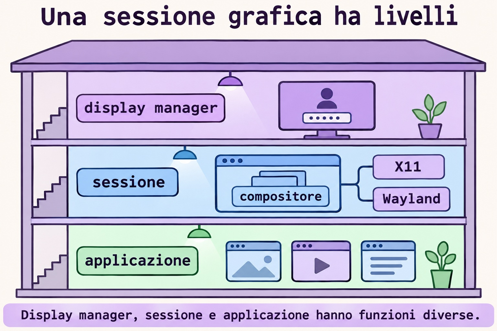
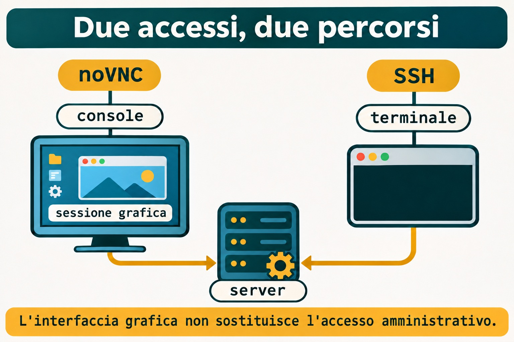
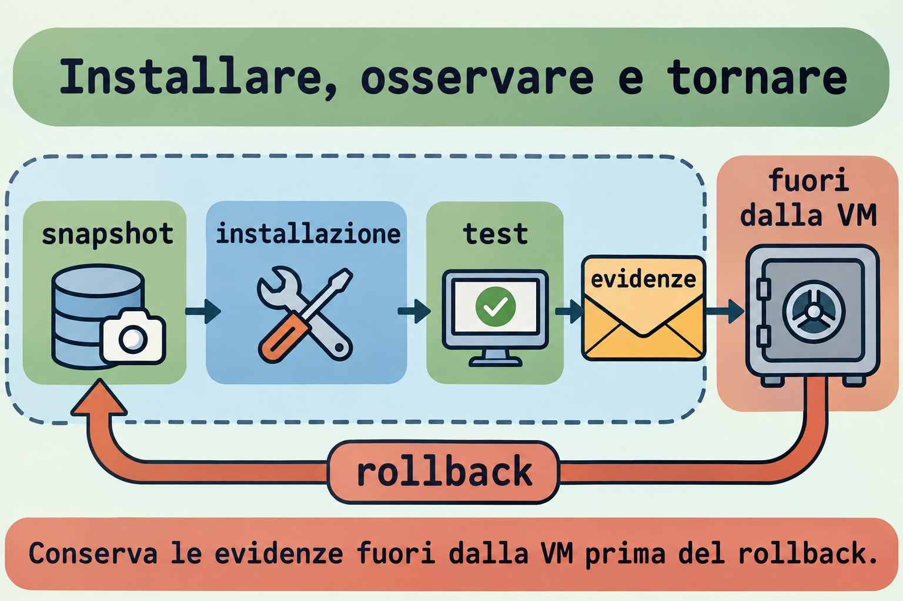

# Lezione 15.4 · Interfacce grafiche

Un server può offrire un'interfaccia grafica senza che questa diventi un requisito per amministrare il sistema. Osserverai GNOME, display manager, X11, Wayland e accessibilità nella console della VM. L'installazione sarà temporanea: le evidenze escono dalla VM prima del rollback.

> **Il cuore di questa lezione:** il display manager avvia l'accesso grafico; la sessione possiede la propria architettura; SSH resta un percorso indipendente. Installa per studiare, registra e torna allo snapshot. Il resto è approfondimento.

| Scheda |  |
| --- | --- |
| **Modulo** | M15 · Shell e ambiente, lezione 4 di 5 |
| **Quando** | Settimana 21 |
| **Alla fine** | Identifichi i livelli della sessione grafica e ripristini la base del server |
| **Prerequisiti** | Proxmox, snapshot, SSH, noVNC e risorse libere per una VM di esercizio |
| **Durata** | Circa 90 minuti, più download e ripetizione sull'altra distribuzione |
| **Snapshot** | `m15a4-inicio` e `m15a4-fim` sulle VM 201 e 202 |

## 1 · Riscaldamento

1. Qual è la differenza tra avviare ora un'unità e cambiare il target predefinito per il prossimo boot?
2. Perché un'applicazione avviata da una sessione grafica può avere un ambiente diverso da SSH?
3. Quali modifiche elimina un rollback all'interno della VM?

## 2 · Perché conta

La console grafica non compare, ma SSH risponde. Riavviare tutto mescolerebbe due situazioni diverse: il server continua a funzionare e il percorso grafico è fallito. Imparerai a identificare unità, sessione e architettura prima di cambiare configurazioni.

Anche l'accessibilità fa parte dell'amministrazione. Una sessione deve permettere lettura, navigazione e inserimento all'utente senza dipendere soltanto dall'aspetto o da un dispositivo di puntamento.

## 3 · Modello mentale

Il display manager è il banco di ingresso dell'edificio. Il desktop organizza la stanza di lavoro. Il protocollo grafico e il compositore partecipano al modo in cui finestre e dispositivi vengono presentati. Un terminale è soltanto un'applicazione di quella stanza.

```text
console -> display manager -> sessione grafica -> applicazioni
SSH -----------------------> shell remota
```



*Display manager, sessione e applicazione hanno funzioni diverse.*

### Ponte Windows

| Windows Server | Linux | Distinzione utile |
| --- | --- | --- |
| Console della VM | noVNC di Proxmox | Mostra la console virtuale |
| Ambiente desktop | GNOME e altri desktop | Organizza la sessione dell'utente |
| Amministrazione remota da terminale | SSH | Non richiede un desktop installato |

## 4 · L'essenziale

### Display manager e sessione

GDM presenta l'accesso grafico e avvia una sessione scelta. GNOME fornisce l'ambiente di lavoro. Un'applicazione grafica può usare X11 o Wayland; una sessione Wayland può eseguire anche applicazioni X11 tramite Xwayland.

Non concludere che la sessione sia X11 soltanto perché esiste `DISPLAY`. Verifica il tipo della sessione grafica in `loginctl` o nell'ambiente del terminale aperto al suo interno.

### La console non è un protocollo remoto di desktop

Il noVNC mostra lo schermo virtuale della VM. Questa lezione non installa RDP, VNC nel sistema ospite o un servizio grafico esposto in rete. SSH esistente resta il canale amministrativo di recupero.



*L'interfaccia grafica non sostituisce l'accesso amministrativo.*

### Risorse e reversibilità

Le VM del corso sono iniziate con 2 GB di RAM. Per questo lab richiedi 4 GB di RAM stabile per la VM in prova, almeno 10 GB liberi nella radice prima di pianificare l'installazione e spazio sufficiente nello storage per lo snapshot. Controlla la stima del gestore pacchetti: questi valori sono un margine dell'esercizio, non una garanzia per qualsiasi desktop.

Esegui una VM alla volta. Se l'host non può fornire questo margine, non iniziare l'installazione. Non aumentare risorse di altre VM e non modificare il cluster per soddisfare il lab.

### Rocky × Debian

| Voce | Rocky 9 | Debian 13 |
| --- | --- | --- |
| Desktop scelto | Ambiente `Server with GUI` | Pacchetti `gnome-core` e `gdm3` |
| Display manager | `gdm.service` | `gdm3.service` |
| Percorso grafico | Controllare la sessione disponibile in GDM | Controllare la sessione disponibile in GDM |
| Ripristino dopo installazione | Rollback dello snapshot iniziale | Rollback dello snapshot iniziale |

## 5 · Lab guidato

Leggi l'intera procedura prima di installare. La cartella delle evidenze nella VM scomparirà al rollback; la copierai su Windows prima di tornare indietro.

### Passo 1 · Registrare la base e il limite di risorse

**Ipotesi:** uno snapshot conservato nello stesso storage elimina la necessità di spazio libero o backup?

Sull'host Proxmox leggi configurazione e risorse. Registra memoria, balloon e storage in un diario esterno alle VM.

```bash
qm config 201
qm config 202
free -h
pvesm status
qm snapshot 201 m15a4-inicio
qm snapshot 202 m15a4-inicio
```

Sulle due VM crea la cartella soltanto se non esisteva.

```bash
test ! -e "$HOME/m15a4"
mkdir -m 700 "$HOME/m15a4"
systemctl get-default > "$HOME/m15a4/target.inicio"
free -h
df -h /
```

**Output atteso:** snapshot disponibili e base registrata. Se il margine di RAM o disco non esiste, interrompi il lab prima di installare.

**Verifica:** conferma noVNC, una nuova sessione SSH e lo snapshot di ogni ID con `qm listsnapshot 201` e `qm listsnapshot 202`.

### Passo 2 · Installare su una VM alla volta

**Ipotesi:** assegnare più RAM nella configurazione dimostra che l'host abbia davvero quella RAM disponibile?

Inizia da Rocky. Se ha ancora 2 GB, arresta correttamente soltanto la VM 201, conferma `stopped` e, soltanto dopo aver verificato la capacità sull'host, configura il margine del lab.

```bash
qm shutdown 201 --timeout 120
qm status 201
qm set 201 --memory 4096 --balloon 0
qm start 201
```

Su Rocky controlla la stima prima di accettare l'installazione.

```bash
sudo env LC_ALL=C dnf group info 'Server with GUI'
sudo env LC_ALL=C dnf --assumeno group install 'Server with GUI'
sudo env LC_ALL=C dnf group install 'Server with GUI'
sudo dnf install orca
```

Dopo aver terminato tutto il percorso e fatto rollback di Rocky, ripeti su Debian. Se necessario usa lo stesso adeguamento di memoria soltanto sull'ID 202, con la VM arrestata e la capacità nuovamente verificata.

```bash
sudo apt update
sudo apt-get -s install gnome-core gdm3 orca
sudo apt install -y gnome-core gdm3 orca
```

**Output atteso:** installazione completata senza esaurire radice o RAM dell'host. Su Debian scegli GDM se compare una selezione del display manager.

**Verifica:** controlla l'unità reale con `systemctl cat gdm.service` su Rocky o `systemctl cat gdm3.service` su Debian. Non presumere il protocollo della sessione dal pacchetto installato.

### Passo 3 · Aprire la sessione grafica

**Ipotesi:** avviare il display manager richiede di terminare la sessione SSH esistente?

Sulla VM in prova indica il target del prossimo boot e avvia il percorso grafico. Non usare l'isolamento del target per questo esercizio.

Su Rocky esegui `sudo systemctl enable gdm.service` per creare l'alias d'ingresso del display manager. Su Debian la selezione di GDM durante l'installazione dovrebbe aver creato questo collegamento; verifica con `systemctl cat display-manager.service`. Se manca, esegui `sudo dpkg-reconfigure gdm3`, seleziona GDM e verifica nuovamente prima di continuare.

```bash
sudo systemctl set-default graphical.target
sudo systemctl start display-manager.service
systemctl status display-manager.service
```

Accedi come `student` tramite noVNC. Se GDM offre una selezione della sessione leggi le opzioni disponibili; non forzare X11 o Wayland modificando file per imitare un'altra distribuzione.

**Output atteso:** sessione desktop nella console e SSH ancora funzionante.

**Verifica:** apri un terminale dentro il desktop e confronta il suo ambiente con il terminale SSH senza mescolare i due.

### Decidi 1

La console grafica è fallita ma SSH risponde. Quale indagine mantiene separati i livelli?

| Opzione | Azione |
| --- | --- |
| A | Riavviare l'host Proxmox |
| B | Modificare la rete del server |
| C | Controllare display manager, journal e sessioni della VM |

Scegli C. Il percorso amministrativo ha già mostrato che il sistema risponde ancora.

### Passo 4 · Identificare l'architettura osservata

**Ipotesi:** vedere `DISPLAY` in un terminale dimostra che l'intera sessione usi X11?

Nel terminale aperto dentro la sessione grafica:

```bash
printf 'type=%s\n' "${XDG_SESSION_TYPE-unset}"
printf 'display=%s\n' "${DISPLAY-unset}"
printf 'wayland=%s\n' "${WAYLAND_DISPLAY-unset}"
loginctl list-sessions
```

Identifica la sessione di `student` che appartiene alla console grafica. Usa il suo ID reale nella ricerca seguente digitandolo quando richiesto.

```bash
read -r -p 'SESSION_ID: ' SESSION_ID
loginctl show-session "$SESSION_ID" -p Name -p Type -p Remote -p State
```

**Output atteso:** tipo realmente osservato, come `wayland` o `x11`. Il terminale SSH corrisponde a un'altra sessione, normalmente di terminale.

**Verifica:** spiega perché un'applicazione X11 tramite Xwayland possa produrre `DISPLAY` dentro una sessione Wayland.

### Passo 5 · Verificare accessibilità

**Ipotesi:** una sessione utilizzabile dipende soltanto da risoluzione e tema?

Nel desktop apri le impostazioni di accessibilità. Osserva dimensione del testo, contrasto, ingrandimento, tastiera a schermo e lettore di schermo. Modifica un'opzione alla volta e annota come tornare al valore precedente.

Nel terminale grafico controlla se la preferenza del lettore sia abilitata.

```bash
gsettings get org.gnome.desktop.a11y.applications screen-reader-enabled
```

**Output atteso:** l'interfaccia offre le opzioni installate. Il lettore di schermo richiede anche un'uscita audio funzionante; una console virtuale senza audio non dimostra che la voce sia arrivata all'utente.

**Verifica:** naviga in un'applicazione usando la tastiera e ripristina le opzioni provate. Registra ciò che è stato osservato e ciò che non è stato possibile dimostrare nella console.

### Decidi 2

Il test grafico è terminato. Quale sequenza protegge i registri della lezione?

| Opzione | Sequenza |
| --- | --- |
| A | Copiare fuori le evidenze, verificare la copia e fare rollback |
| B | Lasciare l'installazione senza registrare la modifica |
| C | Rollback e poi cercare il rapporto nella VM |

Scegli A. Il rollback elimina la cartella creata dopo lo snapshot.

### Passo 6 · Registrare e preparare il ritorno

**Ipotesi:** salvare il file nella VM è sufficiente per sopravvivere al rollback?

Sulla VM registra target e sessioni senza conservare contenuto privato delle applicazioni.

```bash
{
    printf 'initial_target='; cat "$HOME/m15a4/target.inicio"
    printf 'current_target='
    systemctl get-default
    systemctl is-active display-manager.service
    loginctl list-sessions
    free -h
    df -h /
} > "$HOME/m15a4/evidencias.txt"
```

Su Windows crea una cartella locale per la lezione. Al suo interno copia il file della VM in prova. Usa il secondo comando soltanto quando ripeti il percorso su Debian.

```bash
scp rocky-lab:m15a4/evidencias.txt evidencias-rocky.txt
scp debian-lab:m15a4/evidencias.txt evidencias-debian.txt
```

**Output atteso:** copia leggibile fuori dalla VM. Il blocco usa il client OpenSSH già configurato su Windows; non eseguirlo nell'altra VM.

**Verifica:** apri la copia su Windows prima del rollback. Aggiornala dopo i guasti seguenti per conservare anche i loro risultati.

## 6 · Rompi e ripara

### Guasto 1 · Display manager arrestato

Tramite SSH della VM in prova arresta soltanto il display manager. Termina la sessione grafica, non l'host.

```bash
sudo systemctl stop display-manager.service
systemctl is-active display-manager.service
```

**Sintomo:** il desktop non compare più nella console; SSH continua a rispondere.

**Indagine:** consulta stato e journal dell'unità GDM reale della distribuzione.

**Causa:** l'unità che offre l'accesso grafico è stata arrestata.

**Riparazione:** avvia nuovamente `display-manager.service` e accedi dalla console.

**Verifica:** una nuova sessione grafica compare in `loginctl`; non è stato necessario modificare SSH o rete.

**Prevenzione:** registra quale unità offra il percorso grafico prima di riavviare componenti.

### Guasto 2 · Misurare la sessione sbagliata

**Sintomo:** provi a identificare il desktop con una variabile letta nel terminale SSH e trovi un tipo di terminale o una variabile assente.

**Indagine:** confronta ID e tipo delle sessioni in `loginctl` senza modificare configurazioni grafiche.

**Causa:** il processo consultato appartiene a un altro percorso di accesso.

**Riparazione:** apri un terminale nel desktop oppure consulta l'ID reale della sessione grafica.

**Verifica:** le due osservazioni descrivono correttamente sessioni diverse.

**Prevenzione:** annota in quale sessione sia stato eseguito ogni comando diagnostico.

### Guasto 3 · Target di boot diverso

Sulla VM in prova cambia soltanto il target predefinito e riavvia la stessa VM.

```bash
sudo systemctl set-default multi-user.target
sudo systemctl reboot
```

**Sintomo:** il boot non presenta il percorso grafico atteso.

**Indagine:** controlla `systemctl get-default`, stato del display manager e relative dipendenze.

**Causa:** modificare il valore predefinito del prossimo boot è diverso dall'avviare un'unità durante la sessione attuale.

**Riparazione:** torna a `graphical.target` e avvia il display manager durante il test. Il ritorno definitivo alla base avverrà tramite snapshot.

**Verifica:** confronta target dichiarato e unità attiva; registra entrambi senza considerarli la stessa evidenza.

**Prevenzione:** controlla separatamente stato attuale e intenzione di boot.

### Pulizia

Aggiorna la copia esterna delle evidenze. Sull'host Proxmox arresta correttamente soltanto la VM in prova e conferma che sia ferma. Esegui il rollback di Rocky con la sequenza seguente.

```bash
qm shutdown 201 --timeout 120
qm status 201
qm rollback 201 m15a4-inicio
qm config 201
qm start 201
```

Confronta memoria, balloon e dischi con il registro esterno. Soltanto dopo aver ripristinato e verificato Rocky ripeti il lab su Debian. Al termine di Debian usa la sequenza seguente.

```bash
qm shutdown 202 --timeout 120
qm status 202
qm rollback 202 m15a4-inicio
qm config 202
qm start 202
```

Se qualche risorsa non è tornata al valore registrato correggi soltanto la configurazione di quell'ID, con la VM arrestata, prima di considerare concluso il ritorno. Il server non termina questa lezione con il desktop installato.



*Conserva le evidenze fuori dalla VM prima del rollback.*

## 7 · Trappole

| Errore comune | Che cosa fare | Perché |
| --- | --- | --- |
| Installare senza margine di risorse | Controllare host, radice e stima dei pacchetti | Evita di saturare server e storage condiviso |
| `DISPLAY` dimostra X11 | Identificare la sessione reale | Xwayland può fornire DISPLAY |
| Console senza audio dimostra il lettore di schermo | Controllare anche il canale audio | Preferenza attiva ed esperienza effettiva sono diverse |
| Il rollback conserva il nuovo rapporto | Copiare prima fuori dalla VM | I file successivi allo snapshot verranno eliminati |

## 8 · Quiz

1. Qual è la funzione del display manager?
2. GNOME e Wayland sono nomi dello stesso livello?
3. SSH richiede un desktop installato?
4. Perché misurare il tipo di sessione nel terminale grafico?
5. Che cosa deve uscire dalla VM prima del rollback?
6. Perché la modifica della memoria richiede di verificare la capacità reale dell'host?

## 9 · Promemoria

| Operazione | Comando |
| --- | --- |
| Target predefinito | `systemctl get-default` |
| Display manager attuale | `systemctl status display-manager.service` |
| Elenco delle sessioni | `loginctl list-sessions` |
| Tipo della sessione scelta | `loginctl show-session "$SESSION_ID" -p Type -p Remote` |

**Flashcard:** crea cinque schede su display manager, desktop, X11, Wayland e rollback. Ripassa a D+1, D+3, D+7 e D+21.

## 10 · Checklist e chiusura

- [ ] Ho eseguito il test su una VM alla volta con risorse disponibili.
- [ ] Ho distinto display manager, sessione e applicazione.
- [ ] Ho verificato navigazione e opzioni di accessibilità.
- [ ] Ho copiato le evidenze fuori e ripristinato le due VM.

**Ultimo esercizio:** disegna i due percorsi di accesso, noVNC e SSH, e spiega in quale livello sia avvenuto il guasto del display manager.

**Reboot di verifica:** dopo il rollback riavvia ogni VM e conferma target originale, pacchetti originali, RAM originale e SSH. Il file esterno delle evidenze deve restare disponibile su Windows.

Sull'host Proxmox, dopo questa verifica:

```bash
qm snapshot 201 m15a4-fim
qm snapshot 202 m15a4-fim
```

## 11 · Nella vita reale

Su una macchina che amministri o che sei autorizzato a osservare leggi soltanto sessioni e target. Non installare desktop, non terminare sessioni e non modificare risorse durante questa missione.

Esiste una necessità reale di desktop su questo server? Quale percorso amministrativo funziona quando il desktop fallisce? Di quali risorse di accessibilità ha bisogno l'utente e come ne hai verificato il funzionamento?

## 12 · Approfondire quando vuoi

- [GNOME: accessibilità](https://help.gnome.org/users/gnome-help/stable/a11y.html.en) e [Wayland su Debian](https://wiki.debian.org/Wayland).
- [RHEL 9: ambiente GNOME](https://docs.redhat.com/en/documentation/red_hat_enterprise_linux/9/html/getting_started_with_the_gnome_desktop_environment/index) e [GNOME su Debian](https://wiki.debian.org/Gnome).
- [Proxmox: qm](https://pve.proxmox.com/pve-docs/qm.1.html), [loginctl](https://manpages.debian.org/trixie/systemd/loginctl.1.en.html) e [target](https://manpages.debian.org/trixie/systemd/systemd.target.5.en.html).

**DeepTutor** (http://10.1.0.149:3782, KB "Curso Linux Sysadmin"):

- `!explica Compare display manager, desktop, X11, Wayland e uma aplicação gráfica sem tratá-los como sinônimos.`
- `!feynman Vou explicar por que DISPLAY no ambiente não basta para identificar a sessão. Critique.`
- `!quiz Crie seis incidentes gráficos de laboratório com SSH preservado e retorno por snapshot.`

## Soluzioni commentate

### Riscaldamento

1. Avviare cambia lo stato attuale; il target predefinito descrive il percorso del prossimo boot.
2. Appartengono a sessioni e catene di processi diverse con ambienti diversi.
3. Le modifiche successive allo snapshot nello stato ripristinato, comprese installazione del desktop e nuovi registri interni.

### Quiz

1. Presentare l'accesso grafico e avviare la sessione selezionata.
2. No. GNOME è un ambiente; Wayland è parte dell'architettura di presentazione della sessione.
3. No. Il server SSH funziona senza desktop.
4. Perché il terminale SSH appartiene a un'altra sessione e non descrive automaticamente il desktop.
5. Rapporti, osservazioni e altre evidenze create dopo lo snapshot.
6. Configurare un limite maggiore non crea capacità fisica né libera risorse dello storage.

<!-- navegacao -->
[← Lezione 15.3 · Script di amministrazione](15.3-scripts-de-administracao.md) · [Indice delle lezioni](../01-aulas.md) · [Piano del corso: dalla 15.5 in poi →](../00-plano-do-curso.md)
