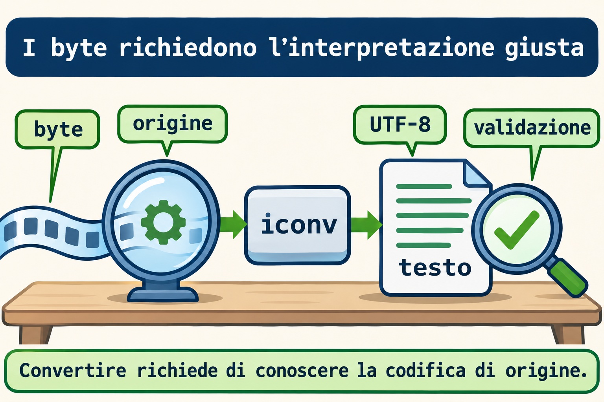

# Lezione 15.5 · Lingua, tastiera e fuso orario

Un accento illeggibile può dipendere da codifica, interpretazione o presentazione. Separerai questi livelli, convertirai una copia con origine nota e chiuderai il modulo con uno script di salute che rende espliciti criteri e incertezze.

> **Il cuore di questa lezione:** i byte non portano da soli la spiegazione di come vadano letti. Locale, tastiera e fuso orario agiscono su livelli diversi. Uno script deve controllare l'interpretazione e restituire uno stato documentato. Il resto è approfondimento.

| Scheda |  |
| --- | --- |
| **Modulo** | M15 · Shell e ambiente, lezione 5 di 5 |
| **Quando** | Settimana 21 |
| **Alla fine** | Converti testo noto e produci un raccoglitore con criteri espliciti |
| **Prerequisiti** | Da M15.1 a M15.4, Bash, file, servizi e snapshot |
| **Durata** | Circa 90 minuti, inclusa la sfida |
| **Snapshot** | `m15a5-inicio` e `m15a5-fim` sulle VM 201 e 202 |

## 1 · Riscaldamento

1. Una variabile anteposta a un comando cambia l'ambiente della shell padre?
2. Che cosa succede se ingresso e uscita di una conversione puntano allo stesso file?
3. Perché un errore di lettura non deve apparire come misurazione sana?

## 2 · Perché conta

Un rapporto proveniente da un'altra macchina mostra accenti strani. Cambiare tastiera non riconverte i byte già scritti. Cambiare la lingua globale non corregge automaticamente un file salvato con un'altra codifica. L'indagine parte dall'origine e dal percorso dei dati.

Nell'automazione la stessa confusione può trasformare una data localizzata o una virgola decimale in ingresso non valido. Il contratto di un raccoglitore deve essere prevedibile per le macchine e comprensibile a chi indaga.

## 3 · Modello mentale

La codifica è la convenzione che associa caratteri e byte. Il locale orienta aspetti come messaggi, ordinamento e formati. La mappa della tastiera trasforma i tasti in ingresso. Il fuso presenta un istante come ora locale. Sono quattro decisioni distinte.

```text
tasto -> ingresso -> byte -> interpretazione -> testo
istante UTC + fuso -> ora presentata
```



*Convertire richiede di conoscere la codifica di origine.*

### Ponte Windows

Su Windows l'aspetto di un file nell'editor dipende dalla codifica selezionata. Anche su Linux. Esportare CSV in UTF-8 e documentare i separatori evita congetture. Ora visualizzata e istante memorizzato restano cose diverse su entrambi i sistemi.

## 4 · L'essenziale

| Livello | Che cosa osservare | Ambito |
| --- | --- | --- |
| Locale del processo | `locale` | Ambiente di quel processo |
| Locali disponibili | `locale -a` | Locali utilizzabili sulla macchina |
| Impostazioni del sistema | `localectl status` | Configurazione indicata da localed |
| Fuso e orologio | `timedatectl status` | Presentazione e stato dell'orologio |
| Conversione | `iconv -f ORIGEM -t DESTINO` | Byte di ingresso e uscita |

Nella selezione del locale un valore non vuoto di `LC_ALL` prevale sulle categorie `LC_*`, che prevalgono su `LANG`. Usa la sostituzione soltanto nel comando che ne ha bisogno; non scrivere globalmente `LC_ALL=C` per nascondere il problema di un'applicazione.

### Rocky × Debian

Su Rocky 9 i pacchetti della famiglia glibc-langpack forniscono dati di lingue aggiuntive. Su Debian 13 selezione e generazione dei locali passano dal pacchetto locales. Questa lezione usa un locale UTF-8 già presente; non installa lingue né modifica file globali.

Console testuale, impostazioni X11 e sorgenti di ingresso del desktop hanno controlli distinti. Su Debian la configurazione della tastiera coinvolge anche keyboard-configuration e console-setup; non tutte le operazioni di modifica di localectl sono supportate. Su Wayland controlla la sorgente di ingresso del compositore o del desktop. Una configurazione X11 non dimostra la mappa effettiva di ogni sessione Wayland.

### Decidi 1

Un file Latin-1 noto è stato aperto come UTF-8. Quale azione conserva meglio l'evidenza?

| Opzione | Azione |
| --- | --- |
| A | Conservare l'origine e convertire in un altro file |
| B | Cambiare tastiera e sovrascrivere |
| C | Eliminare tutti i byte che causano errore |

**Risposta:** A. La copia permette di confrontare i byte e ripetere la conversione senza distruggere l'origine.

## 5 · Lab guidato

Ripeti come student sulle VM 201 e 202, una alla volta. La lezione 15.4 è già tornata allo stato precedente al desktop. Mantieni disponibili SSH e noVNC. Non cambiare tastiera, lingua predefinita o fuso globale in questo laboratorio.

### Passo 1 · Conservare la base

**Ipotesi:** creare dati in una cartella privata non richiede di modificare l'ambiente di accesso.

Sull'host Proxmox controlla gli ID prima degli snapshot:

```bash
qm snapshot 201 m15a5-inicio
qm snapshot 202 m15a5-inicio
```

Sulla VM:

```bash
umask 077
test ! -e "$HOME/m15a5"
mkdir -m 700 "$HOME/m15a5"
cd "$HOME/m15a5"
pwd
command -v iconv
```

**Output atteso:** cartella privata dell'esercizio e percorso di iconv. Se il programma manca fermati e identifica il pacchetto della distribuzione prima di continuare.

**Verifica:** nessun file di inizializzazione della shell è stato modificato.

### Passo 2 · Misurare l'ambiente del processo

**Ipotesi:** un locale fornito come prefisso riguarda soltanto quel comando.

```bash
locale
locale -a
localectl status
LANG_ANTES=${LANG-}
LC_ALL=C locale
test "${LANG-}" = "$LANG_ANTES" && printf 'parent_unchanged=yes\n'
LAB_LOCALE=$(locale -a | awk 'tolower($0)=="c.utf8" || tolower($0)=="c.utf-8" {print; exit}')
test -n "$LAB_LOCALE" && LC_ALL="$LAB_LOCALE" locale charmap
```

**Output atteso:** il padre conserva LANG e il locale selezionato indica UTF-8. Se la selezione resta vuota non usare la variabile: scegli un locale UTF-8 elencato dalla macchina stessa.

**Verifica:** lo stato di localectl descrive impostazioni del sistema; non sostituisce l'osservazione dell'ambiente effettivo dell'applicazione. Una consultazione non disponibile va registrata senza inventare valori.

### Passo 3 · Convertire byte di origine nota

**Ipotesi:** lo stesso testo può avere rappresentazioni diverse senza che una di esse sia un file corrotto.

```bash
printf 'caf\351\n' > latin1.txt
printf 'caf\303\251\n' > referencia-utf8.txt
od -An -tx1 latin1.txt
iconv -f ISO-8859-1 -t UTF-8 latin1.txt > convertido.txt
od -An -tx1 convertido.txt
cmp -- convertido.txt referencia-utf8.txt
```

**Output atteso:** l'accento passa da un byte a due; cmp termina con stato zero e non scrive differenze. L'origine è stata definita dall'esercizio, non indovinata dal nome del file.

**Verifica:** `latin1.txt` resta conservato. La destinazione corrisponde ai byte noti del riferimento.

### Passo 4 · Validare struttura e significato

**Ipotesi:** un file può essere UTF-8 valido e contenere comunque il testo sbagliato.

```bash
iconv -f UTF-8 -t UTF-8 convertido.txt > /dev/null
printf 'utf8_validation_rc=%s\n' "$?"
iconv -f ISO-8859-1 -t UTF-8 referencia-utf8.txt > dupla.txt
iconv -f UTF-8 -t UTF-8 dupla.txt > /dev/null
printf 'double_conversion_utf8_rc=%s\n' "$?"
cmp -s -- dupla.txt referencia-utf8.txt
printf 'same_bytes_rc=%s\n' "$?"
```

**Output atteso:** entrambe le validazioni UTF-8 danno zero, ma il confronto finale dà uno. La doppia conversione ha interpretato ogni byte UTF-8 come Latin-1 e ha cambiato il contenuto.

**Verifica:** validità strutturale e fedeltà al testo originale sono domande diverse. Non usare l'eliminazione silenziosa dei caratteri come riparazione automatica.

### Passo 5 · Separare ora, lingua e ingresso

**Ipotesi:** presentare la stessa ora in un altro fuso non cambia l'orologio della macchina.

```bash
timedatectl status
LC_ALL=C TZ=UTC date '+%Y-%m-%d %H:%M:%S %Z'
LC_ALL=C TZ=Europe/Rome date '+%Y-%m-%d %H:%M:%S %Z'
date +%s
printf 'session=%s\n' "${XDG_SESSION_TYPE-unset}"
```

**Output atteso:** due presentazioni dell'istante, eventualmente con qualche secondo di differenza fra i comandi. La differenza di fuso dipende dalla data e dall'ora legale; non fissare una differenza universale di ore.

**Verifica:** SSH può indicare una sessione testuale. Per indagare la tastiera grafica osserva la sessione grafica corrispondente, la sua sorgente di ingresso e il suo compositore. Non reinstallare il desktop soltanto per questa verifica.


*Verifica il livello che controlla l'effetto osservato.*

### Passo 6 · Pubblicare soltanto una conversione valida

**Ipotesi:** un'uscita parziale non deve sostituire il risultato precedente quando la conversione fallisce.

Crea uno script che riceve origine, codifica nota e destinazione distinta. Il temporaneo resta accanto alla destinazione; così lo scambio finale non deve attraversare file system.

```bash
cat > converter.sh <<'EOF'
#!/usr/bin/env bash
set -u
if (( $# != 3 )) || [[ -z $1 || -z $2 || -z $3 ]]; then exit 2; fi
src=$1; encoding=$2; dst=$3
if [[ ! -f $src || ! -r $src || $src == "$dst" ]]; then exit 3; fi
if [[ -L $dst || ( -e $dst && ! -f $dst ) ]]; then exit 3; fi
if [[ -e $dst && $src -ef $dst ]]; then exit 3; fi
tmp=$(mktemp -- "${dst}.tmp.XXXXXX") || exit 3
trap 'rm -f -- "$tmp"' EXIT
if ! iconv -f "$encoding" -t UTF-8 -- "$src" > "$tmp"; then exit 3; fi
if ! iconv -f UTF-8 -t UTF-8 "$tmp" > /dev/null; then exit 3; fi
mv -f -- "$tmp" "$dst" || exit 3
exit 0
EOF
bash -n converter.sh
bash converter.sh latin1.txt ISO-8859-1 publicado.txt
cmp -- publicado.txt referencia-utf8.txt
```

**Output atteso:** destinazione valida, confronto silenzioso e temporaneo rimosso. Lo script permette di sostituire un file regolare distinto; rifiuta directory, collegamenti simbolici di destinazione e altri tipi esistenti. Eseguilo soltanto nella cartella privata senza editor concorrenti.

**Verifica:** il controllo di identità evita lo stesso file con un altro nome. Non è una garanzia contro cambiamenti concorrenti dei percorsi; questa cartella di laboratorio ha un solo operatore.

### Decidi 2

Il raccoglitore non riesce a leggere l'evidenza dell'ultimo backup. Quale risposta rappresenta meglio ciò che sa?

| Opzione | Risultato |
| --- | --- |
| A | Scrivere l'ora attuale come se il backup fosse terminato |
| B | Sano, perché non ha trovato errori |
| C | Sconosciuto, con diagnosi della lettura mancante |

**Risposta:** C. L'assenza di evidenza non dimostra il successo né determina l'età reale del backup.

## 6 · Rompi e ripara

### Guasto 1 · Origine dichiarata errata

**Ipotesi:** dichiarare UTF-8 non trasforma un byte Latin-1 in UTF-8.

**Sintomo:** esegui `bash converter.sh latin1.txt UTF-8 falha.txt` e cattura subito lo stato: deve essere tre.

**Indagine:** confronta l'origine con `od -An -tx1 latin1.txt` e leggi il messaggio di iconv.

**Causa:** la codifica dichiarata non corrisponde ai byte noti del campione.

**Riparazione:** ripeti con `bash converter.sh latin1.txt ISO-8859-1 reparado.txt` e confronta con il riferimento.

**Verifica:** il confronto termina con zero; l'origine rimane intatta e nessuna uscita parziale ha sostituito una destinazione valida.

**Prevenzione:** registra la codifica nell'interfaccia che produce o esporta i dati.

### Guasto 2 · Sequenza incompleta

**Ipotesi:** una conversione interrotta non deve cancellare la destinazione precedente.

**Sintomo:** crea `printf '\303' > truncado.txt`, conserva `cp -- publicado.txt antes.txt` ed esegui `bash converter.sh truncado.txt UTF-8 publicado.txt`; lo stato sarà tre.

**Indagine:** esegui `cmp -- publicado.txt antes.txt` e controlla che la pubblicazione precedente sia rimasta intatta.

**Causa:** il byte iniziale richiede una continuazione; l'ingresso termina prima di essa.

**Riparazione:** ricostruisci la copia dalla fonte completa senza completare byte per congettura.

**Verifica:** la pubblicazione rimane uguale ad `antes.txt`; pubblica la copia completa soltanto dopo la validazione e il confronto.

**Prevenzione:** valida prima della pubblicazione e conserva l'origine.

### Guasto 3 · Doppia conversione

**Ipotesi:** il successo tecnico della conversione non garantisce la scelta corretta dell'origine.

**Sintomo:** `dupla.txt` supera la validazione UTF-8 ma non corrisponde al testo di riferimento.

**Indagine:** confronta le sequenze di byte e identifica a quale confine la conversione sia avvenuta due volte.

**Causa:** i byte UTF-8 sono stati letti secondo un'altra convenzione e codificati di nuovo.

**Riparazione:** torna all'origine conservata ed esegui una sola conversione con origine documentata.

**Verifica:** i byte coincidono con il riferimento; la sola validazione UTF-8 non soddisfa questo criterio.

**Prevenzione:** definisci quale fase converte e quale fase trasporta soltanto i dati.

### Sfida del modulo · Salute con contratto

Produci un raccoglitore di sola lettura per disco radice, memoria disponibile, servizio SSH ed età dell'ultimo registro di backup verificato. Le soglie sotto sono didattiche, non una politica universale. Nel M27 un elemento o adattatore di Zabbix consumerà un contratto documentato; un codice di uscita arbitrario non diventa automaticamente una metrica di Zabbix.

Il contratto usa zero per sano, uno per avviso, due per critico e tre per sconosciuto. Prevale il codice maggiore, quindi una misurazione mancante non resta nascosta da una buona. Ogni riga conserva il proprio stato individuale anche quando il risultato globale è sconosciuto.

Il registro del backup contiene soltanto un epoch decimale, scritto dal lavoro responsabile dopo la verifica documentata del file. La data da sola non dimostra un ripristino né un backup PBS. M14.5 non ha lasciato un marcatore universale: qui la modalità fixture identifica dati sintetici e la modalità record richiede l'evidenza di un lavoro reale autorizzato.

Crea l'implementazione di riferimento e leggi ogni blocco prima di eseguire. Non riavvia servizi, non crea backup e non installa pianificazioni.

```bash
cat > saude.sh <<'EOF'
#!/usr/bin/env bash
set -u
set -o pipefail
export LC_ALL=C
if (( $# != 3 )); then exit 3; fi
mode=$1; unit=$2; record=$3
case $mode in --fixture|--record) ;; *) exit 3 ;; esac
case $unit in ssh.service|sshd.service) ;; *) exit 3 ;; esac
status=0
report() {
    local name=$1 code=$2 value=$3
    printf '%s code=%s value=%s\n' "$name" "$code" "$value" || exit 3
    if (( code > status )); then status=$code; fi
}
printf 'mode=%s\n' "$mode" || exit 3
if disk=$(df -P / | awk 'NR==2 {gsub(/%/,"",$5); print $5}') &&
   [[ $disk =~ ^[0-9]{1,3}$ ]] && (( 10#$disk <= 100 )); then
    code=0
    if (( 10#$disk >= 90 )); then code=2
    elif (( 10#$disk >= 80 )); then code=1; fi
    report disk "$code" "$disk"
else report disk 3 unavailable; fi
if mem=$(awk '$1=="MemAvailable:" {print $2}' /proc/meminfo) &&
   [[ $mem =~ ^[0-9]{1,12}$ ]]; then
    code=0
    if (( 10#$mem < 131072 )); then code=2
    elif (( 10#$mem < 262144 )); then code=1; fi
    report memory_kib "$code" "$mem"
else report memory_kib 3 unavailable; fi
if load=$(systemctl show "$unit" -p LoadState --value) && [[ $load == loaded ]]; then
    if systemctl is-active --quiet "$unit"; then report ssh 0 active
    else report ssh 2 inactive; fi
else report ssh 3 unavailable; fi
if now=$(date +%s) && [[ $now =~ ^[0-9]{1,10}$ ]] &&
   stamp=$(cat -- "$record") && [[ $stamp =~ ^[0-9]{1,10}$ ]] &&
   (( 10#$stamp > 0 && 10#$stamp <= 10#$now )); then
    age=$((10#$now - 10#$stamp))
    code=0
    if (( age > 172800 )); then code=2
    elif (( age > 86400 )); then code=1; fi
    report backup_age_seconds "$code" "$age"
else report backup_age_seconds 3 unavailable; fi
printf 'status=%s\n' "$status" || exit 3
exit "$status"
EOF
bash -n saude.sh
date +%s > backup-fixture.epoch
```

Il disco usa la percentuale occupata; la memoria usa KiB disponibili. Il servizio deve essere caricato e attivo. La lettura di un registro assente, non valido o futuro produce sconosciuto. Sono osservazioni sequenziali, non una fotografia atomica del server.

Imposta LAB_SSH a sshd.service su Rocky oppure a ssh.service su Debian usando soltanto la riga corrispondente. Poi esegui la raccolta. Non arrestare SSH per creare un guasto.

```bash
LAB_SSH=sshd.service
LAB_SSH=ssh.service
```

Con la variabile corretta per la tua distribuzione:

```bash
bash saude.sh --fixture "$LAB_SSH" backup-fixture.epoch
printf 'collector_rc=%s\n' "$?"
```

Prova una copia del registro vecchia di tre giorni e un'altra assente. L'età elevata produce critico per il backup; l'assenza produce sconosciuto. Altri criteri possono alzare il risultato globale. Cattura subito lo stato senza presumere zero sul server attuale.

```bash
printf '%s\n' "$(( $(date +%s) - 259200 ))" > backup-antigo.epoch
bash saude.sh --fixture "$LAB_SSH" backup-antigo.epoch
printf 'old_backup_rc=%s\n' "$?"
if test -e ausente.epoch; then
    printf 'Choose an unused missing-record path.\n' >&2
else
    bash saude.sh --fixture "$LAB_SSH" ausente.epoch
    printf 'missing_backup_rc=%s\n' "$?"
fi
```

Come estensione estrai le soglie in argomenti validati e scrivi test di confine su copie dello script. Consegna codice, stdout, stderr, stato catturato e origine del registro. Non simulare memoria esaurita o disco pieno sulla VM.


*Il codice finale riassume i criteri senza nascondere dati assenti.*

### Pulizia

Conserva i file privati come evidenza. Non ci sono state modifiche globali a lingua, tastiera, fuso, shell o servizio. Verifica `localectl status` e `timedatectl status` rispetto all'inizio. Nessuna chiave, unità o attività pianificata è stata creata dalla sfida.

## 7 · Trappole

| Errore | Correzione | Motivo |
| --- | --- | --- |
| La lingua corregge i byte | Convertire una copia di origine nota | Il locale non riscrive il file |
| UTF-8 valido dimostra fedeltà | Confrontare il contenuto con un riferimento | Una doppia conversione può essere valida |
| Usare lo stesso file di uscita | Temporaneo e pubblicazione dopo il successo | L'apertura dell'uscita può troncare l'origine |
| Una data recente dimostra il backup | Esigere evidenza del lavoro e verifica | Un timestamp manuale può essere fittizio |

## 8 · Quiz

1. Quale variabile prevale su tutte le categorie del locale?
2. Che cosa dichiarano gli argomenti di origine e destinazione di iconv?
3. Un file UTF-8 valido contiene sempre il testo originale corretto?
4. Il prefisso TZ cambia automaticamente il fuso globale?
5. Un'impostazione X11 dimostra la sorgente effettiva di ingresso di GNOME Wayland?
6. Perché il raccoglitore restituisce sconosciuto quando manca il registro del backup?

## 9 · Promemoria

| Operazione | Comando |
| --- | --- |
| Ambiente effettivo | `locale` |
| Locale installati | `locale -a` |
| Dati di configurazione | `localectl status` |
| UTF-8 strutturalmente valido | `iconv -f UTF-8 -t UTF-8 convertido.txt > /dev/null` |
| Istante decimale | `date +%s` |

**Flashcard:** crea schede per codifica, locale, tastiera, fuso e stato sconosciuto. Ripassa a D+1, D+3, D+7 e D+21.

## 10 · Checklist e chiusura

- [ ] Ho conservato l'origine e confrontato i byte convertiti.
- [ ] Ho separato locale, tastiera e fuso senza modifiche globali.
- [ ] Ho provato un errore senza perdere la pubblicazione precedente.
- [ ] Ho registrato criteri, campione e stato della sfida sulle due distribuzioni.

**Ultimo esercizio:** spiega perché un file valido può essere semanticamente errato e perché una misurazione mancante non può diventare sana. Usa le tue due evidenze per motivarlo.

**Reboot di verifica:** riavvia ogni VM, accedi di nuovo come student e controlla locale, tastiera indicata e fuso. Entra nella cartella privata, definisci nuovamente LAB_SSH con la riga della tua distribuzione ed esegui conversione e raccoglitore fixture. Gli script ricevono esplicitamente i parametri; le variabili della sessione precedente non sopravvivono al reboot.

Sull'host Proxmox, dopo aver verificato il ritorno:

```bash
qm snapshot 201 m15a5-fim
qm snapshot 202 m15a5-fim
```

Il blocco B termina con un giorno di incidente che combina i moduli dal M10 al M15 e con la revisione del quaderno degli errori. Usa soltanto il laboratorio autorizzato, registra ipotesi, evidenza e correzione e ripristina la base prima del M16.

## 11 · Nella vita reale

Su un sistema autorizzato osserva soltanto configurazione di lingua, fuso e origine dei file di scambio. Non convertire file esistenti né cambiare preferenze globali. Produci una proposta che indichi dove avviene la conversione e chi conferma la codifica di origine.

Il sistema di monitoraggio distingue sconosciuto e sano? L'evidenza del backup proviene dal lavoro corretto? Quale verifica è stata eseguita e quale prova di ripristino esiste? Annota i limiti di ciò che il tuo raccoglitore dimostra davvero.

## 12 · Approfondire quando vuoi

- [GNU: variabili di locale](https://www.gnu.org/software/gettext/manual/html_node/Locale-Environment-Variables.html), [locale](https://manpages.debian.org/trixie/manpages/locale.1.en.html) e [iconv](https://manpages.debian.org/trixie/manpages/iconv.1.en.html).
- [localectl](https://manpages.debian.org/trixie/systemd/localectl.1.en.html), [tastiera Debian](https://manpages.debian.org/trixie/keyboard-configuration/keyboard.5.en.html) e [limite di setxkbmap su Xwayland](https://manpages.debian.org/trixie/x11-xkb-utils/setxkbmap.1.en.html).
- [RHEL 9: operazioni di base del sistema](https://docs.redhat.com/en/documentation/red_hat_enterprise_linux/9/html/configuring_basic_system_settings/index), [GNU Bash](https://www.gnu.org/software/bash/manual/bash.html) e [meminfo](https://manpages.debian.org/trixie/manpages/proc_meminfo.5.en.html).

**DeepTutor** (http://10.1.0.149:3782, KB "Curso Linux Sysadmin"):

- `!explica Separe codificação, locale, teclado e fuso usando um arquivo de origem conhecida.`
- `!feynman Vou explicar por que UTF-8 válido e timestamp recente não provam fidelidade e restauração. Critique.`
- `!quiz Crie seis incidentes de interpretação de texto e status desconhecido, sem mudar configuração global.`

## Soluzioni commentate

### Riscaldamento

1. No. Il prefisso cambia l'ambiente fornito al comando.
2. L'apertura dell'uscita può troncare i dati prima che vengano letti.
3. Perché manca l'informazione per affermare che il criterio sia soddisfatto.

### Quiz

1. LC_ALL, quando possiede un valore non vuoto.
2. Come interpretare i byte di ingresso e come rappresentare i caratteri in uscita.
3. No. La doppia conversione ha dimostrato validità senza fedeltà.
4. No. L'ambiente fornito al comando cambia quella presentazione.
5. No. Il desktop o compositore può controllare la sorgente effettiva della sessione.
6. Perché non conosce l'età reale né possiede evidenza sufficiente per affermare il successo.

<!-- navegacao -->
[← Lezione 15.4 · Interfacce grafiche](15.4-interfaces-graficas.md) · [Indice delle lezioni](../01-aulas.md) · [Piano del corso: dal M16 in poi →](../00-plano-do-curso.md)
