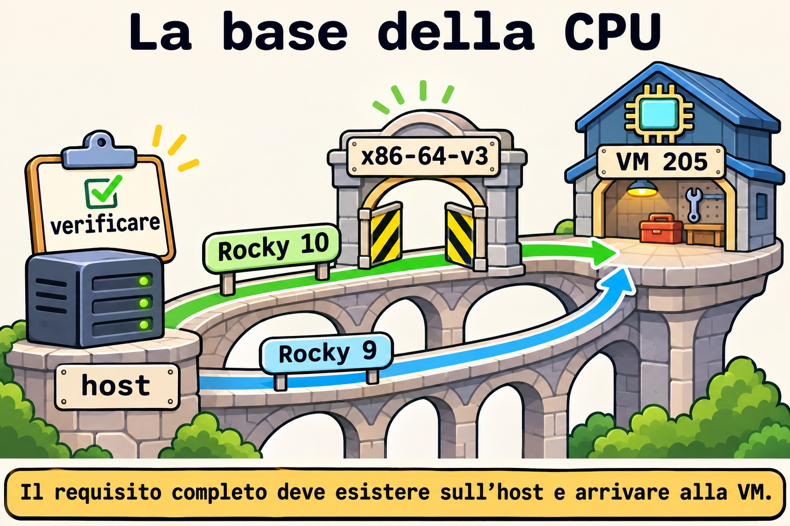
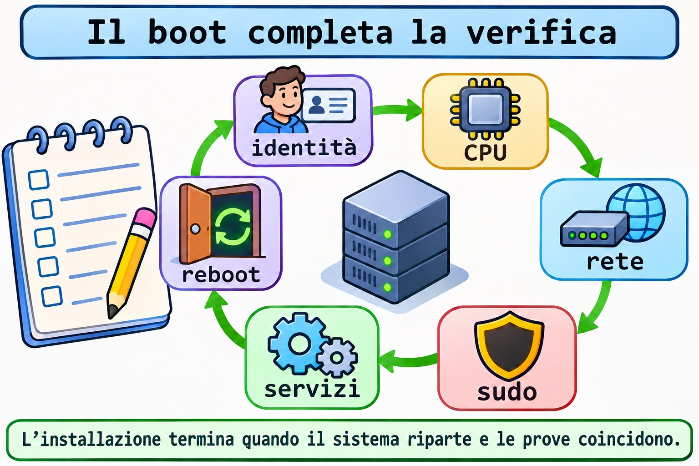

# Lezione 16.1 · Rocky 10: cosa cambia

Aggiungerai una macchina al laboratorio senza sostituire quella che conosci già. La VM 205 serve a confrontare generazioni di Rocky e a esercitarti con gli incidenti. Il primo compito è dimostrare che CPU e installazione soddisfano i requisiti.

> **Il cuore di questa lezione:** una nuova versione richiede un nuovo inventario; il metodo diagnostico continua a basarsi su prove, ambito e persistenza.

| Scheda |  |
| --- | --- |
| **Modulo** | M16 · Settimana di incidenti su Rocky 10, lezione 1 di 4 |
| **Quando** | Settimana 21 |
| **Alla fine** | Verifichi tutti i requisiti CPU, installi la VM 205 e confermi identità, rete e accesso dopo il boot |
| **Prerequisiti** | M0–M15; noVNC, sudo, backup e diario di bordo |
| **Durata** | 60–90 minuti; installazione e ripasso possono richiedere un’altra sessione |
| **Snapshot** | `m16a1-inicio` e `m16a1-fim`, VM 205 e 202 |

## 1 · Riscaldamento

Rispondi senza consultare il materiale. Confronta le soluzioni soltanto alla fine.

1. Vedere AVX2 nell’elenco dei flag conferma l’intero requisito CPU di Rocky 10?

2. Il nome della VM indica con certezza quale distribuzione è installata?

3. Quale dato devi riservare prima di assegnare un IP statico alla nuova VM?

## 2 · Perché conta

Una nuova installazione si ferma prima del login. Il nome della CPU sembra moderno, ma la macchina virtuale ha ricevuto un modello che non fornisce le istruzioni richieste. Reinstallare ripetutamente la stessa immagine non cambia il requisito.

Separi tre domande: l’host supporta, il modello virtuale offre e il sistema guest vede? Poi confronti i servizi che conosci su Rocky 9 con la nuova base, usando la VM 202 come riferimento Debian.

## 3 · Modello mentale

Pensa a un’officina con un banco per incidente. L’etichetta del banco delimita dove puoi intervenire. Il diario conserva le misure; lo strumento di riparazione arriva dopo la misura.



*Il requisito completo deve esistere sull’host e arrivare alla VM.*

### Ponte Windows

| Riferimento Windows | Domanda equivalente su Linux |
| --- | --- |
| Gestione servizi | La unit è partita e può avviarsi al boot? |
| Visualizzatore eventi | Quale evento è avvenuto in questa esecuzione? |
| ACL e account del servizio | L’utente effettivo riesce a leggere il dato? |
| Procedura di modifica | Quale ipotesi giustifica questa modifica? |

## 4 · L'essenziale

### x86-64-v3 è un insieme di requisiti

Su Rocky 10 per x86 il livello minimo è `x86-64-v3`. Trovare soltanto `avx2` sull’host non conferma l’intero insieme. Il caricatore glibc indica quali livelli riconosce come supportati e utilizzabili nell’ambiente attuale.

L’insieme comprende istruzioni oltre ad AVX2 e il supporto necessario del sistema operativo per utilizzarle. Non trasformi una CPU incompatibile in una compatibile scegliendo un’etichetta su Proxmox.

Controlla ogni nodo verso cui prevedi di migrare la VM. Il superamento del nodo attuale non autorizza la migrazione verso un altro senza verificare la destinazione. Un modello virtuale comune deve essere supportato da tutte le destinazioni previste.

### Cosa cambia e cosa resta

Rocky 10 rimuove la compatibilità a 32 bit su x86_64 e ha componenti di base più recenti. Non supporre che ogni pacchetto, vecchio modulo o guida Rocky 9 resti applicabile. Verifica i requisiti del software prima di pianificare la migrazione.

In questa lezione non aggiorni la VM 201 da una versione principale all’altra. Crei una nuova VM e mantieni disponibile la base conosciuta per confronto e recupero.

`systemd`, permessi, journal e ragionamento di rete restano utili. L’esperienza precedente fornisce domande migliori; documentazione e inventario rispondono per questa versione.

### L’alternativa fa parte del piano

Se una destinazione prevista non supporta l’intero requisito, usa Rocky 9 nella VM 205 con `x86-64-v2-AES`, dopo aver verificato anche questo modello su tutte le destinazioni. Se nemmeno tale requisito è disponibile, interrompi il lab. Registra l’alternativa nel diario e mantieni VMID e nome previsti dagli script successivi.

Il nome `rocky10-lab` identifica il ruolo della VM nel corso; `/etc/os-release` rivela il sistema realmente installato. Non usare il nome come prova della versione.

### L’indirizzo è una decisione dell’inventario

Non scegliere un indirizzo soltanto perché termina con un numero simile al VMID. Riserva un IP libero fuori dall’intervallo DHCP, registra maschera, gateway e DNS reali e conferma la prenotazione prima dell’installazione.

Modifica l’indirizzo tramite noVNC. Non cambiare la connessione che sostiene la sessione SSH mentre dipendi da essa per recuperare l’accesso.


*Verifica cosa è cambiato; riusa il ragionamento che resta valido.*

### Rocky × Debian

| Livello | VM 205 | VM 202 |
| --- | --- | --- |
| Sistema | Rocky 10, oppure Rocky 9 se la CPU richiede l’alternativa | Debian 13 |
| Pacchetti | `dnf` e `rpm` | `apt` e `dpkg` |
| Servizi e log | `systemctl` e `journalctl` | `systemctl` e `journalctl` |
| Controllo aggiuntivo | SELinux resta attivo | AppArmor resta attivo quando configurato |
| Incidenti di questo modulo | Alberi dedicati; nessuna modifica a SSH o firewall | Stesso contratto di isolamento |

### Decidi 1

L’host attuale soddisfa il livello richiesto, ma un’altra destinazione di migrazione non è ancora stata verificata. Cosa fai?

| A | B | C |
| --- | --- | --- |
| Autorizzare la migrazione perché il nodo attuale ha superato il controllo | Cambiare soltanto il nome della VM | Verificare l’intero insieme su tutte le destinazioni previste |

## 5 · Lab guidato

Usa soltanto le VM del contratto. Apri noVNC prima di iniziare e conferma il backup. I comandi Proxmox appartengono all’host; gli altri appartengono alla VM indicata.

Nella 16.1 crea e valida la VM 205 prima del suo primo snapshot. Nelle altre lezioni deve già esistere. Non applicare mai un rollback a una VM diversa per recuperare questo banco.

```bash
qm snapshot 202 m16a1-inicio
```

Se il recupero richiede un rollback, interrompi l’esercizio, apri la console e usa lo snapshot iniziale di questa lezione. Annota cosa hai perso e non confondere il ripristino con una diagnosi completata.

```bash
qm rollback 205 m16a1-inicio
qm rollback 202 m16a1-inicio
```

### Passo 1 · Controllare hardware e destinazioni

**Ipotesi:** una riga con AVX2 basta ad autorizzare Rocky 10 su tutti i nodi?

Su ogni host Proxmox previsto usa soltanto letture. Il percorso seguente corrisponde al caricatore x86_64; su un’altra architettura interrompi questa variante del lab.

```bash
lscpu
/lib64/ld-linux-x86-64.so.2 --help
pvesh get /cluster/resources --type vm
pvesm status
```

**Output atteso:** il rapporto del caricatore include `x86-64-v3` come supportato e cercato quando l’host soddisfa il requisito. Leggi l’indicazione completa, non soltanto la presenza del nome nell’elenco.

**Verifica:** tutte le destinazioni previste superano il controllo, il VMID 205 è libero nel cluster e lo storage `vm-hdd` è disponibile. Altrimenti registra Rocky 9 come alternativa; non forzare una CPU fittizia.

### Passo 2 · Creare la VM 205 con la procedura conosciuta

**Ipotesi:** quali scelte appartengono all’host e quali all’installazione del sistema?

Ripeti la procedura di creazione e installazione della lezione 0.1 con il contratto seguente. Scegli il volume ISO realmente elencato nello storage immagini, validato secondo la procedura iniziale; non inventare un percorso ISO.

| Campo | Valore |
| --- | --- |
| VMID e nome | `205`, `rocky10-lab` |
| Risorse | 2 vCPU, 2 GB di RAM, disco da 20 GB |
| CPU | `x86-64-v3`; alternativa `x86-64-v2-AES` con Rocky 9 |
| Macchina e firmware | `q35`, OVMF |
| Disco e rete | `vm-hdd`, virtio, `vmbr0` |
| Installazione | Sistema minimo, utente `student`, sudo e password di root |
| Indirizzo | Prenotazione reale fuori dal pool DHCP; nessun IP inventato |

```bash
qm config 205
qm status 205
```

**Output atteso:** configurazione e sistema installato corrispondono al contratto. L’indirizzo appare nella console e non entra in conflitto con le altre VM.

**Verifica:** la nuova VM si avvia dal disco installato dopo aver scollegato la ISO secondo la lezione 0.1. Solo allora registra `m16a1-inicio` per la VM 205.

```bash
qm snapshot 205 m16a1-inicio
```

### Passo 3 · Confermare cosa ha ricevuto il guest

**Ipotesi:** il supporto v3 dell’host garantisce che qualsiasi modello virtuale esponga v3?

Nella console della VM 205 leggi sistema e capacità fornite. Sulla VM 202 esegui la stessa lettura per confrontare senza modificarne la CPU.

```bash
cat /etc/os-release
uname -m
lscpu
/lib64/ld-linux-x86-64.so.2 --help
```

**Output atteso:** la VM 205 con Rocky 10 riconosce v3 come utilizzabile. Se hai scelto Rocky 9, prove e diario dichiarano questa alternativa.

**Verifica:** copia nel diario la riga pertinente del caricatore e la versione reale. Debian può mostrare altri livelli supportati senza richiedere modifiche alla configurazione.

### Passo 4 · Stabilire accesso e guest agent

**Ipotesi:** avere rete nella console garantisce sudo e autenticazione con chiave?

Sulla 205 installa l’agente e controlla lo stato senza rimuovere pacchetti esistenti. Abilita l’opzione guest agent sull’host secondo la lezione 0.2. Configura la tua chiave di `student` con la stessa procedura, conservando le altre chiavi.

```bash
sudo hostnamectl set-hostname rocky10-lab
sudo dnf install -y qemu-guest-agent
sudo systemctl enable --now qemu-guest-agent
hostnamectl
ip -br address
ip route
sudo -v
systemctl is-active qemu-guest-agent
```

**Output atteso:** nome `rocky10-lab`, IP riservato, rotta reale e agente attivo con il canale virtio abilitato sull’host.

**Verifica:** apri una seconda sessione con la tua chiave ed esegui `sudo -v` prima di chiudere la console. Non abilitare il login SSH di root con password.

### Passo 5 · Confrontare funzioni, non memorizzare versioni

**Ipotesi:** lo stesso comando di servizio resta utile anche se cambiano i pacchetti?

Sulla 205 e sulla 202 registra la base installata. Usa il gestore corretto in ciascun blocco. Non copiare numeri di versione da un output di esempio nella tua scheda.

```bash
rpm -q glibc systemd NetworkManager
systemctl --failed --no-pager
getenforce
```

```bash
dpkg-query -W libc6 systemd network-manager
systemctl --failed --no-pager
sudo aa-status
```

**Output atteso:** versioni e disponibilità riflettono ciascuna installazione. L’assenza di `network-manager` su Debian richiede di riconoscere il gestore di rete realmente usato; non installarne un altro soltanto per uniformare la tabella.

**Verifica:** spiega due funzioni che restano e due differenze da controllare. Un pacchetto assente non dimostra un guasto quando l’installazione usa un altro strumento.

### Passo 6 · Verificare dopo il riavvio

**Ipotesi:** quali prove prevedi di ritrovare in un nuovo boot?

**Reboot di verifica:** riavvia una VM alla volta dalla console. Poi ripeti identità, indirizzo, rotta, sudo e lettura dei servizi su entrambe.

```bash
sudo systemctl reboot
```

```bash
cat /etc/os-release
cat /proc/sys/kernel/random/boot_id
hostname -s
ip -br address
ip route
sudo -v
systemctl --failed --no-pager
```

**Output atteso:** l’identificatore del boot è cambiato, identità e rete restano corrette. Indaga sui guasti reali prima di conservare lo snapshot finale.

**Verifica:** la 205 è pronta per gli script delle lezioni successive e la 202 resta accessibile. Conserva versione, CPU, IP e strumento di rete nell’inventario del modulo.

### Decidi 2

La VM si chiama rocky10-lab, ma l’alternativa installata è Rocky 9. Come compili l’inventario?

| A | B | C |
| --- | --- | --- |
| Eliminare la VM 201 per evitare confusione | Registrare Rocky 9 e la prova del sistema installato | Dichiarare Rocky 10 in base al nome |

## 6 · Rompi e ripara

Lavora su un guasto alla volta. Prima di consultare la riparazione, scrivi il comando che sosterrebbe la tua ipotesi. Non trasformare una difficoltà locale in una modifica globale.

### Guasto 1 · L’etichetta non dimostra la capacità

**Sintomo:** un inventario locale afferma che AVX2 basta per Rocky 10. Introduci l’errore soltanto nel diario, senza cambiare la CPU di un’installazione già funzionante.

**Indagine:** confronta l’affermazione con il rapporto del caricatore sull’host e sul guest.

**Causa:** un singolo flag è stato confuso con il livello completo e utilizzabile.

**Riparazione:** sostituisci l’affermazione con la prova del supporto al livello completo oppure con l’alternativa Rocky 9 documentata.

**Verifica:** un’altra persona riesce a decidere la compatibilità usando il tuo registro, senza indovinare?

**Prevenzione:** registra host, modello virtuale e lettura nel guest in campi separati.

### Guasto 2 · Un comando della famiglia sbagliata

**Sintomo:** provi a interrogare il database pacchetti dell’altra famiglia. Il test è soltanto di lettura.

```bash
command -v dnf apt rpm dpkg-query
```

**Indagine:** leggi `/etc/os-release` e scopri quale database esiste, senza installare l’altro per aggirare il messaggio.

**Causa:** il nome del comando è stato memorizzato senza collegarne la funzione alla distribuzione.

**Riparazione:** ripeti la ricerca con `rpm -q` su Rocky oppure `dpkg-query -W` su Debian.

**Verifica:** la ricerca restituisce dati del database locale senza cambiare pacchetti.

**Prevenzione:** inizia l’inventario di un sistema sconosciuto dalla sua identità.

### Guasto 3 · Un vecchio risultato nel diario

**Sintomo:** il diario identifica il boot precedente come se fosse quello attuale. Riproduci copiando il vecchio identificatore in una nota segnata come tentativo.

**Indagine:** leggi `/proc/sys/kernel/random/boot_id` e confrontalo con la nota.

**Causa:** il risultato è stato riutilizzato senza registrare quando è stato ottenuto.

**Riparazione:** ripeti i controlli di preparazione nel boot attuale e registra il nuovo identificatore.

**Verifica:** ogni conclusione rimanda alla misura corrispondente.

**Prevenzione:** separa risultato osservato, orario e conclusione nel diario.



*L’installazione termina quando il sistema riparte e le prove coincidono.*

## 7 · Trappole

- Cambiare più cose tra due misure cancella il legame tra causa e risultato.

- Un vecchio messaggio nel journal non descrive necessariamente l’ultimo tentativo. Usa il boot e la unit corretti.

- Un file salvato non garantisce che il gestore abbia caricato la modifica.

- Un comando eseguito come root non misura i permessi dell’account del servizio.

- Lo script di controllo copre il contratto dichiarato; non promette di verificare l’intero server.

## 8 · Quiz

Rispondi prima di leggere le soluzioni. Spiega il motivo, oltre al comando.

1. Quali tre livelli devono essere coerenti affinché la VM riceva la CPU richiesta?

2. Perché trovare il nome v3 nell’output del caricatore richiede ancora di leggerne l’indicazione completa?

3. Cosa fai se una destinazione non supporta v3, ma tutte supportano il modello alternativo?

4. Perché un indirizzo apparentemente libero adesso non sostituisce una prenotazione fuori dal pool DHCP?

5. Come confronti Rocky e Debian quando il nome di un pacchetto di rete non esiste in una delle installazioni?

6. Quali prove ripeti dopo il riavvio della VM 205 prima di renderla pronta per la 16.2?

## 9 · Promemoria

| Domanda | Strumento |
| --- | --- |
| Quale sistema è installato? | `cat /etc/os-release` |
| Quale architettura è in uso? | `uname -m` e `lscpu` |
| Il livello completo è utilizzabile? | `/lib64/ld-linux-x86-64.so.2 --help` su ogni host e nel guest |
| Quale CPU è configurata? | `qm config 205` sull’host Proxmox |
| La rete resta corretta dopo il boot? | `ip -br address` e `ip route`, confrontati con la prenotazione |

**Flashcard:** crea da 5 a 10 carte. Includi una domanda di metodo, una sulla lettura degli errori, una sui permessi, una sulla persistenza e una su un tuo errore. Ripassa a D+1, D+3, D+7 e D+21.

## 10 · Checklist e chiusura

### Pulizia e continuità

Questa lezione non crea banchi temporanei e non modifica servizi delle altre VM. Elimina soltanto le note di tentativo che hai segnato come eliminabili. Conserva l’inventario validato, la VM 205 installata e la VM 202 accessibile per la 16.2.

Non eliminare la VM 201 per risparmiare risorse: resta il riferimento Rocky 9 del corso. Se devi liberare RAM, spegni una VM del corso inattiva dopo averne controllato l’attività, senza distruggere dischi o snapshot.

- [ ] Ho conservato l’ipotesi iniziale e la prova che l’ha confermata o scartata.

- [ ] Ho confermato l’utente effettivo, il percorso e il boot a cui appartiene ogni risultato.

- [ ] Ho spiegato ogni modifica e controllato il risultato dopo il reboot.

- [ ] Ho mantenuto intatti servizi e file esterni al banco.

```bash
qm snapshot 205 m16a1-fim
qm snapshot 202 m16a1-fim
```

**Ultimo esercizio:** spiega ad alta voce un’ipotesi sbagliata e la prova che ti ha fatto cambiare idea.

## 11 · Nella vita reale

Su un server che amministri o sei autorizzato a osservare, esegui soltanto letture. Identifica la versione, una unit pertinente e il journal del boot attuale. Non introdurre guasti e non copiare gli script di esercitazione su quel server.

```bash
cat /etc/os-release
systemctl --failed --no-pager
journalctl -b -p warning --no-pager -n 30
```

Annota quali dati mancherebbero per autorizzare una modifica. Non registrare password, chiavi private o contenuti degli utenti.

## 12 · Approfondire quando vuoi

- [Rocky Linux 10: modifiche della versione principale](https://docs.rockylinux.org/latest/releases/release_notes/10_0/).

- [systemd: servizio e ciclo di esecuzione](https://www.freedesktop.org/software/systemd/man/latest/systemd.service.html).

- [systemd: verificare le unit prima dell’esecuzione](https://www.freedesktop.org/software/systemd/man/latest/systemd-analyze.html).

- [GNU tar: confrontare e verificare archivi](https://www.gnu.org/software/tar/manual/html_node/compare.html).

- [Linux man-pages: caricatore e capacità hardware](https://man7.org/linux/man-pages/man8/ld.so.8.html).

Sul sistema stesso preferisci anche i manuali installati e la documentazione del pacchetto. Le versioni locali delimitano le opzioni che hai davvero.

```bash
man systemctl
man journalctl
man systemd.service
man tar
ls /usr/share/doc
```

Con DeepTutor conserva la diagnosi prima di chiedere la soluzione. I prompt restano identici nelle due versioni di questa lezione.

`!explica 16.1 diagnóstico com evidência e persistência depois do reboot`

`!feynman 16.1 vou explicar minha hipótese, a causa e como provei a correção`

`!quiz 16.1`

### Soluzioni commentate

**Riscaldamento:** AVX2 è soltanto parte del requisito; conferma il livello completo utilizzabile. L’hostname è un’etichetta: leggi l’identità del sistema installato. Riserva un IP libero fuori dal pool DHCP, con maschera, gateway e DNS reali registrati.

**Decidi 1:** C. La capacità del nodo attuale non dimostra quella degli altri; il modello deve essere supportato da tutte le destinazioni di migrazione previste.

**Decidi 2:** B. Registra la versione osservata e l’alternativa scelta. Il nome previsto dagli script non deve essere usato come prova della versione.

1. L’hardware dell’host, il modello virtuale configurato e le capacità utilizzabili viste dal guest. Ripeti il controllo sulle destinazioni di migrazione previste.

2. L’elenco può citare livelli non utilizzabili. Leggi se il livello è supportato e cercato, senza accettare soltanto la presenza dell’etichetta.

3. Installa Rocky 9 nella VM 205 con il modello alternativo verificato, registra la decisione e conserva il nome del contratto. Se nemmeno l’alternativa è adatta, interrompi il lab.

4. L’assenza di risposta non dimostra disponibilità e DHCP potrebbe assegnare lo stesso indirizzo in seguito. Prenotazione e inventario evitano conflitti e documentano la decisione.

5. Scopri quale strumento gestisce davvero la rete e confrontane la funzione. Non installare un altro gestore soltanto per ottenere nomi uguali nelle due famiglie.

6. Identità reale, nuovo identificatore di boot, hostname, IP, rotta, sudo e guasti dei servizi; confronta tutto con l’inventario, conservando l’accesso alla VM 202.

[← Lezione 15.5 · Lingua, tastiera e fuso](15.5-idioma-teclado-e-fuso.md) · [Indice delle lezioni](../01-aulas.md) · [Piano del corso: dalla 16.2 in poi →](../00-plano-do-curso.md)
