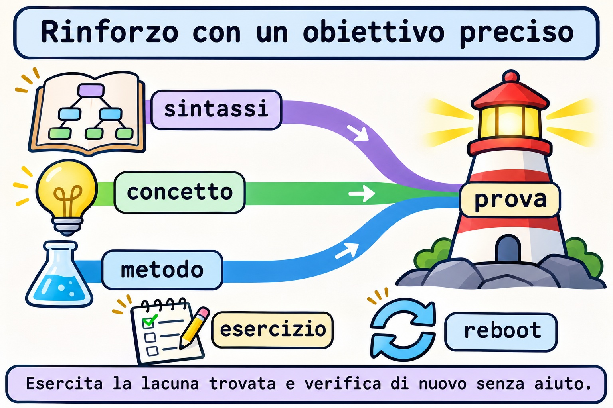

# Lezione 16.4 · Correzione e rinforzo

Il cronometro si è fermato; adesso trasformi i tentativi in decisioni migliori. Lo stesso banco della 16.3 fornisce prove per correggere, verificare, spiegare e scegliere il rinforzo necessario, senza ricominciare l’intero server.

> **Il cuore di questa lezione:** un controllo automatizza criteri espliciti; il rinforzo lavora sulla lacuna rivelata dalle prove.

| Scheda |  |
| --- | --- |
| **Modulo** | M16 · Settimana di incidenti su Rocky 10, lezione 4 di 4 |
| **Quando** | Settimana 22 |
| **Alla fine** | Rivedi le prove, completi i criteri delle due VM e scegli esercizi di rinforzo per le lacune osservate |
| **Prerequisiti** | M0–M15; noVNC, sudo, backup e diario di bordo |
| **Durata** | 60–90 minuti; installazione e ripasso possono richiedere un’altra sessione |
| **Snapshot** | `m16a4-inicio` e `m16a4-fim`, VM 205 e 202 |

## 1 · Riscaldamento

Rispondi senza consultare il materiale. Confronta le soluzioni soltanto alla fine.

1. Quale prova perdi pulendo il banco prima di rivedere il tentativo?

2. Sbagliare l’ordine delle domande equivale sempre a sbagliare la sintassi di un comando?

3. Come definisci un breve esercizio di rinforzo che termini con una prova osservabile?

## 2 · Perché conta

Hai rimesso in funzione la procedura, ma hai speso venti minuti su un’ipotesi non confermata. Un’altra persona ha corretto rapidamente prima del reboot e poi ha scoperto che mancava la persistenza. I due casi richiedono rinforzi diversi.

Questa lezione non crea un nuovo insieme di incidenti. Conclude quello della 16.3, confronta i criteri sulle due famiglie e prepara un piano breve per i punti deboli dimostrati.

## 3 · Modello mentale

Pensa a un’officina con un banco per incidente. L’etichetta del banco delimita dove puoi intervenire. Il diario conserva le misure; lo strumento di riparazione arriva dopo la misura.


*Uno script verifica i criteri; tu spieghi le cause.*

### Ponte Windows

| Riferimento Windows | Domanda equivalente su Linux |
| --- | --- |
| Gestione servizi | La unit è partita e può avviarsi al boot? |
| Visualizzatore eventi | Quale evento è avvenuto in questa esecuzione? |
| ACL e account del servizio | L’utente effettivo riesce a leggere il dato? |
| Procedura di modifica | Quale ipotesi giustifica questa modifica? |

## 4 · L'essenziale

### Stato, dato e spiegazione

`check` deve restituire zero sulla 205 e sulla 202. Inoltre mostri il journal di questo boot, lo stato caricato e il contenuto corrispondente. Il risultato finale senza spiegazione lascia ancora una lacuna.

Il verificatore non è un revisore generale né un sistema inviolabile contro chi dispone di sudo. Misura un contratto didattico. Modificare script, manifesto originale o account di esecuzione per forzare il superamento invalida il tentativo.

### A cosa risponde ogni strumento

| Domanda | Prova |
| --- | --- |
| Il comando esiste? | Percorso della unit e file su disco |
| Il gestore ha caricato la modifica? | `systemctl show -p ExecStart` |
| L’account riesce a leggere? | Test con `sudo -u student` |
| Il contenuto è tornato corretto? | `sha256sum -c` con manifesto originale |
| L’archivio tar corrisponde al disco? | `tar -dzf` |
| È stato eseguito in questo boot? | Risultato e journal del boot attuale |

`tar -dzf` può segnalare anche differenze nei metadati. Nell’esercizio conosci l’origine e puoi ricreare l’archivio dedicato dopo aver ripristinato contenuto e permessi. Sui dati reali esamina ogni differenza prima di accettare un nuovo riferimento.

### Classificare per scegliere l’esercizio

Un errore di sintassi richiede di ricostruire il comando e leggere l’aiuto. Un errore di concetto richiede di spiegare il meccanismo con un piccolo esempio. Un errore di metodo richiede di cambiare l’ordine delle domande e registrare le ipotesi scartate.

Non chiamare tutto distrazione. Se verifichi sempre come root, il problema può riguardare concetto o metodo; ripetere più velocemente la stessa ricetta non lo corregge.

### Rinforzo con risultato osservabile

Ogni punto debole diventa un esercizio di massimo quindici minuti con criterio di completamento. Scrivi il comando che misura il criterio e una breve spiegazione. Alla ripetizione successiva prova senza l’indizio necessario in precedenza.

La sfida del modulo si è già svolta nella 16.3. Questa lezione non crea un superamento parallelo: corregge, rinforza e ripete quel criterio quando necessario.


*L’errore diventa apprendimento quando cambia il comportamento successivo.*

### Rocky × Debian

| Livello | VM 205 | VM 202 |
| --- | --- | --- |
| Sistema | Rocky 10, oppure Rocky 9 se la CPU richiede l’alternativa | Debian 13 |
| Pacchetti | `dnf` e `rpm` | `apt` e `dpkg` |
| Servizi e log | `systemctl` e `journalctl` | `systemctl` e `journalctl` |
| Controllo aggiuntivo | SELinux resta attivo | AppArmor resta attivo quando configurato |
| Incidenti di questo modulo | Alberi dedicati; nessuna modifica a SSH o firewall | Stesso contratto di isolamento |

### Decidi 1

Il controllo passa dopo aver sostituito l’account della unit con root. Il tentativo soddisfa il contratto?

| A | B | C |
| --- | --- | --- |
| Sì, perché basta il ritorno finale | No; occorre ripristinare l’account originale e correggere il meccanismo | Sì, se la modifica non compare nel diario |

## 5 · Lab guidato

Usa soltanto le VM del contratto. Apri noVNC prima di iniziare e conferma il backup. I comandi Proxmox appartengono all’host; gli altri appartengono alla VM indicata.

Nella 16.1 crea e valida la VM 205 prima del suo primo snapshot. Nelle altre lezioni deve già esistere. Non applicare mai un rollback a una VM diversa per recuperare questo banco.

```bash
qm snapshot 205 m16a4-inicio
qm snapshot 202 m16a4-inicio
```

Se il recupero richiede un rollback, interrompi l’esercizio, apri la console e usa lo snapshot iniziale di questa lezione. Annota cosa hai perso e non confondere il ripristino con una diagnosi completata.

```bash
qm rollback 205 m16a4-inicio
qm rollback 202 m16a4-inicio
```

### Passo 1 · Conservare il tentativo prima di riparare

**Ipotesi:** quale prova scompare se pulisci il banco prima della revisione?

Mantieni `m16a3` dalla 16.3. Trasferisci `scripts/m16-coletar.sh` tramite SFTP, controlla l’hash nel manifesto e leggi il file. La raccolta consulta soltanto sistema e oggetti del banco indicato.

```bash
bash -n ~/m16-coletar.sh
sha256sum ~/m16-coletar.sh
less ~/m16-coletar.sh
sudo bash ~/m16-coletar.sh a3
```

**Output atteso:** identità, boot, unit, ultimi eventi e permessi dei file dedicati. Non avvengono riparazioni né chiamate ad altri esercizi. Se una consultazione fallisce, la raccolta conserva gli altri output e termina con ritorno diverso da zero.

**Verifica:** copia nel diario soltanto le prove necessarie, senza dati di altri servizi. Registra se il tentativo è terminato, è stato sospeso o ha superato il tempo.

### Passo 2 · Leggere il risultato per criterio

**Ipotesi:** una riga `FAIL` rivela da sola la causa esatta?

Esegui il verificatore e leggi i suoi controlli nello script originale. Associa ogni ritorno alla domanda corrispondente, senza sostituire lo script con uno che accetti meno criteri.

```bash
sudo bash ~/m16-incidentes.sh a3 check
printf 'check_rc=%s\n' "$?"
systemctl show -p ActiveState -p UnitFileState -p ExecStart m16a3-cadeia.service
sudo journalctl -b -u m16a3-cadeia.service --no-pager -n 30
```

**Output atteso:** lo stato reale del tentativo. Fallire adesso è un’informazione per la revisione, non una ragione per cancellare il registro.

**Verifica:** identifica quale lettura aggiuntiva distingue percorso, configurazione, permessi e integrità.

### Passo 3 · Correggere le cause dimostrate

**Ipotesi:** quale modifica corregge ogni meccanismo senza indebolire la politica del sistema?

Usa le soluzioni commentate della sezione seguente. Confronta ogni file prima di applicare la riparazione; se è già corretto, conserva quello stato. Non eseguire `plant` per rivedere un guasto già risolto.

```bash
systemctl cat m16a3-cadeia.service
sudo cat /srv/m16a3/config
stat -c '%a %U:%G %n' /srv/m16a3/conteudo.txt
sudo -u student cat /srv/m16a3/conteudo.txt
```

**Output atteso:** prove sufficienti per scegliere le riparazioni necessarie. Il manifesto originale resta intatto.

**Verifica:** l’esecuzione riparte usando `student`, l’esecutore originale e le protezioni esistenti. Spiega perché ogni riparazione è stata necessaria.

### Passo 4 · Ripetere il criterio completo

**Ipotesi:** la soluzione candidata può ancora dipendere da un avvio manuale?

Dopo le riparazioni riavvia soltanto la unit dedicata ed esegui il controllo su entrambe le VM.

```bash
sudo systemctl restart m16a3-cadeia.service
sudo bash ~/m16-incidentes.sh a3 check
```

**Reboot di verifica:** riavvia ogni VM dalla console. Poi esegui soltanto controllo e raccolta; non avviare manualmente la procedura prima di misurare.

```bash
sudo systemctl reboot
```

```bash
sudo bash ~/m16-incidentes.sh a3 check
sudo bash ~/m16-coletar.sh a3
```

**Output atteso:** ritorno zero su entrambe le VM, risultati del boot attuale e account originale.

**Verifica:** allega la spiegazione di ogni meccanismo alla prova corrispondente. Adesso hai la conclusione tecnica della 16.3.

### Passo 5 · Preparare il piano di rinforzo

**Ipotesi:** ripetere tutto dall’inizio tratta la lacuna meglio di un esercizio scelto in base alle prove?

Crea nel diario una riga per ogni difficoltà reale. Usa la tabella come scheda da compilare; non presume che tu abbia commesso tutti gli errori.

| Prova del tentativo | Categoria | Esercizio di massimo 15 min | Come verificare |
| --- | --- | --- | --- |
| Comando o osservazione reale | Sintassi, concetto o metodo | Una capacità per sessione | Criterio e spiegazione osservabili |

**Output atteso:** da uno a tre esercizi prioritari, ciascuno con criterio chiaro. Se non ci sono stati errori, scegli l’ipotesi che ha richiesto più tempo e migliora l’ordine delle domande.

**Verifica:** programma il ripasso a D+1, D+3, D+7 e D+21. Scegli una domanda breve per ogni carta, evitando di copiare un’intera ricetta.

### Passo 6 · Spiegare e chiudere il banco

**Ipotesi:** riesci a prevedere il risultato se ricompare una delle cause?

Spiega la catena senza consultare la soluzione. Se su una VM manca ancora il criterio della 16.3, ripeti il tentativo dopo il rinforzo, mantenendo un registro separato dal primo tempo.

```bash
sudo bash ~/m16-incidentes.sh a3 check
```

**Output atteso:** controllo completo e spiegazione personale. Un secondo tentativo deve dichiarare che ci sono state esercitazioni tra le misure.

**Verifica:** conserva i risultati, esegui la pulizia della chiusura e crea lo snapshot finale soltanto dopo aver confermato l’ambito pulito.

### Decidi 2

Conosci i comandi, ma misuri ripetutamente l’accesso come root. Quale esercizio tratta la lacuna?

| A | B | C |
| --- | --- | --- |
| Confrontare l’accesso come root e account del servizio, spiegando la differenza | Rifare l’intera installazione senza un criterio specifico | Memorizzare l’output finale senza eseguirlo |

## 6 · Rompi e ripara

Lavora su un guasto alla volta. Prima di consultare la riparazione, scrivi il comando che sosterrebbe la tua ipotesi. Non trasformare una difficoltà locale in una modifica globale.

### Guasto 1 · La unit punta all’esecutore sbagliato

**Sintomo:** il primo tentativo fallisce prima di validare i dati.

**Indagine:** confronta `systemctl cat`, `systemctl show -p ExecStart` e i file della cartella dedicata.

**Causa:** l’introduzione del guasto ha sostituito `run.sh` con `ausente.sh` nella unit dedicata.

**Riparazione:** ripristina soltanto il riferimento, valida il file e ricarica il gestore.

```bash
sudo sed -i 's|/m16a3/ausente.sh|/m16a3/run.sh|' /etc/systemd/system/m16a3-cadeia.service
sudo systemd-analyze verify /etc/systemd/system/m16a3-cadeia.service
sudo systemctl daemon-reload
```

**Verifica:** il comando caricato torna a puntare all’esecutore originale. L’esecuzione può adesso rivelare la causa successiva.

**Prevenzione:** controlla riferimenti e differenze tra file salvato e configurazione caricata.

### Guasto 2 · Configurazione e accesso non soddisfano il contratto

**Sintomo:** l’esecutore esiste, ma la validazione iniziale oppure la lettura fallisce.

**Indagine:** leggi la riga di configurazione e verifica il dato con `student`, invece di usare soltanto root.

**Causa:** `MODE=errado` viola il contratto e i permessi `0000` impediscono la lettura dell’account. Sono due cause distinte.

**Riparazione:** ripristina la configurazione nota e i permessi di questo file pubblico di esercitazione.

```bash
printf '%s\n' 'MODE=ok' | sudo tee /srv/m16a3/config >/dev/null
sudo chmod 0644 /srv/m16a3/conteudo.txt
sudo -u student cat /srv/m16a3/conteudo.txt
```

**Verifica:** la lettura deve funzionare, ma il contenuto deve ancora corrispondere al manifesto originale. L’accesso non dimostra l’integrità.

**Prevenzione:** valida formato e accesso come domande separate prima di avviare la procedura.

### Guasto 3 · Contenuto e archivio sono stati alterati

**Sintomo:** l’esecutore legge, ma l’hash oppure il confronto dell’archivio tar fallisce.

**Indagine:** verifica con il manifesto originale, elenca l’archivio completo e confrontalo con il disco.

**Causa:** l’introduzione del guasto ha cambiato i byte di `conteudo.txt` e ha sostituito l’archivio compresso con testo.

**Riparazione:** ripristina i byte noti di questo banco e ricrea soltanto il suo archivio temporaneo. Non generare un nuovo manifesto su contenuti sbagliati.

```bash
printf '%s\n' 'curso-m16-ok' | sudo tee /srv/m16a3/conteudo.txt >/dev/null
(cd /srv/m16a3 && sha256sum -c SHA256SUMS)
sudo tar -czf /srv/m16a3/pacote.tar.gz -C /srv/m16a3 conteudo.txt
(cd /srv/m16a3 && tar -dzf pacote.tar.gz)
sudo systemctl enable m16a3-cadeia.service
sudo systemctl restart m16a3-cadeia.service
sudo bash ~/m16-incidentes.sh a3 check
```

**Verifica:** tutti i criteri passano prima e dopo il reboot. Per dati reali sconosciuti il ripristino richiede un’origine affidabile; il testo noto qui è soltanto materiale temporaneo di esercitazione.

**Prevenzione:** conserva riferimenti affidabili, verifica gli archivi prodotti e misura l’esecuzione completa.



*Esercita la lacuna trovata e verifica di nuovo senza aiuto.*

## 7 · Trappole

- Cambiare più cose tra due misure cancella il legame tra causa e risultato.

- Un vecchio messaggio nel journal non descrive necessariamente l’ultimo tentativo. Usa il boot e la unit corretti.

- Un file salvato non garantisce che il gestore abbia caricato la modifica.

- Un comando eseguito come root non misura i permessi dell’account del servizio.

- Lo script di controllo copre il contratto dichiarato; non promette di verificare l’intero server.

## 8 · Quiz

Rispondi prima di leggere le soluzioni. Spiega il motivo, oltre al comando.

1. Perché modificare il controllore per accettare meno criteri invalida la revisione?

2. L’hash originale torna corretto. Questo garantisce da solo che l’archivio tar corrisponda al disco?

3. Perché ricalcolare il manifesto su contenuti sbagliati non ripristina l’integrità?

4. Come distingui un errore di concetto da uno di sintassi scegliendo il prossimo esercizio?

5. Cosa registri quando un secondo tentativo avviene dopo esercitazioni e aiuto?

6. Quale sequenza consente di concludere senza perdere prove e senza lasciare oggetti del lab?

## 9 · Promemoria

| Domanda | Strumento |
| --- | --- |
| Cosa conservi prima della riparazione? | `sudo bash ~/m16-coletar.sh a3` e diario del tentativo |
| Il riferimento dei byte è stato ripristinato? | `sha256sum -c` con il manifesto originale |
| L’archivio corrisponde al disco? | `tar -dzf` e lettura delle differenze |
| Quale lacuna richiede esercizio? | Prova classificata in sintassi, concetto o metodo |
| Quando pulire? | Dopo la prova successiva al boot e la conservazione delle evidenze |

**Flashcard:** crea da 5 a 10 carte. Includi una domanda di metodo, una sulla lettura degli errori, una sui permessi, una sulla persistenza e una su un tuo errore. Ripassa a D+1, D+3, D+7 e D+21.

## 10 · Checklist e chiusura

### Pulizia e passaggio al modulo successivo

Conserva nel diario il risultato e la spiegazione prima di rimuovere il banco. Su entrambe le VM l’azione seguente disabilita e ferma soltanto la unit dedicata e rimuove i file noti.

```bash
sudo bash ~/m16-incidentes.sh a3 cleanup
systemctl list-unit-files 'm16a3-*' --no-pager
systemctl --failed --no-pager
```

Non usare eliminazioni ricorsive per aggirare una cartella con file extra. Identifica il file, copia nel diario le prove necessarie e rimuovi soltanto ciò che hai creato e riconosci.

Conserva la VM 205, la VM 202 e l’inventario. Il criterio di passaggio resta la 16.3 completa dopo il reboot sulle due famiglie, con spiegazione delle cause e piano di rinforzo per le lacune osservate.

- [ ] Ho conservato l’ipotesi iniziale e la prova che l’ha confermata o scartata.

- [ ] Ho confermato l’utente effettivo, il percorso e il boot a cui appartiene ogni risultato.

- [ ] Ho spiegato ogni modifica e controllato il risultato dopo il reboot.

- [ ] Ho mantenuto intatti servizi e file esterni al banco.

```bash
qm snapshot 205 m16a4-fim
qm snapshot 202 m16a4-fim
```

**Ultimo esercizio:** spiega ad alta voce un’ipotesi sbagliata e la prova che ti ha fatto cambiare idea.

## 11 · Nella vita reale

Su un server che amministri o sei autorizzato a osservare, esegui soltanto letture. Identifica la versione, una unit pertinente e il journal del boot attuale. Non introdurre guasti e non copiare gli script di esercitazione su quel server.

```bash
cat /etc/os-release
systemctl --failed --no-pager
journalctl -b -p warning --no-pager -n 30
```

Annota quali dati mancherebbero per autorizzare una modifica. Non registrare password, chiavi private o contenuti degli utenti.

## 12 · Approfondire quando vuoi

- [Rocky Linux 10: modifiche della versione principale](https://docs.rockylinux.org/latest/releases/release_notes/10_0/).

- [systemd: servizio e ciclo di esecuzione](https://www.freedesktop.org/software/systemd/man/latest/systemd.service.html).

- [systemd: verificare le unit prima dell’esecuzione](https://www.freedesktop.org/software/systemd/man/latest/systemd-analyze.html).

- [GNU tar: confrontare e verificare archivi](https://www.gnu.org/software/tar/manual/html_node/compare.html).

- [Linux man-pages: caricatore e capacità hardware](https://man7.org/linux/man-pages/man8/ld.so.8.html).

Sul sistema stesso preferisci anche i manuali installati e la documentazione del pacchetto. Le versioni locali delimitano le opzioni che hai davvero.

```bash
man systemctl
man journalctl
man systemd.service
man tar
ls /usr/share/doc
```

Con DeepTutor conserva la diagnosi prima di chiedere la soluzione. I prompt restano identici nelle due versioni di questa lezione.

`!explica 16.4 diagnóstico com evidência e persistência depois do reboot`

`!feynman 16.4 vou explicar minha hipótese, a causa e como provei a correção`

`!quiz 16.4`

### Soluzioni commentate

**Riscaldamento:** la pulizia può rimuovere configurazione, risultati e il legame tra guasto e riparazione. Metodo, concetto e sintassi richiedono esercizi diversi. Scegli una capacità, fino a quindici minuti, un comando di verifica e una spiegazione personale.

**Decidi 1:** B. L’account originale fa parte del contratto. Usare root per aggirare un guasto cambia la domanda invece di dimostrare la riparazione attesa.

**Decidi 2:** A. L’esercizio confronta i privilegi e richiede di spiegare il meccanismo osservato. Ripetere un’intera installazione o memorizzare l’output non tratta questa lacuna specifica.

1. Il risultato risponderebbe a un’altra domanda. Conserva il contratto originale e correggi le cause che impediscono i suoi criteri, mantenendo la spiegazione di ogni modifica.

2. No. Il manifesto valida i byte del contenuto referenziato. Il confronto dell’archivio tar con il disco è un’altra verifica e può rilevare anche differenze nei metadati.

3. Sostituisce il riferimento affidabile con un altro che accetta l’errore. Ripristina il contenuto noto e confrontalo con il manifesto originale conservato.

4. La sintassi richiede di ricostruire il comando e capirne gli argomenti. Il concetto richiede di spiegare perché il meccanismo funziona e prevederne il risultato in un piccolo esempio.

5. Conserva il primo tempo, dichiara esercitazioni e aiuto ricevuto e mantieni separato il secondo tempo. Confronta criteri e ragionamento senza riscrivere la storia del tentativo iniziale.

6. Dimostra il contratto dopo il reboot su entrambe le VM, conserva risultati e spiegazioni, scegli gli esercizi di rinforzo e soltanto dopo pulisci l’elenco dedicato e controlla l’ambito prima dello snapshot finale.

[← Lezione 16.3 · Incidente con cronometro](16.3-incidente-com-relogio.md) · [Indice delle lezioni](../01-aulas.md) · [Piano del corso: M17 in poi →](../00-plano-do-curso.md)
