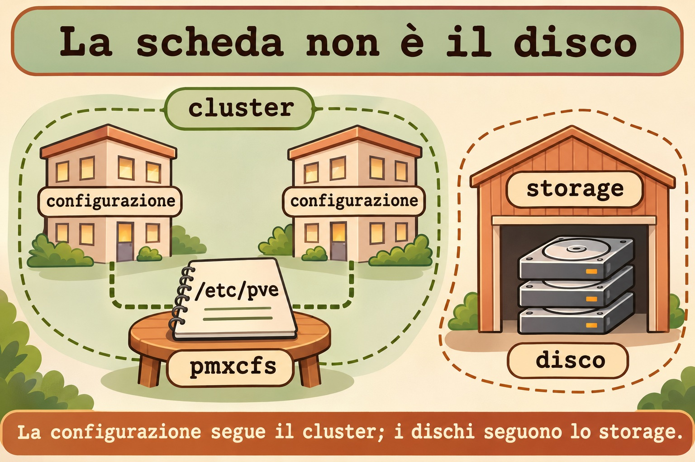

# Lezione 17.1 · Proxmox dall'interno

> **Il cuore di questa lezione:** individua il livello del guasto prima di modificare l'host.

| Scheda | Piano di lavoro |
|---|---|
| Modulo | M17 · Proxmox in pratica, lezione 1 di 7 |
| Quando | Settimana 22 |
| Alla fine | Collegare host, API, configurazione, storage e task |
| Prerequisiti | Accesso amministrativo autorizzato al laboratorio e console disponibile |
| Durata | 80–100 minuti |
| Snapshot | Non applicabile: questa lezione consulta soltanto l'host |

Questa è l'entrata nel modulo: amministrerai il laboratorio che sostiene le altre VM.
Un comando sull'host ha una portata diversa dallo stesso comando dentro un guest.
Mantieni aperta la sessione della console durante tutta l'indagine.
I guest esistenti da 201 a 205 rimangono preservati.
Gli ID 210, 211 e 212 saranno usati soltanto se liberi nell'intero cluster.

## 1 · Riscaldamento

Senza consultare la procedura, scrivi una risposta di due righe per ogni domanda.

1. L'interfaccia web non si apre. Questo dimostra che le VM sono ferme?
2. Una configurazione compare su due nodi. Questo dimostra che anche il disco è su entrambi?
3. Un comando restituisce un errore di VM inesistente. L'ID può trovarsi su un altro nodo?

### Diagnosi iniziale

Scrivi, senza eseguire, come creeresti una VM e dimostreresti che funziona.
Aggiungi come eseguiresti backup, ripristino e migrazione.
Segna con un punto interrogativo ogni passaggio per cui non sai ancora ottenere una prova.
Conserva questa lista: la riprenderai nell'ultima lezione del modulo.
Non eseguire questo piano iniziale; prima scopriamo l'ambiente reale.

**Ipotesi:** quale componente può guastarsi senza spegnere un processo di VM?

## 2 · Perché conta

Un hypervisor non è una scatola che risponde soltanto tramite la pagina web.
Ha un sistema operativo, processi, servizi, file di configurazione e percorsi dei dischi.
Un problema di autenticazione richiede un'indagine diversa da un volume non disponibile.
Riavviare servizi alla cieca mescola i sintomi e può interrompere ciò che funzionava ancora.

In questa lezione produci una mappa delle prove, senza modificare la configurazione dell'host.
Questa mappa sarà il riferimento prima di creare il laboratorio nelle prossime lezioni.
Registra ora, nodo, comando e conclusione, senza copiare token o file privati.

### Ponte Windows

Pensa alla differenza tra una console amministrativa, un servizio e la VM che continua a funzionare.
La finestra che mostra una risorsa non è la risorsa stessa.
La stessa cautela vale quando interpreti l'interfaccia web di Proxmox.

## 3 · Modello mentale


*Conferma host, servizio e guest prima di agire.*

| Livello | Domanda utile | Prova iniziale |
|---|---|---|
| Host | Su quale sistema sono? | Versione e kernel |
| Servizi | Chi risponde all'interfaccia e all'API? | Unità e journal |
| Configurazione | A chi appartiene questo guest? | Risorse del cluster |
| Storage | Dove sono i byte? | Volume e disponibilità |
| Guest | Il sistema interno risponde? | Console e servizi interni |

L'host usa Debian con pacchetti, kernel e servizi propri di Proxmox VE.
Non applicargli automaticamente la procedura che useresti in una normale VM Debian.
Il proxy web gestisce le connessioni; il daemon privilegiato esegue le operazioni dell'API.
Un processo di VM può continuare anche quando la pagina smette di rispondere.

Il filesystem di configurazione del cluster non è una condivisione dei dischi delle VM.
Organizza la configurazione e la sua replica tra i nodi.
In un cluster senza quorum diventa di sola lettura per proteggere la coerenza.
Questo non autorizza a forzare il quorum in questa lezione.

## 4 · L'essenziale

| Strumento | Ambito | Uso qui |
|---|---|---|
| `pveversion` | Software dell'host | Identificare le versioni |
| `pvesh` | API locale | Consultare gli oggetti |
| `qm` | VM del nodo | Consultare stato e scheda |
| `pct` | Container del nodo | Distinguere i tipi |
| `pvesm` | Storage | Consultare la disponibilità |
| `pvenode` | Nodo e task | Leggere un'esecuzione identificata |

Usa l'aiuto dell'installazione prima di adattare opzioni trovate in un'altra versione.
I comandi di questa lezione sono di consultazione.
Non ci sono riavvii di servizi, modifiche ai file o creazioni di guest sull'host.

```bash
pveversion --help
pvesh help get
qm help config
pvenode help task
```

Non confondere lo stato attuale con il risultato di un task precedente.
Non pubblicare un elenco completo della configurazione che contenga dati sensibili.
Annota soltanto i campi necessari per giustificare la tua decisione.

## 5 · Lab guidato


### Passo 1 · Identificare l'host

**Ipotesi:** Quale prova collega questo terminale al nodo corretto?


Accedi tramite la console amministrativa autorizzata del nodo.
Conferma che non sei dentro una delle VM del corso.

```bash
hostname
cat /etc/os-release
uname -r
pveversion -v
systemd-detect-virt
```

**Output atteso:** identità reale del nodo, base Debian e pacchetti di Proxmox.
I numeri dipendono dall'aggiornamento installato; non copiare numeri da una vecchia schermata.
Un nodo annidato può indicare virtualizzazione; questo non lo rende un guest di esercizio.

**Verifica:** quale prova collega il terminale al nodo mostrato dall'interfaccia?
Registra il nome del nodo e la versione principale nel tuo diario locale.
Non proseguire se non riesci a identificare il terminale con sicurezza.


### Passo 2 · Consultare l'inventario del cluster

**Ipotesi:** l'elenco locale mostra tutti i guest di tutti i nodi?

```bash
pvesh get /nodes --output-format json-pretty
pvesh get /cluster/resources --type vm --output-format json-pretty
qm list
pct list
```

**Output atteso:** risorse con ID, nodo proprietario, tipo e stato.
Confronta la vista del cluster con i due elenchi locali.
Una VM di un altro nodo non deve necessariamente comparire nell'elenco locale.
Un container non diventa una VM perché ha un numero simile.

Registra se gli ID 210, 211 e 212 compaiono su un qualsiasi nodo.
Se uno è occupato, segna il laboratorio come bloccato per la creazione e fermati prima della prossima lezione.
Non eliminare l'oggetto esistente per liberare un numero della procedura.
Lo stesso inventario sarà ripetuto subito prima di creare gli oggetti.

**Verifica:** identifica una differenza concreta tra ambito locale e ambito del cluster.


### Passo 3 · Separare servizio e guest

**Ipotesi:** Un servizio attivo dimostra che la connessione remota lo raggiunge?


Non provocare un'indisponibilità per imparare a riconoscerla.
Leggi lo stato attuale dei servizi e l'intervallo recente del journal.

```bash
systemctl is-active pveproxy pvedaemon pvestatd pve-cluster
systemctl status pveproxy pvedaemon --no-pager
journalctl -b -u pveproxy -u pvedaemon --since '-20 min' --no-pager
```

**Output atteso:** stati e messaggi reali, compresa l'assenza di eventi nell'intervallo.
Un journal vuoto in questa finestra non dimostra che non ci sia mai stato un errore.
Anche un'unità attiva non dimostra che un browser remoto raggiunga la porta.

```bash
ss -ltnp 'sport = :8006'
```

Osserva l'indirizzo di ascolto e il processo, senza modificare firewall o certificato.
Se il servizio è attivo e in ascolto, il passo successivo può riguardare il percorso di rete.
Questo non esonera dal controllare il messaggio concreto del client.

**Verifica:** scrivi un'affermazione dimostrata dalla consultazione e un'altra che non dimostra.

### Passo 4 · Trovare la scheda senza modificarla

**Ipotesi:** La scheda contiene i byte del disco?



*La configurazione segue il cluster; i dischi seguono lo storage.*

Scegli una VM esistente dall'inventario soltanto per la lettura.
Esegui la consultazione sul nodo proprietario e indica l'ID reale quando richiesto.

```bash
read -r -p 'VMID existente para leitura: ' VMID_LEITURA
qm status "$VMID_LEITURA"
qm config "$VMID_LEITURA"
findmnt /etc/pve
ls -ld /etc/pve/qemu-server /etc/pve/nodes
```

**Output atteso:** configurazione della VM scelta e montaggio del filesystem di configurazione.
Cerca le righe di disco, rete e boot nella scheda.
Un identificatore di volume non contiene i byte del disco stesso.
Non leggere directory private e non modificare direttamente i file di configurazione.

```bash
pvesm status
```

**Verifica:** associa una riga di disco a uno storage elencato.
Se risulta non disponibile, registra il fatto; questa lezione non ripara il backend.
Non concludere che un volume sia accessibile soltanto perché il nome è nella configurazione.

### Passo 5 · Leggere un task identificato

**Ipotesi:** Un vecchio task descrive lo stato attuale del guest?


*Leggi il task corretto e controlla il risultato osservato.*

Consulta l'aiuto locale e un elenco breve dei task recenti del nodo.

```bash
pvenode help task list
pvenode task list --limit 10
```

Scegli un UPID reale dall'elenco e copia il valore intero, senza inventare un esempio.
Se non ci sono task, registralo e usa il journal del passo precedente come prova disponibile.
Esegui le prossime consultazioni soltanto se hai selezionato un task esistente.

```bash
read -r -p 'UPID real da lista: ' UPID_LEITURA
pvenode task status "$UPID_LEITURA"
pvenode task log "$UPID_LEITURA"
```

**Output atteso:** stato e righe del task selezionato.
Collega il tipo di task, l'ID coinvolto e l'ora.
Un task concluso con successo dimostra il risultato di quell'operazione, in quel momento.
Non dimostra che il sistema interno del guest continui a funzionare correttamente ore dopo.

**Verifica:** trova la prima riga che spiega un errore, se presente.
Non inventare un guasto quando il log mostra soltanto un successo.

### Passo 6 · Completare la mappa delle prove

**Ipotesi:** Quali limiti devono accompagnare la conclusione?

Nel tuo diario, completa una riga per livello.

| Livello | Comando usato | Fatto osservato | Prossima domanda |
|---|---|---|---|
| Host | Versione e kernel | Compila con il dato reale | Il terminale è il nodo giusto? |
| Servizi | Stato e journal | Compila con il dato reale | Ci sono ascolto ed errori nell'intervallo? |
| Configurazione | Inventario e scheda | Compila con il dato reale | Chi possiede l'ID? |
| Storage | Disponibilità | Compila con il dato reale | Il volume è accessibile? |
| Task | Stato e log | Compila con il dato reale | Il risultato corrisponde ancora allo stato attuale? |

**Verifica:** un'altra persona riesce a ripetere la tua conclusione senza aprire file privati?
Se no, aggiungi ambito e ora, invece di accumulare altri output senza contesto.

**Output atteso:** mappa con nodo, ora e limiti di ogni prova.


## 6 · Rompi e ripara

I tre guasti seguenti usano la lettura o il ragionamento sulle annotazioni.
Non arrestare i servizi dell'host per creare il sintomo.

### Guasto 1 · L'ID esiste, ma non su questo nodo

**Sintomo:** una consultazione locale indica che la configurazione non esiste.
**Indagine:** cerca l'ID nell'inventario completo e leggi il campo del nodo.
**Causa:** lo strumento locale è stato usato sul proprietario sbagliato.
**Riparazione:** collegati al nodo proprietario e ripeti soltanto la consultazione.
**Verifica:** lo stesso ID e tipo compaiono nel cluster e nella consultazione locale corretta.
**Prevenzione:** registra insieme nodo, ID e tipo prima di qualsiasi azione.

### Guasto 2 · L'intervallo nasconde l'evento

**Sintomo:** il journal recente non mostra l'errore annotato ieri.
**Indagine:** confronta l'ora dell'annotazione con l'avvio e la finestra consultati.

```bash
journalctl --list-boots --no-pager
```

**Causa:** la selezione temporale non include l'evento; anche la conservazione può aver rimosso registrazioni.
**Riparazione:** seleziona un avvio e un intervallo esistenti, usando l'aiuto del journal.
**Verifica:** la data della prima riga coincide con il periodo esaminato.
**Prevenzione:** registra l'istante del sintomo e conserva la prova pertinente.

### Guasto 3 · La scheda è stata confusa con il disco

**Sintomo:** un'annotazione afferma che i dischi sono stati replicati perché la configurazione compare su un altro nodo.
**Indagine:** separa il percorso della scheda dall'identificatore di volume e dal backend.
**Causa:** la configurazione distribuita è stata interpretata come copia automatica dei dati.
**Riparazione:** riscrivi la conclusione e cita il tipo reale di storage.
**Verifica:** la tua spiegazione permette di distinguere storage condiviso e disco locale.
**Prevenzione:** tratta scheda, volume e backup come oggetti diversi.

## 7 · Trappole

### Decidi 1

La pagina non si apre, ma una VM risponde tramite il servizio interno. Il primo passo è:

A. Riavviare tutti i guest.
B. Consultare servizio, ascolto e messaggi dell'interfaccia.
C. Eliminare la configurazione della VM che risponde.

Scegli e giustifica con due prove indipendenti.

### Decidi 2

Un ID riservato risulta occupato su un altro nodo. Devi:

A. Creare lo stesso ID su questo nodo.
B. Eliminare l'oggetto per seguire la numerazione.
C. Interrompere la creazione e risolvere la prenotazione con chi amministra il laboratorio.

Una numerazione didattica non autorizza a sostituire una risorsa esistente.

### Rocky × Debian

Le VM del corso possono usare distribuzioni diverse.
L'host Proxmox continua a seguire la procedura propria dell'hypervisor.
Scegli prima la macchina giusta; soltanto dopo scegli il gestore dei pacchetti.

## 8 · Quiz

1. Che cosa aggiunge la versione del kernel all'identificazione della base Debian?
2. Perché un'unità attiva non dimostra l'accesso remoto all'interfaccia?
3. Quale consultazione permette di trovare un ID fuori dal nodo attuale?
4. Il filesystem di configurazione del cluster replica automaticamente i dischi locali?
5. Perché conservare l'UPID intero invece dell'ultimo testo del log?
6. Che cosa fare se non ci sono registrazioni nell'intervallo consultato?

Rispondi prima di aprire le soluzioni.

## 9 · Promemoria

**Flashcard:** completa a memoria la seconda colonna.

| Fronte | Retro |
|---|---|
| Pagina non disponibile | Da sola non determina lo stato dei guest |
| Configurazione del cluster | Descrive il guest; non contiene il suo disco |
| Consultazione locale | Dipende dal nodo proprietario |
| Task | Ha identità, tempo e risultato propri |

```text
!explica Por que uma interface indisponível não prova que a VM parou?
!feynman Explique configuração de cluster e disco de VM sem confundir os dois.
!quiz Faça uma pergunta por vez sobre escopo local, tarefa e journal.
```

I tre comandi di studio sopra rimangono uguali nelle due versioni della lezione.

## 10 · Checklist e chiusura

- [ ] Ho identificato il terminale e il nodo reale.
- [ ] Ho confrontato la vista locale con l'inventario del cluster.
- [ ] Ho registrato la situazione degli ID 210, 211 e 212.
- [ ] Ho letto stati e log senza riavviare servizi.
- [ ] Ho distinto configurazione, volume e task.
- [ ] Ho preservato i guest esistenti.

**Ultimo esercizio:** produci un resoconto di cinque frasi su una prova reale raccolta.
Includi sintomo o domanda, ambito, ora, osservazione e limite della conclusione.
Un'altra persona deve poter trovare la stessa informazione senza ricevere accesso a segreti.

**Reboot di verifica:** non riavviare l'host o i guest in questa lezione di lettura.
La verifica consiste nel ripetere una breve consultazione e controllare che sei ancora sullo stesso nodo.
Non ci sono risorse create da rimuovere e non ci sono snapshot da ripristinare.
Conserva soltanto il tuo diario; le consultazioni non richiedono pulizia dell'host.

## 11 · Nella vita reale

Chiedi a un collega di descrivere un vecchio guasto senza rivelare la soluzione.
Prepara una sequenza di tre consultazioni, tutte di lettura.
Per ciascuna, indica quale ipotesi conferma o indebolisce.
Se la prova necessaria contiene un segreto, chiedi una versione ridotta e autorizzata.
Non provare a riprodurre un'interruzione sull'host reale.

Un buon resoconto termina con una prossima domanda verificabile.
Non termina con un riavvio usato al posto dell'indagine.

## 12 · Approfondire quando vuoi

Consulta la documentazione corrispondente alla versione installata.
Il manuale locale è il riferimento immediato quando un'opzione è diversa.

- [Configurazione del cluster e quorum](https://github.com/proxmox/pve-docs/blob/master/pmxcfs.adoc).
- [Comandi del nodo e task](https://github.com/proxmox/pve-docs/blob/master/generated/pvenode.1-synopsis.adoc).
- [Manuale di amministrazione Proxmox VE](https://pve.proxmox.com/pve-docs/pve-admin-guide.html).

### Soluzioni commentate

**Riscaldamento 1:** no; interfaccia, API e processo della VM sono componenti diversi.
**Riscaldamento 2:** no; devi identificare il backend e la disponibilità del volume.
**Riscaldamento 3:** sì; la vista del cluster individua il proprietario prima della consultazione locale.

**Decidi 1: B.** Preserva il guest che risponde e indaga il percorso dell'interfaccia.
Lo stato dell'unità e l'ascolto sono prove diverse; può ancora esistere un problema di rete.
**Decidi 2: C.** L'ID è unico nel cluster e la prenotazione va risolta senza eliminare oggetti.

**Quiz 1:** identifica il kernel in uso, che può essere specifico dell'hypervisor.
**Quiz 2:** ascolto, percorso, firewall, client e autenticazione sono passaggi distinti.
**Quiz 3:** consulta le risorse del cluster e osserva il nodo proprietario.
**Quiz 4:** no; configurazione distribuita non equivale a replica dei byte.
**Quiz 5:** collega la lettura all'operazione corretta ed evita di mescolare task.
**Quiz 6:** controlla finestra, avvio e conservazione; registra l'assenza se il dato non è disponibile.

[← Lezione 16.4 · Correzione e rinforzo](16.4-correcao-e-reforco.md) · [Indice delle lezioni](../01-aulas.md) · [Lezione 17.2 · VM dalla riga di comando →](17.2-vm-pela-linha-de-comando.md)
