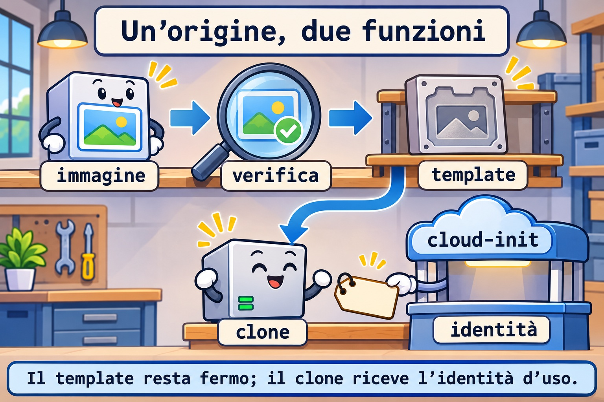
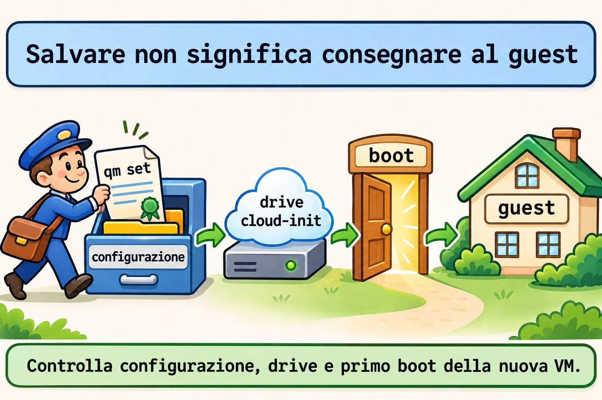

# Lezione 17.2 · VM dalla riga di comando

> **Il cuore di questa lezione:** trasforma un'immagine verificata in template e consegna l'identità al clone prima del primo avvio.

| Scheda | Piano di lavoro |
|---|---|
| Modulo | M17 · Proxmox in pratica, lezione 2 di 7 |
| Quando | Settimana 22 |
| Alla fine | Creare template 210 e clone completo 211 con rete, chiave e console verificati |
| Prerequisiti | Lezione precedente, ID liberi, storage e indirizzo riservati, chiave pubblica disponibile |
| Durata | 120–150 minuti, oltre al download |
| Snapshot | Creare soltanto sulla VM 211, dopo il primo avvio verificato |

Il laboratorio usa template 210 e VM 211; il CT 212 rimane riservato alla prossima lezione.
I nomi sono `m17-template`, `m17-vm` e, più avanti, `m17-ct`.
I guest da 201 a 205 rimangono intatti.
Gli ID temporanei di questo modulo saranno liberati nella pulizia finale prima del loro uso futuro nel M24.
Esegui sull'host soltanto i comandi esplicitamente indicati; i comandi interni hanno un blocco dedicato.

## 1 · Riscaldamento

1. Qual è la differenza tra scaricare un'immagine e verificarne l'origine?
2. Se il template è già stato avviato, quali identità può aver preparato per la copia?
3. Una configurazione di rete salvata sull'host dimostra che il guest l'ha applicata?

**Ipotesi:** il template sarà avviato in un qualsiasi momento di questa lezione?
Rispondi prima di aprire il terminale.

## 2 · Perché conta

Una VM creata in fretta può funzionare una volta e guastarsi quando la cloni o la migri.
Il problema può riguardare la CPU esposta, il disco di avvio o l'identità già scritta nell'origine.
Può anche essere un indirizzo scelto senza prenotazione, in conflitto con un altro dispositivo.

Distinguerai quattro prove: origine dell'immagine, configurazione sull'host, dati di inizializzazione e risultato nel guest.
Un comando riuscito a un livello non sostituisce il controllo di quello successivo.
Alla fine la VM 211 rimane disponibile per storage, rete e backup nelle prossime lezioni.

### Ponte Windows

Pensa a un'immagine preparata per la distribuzione e a un'installazione già usata da qualcuno.
Copiare il disco non garantisce di pulire identità, indirizzo e credenziali.
Qui usiamo un'immagine cloud ufficiale, preservandone il meccanismo del primo avvio.

## 3 · Modello mentale



*Il template resta fermo; il clone riceve l’identità d’uso.*

| Oggetto | Ruolo in questa lezione | Cosa evitare |
|---|---|---|
| Immagine ufficiale | Origine verificata del disco | Sostituirla con un file senza provenienza |
| Template 210 | Modello spento e mai inizializzato qui | Avviarlo per provare |
| Clone 211 | Macchina di lavoro con copia completa | Usare un indirizzo non prenotato |
| Drive di inizializzazione | Trasporto dei dati di cloud-init | Confonderlo con il disco del sistema |

Il clone completo possiede volumi propri; l'origine rimane ferma.
Questo occupa più spazio di un clone collegato al disco base, ma semplifica il laboratorio.
Le identità vengono generate al primo avvio del clone a partire da un'origine preparata per questo.
Non pulire le identità dell'host o dei vecchi guest.

## 4 · L'essenziale

| Decisione | Valore del laboratorio | Motivo |
|---|---|---|
| CPU | `x86-64-v2-AES` | Contratto comune tra i nodi compatibili |
| Firmware e macchina | `ovmf` e `q35` | Avvio UEFI e hardware definito |
| Controller | `virtio-scsi-pci` | Disco VirtIO con percorso esplicito |
| Disco del sistema | `scsi0`, almeno 20 GiB | Separarlo dai futuri dischi di esercizio |
| Storage | `vm-hdd`, backend RBD | Storage già predisposto nel piano |
| Rete iniziale | `net0`, bridge `vmbr0` | Indirizzo reale prenotato del laboratorio |

Non sostituire il modello di CPU con il passaggio diretto della CPU dell'host per aggirare il controllo.
L'insieme completo delle funzioni deve esistere su tutti i nodi candidati alla migrazione.
Controllare una sola istruzione, come AVX2, non convalida questo contratto.

Le variabili di rete saranno compilate con dati reali forniti da chi amministra la rete.
Non c'è un indirizzo inventato da incollare per scoprire dopo se fosse libero.
La console deve rimanere accessibile anche quando SSH non funziona ancora.

## 5 · Lab guidato


### Passo 1 · Controllare le condizioni di creazione

**Ipotesi:** Quale condizione mancante impedisce di creare il laboratorio?


Sull'host autorizzato, ripeti l'inventario di tutti i nodi.

```bash
pvesh get /cluster/resources --type vm --output-format json-pretty
pvesm status
pvesh get /storage/vm-hdd --output-format json-pretty
ip -br link show vmbr0
lscpu
grep '^flags' /proc/cpuinfo | sort -u
```

**Output atteso:** ID 210, 211 e 212 assenti, bridge esistente e storage RBD attivo.
Conferma contenuto per dischi VM, spazio disponibile e disponibilità dello storage sui nodi previsti.
Se un ID esiste, non continuare: l'assenza nell'elenco locale non basta.
Non installare né riconfigurare Ceph per adattare questa lezione a un altro ambiente.

Su ogni nodo candidato alla migrazione, controlla l'insieme di base di x86-64-v2 e AES.
Oltre alla base x86-64, cerca queste funzioni in tutte le righe della CPU.

```text
cx16 lahf_lm popcnt pni ssse3 sse4_1 sse4_2 aes
```

Usa il riferimento ufficiale del modello di CPU e registra ogni nodo controllato.
Se l'insieme non è presente, risolvi la compatibilità del laboratorio prima di creare la VM.
Conferma anche RAM, spazio dell'host per il download e assenza di altre creazioni simultanee con questi ID.

**Verifica:** ottieni la prenotazione dell'indirizzo fuori dal pool DHCP, gateway e DNS reali.
Un tentativo di ping senza risposta non costituisce una prenotazione dell'indirizzo.
Tieni una chiave pubblica del client e mantieni la chiave privata soltanto sul client.


### Passo 2 · Scaricare e verificare l'immagine ufficiale

**Ipotesi:** Un checksum basta per autenticare l’origine?


Usa una cartella nuova ed esclusiva sull'host; se esiste già, fermati ed esaminane il contenuto.
Non eseguire nuovamente il blocco di creazione della cartella su un lavoro precedente.

```bash
test ! -e /root/m17-work || exit 1
install -d -m 0700 /root/m17-work || exit 1
cd /root/m17-work || exit 1
pwd
```

Continua soltanto se la cartella è stata appena creata e il percorso visualizzato è quello atteso.
Nella directory ufficiale, seleziona l'immagine GenericCloud Base di Rocky 9 per x86_64 con nome versionato.
Copia il nome esatto, senza usare un alias che possa cambiare contenuto in futuro.
Non scegliere l'immagine container o un disco specifico di un altro fornitore.

```bash
BASE='https://dl.rockylinux.org/pub/rocky/9/images/x86_64'
read -r -p 'Nome versionado oficial da imagem qcow2: ' IMAGE
case "$IMAGE" in
  Rocky-9-GenericCloud-Base-*.x86_64.qcow2) ;;
  *) printf '%s\n' 'Nome inesperado; pare e confira.'; exit 1 ;;
esac
test "$IMAGE" != 'Rocky-9-GenericCloud-Base-latest.x86_64.qcow2' || exit 1
curl --fail --location --remote-name "$BASE/$IMAGE" || exit 1
curl --fail --location --remote-name "$BASE/$IMAGE.CHECKSUM" || exit 1
curl --fail --location --remote-name "$BASE/$IMAGE.CHECKSUM.asc" || exit 1
curl --fail --location --output RPM-GPG-KEY-Rocky-9 \
  'https://dl.rockylinux.org/pub/rocky/RPM-GPG-KEY-Rocky-9' || exit 1
```

Fermati se un download fallisce; non riutilizzare un file incompleto come immagine valida.
Confronta l'impronta con la pagina ufficiale delle chiavi tramite un canale indipendente dal file scaricato.
Per la chiave di rilascio Rocky 9 documentata, l'impronta è la seguente.

```text
21CB 256A E16F C54C 6E65 2949 702D 426D 350D 275D
```

Se la pubblicazione ufficiale indica una rotazione della chiave, fermati e convalida il cambiamento prima di continuare.

```bash
install -d -m 0700 /root/m17-work/gnupg
export GNUPGHOME=/root/m17-work/gnupg
gpg --show-keys --with-fingerprint RPM-GPG-KEY-Rocky-9
gpg --import RPM-GPG-KEY-Rocky-9 || exit 1
gpg --verify "$IMAGE.CHECKSUM.asc" "$IMAGE.CHECKSUM" || exit 1
sha256sum --check "$IMAGE.CHECKSUM" || exit 1
qemu-img info "$IMAGE" || exit 1
```

**Output atteso:** firma valida della chiave controllata e verifica del file approvata.
Un avviso di fiducia locale non sostituisce il confronto dell'impronta.
Se l'algoritmo indicato nel file non è SHA256, usa lo strumento corrispondente e registralo.
Controlla formato e dimensione virtuale; questo laboratorio prevede di aumentare il disco ad almeno 20 GiB.
Non ridurre un'immagine più grande per adattarla alla procedura.

**Verifica:** conserva nel diario nome versionato, checksum verificato e impronta.
La verifica dell'integrità senza firma non dimostra da sola l'origine del file.


### Passo 3 · Creare il template senza avviarlo

**Ipotesi:** Perché il template deve rimanere spento?


Ripeti il controllo degli ID subito prima della creazione; un'altra persona potrebbe aver usato la prenotazione.
Nei comandi seguenti, viene creato o modificato soltanto l'oggetto 210.

```bash
pvesh get /cluster/resources --type vm --output-format json > /root/m17-work/cluster-before-create.json || exit 1
python3 - /root/m17-work/cluster-before-create.json <<'PY'
import json, sys
items = json.load(open(sys.argv[1]))
assert not any(int(x.get('vmid', -1)) in (210, 211, 212) for x in items), 'STOP: ID occupied'
PY
test "$?" -eq 0 || exit 1
qm create 210 --name m17-template --memory 2048 --cores 2 \
  --cpu x86-64-v2-AES --machine q35 --bios ovmf \
  --scsihw virtio-scsi-pci --net0 virtio,bridge=vmbr0 \
  --agent enabled=1 --onboot 0 || exit 1
qm set 210 --efidisk0 vm-hdd:1,efitype=4m,pre-enrolled-keys=1 || exit 1
qm set 210 --scsi0 "vm-hdd:0,import-from=/root/m17-work/$IMAGE,discard=on" || exit 1
qm config 210
```

Fermati e indaga se un comando fallisce; non proseguire con una configurazione creata solo in parte.
Il volume importato deve comparire in `scsi0`; annotane la dimensione attuale.
Soltanto se è inferiore a 20 GiB, esegui l'aumento seguente.

```bash
qm disk resize 210 scsi0 20G || exit 1
```

Se è già uguale o maggiore, salta l'aumento e preservane la dimensione.
Ora aggiungi il drive di inizializzazione e la console seriale.

```bash
qm set 210 --ide2 vm-hdd:cloudinit || exit 1
qm set 210 --boot order=scsi0 || exit 1
qm set 210 --serial0 socket --vga serial0 || exit 1
qm config 210
qm status 210
qm template 210 || exit 1
qm config 210
```

**Output atteso:** template contrassegnato come tale, spento, con disco, EFI e drive cloud-init.
Non avviare il template per controllare lo schermo; la verifica sarà eseguita sul clone.
Non inserire password, indirizzo di lavoro o chiave privata nell'origine.

**Verifica:** identifica dove la configurazione registra firmware, CPU e ordine di avvio.
Se l'immagine ufficiale richiede un'altra console, consulta la sua documentazione prima di modificare soltanto il clone.

### Passo 4 · Clonare e consegnare i dati del primo avvio

**Ipotesi:** Il documento generato dimostra che il guest lo abbia applicato?



*Controlla configurazione, drive e primo boot della nuova VM.*

Copia soltanto la chiave pubblica del client in `/root/m17-work/student.pub`.
Controlla l'impronta sul client e sull'host; devono coincidere.

```bash
ssh-keygen -lf /root/m17-work/student.pub
qm clone 210 211 --name m17-vm --full 1 --storage vm-hdd || exit 1
test "$(qm config 211 | sed -n 's/^name: //p')" = m17-vm || exit 1
qm config 211
read -r -p 'CIDR real reservado para a VM 211: ' VM_CIDR
read -r -p 'Gateway real da VM 211: ' VM_GW
read -r -p 'DNS real da VM 211: ' VM_DNS
: "${VM_CIDR:?}" "${VM_GW:?}" "${VM_DNS:?}"
qm set 211 --ciuser student --sshkeys /root/m17-work/student.pub || exit 1
qm set 211 --ipconfig0 "ip=$VM_CIDR,gw=$VM_GW" --nameserver "$VM_DNS" || exit 1
qm cloudinit update 211 || exit 1
qm cloudinit dump 211 user
qm cloudinit dump 211 network
qm cloudinit dump 211 meta
```

**Output atteso:** utente, chiave pubblica e rete corrispondono ai valori prenotati.
I tre documenti non dimostrano che il guest li abbia già eseguiti.
Non pubblicare i documenti completi senza esaminarne il contenuto.
Il clone deve rimanere spento fino al termine di questo controllo.

**Verifica:** il MAC del clone è diverso dal MAC dell'origine e la chiave è quella attesa.
Controlla l'utente e la regola di accesso amministrativo nel documento dell'utente.
Se manca una condizione di accesso, correggi prima di avviare; non inventare una password predefinita.

### Passo 5 · Avviare e controllare dentro il guest

**Ipotesi:** Quale prova deve essere ottenuta dentro il guest?


*Un nuovo clone richiede un indirizzo riservato e una chiave nota.*

Mantieni aperta la console dell'host e apri anche la console della VM 211.

```bash
qm start 211
qm status 211
qm terminal 211
```

La console seriale permette di seguire i messaggi senza dipendere dall'indirizzo configurato.
Non elimina la necessità di credenziali per accedere al sistema.
Sul client che possiede la chiave privata, usa l'IP reale prenotato per collegarti come utente di studio.
Controlla l'identità della VM tramite la console prima di accettarne la chiave SSH.
Al primo avvio, leggi nella console seriale l’impronta pubblica emessa da cloud-init e confronta algoritmo e hash con l’avviso del client SSH.
Se l’immagine non emette l’impronta, interrompi il primo accesso: chiedi al responsabile una lettura autenticata della chiave pubblica dalla console di recupero o da un altro canale indipendente già fidato.
La console senza password iniziale serve a osservare il boot, non a eseguire comandi autenticati. Non accettare la chiave alla cieca e non usare la connessione ancora non verificata come fonte di fiducia.
Dopo essere entrato nella VM, esegui i prossimi comandi al suo interno, mai sull'host.

```bash
hostnamectl
sudo cloud-init status --wait --long
ip -br address
ip route
nmcli device status
cat /var/lib/cloud/data/instance-id
cat /etc/machine-id
sudo ssh-keygen -lf /etc/ssh/ssh_host_ed25519_key.pub
sudo dnf install -y qemu-guest-agent
sudo systemctl enable --now qemu-guest-agent
sudo passwd root
```

La password di emergenza viene impostata interattivamente dentro il clone; non registrarla nel materiale.
Non abilitare l'accesso remoto di root tramite password come scorciatoia.
Annota le identità generate per confronti futuri, senza copiarle in un altro guest.
La conclusione con errore di cloud-init richiede l'indagine del log; non equivale a configurazione completata.

**Verifica:** usa la console per confermare l'accesso di emergenza con la password appena impostata.
Esci da questa sessione e torna all'utente di studio per continuare.
Sull'host, consulta l'agente soltanto dopo averlo abilitato dentro il clone.

```bash
qm agent 211 ping
qm config 211
```

**Output atteso:** l'agente risponde; la scheda corrisponde alla macchina appena verificata.
Una risposta dell'agente non dimostra l'accesso all'applicazione né l'integrità del backup.

### Passo 6 · Riavvio e punto di ritorno del laboratorio

**Ipotesi:** Quali identità devono persistere al riavvio?

Registra la configurazione del clone e le identità prima del riavvio.
Non includere password o chiave privata in questa prova.
Dentro la VM 211, riavvia soltanto questa VM.

```bash
sudo reboot
```

Ricollegati e controlla indirizzo, percorso, agente e identità.
Un riavvio normale deve preservare le identità già generate; non pulire cloud-init per provare.
Con la VM funzionante, crea sull'host un punto di ritorno senza memoria.

```bash
qm snapshot 211 m17a2-base --description 'M17 VM211 base'
qm listsnapshot 211
```

Se lo storage rifiuta lo snapshot, indaga la capacità prima dei guasti seguenti.
Lo snapshot è un supporto di laboratorio, non una copia di sicurezza indipendente.
Backup e ripristino saranno affrontati nella lezione dedicata.

**Output atteso:** clone funzionante dopo il riavvio e punto di ritorno elencato.

**Verifica:** controlla che il clone si sia avviato con le stesse identità e che l’agente risponda.


## 6 · Rompi e ripara

Modifica soltanto la VM 211 e mantieni il template spento.
Esegui un guasto alla volta, con la relativa correzione prima del successivo.

### Guasto 1 · La chiave pubblica non è nel percorso indicato

**Sintomo:** vuoi indicare un file che non esiste.
**Indagine:** verifica l'esistenza prima di inviare la modifica all'hypervisor.

```bash
test -r /root/m17-work/chave-ausente.pub
printf 'rc=%s\n' "$?"
```

**Causa:** il percorso del file è stato confuso con la chiave stessa.
**Riparazione:** controlla il file pubblico reale e ripeti la lettura della sua impronta.
**Verifica:** la chiave nel documento di cloud-init corrisponde alla chiave pubblica del client.
**Prevenzione:** convalida il file e non copiare mai la chiave privata sull'host.

### Guasto 2 · L'ordine di avvio indica il drive sbagliato

Spegni il clone regolarmente dal sistema interno e controllane lo stato sull'host.
Non usare un arresto forzato per accelerare questo guasto.

```bash
qm shutdown 211 --timeout 120
qm status 211
```

Soltanto dopo aver confermato che è spenta, modifica l'ordine e avvia la VM 211.

```bash
qm set 211 --boot order=ide2
qm start 211
```

**Sintomo:** il sistema non viene caricato dal disco atteso.
**Indagine:** osserva la console e confronta l'ordine di avvio con il disco del sistema.
**Causa:** il drive cloud-init trasporta dati; non è il sistema operativo.
**Riparazione:** riporta la VM allo stato spento dalla console del firmware, senza un sistema operativo in esecuzione, e correggi l'ordine.
Se il firmware non offre lo spegnimento, l'arresto del processo 211 è ammesso soltanto dopo aver confermato che nessun sistema è partito.

```bash
qm set 211 --boot order=scsi0
qm start 211
```

**Verifica:** il clone si avvia dal disco corretto e le identità rimangono uguali.
**Prevenzione:** controlla l'ordine prima del primo avvio; non reinstallare un sistema per correggere un ordine errato.

### Guasto 3 · L'agente è stato abilitato solo da un lato

Dentro la VM 211, ferma temporaneamente soltanto l'agente del guest.

```bash
sudo systemctl stop qemu-guest-agent
```

**Sintomo:** la consultazione dell'agente sull'host fallisce, mentre la console continua a funzionare.
**Indagine:** confronta l'opzione della scheda con lo stato del servizio dentro il clone.
**Causa:** abilitare il canale nell'hypervisor non mantiene il programma interno in esecuzione.
**Riparazione:** avvia nuovamente l'agente dentro la VM.

```bash
sudo systemctl start qemu-guest-agent
```

**Verifica:** ripeti sull'host la consultazione ping dell'agente della VM 211.
**Prevenzione:** controlla l'opzione dell'hypervisor e il servizio interno come condizioni separate.

## 7 · Trappole

### Decidi 1

Il checksum corrisponde, ma la firma non corrisponde alla chiave ufficiale controllata. Devi:

A. Importare perché il file non è danneggiato.
B. Avviare il template per vedere se sembra legittimo.
C. Fermarti e risolvere la verifica dell'origine prima di importare.

### Decidi 2

La rete è stata modificata nella scheda dopo che cloud-init ha già completato il primo avvio. Devi:

A. Verificare quanto è stato consegnato e correggere la rete dalla console del clone, secondo il sistema interno.
B. Pulire le identità dell'host per forzare una nuova macchina.
C. Garantire che un riavvio applichi automaticamente qualsiasi modifica.

### Rocky × Debian

L'agente interno si installa con il gestore dei pacchetti dell'immagine scelta.
L'host Proxmox non riceve comandi di installazione destinati alla VM Rocky.
Non aggiungere un'immagine Debian come secondo template soltanto per confrontare in questa lezione.

## 8 · Quiz

1. Perché il template 210 non viene avviato prima della conversione?
2. Che cosa aggiunge la firma al checksum?
3. Qual è la conseguenza della scelta di un clone completo?
4. Quali tre controlli distinguono configurazione salvata e configurazione applicata?
5. Perché una CPU accettata sul nodo attuale può impedire la migrazione?
6. Una risposta dell'agente garantisce che un backup sia ripristinabile?

## 9 · Promemoria

**Flashcard:** rispondi senza consultare i comandi del laboratorio.

| Fronte | Retro |
|---|---|
| Origine | Firma di chiave controllata e checksum del file |
| Template | Modello fermo, senza primo avvio eseguito qui |
| Clone | Volumi propri e identità d'uso generata al suo interno |
| Rete | Prenotazione reale, dati consegnati e risultato osservato |

```text
!explica Por que verificar a assinatura antes de importar uma imagem cloud?
!feynman Explique template, clone e identidade usando um molde e uma peça nova.
!quiz Faça perguntas sobre boot, cloud-init e agente sem inventar saídas.
```

## 10 · Checklist e chiusura

- [ ] Ho confermato gli ID liberi nel cluster e preservato 201–205.
- [ ] Ho convalidato CPU su tutti i nodi candidati e storage RBD esistente.
- [ ] Ho controllato firma, impronta e checksum prima dell'importazione.
- [ ] Ho mantenuto spento il template 210 e creato il clone completo 211.
- [ ] Ho controllato rete prenotata, chiave pubblica e dati di cloud-init.
- [ ] Ho confermato console, agente e identità dopo il riavvio del solo clone.
- [ ] Ho corretto i tre guasti e conservato un punto di ritorno.

**Ultimo esercizio:** spiega la creazione a qualcuno che possiede soltanto l'inventario e la tua prova ridotta.
Questa persona deve distinguere origine verificata, template, disco del clone e identità interna.

**Reboot di verifica:** il riavvio del passo 6 ha riguardato soltanto la VM 211.
Dopo i guasti, controllane nuovamente lo stato e l'agente; non riavviare l'host.
Mantieni template 210, VM 211 e cartella di origine per le prossime lezioni.
Non liberare ancora gli ID: la pulizia finale sarà eseguita dopo la consegna del modulo.
Chiudi le sessioni amministrative aggiuntive e conserva soltanto le prove senza segreti.

## 11 · Nella vita reale

Scegli una VM già autorizzata soltanto per la lettura ed esaminane la scheda.
Descrivi firmware, CPU, origine nota del disco e meccanismo di inizializzazione.
Se la provenienza non è registrata, trattala come informazione assente.
Non ricreare la VM e non modificarne il tipo di CPU per colmare la lacuna del rapporto.
Proponi un miglioramento della documentazione prima di proporre una modifica all'infrastruttura.

## 12 · Approfondire quando vuoi

- [Cloud-init e template in Proxmox](https://github.com/proxmox/pve-docs/blob/master/qm-cloud-init.adoc).
- [Comandi e modelli di CPU](https://github.com/proxmox/pve-docs/blob/master/generated/qm.1-synopsis.adoc).
- [Immagini ufficiali Rocky 9](https://dl.rockylinux.org/pub/rocky/9/images/x86_64/).
- [Impronte delle chiavi ufficiali](https://rockylinux.org/resources/gpg-key-info).

- [Emissione delle chiavi SSH nella console tramite cloud-init](https://cloudinit.readthedocs.io/en/stable/reference/yaml_examples/ssh.html).

### Soluzioni commentate

**Riscaldamento 1:** scaricare ottiene byte; verificare firma e integrità collega quei byte all'origine controllata.
**Riscaldamento 2:** identificatore della macchina, chiavi dell'host SSH e stato di cloud-init.
**Riscaldamento 3:** no; devi controllare la consegna e il risultato dentro il guest.
**Decidi 1: C.** Non importare un'origine la cui firma non sia stata ancora convalidata.
**Decidi 2: A.** La politica di esecuzione per istanza impedisce di presumere una riapplicazione completa a ogni riavvio.
**Quiz 1:** per preservare lo stato preparato dell'immagine e generare le identità nel clone.
**Quiz 2:** collega l'elenco delle somme alla chiave di cui hai controllato l'identità.
**Quiz 3:** i volumi sono indipendenti dal disco base e occupano spazio proprio.
**Quiz 4:** scheda sull'host, documento consegnato e stato osservato dentro il clone.
**Quiz 5:** un altro nodo può non offrire le stesse istruzioni; il contratto deve essere comune.
**Quiz 6:** no; la ripristinabilità richiede di verificare il backup ed eseguire un ripristino controllato.

[← Lezione 17.1 · Proxmox dall'interno](17.1-proxmox-por-dentro.md) · [Indice delle lezioni](../01-aulas.md) · [Lezione 17.3 · Container LXC →](17.3-conteiner-lxc.md)
