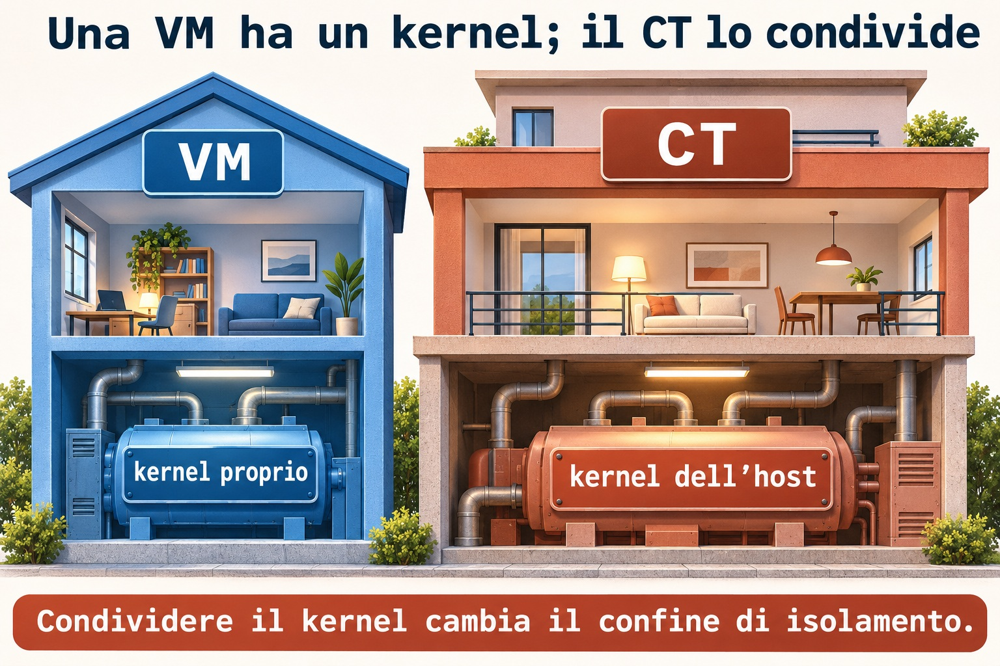
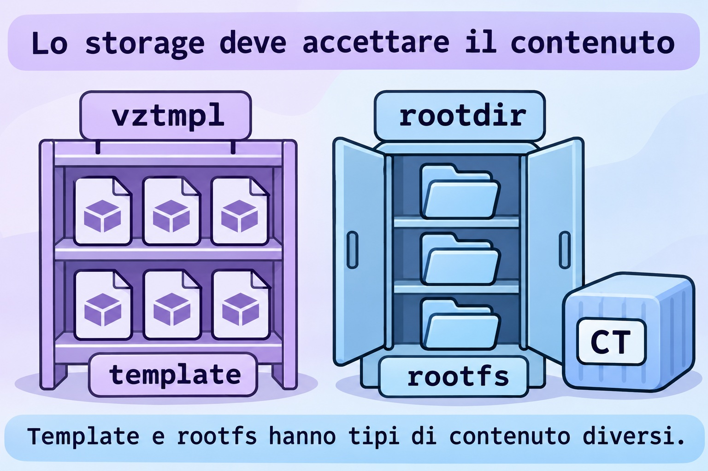

# Lezione 17.3 · Container LXC

Un processo dentro il CT mostra Debian, ma usa il kernel dell’host. In questa lezione crei il CT 212 senza rete attiva, misuri questo confine e impari a entrare nell’ambiente giusto senza considerare il container una piccola VM.

> **Il cuore di questa lezione:** il CT isola processi e risorse; condivide il kernel e dipende dalla mappatura delle identità.

| Scheda |  |
| --- | --- |
| **Modulo** | M17 · Proxmox nella pratica, lezione 3 di 7 |
| **Quando** | Settimana 23 |
| **Alla fine** | Crei un CT non privilegiato, leggi la configurazione e dimostri il kernel condiviso |
| **Prerequisiti** | 17.1 e 17.2; console e inventario dell’host |
| **Durata** | Da 60 a 90 minuti, oltre al download del template |
| **Snapshot** | `m17a3-inicio` e `m17a3-fim`, soltanto CT 212 |

## 1 · Riscaldamento

Rispondi senza consultare. Poi confronta con le soluzioni.

1. Il nome di una VM può dimostrare quale sistema è installato?

2. Perché l’ID deve essere libero nell’intero cluster, non soltanto su questo nodo?

3. Qual è la differenza tra file di template e disco di un’istanza?

## 2 · Perché conta

Un’applicazione funziona in una VM e fallisce in un CT. Chi amministra prova a installare un altro kernel nel container. Il pacchetto cambia, ma la chiamata continua ad arrivare allo stesso kernel dell’host. La correzione è stata applicata al livello sbagliato.

Un altro caso emerge nel backup: una directory dell’host viene montata nel CT, ma il proprietario sembra strano. I numeri appartengono a spazi di identità diversi. Risolvere concedendo accesso totale nasconderebbe la causa e aumenterebbe il rischio.

## 3 · Modello mentale

Una VM è una casa con la propria sala macchine. Un CT è un appartamento: possiede stanze e regole, ma condivide l’infrastruttura dell’edificio. Nessuna delle due metafore garantisce un isolamento assoluto.



*Condividere il kernel cambia il confine di isolamento.*

### Ponte Windows

| Riferimento | Relazione utile, con limite |
| --- | --- |
| VM su Hyper-V | Kernel guest distinto dall’host |
| Container di processo | Condivide il kernel; non equivale a una VM |
| Account e ACL | Conta l’identità effettiva; la mappatura del CT aggiunge un livello |

## 4 · L'essenziale

### Il CT è gestito dall’host

Usa `pct` sull’host Proxmox. Dentro il CT amministri lo spazio utente: pacchetti, file e servizi disponibili in quell’ambiente. Il comando dell’host non diventa un comando del Debian del container.

`pct enter` apre una shell dentro il CT partendo dall’host. `pct exec` esegue un comando delimitato e restituisce il risultato. Identifica sempre dove ti trovi prima di modificare qualsiasi file.

### Non privilegiato è la scelta iniziale

Alla creazione usa `unprivileged=1`. Il root interno viene mappato su un’identità senza privilegi sull’host. Questo riduce l’impatto di varie classi di guasto, ma non trasforma il kernel condiviso in un confine da VM.

Non convertire un CT esistente tra privilegiato e non privilegiato modificando una riga. Proprietari del rootfs e mappature devono essere coerenti. Backup, ripristino supportato e verifica appartengono a un piano di modifica dedicato.


*Nel CT non privilegiato gli ID vengono mappati sull’host.*

### Due contenuti, due domande

Il template scaricato richiede uno storage che accetti `vztmpl`. Il volume di root creato per il CT richiede `rootdir`. Uno storage abilitato soltanto per `images` non soddisfa automaticamente nessuna delle due esigenze.

Non modificare la definizione globale di uno storage per adattarla all’esercizio. Scegli un backend già autorizzato, con spazio, contenuto e supporto snapshot adeguati. Se non esiste, ferma la creazione e registra il prerequisito.

### Rocky × Debian

| Livello | VM 211 | CT 212 |
| --- | --- | --- |
| Spazio utente | Rocky, dalla 17.2 | Debian 13 del template |
| Kernel | Proprio del guest | Condiviso con l’host |
| Strumento sull’host | `qm` | `pct` |
| Rete iniziale della lezione | Mantenuta com’era | Scheda con link disattivato, senza DHCP |

NS8 richiede una VM nel contratto supportato del prodotto. Non provare ad adattare questo CT rimuovendo AppArmor, ampliando capabilities o abilitando risorse arbitrarie per aggirare tale requisito.

### Decidi 1

Ti serve un altro kernel per l’applicazione. Qual è la decisione corretta?

| A | B | C |
| --- | --- | --- |
| Installare il kernel nel CT e riavviare | Pianificare una VM compatibile | Rendere il CT privilegiato senza verificare nulla |

## 5 · Lab guidato

Tutti i comandi `pct`, `pveam`, `pvesm` e `pvesh` di questa lezione girano sull’host di laboratorio autorizzato. Non eseguire la procedura su un host di un cliente. Le VM da 201 a 205 restano intatte.

Mantieni disponibile la console dell’host. Il CT della lezione resta senza rete attiva: non servono IP, DHCP né accesso esterno per dimostrare il modello. La 17.5 userà la sua scheda sulla rete isolata.

### Passo 1 · Riservare l’ID e scegliere gli storage

**Ipotesi:** una ricerca soltanto nell’elenco CT di questo nodo basta per riservare l’ID 212?

Leggi l’intero inventario e la configurazione dello storage. Non creare il CT se l’ID appartiene già a qualsiasi VM o CT, anche spento o su un altro nodo.

```bash
pvesh get /cluster/resources --type vm
pvesm status
cat /etc/pve/storage.cfg
pct help create
```

**Output atteso:** storage reali, relativi contenuti e inventario reale. Non esiste un output numerico di esempio da copiare.

**Verifica:** scegli uno storage per i template e uno per il rootfs; possono coincidere se supportano entrambi i contenuti. Il rootfs deve consentire snapshot CT e avere margine per 4 GB di disco e copie.

Inserisci i nomi letti; non indovinare l’ID dello storage. Queste variabili restano nella sessione dell’host e vanno richieste di nuovo dopo averla chiusa.

```bash
read -r -p 'Storage vztmpl: ' CT_TEMPLATES
read -r -p 'Storage rootdir: ' CT_STORE
test -n "$CT_TEMPLATES" && test -n "$CT_STORE"
```

### Passo 2 · Scaricare un template dal catalogo

**Ipotesi:** il nome di un vecchio template annotato dimostra che il file sia ancora nel catalogo?

Aggiorna il catalogo sull’host di laboratorio ed elenca la sezione dei sistemi. Scegli il Debian 13 standard per l’architettura dell’host. Copia esattamente il nome elencato, senza inventare revisione o estensione.

```bash
pveam update
pveam available --section system
read -r -p 'Template Debian 13 do catalogo: ' CT_TEMPLATE
test -n "$CT_TEMPLATE" && pveam download "$CT_TEMPLATES" "$CT_TEMPLATE"
pveam list "$CT_TEMPLATES"
```

**Output atteso:** download completato dal gestore e volume del template visibile nell’elenco. In caso di errore di autenticazione, trasferimento o verifica non usare un file parziale.

**Verifica:** annota il volume completo da passare al comando successivo. La sola esistenza del file non sostituisce il successo registrato del download.

```bash
read -r -p 'Volume completo vztmpl listado: ' CT_VOLUME
test -n "$CT_VOLUME"
```

### Passo 3 · Creare il CT non privilegiato

**Ipotesi:** il root interno avrà lo stesso ID effettivo sull’host?

La guardia seguente rifiuta qualsiasi ID 212 presente nel cluster. Se la query fallisce o avviene una creazione concorrente, fermati; non aggirare mai l’errore con una rimozione forzata.

```bash
set -o pipefail
pvesh get /cluster/resources --type vm --output-format json |
  perl -MJSON::PP -0777 -e '$r=decode_json(<>); exit((scalar grep { $_->{vmid} == 212 } @$r) ? 1 : 0)' &&
pct create 212 "$CT_VOLUME" --hostname m17-ct --unprivileged 1 \
  --cores 1 --memory 512 --swap 0 --rootfs "$CT_STORE:4" --features nesting=1 \
  --net0 name=eth0,bridge=vmbr0,ip=manual,ip6=manual,firewall=1,link_down=1 \
  --onboot 0 || { printf '%s\n' 'STOP: CT creation failed; do not continue' >&2; exit 1; }
pct config 212
```

**Output atteso:** nome corretto, limite di memoria, `unprivileged: 1` e scheda con link disattivato. Lo storage del rootfs è quello scelto.

**Verifica:** conferma ID, nome e tutti i campi prima di avviare. Un errore di creazione richiede di leggere l’errore e lo stato parziale, non di ripetere ciecamente la stessa creazione.

```bash
ct_m17_confere() {
  local esperado="${1:-m17-ct}" config
  case "$esperado" in m17-ct|m17-ct-errado) ;; *) return 1 ;; esac
  config=$(pct config 212) || return 1
  test "$(printf '%s\n' "$config" | sed -n 's/^hostname: //p')" = "$esperado" || return 1
  test "$(printf '%s\n' "$config" | sed -n 's/^unprivileged: //p')" = '1' || return 1
}
ct_m17_confere || exit 1
pct start 212
pct status 212
pct exec 212 -- hostname
ct_m17_confere || exit 1
pct snapshot 212 m17a3-inicio
```

La funzione conferma nome e modalità non privilegiata prima delle modifiche. Se hai aperto un’altra sessione dell’host, definiscila nuovamente prima di continuare; un controllo fallito richiede di fermarsi e identificare l’oggetto.

Lo snapshot iniziale si crea dopo la creazione, perché prima il CT non esisteva. Se il backend rifiuta lo snapshot, interrompi le modifiche: risolvi il prerequisito oppure ricrea il banco vuoto su un backend autorizzato.

### Passo 4 · Misurare kernel e identità

**Ipotesi:** quale lettura deve coincidere tra host e CT e quale deve identificare il Debian interno?

Sull’host confronta queste tre letture. Il file d’identità interno non deve necessariamente corrispondere a quello dell’host; la release del kernel condiviso corrisponde a quella eseguita dall’host.

```bash
uname -r
pct exec 212 -- uname -r
pct exec 212 -- cat /etc/os-release
pct exec 212 -- id
pct exec 212 -- cat /proc/self/uid_map
```

**Output atteso:** kernel condiviso e sistema utente Debian 13. Il root interno ha ID zero nel CT; la mappa mostra la traduzione verso ID esterni.

**Verifica:** spiega le colonne della mappa con la documentazione locale. Non presumere che tutti gli host usino lo stesso inizio intervallo e non riscrivere la mappa per imitare una schermata.

### Passo 5 · Entrare, uscire e delimitare il comando

**Ipotesi:** dopo l’uscita dalla shell interna, dove verrà eseguito il prossimo comando?

Entra dall’host. I comandi tra ingresso e uscita appartengono al CT; la query finale appartiene di nuovo all’host. Non serve alcun pacchetto aggiuntivo.

```bash
pct enter 212
hostname
cat /etc/os-release
exit
pct status 212
```

**Output atteso:** la shell ritorna all’host dopo `exit`. Il CT resta acceso. Uscire da una sessione non equivale a spegnerne il sistema.

**Verifica:** ripeti una lettura con `pct exec` e spiega perché il suo ambito è più semplice da registrare in una procedura automatica.

```bash
pct exec 212 -- sh -c 'printf "HOST=%s\n" "$(hostname)"; id; uname -r'
```

### Passo 6 · Riavviare e verificare il confine

**Ipotesi:** riavviare il CT cambia il kernel dell’host?

**Reboot di verifica:** riavvia soltanto il CT 212. Attendi lo stato e ripeti la lettura di kernel, identità e configurazione, sempre dall’host.

```bash
ct_m17_confere || exit 1
pct reboot 212
pct status 212
pct exec 212 -- uname -r
pct exec 212 -- cat /etc/os-release
pct config 212
```

**Output atteso:** CT nuovamente acceso, kernel dell’host e modalità non privilegiata conservati. La scheda resta disattivata, senza acquisire indirizzi.

**Verifica:** confronta con il registro iniziale. Non riavviare l’host per correggere un errore di servizio del CT senza una causa dimostrata.

### Decidi 2

Lo storage accetta dischi VM, ma rifiuta il rootfs. Qual è la prossima azione?

| A | B | C |
| --- | --- | --- |
| Disabilitare l’isolamento del CT | Modificare globalmente lo storage senza esaminare i consumatori | Verificare tipo, contenuto e backend autorizzato per rootdir |

## 6 · Rompi e ripara

I tre guasti seguenti restano nel CT usa e getta o nel diario. Lo snapshot protegge il CT, non l’intero host. Non toccare file globali di Proxmox.

### Guasto 1 · Query nel posto sbagliato

**Sintomo:** dentro il CT cerchi lo strumento di amministrazione dell’host e non esiste. Riproduci soltanto con una query.

```bash
pct exec 212 -- sh -c 'command -v pct || true'
```

**Indagine:** confronta hostname, file d’identità e ruolo di ogni ambiente.

**Causa:** un comando del gestore dei container è stato cercato nello spazio utente del container.

**Riparazione:** esci dalla shell interna se ci sei; usa `pct config 212` sull’host. Non installare Proxmox dentro il CT per nascondere l’errore di contesto.

**Verifica:** spiega dove è stato eseguito ogni comando e quale identità ha interrogato.

**Prevenzione:** scrivi host o CT nel diario prima del blocco eseguito.

### Guasto 2 · Memoria configurata diversa dal contratto

**Sintomo:** la configurazione del CT mostra un altro limite. Introduci soltanto questa differenza nel CT 212.

```bash
ct_m17_confere || exit 1
pct set 212 --memory 384
pct config 212
```

**Indagine:** confronta la configurazione attuale con la scheda di creazione e le letture interne, senza confondere limite e consumo.

**Causa:** il limite di memoria è stato modificato; non ci sono prove di una perdita di memoria.

**Riparazione:** ripristina il valore del contratto senza modificare altri CT.

```bash
ct_m17_confere || exit 1
pct set 212 --memory 512
pct config 212
```

**Verifica:** il limite torna a 512 MB e resta dopo il reboot del CT.

**Prevenzione:** registra limite, utilizzo e fonte della misura in campi separati.

### Guasto 3 · Nome interno inatteso

**Sintomo:** l’identificazione del CT non corrisponde più alla scheda. Applica l’errore soltanto tramite il gestore.

```bash
ct_m17_confere || exit 1
pct set 212 --hostname m17-ct-errado
pct config 212
pct exec 212 -- hostname
```

**Indagine:** confronta nome configurato e nome osservato. Se la versione o la modalità di avvio richiede un restart, registralo; non inventare una modifica istantanea.

**Causa:** la configurazione d’identità è stata modificata senza cambiare il contenuto del sistema Debian.

**Riparazione:** ripristina il nome previsto e riavvia il CT per confermare lo stato finale.

```bash
ct_m17_confere m17-ct-errado || exit 1
pct set 212 --hostname m17-ct
ct_m17_confere || exit 1
pct reboot 212
pct exec 212 -- hostname
```

**Verifica:** il nome osservato torna al contratto. Il nome resta un’etichetta, non una prova di versione o isolamento.

**Prevenzione:** verifica insieme configurazione e osservazione dopo modifiche e riavvii.



*Template e rootfs hanno tipi di contenuto diversi.*

## 7 · Trappole

- Condividere il kernel non significa condividere tutti i file; sono confini diversi.

- Root nel CT non giustifica la mappatura del root dell’host né l’ampliamento dei permessi di directory esterne.

- Un bind mount può portare dati dell’host nell’ambito del CT. Questa lezione non ne crea.

- Non installare pacchetti kernel aspettandoti di cambiare il kernel effettivamente usato dal CT.

- Lo snapshot di un CT non protegge modifiche alla configurazione globale dell’host o del cluster.

## 8 · Quiz

1. Quale lettura dimostra il kernel condiviso senza confonderlo con la versione Debian?

2. Perché `UID 0` dentro il CT non basta per affermare privilegi root sull’host?

3. Quale contenuto di storage conserva il template e quale serve il rootfs?

4. Quando usi `pct exec` invece di mantenere aperta una shell interattiva?

5. Perché non abilitare privilegi aggiuntivi per eseguire NS8 in questo CT?

6. Cosa devi conservare per continuare la 17.5?

## 9 · Promemoria

| Domanda | Lettura sull’host |
| --- | --- |
| Il CT esiste ed è acceso? | `pct status 212` |
| Cosa ha configurato l’host? | `pct config 212` |
| Quale kernel usa il CT? | `pct exec 212 -- uname -r` |
| Qual è lo spazio utente? | `pct exec 212 -- cat /etc/os-release` |
| Qual è la mappa d’identità? | `pct exec 212 -- cat /proc/self/uid_map` |

**Flashcard:** crea da 5 a 10 carte includendo kernel, contesto, contenuto di storage e mappatura. Ripassa a D+1, D+3, D+7 e D+21.

## 10 · Checklist e chiusura

### Pulizia e continuità

Ripristina nome e memoria corretti. Conserva il CT 212 senza rete attiva per la 17.5; non distruggerlo qui. Nella 17.5 verrà rimosso dopo aver conservato le prove, liberando l’ID per la prova di ripristino della 17.6.

Non eliminare il template condiviso soltanto perché hai terminato il download: potrebbe avere consumatori esterni all’esercizio. La lezione non crea storage globali, bind mount né regole firewall.

- [ ] Ho confermato ID e nome del CT usa e getta nel cluster.

- [ ] Ho confrontato kernel e identità senza scambiare i livelli.

- [ ] Ho dimostrato modalità non privilegiata e mappa degli ID.

- [ ] Ho ripristinato i tre guasti e verificato dopo il reboot.

```bash
pct config 212
ct_m17_confere || exit 1
pct snapshot 212 m17a3-fim
```

**Ultimo esercizio:** spiega perché una VM e un CT con lo stesso nome di distribuzione possono avere kernel e confini diversi.

## 11 · Nella vita reale

Su un host autorizzato esegui soltanto inventario: scegli un CT noto e leggi la configurazione senza entrare nei dati degli utenti né modificare limiti. Se non c’è un CT, registra l’assenza; non crearne uno in produzione per completare l’esercizio.

Confronta la politica d’isolamento con le esigenze dell’applicazione. Una decisione di migrazione deve citare kernel, dispositivi, storage, backup e supporto del fornitore, non soltanto il consumo RAM.

## 12 · Approfondire quando vuoi

- [Proxmox: amministrazione dei container](https://pve.proxmox.com/pve-docs/chapter-pct.html).

- [Proxmox: opzioni e comandi pct](https://pve.proxmox.com/pve-docs/pct.1.html).

- [Proxmox: gestore dei template](https://pve.proxmox.com/pve-docs/pveam.1.html).

- [NethServer 8: requisiti d’installazione](https://docs.nethserver.org/projects/ns8/en/latest/install.html).

Consulta anche la guida installata nella versione del tuo host; determina nomi e opzioni disponibili.

```bash
man pct
man pveam
man pvesm
```

`!explica 17.3 kernel compartilhado, CT não privilegiado e rootfs`

`!feynman 17.3 vou explicar onde pct roda e como o root interno é mapeado`

`!quiz 17.3`

### Soluzioni commentate

**Riscaldamento:** il nome è un’etichetta; leggi l’identità del sistema. I VMID appartengono al cluster e possono trovarsi su un altro nodo. Il template è la fonte; il rootfs è il volume creato per un’istanza.

**Decidi 1:** B. Un’altra esigenza di kernel richiede una VM compatibile; modificare lo spazio utente del CT non cambia il kernel condiviso.

**Decidi 2:** C. Verifica backend e contenuto autorizzato; una modifica globale non giustificata coinvolgerebbe altri consumatori.

1. Confronta `uname -r` sull’host con `pct exec 212 -- uname -r`; leggi separatamente l’identità utente con `/etc/os-release`.

2. Il CT non privilegiato usa una mappa degli ID. Root interno viene tradotto in un’identità esterna senza privilegi; leggi la mappa reale.

3. `vztmpl` conserva file di template; `rootdir` serve i volumi dei container. Il tipo di contenuto non elimina la verifica del supporto del backend.

4. Quando vuoi un comando delimitato, ritorno osservabile e minor rischio di perdere il contesto. La shell interattiva richiede di confermare ingresso e uscita.

5. Il requisito supportato è una VM; ampliare i privilegi non sostituisce il supporto né crea un kernel proprio.

6. Il CT 212 corretto, non privilegiato, senza rete attiva, con nome e memoria ripristinati e prova del reboot.

[← Lezione 17.2 · VM dalla riga di comando](17.2-vm-pela-linha-de-comando.md) · [Indice delle lezioni](../01-aulas.md) · [Piano del corso: dalla 17.4 in poi →](../00-plano-do-curso.md)
