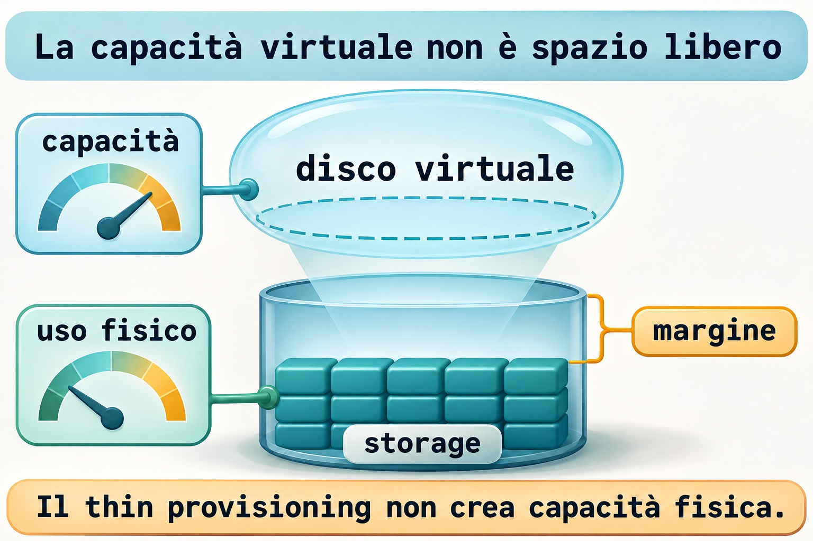
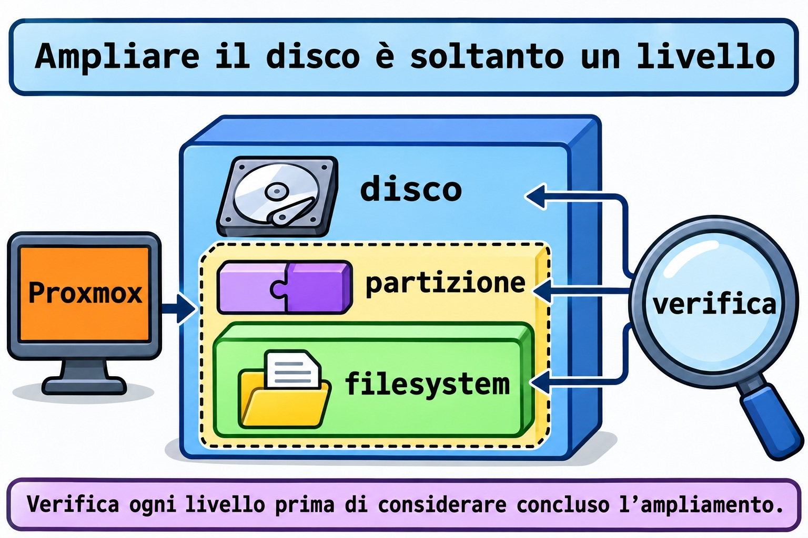

# Lezione 17.4 · Storage: capacità, ampliamento e spostamento

Il disco risulta più grande in Proxmox, ma la cartella dei dati conserva lo stesso spazio. In questa lezione separi capacità virtuale, consumo fisico e dimensione del filesystem, lavorando soltanto su un nuovo disco della VM 211.

> **Il cuore di questa lezione:** ampliare e spostare dischi richiede di verificare il riferimento sull’host e i dati dentro la VM.

| Scheda |  |
| --- | --- |
| Modulo | M17 · Proxmox VE nella pratica, lezione 4 di 7 |
| Quando | Settimana 23 |
| Alla fine | Creare un disco dati, ampliare ext4 e verificare uno spostamento fra storage |
| Prerequisiti | Lezioni 17.1–17.3; VM 211 disponibile; backup autorizzato e spazio fisico |
| Durata | 100–130 min; il tempo di copia dipende dall’ambiente |
| Snapshot | Punto precedente alla modifica e backup indipendente sullo storage autorizzato |

## 1 · Riscaldamento

Ricevi un avviso di occupazione. Prima di ampliare, rispondi: è finito lo spazio dentro la VM, la capacità fisica del backend oppure entrambi?

- La dimensione configurata di un disco non indica da sola quanto spazio abbia già consumato il backend.
- Un filesystem più piccolo può esistere dentro un dispositivo più grande.
- Un backup utilizzabile deve restare disponibile se lo storage di origine si guasta.

Riprendi la configurazione della VM 211 e individua il disco di avvio, il drive di cloud-init e l’interfaccia di gestione. Nessuno di questi verrà sostituito.

```bash
qm config 211
qm status 211
pvesm status
```

Questi comandi appartengono all’host Proxmox. I comandi del filesystem di questa lezione appartengono al terminale Linux **dentro la VM 211**.

## 2 · Perché conta

Lo storage può servire molte VM. Un nuovo disco di laboratorio continua a consumare risorse condivise; perciò misuri il margine prima di riservare spazio o scrivere dati.

Il thin provisioning consente di presentare una capacità virtuale e allocare blocchi fisici secondo l’uso, in base al backend. Non elimina limiti, metadati, riserve né avvisi di occupazione.

Se la somma delle capacità promesse supera quella reale, più VM possono contendersi l’ultimo spazio contemporaneamente. Eliminare un file nel guest non garantisce neppure la restituzione immediata dei blocchi al backend.



*Il thin provisioning non crea capacità fisica.*

### Ponte Windows

Ampliare il disco nell’hypervisor ricorda l’aumento di un disco virtuale seguito dall’estensione del volume in Windows. La prima azione modifica il dispositivo; la seconda adatta la struttura che ne utilizza i blocchi.

Qui il disco dati avrà ext4 direttamente sul dispositivo, senza partizione. Questo riduce i livelli dell’esercizio; non descrive automaticamente il layout del disco di avvio.

## 3 · Modello mentale

Pensa a tre domande, poste in luoghi diversi.

| Dove | Domanda | Evidenza |
| --- | --- | --- |
| Backend | Quanto spazio fisico posso ancora usare mantenendo margine? | Stato, capacità e avvisi dello storage |
| Proxmox | A quale volume punta questo slot e quale capacità presenta? | Configurazione della VM e attività completata |
| Guest | Quale dispositivo è questo e quanto contiene il filesystem? | Seriale, montaggio e dimensione di ext4 |

Il nome dello storage è un identificatore di configurazione. Non è necessariamente il percorso di una cartella, né dimostra che lo stesso contenuto possa essere salvato su un altro backend.

**Decisione di sicurezza:** identificheremo il nuovo disco tramite il seriale `M17DATA`, senza supporre quale sarà il secondo nome in ordine alfabetico.

Una modifica dell’ordine dei dischi può cambiare il nome presentato dal kernel. Il seriale configurato consente di collegare l’identità nell’host all’osservazione dentro la VM.



*Verifica ogni livello prima di considerare concluso l’ampliamento.*

## 4 · L'essenziale

### Rocky × Debian

L’host Proxmox resta responsabile della creazione e dello spostamento dei volumi. Dentro la VM lo strumento dipende dal filesystem: ext4 utilizza strumenti diversi da XFS.

Il nuovo disco sarà ext4, anche se il sistema Rocky della VM usa XFS all’avvio. Non applicare la procedura ext4 a un volume XFS o a un livello LVM.

| Azione | Strumento o evidenza |
| --- | --- |
| Vedere capacità e disponibilità del backend | `pvesm status` |
| Verificare slot e riferimenti | `qm config 211` |
| Ampliare soltanto il disco dati | `qm disk resize 211 scsi1 +1G` |
| Ampliare ext4 sul disco identificato | `resize2fs` |
| Copiare e cambiare il riferimento di storage | `qm disk move` |

**Prima di iniziare:** ottieni l’autorizzazione per 4 GiB virtuali iniziali, un ampliamento di 1 GiB e il corrispondente consumo fisico. Occorre inoltre spazio per snapshot, backup ed eventuale seconda copia.

Il backend `vm-hdd` indicato nel piano deve esistere, essere attivo su questo nodo e accettare immagini di VM. Se non è disponibile, usa un altro storage reale autorizzato e annota la scelta.

Non creare uno storage immaginario per completare la procedura. Un secondo backend è necessario soltanto per eseguire lo spostamento; senza di esso, il confronto resta documentale.

## 5 · Lab guidato

### Passo 1 · Inventariare e proteggere

**Ipotesi:** quali righe distinguono il disco di avvio, cloud-init e lo slot libero?

Nell’host, leggi tutto prima di creare il disco. Controlla anche le configurazioni in sospeso nell’interfaccia della VM. Lo slot `scsi1` deve essere libero sia nella configurazione attuale sia in quella in sospeso.

```bash
qm config 211
qm config 211 --current 1
qm pending 211
pvesm status
cat /etc/pve/storage.cfg
qm listsnapshot 211
```

**Output atteso:** la VM si chiama `m17-vm`; identifichi i suoi dischi esistenti e nessuno occupa `scsi1`. Sono visibili gli storage reali e i tipi di contenuto.

Annota le righe complete di avvio, cloud-init e rete; le confronterai in seguito. Se esiste uno stato in sospeso sconosciuto, fermati per risolverlo con chi amministra il laboratorio.

Crea uno snapshot con un nome ancora inesistente ed esegui il backup nella destinazione già autorizzata. `PBS-LAB` deve essere attivo, configurato e accessibile; non inventare credenziali o criteri di conservazione.

```bash
qm snapshot 211 m17-pre-storage || exit 1
vzdump 211 --storage PBS-LAB --mode snapshot --remove 0 || exit 1
```

**Verifica:** entrambe le attività sono terminate senza errori; annota l’identificatore reale del backup. Senza un backend capace di snapshot o un backup completato, non procedere con modifiche in questo laboratorio.

### Passo 2 · Aggiungere soltanto il nuovo disco

**Ipotesi:** che cosa deve cambiare nella configurazione quando crei un disco dati?

Nell’host, scegli lo storage per immagini verificato nel passo precedente; digita il suo identificatore reale. Spegni correttamente la VM e conferma che sia ferma prima di continuare.

```bash
read -r DATA_STORE
qm shutdown 211 --timeout 120
qm status 211
```

Soltanto dopo aver confermato lo stato fermo, esegui il controllo. Rifiuta un nome errato, una variabile vuota e uno slot esistente; non sostituisce il controllo delle modifiche in sospeso.

```bash
test -n "$DATA_STORE" &&
test "$(qm config 211 | sed -n 's/^name: //p')" = m17-vm &&
test "$(qm status 211)" = 'status: stopped' &&
! qm config 211 | grep -q '^scsi1:' &&
qm set 211 --scsi1 "$DATA_STORE:4,serial=M17DATA,discard=on" || { printf '%s\n' 'STOP: new disk creation not performed' >&2; exit 1; }
qm config 211
```

**Output atteso:** compare una sola riga `scsi1` con il seriale `M17DATA` e una capacità iniziale di 4 GiB. Le righe annotate nel Passo 1 restano uguali.

**Verifica:** annota l’identificatore reale del volume creato. Se il controllo ha rifiutato l’operazione, indaga; non rimuovere un disco per liberare lo slot.

```bash
qm start 211
```

### Passo 3 · Identificare, formattare e conservare una prova

**Ipotesi:** un dispositivo senza filesystem è necessariamente il disco che abbiamo appena creato?

Entra nella VM 211. Controlla hostname, seriale e albero dei dispositivi. Se mancano gli strumenti per ext4, installa il pacchetto `e2fsprogs` tramite il gestore già noto della distribuzione.

```bash
hostname
test "$(hostname -s)" = m17-vm || exit 1
lsblk -o NAME,TYPE,SIZE,FSTYPE,MOUNTPOINTS,SERIAL
ls -l /dev/disk/by-id/
```

Digita in `LAB_DISK` il percorso completo e reale del disco con seriale `M17DATA`, preferibilmente il suo collegamento persistente. Non copiare un nome da un altro terminale o da un’altra VM.

```bash
read -r LAB_DISK
test -b "$LAB_DISK" || exit 1
SIGNATURES=$(sudo wipefs -n "$LAB_DISK") || exit 1
test ! -e /mnt/m17-data &&
test -b "$LAB_DISK" &&
test "$(lsblk -dnro SERIAL "$LAB_DISK")" = M17DATA &&
test "$(lsblk -dnro TYPE "$LAB_DISK")" = disk &&
test "$(lsblk -nrpo NAME "$LAB_DISK" | wc -l)" -eq 1 &&
test -z "$SIGNATURES" &&
! findmnt -rn -S "$LAB_DISK" &&
printf '%s\n' 'M17DATA: blank whole disk verified' || { printf '%s\n' 'STOP: new disk checks failed' >&2; exit 1; }
```

**Output atteso:** l’ultima frase compare soltanto se seriale, tipo, assenza di partizioni, firme e montaggio corrispondono. Controlla visivamente `lsblk` e `wipefs` prima di formattare.

Se un qualsiasi output indica dati precedenti, fermati. Il comando seguente distrugge le strutture esistenti e riguarda soltanto il disco nuovo già identificato; non usare opzioni di forzatura.

```bash
sudo mkfs.ext4 -L M17DATA "$LAB_DISK" || exit 1
sudo mkdir /mnt/m17-data || exit 1
sudo mount "$LAB_DISK" /mnt/m17-data || exit 1
printf '%s\n' 'm17-data: disposable evidence' | sudo tee /mnt/m17-data/evidence.txt
sudo sha256sum /mnt/m17-data/evidence.txt | tee "$HOME/m17-data.sha256"
findmnt /mnt/m17-data
df -hT /mnt/m17-data
```

**Verifica:** il filesystem è ext4 e contiene la frase fittizia. La cartella deve essere nuova ed esclusiva di questo laboratorio; se esiste già prima della creazione, fermati per controllare chi la usa.

### Passo 4 · Ampliare dispositivo ed ext4

**Ipotesi:** dopo l’aumento del disco in Proxmox, ext4 mostrerà già più spazio?

Conserva la prova e smonta nella VM. Un montaggio occupato deve essere analizzato; non forzare lo smontaggio.

```bash
sudo sha256sum -c "$HOME/m17-data.sha256"
sync
sudo umount /mnt/m17-data || exit 1
```

Nell’host, esegui un nuovo snapshot e un backup che includano il disco dati. Controlla che `scsi1` non sia escluso dal backup e che l’attività abbia incluso il suo volume reale.

```bash
qm snapshot 211 m17-pre-grow || exit 1
vzdump 211 --storage PBS-LAB --mode snapshot --remove 0 || exit 1
qm shutdown 211 --timeout 120
qm status 211
```

Con il backup completato, la VM ferma e lo spazio fisico confermato, amplia **soltanto** `scsi1`. Il controllo verifica nuovamente nome e seriale della configurazione.

```bash
test "$(qm config 211 | sed -n 's/^name: //p')" = m17-vm &&
test "$(qm status 211)" = 'status: stopped' &&
qm config 211 | grep '^scsi1:' | grep -q 'serial=M17DATA' &&
qm disk resize 211 scsi1 +1G || { printf '%s\n' 'STOP: disk growth not performed' >&2; exit 1; }
qm config 211
qm start 211
```

Nella VM, digita nuovamente il percorso in `LAB_DISK` e riconferma seriale, ext4 e assenza di montaggio. Le variabili non sopravvivono all’apertura di un’altra shell o al reboot.

```bash
read -r LAB_DISK
lsblk -o NAME,TYPE,SIZE,FSTYPE,MOUNTPOINTS,SERIAL "$LAB_DISK"
test "$(hostname -s)" = m17-vm || exit 1
test -b "$LAB_DISK" || exit 1
test "$(lsblk -dnro SERIAL "$LAB_DISK")" = M17DATA &&
test "$(lsblk -dnro TYPE "$LAB_DISK")" = disk &&
test "$(lsblk -dnro FSTYPE "$LAB_DISK")" = ext4 &&
! findmnt -rn -S "$LAB_DISK" &&
sudo e2fsck -f "$LAB_DISK"
FSCK_RC=$?
printf 'fsck exit: %s\n' "$FSCK_RC"
```

Se il controllo segnala errori non corretti, fermati. Il codice 0 indica integrità; 1 indica correzioni eseguite e richiede un nuovo controllo prima di proseguire. Non ignorare un errore soltanto perché il dispositivo è cresciuto.

Dopo un controllo concluso con codice 0, amplia ext4 e monta nuovamente. Su questo disco non esiste una partizione intermedia.

```bash
test "$FSCK_RC" -eq 0 && sudo resize2fs "$LAB_DISK" || { printf '%s\n' 'STOP: filesystem growth failed' >&2; exit 1; }
sudo mount "$LAB_DISK" /mnt/m17-data || exit 1
df -hT /mnt/m17-data
sudo sha256sum -c "$HOME/m17-data.sha256"
```

**Output atteso:** dispositivo ed ext4 presentano la capacità ampliata; la prova resta valida. Lo spazio utilizzabile differisce dalla capacità nominale a causa delle strutture e delle riserve del filesystem.

**Verifica:** annota dimensioni precedenti e successive, seriale e risultato dell’hash. Non tentare di ridurre nuovamente il disco; una riduzione richiede un altro piano e non fa parte di questo esercizio.

### Passo 5 · Spostare quando esiste una destinazione reale

**Ipotesi:** un’attività di copia riuscita dimostra che la VM usa il volume di destinazione?


*Rimuovi la vecchia origine soltanto dopo aver verificato riferimento e dati.*

Nell’host, esamina un secondo storage autorizzato che accetti immagini su questo nodo e abbia margine per la copia. Verifica anche la compatibilità degli snapshot fra i backend.

```bash
pvesm status
cat /etc/pve/storage.cfg
qm config 211
qm help disk move
```

**Senza un secondo storage:** annota l’origine reale, la capacità e i requisiti mancanti; spiega dove cambierebbe il riferimento. Non eseguire il blocco di spostamento e indica che la pratica non è stata eseguita.

**Con un secondo storage:** annota il volume di origine e digita in `TARGET_STORE` l’identificatore della destinazione, diverso dall’origine. Se gli snapshot impediscono l’operazione, fermati; non eliminare la protezione per forzare la copia.

Prima di spostare, annota `M17_SHARED_STORE` nel diario e conferma con `pvesm status` che l’origine sia lo storage condiviso del lab (Ceph RBD nel progetto del corso). Se l’origine è locale, fermati e riconcilia l’inventario. Le variabili rimangono nello stesso terminale; non inventare l’origine al ritorno.

Nella VM, smonta la cartella; nell’host, spegni e conferma l’arresto. Esegui il blocco soltanto dopo aver verificato la destinazione e il backup del Passo 4.

```bash
M17_SHARED_VOLUME=$(qm config 211 | sed -n 's/^scsi1: \([^,]*\).*/\1/p')
M17_SHARED_STORE=${M17_SHARED_VOLUME%%:*}
pvesm status --storage "$M17_SHARED_STORE"
read -r TARGET_STORE
qm shutdown 211 --timeout 120
qm status 211
```

```bash
test -n "$TARGET_STORE" &&
test "$(qm config 211 | sed -n 's/^name: //p')" = m17-vm &&
test "$(qm status 211)" = 'status: stopped' &&
qm config 211 | grep '^scsi1:' | grep -q 'serial=M17DATA' &&
qm disk move 211 scsi1 "$TARGET_STORE" --delete 0 || { printf '%s\n' 'STOP: disk move not performed' >&2; exit 1; }
qm config 211
```

**Output atteso:** l’attività termina, `scsi1` punta alla destinazione e il seriale resta presente. L’origine conservata compare come volume inutilizzato; continua a occupare spazio.

**Verifica:** confronta i riferimenti completi, conferma i dischi protetti del Passo 1 e controlla la prova dentro la VM dopo l’avvio. Se non hai eseguito lo spostamento, annota chiaramente questa limitazione.

L’origine precedente resta conservata per la revisione; questa procedura non richiede di eliminare volumi inutilizzati. Rimuoverne uno può cancellarne fisicamente i dati.

Dopo aver osservato il disco nella destinazione locale e registrato la prova, riporta `scsi1` all’origine condivisa prima della 17.5. La VM resta spenta. `--delete 1` elimina soltanto la copia di origine di questo secondo trasferimento dopo il completamento; non è un comando per cancellare volumi `unusedN`.

```bash
m17_devolver_disco() {
  [ -n "$M17_SHARED_STORE" ] || return 1
  [ "$(qm config 211 | sed -n 's/^name: //p')" = m17-vm ] || return 1
  [ "$(qm status 211)" = "status: stopped" ] || return 1
  qm config 211 | grep '^scsi1:' | grep -q 'serial=M17DATA' || return 1
  qm disk move 211 scsi1 "$M17_SHARED_STORE" --delete 1 || return 1
  qm config 211
}
m17_devolver_disco
```

Controlla tutte le righe dei dischi, inclusi EFI, cloud-init e `unusedN`: nessun volume deve restare su storage locale per la migrazione insegnata nella 17.7. Se il primo trasferimento ha conservato una vecchia copia condivisa, registrala senza eliminarla in base a un nome presunto. Gli snapshot successivi si fanno soltanto dopo questo ritorno.

### Passo 6 · Reboot e verifica completa

**Ipotesi:** dopo il reboot, l’assenza del montaggio significa perdita dei dati?

Nell’host, avvia la VM se è ferma; se è già attiva, esegui un reboot corretto. Non riavviare il nodo Proxmox.

```bash
qm status 211
qm config 211
```

**Reboot di verifica:** scegli soltanto l’azione adatta allo stato appena misurato. Attendi l’avvio ed entra nuovamente nella VM.

```bash
qm start 211
```

```bash
qm reboot 211
```

Nella VM, identifica nuovamente il disco tramite il seriale e monta la cartella. Non abbiamo modificato la configurazione persistente del montaggio; è normale dover montare manualmente dopo il reboot.

```bash
lsblk -o NAME,TYPE,SIZE,FSTYPE,MOUNTPOINTS,SERIAL
read -r LAB_DISK
test "$(lsblk -dnro SERIAL "$LAB_DISK")" = M17DATA &&
sudo mount "$LAB_DISK" /mnt/m17-data || exit 1
findmnt /mnt/m17-data
df -hT /mnt/m17-data
sudo sha256sum -c "$HOME/m17-data.sha256"
```

**Output atteso:** il disco ampliato viene montato come ext4 e l’hash conferma la stessa evidenza. Il riferimento nell’host corrisponde al backend attuale, con o senza spostamento eseguito.

**Verifica:** descrivi tre prove distinte: capacità del dispositivo, capacità del filesystem e integrità del file. Nessuna sostituisce le altre.

## 6 · Rompi e ripara

Tutti i guasti seguenti restano sul disco fittizio della VM 211. Non modificare il disco del sistema, i permessi del backend o i volumi di altre VM.

### Guasto 1 · Cartella vuota dopo lo smontaggio

**Sintomo:** la cartella esiste, ma la prova sembra sparita. Smonta soltanto il montaggio del laboratorio e osserva la cartella.

```bash
sudo umount /mnt/m17-data
ls -la /mnt/m17-data
findmnt /mnt/m17-data
```

**Indagine:** verifica l’assenza del montaggio e individua il disco tramite il seriale; non scrivere una nuova prova nella cartella vuota.
**Causa:** stai vedendo la cartella del filesystem di avvio, senza il disco dati montato sopra.
**Riparazione:** monta nuovamente il disco identificato.

```bash
test "$(lsblk -dnro SERIAL "$LAB_DISK")" = M17DATA &&
sudo mount "$LAB_DISK" /mnt/m17-data || exit 1
sudo sha256sum -c "$HOME/m17-data.sha256"
```

**Verifica:** l’hash torna valido senza ripristinare o ricreare il file.
**Prevenzione:** controlla il montaggio prima di interpretare una cartella vuota come perdita di dati.

### Guasto 2 · Dati visibili, scrittura rifiutata

**Sintomo:** la lettura funziona e la scrittura fallisce. Rimonta soltanto la cartella del laboratorio in sola lettura.

```bash
sudo mount -o remount,ro /mnt/m17-data
sudo touch /mnt/m17-data/probe.txt
```

**Indagine:** confronta le opzioni di montaggio con i permessi dei file; l’errore può trovarsi sotto il livello dei permessi dell’utente.

```bash
findmnt -no SOURCE,FSTYPE,OPTIONS /mnt/m17-data
```

**Causa:** il montaggio è in sola lettura; modificare i permessi della cartella non elimina questa condizione.
**Riparazione:** ripristina la modalità di lettura e scrittura soltanto su questo montaggio.

```bash
sudo mount -o remount,rw /mnt/m17-data
sudo touch /mnt/m17-data/probe.txt
sudo rm /mnt/m17-data/probe.txt
sudo sha256sum -c "$HOME/m17-data.sha256"
```

**Verifica:** la scrittura funziona e la prova originale conserva il suo hash.
**Prevenzione:** diagnostica opzioni e stato del filesystem prima di modificare ricorsivamente i permessi.

### Guasto 3 · Misura corretta al livello sbagliato

**Sintomo:** qualcuno afferma che la cartella abbia la dimensione del disco di avvio. Produci la misura sbagliata e confrontala.

```bash
df -hT /
df -hT /mnt/m17-data
lsblk -o NAME,SIZE,FSTYPE,MOUNTPOINTS,SERIAL
```

**Indagine:** associa ogni percorso al dispositivo realmente montato; controlla il seriale del disco dati.
**Causa:** la misura della radice è stata usata come se rappresentasse il montaggio dei dati.
**Riparazione:** correggi l’annotazione usando il percorso montato e la sua origine; non occorre modificare alcuna capacità.
**Verifica:** il tuo rapporto distingue la radice da ext4 dei dati, senza inventare valori di output.
**Prevenzione:** scrivi sempre quale oggetto è stato misurato e a quale livello.

## 7 · Trappole

- Confondere spazio virtuale disponibile e margine fisico del backend.
- Usare il nome variabile del kernel come prova dell’identità del disco.
- Eseguire uno strumento ext4 su XFS, oppure dimenticare un livello di partizione/LVM in un altro layout.
- Eliminare volumi inutilizzati prima di verificare riferimento attivo, hash e backup.
- Promettere che uno snapshot annulli sempre un ridimensionamento fisico. Supporto e limiti dipendono dal backend; il ripristino del backup va pianificato.

### Decidi 1

Il disco è cresciuto nell’host, ma ext4 resta più piccolo. Che cosa fai?

A. Ripetere il comando di ampliamento del disco finché la cartella aumenta.
B. Formattare nuovamente il disco che contiene i dati.
C. Verificare seriale, struttura e filesystem, poi ampliare il livello ancora più piccolo.

### Decidi 2

L’attività di spostamento è terminata ed è rimasto un volume inutilizzato. Qual è l’azione successiva?

A. Verificare riferimento attivo e dati; trattare l’eliminazione precedente come azione separata.
B. Sostituire il disco di avvio con la vecchia copia.
C. Eliminare tutti i volumi inutilizzati dello storage.

## 8 · Quiz

1. Perché un disco virtuale da 5 GiB non garantisce 5 GiB fisici liberi nel backend?
2. Quale identità collega il nuovo disco configurato nell’host al dispositivo nel guest?
3. Quale livello intermedio è stato deliberatamente omesso dal disco dati di questo laboratorio?
4. Che cosa dimostra il risultato dell’hash dopo l’ampliamento? Che cosa non misura?
5. Perché conservare l’origine precedente aumenta temporaneamente il consumo?
6. Senza un secondo backend autorizzato, come annoti correttamente il Passo 5?

## 9 · Promemoria

**Flashcard:** la capacità virtuale promette blocchi; la capacità fisica limita il backend; il filesystem organizza lo spazio presentato; l’hash confronta il contenuto della prova.

```text
!explica Por que aumentar um disco no Proxmox não amplia automaticamente todo filesystem?
!feynman Explique capacidade virtual, espaço físico e filesystem usando o disco M17DATA.
!quiz Faça perguntas sobre serial, resize, move e validação de dados na VM 211.
```

## 10 · Checklist e chiusura

- [ ] Ho annotato la configurazione originale e conservato avvio, cloud-init e rete.
- [ ] Ho identificato il nuovo disco tramite il seriale prima di formattare.
- [ ] Ho ampliato il dispositivo ed ext4, controllando l’hash.
- [ ] Ho annotato se lo spostamento è avvenuto o è rimasto documentale per mancanza di destinazione.
- [ ] Ho conservato l’identificatore del backup e i riferimenti attuali dei volumi.
- [ ] Ho confermato il reboot e ripristinato il montaggio in lettura e scrittura.

**Ultimo esercizio:** scrivi una registrazione con identità della VM, seriale, origine, destinazione se usata, capacità precedenti/successive, hash e limiti. Chi la legge deve distinguere una copia pianificata da una copia eseguita.

Pulizia: elimina soltanto la prova temporanea del Guasto 2, se è rimasta. Conserva disco, evidenza, hash e VM 211 per le prossime lezioni; il CT 212 resta disponibile per la 17.5.

Non eliminare backup, template 210, volumi inutilizzati o snapshot per recuperare spazio senza analisi. La pulizia finale delle risorse del modulo ha un proprio punto di verifica.

## 11 · Nella vita reale

Durante un intervento reale, osserva prima: identifica il montaggio interessato, il dispositivo, i suoi livelli e la politica dello storage. Una richiesta di capacità non autorizza a formattare un volume esistente.

Definisci finestra operativa, responsabili, backup ripristinabile, margine e criterio di successo. Un filesystem con dati importanti può richiedere una procedura diversa, incluso l’arresto dell’applicazione.

La missione di questa sezione è soltanto di lettura: disegna i livelli di un volume autorizzato e indica dove misureresti ciascuna capacità. Non eseguire il laboratorio su un server di un cliente.

## 12 · Approfondire quando vuoi

- [Storage in Proxmox VE](https://pve.proxmox.com/pve-docs/chapter-pvesm.html): contenuto, backend e capacità.
- [Manuale di qm](https://pve.proxmox.com/pve-docs/qm.1.html): verifica la sintassi installata prima di spostare o ridimensionare.
- [Documentazione del kernel su ext4](https://docs.kernel.org/admin-guide/ext4.html): struttura e caratteristiche del filesystem.

Leggi anche i manuali locali di `resize2fs`, `e2fsck`, `lsblk` e `findmnt`; corrispondono agli strumenti effettivamente installati.

## Soluzioni commentate

**Decidi 1: C.** La capacità del dispositivo e quella del filesystem sono misure distinte. Identificare la struttura evita di applicare lo strumento al disco sbagliato o dimenticare un livello.

**Decidi 2: A.** Completamento dell’attività e riferimento attivo devono concordare con la prova dentro la VM. La vecchia copia non va eliminata applicando una regola generica.

1. La capacità virtuale viene presentata al guest; il backend ha consumo fisico, riserve e altri carichi. Il thin provisioning può promettere più dello spazio disponibile.
2. Il seriale `M17DATA`, verificato anche sul dispositivo da formattare. Dimensione e ordine dei nomi da soli non bastano.
3. La partizione: ext4 è stato creato direttamente sul nuovo disco. In un’altra struttura occorrerebbe esaminare partizione ed eventuale LVM.
4. Dimostra che il contenuto dell’evidenza coincide con l’hash registrato; non misura la capacità e non verifica tutti i file della VM.
5. Esistono una copia nella destinazione e il volume di origine conservato; fino all’eliminazione approvata, entrambi continuano a consumare spazio.
6. Annotare il prerequisito mancante, l’origine reale e il confronto pianificato; dichiarare che non è stato eseguito alcuno spostamento.

Questo materiale è stato verificato documentalmente; numeri e risultati vanno ottenuti nel tuo laboratorio. Questa consegna non dichiara l’esecuzione di tali operazioni su VM.

[← Lezione 17.3 · Container LXC](17.3-conteiner-lxc.md) · [Indice delle lezioni](../01-aulas.md) · [Piano del corso: dalla 17.5 in poi →](../00-plano-do-curso.md)
