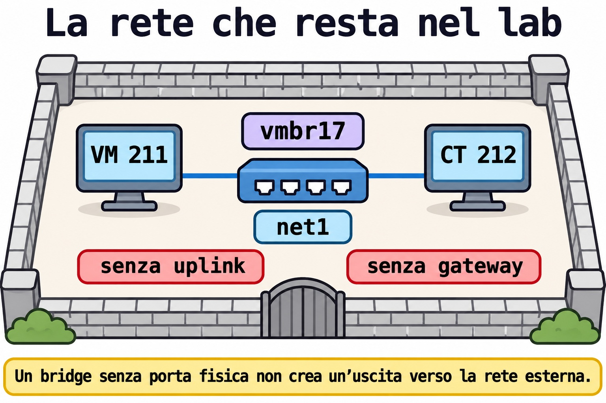
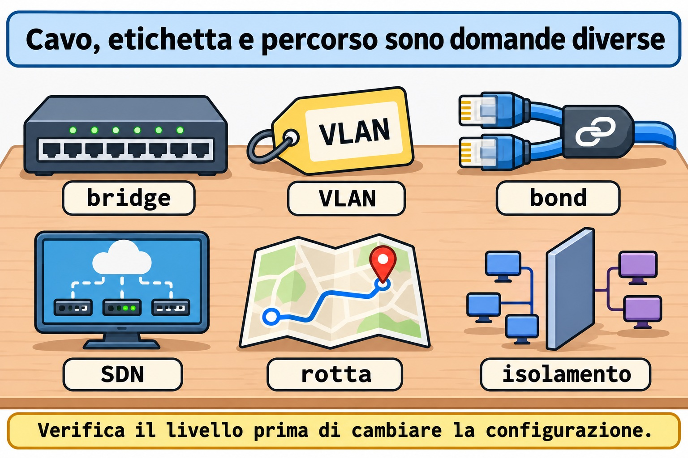
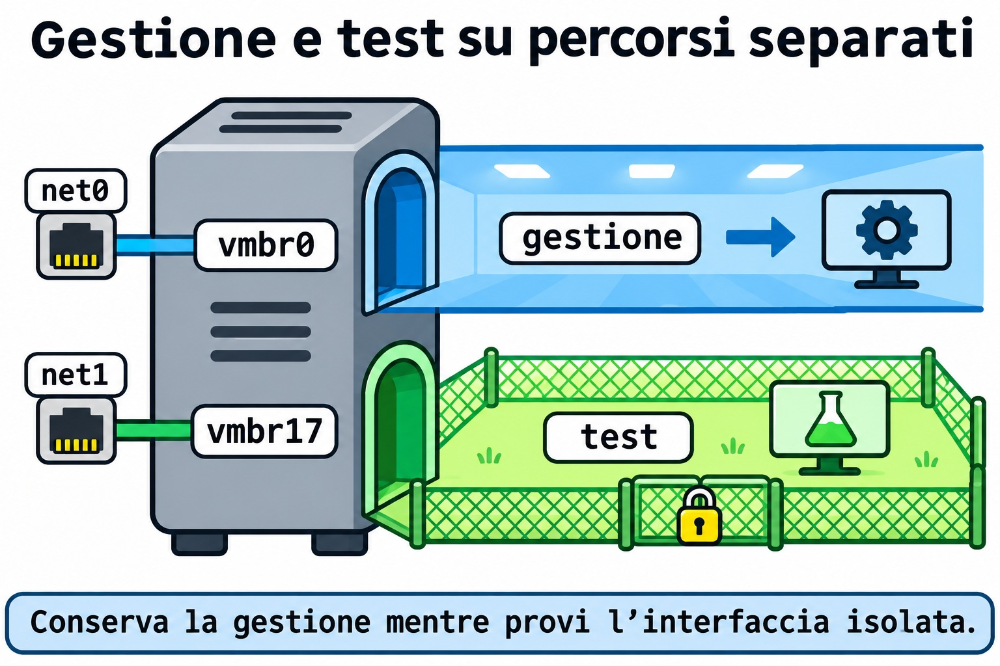

# Lezione 17.5 · Rete: bridge, VLAN, bond e SDN

> **Il cuore di questa lezione:** costruire una rete isolata fra due guest senza modificare il percorso di gestione dell’host.

Una VM ha un indirizzo eppure non comunica con il vicino. Prima di cambiare gli IP, devi distinguere porta, switch, etichetta e rotta.

| Scheda |  |
| --- | --- |
| **Modulo** | M17 · Proxmox nella pratica, lezione 5 di 7 |
| **Quando** | Settimana 23 |
| **Alla fine** | Creare un bridge isolato, collegare due interfacce e individuare il livello di un guasto |
| **Prerequisiti** | 17.1–17.4; VM 211 e CT 212 del contratto; console dell’host di laboratorio; `iproute2` e `iputils-ping` nel CT |
| **Durata** | 75–100 minuti |
| **Snapshot** | `m17a5-inicio` e `m17a5-fim` nella VM 211; riscontri del CT prima di rimuoverlo |

## 1 · Riscaldamento

Rispondi prima di aprire la console.

1. Un bridge senza porta fisica può collegare due VM dello stesso host?

2. Collegare due interfacce a un bridge crea automaticamente un gateway?

3. Una VLAN e una rotta risolvono lo stesso problema?

## 2 · Perché conta

Vuoi provare uno scambio di file fra la VM 211 e il CT 212. La gestione dell’host deve restare accessibile e la rete di test non deve raggiungere la rete esterna.

Aggiungere un’altra scheda ai guest permette di separare i due percorsi. La scheda di gestione resta dov’era; quella nuova entra in uno switch virtuale senza uscita fisica.

Il risultato della lezione è una comunicazione locale dimostrabile, non una nuova infrastruttura di produzione. Non configurare questo esercizio su un host di un cliente.

## 3 · Modello mentale

Pensa a una stanza con uno switch e due computer. Senza un cavo verso un altro switch, la stanza resta nel proprio dominio di livello 2. Un indirizzo IP organizza la comunicazione; non crea un’uscita.



*Un bridge senza porta fisica non crea un’uscita verso la rete esterna.*

### Ponte Windows

| Riferimento | Equivalenza utile |
| --- | --- |
| Switch virtuale interno | Bridge senza interfaccia fisica e senza indirizzo sull’host |
| Scheda aggiuntiva della VM | Un’altra interfaccia, con indirizzo e funzione propri |
| Identificazione VLAN | Etichetta che separa domini di livello 2 |
| Raggruppamento di interfacce | Bond; non è un sinonimo di bridge |

## 4 · L'essenziale

Un Linux bridge inoltra frame fra le sue porte. Può includere interfacce virtuali e fisiche, ma nessuna porta fisica è obbligatoria.

Un bridge senza IP sull’host collega comunque i guest. L’host non deve partecipare alla sottorete per funzionare da switch.

Una VLAN identifica un dominio di livello 2. Il routing collega reti di livello 3. Un bond raggruppa collegamenti; le sue proprietà dipendono dalla modalità e dallo switch.

SDN organizza configurazioni di rete a livello di datacenter. La sua presenza non elimina la necessità di verificare interfacce, bridge e connettività.

In questo banco non creiamo VLAN, bond, NAT, DHCP o zone SDN. Confrontiamo queste funzionalità e modifichiamo soltanto il nuovo bridge.



*Verifica il livello prima di cambiare la configurazione.*

### Rocky × Debian

| Livello | Rocky nella VM 211 | Debian nel CT 212 |
| --- | --- | --- |
| Scheda | Dispositivo virtuale riconosciuto dal kernel della VM | Interfaccia creata nel namespace del CT |
| Indirizzo del lab | Profilo dedicato di NetworkManager | Proprietà della configurazione del CT |
| Ispezione | `ip -br address` e `ip route` | `ip -br address` e `ip route` |
| Gestione | `net0` resta su `vmbr0` | `net0` resta scollegata su `vmbr0`; accesso tramite host |

### Decidi 1

Ti serve comunicazione locale fra due guest e nessuna uscita esterna. Quale disegno soddisfa la richiesta?

| A | B | C |
| --- | --- | --- |
| Nuovo bridge senza porta fisica e senza gateway | Cambiare il bridge di gestione | Aggiungere una rotta predefinita sull’host |

## 5 · Lab guidato

I comandi host appartengono esclusivamente al nodo di laboratorio autorizzato. Gli ID da 201 a 205 restano fuori da questa lezione.

Apri noVNC della VM 211 e la console dell’host. Riserva una finestra a ogni contesto; non incollare comandi host nel guest.

Gli indirizzi di documentazione seguenti si usano soltanto in questo segmento isolato. Se esiste già una sovrapposizione nelle rotte dei guest, fermati e scegli un altro segmento isolato documentato prima di adattare tutte le righe.

### Passo 1 · Identificare e conservare lo stato

**Ipotesi:** i due guest hanno nomi conosciuti e il secondo slot di rete è libero.

Sull’host, controlla anche l’inventario del cluster, non soltanto il nodo attuale.

```bash
pvesh get /cluster/resources --type vm
qm config 211
pct config 212
pct exec 212 -- sh -c 'command -v ip && command -v ping' || exit 1
test "$(qm config 211 | sed -n 's/^name: //p')" = m17-vm || exit 1
test "$(pct config 212 | sed -n 's/^hostname: //p')" = m17-ct || exit 1
! qm config 211 | grep -q '^net1:' || exit 1
! pct config 212 | grep -q '^net1:' || exit 1
umask 077
EVID=$(mktemp -d /root/m17a5.XXXXXX)
qm config 211 > "$EVID/vm211-antes.conf"
pct config 212 > "$EVID/ct212-antes.conf"
cp /etc/network/interfaces "$EVID/interfaces-antes"
qm snapshot 211 m17a5-inicio
printf '%s\n' "$EVID"
```

**Output atteso:** i nomi corrispondono al contratto; non esiste `net1`; gli strumenti esistono; lo snapshot termina senza errori. I percorsi temporanei reali variano. Se manca un pacchetto nel CT, fermati e prepara un’immagine base autorizzata con quei pacchetti prima di ricreare il CT; non collegarne la scheda di gestione per improvvisare un’installazione.

Nelle console dei due guest, registra la gestione e verifica eventuali sovrapposizioni. Non continuare se la rete scelta ha già un altro utilizzo.

```bash
ip -br address
ip route show table all
ip route get 192.0.2.211
ip route get 192.0.2.212
```

**Verifica:** la rotta attuale verso questi indirizzi non è una rete locale già configurata. Una rotta predefinita esistente non è, da sola, una sovrapposizione.

La bridge è una risorsa locale dell’host. Prima di questo passo, elenca tutti i nodi con `pvecm nodes`. Ripeti i due blocchi di creazione qui sotto nella console di **ogni nodo**, incluse le possibili destinazioni della 17.7, usando esattamente `/etc/network/interfaces.d/m17-lab`. Non basta crearla sul proprietario attuale della VM.

### Passo 2 · Creare soltanto il nuovo bridge

**Ipotesi:** l’host include file aggiuntivi, usa `ifupdown2` e non ha un’interfaccia chiamata `vmbr17`.

Sull’host, leggi il file principale. L’inclusione attiva deve comprendere esattamente il nuovo file; un commento non conta.

```bash
dpkg-query -W ifupdown2
cat /etc/network/interfaces
grep -nE '^[[:space:]]*source(-directory)?[[:space:]]' /etc/network/interfaces
test ! -e /etc/network/interfaces.d/m17-lab || exit 1
! ip link show vmbr17 >/dev/null 2>&1 || exit 1
grep -Rns 'vmbr17' /etc/network/interfaces /etc/network/interfaces.d/
```

**Output atteso:** inclusione attiva come `source /etc/network/interfaces.d/*` oppure `source-directory /etc/network/interfaces.d`; nessuna definizione precedente di `vmbr17`.

Se l’inclusione non esiste o ha un altro schema, fermati. La preparazione autorizzata dell’host precede questa lezione; non aggiungere una riga di gestione per tentativi.

```bash
install -m 0644 /dev/null /etc/network/interfaces.d/m17-lab
cat > /etc/network/interfaces.d/m17-lab <<'EOF'
auto vmbr17
iface vmbr17 inet manual
    bridge-ports none
    bridge-stp off
    bridge-fd 0
    post-up sysctl -w net.ipv6.conf.vmbr17.disable_ipv6=1
EOF
ifquery vmbr17
ifup vmbr17
ip -br address show vmbr17
bridge link show master vmbr17
```

**Verifica:** il bridge esiste senza indirizzo; non ci sono ancora porte dei guest. Non eseguire una ricarica globale e non spegnere un altro bridge.

Prima di collegare i guest, controlla il risultato su ogni nodo e annotane i nomi nel diario. Due bridge isolate con lo stesso nome su host diversi non creano un collegamento fra loro: nella 17.7 permettono di avviare la VM nella destinazione, ma non estendono automaticamente la LAN isolata fra nodi.
```bash
hostname -s
ip -br link show vmbr17
```


### Passo 3 · Aggiungere interfacce senza toccare la gestione

**Ipotesi:** aggiungere `net1` lascia intatta `net0`.

Arresta in modo controllato entrambi i guest prima della modifica. Se l’arresto non termina, indaga dalla console; non forzarlo per comodità.

```bash
qm shutdown 211 --timeout 60
pct shutdown 212 --timeout 60
qm status 211 | grep -qx 'status: stopped' || exit 1
pct status 212 | grep -qx 'status: stopped' || exit 1
qm set 211 --net1 virtio,bridge=vmbr17
pct set 212 --net1 name=eth1,bridge=vmbr17,ip=192.0.2.212/24,type=veth
qm config 211 > "$EVID/vm211-depois.conf"
pct config 212 > "$EVID/ct212-depois.conf"
diff <(grep '^net0:' "$EVID/vm211-antes.conf") <(qm config 211 | grep '^net0:')
diff <(grep '^net0:' "$EVID/ct212-antes.conf") <(pct config 212 | grep '^net0:')
qm start 211
pct start 212
```

**Output atteso:** i due confronti non mostrano differenze; le nuove interfacce puntano a `vmbr17`.

**Verifica:** la gestione della VM resta accessibile; il CT continua a essere amministrato tramite `pct exec` e con `net0` scollegata. La nuova scheda non assegna ancora un indirizzo alla VM.

### Passo 4 · Configurare l’indirizzo sulla scheda corretta

**Ipotesi:** la MAC della nuova interfaccia identifica il dispositivo nella VM senza indovinarne il nome.

Sull’host, leggi la MAC di `net1`. Nella VM 211, confrontala con l’elenco e imposta la variabile con il dispositivo corrispondente.

```bash
qm config 211 | grep '^net1:'
```

Adesso nella console della VM 211, come amministratore:

```bash
nmcli -f GENERAL.DEVICE,GENERAL.HWADDR,GENERAL.CONNECTION device show
read -r -p 'Interface net1: ' LAB_IF
ip link show dev "$LAB_IF" || exit 1
nmcli connection show
nmcli -g GENERAL.CONNECTION device show "$LAB_IF"
ACTIVE_PROFILE=$(nmcli -g GENERAL.CONNECTION device show "$LAB_IF") || exit 1
case "$ACTIVE_PROFILE" in ''|'--'|'Wired connection '*) ;; *) exit 1 ;; esac
! nmcli -g NAME connection show | grep -qx m17-isolada || exit 1
sudo nmcli connection add type ethernet ifname "$LAB_IF" con-name m17-isolada ipv4.method manual ipv4.addresses 192.0.2.211/24 ipv4.never-default yes ipv6.method disabled connection.autoconnect yes
sudo nmcli connection up m17-isolada
ip -br address show dev "$LAB_IF"
ip route show
```

**Output atteso:** l’interfaccia scelta ha `192.0.2.211/24`; la rotta predefinita resta sull’interfaccia di gestione.

**Verifica:** il profilo del lab non ha gateway. Se la MAC non corrisponde, fermati; non disattivare il profilo di gestione per correggere una scelta sbagliata. Se esiste già un profilo automatico sulla nuova scheda, fermati prima di crearne un altro e rivedi separatamente quel profilo.

### Passo 5 · Dimostrare percorso, vicino e persistenza

**Ipotesi:** i due indirizzi si raggiungono direttamente; la comunicazione non usa la rotta predefinita.

Nella VM 211, verifica il vicino. Nel CT, controlla il ritorno dalla console oppure con il comando host indicato.

```bash
ip route get 192.0.2.212
ping -c 3 192.0.2.212
ip neigh show dev "$LAB_IF"
```

Sull’host:

```bash
pct exec 212 -- ip -br address show eth1
pct exec 212 -- ip route get 192.0.2.211
pct exec 212 -- ping -c 3 192.0.2.211
bridge link show master vmbr17
qm config 211 | grep '^net1:'
pct config 212 | grep '^net1:'
```

**Output atteso:** la rotta è diretta sulla nuova scheda; arrivano risposte in entrambe le direzioni e sono presenti porte virtuali sul bridge. Nessun tempo di risposta è prestabilito.

Se ICMP fallisce, osserva link, indirizzo, vicino e regole esistenti. Non disattivare il firewall globale per ottenere un risultato positivo.

**Reboot di verifica:** riavvia soltanto VM 211 e CT 212 con la procedura normale e ripeti i test. Non riavviare l’host in questa lezione.

**Verifica:** gli indirizzi ricompaiono e la gestione resta uguale. Conserva comandi e risultati reali nel diario.

### Passo 6 · Conservare i riscontri e liberare l’ID 212

**Ipotesi:** il CT è eliminabile e i suoi riscontri possono essere conservati prima della rimozione prevista dal contratto.

Esegui questo passo soltanto dopo i guasti della sezione successiva. Conclude l’utilizzo del CT e prepara il ripristino della 17.6.

Sull’host, controlla nuovamente nome e ID. Se il CT contiene dati non eliminabili, interrompi la pulizia.

```bash
: "${EVID:?}"
test "$(pct config 212 | sed -n 's/^hostname: //p')" = m17-ct || exit 1
pct config 212 > "$EVID/ct212-final.conf"
pct exec 212 -- ip -br address > "$EVID/ct212-address.txt"
pct exec 212 -- ip route > "$EVID/ct212-route.txt"
pct exec 212 -- ping -c 3 192.0.2.211 > "$EVID/ct212-ping.txt"
read -r -p 'Confirmar descarte m17-ct 212: ' CONFIRMA
test "$CONFIRMA" = 'm17-ct 212' || exit 1
pct shutdown 212 --timeout 60
pct status 212 | grep -qx 'status: stopped' || exit 1
pct destroy 212
pvesh get /cluster/resources --type vm
qm snapshot 211 m17a5-fim
ip -br address show vmbr17
```

**Output atteso:** il CT 212 scompare dall’inventario; VM 211 e template 210 restano. Il bridge continua a non avere IP.

**Verifica:** conserva il file del bridge e l’interfaccia `net1` della VM. Il segmento sarà riutilizzato nella sfida e nel M19; non rimuoverne ora l’infrastruttura.

### Decidi 2

La VM raggiunge la gestione, ma l’indirizzo del CT usa la rotta predefinita. Cosa esaminare per prima cosa?

| A | B | C |
| --- | --- | --- |
| Il bond fisico dell’host | L’indirizzo e il profilo della nuova interfaccia | Il DNS esterno |

## 6 · Rompi e ripara

Esegui prima della rimozione del CT nel Passo 6. Ogni guasto riguarda soltanto il segmento isolato. Riparane uno prima di crearne un altro.

### Guasto 1 · Il cavo virtuale è stato scollegato

Sull’host, conserva la configurazione originale di `net1` e cambia soltanto lo stato del link.

```bash
NET1=$(qm config 211 | sed -n 's/^net1: //p')
test -n "$NET1" || exit 1
qm set 211 --net1 "$NET1,link_down=1"
```

**Sintomo:** il ping smette di funzionare, anche se l’indirizzo resta configurato.

**Indagine:** confronta `qm config 211` sull’host e `ip link` nella VM; osserva lo stato del cavo virtuale.

**Causa:** l’hypervisor presenta la scheda con il link scollegato. Un IP non sostituisce il link.

**Riparazione:** nella stessa shell dell’host, ripristina esattamente la configurazione conservata.

```bash
qm set 211 --net1 "$NET1"
```

**Verifica:** la VM torna a raggiungere il CT dall’interfaccia del lab.

**Prevenzione:** registra lo stato del link insieme al bridge e all’indirizzo.

### Guasto 2 · L’indirizzo è sulla scheda sbagliata?

Nella VM 211, disattiva soltanto il profilo isolato. Non modificare il dispositivo di gestione.

```bash
sudo nmcli connection down m17-isolada
ip route get 192.0.2.212
```

**Sintomo:** il test locale fallisce e la rotta può ricadere sull’uscita predefinita.

**Indagine:** controlla il profilo attivo e l’indirizzo del dispositivo la cui MAC corrisponde a `net1`.

**Causa:** senza indirizzo e rotta connessa, la presenza della scheda nel bridge non basta.

**Riparazione:** riattiva il profilo esistente, senza creare un secondo profilo concorrente.

```bash
sudo nmcli connection up m17-isolada
ip route get 192.0.2.212
```

**Verifica:** la rotta torna a indicare l’interfaccia del lab e il ping riesce.

**Prevenzione:** controlla profilo, dispositivo e MAC come un insieme.

### Guasto 3 · L’etichetta non corrisponde

Questo guasto è un’analisi di configurazione, senza applicare VLAN all’host. Leggi lo scenario e scrivi il riscontro necessario.

**Sintomo:** due guest sullo stesso nome di bridge non si vedono; uno ha una VLAN configurata e l’altro no.

**Indagine:** confronta le proprietà delle schede, la configurazione VLAN del bridge e il disegno previsto del segmento.

**Causa:** appartenere allo stesso switch non garantisce di appartenere allo stesso dominio di livello 2.

**Riparazione:** nello scenario, allinea le etichette al disegno autorizzato; nel banco attuale, mantieni entrambe le schede senza etichetta.

```bash
qm config 211 | grep '^net1:'
pct config 212 | grep '^net1:'
ifquery vmbr17
```

**Verifica:** non compare `tag=` nelle due interfacce di questo banco. Non aggiungere una VLAN soltanto per riprodurre la storia.

**Prevenzione:** registra bridge ed etichetta; un solo nome non descrive l’intero percorso.



*Conserva la gestione mentre provi l’interfaccia isolata.*

## 7 · Trappole

- Un bridge isolato non impedisce a un guest di instradare traffico se qualcuno configura l’inoltro al suo interno. Non trasformare la VM in router.

- Aggiungere un IP all’host amplia la superficie del disegno e non serve per questo test.

- Un bond non raddoppia automaticamente la velocità di una singola connessione; dipende dalla modalità e dalla distribuzione dei flussi.

- Una VLAN dipende da una configurazione coerente lungo il percorso; non è crittografia.

- Ricaricare l’intera rete per creare un bridge vuoto coinvolge interfacce esterne all’esercizio.

- Lo snapshot della VM non salva i file di rete dell’host. I riscontri dell’host devono esistere separatamente.

## 8 · Quiz

1. Perché il bridge del lab usa una configurazione manuale senza indirizzo sull’host?

2. Come dimostri che il ping non è passato dall’interfaccia di gestione?

3. Se la MAC è corretta e il link è attivo, quale livello esamini dopo?

4. Perché un test con il nome del CT richiederebbe un’indagine diversa da un test tramite IP?

5. Cosa deve restare per la prossima lezione e per il M19?

6. Perché una connessione automatica sconosciuta sulla nuova scheda richiede una revisione prima di creare il profilo del laboratorio?

## 9 · Promemoria

| Domanda | Osservazione |
| --- | --- |
| Quale bridge ha ricevuto la scheda? | `qm config 211` |
| Quali porte sono sullo switch? | `bridge link show master vmbr17` |
| Quale percorso usa l’IP? | `ip route get 192.0.2.212` |
| Esiste un vicino sulla scheda del lab? | `ip neigh` |
| Quale profilo è stato attivato? | `nmcli connection show --active` |

**Flashcard:** il bridge inoltra frame; il gateway inoltra pacchetti; la VLAN separa domini; il bond raggruppa link; SDN organizza reti.

## 10 · Checklist e chiusura

- [ ] Ho confermato l’inclusione attiva del file aggiuntivo prima di crearlo.

- [ ] Ho conservato la configurazione di gestione e confrontato `net0` prima e dopo.

- [ ] Ho dimostrato rotta diretta e comunicazione in entrambe le direzioni prima della pulizia.

- [ ] Ho ripetuto i test dopo aver riavviato i guest.

- [ ] Ho conservato i riscontri del CT e liberato l’ID 212 controllandone il nome.

- [ ] Ho conservato VM 211, template 210, bridge e file per il seguito.

**Ultimo esercizio:** disegna il percorso di un frame dalla VM al CT e indica dove entrerebbero un’etichetta VLAN e un router.

Nel DeepTutor, mantieni letterali i comandi seguenti e aggiungi la tua spiegazione al di fuori di essi.

`!explica bridge VLAN bond SDN`

`!feynman bridge sem IP no host`

`!quiz rede isolada no Proxmox`

## 11 · Nella vita reale

Missione di sola lettura: scegli una VM autorizzata e segui la scheda virtuale fino al bridge, al bond e all’interfaccia fisica, se esistono.

Registra chi è responsabile di ogni livello, quali VLAN sono previste e dove si trova il gateway. Non modificare la gestione per completare il disegno.

Confronta lo stato osservato con l’inventario approvato. Un’interfaccia sconosciuta è un motivo per indagare con il responsabile, non per eliminarla.

## 12 · Approfondire quando vuoi

Consulta [la documentazione ufficiale di rete di Proxmox VE](https://github.com/proxmox/pve-docs/blob/master/pve-network.adoc) per esempi di bridge, bond e VLAN.

Verifica i parametri delle schede nel [manuale ufficiale delle VM](https://github.com/proxmox/pve-docs/blob/master/generated/qm.1-synopsis.adoc) e nel [manuale ufficiale dei CT](https://github.com/proxmox/pve-docs/blob/master/generated/pct.1-synopsis.adoc).

La documentazione descrive funzionalità più ampie di questo banco. Applicare una modifica globale richiede un piano dedicato e non fa parte dei passi precedenti.

## Soluzioni commentate

**Riscaldamento 1:** sì. Le porte virtuali possono scambiare frame nello stesso bridge senza interfaccia fisica.

**Riscaldamento 2:** no. Un gateway deve esistere e inoltrare traffico; collegare schede non crea quel servizio.

**Riscaldamento 3:** no. Una VLAN separa domini di livello 2; una rotta sceglie il percorso fra reti.

**Decidi 1:** A. Il disegno soddisfa la comunicazione locale e conserva la gestione.

**Decidi 2:** B. L’assenza della rotta connessa indica anzitutto indirizzo, profilo e dispositivo del lab.

**Quiz 1:** l’host deve soltanto inoltrare frame; non gli serve un indirizzo in quella sottorete.

**Quiz 2:** registra la rotta scelta, il dispositivo e il vicino. La risposta del ping da sola non identifica il percorso.

**Quiz 3:** controlla indirizzo, prefisso e rotta; poi valuta vicinato e filtraggio con riscontri.

**Quiz 4:** i nomi aggiungono il livello di risoluzione. Un errore DNS non dimostra un guasto del bridge.

**Quiz 5:** VM 211 con la sua interfaccia aggiuntiva, template 210 e infrastruttura del bridge. Il CT 212 viene rimosso dopo aver conservato i riscontri.

**Quiz 6:** un profilo esistente può già configurare indirizzo, gateway o connessione automatica; identificane dispositivo e ambito prima di modificarlo, senza toccare la gestione.

[← Lezione 17.4 · Storage](17.4-storage.md) · [Indice delle lezioni](../01-aulas.md) · [Lezione 17.6 · Backup e ripristino →](17.6-backup-e-restauracao.md)
