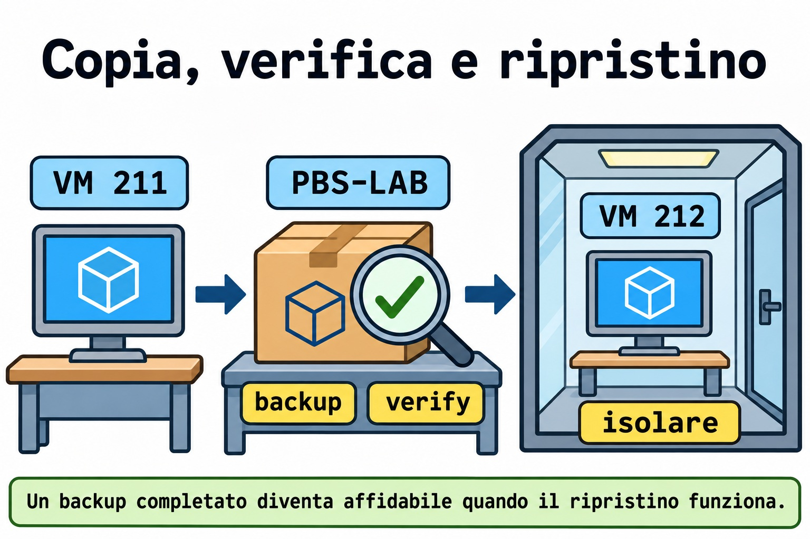
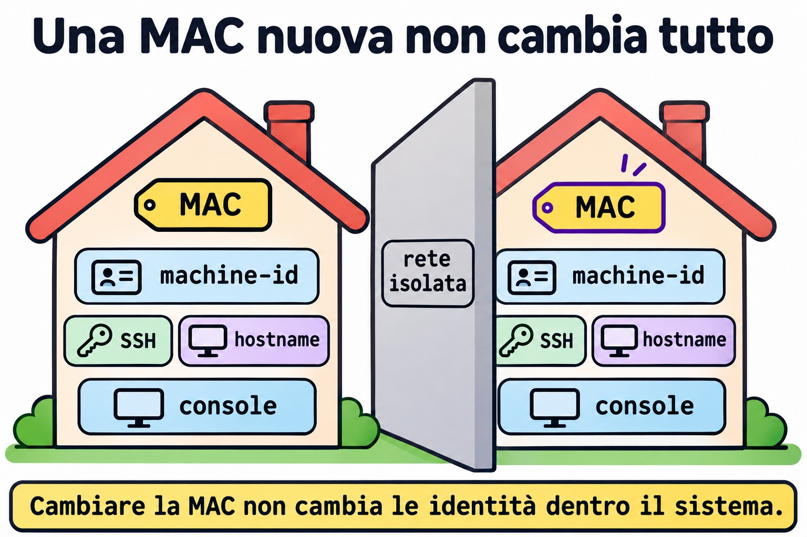
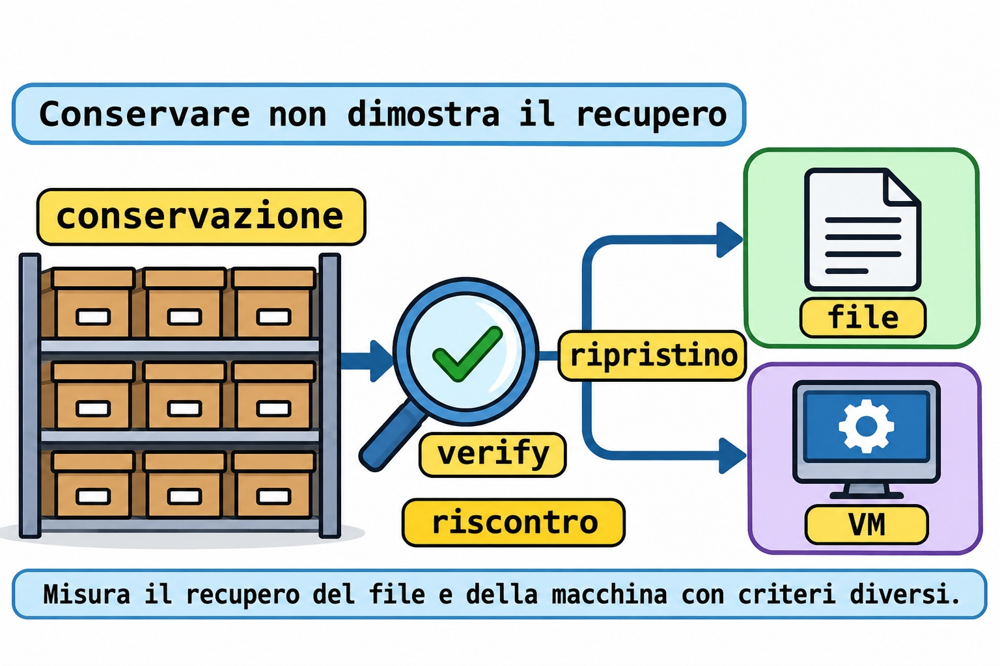

# Lezione 17.6 · Backup e ripristino con PBS

> **Il cuore di questa lezione:** produrre un backup della VM 211, verificarne il contenuto e dimostrare il recupero senza mettere in rete una copia con identità duplicata.

Un job verde conferma una fase. La fiducia dipende anche dal trovare la copia, recuperare ciò che conta e registrare quanto tempo è servito.

| Scheda |  |
| --- | --- |
| **Modulo** | M17 · Proxmox nella pratica, lezione 6 di 7 |
| **Quando** | Settimana 23 |
| **Alla fine** | Recuperare un file e una VM isolata da una copia identificata |
| **Prerequisiti** | 17.5 completata; VM 211; ID 212 libero nel cluster; storage `PBS-LAB` già predisposto |
| **Durata** | 90–120 minuti, più trasferimento e verifica |
| **Snapshot** | `m17a6-inicio` e `m17a6-fim` nella VM 211; backup esterno identificato nel diario |

## 1 · Riscaldamento

1. Uno snapshot conservato nello stesso storage risolve la perdita di quello storage?

2. La verifica d’integrità dimostra che l’applicazione parte dopo il ripristino?

3. Una nuova MAC elimina l’indirizzo IP, il nome e le chiavi SSH presenti sul disco?

## 2 · Perché conta

L’inventario mostra backup recenti, ma nessuno ha provato a recuperare un file. Quando arriva la richiesta, mancano l’identificazione della copia e l’autorizzazione a ripristinare senza sovrascrivere la macchina attuale.

Proverai i due percorsi: file singolo e macchina completa. L’originale resta acceso; la copia ripristinata parte soltanto senza connettività.

Questa lezione usa un PBS di laboratorio già registrato. Installare il server, distribuire credenziali e creare politiche globali richiederebbe un altro contratto.

## 3 · Modello mentale

Pensa a una scatola sigillata. Trasportarla, controllare il sigillo e rimontare l’apparecchio sono operazioni diverse. Una può riuscire e quella successiva fallire.



*Un backup completato diventa affidabile quando il ripristino funziona.*

### Ponte Windows

| Riferimento | Domanda equivalente |
| --- | --- |
| Recuperare una versione di file | Quale snapshot contiene il contenuto desiderato? |
| Recuperare una macchina intera | Dove avviare la copia senza sovrascrivere l’originale? |
| Cronologia del job | Il trasferimento è terminato e quale copia ha prodotto? |
| Esercitazione di recupero | Il dato recuperato soddisfa il criterio dell’operazione? |

## 4 · L'essenziale

Proxmox VE coordina il backup del guest. PBS conserva i dati e offre verifiche e politiche proprie. Sono servizi con interfacce e responsabilità diverse.

Una copia incrementale deduplicata rappresenta comunque un punto di recupero completo. La quantità trasferita non è la dimensione logica ripristinabile.

La modalità di backup deve essere adatta all’applicazione. Per questo banco useremo un arresto controllato e la modalità a macchina ferma, evitando di promettere una coerenza che non abbiamo misurato.

La conservazione sceglie quali punti mantenere. Prune rimuove riferimenti secondo la politica; garbage collection recupera successivamente i chunk senza riferimenti. Non eseguire nessuna delle due operazioni globalmente per questo esercizio.

RPO chiede quanti dati si possono perdere; RTO chiede quanto tempo può richiedere il recupero. Un backup recente e un recupero rapido rispondono a domande diverse.

Se trasformi l’esercitazione in un job pianificato, documentane prima l’ambito. Un job del lab deve selezionare esplicitamente soltanto la VM 211, non tutti i guest o un pool condiviso.

| Campo del piano | Decisione per questo banco |
| --- | --- |
| Selezione | Soltanto VM 211; mai tutti i guest |
| Destinazione | `PBS-LAB` già autorizzato |
| Orario | Finestra approvata, senza competere con job esistenti |
| Conservazione | Simulare i punti conservati prima di consentire rimozioni |
| Verifica | Esercitazione su file e VM con periodicità e responsabile |

Il comando manuale di questa lezione non pianifica job e non autorizza eliminazioni. Una politica futura è una modifica dedicata, da rivedere e simulare prima dell’attivazione.



*Cambiare la MAC non cambia le identità dentro il sistema.*

### Rocky × Debian

| Livello | Rocky | Debian |
| --- | --- | --- |
| Identità persistente | `machine-id`, hostname e chiavi SSH sul disco | Gli stessi tipi di identità |
| Recupero di file | Confrontare contenuto e permessi | Confrontare contenuto e permessi |
| Recupero di VM | Verificare boot e servizio previsto | Verificare boot e servizio previsto |
| Sicurezza della copia | Rete scollegata prima del primo boot | La stessa regola |

### Decidi 1

Ti serve soltanto un file eliminato ieri. Quale percorso conserva meglio lo stato attuale?

| A | B | C |
| --- | --- | --- |
| Recuperare il file in una nuova destinazione e confrontarlo | Ripristinare sopra la VM attuale | Eliminare la VM prima di cercare la copia |

## 5 · Lab guidato

Il CT 212 è stato rimosso alla fine della 17.5. Ora lo stesso numero sarà usato temporaneamente da una VM chiamata `m17-restore`. Non supporre che sia libero: controlla il cluster.

Non usare ripristino forzato, ripristino live o avvio automatico. L’originale 211 non sarà eliminato in questa lezione.

### Passo 1 · Fissare il criterio di recupero

**Ipotesi:** un file conosciuto permette di distinguere il recupero di una macchina dal semplice avvio di un sistema qualsiasi.

Nella console della VM 211, conferma il login locale con la credenziale di emergenza definita nella 17.2; poi usa una shell amministrativa per creare il marcatore. Se esiste già, fermati e leggine il contenuto prima di decidere di riutilizzarlo.

```bash
sudo -i
test ! -e /var/lib/m17/evidencia.txt || exit 1
install -d -m 0750 /var/lib/m17
printf '%s\n' 'm17-vm 211: recuperacao ensaiada' > /var/lib/m17/evidencia.txt
chmod 0640 /var/lib/m17/evidencia.txt
sha256sum /var/lib/m17/evidencia.txt
stat -c '%a %U:%G %n' /var/lib/m17/evidencia.txt
cat /etc/machine-id
hostnamectl hostname
```

**Output atteso:** il file contiene una riga; conserva l’hash reale e i metadati nel diario. Non esiste un hash d’esempio da copiare.

Sull’host, conferma l’origine e salva configurazione e inventario in una cartella privata.

```bash
test "$(qm config 211 | sed -n 's/^name: //p')" = m17-vm || exit 1
umask 077
EVID=$(mktemp -d /root/m17a6.XXXXXX)
qm config 211 > "$EVID/vm211.conf"
pvesh get /cluster/resources --type vm --output-format json-pretty > "$EVID/inventario-antes.json"
qm snapshot 211 m17a6-inicio
pvesm status --storage PBS-LAB
pvesm status
cat /etc/pve/storage.cfg
read -r -p 'Storage de imagens autorizado para restore: ' RESTORE_STORE
test -n "$RESTORE_STORE" || exit 1
qm config 211 | grep -E '^(scsi|virtio|sata|ide)[0-9]+:'
```

**Verifica:** `PBS-LAB` è attivo e accetta backup. La destinazione scelta supporta immagini e ha margine per tutti i dischi della copia; usa `vm-hdd` se verificato oppure un altro backend reale autorizzato. Includi il disco dati `M17DATA` della 17.4: non puoi promettere di recuperare dati esclusi dal backup.

### Passo 2 · Produrre una copia identificabile

**Ipotesi:** arrestare in modo controllato e copiare la VM ferma produce un punto conosciuto per questo esercizio.

Sull’host, elenca prima e dopo. Non aggiungere opzioni di prune o conservazione al comando di questa copia.

```bash
pvesm list PBS-LAB --content backup --vmid 211 > "$EVID/backups-antes.txt"
qm shutdown 211 --timeout 60
qm status 211 | grep -qx 'status: stopped' || exit 1
date -Is > "$EVID/backup-inicio.txt"
vzdump 211 --storage PBS-LAB --mode stop --remove 0 || exit 1
date -Is > "$EVID/backup-fim.txt"
pvesm list PBS-LAB --content backup --vmid 211 | tee "$EVID/backups-depois.txt"
qm start 211
```

**Output atteso:** l’attività termina correttamente e compare un volume di backup con una data reale. Se l’attività fallisce, non continuare usando un nome simile.

Copia l’identificatore completo della nuova riga, non la dimensione o l’identificatore di una copia precedente.

```bash
read -r -p 'Volume ID do backup novo: ' BACKUP
case "$BACKUP" in PBS-LAB:backup/vm/211/*) ;; *) exit 1 ;; esac
printf '%s\n' "$BACKUP" > "$EVID/backup-volume.txt"
pvesm extractconfig "$BACKUP" | tee "$EVID/backup-config.conf"
```

**Verifica:** la configurazione recuperata appartiene alla VM di origine e include i dischi previsti. Conserva l’orario e il risultato dell’attività.

### Passo 3 · Verificare sul server corretto

**Ipotesi:** la copia appena creata può essere verificata su PBS senza avviare una verifica globale del datastore.

Apri l’interfaccia del PBS di laboratorio, non la schermata di rete di Proxmox VE. Nel datastore corrispondente a `PBS-LAB`, apri il contenuto e seleziona esattamente lo snapshot della VM 211 annotato.

Esegui l’azione di verifica di quello snapshot. Conferma l’ambito mostrato prima di iniziare; se l’interfaccia seleziona l’intero datastore, annulla e chiedi all’amministratore PBS l’esecuzione puntuale.

Registra identificatore dell’attività, snapshot selezionato, conclusione e orario. Non copiare token, password o configurazioni di credenziali nel diario.

**Output atteso:** la verifica del punto scelto termina senza errori. Un risultato precedente di un’altra copia non soddisfa questo passo.

**Verifica:** spiega la differenza fra integrità dei dati conservati e boot funzionante del sistema recuperato. Il secondo non è stato ancora dimostrato.

### Passo 4 · Recuperare un file in una nuova destinazione

**Ipotesi:** esplorare la copia permette di ottenere il marcatore senza sostituire il file della VM in uso.

Sull’host di laboratorio, controlla lo strumento. Il repository PBS autorizzato e la sua impronta provengono dall’inventario validato, mai dall’accettazione cieca del certificato.

```bash
command -v proxmox-file-restore
read -r -p 'Repositorio PBS autorizado: ' PBS_REPOSITORY
export PBS_REPOSITORY
SNAPSHOT=${BACKUP#PBS-LAB:backup/}
printf '%s\n' "$SNAPSHOT"
proxmox-file-restore list "$SNAPSHOT" / --repository "$PBS_REPOSITORY"
```

Autenticati con il meccanismo approvato, senza inserire la password nella riga di comando. Se ci sono namespace o crittografia, usa il namespace e la chiave di recupero autorizzati; senza questi, fermati.

La radice mostra i file dei dischi. Naviga tramite il nome reale del disco e le partizioni o i volumi visualizzati. Non supporre una partizione fissa o un layout uguale a quello di un’altra VM.

```bash
read -r -p 'Caminho de diretorio exibido: ' DIR_RESTORE
proxmox-file-restore list "$SNAPSHOT" "$DIR_RESTORE" --repository "$PBS_REPOSITORY"
```

Ripeti l’elenco fino a individuare il marcatore nel file system. Copia il percorso virtuale completo visualizzato; comprende il disco e il percorso interno del guest.

```bash
read -r -p 'Caminho completo do arquivo no backup: ' FILE_RESTORE
DEST=$(mktemp -d /root/m17-file-restore.XXXXXX)
proxmox-file-restore extract "$SNAPSHOT" "$FILE_RESTORE" - --repository "$PBS_REPOSITORY" --format plain > "$DEST/evidencia.txt"
RC=$?
test "$RC" -eq 0 || exit 1
sha256sum "$DEST/evidencia.txt"
cat "$DEST/evidencia.txt"
proxmox-file-restore status
```

**Output atteso:** contenuto e hash coincidono con quelli registrati nel Passo 1. Il file recuperato si trova in una nuova cartella dell’host.

**Verifica:** questo flusso misura i byte del file. Per restituire il dato all’applicazione, devi ancora pianificare proprietario, modalità, contesto di sicurezza e approvazione del responsabile.

### Passo 5 · Ripristinare la macchina con tutte le schede scollegate

**Ipotesi:** una VM ripristinata con un altro ID può essere esaminata senza raggiungere la rete dell’originale.

Sull’host, dimostra che nessun nodo del cluster usa 212. La query deve riuscire prima di fidarti di un risultato vuoto.

```bash
pvesh get /cluster/resources --type vm --output-format json > "$EVID/cluster-pre-restore.json" || exit 1
python3 - "$EVID/cluster-pre-restore.json" <<'PY' || exit 1
import json, sys
items = json.load(open(sys.argv[1]))
assert not any(int(x.get('vmid', -1)) == 212 for x in items), 'ID 212 ocupado'
PY
date -Is > "$EVID/restore-inicio.txt"
: "${RESTORE_STORE:?}" "${BACKUP:?}"
qmrestore "$BACKUP" 212 --storage "$RESTORE_STORE" --unique 1 --start 0 || exit 1
qm status 212 | grep -qx 'status: stopped' || exit 1
qm set 212 --name m17-restore --onboot 0 || exit 1
qm config 212 > "$EVID/restore-antes-isolar.conf" || exit 1
```

Non avviare ancora. Il nuovo ID e le nuove MAC non dimostrano un cambiamento delle identità interne. Cloud-init può rilevare una nuova istanza e rigenerarne una parte; controlla il risultato dalla console, senza presumere conservazione o rigenerazione.

Scollega il link di tutte le interfacce ripristinate, compresa quella del segmento isolato. Il ciclo conserva le altre proprietà di ogni scheda.

```bash
while IFS= read -r LINE; do
    KEY=${LINE%%:*}
    VALUE=${LINE#*: }
    VALUE=$(printf '%s' "$VALUE" | sed -E 's/(^|,)link_down=[01](,|$)/\1/; s/,$//')
    qm set 212 --"$KEY" "$VALUE,link_down=1" || exit 1
done < <(grep -E '^net[0-9]+:' "$EVID/restore-antes-isolar.conf")
qm config 212 > "$EVID/restore-isolado.conf" || exit 1
cat "$EVID/restore-isolado.conf"
awk '/^net[0-9]+:/ && $0 !~ /,link_down=1(,|$)/ {bad=1} END {exit bad}' "$EVID/restore-isolado.conf" || exit 1
qm start 212
```

**Output atteso:** tutte le righe delle schede mostrano `link_down=1`; la VM parte senza connettività. Controllalo prima di premere avvia.

Dalla console della VM 212, usa la credenziale locale provata prima del backup e una shell amministrativa. Se la VM usa una console seriale, apri la console corrispondente; non configurare una rete per facilitare l’accesso. Leggi il marcatore, l’hash e l’identità.

```bash
cat /var/lib/m17/evidencia.txt
sha256sum /var/lib/m17/evidencia.txt
stat -c '%a %U:%G %n' /var/lib/m17/evidencia.txt
cat /etc/machine-id
hostnamectl hostname
ip -br link
journalctl -b -p err --no-pager
lsblk -o NAME,TYPE,SIZE,FSTYPE,MOUNTPOINTS,SERIAL
read -r -p 'Disco restaurado com serial M17DATA: ' LAB_DISK
test "$(lsblk -dnro SERIAL "$LAB_DISK")" = M17DATA || exit 1
mount "$LAB_DISK" /mnt/m17-data
sha256sum /mnt/m17-data/evidence.txt
```

**Verifica:** il marcatore coincide con l’origine; l’hash del disco dati coincide con il diario della 17.4; il boot arriva al login e gli errori vengono interpretati. Gli errori di rete sono previsti con i cavi scollegati; non nascondere fra essi errori del disco.

### Passo 6 · Registrare l’esercitazione e rimuovere soltanto la copia

**Ipotesi:** puoi conservare il risultato senza mantenere due macchine con le stesse identità.

Esegui questo passo dopo le analisi dei guasti. Copia le osservazioni di noVNC nel diario e registra i tempi reali, inclusi indagine e autenticazione.

Sull’host, conserva la configurazione finale e conferma nome e ID prima di rimuovere la VM eliminabile.

```bash
date -Is > "$EVID/restore-fim.txt"
test "$(qm config 212 | sed -n 's/^name: //p')" = m17-restore || exit 1
qm config 212 > "$EVID/restore-final.conf"
read -r -p 'Confirmar descarte m17-restore 212: ' CONFIRMA
test "$CONFIRMA" = 'm17-restore 212' || exit 1
qm shutdown 212 --timeout 60
qm status 212 | grep -qx 'status: stopped' || exit 1
qm destroy 212
qm status 211
qm snapshot 211 m17a6-fim
pvesh get /cluster/resources --type vm
```

**Output atteso:** VM 212 rimossa; VM 211 e template 210 conservati; il backup identificato resta disponibile.

**Verifica:** non eliminare la copia PBS che servirà nella sfida. Anche il bridge del laboratorio resta per il seguito e per il M19.

### Decidi 2

Il ripristino ha generato nuove MAC. Puoi collegare subito la copia alla rete di gestione?

| A | B | C |
| --- | --- | --- |
| Soltanto se il backup ha meno di un giorno | No; prima verifica e pianifica le identità interne | Sì, ogni identità è cambiata |

## 6 · Rompi e ripara

I guasti seguenti sono esercizi di decisione e lettura. Non corrompere chunk, eliminare backup o collegare la copia per provocare il problema.

### Guasto 1 · La copia era di un altro orario

**Sintomo:** la VM ripristinata parte, ma non contiene il marcatore appena creato.

**Indagine:** confronta orario del marcatore, conclusione del backup e identificatore completo scelto per il ripristino.

```bash
cat "$EVID/backup-volume.txt"
cat "$EVID/backup-inicio.txt" "$EVID/backup-fim.txt"
pvesm list PBS-LAB --content backup --vmid 211
```

**Causa:** una vecchia copia può essere integra e non contenere comunque la versione necessaria.

**Riparazione:** identifica il punto corretto prima di ripetere il ripristino isolato; non sostituire mai l’originale per verificare una supposizione.

**Verifica:** associa marcatore e snapshot tramite date e contenuto, non soltanto con il numero della VM.

**Prevenzione:** registra il volume completo e il criterio di recupero insieme all’attività.

### Guasto 2 · Il percorso virtuale è stato indovinato

**Sintomo:** lo strumento elenca lo snapshot, ma non trova il percorso usato per estrarre il file.

**Indagine:** torna alla radice dell’elenco e segui disco, partizione o volume e directory.

```bash
proxmox-file-restore list "$SNAPSHOT" / --repository "$PBS_REPOSITORY"
```

**Causa:** il percorso di estrazione include l’albero virtuale dei dischi; non è soltanto il percorso assoluto dentro la VM.

**Riparazione:** naviga con i nomi reali. Se esistono crittografia interna o layout non accessibili, usa un ripristino completo isolato e la chiave autorizzata.

**Verifica:** estrai in un’altra nuova destinazione e confronta l’hash. Un file vuoto creato dalla redirezione non significa estrazione riuscita.

**Prevenzione:** conserva la sequenza di navigazione e il codice d’uscita; non copiare percorsi di un’altra installazione.

### Guasto 3 · Il backup è riuscito, ma la rete sarebbe pericolosa

**Sintomo:** il piano di ripristino propone di avviare la copia con lo stesso IP statico dell’originale.

**Indagine:** leggi la configurazione delle schede e l’identità tramite noVNC prima di considerare qualsiasi riconnessione.

```bash
qm config 212 | grep -E '^net[0-9]+:'
```

**Causa:** il disco ripristinato contiene hostname, profili di rete, machine-id e chiavi. Una nuova MAC non risolve questo insieme.

**Riparazione:** mantieni tutti i link scollegati e verifica il recupero dalla console. Un’eventuale promozione richiede un piano d’identità dedicato.

**Verifica:** tutte le schede della VM 212 restano con `link_down=1`. Non basta isolare soltanto la scheda di gestione.

**Prevenzione:** includi l’isolamento prima del boot nella procedura, prima dell’azione di avvio.



*Misura il recupero del file e della macchina con criteri diversi.*

## 7 · Trappole

- Un trasferimento piccolo può rappresentare una VM grande grazie alla deduplicazione; la dimensione trasferita non misura la recuperabilità.

- Una politica di conservazione aggressiva può rimuovere l’unico punto che contiene la versione desiderata. Simula e approva l’ambito prima di cambiare politiche.

- Non confondere il nome dello storage in Proxmox VE con il nome reale del datastore in PBS.

- Senza la chiave di crittografia, la presenza dei dati non garantisce accesso al contenuto. Il piano di recupero deve includere custodia e verifica dell’accesso.

- Il cronometro dell’attività non include necessariamente il tempo per trovare credenziali, percorso e autorizzazione. Misura l’intera esercitazione.

- La copia del backup fuori dall’host e una politica d’isolamento di PBS rispondono a rischi che uno snapshot locale non copre.

## 8 · Quiz

1. Quale riscontro collega il marcatore al punto di recupero scelto?

2. Perché una verifica riuscita non sostituisce il boot della copia?

3. Cosa controlli prima di usare l’ID 212?

4. Perché estrarre i byte del file non restituisce automaticamente tutti i metadati dell’applicazione?

5. Qual è la differenza fra RPO, RTO e politica di conservazione?

6. Perché controllare soltanto il marcatore del disco di avvio non dimostra il recupero del disco M17DATA?

## 9 · Promemoria

| Domanda | Azione di lettura |
| --- | --- |
| Quali copie esistono? | `pvesm list PBS-LAB --content backup --vmid 211` |
| Quale configurazione è stata salvata? | `pvesm extractconfig` con il volume annotato |
| Come esplorare il file? | `proxmox-file-restore list` prima di estrarre |
| La copia è isolata? | Tutte le schede mostrano `link_down=1` |
| Per quale punto vale il risultato? | Volume completo, orario e attività |

**Flashcard:** il backup trasferisce; verify controlla i dati; il ripristino dimostra l’uso; la conservazione sceglie i punti; RTO misura il recupero; RPO limita la perdita.

## 10 · Checklist e chiusura

- [ ] Ho registrato contenuto, hash e metadati del marcatore prima della copia.

- [ ] Ho conservato il volume completo e la configurazione estratta.

- [ ] Ho registrato la verifica dello snapshot corretto in PBS.

- [ ] Ho recuperato il file in una nuova destinazione e confrontato i byte.

- [ ] Ho dimostrato che l’ID era libero e scollegato tutti i link prima del primo boot.

- [ ] Ho verificato boot, contenuto ed errori dalla console senza rete.

- [ ] Ho rimosso soltanto la VM temporanea dopo aver conservato i risultati.

- [ ] Ho conservato il backup verificato e la VM originale per la sfida.

**Ultimo esercizio:** scrivi una procedura di recupero con origine, punto, destinazione, isolamento, criterio e responsabile dell’approvazione.

**Reboot di verifica:** il boot della VM 212 isolata è il controllo di questa lezione; non riavviare l’host e non collegare la copia per aggiungere una fase.

Usa i comandi letterali del DeepTutor e spiega con i dati della tua esercitazione.

`!explica backup verify restauracao`

`!feynman restaurar sem duplicar identidade`

`!quiz RPO RTO retencao`

## 11 · Nella vita reale

Missione di sola lettura: scegli un servizio autorizzato e individua la sua politica di backup, conservazione, archiviazione e l’ultimo test di recupero documentato.

Registra chi possiede credenziali e chiavi, come ottenere l’approvazione e dove ripristinare senza interferire con la produzione. Non provare password e non avviare job senza autorizzazione.

Confronta RPO e RTO richiesti con i riscontri disponibili. L’assenza di un’esercitazione è una lacuna da registrare, non un risultato che si possa supporre.

## 12 · Approfondire quando vuoi

Leggi la [sintassi ufficiale del ripristino delle VM](https://github.com/proxmox/pve-docs/blob/master/generated/qmrestore.1-synopsis.adoc), in particolare destinazione, avvio e generazione delle MAC.

Consulta il [riferimento ufficiale degli strumenti PBS](https://pbs.proxmox.com/docs/command-syntax.html) per esplorazione ed estrazione dei file e il [client ufficiale](https://pbs.proxmox.com/docs/backup-client.html) per l’accesso al repository.

La [documentazione di manutenzione di PBS](https://pbs.proxmox.com/docs/maintenance.html) spiega verifica, prune e garbage collection. Sono meccanismi diversi; pianifica separatamente ogni ambito.

## Soluzioni commentate

**Riscaldamento 1:** no. La perdita dello storage può coinvolgere dati e snapshot; una copia indipendente risponde a un altro rischio.

**Riscaldamento 2:** no. Integrità dei dati conservati e funzionamento dell’applicazione sono criteri diversi.

**Riscaldamento 3:** no. Questi valori si trovano nel sistema ripristinato e possono restare uguali.

**Decidi 1:** A. Recuperare in una nuova destinazione permette il confronto prima di sostituire qualsiasi dato in uso.

**Decidi 2:** B. Il piano deve trattare indirizzo, hostname e altre identità, oltre alla MAC.

**Quiz 1:** contenuto e hash registrati prima del backup, volume completo e orario del punto scelto.

**Quiz 2:** controlla i dati conservati; avvio e servizio richiedono criteri osservabili nella copia recuperata.

**Quiz 3:** una query riuscita all’inventario del cluster che dimostri l’assenza di VM e CT con quel numero.

**Quiz 4:** il flusso d’uscita semplice consegna il contenuto; proprietario, modalità e contesti richiedono un trattamento esplicito nella destinazione.

**Quiz 5:** RPO limita la perdita dei dati, RTO limita la durata del recupero e la conservazione decide quali punti restano disponibili.

**Quiz 6:** sono volumi diversi. Il backup deve includere il disco dati e il file al suo interno deve essere montato e confrontato con l’hash annotato nella 17.4.

[← Lezione 17.5 · Rete](17.5-rede.md) · [Indice delle lezioni](../01-aulas.md) · [Lezione 17.7 · Migrazione e quorum →](17.7-migracao-e-quorum.md)
