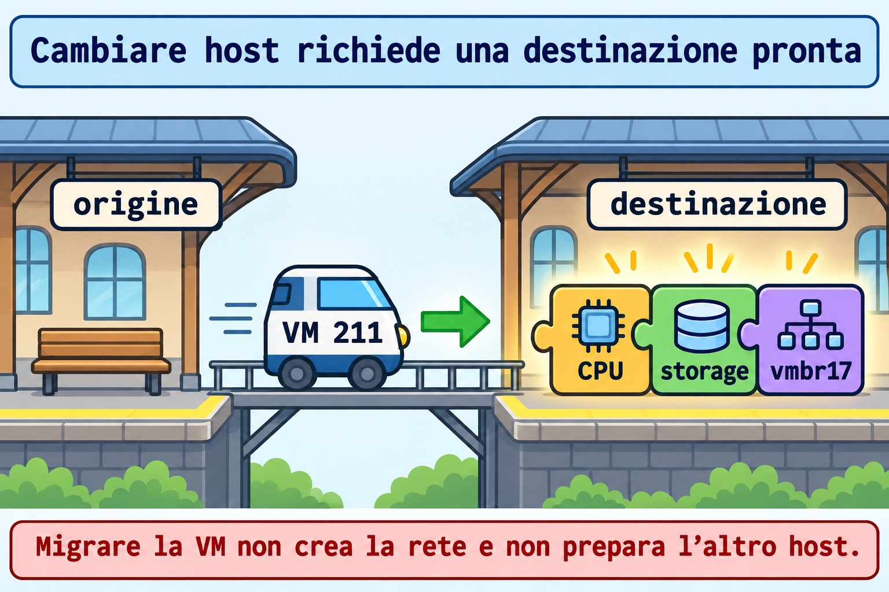
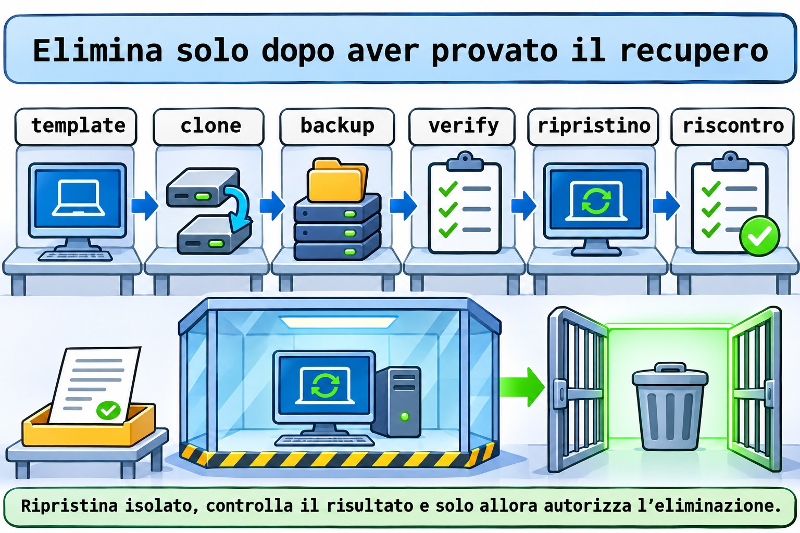

# Lezione 17.7 · Migrazione e quorum

> **Il cuore di questa lezione:** migrare richiede una destinazione pronta; eliminare richiede un recupero già dimostrato.

| Scheda | Piano di lavoro |
|---|---|
| Modulo | M17 · Proxmox in pratica, lezione 7 di 7 |
| Quando | Settimana 24 |
| Alla fine | Valutare migrazione e quorum e dimostrare il recupero del laboratorio |
| Prerequisiti | Lezioni precedenti, PBS-LAB disponibile, prova esterna e console |
| Durata | 150–210 minuti, oltre ai trasferimenti |
| Snapshot | Conservare il punto di ritorno esistente; la sfida richiede un backup indipendente |

Questa lezione chiude il modulo e riprende la tua diagnosi iniziale.
Prima consulti il cluster e, se esistono condizioni reali, migri la VM 211.
Poi esegui una prova di recupero isolata, con condizioni obbligatorie prima di qualsiasi eliminazione.
I guest da 201 a 205 e il bridge isolato rimangono preservati.

## 1 · Riscaldamento

1. Configurazione replicata significa che il disco locale è disponibile sulla destinazione?
2. Un cluster senza maggioranza deve accettare modifiche concorrenti da entrambi i lati?
3. Un backup concluso basta per autorizzare l'eliminazione dell'unica VM?

Riprendi il piano che hai scritto nella prima lezione.
Sottolinea ciò che ora riesci a dimostrare, invece di descriverlo soltanto.
Rendi esplicito ciò che il tuo laboratorio non permette di eseguire.

## 2 · Perché conta

La migrazione non installa la rete, non crea storage e non aggiunge istruzioni alla CPU della destinazione.
Dipende da queste condizioni già esistenti.
Un task accettato può fallire dopo per una condizione che avresti potuto controllare prima.

Il quorum protegge le decisioni di configurazione; non è un indicatore della velocità della rete.
La sua assenza richiede di indagare membri, voti e comunicazione.
Forzare una maggioranza non è un modo didattico di riparare il cluster reale.

La chiusura aggiunge un'altra disciplina: provare il recupero prima di averne bisogno.
Il rapporto deve continuare a esistere quando il guest originale non esiste più.

### Ponte Windows

Spostare un carico tra host richiede compatibilità delle risorse e connettività equivalente.
Il nome della rete può essere uguale e rappresentare un collegamento diverso sull'altro host.
Devi controllare significato e portata, non soltanto l'etichetta.

## 3 · Modello mentale



*Migrare la VM non crea la rete e non prepara l’altro host.*

| Condizione | Prova | Se manca |
|---|---|---|
| Destinazione nello stesso cluster | Inventario e membri | Non eseguire la migrazione |
| CPU compatibile | Modello, produttore e funzioni su entrambi | Risolvere prima del tentativo |
| Dischi condivisi | Tutti i volumi accessibili su entrambi i nodi | Non presumere un trasferimento implicito |
| Reti equivalenti | Bridge, porte e isolamento | Preparare fuori da questa operazione |
| Quorum | Maggioranza e comunicazione sane | Indagare soltanto in lettura |

Migrazione e ripristino sono operazioni diverse.
Nella migrazione, la proprietà della VM cambia all'interno del cluster.
Nel ripristino, un backup ricostruisce dischi e configurazione in un ID controllato.
Nessuna delle due autorizza a collocare due identità uguali sulla stessa rete.

## 4 · L'essenziale

Questa lezione usa la migrazione convenzionale nello stesso cluster.
Non configurare migrazione remota tra cluster e non modificare il quorum per completare la procedura.
Tutti i volumi della VM 211 devono essere su storage condiviso disponibile sulla destinazione.
Questo comprende disco del sistema, EFI, cloud-init e disco dati aggiunto prima.

Le versioni della destinazione devono essere compatibili e non precedenti a quelle dell'origine per l'operazione prevista.
Usa la matrice e le note della versione installata, con lo stesso produttore di CPU per questa pratica.
Se non riesci a dimostrare la compatibilità, scegli il ramo non eseguito.

### Laboratorio con un solo nodo

Eseguirai le consultazioni disponibili e documenterai una migrazione pianificata, non eseguita.
Non inventare una destinazione e non creare un cluster temporaneo sull'host per completare la prova.
La prova di backup e ripristino può continuare sullo stesso nodo, se i suoi prerequisiti sono soddisfatti.

## 5 · Lab guidato

### Passo 1 · Individuare membri e quorum

**Ipotesi:** quale consultazione distingue una destinazione reale da un nome scritto nel diario?

```bash
pvesh get /nodes --output-format json-pretty
pvesh get /cluster/resources --type vm --output-format json-pretty
pvesh get /cluster/status --output-format json-pretty
pvecm status
```

**Output atteso:** membri reali e stato del quorum, quando il nodo appartiene a un cluster.
Su un nodo indipendente, la consultazione del gestore del cluster può indicare che non esiste una configurazione di cluster.
Registra questa condizione; non è un'autorizzazione a creare un cluster.


*Senza quorum, indaga la comunicazione prima di tentare una scrittura.*

**Verifica:** esistono almeno due nodi reali nello stesso cluster e il quorum è sano?
Se no, segna migrazione non eseguita e salta i comandi di esecuzione del passo 4.
Non spegnere membri, non bloccare comunicazioni e non modificare voti per simulare perdita di quorum.

### Passo 2 · Controllare le risorse della destinazione

**Ipotesi:** un bridge con lo stesso nome possiede necessariamente gli stessi collegamenti?

Sui nodi di origine e destinazione, esegui soltanto le consultazioni seguenti.

```bash
pveversion -v
lscpu
pvesm status
ip -d link show vmbr0
ip -d link show vmbr17
bridge link
ip -br address show vmbr17
```

**Output atteso:** risorse compatibili e bridge isolato già esistente su entrambi i nodi.
Il bridge isolato non riceve IP sull'host né una porta fisica, e non deve raggiungere la rete di gestione.
Non creare né riconfigurare il bridge della destinazione durante questo tentativo di migrazione.
Se manca, fermati e ottieni la preparazione autorizzata prima di tornare a questo passo.

**Verifica:** produttore, modello di CPU esposto, versioni, RAM e storage sono adeguati alla destinazione scelta?
Ripeti il controllo completo delle funzioni CPU svolto alla creazione del laboratorio.
Registra quali condizioni sono state dimostrate e quali sono rimaste in sospeso.

### Passo 3 · Controllare la VM e tutti i volumi

**Ipotesi:** quale piccolo disco viene spesso dimenticato nella valutazione di una migrazione?

Sul nodo proprietario della VM 211, consulta la scheda e i task attuali.

```bash
qm status 211
qm config 211
qm pending 211
pvenode task list --limit 10
```

**Output atteso:** VM del laboratorio senza un'altra operazione concorrente e senza modifiche in sospeso inspiegate.
Elenca gli identificatori di tutti i volumi, compresi EFI, cloud-init e dati.
Conferma l'accesso agli stessi backend su entrambi i nodi; il nome registrato non basta.
Un dispositivo passato direttamente, un supporto locale o una risorsa limitata al nodo richiedono un'analisi fuori da questa procedura.

Dentro il clone, registra indirizzo, percorso, stato dell'agente e accesso al dato della lezione sullo storage.
Non formattare né sostituire il disco dati per semplificare l'elenco.

**Verifica:** la scheda identifica `m17-vm`, e nessun volume dipende soltanto dall'origine?
Se è attivo un task di backup, snapshot o modifica del disco, attendine la conclusione e rivaluta.
Non rimuovere un blocco per forzare la concorrenza.

### Passo 4 · Migrare soltanto quando le condizioni lo permettono

**Ipotesi:** quale prova dimostra il cambio di proprietario dopo il task?

Prima di migrare, conferma che **nessun disco sia su storage locale e nessun `unusedN` sia locale**. Controlla anche EFI, cloud-init e supporti ISO. Se esiste una dipendenza locale, non eseguire la migrazione: torna al rientro sullo storage condiviso della 17.4. Non cancellare un `unusedN` per superare il controllo.

```bash
qm config 211 | grep -E '^((ide|sata|scsi|virtio)[0-9]+|efidisk0|tpmstate0|unused[0-9]+):'
pvesm status
```


Esegui questo blocco soltanto nel ramo con destinazione reale, quorum e risorse controllati.
Leggi il nome di un nodo realmente comparso nell'inventario e controlla prima di confermare.

```bash
read -r -p 'No de destino real no mesmo cluster: ' DESTINO
: "${DESTINO:?}"
test "$(qm config 211 | sed -n 's/^name: //p')" = m17-vm || exit 1
qm migrate 211 "$DESTINO" --online 1 || exit 1
```

**Output atteso:** task concluso senza errori e proprietà della VM sulla destinazione.
Non interpretare una riga di avanzamento come conclusione finale.
Consulta l'inventario del cluster e il log del task appena eseguito.

```bash
pvesh get /cluster/resources --type vm --output-format json-pretty
```

Sul nodo destinazione, controlla la VM tramite ID e nome prima di usare la console.
Al suo interno, ripeti le prove di rete, agente e lettura del dato registrate prima.
Se la sessione si è interrotta, registra durata e sintomo reale, senza promettere assenza di interruzioni.

**Verifica:** l'applicazione o il dato osservato continua a essere accessibile sul nuovo proprietario?
Nel ramo con un nodo, scrivi quali condizioni mancavano e lascia la migrazione contrassegnata come non eseguita.
Non usare una schermata di un altro laboratorio come prova del tuo.

### Passo 5 · Provare il recupero senza eliminare l'origine

**Ipotesi:** la prova di ripristino può rivelare qualcosa che il successo del backup non rivela?



*Ripristina isolato, controlla il risultato e solo allora autorizza l’eliminazione.*

Usa il flusso della lezione precedente per ottenere un nuovo backup della VM 211 sullo storage già registrato.
Il disco dati deve essere incluso; controllane la partecipazione nella scheda prima di iniziare.

```bash
vzdump 211 --storage PBS-LAB --mode snapshot --remove 0 || exit 1
pvesm list PBS-LAB --vmid 211
```

Seleziona il volume esatto appena creato; non scegliere soltanto il primo elemento dell'elenco.
Sul PBS, esegui la verifica di questo backup e attendi il risultato finale positivo.
Se non hai accesso autorizzato al risultato, fermati prima di qualsiasi eliminazione.
Il CT 212 della lezione precedente deve essere già stato rimosso dalla relativa procedura di pulizia.
Se esiste ancora un qualsiasi oggetto 212, non sovrascriverlo: risolvi prima la conservazione e la pulizia autorizzata.

```bash
pvesh get /cluster/resources --type vm --output-format json-pretty
read -r -p 'Volume exato do backup verificado: ' BACKUP_PREVIO
: "${BACKUP_PREVIO:?}"
case "$BACKUP_PREVIO" in PBS-LAB:backup/vm/211/*) ;; *) exit 1 ;; esac
set -o pipefail
pvesh get /cluster/resources --type vm --output-format json |
  perl -MJSON::PP -0777 -e '$r=decode_json(<>); exit((scalar grep { $_->{vmid} == 212 } @$r) ? 1 : 0)' || exit 1
pvesm status
read -r -p 'Storage de imagens autorizado para restore: ' RESTORE_STORE
: "${RESTORE_STORE:?}"
qmrestore "$BACKUP_PREVIO" 212 --storage "$RESTORE_STORE" --unique 1 --start 0 || exit 1
qm set 212 --name m17-restore --onboot 0 || exit 1
qm config 212
```

Prima di avviare 212, scollega tutte le NIC ripristinate nella scheda della VM.
Preserva i parametri e aggiungi lo stato scollegato; controlla ogni indice esistente.
Non confondere MAC nuovo con nuova identità interna; il ripristino mantiene il contenuto del backup.
Usa questa funzione soltanto sui due ID di ripristino del laboratorio; preserva gli altri parametri di ogni NIC.

```bash
desconectar_nics_m17() {
  local id="$1" nic spec config nome nics
  case "$id" in 211|212) ;; *) return 1 ;; esac
  config=$(qm config "$id") || return 1
  nome=$(printf '%s\n' "$config" | sed -n 's/^name: //p')
  case "$id:$nome" in 211:m17-vm|212:m17-restore) ;; *) return 1 ;; esac
  nics=$(printf '%s\n' "$config" | sed -nE 's/^(net[0-9]+): .*/\1/p')
  test -n "$nics" || return 1
  while IFS= read -r nic; do
    spec=$(printf '%s\n' "$config" | sed -n "s/^$nic: //p")
    spec=$(printf '%s' "$spec" | sed -E 's/,link_down=[01]//g')
    test -n "$spec" || return 1
    qm set "$id" "--$nic" "$spec,link_down=1" || return 1
  done <<< "$nics"
  config=$(qm config "$id") || return 1
  printf '%s\n' "$config" | awk '/^net[0-9]+:/ && $0 !~ /,link_down=1(,|$)/ {bad=1} END {exit bad}' || return 1
}
desconectar_nics_m17 212 || { printf '%s\n' 'STOP: isolation failed' >&2; exit 1; }
qm config 212
```

Controlla nell'output reale che ogni NIC sia scollegata; soltanto dopo esegui l'avvio.

```bash
desconectar_nics_m17 212 || exit 1
qm start 212 || exit 1
qm terminal 212
```

Usa soltanto la console per avviare, accedere e leggere il dato ripristinato sul disco della lezione sullo storage.
Usa la credenziale locale provata nella 17.6, conferma la shell corretta e identifica il disco tramite il seriale `M17DATA`. Il montaggio manuale e l’hash del file devono coincidere con il diario della 17.4; il marcatore della radice non sostituisce questa prova.

**Output atteso:** ripristino 212 isolato con sistema e dato controllati.
**Verifica:** registra backup, verify, ripristino, lettura e isolamento fuori dai guest.
Senza questa sequenza completa, la condizione per l'eliminazione non è soddisfatta.

### Passo 6 · Autorizzare la preparazione della sfida

**Ipotesi:** che cosa deve sopravvivere fuori dalla VM prima di liberarne l'ID?

Conserva il backup precedente, il dato di storage e il rapporto esterno del passo 5.
La prova deve identificare il backup esatto e il ripristino 212 realmente verificato.
Soltanto dopo questa prova puoi liberare la VM di esercizio e il suo ripristino temporaneo.
Spegni regolarmente entrambi i sistemi prima di rimuoverne gli oggetti.

```bash
qm shutdown 211 --timeout 120
qm shutdown 212 --timeout 120
qm status 211
qm status 212
qm config 211
qm config 212
```

**Output atteso:** entrambi spenti; i nomi corrispondono esattamente al laboratorio e al ripristino.
Se lo spegnimento non si conclude, indaga dalla console; non forzare per rispettare il tempo.
Prima delle eliminazioni, un'altra persona deve poter trovare il rapporto esterno.
Esegui ogni comando seguente soltanto dopo aver controllato nome, stato e prova di recupero.

```bash
test "$(qm config 211 | sed -n 's/^name: //p')" = 'm17-vm' && \
  test "$(qm status 211)" = 'status: stopped' && qm destroy 211
test "$(qm config 212 | sed -n 's/^name: //p')" = 'm17-restore' && \
  test "$(qm status 212)" = 'status: stopped' && qm destroy 212
```

**Verifica:** gli ID 211 e 212 risultano liberi nell'inventario completo, e 210 rimane un template spento.
In questa fase conserva backup e bridge: la sfida qui sotto usa ancora questa rete. La rimozione della bridge avviene soltanto nella pulizia finale, dopo tutti i guest temporanei.
Se non hai concluso la prova del passo 5, conserva tutto e segna la sfida bloccata nella preparazione.

## 6 · Rompi e ripara

I guasti sono decisioni sulle prove; non provocare guasti sul cluster reale.

### Guasto 1 · Il bridge manca sulla destinazione

**Sintomo:** l'inventario di rete della destinazione non contiene il bridge isolato.
**Indagine:** confronta bridge, porte e indirizzi sui due nodi.
**Causa:** il nome della rete dell'origine è stato trattato come risorsa creata automaticamente sulla destinazione.
**Riparazione:** sospendi la migrazione e richiedi la preparazione equivalente autorizzata.
**Verifica:** ripeti la consultazione dopo la preparazione; soltanto allora rivaluta la migrazione.
**Prevenzione:** la rete fa parte dei prerequisiti, non delle riparazioni dopo lo spostamento.

### Guasto 2 · La maggioranza non è disponibile

**Sintomo:** una prova fornita mostra un cluster senza quorum e configurazione di sola lettura.
**Indagine:** collega membri visibili, voti attesi e comunicazione registrata.
**Causa:** la partizione osservata non soddisfa le condizioni per decidere modifiche in sicurezza.
**Riparazione:** conserva la prova e rimanda il recupero della comunicazione alla procedura operativa.
**Verifica:** riprendi le modifiche soltanto quando la condizione normale è ripristinata e documentata.
**Prevenzione:** non modificare voti e non rimuovere membri per rendere verde una schermata.

### Guasto 3 · Il backup non contiene il dato atteso

**Sintomo:** il ripristino isolato non presenta il marcatore o il dato atteso.
**Indagine:** confronta istante del backup, volumi inclusi e percorso controllato.
**Causa:** possono esserci un backup precedente, un disco escluso o una lettura nel posto sbagliato.
**Riparazione:** conserva l'origine e produci un nuovo backup corretto prima di ripetere il ripristino.
**Verifica:** confronta contenuto e checksum con la prova esterna; il solo successo del task non basta.
**Prevenzione:** leggi un dato noto nel ripristino prima di autorizzare qualsiasi eliminazione.

## 7 · Trappole

### Decidi 1

Il disco principale è condiviso, ma EFI è su storage locale. Devi:
A. Ignorare EFI perché il volume è piccolo.
B. Trattare la condizione come prerequisito non soddisfatto e preparare il volume tramite la procedura autorizzata.
C. Eliminare EFI prima di migrare.

### Decidi 2

Il verify è terminato bene, ma nessuno ha avviato il ripristino isolato. Devi:
A. Conservare l'origine fino a concludere la prova di ripristino e registrarne il risultato all'esterno.
B. Considerare la presenza del file equivalente alla prova.
C. Eliminare l'origine e scoprirlo dopo.

### Rocky × Debian

L'host continua a seguire la procedura dell'hypervisor; il guest preserva il proprio sistema.
Una migrazione non converte la distribuzione interna e non ne rigenera le identità.

## 8 · Quiz

1. Quali volumi devono entrare nella valutazione della migrazione?
2. Che cosa scrivere quando esiste soltanto un nodo?
3. Perché il quorum blocca la scrittura in una partizione senza maggioranza?
4. Che cosa non cambia un MAC nuovo in un ripristino?
5. Quale prova deve esistere prima di eliminare la VM originale?
6. Perché preservare il bridge isolato alla chiusura?

## 9 · Promemoria

**Flashcard:** collega decisione e prova.

| Fronte | Retro |
|---|---|
| Migrare | Destinazione, CPU, versioni, volumi e reti dimostrati |
| Senza quorum | Indagare la comunicazione senza modificare voti |
| Eliminare | Recupero isolato dimostrato e prova esterna |
| Ripristinare | Avviare senza rete collegata fino al controllo dell'identità |

```text
!explica Por que o quorum protege a configuração do cluster?
!feynman Explique por que mover uma VM não prepara o host de destino.
!quiz Pergunte sobre recuperação antes de exclusão, uma etapa por vez.
```

## 10 · Checklist e chiusura

### Sfida del modulo · Ricostruire senza dipendere dall'origine

Esegui soltanto se gli ID 211 e 212 sono rimasti liberi dopo la prova dimostrata del laboratorio.
Il backup precedente continua a preservare i dati delle lezioni sullo storage.
Il nuovo clone di questa sfida nasce dal template e non contiene quel disco dati.
Il suo nuovo marcatore sarà creato sul disco del sistema e controllato separatamente.

1. Conferma template 210 spento e ID 211 e 212 liberi nell'intero cluster.
2. Crea clone completo 211 e collega la sua unica NIC soltanto al bridge isolato.
Torna al nodo proprietario del template 210 prima di clonare. Il clone verrà creato su quel nodo; usalo anche nelle query locali e nel ripristino della sfida. In quella shell ridefinisci la funzione di isolamento del Passo 5 se necessario; controlla il bridge isolato, lo storage reale autorizzato e la chiave pubblica prima di creare.

```bash
test "$(qm config 210 | sed -n 's/^name: //p')" = m17-template || exit 1
test "$(qm config 210 | sed -n 's/^template: //p')" = 1 || exit 1
test "$(qm status 210)" = 'status: stopped' || exit 1
set -o pipefail
pvesh get /cluster/resources --type vm --output-format json |
  perl -MJSON::PP -0777 -e '$r=decode_json(<>); exit((scalar grep { $_->{vmid} == 211 || $_->{vmid} == 212 } @$r) ? 1 : 0)' || exit 1
pvesm status
read -r -p 'Storage de imagens autorizado para o clone: ' CLONE_STORE
: "${CLONE_STORE:?}"
qm clone 210 211 --name m17-vm --full 1 --storage "$CLONE_STORE" || exit 1
qm set 211 --net0 virtio,bridge=vmbr17,link_down=1 --onboot 0 || exit 1
test -s /root/m17-work/student.pub || exit 1
qm set 211 --ciuser student --sshkeys /root/m17-work/student.pub || exit 1
qm set 211 --ipconfig0 ip=192.0.2.211/24 || exit 1
qm set 211 --ciupgrade 0 || exit 1
qm config 211
```

3. Imposta una password temporanea per la console tramite input interattivo, senza inserirla nella riga di comando.
Il comando riceve soltanto l'hash; la password non compare nell'elenco degli argomenti né nella cronologia.
Non eseguire questo blocco con il tracciamento dei comandi abilitato. L'aggiornamento dei pacchetti al primo avvio è disabilitato perché la rete è isolata.

```bash
set +x
read -rs -p 'Senha temporaria forte para console de student: ' M17_SENHA
printf '\n'
test -n "$M17_SENHA" || exit 1
M17_HASH=$(printf '%s\n' "$M17_SENHA" | openssl passwd -6 -stdin) || exit 1
unset M17_SENHA
qm set 211 --cipassword "$M17_HASH" || { unset M17_HASH; exit 1; }
unset M17_HASH
qm cloudinit update 211 || exit 1
desconectar_nics_m17 211 || exit 1
qm start 211 || exit 1
qm terminal 211
```

Accedi dalla console con l'utente di studio e la password appena impostata.
Non rendere disponibile questa password nel rapporto. La configurazione della password di cloud-init può abilitare l'autenticazione SSH tramite password; per questo il primo avvio avviene con tutte le NIC scollegate.
Mantieni i collegamenti scollegati durante tutta la sfida. Prima di qualsiasi futura riconnessione, configura la politica SSH senza password e controlla il risultato effettivo dentro il guest.

```bash
sudo sshd -T | grep -E '^(passwordauthentication|kbdinteractiveauthentication|pubkeyauthentication) '
```

Questa lettura mostra soltanto la politica; non la corregge. Non ricollegare finché l'autenticazione tramite password non sia disabilitata e controllata.
Avvia dalla console, conferma l'isolamento e crea il marcatore dentro il nuovo clone.

```bash
printf '%s\n' 'M17 recuperacao comprovada' | sudo tee /var/tmp/m17-desafio.txt
sha256sum /var/tmp/m17-desafio.txt
```

4. Copia il checksum nel diario esterno; esegui un nuovo backup di 211 su PBS-LAB e attendi il verify corrispondente.
5. Ripristina questo backup in 212, assegna il nome `m17-restore`, lascia tutte le NIC scollegate prima di avviare e controlla il marcatore dalla console.
6. Registra task, volume esatto, verify, checksum ripristinato e isolamento fuori dalle VM.
7. Soltanto dopo la prova, spegni 211, controlla il nome e rimuovi soltanto la VM 211 con il controllo del laboratorio.
8. Ripristina lo stesso backup nell'ID 211 libero, senza avvio automatico.

```bash
read -r -p 'Volume exato do backup do desafio ja verificado e testado: ' BACKUP_DESAFIO
: "${BACKUP_DESAFIO:?}"
case "$BACKUP_DESAFIO" in PBS-LAB:backup/vm/211/*) ;; *) exit 1 ;; esac
pvesh get /cluster/resources --type vm --output-format json |
  perl -MJSON::PP -0777 -e '$r=decode_json(<>); exit((scalar grep { $_->{vmid} == 211 } @$r) ? 1 : 0)' || exit 1
pvesm status
read -r -p 'Storage de imagens autorizado para restore do desafio: ' RESTORE_STORE
: "${RESTORE_STORE:?}"
qmrestore "$BACKUP_DESAFIO" 211 --storage "$RESTORE_STORE" --unique 1 --start 0 || exit 1
qm set 211 --name m17-vm --onboot 0 || exit 1
qm config 211
```

Scollega tutte le NIC ripristinate prima di avviare 211 e ripeti la lettura del marcatore dalla console.
Riutilizza la funzione del passo 5; se hai aperto un'altra sessione dell'host, definiscila nuovamente prima di richiamarla.

```bash
desconectar_nics_m17 211 || { printf '%s\n' 'STOP: isolation failed' >&2; exit 1; }
qm config 211
```

Controlla nell'output reale che tutte le NIC rimangano scollegate prima di avviare.

```bash
desconectar_nics_m17 211 || exit 1
qm start 211 || exit 1
qm terminal 211
```

Non collegare 211 e 212 alla stessa rete per facilitare il confronto.
La sfida termina quando il checksum coincide e il rapporto permette di ricostruire la sequenza.

**Ultimo esercizio:** confronta la diagnosi iniziale con la consegna ora dimostrata.
Distingui migrazione eseguita, migrazione non eseguita e recupero realmente verificato.

### Verifica puntuale senza interfaccia web

Per la sfida usa soltanto terminali, anche sul PBS. Nel terminale amministrativo autorizzato del PBS di laboratorio, identifica datastore e namespace reali corrispondenti allo storage registrato nel PVE.
Non eseguire questo blocco sull’host PVE né nel guest. Copia l’identità esatta dello snapshot appena creato; non scegliere un intero gruppo.

```bash
read -r -p 'Datastore PBS real do inventario: ' PBS_STORE
read -r -p 'Namespace PBS autorizado (vazio = raiz): ' PBS_NS
read -r -p 'Snapshot exato vm/211/data-UTC do backup: ' PBS_SNAP
: "${PBS_STORE:?}" "${PBS_SNAP:?}"
case "$PBS_STORE" in *[!A-Za-z0-9_-]*|'') exit 1 ;; esac
case "$PBS_SNAP" in vm/211/*) ;; *) exit 1 ;; esac
PBS_EPOCH=$(date -u -d "${PBS_SNAP#vm/211/}" +%s) || exit 1
PBS_EXTRA=()
test -z "$PBS_NS" || PBS_EXTRA=(--ns "$PBS_NS")
proxmox-backup-debug api usage "/admin/datastore/$PBS_STORE/verify" --verbose 1
```

Confronta tipo, ID, istante UTC e namespace con il backup annotato. Controlla la guida locale; se i parametri non corrispondono alla versione installata, fermati prima della chiamata di creazione.

```bash
proxmox-backup-debug api create "/admin/datastore/$PBS_STORE/verify" \
  --backup-type vm --backup-id 211 --backup-time "$PBS_EPOCH" \
  --ignore-verified false "${PBS_EXTRA[@]}" || exit 1
read -r -p 'UPID real retornado pela verificacao: ' PBS_UPID
: "${PBS_UPID:?}"
proxmox-backup-manager task log "$PBS_UPID"
proxmox-backup-manager task list --all 1 --output-format json-pretty
```

L’UPID avvia l’osservazione, non dimostra il completamento. Attendi la fine e leggi il log e il task terminato corrispondente: accetta soltanto il completamento riuscito dello snapshot esatto. Conserva questo risultato fuori dalle VM; non sostituirlo con una verifica vecchia o globale.
Ripeti questa verifica puntuale per ogni nuovo backup della sfida, prima di ripristinare o liberare l’origine. Usa l’autenticazione autorizzata senza password o token nei comandi pubblicati.

### Pulizia finale del laboratorio

Conserva backup, rapporto e dati esterni per il periodo concordato con chi amministra il corso.
Dopo la consegna, spegni regolarmente 211 e 212 e controlla nomi e stati.
Rimuovi soltanto gli oggetti temporanei 211 e 212 con gli stessi controlli del passo 6.
Prima di rimuovere 210, conferma che è il template spento di questo laboratorio e che non esistono cloni dipendenti.

```bash
test "$(qm config 210 | sed -n 's/^name: //p')" = 'm17-template' && \
  test "$(qm config 210 | sed -n 's/^template: //p')" = '1' && \
  test "$(qm status 210)" = 'status: stopped' && qm destroy 210
pvesh get /cluster/resources --type vm --output-format json-pretty
```

Dopo la sfida, esegui la pulizia qui sotto **su ogni nodo**, dalla console amministrativa autorizzata. Rimuove la bridge soltanto quando non ci sono porte collegate **né configurazioni di guest che la usino ancora**. Se il controllo rifiuta, conserva la rete e indaga; non scollegare un altro esercizio per liberare la pulizia. Non eseguire un ricaricamento globale della rete.

```bash
m17_retirar_bridge() {
  [ -f /etc/network/interfaces.d/m17-lab ] || return 0
  [ -d /sys/class/net/vmbr17/bridge ] || return 1
  if [ -n "$(ls -A /sys/class/net/vmbr17/brif)" ]; then
    printf '%s\n' 'Ci sono porte collegate; conserva la bridge.'; return 1
  fi
  local refs rc backup
  refs=$(grep -rsE 'bridge=vmbr17([,[:space:]]|$)' /etc/pve/nodes); rc=$?
  [ "$rc" -le 1 ] || return 1
  if [ -n "$refs" ]; then printf '%s\n' "$refs"; return 1; fi
  grep -Eq '^[[:space:]]*bridge-ports[[:space:]]+none[[:space:]]*$' /etc/network/interfaces.d/m17-lab || return 1
  install -d -m 0700 /root/m17-work || return 1
  backup="/root/m17-work/m17-lab.removida.$(date +%Y%m%d%H%M%S)"
  [ ! -e "$backup" ] || return 1
  ifdown vmbr17 || return 1
  mv /etc/network/interfaces.d/m17-lab "$backup" || return 1
  if ip link show vmbr17 >/dev/null 2>&1; then return 1; fi
  printf '%s\n' 'Bridge rimossa; configurazione conservata nel diario dell’host.'
}
m17_retirar_bridge
```
Gli ID da 210 a 212 restano liberi nell’inventario dopo la consegna e la pulizia autorizzata.
Non eliminare backup o cartella delle prove come conseguenza automatica della pulizia delle VM.

**Reboot di verifica:** non riavviare host o membri del cluster per verificare la pulizia.
Il controllo finale consiste nell'inventario, nell'assenza degli oggetti temporanei e nella conservazione di quelli esistenti.

- [ ] Ho registrato le condizioni reali di migrazione e quorum.
- [ ] Ho conservato l'origine fino a dimostrare il recupero isolato.
- [ ] Ho controllato marcatore e checksum fuori dalla VM originale.
- [ ] Ho mantenuto scollegate le reti ripristinate fino al controllo.
- [ ] Ho liberato soltanto gli ID temporanei dopo la consegna.
- [ ] Ho preservato i guest da 201 a 205 e i backup; ho rimosso soltanto le bridge libere dell’esercizio su tutti i nodi.

## 11 · Nella vita reale

Produci una valutazione di migrazione senza eseguire modifiche su un carico reale.
Elenca dipendenze di CPU, versione, volumi, reti e capacità.
Aggiungi chi autorizzerebbe la finestra e come sarebbe dimostrato il recupero.
Una condizione sconosciuta deve comparire come punto in sospeso, non come approvazione presunta.

## 12 · Approfondire quando vuoi

- [Migrazione delle VM](https://github.com/proxmox/pve-docs/blob/master/qm.adoc).
- [Cluster, membri e quorum](https://github.com/proxmox/pve-docs/blob/master/pvecm.adoc).
- [Comandi di ripristino](https://github.com/proxmox/pve-docs/blob/master/generated/qmrestore.1-synopsis.adoc).

- [API e strumenti di verifica PBS](https://pbs.proxmox.com/docs/command-line-tools.html).

### Soluzioni commentate

**Riscaldamento 1:** no; configurazione e byte del disco hanno meccanismi distinti.
**Riscaldamento 2:** no; decisioni concorrenti senza maggioranza possono produrre stati incompatibili.
**Riscaldamento 3:** no; ripristino isolato, lettura e prova esterna devono venire prima.
**Decidi 1: B.** Anche il piccolo volume partecipa all'avvio e deve essere disponibile.
**Decidi 2: A.** Verify e ripristino rispondono a domande diverse; conserva l'origine.
**Quiz 1:** tutti, compresi sistema, EFI, cloud-init, dati e qualsiasi risorsa limitata al nodo.
**Quiz 2:** migrazione pianificata e non eseguita, con i prerequisiti mancanti espliciti.
**Quiz 3:** per impedire decisioni di configurazione concorrenti e incoerenti.
**Quiz 4:** contenuto del disco, identificatore interno e chiavi SSH possono rimanere uguali.
**Quiz 5:** backup esatto verificato, ripristino isolato provato e dato confrontato con prova esterna.
**Quiz 6:** conserva la rete mentre la sfida o un’altra configurazione la usa; poi rimuovi soltanto le bridge libere, su tutti i nodi, con i controlli della pulizia finale.

[← Lezione 17.6 · Backup e ripristino](17.6-backup-e-restauracao.md) · [Indice delle lezioni](../01-aulas.md) · [Piano del corso: da M18 in poi →](../00-plano-do-curso.md)
