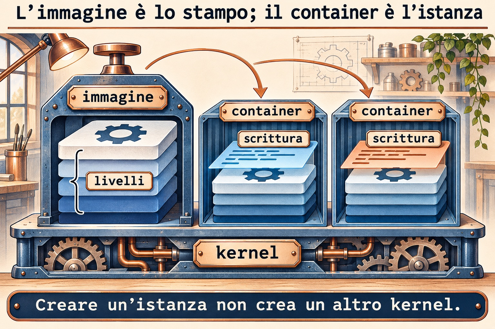
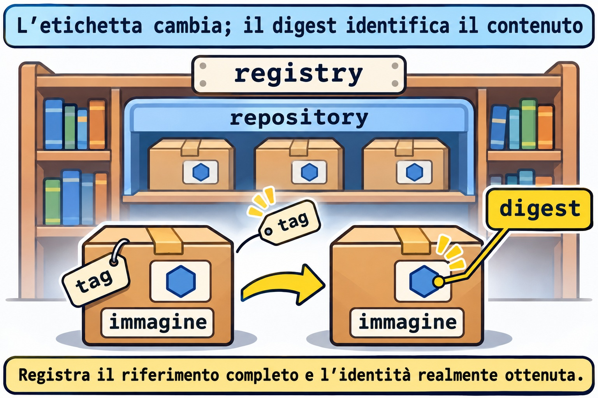
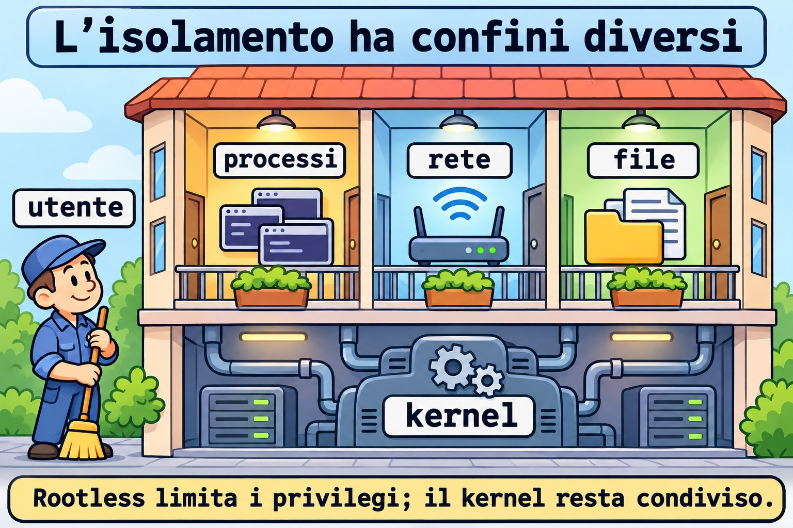

# Lezione 18.1 · Un container non è una VM

> **Il cuore di questa lezione:** identifica immagine, istanza e utente proprietario prima di eseguire qualsiasi container.

| Scheda | Piano di lavoro |
| --- | --- |
| Modulo | M18 · Podman, lezione 1 di 5 |
| Quando | Settimana 24 |
| Alla fine | Ispezionare immagine, livelli e digest senza confondere container e VM |
| Prerequisiti | VM 201 e 202; utente student già esistente con sudo; accesso autorizzato al lab |
| Durata | 70–90 minuti, oltre al download |
| Snapshot | m18a1-inicio e m18a1-fim nelle VM usate |

La VM 201 è il banco principale; ripeti sul Debian 202 dove indicato. Ogni VM avrà la propria cache e il proprio digest registrato.

Podman viene eseguito dentro le VM, con l’utente `student`. L’host Proxmox riceve soltanto i comandi di snapshot separati esplicitamente.

Prima di iniziare il modulo, l’utente `student` deve già esistere in entrambe le VM e avere accesso a sudo. Se manca l’account o l’autorizzazione, fermati e completa la preparazione con l’amministratore della VM; non eseguire il laboratorio Podman come root.

## 1 · Riscaldamento

Rispondi a memoria e rimanda la correzione alla fine.

1. Quale componente distingue il kernel di una VM dal kernel condiviso da un CT?

2. Uno snapshot nello stesso storage sostituisce una copia indipendente di sicurezza?

3. Lo stesso nome di servizio su due macchine dimostra che stai consultando lo stesso oggetto?

### Diagnosi iniziale del modulo

Disegna, senza comandi, un server web che conserva il contenuto dopo la rimozione del container e riparte al boot senza login.

Segna proprietario, immagine, dato, porta e chi avvia il processo. Conserva il disegno per l’ultima lezione.

## 2 · Perché conta

La segnalazione dice che l’applicazione è scomparsa. Il processo è ancora attivo, ma l’amministratore è entrato come root e ha consultato un altro archivio di container.

Un’altra segnalazione nasce dopo un aggiornamento: lo stesso tag ora indica byte diversi. Senza registrare il riferimento ottenuto, il confronto diventa un’ipotesi senza riscontro.

Questa lezione separa queste domande prima di pubblicare porte o montare directory. Un’immagine scaricata non è ancora un servizio in esecuzione.

### Ponte Windows

Un’immagine di distribuzione descrive un’origine; una macchina istanziata aggiunge stato. Il confronto aiuta, ma un container non riceve un kernel proprio come una VM.

## 3 · Modello mentale



*Creare un’istanza non crea un altro kernel.*

| Oggetto | Domanda a cui risponde |
| --- | --- |
| Registry | Da quale servizio ottengo l’immagine? |
| Repository | Quale famiglia di artefatti cerco? |
| Tag | Quale etichetta è stata richiesta? |
| Digest | Quale contenuto è stato identificato? |
| Container | Quale istanza ha stato e processo propri? |

I livelli dell’immagine sono riutilizzabili. L’istanza riceve un proprio livello scrivibile; modificarlo non pubblica una nuova immagine nel registry.

I namespace separano le viste di processi, rete e altre risorse. I cgroup controllano le risorse. Questi meccanismi non sostituiscono un kernel indipendente.

## 4 · L'essenziale

### Nome completo prima di scaricare

Usa un riferimento con registry e repository espliciti. Un nome breve può dipendere dagli alias e dalla configurazione locale di ricerca.

L’immagine scelta proviene dal progetto NGINX Unprivileged. Il suo server ascolta sulla porta interna `8080`; verrà usata nella prossima lezione.

Il tag seleziona una versione pubblicata, ma può essere aggiornato. Dopo il pull registra il digest reale ottenuto. Non copiare un hash inventato da questa pagina.



*Registra il riferimento completo e l’identità realmente ottenuta.*

Il digest è un’identità del contenuto, non una prova sufficiente della reputazione di chi lo ha pubblicato. Conferma anche progetto, registry e politica di fiducia.

### Un utente, un ambito

La modalità rootless usa l’archivio e l’ambiente dell’utente proprietario. Eseguire lo stesso comando con un altro utente consulta un altro ambito.

Root dentro un namespace utente non equivale a root dell’host. Anche il processo dell’immagine può usare un UID senza privilegi.

Non usare privilegi aggiuntivi per nascondere una configurazione rootless incompleta. La documentazione della versione installata stabilisce i prerequisiti.

### Rocky × Debian

| Verifica | Rocky 201 | Debian 202 |
| --- | --- | --- |
| Pacchetto | podman | podman e uidmap |
| Protezione dei file | SELinux normalmente attivo | Verificare AppArmor e configurazione locale |
| Identità | student | student |
| Cache e digest | Ottenuti in questa VM | Ottenuti in questa VM |

## 5 · Lab guidato

Usa due sessioni chiaramente identificate: console Proxmox soltanto per gli snapshot e shell della VM per Podman. Non copiare blocchi fra questi contesti.

### Passo 1 · Confermare l’ambiente e il punto di ritorno

**Ipotesi:** quale lettura evita di confondere l’host Proxmox con il sistema del banco?

Sul Proxmox autorizzato, controlla ID e nome prima dello snapshot. Procedi soltanto sulle VM usate dall’esercizio.

```bash
qm config 201
qm config 202
qm snapshot 201 m18a1-inicio
qm snapshot 202 m18a1-inicio
```

Dentro ogni VM accedi direttamente con l’utente di studio.

```bash
hostnamectl hostname
cat /etc/os-release
id
test "$(id -un)" = student || exit 1
sudo -v || exit 1
test "$(id -u)" -ne 0 || exit 1
printf 'HOME=%s\n' "$HOME"
```

**Output atteso:** nome della VM corretta e utente di studio senza UID zero. Non c’è un output numerico modello da copiare.

**Verifica:** il diario identifica macchina, utente e istante. Una consultazione fatta nel posto sbagliato non vale come riscontro.

### Passo 2 · Controllare Podman rootless

**Ipotesi:** installare l’eseguibile basta per validare l’ambiente dell’utente?

Se mancano i pacchetti, installali dentro la VM appropriata. Questi sono gli unici blocchi amministrativi di installazione; i comandi Podman restano senza sudo.

Nella VM Rocky:

```bash
sudo dnf install -y podman curl man-db || exit 1
```

Nella VM Debian:

```bash
sudo apt update || exit 1
sudo apt install -y podman uidmap curl man-db || exit 1
sudo systemctl add-wants multi-user.target network-online.target || exit 1
```

Su Debian minimal, `man-db` fornisce il comando `man`. La dipendenza aggiunta appartiene al gestore di sistema: richiama `network-online.target` durante il boot, evitando che `podman-user-wait-network-online` attenda inutilmente il timeout di 90 secondi. Non certifica l’accesso a Internet: lo stato effettivo della rete dipende dal gestore e dal relativo servizio wait-online. La prova verrà fatta dopo il reboot, nella 18.3.

```bash
podman version
test -z "${CONTAINER_HOST-}${CONTAINER_CONNECTION-}" || exit 1
test "$(podman info --format '{{.Host.Security.Rootless}}')" = true || exit 1
grep "^$(id -un):" /etc/subuid /etc/subgid
findmnt -T "$HOME"
```

**Output atteso:** Podman funzionante in modalità rootless e intervalli subordinati configurati. Leggi l’errore completo se l’inizializzazione fallisce.

Una home su NFS o altro filesystem distribuito può non essere adatta all’archivio rootless. Non spostare la cache e non modificare gli intervalli senza un piano compatibile con la versione.

**Verifica:** il campo rootless è vero. Se il pacchetto o l’helper richiesto non è disponibile nel repository autorizzato, fermati e risolvi il prerequisito.

### Passo 3 · Preparare un registro locale nuovo

**Ipotesi:** una cartella già esistente può contenere un banco che non devi sostituire?

```bash
test ! -e "$HOME/m18-lab" || exit 1
umask 077
mkdir -m 0750 "$HOME/m18-lab" || exit 1
podman images
podman ps -a
M18_TAG=docker.io/nginxinc/nginx-unprivileged:stable-alpine
printf '%s\n' "$M18_TAG" > "$HOME/m18-lab/origem.txt"
```

**Output atteso:** directory nuova e inventario dell’utente attuale, che può essere vuoto. Non rimuovere gli oggetti trovati.

La cartella contiene soltanto registrazioni di studio. Nessuna chiave del registry né password appartiene al file dell’origine.

**Verifica:** il nome completo corrisponde al progetto controllato nella documentazione. Non accettare un suggerimento di registry per un nome abbreviato.

### Passo 4 · Scaricare e leggere la configurazione dell’immagine

**Ipotesi:** il pull avvia il server web?

```bash
podman pull "$M18_TAG" || exit 1
podman images
podman image inspect "$M18_TAG" > "$HOME/m18-lab/imagem-inspect.json" || exit 1
podman image inspect --format '{{.Os}} {{.Architecture}} {{.User}}' "$M18_TAG"
podman image inspect --format '{{json .RootFS.Layers}}' "$M18_TAG"
podman image inspect --format '{{json .Config.ExposedPorts}}' "$M18_TAG"
podman ps
```

**Output atteso:** immagine locale, metadati reali e nessuna istanza creata da questi comandi. L’utente predefinito dell’immagine non è l’identità del proprietario sull’host.

Una porta dichiarata nei metadati non è una porta pubblicata dall’host. La prossima lezione creerà questo collegamento esplicitamente.

**Verifica:** trova architettura, utente e livelli nell’ispezione. Non dedurre la compatibilità soltanto dal nome del tag.

### Passo 5 · Fissare il riferimento realmente ottenuto

**Ipotesi:** usare lo stesso tag domani garantisce gli stessi byte?

```bash
M18_IMAGE=$(podman image inspect --format '{{index .RepoDigests 0}}' "$M18_TAG") || exit 1
[[ "$M18_IMAGE" =~ ^docker\.io/nginxinc/nginx-unprivileged@sha256:[[:xdigit:]]{64}$ ]] || exit 1
podman image inspect "$M18_IMAGE" >/dev/null || exit 1
printf 'M18_IMAGE=%q\n' "$M18_IMAGE" > "$HOME/m18-lab/image.env"
chmod 0600 "$HOME/m18-lab/image.env"
cat "$HOME/m18-lab/image.env"
```

**Output atteso:** riferimento completo con digest reale, salvato in un file creato da te. L’ID locale e il digest del manifesto non sono nomi intercambiabili.

Nelle immagini multipiattaforma anche indice e manifesto specifico hanno identità distinte. Registra ciò che il comando ha restituito, insieme ad architettura e versione.

**Verifica:** il riferimento salvato identifica questo repository e può ancora essere ispezionato localmente. Se manca RepoDigest, fermati; non improvvisare un valore.

### Passo 6 · Controllare dopo una nuova sessione

**Ipotesi:** la cache scompare quando chiudi la shell?

Chiudi soltanto la sessione della VM e accedi nuovamente come lo stesso utente. Se il piano operativo lo permette, riavvia la VM di studio; non Proxmox.

```bash
test "$(id -un)" = student || exit 1
source "$HOME/m18-lab/image.env" || exit 1
podman image inspect "$M18_IMAGE" --format '{{.ID}}'
podman ps -a
```

**Output atteso:** riferimento e immagine disponibili nello stesso ambito. Questa lezione non ha ancora creato un servizio.

**Verifica:** spiega perché immagine persistente nella cache e processo avviato al boot sono risultati diversi.

## 6 · Rompi e ripara

I guasti seguenti restano nel diario o nei riferimenti locali di consultazione. Non cancellare l’archivio di Podman per creare un errore.

### Guasto 1 · Riferimento incompleto

**Sintomo:** un’annotazione contiene soltanto un nome breve e un’altra VM sceglie un’origine diversa.

**Indagine:** confronta la registrazione locale dell’origine con registry, repository e tag attesi.

```bash
cat "$HOME/m18-lab/origem.txt"
podman image inspect --format '{{json .RepoTags}}' "$M18_IMAGE"
```

**Causa:** la risoluzione del nome dipendeva dalla configurazione locale o da una scelta interattiva.

**Riparazione:** riscrivi l’annotazione con il nome completo verificato. Non eseguire il pull da un’origine suggerita senza validarla.

**Verifica:** il riferimento del diario e il repository del digest corrispondono.

**Prevenzione:** registra nome richiesto e contenuto ottenuto come campi separati.

### Guasto 2 · L’utente non è il proprietario

**Sintomo:** qualcuno segnala una cache vuota in una sessione amministrativa diversa. Non eseguire un secondo Podman con sudo per riprodurre il caso.

**Indagine:** confronta utente, home e modalità rootless con la registrazione del Passo 2.

```bash
id
printf '%s\n' "$HOME"
test -z "${CONTAINER_HOST-}${CONTAINER_CONNECTION-}" || exit 1
test "$(podman info --format '{{.Host.Security.Rootless}}')" = true || exit 1
```

**Causa:** l’archivio di un altro utente è stato consultato come se fosse lo stesso.

**Riparazione:** torna alla sessione diretta del proprietario e ripeti l’ispezione del riferimento salvato.

**Verifica:** identità e immagine coincidono con il diario, senza copiare la cache fra utenti.

**Prevenzione:** registra il proprietario insieme al nome dell’oggetto in ogni segnalazione.

### Guasto 3 · Confondere immagine e servizio

**Sintomo:** l’immagine esiste, ma nessun server risponde.

**Indagine:** confronta i due elenchi con lo stesso utente.

```bash
podman images
podman ps -a
```

**Causa:** il pull ha memorizzato l’immagine, senza creare né avviare un’istanza.

**Riparazione:** correggi la conclusione del rapporto; l’esecuzione avverrà in modo controllato nella 18.2.

**Verifica:** la descrizione distingue la presenza nella cache dal processo attivo.

**Prevenzione:** chiedi riscontri sullo stato del container e sulla risposta dell’applicazione, oltre all’immagine.



*Rootless limita i privilegi; il kernel resta condiviso.*

## 7 · Trappole

### Decidi 1

Il digest coincide con un’annotazione, ma l’origine dell’annotazione non è stata verificata. Devi:

A. Considerare la coincidenza una prova di provenienza.

B. Controllare progetto, registry e politica di fiducia prima dell’esecuzione.

C. Concedere privilegi per ridurre i dubbi.

### Decidi 2

L’applicazione richiede un altro kernel. La decisione migliore è:

A. Rinominare l’immagine per rappresentare un altro sistema.

B. Installare un kernel nel livello scrivibile del container.

C. Pianificare una VM compatibile e verificare i requisiti reali.

## 8 · Quiz

1. Che cosa cambia fra immagine e istanza?

2. Perché usare il nome completo nel pull?

3. Che cosa non garantisce un tag nel tempo?

4. Digest e origine affidabile sono lo stesso riscontro?

5. Quale contesto deve accompagnare una consultazione rootless?

6. Un’immagine nella cache dimostra l’avvio automatico?

## 9 · Promemoria

**Flashcard:** crea carte per immagine, istanza, tag, digest e proprietario. Ripassa a D+1, D+3, D+7 e D+21.

```bash
podman images
podman ps -a
podman image inspect "$M18_IMAGE"
```

`!explica 18.1 imagem, camadas, tag, digest e escopo rootless`

`!feynman 18.1 vou explicar por que um contêiner não recebe outro kernel`

`!quiz 18.1`

## 10 · Checklist e chiusura

- [ ] Ho confermato VM e utente prima di Podman.

- [ ] Ho letto la configurazione rootless e i suoi prerequisiti.

- [ ] Ho ottenuto l’immagine dal nome completo verificato.

- [ ] Ho registrato il digest reale senza inventare valori.

- [ ] Ho conservato i dati locali per la prossima lezione.

**Ultimo esercizio:** riprendi il disegno iniziale e aggiungi il ruolo del livello scrivibile e dell’utente proprietario.

**Reboot di verifica:** se hai riavviato la VM, registra il ritorno della sessione e l’ispezione del riferimento. Se hai aperto soltanto una nuova sessione, indica reboot non eseguito.

Non c’è un container creato da rimuovere. Conserva immagine, directory e file locale del riferimento; non eseguire una pulizia globale della cache.

Su Proxmox, dopo aver ricontrollato ID e nome, registra il punto finale delle VM usate.

```bash
qm snapshot 201 m18a1-fim
qm snapshot 202 m18a1-fim
```

## 11 · Nella vita reale

In un ambiente autorizzato chiedi soltanto l’inventario ridotto di un’immagine e l’utente responsabile. Non eseguire pull, aggiornamenti né avvii in produzione.

Indica quale riferimento è stato richiesto, quale digest è stato ottenuto e quale riscontro di provenienza esiste. Un’informazione assente deve restare indicata come assente.

## 12 · Approfondire quando vuoi

- [Podman: pull e riferimenti](https://docs.podman.io/en/latest/markdown/podman-pull.1.html).

- [Podman: ispezione delle immagini](https://docs.podman.io/en/latest/markdown/podman-image-inspect.1.html).

- [Progetto NGINX Unprivileged](https://github.com/nginx/docker-nginx-unprivileged).

Leggi anche il manuale installato nella VM. Un’opzione assente richiede di consultare la versione locale, senza indovinare una sostituzione.

### Soluzioni commentate

**Riscaldamento:** la VM ha un kernel proprio; il CT lo condivide. Uno snapshot nello stesso backend non è un backup indipendente. Lo stesso nome non dimostra l’identità dell’oggetto.

**Decidi 1: B.** Identità del contenuto e fiducia nella pubblicazione sono domande separate.

**Decidi 2: C.** Modificare lo spazio utente non cambia il kernel usato dal container.

1. L’istanza aggiunge stato e processo; l’immagine resta l’origine riutilizzabile.

2. Per evitare che alias e scelte locali decidano l’origine in silenzio.

3. Non garantisce gli stessi byte dopo un aggiornamento della pubblicazione.

4. No. Il digest identifica il contenuto; la fiducia richiede una politica dell’origine.

5. Macchina, utente proprietario, home, modalità e versione degli strumenti.

6. No. La cache è persistenza dell’immagine; l’avvio del servizio richiede una configurazione propria.

[← Lezione 17.7 · Migrazione e quorum](17.7-migracao-e-quorum.md) · [Indice delle lezioni](../01-aulas.md) · [Lezione 18.2 · Eseguire e conservare i dati →](18.2-rodar-e-persistir.md)
